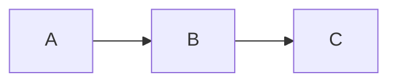

# noir1458 Astro Blog

`noir1458.github.io`를 위한 Astro 정적 블로그입니다. 현재 112개 논리 글과
번역을 포함한 114개 글 경로를 제공하며 `/posts/<slug>/` 주소를 유지합니다.
Markdown, 수식, 검색, 태그, 카테고리, 아카이브와 Giscus 댓글을 지원합니다.

화면은 개인 디자인 저장소의 **Orange Square 0.1.2**를 적용합니다.
따뜻한 흰 바탕·주황색 강조·직각·시스템 서체·구분선으로 글 목록과 본문을
구성하며, 글 목록과 글 본문은 최대 1120px, 본문은 18px·행간 1.85를 사용합니다. 디자인 값의 원본은
`noir1458/orange-square`의 `styles/orange-square/DESIGN.md`
(commit `1ea6d1cd92295d86a587f7dfc1faafc7a1850d02`)입니다.
`src/styles/orange-square-tokens.css`는 그 저장소에서 생성한 값을 그대로 복사한
파일이며 직접 수정하지 않습니다. 블로그 적용 규칙은 `src/styles/orange-square.css`에
있습니다. 기존 기능 스타일은 `legacy` CSS layer에 두어 새 스킨과 연결합니다.
블로그의 초점 표시는 화면을 노란색으로 채우는 대신 테마에 맞춘 외곽선을 사용합니다.
상단의 선택·호버 색상도 방문자가 고른 강조색을 따릅니다.
글 목록은 제목 아래에 카테고리·날짜를 표시하고 요약은 한 줄을 넘으면 생략합니다.
오른쪽에는 썸네일을 두며, 이미지가 없거나 불러오지 못하면 회색 영역을 표시합니다.
카테고리·태그별 목록과 페이지네이션도 사이드바 없이 홈과 같은 너비를 사용합니다.
본문의 H2는 제목 아래에 얇은 구분선을 두며, H2~H6 앞에는 현재 강조색의 `#`를 표시합니다.

> 사이트를 운영할 때 수정하는 영역은 `config/`, `content/`,
> `public/images/` 세 곳뿐입니다.

일반 사용자는 `astro.config.mjs`, `package.json`, `src/**/*.ts`,
`src/**/*.astro`, `src/content.config.ts`, `.github/workflows/deploy.yml`을 수정하지
않아도 사이트 정보, 글, 프로젝트, 이미지와 GitHub Pages 배포를 관리할 수
있습니다.

## 사용자 편집 영역

| 경로 | 용도 |
| --- | --- |
| `config/` | 사이트 정보, 프로필, 메뉴, 카테고리 묶음, 소셜 링크, 기능 켜기/끄기 |
| `content/` | 게시물·프로젝트 Markdown과 각각의 전용 이미지 |
| `public/images/` | 프로필, favicon, manifest, 기본 OG 이미지 |

## 주요 기능

- Astro 정적 빌드와 GitHub Pages 자동 배포
- 안정적인 `/posts/<slug>/` 주소를 사용하는 Markdown 게시물
- 카테고리, 태그, 아카이브, 페이지네이션과 Pagefind 검색
- RSS, sitemap, robots.txt, canonical, Open Graph, JSON-LD
- 한국어·영어·일본어 번역 경로와 `hreflang`
- 다크 모드, 수식, admonition, Mermaid 다이어그램, 코드 하이라이팅, 목차와 Giscus 댓글
- Markdown 한 파일로 관리하는 About / CV와 A4 인쇄 형식

## 기본 설정

`config/README.md`의 순서대로 다음 파일을 수정합니다.

1. `config/site.yaml`: 사이트 URL, 제목, 설명, 언어, 시간대, 작성자, 공용 이미지,
   Analytics·Search Console·Giscus 공개 식별자
2. `config/navigation.yaml`: header, footer 메뉴와 순서
3. `config/social.yaml`: GitHub, LinkedIn, X, Facebook, 이메일 링크
4. `config/features.yaml`: search, RSS, sitemap, dark mode, 목차, Mermaid, 프로젝트, 댓글
5. `config/profile.md`: About / CV의 이름, 연락처, 언어와 단일 본문 Markdown

빈 선택 값은 화면에서 자동으로 숨겨집니다. 메뉴의 `requiresFeature`를 사용하면
기능이 꺼졌을 때 연결된 메뉴도 함께 숨길 수 있습니다. YAML과 Markdown 설정은
빌드 전에 스키마와 파일 경로를 검증합니다.

사이트의 기본 테마와 강조색은 `config/site.yaml`에서 설정합니다. 테마는
`light`·`dark`·`system`, 강조색은 0부터 360 사이의 정수입니다.

```yaml
appearance:
  defaultTheme: system
  accentHue: 0
```

이 블로그의 기본값은 시스템 테마와 `0°`입니다. 강조색 값 18은 Orange Square 원본의
밝은·어두운 주황색을 유지하고, 다른 값은 원본 팔레트의 색상각을 회전합니다.
방문자가 테마와 강조색을 직접 선택하면 해당 브라우저에 저장되며 설정 파일의
기본값보다 우선합니다. `system`은 운영체제의 밝고 어두운 모드를 따릅니다. 이전 스킨의
강조색 기록과 저장 키를 분리해 첫 방문에 새 기본 디자인이 표시됩니다.

사이트 전체 배경 배너는 선택 기능이며 기본값은 꺼짐입니다. 로컬 이미지를 `public/`에 넣은 뒤
`config/site.yaml`에서 활성화하고 표시 방식을 조정합니다.

```yaml
appearance:
  banner:
    enabled: true
    image: /images/site/banner.webp
    position: center
    height: 600
    mobileHeight: 420
    overlayOpacity: 0.18
```

이미지는 공통 layout을 사용하는 모든 페이지의 기존 header와 navigation 뒤에서 viewport
전체 폭을 채우고 현재 light/dark theme 배경으로 자연스럽게 이어집니다. 프로젝트 사이트의
base path도 자동으로 적용됩니다.

```md
---
title: 글 제목
slug: post-slug
publishedAt: '2026-07-25'
categories: blog
math: false
---
```

## 로컬 실행

- Node.js 24 이상
- npm

```bash
nvm use
npm ci
npx playwright install --only-shell chromium
npm run dev
```

로컬 주소는 기본적으로 `http://localhost:4321`입니다.

## 글 쓰기

```bash
npm run new
```

질문에 답하면 `content/posts/<번호-큰분류>/<대표-category>/<slug>/` 아래에
한국어는 `index.md`, 영어는 `en.md`, 일본어는 `ja.md`로 생성됩니다.
기존 카테고리는 해당 큰 분류를 자동으로 재사용하고, 새 카테고리일 때만
큰 분류를 묻습니다. 이 폴더 구조는 소스 정리용입니다. Categories 페이지와
각 카테고리의 글 목록은 게시글의 `categories` 값에서 자동으로 생성되며,
Categories 페이지의 묶음 제목과 표시 순서는 `config/categories.yaml`에서
바꿀 수 있습니다. 이 파일에는 카테고리 URL의 슬러그(예: `linux-systems`)를
입력합니다. 목록에 없는 카테고리는 마지막에 자동으로 표시됩니다.
초안은 기본적으로 `draft: true`입니다.
초안의 카테고리는 비워 둘 수 있습니다. 공개할 때는 `categories`에 하나 이상
지정하고 `draft` 줄을 제거합니다.
글 분류에는 `categories`만 사용합니다. `description`은 선택 사항이며,
생략하면 본문의 첫 번째 유효 문단이 글 목록, 검색, RSS와 SEO 설명으로
자동 사용됩니다. Tags 화면은 호환성을 위해 유지되지만 태그를 지정하지
않으면 비어 있습니다. 카테고리가 하나면 `categories: blog`처럼 한 줄로
쓰고, 여러 개면 YAML 목록 형식을 사용합니다. 빌드 과정에서는 두 형식
모두 항상 문자열 배열로 정규화됩니다.

수식은 Markdown 안에서 다음처럼 작성합니다.

```md
인라인 수식: $E = mc^2$

$$
\int_0^1 x^2\,dx = \frac{1}{3}
$$
```

Mermaid는 별도 컴포넌트 없이 `mermaid` fenced code block으로 작성합니다.
다이어그램 우측 상단의 코드 아이콘(`</>`)을 누르면 화면 중앙의 모달에서 원문을
확인하고 복사할 수 있습니다.

````md

````

글 전용 이미지는 언어 파일과 같은 글 폴더에 둡니다. 본문에서 처음 사용한
로컬 이미지가 글 목록과 공유 메타데이터의 대표 이미지로 자동 선택됩니다.
다른 이미지를 대표로 지정하고 싶을 때만 `cover`를 추가합니다. Astro는
빌드할 때 파일 존재 여부와 이미지 정보를 검사하고 최적화합니다.
글 목록은 대표 로컬 이미지가 없을 때 본문의 외부·공용 이미지도 썸네일로 사용합니다.

```yaml
cover: ./cover.png
```

```md

```

`public/images/`는 여러 페이지에서 공유하는 사용자 교체 이미지에 사용합니다.
프로필 이미지는 `public/images/profile/`, 파비콘·manifest 아이콘·기본 OG 이미지는
`public/images/site/`에 둡니다. 실제 파일 경로는 `config/site.yaml`의
`author.profileImage`와 `branding` 설정에서 지정합니다. 글 전용 이미지는 계속
각 글 폴더에 둡니다.

## 인쇄와 PDF 저장

글을 연 뒤 브라우저의 인쇄 메뉴(`⌘P` / `Ctrl+P`)를 사용합니다. 용지 크기와
배율은 인쇄 창에서 선택할 수 있고, 기본 여백은 18mm입니다. 브라우저가 추가하는
머리글·바닥글은 필요에 따라 인쇄 창에서 끕니다.

인쇄할 때는 탐색 메뉴·댓글 입력창·조작 버튼을 숨기고 제목, 날짜, 작성자, 원문 주소와
본문을 출력합니다. 본문 링크는 빌드 시 중복을 합친 참고 링크 목록으로 만들며,
번호와 목록은 인쇄할 때만 나타납니다. 코드의 배경색을 없애고 긴 줄을 줄바꿈하며,
긴 코드 블록은 여러 페이지로 나눕니다. 본문 이미지와 수식은 유지하고 Mermaid는
밝은 테마로 출력합니다. 접힌 본문은 인쇄 시 펼쳤다가 종료·취소 후 원래 상태로
돌립니다. 기본 인쇄 스타일과 참고 링크는 JavaScript 없이도 적용됩니다.
인쇄에서 화면 밖 이미지가 누락되지 않도록 글 본문의 이미지는 미리 불러옵니다.
따라서 이미지가 많은 글은 초기 전송량이 늘 수 있습니다. 목록 썸네일의 지연 로딩은 유지합니다.

공개 댓글과 답글은 배포 시 GitHub에서 수집해 인쇄용 HTML에 넣습니다. 댓글이 있으면
본문 다음 새 페이지에서 작성자, 작성 시각, 내용, 답글과 원문 주소를 출력합니다.
수집 시각도 함께 남기므로 실시간 화면 댓글과 구분할 수 있습니다. 댓글과 답글은
각각 모든 페이지를 읽으며, 삭제·숨김 처리된 내용은 수집 대상에서 제외합니다.
댓글 HTML은 `rehype-sanitize`로 정리하고, 인쇄용 댓글은 화면과 사이트 검색에서 제외합니다.

GitHub Actions는 댓글/토론 생성·수정·삭제 때 다시 검증하고 배포합니다. 배포가 끝나기
전에는 이전 댓글 사본이 남을 수 있습니다. 숨김 처리 등 이벤트가 없는 관리 작업은
Actions의 수동 실행으로 갱신합니다. 자동 수집이 실패하면 배포를 중단합니다.
별도 서버나 브라우저 토큰은 없으며, 수집 단계에만 `discussions: read` 권한을 사용합니다.
사본은 `.cache/print-comments.json`에 두고 Git 기록에는 저장하지 않습니다.
로컬에서 댓글을 포함해 확인하려면 기존 `gh` 로그인 상태에서 `npm run comments:sync` 후
빌드합니다. 사본 없이 빌드하면 인쇄물에 미수집 안내와 원문 링크를 표시합니다.
PR 검증은 댓글 수집 없이 실행되며 실제 배포는 항상 새로 수집합니다.

유지보수 파일은 `src/styles/print.css`, `src/lib/markdown/rehypePrint.ts`,
`src/scripts/print.ts`, `src/components/PrintComments.astro`,
`scripts/sync-print-comments.mjs`입니다. 긴 코드, 수식, 표, 이미지, 댓글·답글이 있는 글을 A4와 Letter에서
확인하고, 밝은·어두운 테마 모두 PDF로 점검합니다. 수식·표가 용지 폭보다 넓으면
내용 자체의 분할 또는 가로 방향 인쇄가 필요할 수 있습니다.

## About / CV 작성과 PDF 저장

`config/profile.md` 한 파일이 About 아래쪽 문서 영역과 인쇄용 CV의 원본입니다.
상단에는 기존 프로필 사진, 사이트 표시 이름과 소셜 아이콘 링크를 유지합니다.
이 상단 프로필은 인쇄에서 제외되고, 아래쪽 실명·텍스트 연락처·문서 본문만 출력됩니다.
기존 LaTeX CV의 항목과 문구를 이 파일로 옮겼으며, 앞으로 이력은 이곳에서 수정합니다.
화면과 인쇄를 위한 본문을 따로 작성하지 않습니다.

파일 위쪽의 `name`, `email`, `eyebrow`, `language`로 이름, 연락처, 문서 종류와 언어를
정합니다. `name`을 비워두면 사이트 표시 이름을, `email`을 비워두면 `social.yaml`의
이메일을 사용합니다. `subtitle`은 선택 항목입니다. `language`를 생략하면 사이트
기본 언어를 사용하고, 입력할 때는 `site.yaml`에 등록된 언어 코드여야 합니다.
상단 소셜 아이콘 링크는 `social.yaml`에서 가져옵니다. 아래쪽 CV 연락처에는
이메일과 GitHub만 표시합니다. 이메일은 설정 파일에 원래 주소로 입력하고,
화면과 인쇄에서는 `@` 대신 `(at)`으로 표시합니다.

본문은 일반 Markdown입니다. `##`는 섹션, `###`는 기관·프로젝트 등 개별 항목이며,
소제목 끝의 기울임꼴은 기간을 나타냅니다. 예를 들어:

```md
## Education

### University *Mar 2024 - Feb 2027 (Expected)*

Degree · GPA

## Projects

### Project name *Jan 2026 - Apr 2026*

- 본인이 맡은 역할과 구현 내용
- 직접 확인한 결과

[Repository](https://github.com/username/project)
```

About의 **CV · PDF 저장** 버튼 또는 Ctrl+P / ⌘P를 누르면 같은 내용을 A4 문서로
인쇄합니다. 화면에서는 여유 있게 표시하고, 인쇄에서는 메뉴·버튼을 숨기며 간격을 줄입니다.
인쇄 설정에서 **PDF로 저장**을 선택하고 브라우저 머리글·바닥글을 끄면 됩니다.
내용이 늘어나면 여러 페이지로 이어집니다. 모든 이력과 연락처는 공개됩니다.

기존 글을 인쇄할 때는 상단 글 정보에 모든 카테고리도 함께 출력합니다.

## 프로젝트

About의 `## Projects` 아래에 프로젝트 요약과
저장소·관련 글 링크를 작성합니다. Non-PQC 프로젝트를 맨 위에 두고 다른 프로젝트를
그 아래에 이어 작성합니다. 구현 과정이나 회고는 일반 글처럼 `content/posts/`에
작성하고 `categories: [project]`를 지정하면 됩니다. 카테고리는 공개 글이 생기면
자동으로 생성됩니다.

전용 Projects 목록·상세 페이지는 `config/features.yaml`의 `projects: false`로
비활성화되어 있고 상단 메뉴에서도 제거되어 있습니다.

## 글 언어와 번역본

지원 언어는 한국어(`ko`), 영어(`en`), 일본어(`ja`)입니다. 기존 글처럼
`lang`을 생략하면 한국어로 처리되므로 기존 `index.md`와 공개 URL은 바뀌지
않습니다.

```yaml
---
title: 한국어 글
slug: sample-post
publishedAt: '2026-08-02'
categories: blog
---
```

파일명은 언어 슬롯을 나타냅니다. 한국어는 기존 호환성을 위해 `index.md`,
영어는 `en.md`, 일본어는 `ja.md`를 사용합니다. `npm run new`에서 처음 작성할
언어를 선택하면 해당 파일을 생성합니다.

```yaml
---
title: An English Post
slug: english-post
translationKey: english-post
lang: en
publishedAt: '2026-08-02'
categories: blog
---
```

번역본은 원문과 이미지 폴더를 공유하도록 같은 글 폴더에 언어 코드 파일로
추가합니다. 원문과 모든 번역본은 같은 `slug`와 논리적 번역 식별자를
사용해야 합니다.

```text
content/posts/00.blog/blog/sample-post/
├── index.md  # 한국어, lang 생략 시 ko
├── en.md     # 영어, lang: en
├── ja.md     # 일본어, lang: ja
└── diagram.png
```

```yaml
---
title: English Translation
slug: sample-post
translationKey: sample-post
lang: en
publishedAt: '2026-08-02'
categories: blog
---
```

처음 작성한 언어 파일에 `translationKey`가 있으면 다른 언어 파일도 같은 값을
사용합니다. 생략한 경우에는 `slug`가 논리적 글 식별자가 됩니다. 어느 언어를
먼저 작성했는지는 라우팅에 영향을 주지 않습니다. 한국어 기본 글은 `/posts/<slug>/`, 영어는
`/en/posts/<slug>/`, 일본어는 `/ja/posts/<slug>/`에 생성됩니다. 실제 번역본이
두 개 이상 있는 글에서만 우상단 테마 버튼 왼쪽에 언어 선택기가 나타나며,
존재하지 않는 번역 언어는 표시하지 않습니다.

### Codex로 글 번역하기

글을 완성한 뒤 Codex에 다음처럼 요청합니다.

> 이 글 블로그 번역 스크립트대로 번역해줘:
> `content/posts/.../글-slug/ja.md`

Codex는 지정한 파일을 원문으로 보고 현재 폴더에 없는 나머지 두 언어 슬롯을
바로 생성합니다. 예를 들어 `ja.md`로 시작했다면 `index.md`와 `en.md`를
만듭니다. 작업 전에 원문 해시를 기록하고, 생성 후 코드 블록·인라인 코드·
수식·링크·이미지 경로·front matter와 원문 해시를 검사합니다. 이어서 전체
`npm run check`를 실행하고 번역 diff와 로컬 확인 URL을 알려줍니다.

이 과정은 번역 파일을 커밋 직전 상태까지 준비하지만 `git add`, 커밋, push,
배포는 실행하지 않습니다. 안내받은 한국어·영어·일본어 페이지를 로컬에서 직접
읽어본 다음 사용자가 커밋합니다. 기존 번역 파일은 사용자가 갱신을 명시적으로
요청하지 않는 한 덮어쓰지 않습니다.

수동으로 안전 검사를 실행할 때는 먼저 원문 해시를 얻고, 번역 후 그 값을 다시
전달합니다.

```bash
npm run translate:snapshot -- content/posts/.../ja.md
npm run translate:verify -- content/posts/.../ja.md --source-hash <출력된 해시>
npm run check
```

각 언어 페이지는 자기 URL을 canonical로 사용하고 `html lang`, Open Graph,
Twitter, JSON-LD `inLanguage`, Pagefind 색인 언어를 해당 글에 맞게 생성합니다.
같은 글의 페이지들은 `hreflang`과 `x-default`로 서로 연결됩니다. 사이트맵은
Astro가 생성된 언어별 URL을 자동으로 포함합니다.

기본 홈페이지·카테고리·아카이브와 `/rss.xml`은 기존 동작을 보존하기 위해
한국어 글만 표시합니다. 번역 페이지는 언어별 Pagefind 색인에 포함됩니다.
Giscus는 기존 댓글을 보존하기 위해 pathname 매핑을 유지하므로 번역 URL의
댓글은 한국어 원문과 분리됩니다.

지원 언어를 늘릴 때는 `config/site.yaml`의 `languages`에 언어 코드, 표시 이름,
locale, OG locale, URL prefix를 추가합니다. 라우트와 콘텐츠 스키마는 이 설정을
공통으로 사용합니다. 기본 언어만 `index.md`를 사용하고 다른 언어 파일명은 언어
코드와 같아야 합니다.

## 검사

```bash
npm run check
```

다음을 한 번에 검사합니다.

- front matter, 언어별 중복 slug와 지원하지 않는 lang
- 언어 파일명, 번역본 중복, translationKey·slug와 draft 상태 불일치
- 로컬 이미지 누락
- Astro/TypeScript
- 프로덕션 빌드와 Pagefind 색인
- 생성된 내부 링크, 언어별 페이지와 상호 hreflang
- canonical, html lang과 기본 Open Graph 이미지
- RSS, sitemap, search, archive, 404와 게시물 페이지
- 공개 게시물 URL 기준선 114개

## 배포

최초 한 번 GitHub 저장소의 **Settings → Pages → Build and deployment →
Source**를 **GitHub Actions**로 설정합니다. 그다음 `config/site.yaml`의
`site.url`이 실제 공개 주소인지 확인하고 `main`에 push합니다.

`.github/workflows/deploy.yml`은 다음을 자동으로 수행합니다.

- pull request: 읽기 전용 권한으로 `npm ci`와 전체 `npm run check`
- `main` push 또는 수동 실행: 같은 검증 후 Pages artifact 생성과 배포
- deploy job만 `pages: write`와 `id-token: write` 사용
- 모든 외부 GitHub Action을 전체 commit SHA로 고정

```bash
npm run publish
git add .
git commit -m "feat: rebuild blog with Astro"
git push origin main
```

`npm run publish`는 실제 push를 실행하지 않고 검사와 명령 안내만 합니다.

배포가 시작되지 않으면 Pages Source가 **GitHub Actions**인지, Actions 탭에서
workflow 실행이 허용됐는지, 기본 브랜치가 `main`인지 확인합니다. URL이 잘못된
경우 `config/site.yaml`만 고친 뒤 다시 push합니다.

## 커스텀 도메인

1. `config/site.yaml`의 `site.url`을 `https://example.com`처럼 실제 도메인으로
   변경하고 push합니다.
2. GitHub 저장소의 **Settings → Pages → Custom domain**에 같은 도메인을
   저장합니다.
3. DNS 제공자에서 subdomain은 `<username>.github.io`를 향하는 `CNAME`, apex
   domain은 GitHub가 안내하는 `A`/`AAAA` 또는 `ALIAS`/`ANAME` 레코드를
   설정합니다.
4. DNS 적용 후 **Enforce HTTPS**를 켭니다.

GitHub Actions 방식에서는 저장소의 `CNAME` 파일이 필요하지 않습니다. 도메인
탈취를 막기 위해 계정의 Pages 설정에서 도메인을 검증하고 wildcard DNS는
사용하지 않는 것을 권장합니다. 자세한 절차는
[GitHub Pages custom domain 문서](https://docs.github.com/en/pages/configuring-a-custom-domain-for-your-github-pages-site/managing-a-custom-domain-for-your-github-pages-site)를
따릅니다.

## 설정 오류 해결

- `config/*.yaml` 오류: 메시지에 표시된 파일과 필드의 들여쓰기·필수값을 확인
- `site.url` 오류: `https://`를 포함한 전체 공개 URL 사용
- `public asset does not exist`: `config/site.yaml`의 이미지 경로와
  `public/images/`의 실제 파일명 일치 여부 확인
- 게시물 날짜 오류: `publishedAt: 'YYYY-MM-DD'` 형식 사용
- 중복 slug 오류: 같은 언어의 게시물마다 고유한 `slug` 사용
- 빈 프로젝트 경고: `content/projects/`가 비어 있고 projects 기능이 꺼진 운영
  블로그에서는 정상이며 build 실패가 아님

문제를 고친 뒤 `npm run check`를 다시 실행하면 설정, 콘텐츠, 타입, production
build, 링크와 기능 플래그를 한 번에 재검증합니다.

## 공개 설정과 비밀값

`config/`에는 브라우저에 공개되어도 되는 값만 둡니다. Analytics 측정 ID,
Search Console verification 문자열, Giscus repository/category ID는 공개
클라이언트 설정입니다. API token, 비밀번호, private key 같은 비밀값은 절대
`config/`, Markdown 또는 `.env.example`에 실제 값으로 커밋하지 않습니다.
향후 비밀값이 필요한 자동화를 추가할 때는 GitHub Actions Secrets와 환경변수를
사용합니다.

## 주요 경로

- `content/posts/<ordered-group>/<category>/<slug>/` — Markdown 글과 글 전용 이미지
- `content/projects/` — 비활성화된 전용 프로젝트 기능의 콘텐츠 위치
- `config/` — 사이트, 내비게이션, 소셜 링크와 기능 설정
- `public/images/` — 프로필, favicon과 기본 OG 이미지
- `src/components/` — 공통 UI
- `src/layouts/` — HTML/SEO 레이아웃
- `src/pages/` — 정적 페이지와 동적 경로
- `src/styles/orange-square.css` — Orange Square 스킨과 반응형 적용 규칙
- `src/styles/orange-square-tokens.css` — 디자인 저장소에서 복사한 원본 토큰
- `src/styles/global.css` — 기존 기능의 기반 스타일 (`legacy` layer)
- `scripts/` — 새 글·번역·검증·배포 안내
- `tests/baselines/published-post-routes.txt` — 공개 게시물 URL 보존 기준선

## 고급 사용자와 라이선스

레이아웃이나 기능 자체를 바꾸려는 고급 사용자만 `src/`와 내부 Astro 설정을
수정합니다. 일반적인 사이트 운영에는 해당 변경이 필요하지 않습니다.

현재 개인 블로그 저장소의 코드와 콘텐츠에는 별도 재사용 라이선스가 지정되어
있지 않습니다. 공개용 `astro_blog_template` 저장소는 MIT 라이선스를 사용하며,
이 개인 블로그의 실제 글과 이미지는 템플릿에 포함하지 않습니다.
