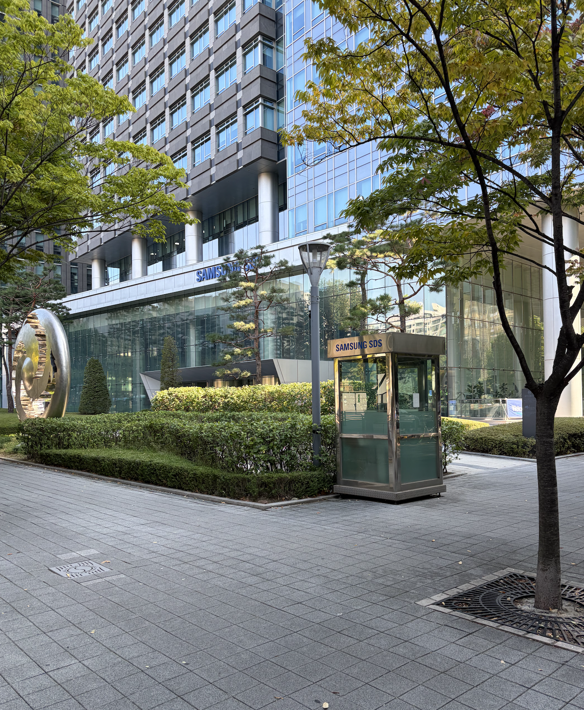
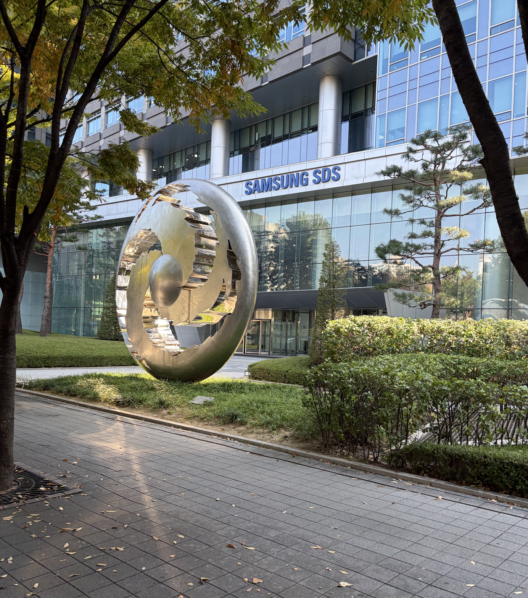
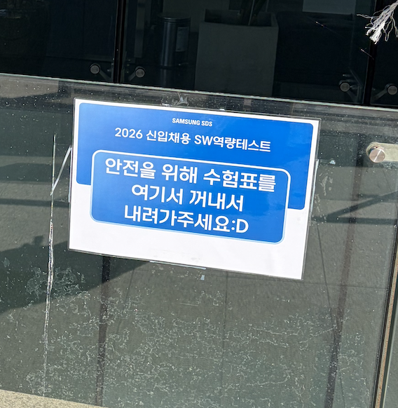
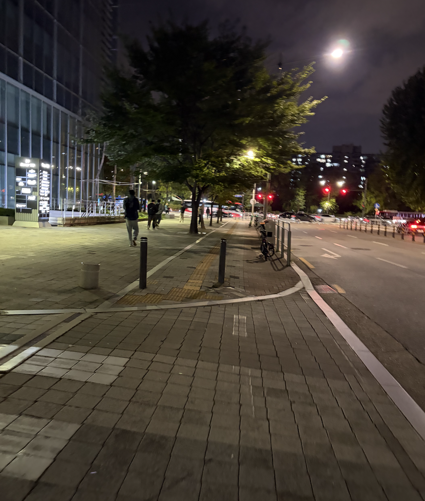

## 삼성 SDS 코딩테스트 후기

9월 한달동안 여러 기업에 서류 지원을 했었고, 삼성 sds에 서류합격을 해서 코딩테스트를 볼 수 있었다.

자주 가는 장소 근처에 있었는데 이정도로 가까운줄은 몰랐다. 

이런곳에서 일할수 있다면 정말정말 좋겠다...

그런 생각을 하면서 근처를 걸어다니면서 컨디션관리를 했었다.

건물 옆 계단쪽으로 가다가 코딩테스트 장소를 발견했다. 내가 갔을때 취준생 나이대의 사람이 많이 걸어다니며 오전 코딩테스트 이야기를 하거나 전화로 지인과 이야기를 하고 있었는데, 오전에 코딩테스트를 치른 사람으로 생각된다. 나는 오후반이었고. 입장시간 전까지 계단 근처 카페에서 기다렸다.

4시간의 코딩테스트를 치르고 세상이 까맣게 변해버린 모습.

개인적인 고민이 많았고, 대학원 진학을 일단 생각하면서도 지원을 넣었었는데, 이런 기업에 코딩테스트를 치를수 있었다는데 너무나도 감사하게 생각한다.

사실 삼성 구현문제는 이전의 삼성 알고리즘 캠프에 지원하고, 준비하면서 풀어본적이 있었다. 이제는 더이상 열리지 않는 교육인것 같고, 코딩테스트 준비를 하면서도 이런걸 해야하나? 의문을 갖는 사람이 많지만...

AI 영향일지도 모르고, 이전에 본 문제에 비해 시험치른 문제가 더 어렵다거나 그런 느낌은 없었는데, 준비가 많이 된 상태는 아니었다보니 1문제를 붙잡고 매달리고, 작동하는것을 확인은 했는데 테스트값 일부 값이 이상한걸 시험 끝나기 1시간 전쯤 확인해서 그거를 남은시간동안 고치다가 나온것 같다.

SSAFY 코테를 이전에 한번 보기만 하고 이후 전형에는 안갔던 기억이 있는데, 당시에는 파이참으로 코테를 보면서 AI 기능 켜져있는지 확인도 안하고 조금 어수선한 분위기에서 코딩테스트 치뤄서 별로 안좋아했었는데... 파이썬 디버깅은 코테하면서 여러번 해봤었지만, 디버깅할때 어떤 방법을 더 알았으면 싶은 순간도 있었고 조금 더 익숙했고 조금 더 많이 해봤으면 어땠을까 싶은 생각을 하면서 시험장에서 나왔다.

시험을 치른지 한달정도 지나서 남기는 후기 글이지만... 그냥 그랬었다.

시험장 분위기는 매우 친절했고, 자리마다 노트북이 하나씩 놓여있었는데, 내 노트북 상태가 유난히 안좋아서 시험 1시간 전쯤에 종료되는 일이 있기도 했다. 구현 문제 특성상 루프를 많이 돌리다보니 가끔 발생하는 일인것 같다. 처음 안내때 이야기를 해주기도 하고 저장하면서 구현했었기에 문제는 없었다.

## 삼성 외에 여러 기업에 서류지원을 했었는데

중간고사 기간과 겹치기도 하고 대학원 지원 기간과 겹치기도 하고, 취사선택을 잘 하지 않으면 문제가 생길수도 있겠다 싶어서 서류합격한 공기업 2개는 필기에 결시를 했다.

자격증 커트라인만 넘으면 합격을 시켜주는것으로 생각되고, 자소서도 나름 신경을 썼었기에 합격한 기업의 경우 어떻게 자소서를 작성해서 어떤 부분이 좋게 보였나 이런 생각을 하면서 정리를 해보기도 했다.

KT인프라, 삼성 SDS, 도로공사(적/부), 한국산업기술시험원, 대한항공 정보보안... 기억나는 기업은 이정도인데 

제일 스트레스받았던건 금융권 은행 등 지원하고 서합하는 과정에서 답답했는데, 일단 왜 떨어지는지 잘 이유를 모르기도 했고, 서류 지원하면서 모든 사람이 AI 역검을 봐야했던게 정말 스트레스가 컸었다. 이런 기업들은 인턴 지원할때도 조금 심하다는 생각을 많이 했었다.

지원을 하면서 개발직, 정보보호직 등 여러군데로 분산해서 지원을 했었다.

일단 내가 개발에 흥미를 많이 잃어버러기도 했었고, 더 미래가 있다는 생각이 안들어서 그렇게 했다.

나이가 늦은걸 감안하면 많이 서합했다고 봐야하나? 기업입장에서 나와 같은 스펙을 어떻게 보고 어떻게 생각하는지 궁금하긴 하다. 별 생각이 없으려나 그냥 몰려드는 사람들 상대로 적당히 기준잡고 엑셀컷 하기에 바쁘려나...

정확한지 모르겠는데 서합률은 11.9% 라고 서류지원 기록에 남아있다. 9월 이후 대학원지원, 중간고사 대비 기간부터는 새로 지원하는걸 멈췄다.

9월중에는 멘탈적으로 너무 흔들려서 지원하면서 AI를 많이 사용하기는 했었다. 캡스톤하면서 gpt pro 결제한것을 그 당시에는 이런짓까지 해야하나 생각을 했었는데, 돌이켜보면 프로젝트 외적으로도 토큰을 잘 털어내면서 유용하게 썼다.

취업지원 관련 중간회고는 여기까지