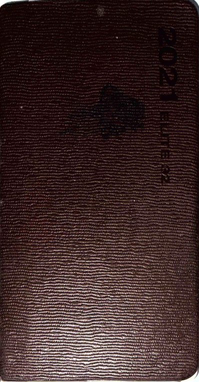

## 오래된 다이어리를 정리하며

몇년 전에 들고다니면서 썼던 다이어리를 정리했다. 모든 페이지를 스캔해서 찍어두고 정리했었다.

나는 군 생활을 학은제 수업때문에 한번 미뤄서 늦게 갔었다. 이게 정상적인 상태에서 했던 선택이 아니라 자존감이 너무 낮고 엉망이라서 지금은 그냥 생활 사이클을 유지하면서 살아야겠다는 판단에 그렇게 했었다.

그러다가 갑자기 가야겠다는 생각이 들어서 갔었다. 안에서 항상 이 노트를 무릎 주머니에 넣고 다녔었다. 심심할때는 낙서도 하고.. 그냥 공부하고 일하고 하는 중간에 계속 생각나는 이야기를 여기에 덜어냈었다.

왜 스스로 뭔가 해낼수 있는게 없고 이미 엉망인 상태에서 생활 사이클과 조금만 환경이 바뀌어도 뭔가 무너질것처럼 생각이 들고 겁이 많았던건지...

젊음을 수 없이 흩뿌리며 살던 그런 사람들...

나는 지금도 젊은 사람에게 젊음은 너무나도 아깝다는 이야기에 동의한다.

예전과 다른 세상이지만 오래된 사고가 남아있는 사람들. 꽤 많은 여자들은 너무나도 자신을 소중하게 느껴서 힘들어하고, 꽤 많은 남성들은 너무나도 자신이 가진것도 없고 보잘것 없어서 고통스러워한다.

직설적으로 말은 안하지만... 나는 타인의 사고방식을 보면 놀랍다는 생각을 자주 한다.

중학생때 책 읽기를 좋아하던 한 여자아이를 떠올린다. 신경숙 작가의 책을 읽던 그 학생은, 이 작가가 표절작가라고 기사가 나왔을때 무슨 생각을 했을까.

거짓말로 가득한 국가. 어떤 사상이나 문학, 예술 심지어 여러 사람들이 관심을 갖는 어떤 이야기들까지도

옛날의 위대한 과학자들은 그 시대의 기술로 설명할수 없는 것들은 신의 작품이라고 여겼다고 한다.

나는... 나는 지금 이 국가에서 일어나는 일들과 타인의 사고를 지켜보며. 어떤 생각의 집합을 지켜보면서 이게 신의 작품이라고 여긴다.

어린 시절 너무나도 답답한 상황에 있을때 나는 집 앞에 성당에 내 발로 주말마다 찾아가고, 도서관에 가는 길에 항상 성모상 앞에서 기도를 드렸었다.

그렇지만 그런것보다도. 나는 지금 시대의 사람들의 생각을 보면서 신이 있을지도 모른다고 오히려 느끼게 된다.

나는 신을 더이상 믿지 않고. 신이 나를 싫어할지도 모른다고 생각하지만. 그 시절도 지금도 나는 신이 무엇인지 모르지만. 어린 시절 내가 간절하게 부탁하던 가짜 신이 아닌 지금 이 순간 나는 내 눈앞에 악의를 가진 신이 있다고 느낀다.

내가 엉망이 된 내 인생을 보면서 괴로워할때 스스로의 몸을 엉망으로 치장하며 현실에 있는지도 없는지도 모르는 사람에게 현실에 없는 사람의 모습을 만들어내서 보이면서도...

그러면서도 자기파괴적인 성향을 가진 그 사람들이 스스로의 인생을 망가뜨리다가 점점 젊음을 잃어가는것을 보던 그 순간에...

그 시절 그 사람들이 타인을 조롱하며 살았는지, 약에 취해서 살았는지 나는 모르지만 그 순간에도 신이 있다고 느꼈었다. 그리고 그 사람에게서 신이 빠져나간것처럼.

어쩌면 단순히 젊음이 빠져나간게 아니라 영혼이 빠져나간것일지도 모른다.

나는 단 한번도 젊은 인생을 살아본적이 없었기에 그 사람의 기분은 모른다.

돌이켜보면 어린아이와 늙은 사람의 사이에서 오가면서... 스스로를 붙들고 뭔가 해보려고 항상 노력했던것 같다.

그렇게 해서... 지금 이렇게 살고있다. 신이 존재하는지, 죽었는지 살았는지 나는 모른다.