메모리가 남아 있는데도 큰 메모리 요청이 실패할 수 있다. 남은 양뿐 아니라 **어느 node와 zone에 있는지, 어떤 크기의 연속 블록으로 남았는지**가 중요하기 때문이다. 메모리 관리를 하드웨어의 접근 거리에서 시작해 커널의 할당 단위까지 내려가며 살펴본다.

## 1. Memory hierarchy

*강의 2쪽*

CPU 가까이에 빠르고 작은 저장 공간을 두고, 아래로 갈수록 크고 상대적으로 느린 공간을 둔다.

| 계층 | 역할·특징 |
|---|---|
| Register | CPU 연산이 직접 사용하는 아주 작은 저장 공간 |
| L1·L2·L3 cache | 자주 접근하는 데이터를 CPU 가까이에 보관 |
| DRAM | 실행 중인 프로그램과 커널이 사용하는 주 메모리 |
| SSD·HDD | 큰 용량의 지속적 저장 공간 |

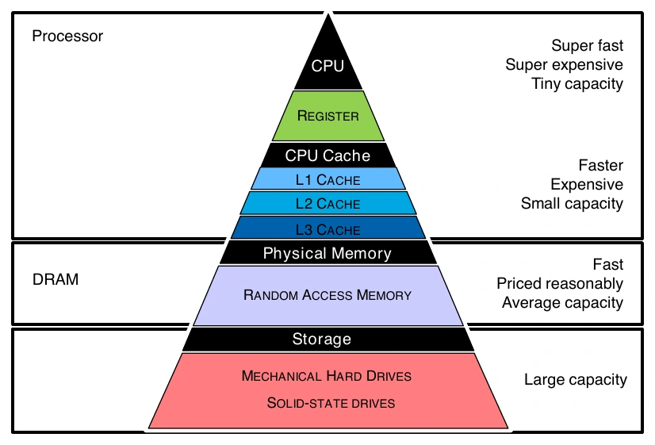

일반적으로 위쪽은 빠르고 비트당 비용이 높으며 용량이 작다. 아래쪽은 용량이 크지만 접근 지연이 길다. DRAM은 전원이 사라지면 내용을 유지하지 못하는 volatile memory다.

필기의 LLC는 **Last-Level Cache**, 즉 메모리에 도달하기 전 마지막 캐시 계층을 뜻한다. 항상 특정 코어에 독립적이거나 항상 L3라고 고정하는 대신 해당 CPU의 구조를 확인해야 한다.

메모리 계층은 가까운 위치의 데이터를 반복해서 사용하는 지역성을 활용한다. 같은 배열 구간을 여러 번 처리할 때 필요한 값이 가까운 캐시에 남아 있으면 DRAM까지 접근하는 횟수를 줄일 수 있다. 다만 CPU의 하드웨어 캐시와 앞서 배운 page cache는 다른 층이다. Page cache는 파일 데이터를 RAM에 보관하는 커널 관리 대상이며, 그 RAM에 접근할 때도 CPU 캐시 계층이 관여할 수 있다.

## 2. Shared memory와 UMA

*강의 3~5쪽*

Shared-memory 시스템에서는 여러 CPU·코어가 시스템 메모리에 접근할 수 있다. 공유한다고 해서 모든 위치까지의 접근 비용이 같은 것은 아니다.

**UMA(Uniform Memory Access)** 는 어느 참여 CPU에서 어느 메모리 위치를 접근하든 대체로 균일한 비용을 갖는 모델이다. 강의는 하나의 메모리 버스를 공유하는 그림으로 설명한다.

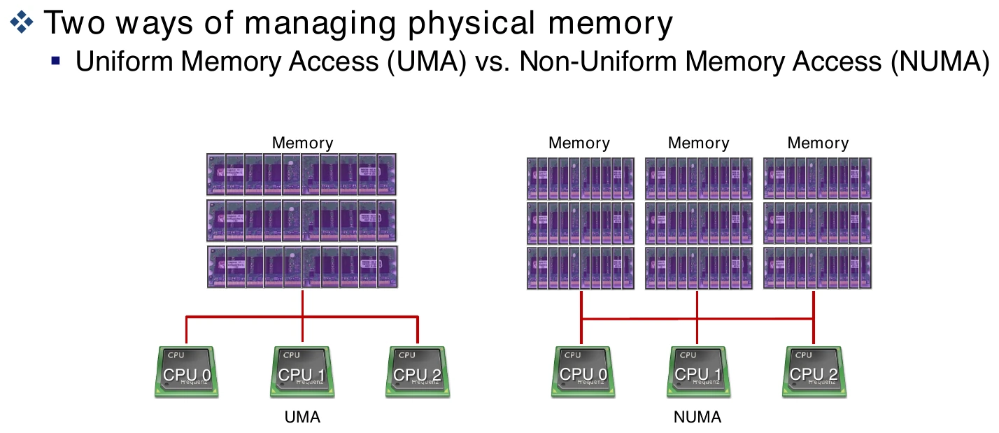

공통 통로에 CPU가 계속 추가되면 요청이 몰려 대역폭 병목이 생긴다. 필기의 “CPU를 늘리면 같은 버스가 포화된다”는 설명은 이 확장성 문제를 가리킨다. 실제 모든 UMA 구현이 문자 그대로 단일 버스 하나라는 뜻은 아니다.

## 3. NUMA: 물리적 분산, 논리적 공유

*강의 6~7쪽*

NUMA(Non-Uniform Memory Access)는 메모리가 물리적으로 분산되어 있고, 어느 CPU에서 어느 메모리를 접근하느냐에 따라 지연·대역폭이 달라진다.

- **Local access**: 가까운 node의 메모리에 접근.
- **Remote access**: interconnect를 거쳐 다른 node의 메모리에 접근.

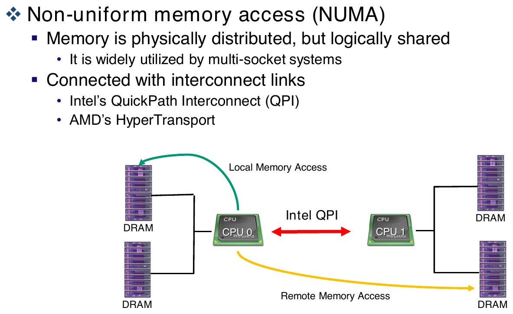

원격 메모리도 주소 공간상 접근 가능하지만 통신 비용이 더 들 수 있다. 같은 코드를 실행해도 데이터 배치와 태스크가 실행되는 CPU에 따라 성능이 달라지는 이유다. 강의는 interconnect의 예로 Intel QPI와 AMD HyperTransport를 든다.

Node 0의 메모리를 주로 사용하는 태스크가 node 1의 CPU로 이동했다고 생각해 보자. 데이터가 그대로 node 0에 남아 있다면 주소의 의미는 유지되지만 접근은 remote가 될 수 있다. 그래서 CPU 부하만 고르게 나누는 결정과 메모리 접근 거리를 줄이는 결정이 항상 일치하지는 않는다. 스케줄링과 메모리 배치를 함께 보는 이유다.

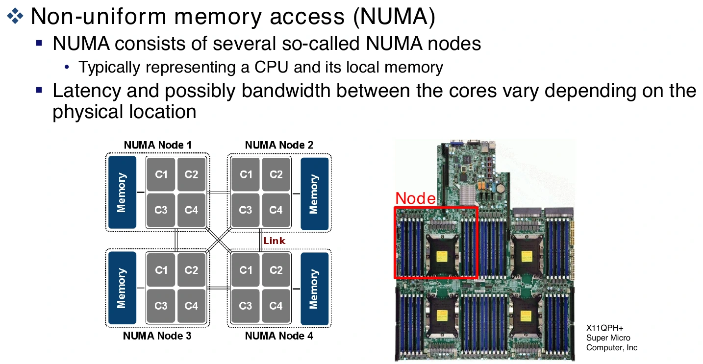

**Core, CPU socket, NUMA node는 항상 1:1이 아니다.** 필기에는 설명을 단순화해 CPU=node=socket으로 연결한 부분이 있지만, 실제 구성에서는 한 소켓이 여러 NUMA node로 나뉘거나 CPU 없는 메모리 node가 있을 수 있다. Node는 메모리 접근 특성을 나타내는 관리 단위로 이해하는 편이 정확하다. [Linux physical memory 문서](https://docs.kernel.org/mm/physical_memory.html)

## 4. Node → Zone → Page

*강의 8~9쪽*

```text
시스템 메모리
  └─ NUMA node: 접근 위치·거리의 단위
       └─ zone: 주소 범위·용도 제약에 따른 구분
            └─ page frame: 고정 크기 물리 메모리 단위
```

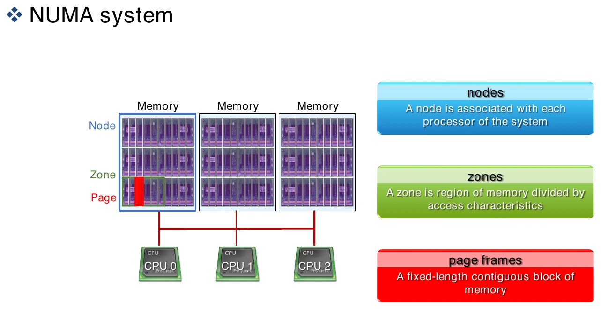

**Page**는 가상 메모리 문맥에서도 쓰이는 단위이고, **page frame**은 물리 메모리의 해당 크기 블록을 가리킨다. 기본 page 크기는 아키텍처와 설정에 따라 다르며, 수업 계산에서는 4KiB를 주로 가정한다.

Zone은 물리 메모리를 접근 제한이나 운영 특성에 따라 묶은 것이다. 각 zone은 자체 buddy 할당 정보와 watermark를 가진다. 그림의 node당 8GiB zone 두 개는 구조 설명용 예이며 모든 시스템의 고정 분할은 아니다.

이 계층은 같은 메모리를 세 번 따로 확보한다는 뜻이 아니다. 물리 페이지가 어느 node에 속하는지, 그 안에서 어느 zone의 조건을 따르는지 정하고 그 페이지들을 블록으로 관리한다. 요청이 왔을 때 node는 주로 위치와 거리, zone은 사용할 수 있는 주소 범위 등의 제약, order는 필요한 연속 크기를 판단하는 축이 된다.

### 페이지 크기의 trade-off

작은 단위는 작은 요청을 세밀하게 배치할 수 있지만 더 많은 페이지를 추적해야 한다. 큰 단위는 큰 연속 영역을 표현하고 주소 변환 비용을 줄이는 데 유리할 수 있지만, 연속 메모리 확보와 내부 낭비 문제가 커진다.

필기에서 강조한 것은 **메타데이터도 메모리를 소비한다**는 점이다. `struct page` 같은 관리 정보가 공짜로 존재하는 것은 아니다. 다만 huge page를 쓴다고 모든 기본 page의 `struct page`가 항상 사라지는 것은 아니며, 메타데이터 절감은 구현과 최적화에 따라 다르다.

Huge page의 매핑 크기와 buddy allocator의 여러 페이지 연속 할당도 구분한다. 4KiB 페이지 512개를 연속으로 확보한 것과 그것을 하나의 2MiB huge-page 매핑으로 사용하는 것은 같은 단계의 일이 아니다.

## 5. Node 관리: pg_data_t

*강의 10쪽*

Linux는 node를 `struct pglist_data`, typedef 이름으로 `pg_data_t`로 관리한다.

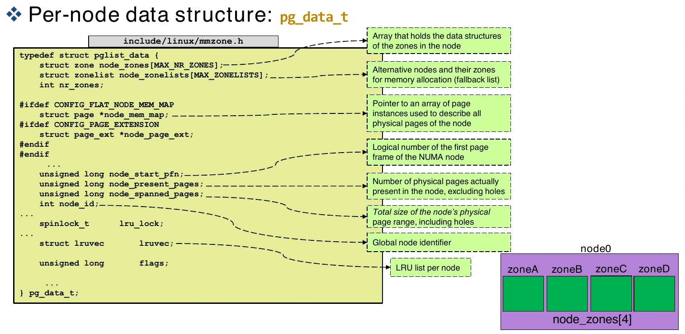

| 필드 | 의미 |
|---|---|
| `node_zones` | 이 node가 가진 zone 구조체 배열 |
| `node_zonelists` | 할당 시 탐색할 zone들의 순서 |
| `nr_zones` | 관리하는 zone 수 |
| `node_mem_map` | 해당 구성에서 물리 page를 설명하는 배열 포인터 |
| `node_start_pfn` | node의 시작 page frame number |
| `node_present_pages` | 실제 존재하는 물리 페이지 수, hole 제외 |
| `node_spanned_pages` | 주소 범위가 걸치는 페이지 수, hole 포함 |
| `node_id` | node 식별자 |
| `lruvec`, 관련 lock | 회수 후보·활성도 정보를 관리하는 구조 |

예를 들어 주소 범위가 1024개 페이지를 덮지만 그 사이 128개가 실제 RAM이 아닌 hole이면 spanned는 1024, present는 896일 수 있다. 같은 “메모리 크기”처럼 보여도 세는 대상이 다르다.

PFN은 물리 페이지 프레임의 번호다. 페이지 크기가 P이면 개념적으로 `PFN = 물리주소 / P`로 프레임을 식별한다. `node_start_pfn`을 바이트 주소와 혼동하지 않는다.

### LRU와 필기의 hot·cold

최근에 사용한 페이지와 한동안 사용하지 않은 페이지를 구분하면 회수 대상을 고를 때 유리하다. 필기의 hot·cold와 LRU는 이런 접근 이력을 설명한다.

다만 LRU를 “항상 완벽한 최근 접근 순서로 전역 정렬된 하나의 리스트”라고 이해하면 과도한 단순화다. 실제 커널의 회수 정책과 자료구조는 버전·설정에 따라 다르다. 또한 **할당할 free page 목록과 이미 사용 중인 회수 후보 목록은 목적이 다르다.**

필기의 코어별 관리 아이디어는 동기화 비용과 전역적으로 정확한 순서 사이의 trade-off로 볼 수 있다. 공유 락 경쟁을 줄이는 대신 전체 상태를 합치고 비교하는 문제가 남는다.

## 6. Zone 종류와 DMA

*강의 12쪽*

장치마다 DMA로 접근할 수 있는 주소 범위가 다를 수 있다. DMA는 CPU가 데이터를 매번 직접 복사하는 대신 장치가 메모리 전송을 수행하게 하는 방식이며, 설정·완료 처리까지 CPU가 전혀 관여하지 않는다는 뜻은 아니다.

강의는 x86 계열의 전형적인 경계를 사용한다.

| Zone | 설명용 주소 제약 | 예 |
|---|---|---|
| `ZONE_DMA` | 낮은 16MiB 영역 | 24비트 주소 제약의 구형 ISA 장치 |
| `ZONE_DMA32` | 4GiB 아래 | 32비트 DMA 주소 제약 |
| `ZONE_NORMAL` | 일반적으로 직접 주소 지정 가능한 메모리 | 일반 커널 할당 |

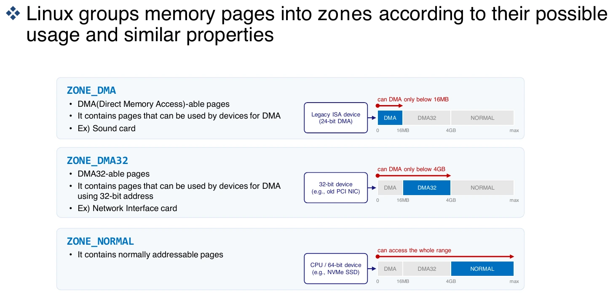

이 경계와 zone의 존재 여부는 아키텍처·설정에 따라 다르다. 32비트 시스템의 `ZONE_HIGHMEM`, 이동 가능한 메모리를 위한 `ZONE_MOVABLE` 등도 있으므로 그림의 세 종류가 모든 구성의 전부는 아니다.

필기의 “요즘 DMA 영역을 쓰지 않는다”는 표현은 특정 실습 환경의 오래된 주소 제약이 두드러지지 않는다는 맥락으로 읽어야 한다. **DMA 기술 자체는 현대 장치에서도 사용한다.** DMA32·DMA zone의 필요성 역시 실제 장치와 주소 변환·할당 조건에 달려 있다.

## 7. Zone 구조와 Watermark

*강의 13~14쪽*

| `struct zone` 필드 | 역할 |
|---|---|
| `_watermark` | free page 관련 임계값 |
| `lowmem_reserve` | 제한된 낮은 zone을 위한 예약 보호 |
| `zone_pgdat` | 소속 node |
| `pageset` | per-CPU 페이지 관리 경로 |
| `zone_start_pfn` | zone 시작 PFN |
| `managed_pages` | allocator가 관리하는 페이지 수 |
| `present_pages`, `spanned_pages` | 실제 존재량과 주소 범위 크기 |
| `free_area` | buddy의 order별 free block 정보 |
| `lock` | free area 등 공유 정보 보호 |
| `vm_stat` | zone 통계 |

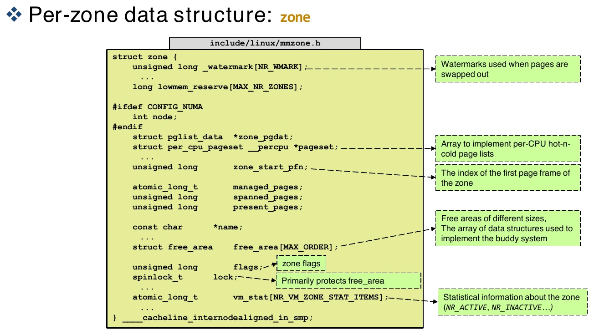

Watermark는 **free page가 얼마나 남았는지**에 따라 언제 회수를 시작하고 어느 문맥에서 수행할지 판단하는 기준이다. 필기 일부의 dirty page 비율과는 다른 개념이다.

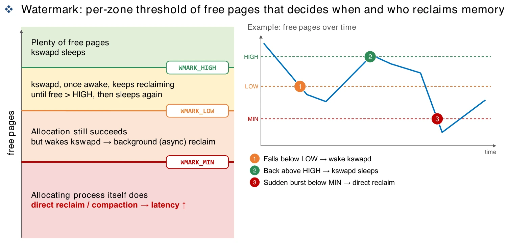

- 여유가 충분하면 `kswapd`는 잠든다.
- LOW 아래로 내려가면 background reclaim을 깨우는 계기가 된다.
- 깨어난 `kswapd`는 HIGH 수준의 여유를 확보하려고 회수한다.
- 여유가 더 부족해 할당 조건을 만족하지 못하면 요청한 태스크가 direct reclaim 등에 참여할 수 있어 지연이 커진다.

실제 판단에는 요청 order, GFP flags, 예약량 등이 함께 들어간다. 그래프는 동작을 이해하기 위한 모델이지 free page가 MIN을 한 번 통과하면 모든 종류의 할당이 똑같이 동작한다는 규칙은 아니다.

LOW와 HIGH를 나누는 이유는 회수 작업을 너무 자주 켰다 끄는 상황을 줄이기 위해서다. 예를 들어 LOW가 100페이지, HIGH가 150페이지인 가상의 zone에서 99페이지가 남아 회수를 시작했다면, 100페이지만 넘기고 즉시 멈추기보다 더 여유 있는 수준을 목표로 삼는다. 숫자는 동작을 설명하는 예시이며 실제 임계값이나 모든 할당의 허용 기준을 뜻하지 않는다.

### Reclaim은 항상 swap-out인가?

아니다. 깨끗한 파일 캐시는 필요하면 버리고 나중에 파일에서 다시 읽을 수 있다. Dirty 페이지는 쓰기 처리가 필요할 수 있고, 익명 페이지는 swap이 설정되어 있을 때 swap-out 대상이 될 수 있다.

**Direct reclaim은 별도 데몬이 아니라 메모리를 요청한 태스크가 커널 안에서 직접 회수에 시간을 쓰는 경로**다. 그래서 애플리케이션의 메모리 요청 지연이 커질 수 있다. 필기의 “kswapd가 따라가지 못하면 요청 스레드가 직접 확보한다”는 설명과 연결된다.

## 8. Zonelist: 할당 후보의 탐색 순서

*강의 15~18쪽*

Node 안의 zone 배열은 그 node가 소유한 메모리를 나타낸다. Zonelist는 **어느 zone부터 시도할지 정한 참조 목록**이다. 따라서 다른 node의 zone도 가리킬 수 있다.

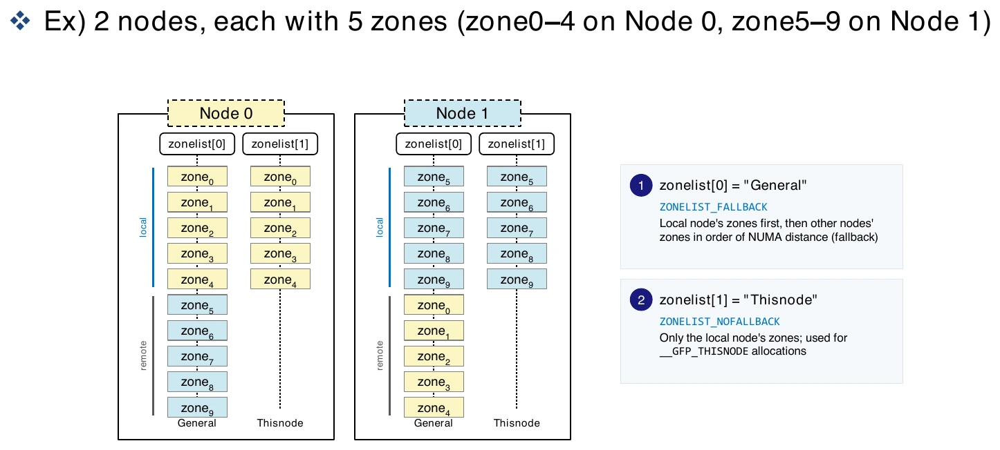

| 목록 | 의미 |
|---|---|
| `ZONELIST_FALLBACK` | 로컬 후보와 원격 후보를 포함하는 일반 목록 |
| `ZONELIST_NOFALLBACK` | 해당 node에 제한하는 목록, `__GFP_THISNODE` 관련 |

가능하면 가까운 메모리에서 할당하고 부족하면 허용된 원격 후보를 살핀다. 실제 후보 선택에는 zone 상한, NUMA 정책, cpuset 등의 제약도 반영된다.

```c
struct zoneref {
    struct zone *zone;
    int zone_idx;
};
```

`zoneref`는 실제 zone 포인터와 zone 인덱스를 보관한다. 강의의 `MAX_NUMNODES=1024`, `MAX_NR_ZONES=5`에서는 최대 후보 슬롯을 `1024×5=5120`으로 계산하고 종료 표시를 위한 여분을 둔다.

이 값은 해당 코드·설정의 상한 예다. **현재 머신에 1024개 node와 5120개 zone이 존재한다는 뜻이 아니다.** NUMA 조건부 설정에 따라 zonelist 종류 수도 달라진다.

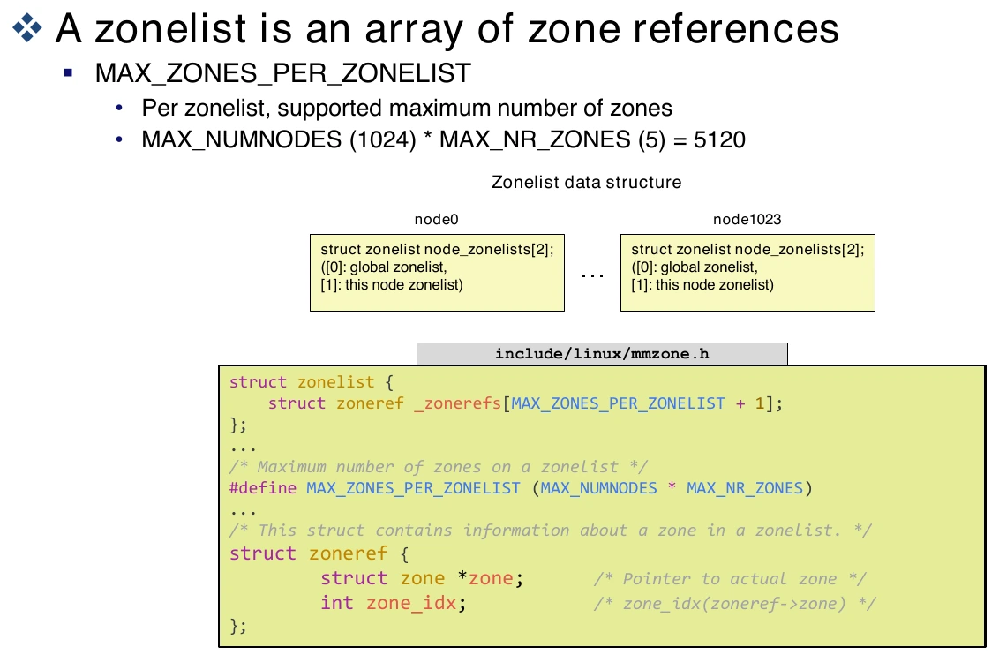

## 9. Zonelist 출력 읽기

*강의 19~22쪽*

강의의 디버깅 절차는 다음과 같다.

1. 커널 설정에서 `CONFIG_DEBUG_MEMORY_INIT=y` 확인.
2. 필요하면 `menuconfig → Kernel hacking → Memory Debugging → Debug memory initialisation`을 켜고 해당 커널 빌드.
3. Ubuntu의 GRUB 커널 인자에 `mminit_loglevel=4 loglevel=8` 추가.
4. `sudo update-grub` 후 해당 커널로 재부팅.
5. 부팅 로그에서 zonelist 확인.

이미 실행할 커널에 해당 설정이 켜져 있다면 설정 변경을 위한 재빌드가 필요하지 않을 수 있다. GRUB 인자를 편집할 때는 기존 인자를 지우지 않고 필요한 값을 더한다. 로그 위치는 환경에 따라 `/var/log/dmesg`, `dmesg`, `journalctl -k -b` 등을 확인한다.

```text
zonelist general 1:Normal =
  1:Normal 2:Normal 3:Normal 0:Normal 0:DMA32 0:DMA
```

- `general`: fallback을 허용하는 목록.
- `1:Normal`: node 1 기준, 허용 zone 상한이 Normal인 경우.
- 오른쪽: 왼쪽부터 시도할 후보 순서.

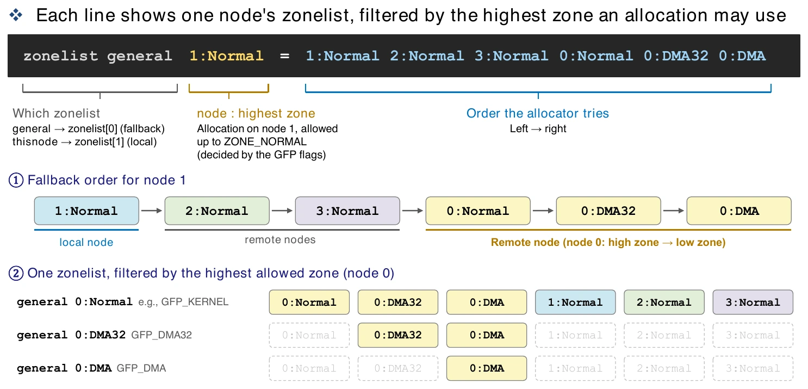

DMA32만 허용한 요청은 Normal 후보를 사용하지 않는다. DMA만 허용하면 DMA32·Normal을 제외한다. 목록에 포인터가 있다고 해서 모든 요청이 모든 후보를 사용할 수 있는 것은 아니다.

따라서 일반 메모리가 많이 남아 있다는 사실만으로 제약 있는 요청이 성공한다고 말할 수 없다. 요청이 낮은 주소 범위의 메모리만 사용할 수 있다면 그 범위 안에서 여유와 연속성을 찾아야 한다. Zonelist는 시도할 순서를 제공하고, 각 요청의 조건은 그중 실제로 선택할 수 있는 후보를 제한한다.

자료의 출력에서는 DMA·DMA32가 node 0에만 있고 node 1~3은 Normal만 가진다. 이것은 그 머신의 물리 주소 배치이며 NUMA 시스템이라면 언제나 같은 배치라는 법칙은 아니다.

## 10. /proc/buddyinfo: 페이지 수가 아니라 블록 수

*강의 23~24쪽*

```bash
cat /proc/buddyinfo
```

각 행은 node와 zone, 각 열은 order별 **사용 가능한 연속 블록 개수**를 보여 준다. [proc_buddyinfo(5)](https://man7.org/linux/man-pages/man5/proc_buddyinfo.5.html)

```text
order k의 블록 크기 = 2^k × 기본 page 크기
해당 열의 free 용량 = 블록 개수 × 2^k × 기본 page 크기
```

4KiB 페이지를 가정하면 다음과 같다.

| Order | 한 블록의 페이지 수 | 한 블록의 크기 |
|---:|---:|---:|
| 0 | 1 | 4KiB |
| 1 | 2 | 8KiB |
| 2 | 4 | 16KiB |
| 3 | 8 | 32KiB |
| 4 | 16 | 64KiB |
| 5 | 32 | 128KiB |
| 6 | 64 | 256KiB |
| 7 | 128 | 512KiB |
| 8 | 256 | 1MiB |
| 9 | 512 | 2MiB |
| 10 | 1024 | 4MiB |

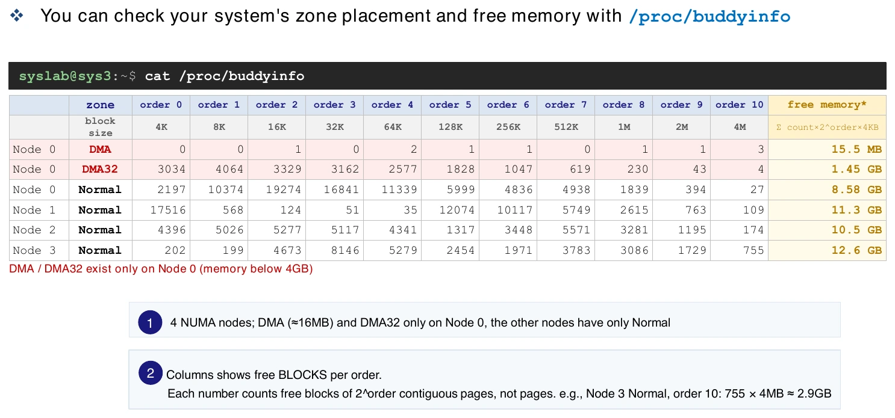

자료의 Node 3 Normal에서 order 10 값 755는 다음을 뜻한다.

```text
755개 블록 × 1024페이지/블록 × 4KiB/페이지
= 3020MiB
≈ 2.949GiB
```

755페이지도, 755MiB도 아니다. 행 전체를 합하려면 **각 열에 크기 가중치**를 곱해 더한다.

예를 들어 `order0=3`, `order1=2`, `order2=1`이고 나머지가 0이면 free 용량은 `(3×1 + 2×2 + 1×4)×4KiB = 44KiB`다. 이것만으로 연속 32KiB 블록 하나를 즉시 얻을 수 있다는 뜻은 아니다.

Buddy 목록의 free block 합과 시스템에서 모든 방식으로 사용 가능한 메모리 총량도 같지 않다. Per-CPU free 페이지, 회수 가능한 cache 등 다른 상태가 있기 때문이다. 이 파일의 강점은 **큰 order의 블록이 남아 있는지** 살피는 데 있다.

## 11. External·Internal fragmentation

*강의 25~26쪽*

### 외부 단편화

빈 공간의 합은 충분하지만 필요한 크기로 연속되어 있지 않은 상황이다.

```text
[free 4KiB][사용 중 4KiB][free 4KiB]
```

총 8KiB가 비어 있어도 가운데 사용 중인 페이지 때문에 연속 8KiB 요청을 바로 만족시키지 못한다. 작은 요청에는 여전히 사용할 수 있으므로 “아무 프로세스도 쓸 수 없는 메모리”라는 뜻은 아니다.

### 내부 단편화

할당받은 블록 안에서 실제로 사용하지 않는 공간이다. 29KiB를 32KiB 블록으로 받으면 3KiB가 남는다. 실제 사용량이 2KiB인데 4KiB 한 페이지를 전용으로 받았다면 그 안의 2KiB도 같은 문제다.

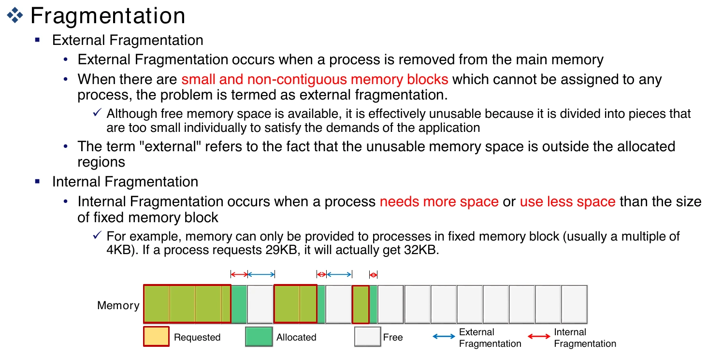

프로세스가 종료될 때만 생기는 현상은 아니다. 실행 중 다양한 크기의 할당·해제가 섞여도 발생한다. 또한 사용자 프로그램의 연속 가상 주소가 반드시 연속 물리 페이지를 의미하는 것은 아니다. 여기서는 특히 **물리적으로 연속된 블록을 요구하는 할당**이 문제가 된다.

## 12. Buddy allocator와 Slab allocator

*강의 27~29쪽*

Buddy는 페이지 단위의 연속 블록을, slab 계열은 그 위에서 작은 커널 객체를 다룬다.

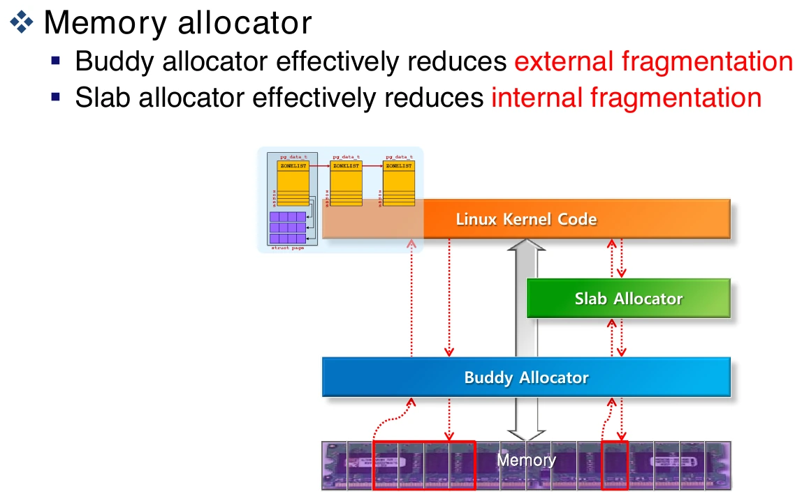

예를 들어 inode처럼 일정한 크기의 객체마다 페이지 전체를 전용 할당하면 공간 낭비가 크다. Slab 계열은 확보한 페이지 안에 여러 객체를 배치하고 재사용한다. 다만 객체 정렬·크기 클래스·부분 사용 slab 등에 따른 낭비가 완전히 사라지는 것은 아니다.

Buddy는 2의 거듭제곱 개수 페이지를 관리한다. 요구량 이상인 가장 작은 order가 필요하며, “반드시 더 큰 블록”이 아니라 **정확히 같은 크기여도 된다.**

```text
요청: 연속 3페이지
필요 블록: 4페이지 = order 2
```

Order 2 목록이 비었지만 order 3의 8페이지 블록이 있다면 반으로 나눠 4페이지를 반환하고, 나머지 4페이지는 free 목록에 둔다. 더 큰 블록밖에 없으면 여러 단계로 나눈다.

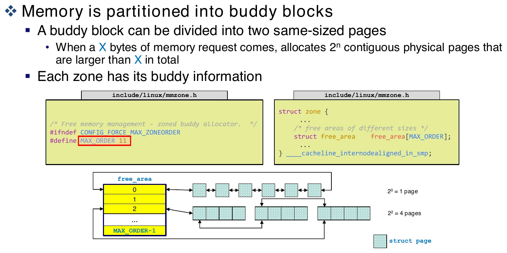

### 해제와 병합

해제한 블록과 **같은 크기이며 정렬된 짝 buddy**가 모두 free이면 상위 order로 합친다. 단순히 주소가 옆이라는 이유만으로 어떤 두 블록이든 합치는 것은 아니다. 상위 단계에서도 짝이 비어 있으면 반복 병합한다.

예를 들어 4페이지 경계에 맞춰진 프레임 `0~3` 블록을 나눴다면 order 1의 짝은 `0~1`과 `2~3`이다. `2~3`과 `4~5`가 모두 비어 있어도 서로 다른 상위 블록에서 나온 조각이라 그 둘을 바로 하나의 order 2 블록으로 합치지는 않는다. 크기뿐 아니라 시작 위치의 정렬과 짝 관계가 필요한 이유다.

```text
order 0 두 buddy가 free → order 1
order 1 두 buddy가 free → order 2
```

강의의 `MAX_ORDER=11` 예에서는 인덱스가 0~10이므로 **11개 order**다. 시작이 2페이지가 아니라 `2^0=1페이지`임을 주의한다. 이 상한과 표기 역시 커널 버전·설정에 따라 달라진다.

### Buddy merge와 Compaction의 차이

Buddy 병합은 이미 비어 있는 짝 블록을 합친다. **사용 중인 페이지를 이동시키는 작업이 아니다.**

Compaction은 이동 가능한 사용 중 페이지를 옮겨 free 공간을 모으는 작업이다. Buddy의 분할·병합과 함께 외부 단편화에 대응할 수 있지만 같은 연산은 아니다. 높은 order가 부족하면 회수·compaction을 시도할 수 있고, 이동 불가능한 페이지가 있으면 큰 블록을 만들지 못할 수도 있다.

## 13. Order 안의 Migration type

*강의 30쪽*

같은 크기의 free block도 예상 이동 특성에 따라 분류한다. 이동 가능한 것과 불가능한 것을 무작정 섞으면 나중에 연속 영역을 확보하기 어려워질 수 있기 때문이다.

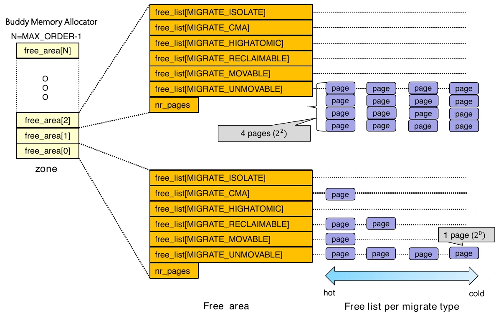

| 유형 | 개념 |
|---|---|
| `MIGRATE_UNMOVABLE` | 일반적인 페이지 이동으로 옮기기 어려운 할당 |
| `MIGRATE_MOVABLE` | 페이지 이동이 가능한 할당 |
| `MIGRATE_RECLAIMABLE` | 회수 가능한 객체 등과 관련 |
| `MIGRATE_HIGHATOMIC` | 고차 atomic 할당을 위한 예약 성격 |
| `MIGRATE_CMA` | 연속 메모리 할당 영역 관련 |
| `MIGRATE_ISOLATE` | 일반 할당에서 격리한 영역 관련 |

따라서 구조는 `zone → order별 free_area → migration type별 free_list → 블록`으로 읽는다. 그림의 hot·cold/per-CPU 경로는 자주 쓰는 페이지를 CPU 가까운 관리 경로에서 처리해 공유 락 접근을 줄이려는 배경과 연결된다. 모든 버전이 같은 필드 이름·목록 구성을 유지하는 것은 아니다.

## 14. 메모리 요청을 한 흐름으로 연결하기

지금까지의 구조를 합치면 다음과 같다.

1. 요청 크기와 GFP 조건으로 필요한 order, 허용 zone·회수 동작을 판단한다.
2. Node 정책과 zonelist를 바탕으로 후보 zone을 탐색한다.
3. Free 여유와 watermark, 예약 조건을 확인한다.
4. 적절한 order의 블록을 찾거나 더 큰 블록을 나눈다.
5. 부족하면 허용된 fallback·회수·compaction 경로 등을 고려한다.
6. 끝내 조건을 만족하지 못하면 할당이 실패할 수 있다.

작은 커널 객체는 slab 계열을 통해 확보할 수 있다. 큰 요청의 실패를 분석할 때는 `free memory가 몇 GiB 남았는가`에 더해 node, zone, order, migration 가능성, 할당 문맥을 함께 확인한다.

할당 문맥은 메모리를 구하는 동안 무엇을 해도 되는지를 제한한다. 앞선 동기화 주차에서 spinlock을 가진 채 `GFP_KERNEL` 할당을 피해야 했던 이유도 이 경로가 잠들거나 회수 작업을 기다릴 수 있기 때문이다. 잠들 수 없는 요청에서는 같은 회수 경로를 마음대로 사용할 수 없다. 그래서 메모리 총량이 같아도 요청의 조건과 실행 문맥에 따라 성공 여부와 지연이 달라진다. [커널 메모리 할당과 GFP 조건](https://docs.kernel.org/core-api/memory-allocation.html)

## 15. 복습문제

해설을 보기 전에 각 질문에 짧게 답해 보자.

<details><summary>1. NUMA에서 같은 주소 공간을 공유해도 접근 비용이 다른 이유는?</summary>

물리 메모리가 node별로 나뉘어 있고 원격 접근은 interconnect를 거칠 수 있기 때문이다. 논리적 접근 가능성과 물리적 거리는 다른 속성이다.

</details>

<details><summary>2. node_zones와 node_zonelists의 차이는?</summary>

앞은 해당 node가 가진 zone 객체 배열, 뒤는 할당 시 탐색할 zone 참조 순서다. Fallback zonelist는 원격 node의 zone도 참조할 수 있다.

</details>

<details><summary>3. present_pages보다 spanned_pages가 큰 경우는?</summary>

관리하는 물리 주소 범위 안에 실제 RAM이 존재하지 않는 hole이 있는 경우다. Present는 실제 페이지, spanned는 범위 전체를 센다.

</details>

<details><summary>4. Watermark는 dirty page 비율을 뜻하는가?</summary>

아니다. 여기서는 zone의 free page 여유와 메모리 회수 판단에 쓰는 임계값이다. Dirty throttling의 비율 설정과 구분한다.

</details>

<details><summary>5. Reclaim은 항상 swap-out인가?</summary>

아니다. 깨끗한 파일 캐시를 버리는 등 다른 경로도 있다. Swap-out은 익명 페이지 회수 등에 사용할 수 있는 한 방법이다.

</details>

<details><summary>6. 4KiB 페이지에서 order 3 열의 값이 7이면 용량은?</summary>

7개 블록×8페이지×4KiB=224KiB다. 7페이지라는 뜻이 아니다.

</details>

<details><summary>7. 총 free 메모리가 1GiB여도 연속 4MiB 할당이 실패할 수 있는가?</summary>

가능하다. 허용 node·zone 안에 충분한 연속 블록이 없거나 watermark·예약 조건을 만족하지 못할 수 있다. 총량과 할당 가능한 형태는 다르다.

</details>

<details><summary>8. Buddy가 연속 5페이지 요청을 직접 받는다면 어느 order가 필요한가?</summary>

최소 8페이지인 order 3이다. Order 2는 4페이지라 부족하다.

</details>

<details><summary>9. Buddy merge와 compaction을 구별하라.</summary>

Merge는 비어 있는 같은 크기의 buddy를 합친다. Compaction은 이동 가능한 사용 중 페이지를 옮겨 더 큰 free 영역을 만들려는 과정이다.

</details>

<details><summary>10. Slab을 buddy 위에 두는 이유는?</summary>

Buddy의 페이지 단위를 작은 커널 객체 여러 개에 나눠 활용하고 객체를 재사용하기 위해서다. 객체마다 페이지 전체를 쓰는 낭비를 줄일 수 있다.

</details>

## 참고 자료

중앙대학교 리눅스 시스템 응용 설계, 손용석 교수, Systems and Storage Lab.

- 수업 자료: `Memory Management [Overview].pdf`.
- 수업 필기: `Memory Management [Overview]_note.pdf`.
