리눅스 시스템 응용 설계 2주차 정리. 이번 주는 **응용프로그램이 하드웨어를 사용하기까지 운영체제와 커널이 어떤 역할을 하는지** 큰 그림을 잡는 시간이다. 뒤에서 배울 시스템 콜, 프로세스, 동기화, 스케줄러, 메모리 관리도 이 구조 안에 들어간다.

## 1. 운영체제는 무엇을 관리하는가

*강의자료 2쪽*

운영체제(Operating System, OS)는 컴퓨터에서 실행되는 응용프로그램과 하드웨어 자원을 관리하는 소프트웨어다. CPU, 메모리, 저장장치, 네트워크 장치 등이 관리 대상이다.

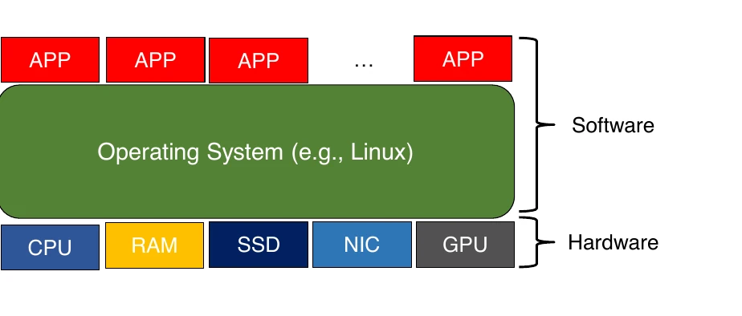

그림에서 위쪽의 APP들은 각각 다른 일을 하지만, 아래쪽의 하드웨어를 함께 사용한다. 프로그램마다 CPU나 SSD를 제각각 제어하면 자원이 충돌하거나 다른 프로그램의 데이터를 손상시킬 수 있다. 운영체제는 자원을 나누고 접근을 통제하며, 프로그램이 공통된 방식으로 자원을 사용할 수 있게 한다.

| 자원 | 운영체제가 해결해야 하는 질문 |
|---|---|
| CPU | 지금 어느 작업을 실행하고, 얼마나 실행할 것인가? |
| RAM | 어느 프로세스에 어떤 메모리를 제공하고 보호할 것인가? |
| SSD·HDD | 파일과 디렉터리를 어디에 저장하고 어떻게 읽고 쓸 것인가? |
| NIC | 네트워크 데이터를 어디로 보내고 어느 프로그램에 전달할 것인가? |
| GPU 등 장치 | 장치별 동작 차이를 어떻게 다루고 요청을 전달할 것인가? |

NIC는 Network Interface Controller, 즉 네트워크 인터페이스 장치를 뜻한다.

예를 들어 음악 재생과 파일 다운로드를 함께 실행하면 두 프로그램은 CPU와 메모리, 장치를 나누어 사용한다. 운영체제는 각 프로그램의 요청을 관리하므로, 한 프로그램이 데이터를 기다리는 동안 다른 프로그램에 CPU를 줄 수 있다. 자원을 보호하는 기능과 자원을 효율적으로 배분하는 기능이 함께 필요한 이유다.

**보충 — 운영체제가 없으면 아무 코드도 실행할 수 없는가?** 강의의 “운영체제가 없으면 컴퓨터는 쓸모없다”는 표현은 범용 컴퓨터에서 운영체제의 중요성을 강조한 것이다. 운영체제 없이 실행하는 bare-metal 프로그램도 있다. 이 수업에서는 여러 응용프로그램을 실행하는 범용 시스템을 기준으로 이해하면 된다.

## 2. Linux와 오픈소스

*강의자료 3~5쪽*

Linux는 Unix 계열의 설계와 사용 방식을 따르는 오픈소스 커널이다. Linus Torvalds가 시작했고, 이후 전 세계 개발자가 함께 발전시켰다. 강의에서는 Windows, iOS, macOS와 비교하며 Linux를 운영체제라고 부른다.

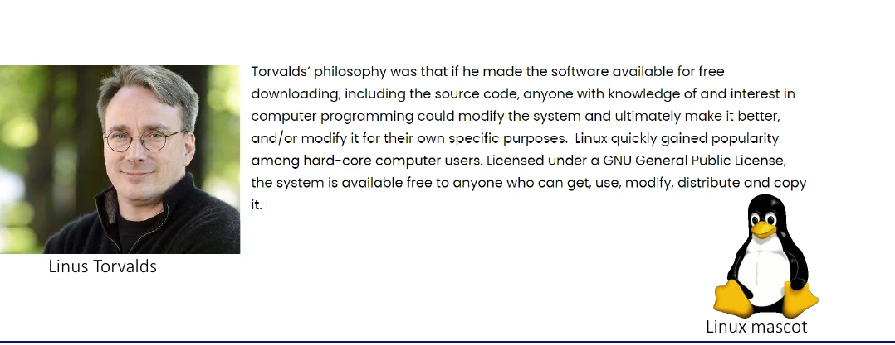

여기서 이름을 두 층으로 구분해 두면 좋다. 엄밀한 의미의 **Linux는 커널**이고, 일상적으로 말하는 “Linux를 설치한다”는 것은 커널에 명령어, 라이브러리, 패키지 관리자 등을 묶은 **배포판을 설치한다**는 뜻인 경우가 많다. Ubuntu가 그 예다.

강의에서 제시한 장점은 다음과 같다.

| 장점 | 의미 |
|---|---|
| Open Source | 공개된 소스 코드를 읽고, 라이선스 조건에 따라 수정·개선·기여할 수 있다. 무료로 내려받아 사용할 수 있는 배포판도 많다. |
| Security | 사용자와 관리자 권한을 구분하고 자원 접근을 통제한다. |
| Various Distributions | Ubuntu, CentOS, Linux Mint 등 용도가 다른 배포판을 선택할 수 있다. |
| Customization | 필요한 기능을 추가하거나 불필요한 기능을 제외하는 등 환경을 조정할 수 있다. |
| Community Support | 사용자가 많아 오류와 사용 사례를 찾기 쉽다. 자료에서는 Reddit, Stack 계열 사이트, Arch Linux 커뮤니티를 예로 든다. |
| Privacy | 구성 요소와 설정을 선택하고 데이터 수집 동작을 살펴볼 여지가 있다. |

**보충 — 장점을 절대적인 보장으로 외우면 안 된다.** 자료에는 Windows보다 안전하고, 프로그램 실행에 관리자 승인이 필요하다는 설명이 있다. 그러나 일반 프로그램을 실행할 때마다 관리자 암호를 입력하는 것은 아니다. 관리자 권한이 필요한 작업에서 권한 상승을 요구하는 것이며, 실제 보안은 취약점·업데이트·설정·사용 방식에 영향을 받는다. 개인정보 수집 여부도 배포판과 설치된 프로그램에 따라 다르다. 오픈소스라는 사실만으로 “항상 안전하다”, “데이터를 전혀 수집하지 않는다”가 성립하지는 않는다.

## 3. Linux를 배우는 이유

*강의자료 6~11쪽*

Linux는 데스크톱에만 쓰이지 않는다. 강의에서는 노트북과 데스크톱, 클라우드 서버, 스마트폰과 태블릿, 슈퍼컴퓨터, 게임기, 자동차, 로켓과 우주선, 의료기기, 화성 탐사 장비까지 사용 분야를 넓혀 설명한다.

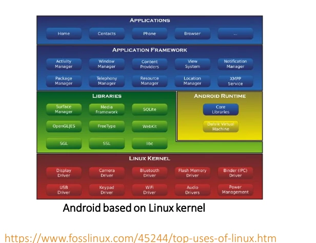

Android 사례의 핵심은 **Linux 커널 위에 다른 소프트웨어 환경이 올라갈 수 있다**는 것이다. 커널을 공유한다고 해서 스마트폰과 Ubuntu 데스크톱의 사용자 환경까지 같아지는 것은 아니다.

### 강의에 제시된 서비스와 산업 사례

자료는 Facebook, Twitter, YouTube, Amazon, eBay, PayPal, Walmart 같은 서비스와 NYSE, NASDAQ, 런던·도쿄 거래소 등을 사례로 든다. 자동차 분야에서는 현대자동차와 GM의 차량용 OS, Tesla의 차량 내 소프트웨어 플랫폼을 소개한다. 로봇과 스마트팩토리도 사례에 포함된다.

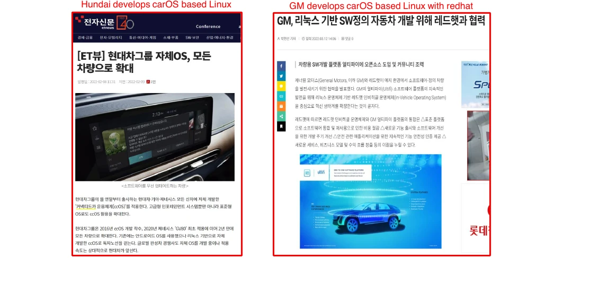

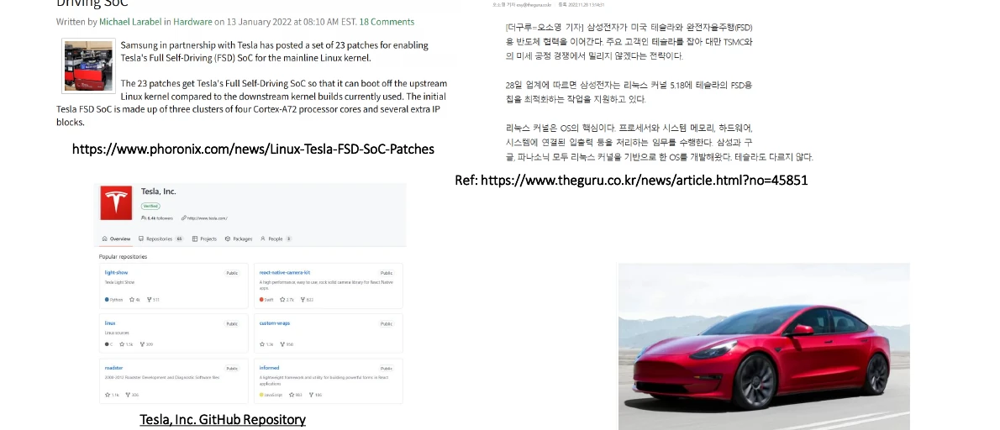

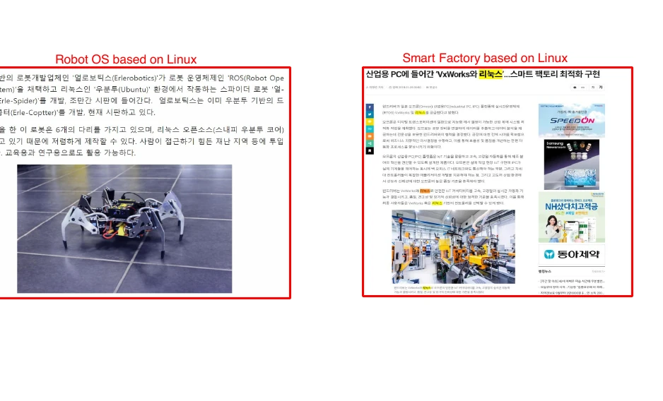

우주 분야에서는 SpaceX, NASA, ESA를 언급한다. Falcon 9 사례에는 간소화한 Linux와 세 개의 듀얼코어 x86 프로세서, 각 프로세서에서 별도로 실행하는 C/C++ 비행 소프트웨어가 설명되어 있다. 이는 강의에 수록된 특정 시스템의 사례이며 모든 우주선의 구성을 뜻하지 않는다.

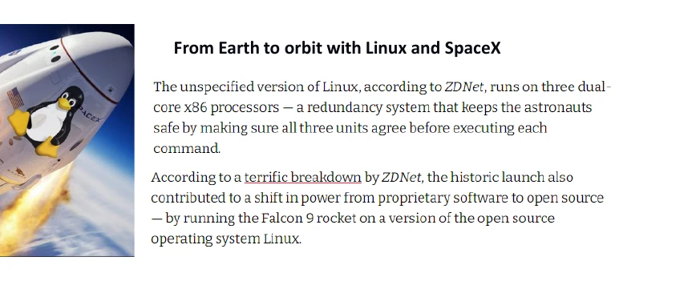

<details>
<summary>자료에 실린 보급률 수치</summary>

강의 7쪽에는 다음 수치가 실려 있다.

- 클라우드를 사용하는 기업의 75% 이상이 Linux를 주요 클라우드 플랫폼으로 사용한다.
- 스마트폰의 85%가 Linux를 기반으로 한다. Android가 Linux 커널을 사용한다는 설명과 연결된다.
- 세계 상위 500대 슈퍼컴퓨터의 100%가 Linux를 사용한다.

자료에 조사 시점과 모집단의 자세한 조건이 함께 적혀 있지 않으므로, 이 수치를 현재 점유율로 옮겨 읽지는 않는다. 이 부분의 학습 요지는 **다양한 규모와 용도의 시스템에서 커널 기술이 필요하다**는 데 있다.

</details>

## 4. 응용 소프트웨어와 시스템 소프트웨어

*강의자료 12쪽*

| 구분 | 응용 소프트웨어 | 시스템 소프트웨어 |
|---|---|---|
| 목적 | 사용자가 원하는 구체적인 작업 수행 | 자원과 실행 환경 관리, 다른 프로그램의 실행 지원 |
| 하드웨어와의 관계 | 보통 OS와 라이브러리가 제공하는 기능을 이용 | 하드웨어 특성과 제약을 고려해 기능 제공 |
| 사용자와의 관계 | 사용자가 직접 작업하는 화면이나 기능이 많음 | 시스템 내부에서 동작하는 기능이 많음 |
| 강의의 언어 예시 | C, C++, Java, Python 등 | C, C++, Assembly 등 |
| 강의의 프로그램 예시 | 앱, 데이터베이스, 웹 브라우저, LLM 등 | OS, 장치 드라이버, 펌웨어, 컴파일러 등 |

예를 들어 파일을 저장하는 앱은 저장할 내용을 결정하고, 운영체제와 파일시스템은 그 내용을 실제 저장장치에 기록하는 과정을 담당한다.

**보충:** 프로그래밍 언어나 foreground/background 여부가 둘을 가르는 절대 기준은 아니다. 서버 응용프로그램도 백그라운드에서 실행하고, 컴파일러는 시스템 소프트웨어로 분류되지만 보통 사용자 공간에서 실행한다. **시스템 소프트웨어라는 분류와 커널 공간에서 실행한다는 성질은 서로 다르다.**

## 5. 커널, 셸, 라이브러리

*강의자료 13~15쪽*

커널(kernel)은 운영체제의 중심 구성 요소다. 하드웨어 자원을 관리하고, 프로세스가 필요한 서비스를 이용할 수 있도록 하며, 시스템의 보호와 무결성을 유지한다. 단단한 껍질 속의 알맹이처럼 운영체제의 핵심에 있다는 의미로 이해할 수 있다.

셸(shell)은 사용자 명령을 해석하는 프로그램이다. 예를 들어 셸에서 명령을 입력하면, 셸은 해당 프로그램을 실행하도록 요청한다. 라이브러리는 프로그램이 재사용하는 기능을 제공한다. `glibc` 같은 시스템 라이브러리는 응용프로그램과 시스템 콜을 연결하는 역할도 한다.

```text
사용자 명령 → 셸 → 명령을 수행하는 프로그램
                         ↓ 라이브러리 / 시스템 콜
                       커널
                         ↓ 드라이버
                      하드웨어
```

강의 15쪽은 `Application → Shell → Kernel → Hardware`로 단순화한다. 이때 **모든 응용프로그램의 요청이 반드시 셸을 거치는 것은 아니다.** 이미 실행 중인 프로그램은 셸 없이도 시스템 콜을 통해 커널 서비스를 요청할 수 있다.

자료는 커널이 부팅 초기에 적재되어 메인 메모리에 머무른다고 설명한다. “가장 먼저 적재된다”는 문장은 OS의 중심부라는 의미로 읽고, 실제 부팅 과정에서 펌웨어나 부트로더가 커널보다 먼저 동작한다는 점은 구분해 둔다.

셸에서 `cat memo.txt`를 실행한다고 생각해 보자. 셸은 명령과 인자를 해석해 `cat`을 실행하고, 실행된 `cat`이 파일 열기·읽기·출력을 요청한다. 셸이 파일의 모든 바이트를 대신 읽어 주는 구조가 아니다. 이처럼 명령을 시작시키는 역할과 실행 중 자원 요청을 처리하는 역할을 나누면 셸과 커널의 위치가 분명해진다.

### 저장장치 접근 계층으로 보는 커널

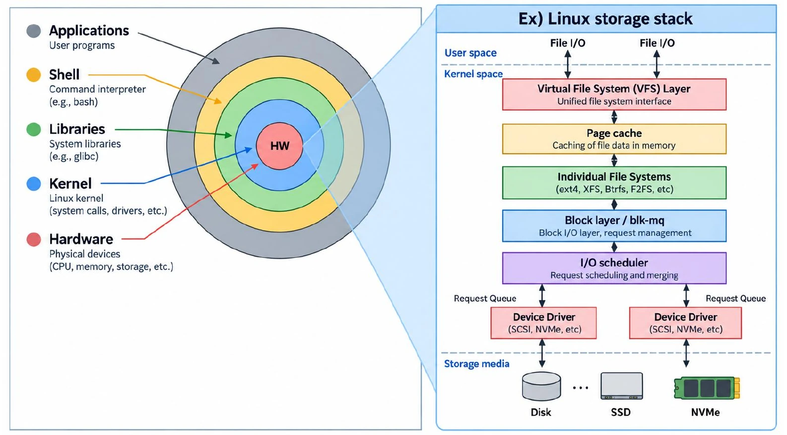

그림 오른쪽은 파일 I/O가 여러 기능을 거쳐 장치까지 내려가는 구조다.

| 계층 | 역할 |
|---|---|
| VFS, Virtual File System | 서로 다른 파일시스템에 공통된 파일 인터페이스 제공 |
| Page cache | 파일 데이터를 메모리에 보관해 재사용 |
| 개별 파일시스템 | ext4, XFS, Btrfs, F2FS 등의 실제 파일 관리 구현 |
| Block layer / blk-mq | 블록 I/O 요청과 큐 관리 |
| I/O scheduler | I/O 요청의 처리 순서와 병합 등에 관여 |
| Device driver | 장치가 이해하는 방식으로 요청 전달 |
| 저장장치 | 디스크·SSD 등의 실제 데이터 저장 매체 |

이 그림은 계층별 역할을 보여 주는 개념도다. 모든 I/O가 항상 각 상자를 같은 순서로 통과한다는 뜻은 아니다. 뒤에서 볼 page cache hit처럼 장치 접근 자체가 필요 없는 경우도 있다. 그림의 `NVMe`는 저장 매체 자체의 이름보다는 SSD 등에 사용하는 인터페이스·프로토콜을 가리킨다.

## 6. 커널의 네 가지 주요 역할

*강의자료 16쪽*

1. **프로세스 관리:** 어느 프로세스가 CPU를 언제, 얼마나 사용할지 결정한다. 여러 작업이 CPU를 공유하는 문제다.
2. **메모리·저장장치 관리:** 어떤 데이터가 어디에 있고 자원이 얼마나 사용 중인지 관리한다. 파일의 내용, 디렉터리, 파일 이름을 다루는 기능도 포함된다.
3. **장치 드라이버:** 프로세스의 요청과 실제 하드웨어 동작 사이를 중재한다.
4. **시스템 콜과 보안:** 프로그램의 서비스 요청을 받아 처리하고, 허용되는 접근인지 확인한다.

예를 들어 파일을 읽는 동안에는 이 기능들이 함께 작동한다. 프로세스가 CPU를 배정받아 `read()`를 호출하고, 커널은 파일과 접근 권한을 확인한다. 데이터가 메모리에 없으면 파일시스템과 드라이버를 거쳐 가져오고, 프로그램이 사용할 수 있게 전달한다.

이 네 가지는 학습을 위한 묶음이다. 네트워크, 인터럽트, 타이머 등의 기능이 커널에 없다는 뜻은 아니다.

파일 읽기가 저장장치 응답을 기다려야 한다면 메모리·파일 관리만으로 일이 끝나지 않는다. 요청한 태스크를 잠들게 하고 다른 태스크를 실행하는 스케줄링도 필요하며, 장치가 완료를 알리면 기다리던 태스크를 다시 실행 가능하게 해야 한다. 이후 주차의 주제들은 같은 요청의 서로 다른 단계를 자세히 살펴보는 셈이다.

## 7. 커널 설계의 상충 관계와 연구 문제

*강의자료 17~18쪽*

운영체제 설계에서는 여러 목표를 동시에 만족시켜야 한다. 한쪽을 개선하면 다른 쪽에 비용이 생길 수 있는데, 이를 trade-off라고 한다.

| 목표 쌍 | 생각해 볼 문제 |
|---|---|
| Efficient ↔ Portable | 특정 CPU에 맞춘 최적화가 다른 구조의 CPU에서도 쉽게 동작할까? |
| Powerful ↔ Simple | 많은 기능을 제공하면서 구현과 인터페이스를 단순하게 유지할 수 있을까? |
| Isolated ↔ Interactable | 프로세스를 보호하면서 필요한 데이터는 어떻게 주고받을까? |
| General ↔ Performant | 다양한 환경을 지원하는 설계가 특정 작업에도 가장 빠를까? |

자료에서 제시한 연구 질문은 세 가지다.

- **Manycore 확장성:** Linux를 72코어 시스템에서 실행하면 프로그램이 72배 빨라질까?
- **비휘발성 메모리·저장장치:** 저장장치의 성능이 DRAM에 가까워지면 응용프로그램의 I/O 성능도 그만큼 좋아질까?
- **시스템 보안:** 보안 허점을 줄이려면 운영체제를 어떻게 설계해야 할까?

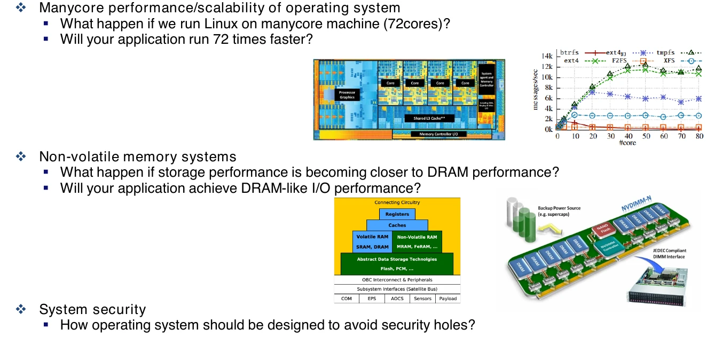

**보충:** CPU 코어가 늘어도 직렬로 처리하는 부분, 락 경합, 공유 자원 접근 비용이 남아 있으면 속도가 비례해서 늘지 않는다. 저장장치가 빨라져도 시스템 콜 처리, 데이터 복사, 파일시스템 처리 같은 소프트웨어 비용은 남는다. 따라서 하드웨어 성능만으로 응용프로그램의 성능을 예측할 수 없다. 이후 동기화·스케줄러·파일시스템을 공부하는 이유가 여기에 연결된다.

## 8. 커널 소스와 개발 규모

*강의자료 19~21쪽*

Linux 커널 소스는 [kernel.org](https://www.kernel.org/)에서 찾을 수 있다. 완성된 바이너리만 사용하는 것이 아니라 실제 구현을 읽고 수정할 수 있다는 점이 이 수업의 실습과 연결된다.

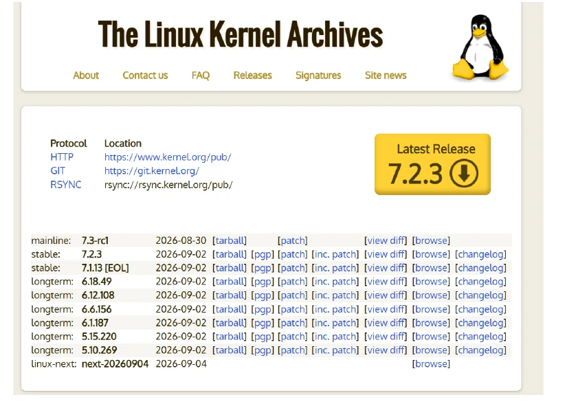

강의자료는 개발 규모를 설명하기 위해 다음 수치를 제시한다.

| 항목 | 강의자료에 적힌 값 |
|---|---|
| 2015년 코드 규모 | 약 20,000,000줄 |
| 2024년 말 코드 규모 | 39,819,522줄 |
| Linux 6.14 첫 RC의 코드 규모 | 40,063,856줄 |
| mainline 릴리스 간격 | 약 9~10주 |
| 릴리스당 커밋 | 16,000개 이상 |
| 릴리스당 개발자 | 2,600명 이상 |
| 릴리스당 참여 조직 | 250곳 이상 |

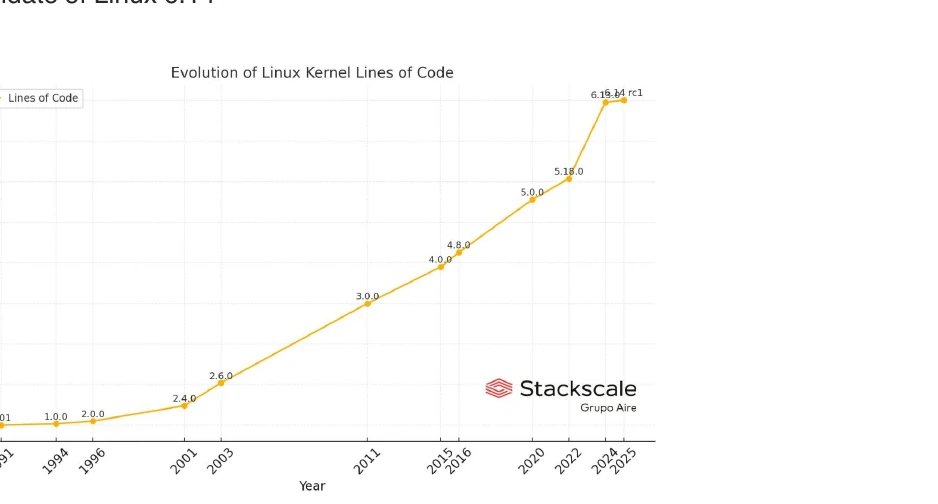

코드 줄 수와 참여 규모는 자료에 수록된 시점의 설명이다. 현재의 정확한 규모로 취급하지 않는다. mainline의 약 9~10주 주기는 [kernel.org의 릴리스 안내](https://www.kernel.org/releases.html)에서도 설명하며, 기능을 받는 merge window와 이후 안정화 기간으로 이루어진다. 이미지에 보이는 버전 번호도 강의 화면의 예시다.

## 9. 운영체제 전체 구조와 시스템 콜

*강의자료 22~24쪽*

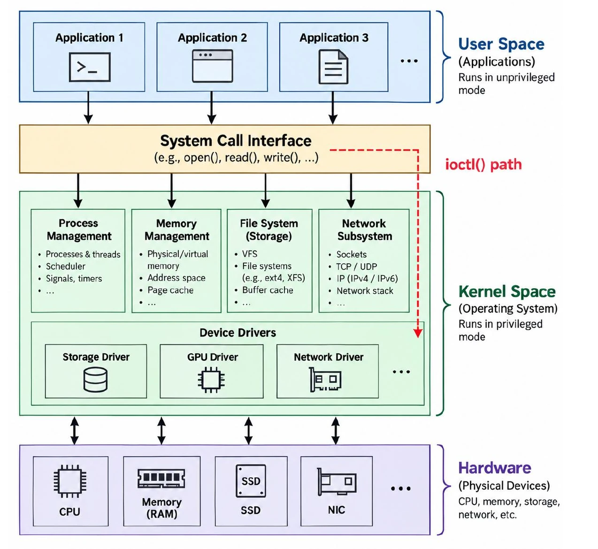

위쪽의 응용프로그램은 user space에서 실행한다. 아래쪽 커널에는 프로세스 관리, 메모리 관리, 파일시스템, 네트워크 기능과 장치 드라이버가 있다. 그 아래에 CPU, RAM, SSD, NIC 같은 하드웨어가 놓인다.

**시스템 콜(system call)은 프로그램이 커널에 서비스를 요청하는 인터페이스다.** 파일 열기·읽기·쓰기·닫기 등이 대표적이다. 자료의 예시는 다음과 같다.

```c
/* 호출 관계를 보여 주는 강의 예시. 완전한 실행 프로그램은 아니다. */
fd = open("file", flag);
write(fd, "hello", count);
```

`open()`으로 파일을 열면 파일 디스크립터(file descriptor)를 얻고, `write()`는 그 디스크립터로 지정한 대상에 데이터를 쓴다. `flag`는 파일을 여는 방식, `count`는 쓰려는 바이트 수를 나타낸다. 실제 코드에서는 필요한 헤더와 인자를 갖추고 반환값·오류·부분 쓰기도 처리해야 한다.

파일 디스크립터는 파일 내용이나 디스크 주소가 아니라, 해당 프로세스의 열린 파일 항목을 찾는 정수 번호다. 프로그램은 파일 경로로 대상을 연 뒤 그 번호로 후속 요청을 보낸다. 따라서 서로 다른 프로세스가 같은 번호를 가지고 있어도 같은 파일을 뜻한다고 단정할 수 없다.

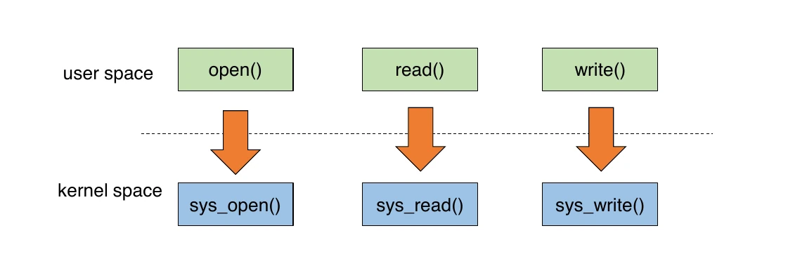

그림은 `open() → sys_open()`처럼 표현한다. **보충:** 이는 사용자 측 요청과 커널 측 처리를 대응시킨 개념도다. 라이브러리 함수 이름과 실제 시스템 콜, 커널 내부 함수 이름이 모든 환경에서 일대일로 같지는 않다. 커널 버전과 CPU 아키텍처에 따라 진입 함수 이름도 달라진다.

22쪽의 빨간 점선은 `ioctl()` 경로다. 일반적인 읽기·쓰기 외에 장치별 제어 요청을 보내는 인터페이스를 강조한다. 응용프로그램이 하드웨어를 무조건 직접 제어한다는 뜻이 아니라, **커널이 제공하는 제어 경로를 이용한다**는 의미다.

## 10. User space와 Kernel space

*강의자료 24~26쪽*

### 먼저 RAM과 저장장치를 구분하기

RAM은 현재 사용하는 프로그램과 데이터를 빠르게 읽고 쓰기 위한 메모리다. 일반적인 DRAM은 전원이 꺼지면 내용이 유지되지 않는다. SSD·HDD는 데이터를 지속적으로 저장하며, CPU는 실행에 필요한 데이터를 메모리로 가져와 사용한다.

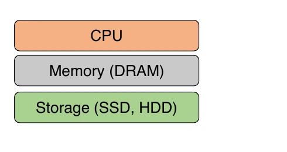

이 그림은 저장 계층을 단순화한 것이다. CPU 캐시 같은 중간 계층은 생략되어 있다.

### 주소 공간과 실행 권한

| 구분 | User space | Kernel space |
|---|---|---|
| 주요 코드 | 응용프로그램, 셸, 라이브러리, 언어 런타임 | 커널과 커널 내부 서비스 |
| 역할 | 프로그램의 작업 수행 | 자원 관리·보호·서비스 제공 |
| 권한 | 제한된 권한으로 실행 | 시스템 자원 관리에 필요한 높은 권한으로 실행 |
| 연결 | 시스템 콜로 서비스를 요청 | 요청을 검사하고 처리한 뒤 결과를 전달 |

사용자 프로그램이 마음대로 커널 메모리를 읽고 쓰게 하면 자원 보호가 무너진다. 그래서 정해진 진입 경로를 통해 요청하고 커널이 이를 검사한다. 시스템 콜은 프로그램에 커널 영역의 임의 접근권을 주는 기능이 아니다. 사용자 공간과 커널 공간의 역할 구분은 [Canonical의 커널 설명](https://canonical.com/knowledge/ubuntu-and-linux/what-is-linux-kernel)에서도 확인할 수 있다.

**보충:** user/kernel **space**는 주소 공간과 소프트웨어 영역을, user/kernel **mode**는 CPU의 실행 권한을 설명할 때 주로 쓰는 용어다. 서로 관련되지만 같은 말은 아니다. 또한 커널 진입은 시스템 콜 외에도 인터럽트나 예외로 일어날 수 있다. 이 주차에서는 프로그램이 명시적으로 서비스를 요청하는 시스템 콜 경로를 중심으로 본다.

### 32비트 주소 공간 그림 읽기

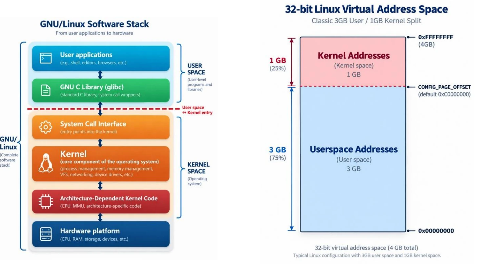

왼쪽은 `응용프로그램 → glibc → 시스템 콜 인터페이스 → 커널 → 아키텍처별 코드 → 하드웨어`의 관계다. `glibc`는 커널 안이 아니라 사용자 공간에 있다는 점을 확인한다.

오른쪽은 **32비트 Linux의 전형적인 3G/1G 가상 주소 분할 예시**다.

- 32비트 주소로 표현할 수 있는 전체 범위는 `2^32`바이트, 즉 4 GiB다.
- 예시의 사용자 영역은 `0x00000000`부터 `0xBFFFFFFF`까지 3 GiB다.
- 예시의 커널 영역은 `0xC0000000`부터 `0xFFFFFFFF`까지 1 GiB다.
- 그림의 `CONFIG_PAGE_OFFSET`은 이 분할 경계와 관련된 설정을 나타낸다.

자료는 단위를 GB로 표기하지만 여기서는 이진 단위인 GiB로 풀어 적었다. **실제 RAM을 반드시 3 GiB와 1 GiB로 나눈다는 뜻이 아니다.** 가상 주소 공간의 예시이며, 모든 Linux·모든 아키텍처·모든 설정에 이 비율을 적용하면 안 된다.

주소 공간은 프로그램이 사용하는 주소를 해석하는 틀이다. 서로 다른 프로세스에서 같은 가상주소가 보이더라도 각자의 주소 변환을 거쳐 다른 물리 메모리를 가리킬 수 있다. 반대로 공유 메모리는 서로 다른 주소 공간의 매핑이 같은 물리 페이지를 가리키게 할 수 있다. 숫자가 같은지와 실제 저장 위치가 같은지를 구별해야 한다.

## 11. 파일을 읽을 때 실제로 거치는 경로

*강의자료 27쪽*

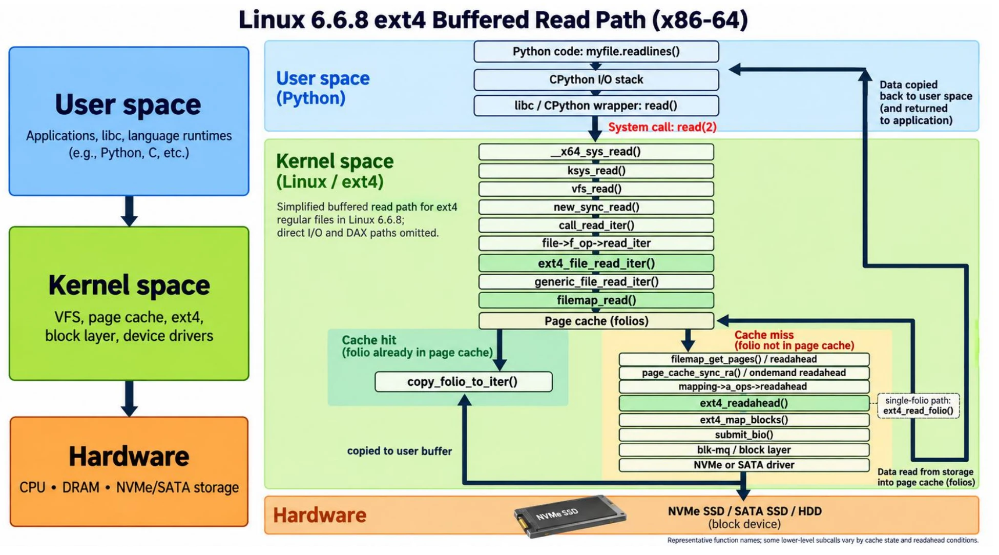

강의 그림은 Linux 6.6.8, x86-64, ext4 일반 파일의 **buffered read**를 예로 든다. Direct I/O와 DAX 경로는 생략되어 있다. Python의 `myfile.readlines()` 같은 고수준 호출도 필요할 때 런타임과 시스템 콜을 거쳐 커널의 파일 읽기 기능을 이용한다.

그림에 적힌 대표 경로를 옮기면 다음과 같다.

```text
myfile.readlines()
  → CPython I/O stack
  → libc / CPython의 read() 호출 경로
  → read 시스템 콜
  → __x64_sys_read()
  → ksys_read()
  → vfs_read()
  → new_sync_read()
  → call_read_iter()
  → file->f_op->read_iter
  → ext4_file_read_iter()
  → generic_file_read_iter()
  → filemap_read()
  → page cache 확인
```

이때 두 상황으로 나뉜다.

| 상황 | 데이터 경로 |
|---|---|
| Cache hit | 요청한 데이터가 유효하고 준비된 상태로 page cache에 있으면, 메모리의 데이터를 사용자 버퍼로 복사한다. 해당 데이터를 얻기 위한 디스크 읽기를 피할 수 있다. |
| Cache miss | 데이터가 없다면 파일시스템·블록 계층·드라이버를 통해 저장장치에서 읽어 page cache를 채운 뒤 사용자 버퍼에 전달한다. |

그림의 miss 쪽에는 `filemap_get_pages()`, readahead, `page_cache_sync_ra()`, `mapping->a_ops->readahead`, `ext4_readahead()`, `ext4_map_blocks()`, `submit_bio()`, blk-mq, NVMe/SATA 드라이버가 표시되어 있다. 단일 folio 읽기 경로로는 `ext4_read_folio()`가 따로 적혀 있다. hit 쪽의 사용자 버퍼 복사에는 `copy_folio_to_iter()`가 표시된다. **Readahead는 앞으로 필요할 것으로 예상되는 데이터를 미리 읽어 두는 동작**이다.

**보충 — 그림은 호출 스택 전체를 그대로 출력한 로그가 아니다.** 함수 호출과 데이터 이동을 함께 단순화한 그림이다. 실제 코드에서 `filemap_get_pages()`는 캐시된 folio를 찾는 동작도 수행하므로 “miss가 난 뒤에만 호출한다”고 외우면 안 된다. 또한 Python의 버퍼에 이미 데이터가 있으면 고수준 함수 호출마다 시스템 콜이 새로 발생하지 않을 수 있다. 세부 호출은 파일 종류·캐시 상태·버전에 따라 달라진다. 관련 구현은 [Linux v6.6의 read 경로](https://github.com/torvalds/linux/blob/v6.6/fs/read_write.c)와 [filemap 구현](https://github.com/torvalds/linux/blob/v6.6/mm/filemap.c)에서 비교할 수 있다.

이 그림에서 먼저 기억할 것은 함수 이름 전체보다 **사용자 공간과 커널 공간을 넘는 지점**, **page cache의 역할**, **장치 접근이 필요한 조건**이다.

첫 읽기에서 필요한 데이터를 장치에서 가져와 캐시에 남겼다면, 다음 읽기는 그 메모리 사본을 재사용할 수 있다. 반면 캐시가 회수되었거나 다른 범위를 읽으면 다시 장치 접근이 필요할 수 있다. 같은 파일을 같은 크기로 읽더라도 측정 시간이 달라질 수 있는 이유이며, 뒤의 fio 실습에서 캐시 상태를 확인하는 것과 연결된다.

## 12. Kernel map으로 이후 주차 연결하기

*강의자료 28쪽*

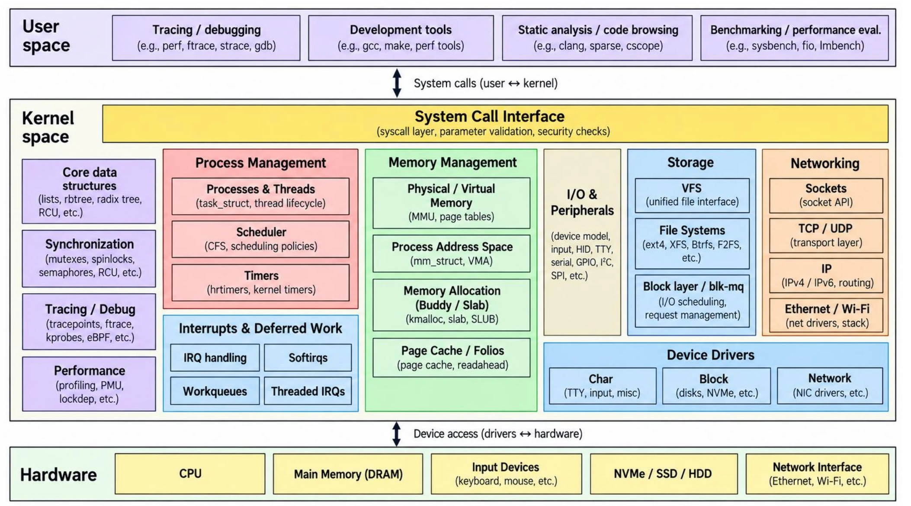

그림 위쪽에는 커널 개발과 분석에 사용하는 도구들이 있다.

| 도구 묶음 | 그림의 예시 | 용도 |
|---|---|---|
| 추적·디버깅 | perf, ftrace, strace, gdb | 실행 흐름과 문제 지점 관찰 |
| 개발 | gcc, make, perf tools | 빌드 및 개발 지원 |
| 정적 분석·코드 탐색 | clang, sparse, cscope | 소스 분석과 구현 탐색 |
| 벤치마크·성능 평가 | sysbench, fio, lmbench | 작업 부하를 주고 성능 측정 |

그 아래 시스템 콜 인터페이스에는 인자 검증과 보안 검사가 표시되어 있다. 커널 내부는 다음과 같이 나뉜다.

| 영역 | 그림에 포함된 항목 |
|---|---|
| 공통 자료구조 | list, rbtree, radix tree, RCU 등 |
| 동기화 | mutex, spinlock, semaphore, RCU 등 |
| 추적·성능 분석 | tracepoint, ftrace, kprobe, eBPF, profiling, PMU, lockdep 등 |
| 프로세스 관리 | 프로세스·스레드, `task_struct`, 스케줄러, 타이머·hrtimer |
| 인터럽트·지연 처리 | IRQ handling, softirq, workqueue, threaded IRQ |
| 메모리 관리 | 물리·가상 메모리, MMU·페이지 테이블, `mm_struct`·VMA, Buddy·Slab·SLUB·`kmalloc`, page cache·folio |
| I/O와 주변장치 | device model, 입력 장치, HID, TTY, serial, GPIO, I²C, SPI 등 |
| 저장장치 | VFS, ext4·XFS·Btrfs·F2FS, block layer·blk-mq |
| 네트워크 | socket, TCP·UDP, IPv4·IPv6, routing, Ethernet·Wi-Fi |
| 장치 드라이버 | 문자 장치, 블록 장치, 네트워크 장치 드라이버 |

이 표는 앞으로 등장할 용어의 위치를 찾는 지도다. RCU처럼 여러 관점에서 등장하는 항목도 있고, 그림에 적힌 CFS·radix tree 같은 이름을 모든 버전의 유일한 구현으로 받아들일 필요는 없다. 도구 역시 사용자 측 프로그램과 커널 측 지원 기능이 함께 작동할 수 있다.

맨 아래 하드웨어에는 CPU, DRAM, 입력 장치, NVMe·SSD·HDD, 네트워크 인터페이스가 있다. 수업의 프로세스·동기화·스케줄러·메모리 주제와 파일시스템 실습을 이 지도에 대입해 보면 서로의 관계가 보인다.

## 13. Linux 배포판

*강의자료 29~30쪽*

배포판(distribution)은 **Linux 커널을 바탕으로 여러 소프트웨어와 관리 도구를 묶은 운영체제 구성**이다. 흔히 패키지 관리 체계를 포함한다.

배포판은 상업용 여부, 기업·숙련자·일반 사용자 중 누구를 대상으로 하는지, 여러 하드웨어를 지원하는지 특정 플랫폼에 특화했는지, 서버·데스크톱·임베디드 중 어떤 환경을 위한 것인지 등에 따라 달라진다. 방화벽·라우터·클러스터 같은 특정 기능에 집중할 수도 있다.

| 자료의 패키지 계열 분류 | 예시 |
|---|---|
| Debian 계열, `.deb` | Ubuntu, Linux Mint 등 |
| RPM 계열, `.rpm` | Red Hat Enterprise Linux, CentOS, Fedora 등 |
| 기타 | 앞의 두 계열로 분류하지 않은 배포판 |

자료에서는 Ubuntu를 널리 사용하는 배포판으로 소개한다. 여기서 외울 관계는 **Ubuntu는 Linux 커널을 사용하는 배포판이고, Linux 커널과 Ubuntu 전체는 같은 것이 아니다**라는 점이다. 자료의 배포판 목록은 분류 예시이며 현재 지원 기간이나 인기 순위를 의미하지 않는다.

## 14. 실습: 가상머신에 Linux 설치하기

*Practical Class 1: VirtualBox 1~23쪽 / Practical Class 1-b: UTM 1~20쪽*

이번 실습은 다음 주차의 커널 컴파일과 프로그래밍을 진행할 Linux 환경을 준비하는 과정이다. VirtualBox와 UTM은 한 대의 물리 컴퓨터에서 가상머신을 만들어 다른 운영체제를 실행할 수 있게 한다.

- **Host:** 가상머신을 실행하는 원래 컴퓨터와 운영체제.
- **Guest:** 가상머신 안에서 실행하는 운영체제. 이번 실습에서는 Ubuntu다.

두 자료 모두 여러 OS의 동시 실행, 설치·테스트의 편의, 장애 복구 실험, 여러 시스템을 한 물리 장비에 모으는 용도를 장점으로 든다. 실습 환경을 분리하면 커널을 수정하고 재부팅하는 작업도 다루기 쉽다.

### 자료에 제시된 환경

| 항목 | VirtualBox 실습 | UTM 실습 |
|---|---|---|
| 대상 | 일반 PC 환경, 자료의 Windows/x86 예시 | Apple Silicon Mac |
| 설치 도구 표기 | VirtualBox 6.x, Extension Pack | UTM 3.x |
| Guest OS | Ubuntu 20.04 | Ubuntu 20.04 ARM |
| RAM | 4 GB 이상 | 4 GB 이상 |
| CPU | 2개 이상 권장 | 2개 이상 권장 |
| 디스크 | 4쪽은 50 GB 이상, 14쪽은 50 GB 초과 권장·최소 40 GB 표기 | 40 GB 이상 |
| 추가 설정 | 공유 폴더, TCP 포트 포워딩, 필요시 비디오 메모리 128 MB | 공유 폴더, SPICE 도구 |

디스크를 넉넉하게 잡는 이유는 뒤에서 커널 소스와 빌드 결과물을 저장하기 때문이다. CPU 수는 호스트가 사용할 여유를 남기는 방향으로 안내한다. 자료의 용량은 당시 실습 기준이며 작업량에 따라 필요한 공간은 달라진다.

**버전 주의:** 아래 절차는 강의에 있는 화면과 설정을 정리한 것이다. VirtualBox 6.x·UTM 3.x의 화면을 현재 버전과 같다고 가정하지 않는다. 필요한 개념과 입력값을 먼저 확인하고 메뉴 차이는 설치한 버전에서 확인한다.

### VirtualBox: 사전 설정

자료에서는 BIOS/UEFI의 하드웨어 가상화 기능을 확인한다.

| CPU | 기본 가상화 항목 | 자료의 선택 항목 |
|---|---|---|
| Intel | Intel Virtualization / VT-x | VT-d |
| AMD | AMD-V / SVM | AMD IOMMU |

Hyper-V 비활성화도 소개하지만, 6쪽은 **구버전 Windows와 VirtualBox의 호환성 문제에 대한 선택 설정**이라고 설명한다. 뒤쪽 준비 목록에 “Disable Hyper-V”가 다시 나온다고 해서 모든 환경의 필수 조건으로 읽지 않는다. 자료의 메뉴 경로는 `Settings → Apps → Optional features → More Windows features`다.

<details>
<summary>가상화 기능과 Extension Pack 설정 화면</summary>

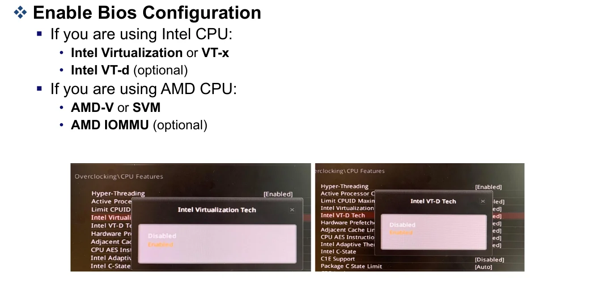

VirtualBox 설치 파일과 Extension Pack을 준비하고, 자료의 환경설정 화면에서 확장 패키지를 추가한다.

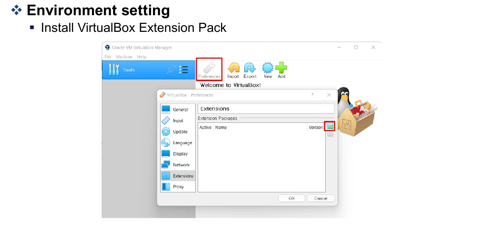

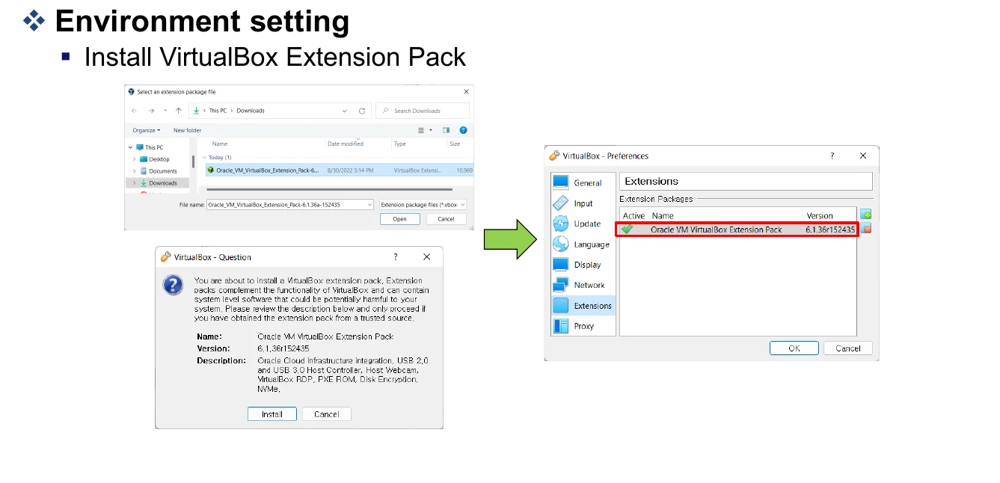

</details>

### VirtualBox: VM 생성부터 Ubuntu 설치까지

1. VirtualBox를 설치하고 Ubuntu 20.04 ISO를 준비한다.
2. 새 가상머신을 만들고 Linux·Ubuntu 환경을 선택한다.
3. RAM을 4 GB 이상 할당한다.
4. 가상 디스크를 만든다. 자료의 최소치와 권장치가 다르므로 커널 빌드를 고려해 권장치 이상의 여유를 잡는다.
5. 설정에서 CPU 수를 조절한다. 화면 문제가 있으면 자료에 제시된 비디오 메모리 설정도 확인한다.
6. VM을 시작하고 가상 광학 드라이브에 Ubuntu ISO를 연결한다.
7. 설치 화면에서 `Install Ubuntu`를 선택하고 언어·사용자 등의 설정을 진행한다.
8. 설치 대상이 **새 VM의 가상 디스크**인지 확인한 뒤 설치한다.

<details>
<summary>RAM·디스크·CPU·ISO 설정 화면</summary>

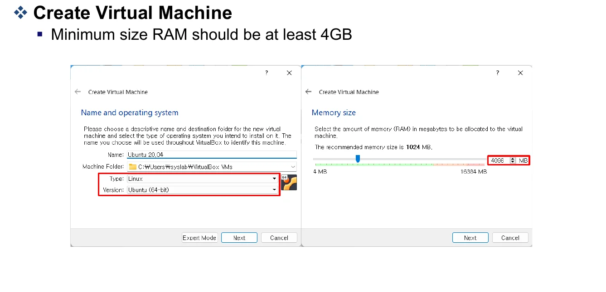

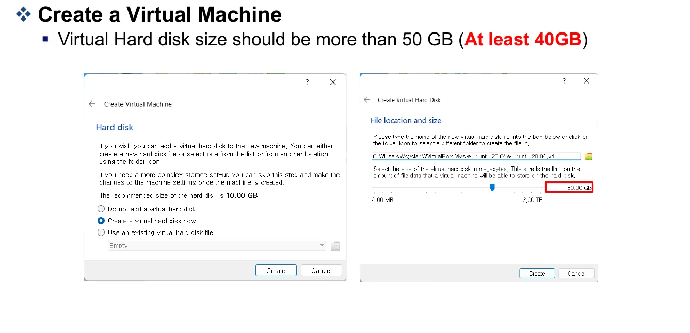

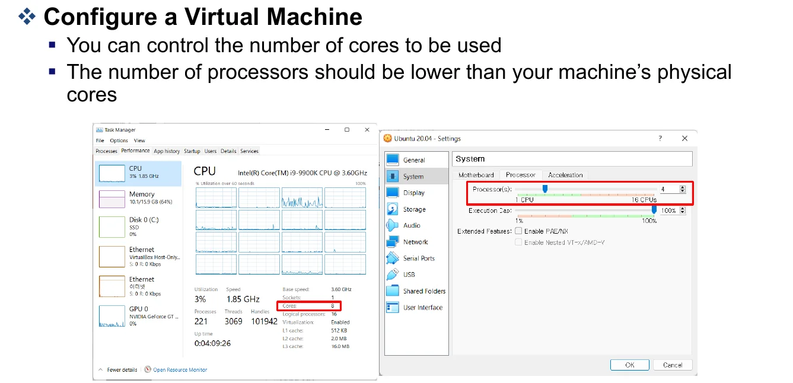

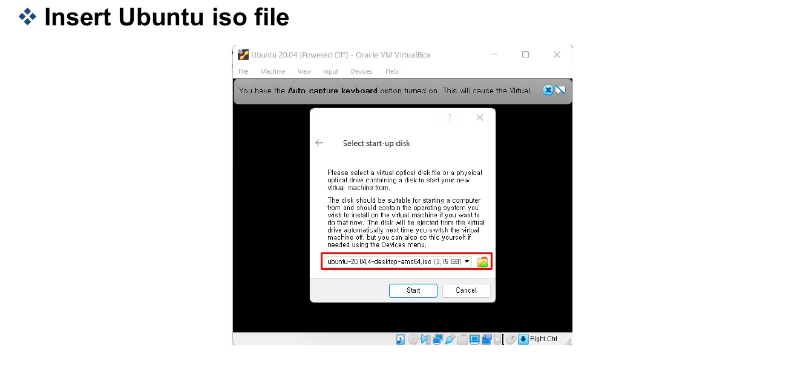

</details>


자료의 `Erase disk and install Ubuntu`는 새 가상 디스크에 설치하는 상황에서 선택한다. 물리 컴퓨터에 직접 설치하면 실제 디스크의 데이터가 지워질 수 있으므로 같은 문구라도 설치 대상을 구분해야 한다. 자료는 별도의 root·swap 수동 파티션 구성이 이번 실습의 필수 사항은 아니라고 안내한다.

### VirtualBox: 설치 후 연결과 공유

자료의 포트 포워딩 규칙은 다음과 같다.

| 항목 | 값 |
|---|---|
| Protocol | TCP |
| Host IP | `127.0.0.1` |
| Host port | `2222` |
| Guest port | `22` |

이는 호스트의 `127.0.0.1:2222`로 들어오는 연결을 게스트의 22번 포트로 전달하는 설정이다. **보충:** 포워딩 규칙을 만든 것만으로 게스트의 SSH 서버가 설치되거나 실행되는 것은 아니다. 실제 연결에는 게스트의 SSH 서비스도 필요하다.

파일 교환에는 공유 폴더를 사용한다. 부록은 VM 메뉴의 `Devices → Insert Guest Additions CD image…`를 선택해 게스트 안에서 Guest Additions를 설치하는 과정을 보여 준다. 호스트에 설치하는 **Extension Pack**과 게스트 안에 설치하는 **Guest Additions**를 구분한다.

<details>
<summary>Guest Additions 설치 화면</summary>

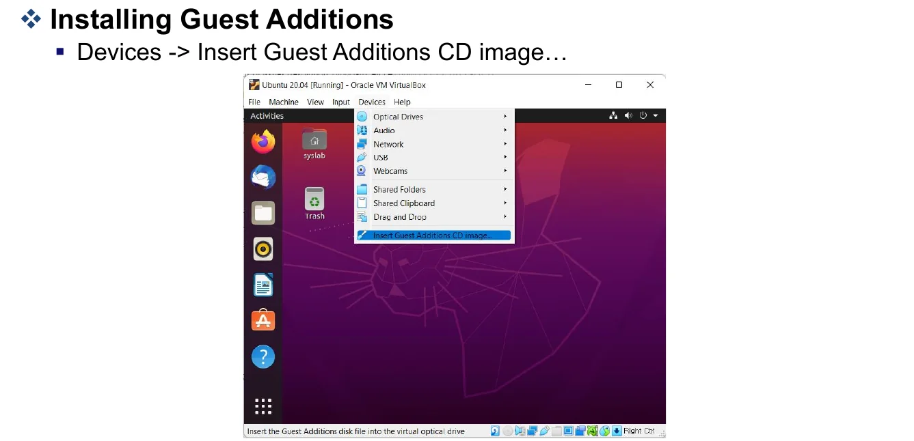

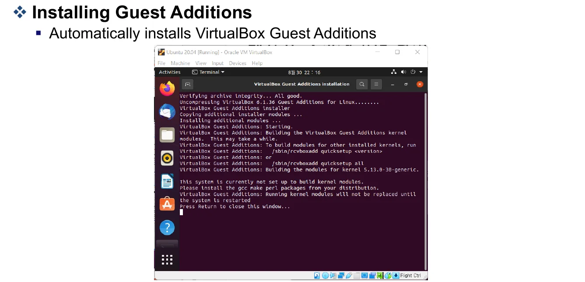

**화면 읽기:** 이 캡처에는 `gcc`, `make`, `perl` 패키지가 필요하다는 메시지가 함께 나온다. 설치 프로그램을 실행한 화면과 설치가 성공한 결과를 구분해야 한다. 자료의 “자동 설치”라는 제목만 보고 성공으로 판단하지 않는다.

</details>

### UTM: Apple Silicon에서 ARM Linux 실행

UTM 자료는 Apple Silicon에서 Apple의 Hypervisor 가상화 기능을 이용해 ARM64 운영체제를 실행하는 흐름을 소개한다. UTM 공식 사이트에서 설치하거나, 자료에 적힌 Homebrew 설치 방법을 이용한다. 여기서 핵심은 **게스트 이미지의 CPU 아키텍처를 맞추는 것**이다.

1. UTM을 설치하고 Ubuntu 20.04 ARM 이미지를 준비한다.
2. 새 VM을 만들고, 자료 화면 기준으로 `Virtualize → Other`를 선택한다.
3. ARM용 ISO를 지정한다.
4. RAM 4 GB 이상, 디스크 40 GB 이상을 설정하고 CPU 수를 조절한다.
5. 공유 디렉터리를 선택하거나 나중에 설정한다.
6. 요약 화면을 확인하고 VM을 실행한다.
7. 부팅 메뉴에서 Ubuntu 설치 항목을 선택한다. 초기 화면에서 기다리는 단계도 자료에 안내되어 있다.
8. 설치할 가상 디스크를 확인하고 설치를 마친다.
9. 설치 후 재시작 과정에서 검은 화면만 보이면 VM을 재시작하는 방법이 안내되어 있다. 설치 ISO를 가상 CD/DVD에서 꺼내 설치된 디스크로 부팅한다.

**원문 확인:** 6쪽은 당시 ARM 이미지에 대해 Server만 제공된다고 적지만, 16~19쪽은 Desktop 설치·실행 화면이다. 따라서 Server ISO를 설치하면 반드시 그림과 같은 GUI가 나온다고 읽지 않는다. 과제 안내는 Desktop과 Server 양쪽의 증빙 방법을 모두 제공한다.

<details>
<summary>UTM의 가상화 방식·ISO·자원·공유 폴더 설정 화면</summary>

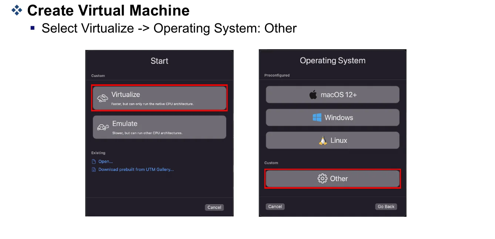

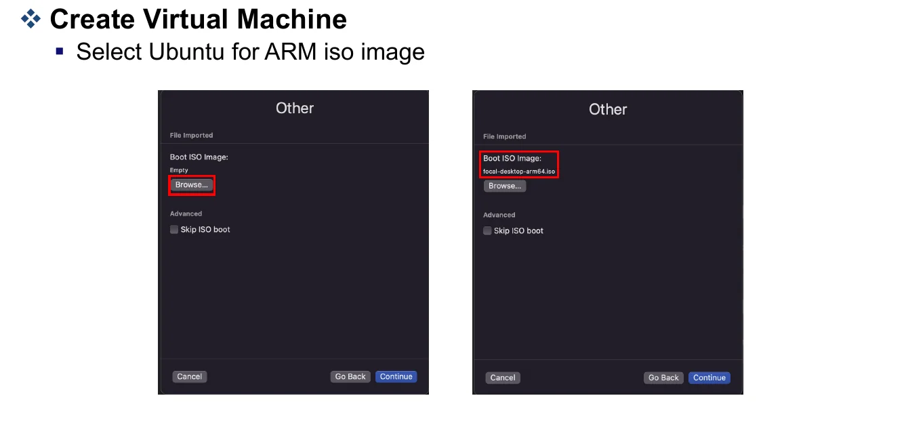

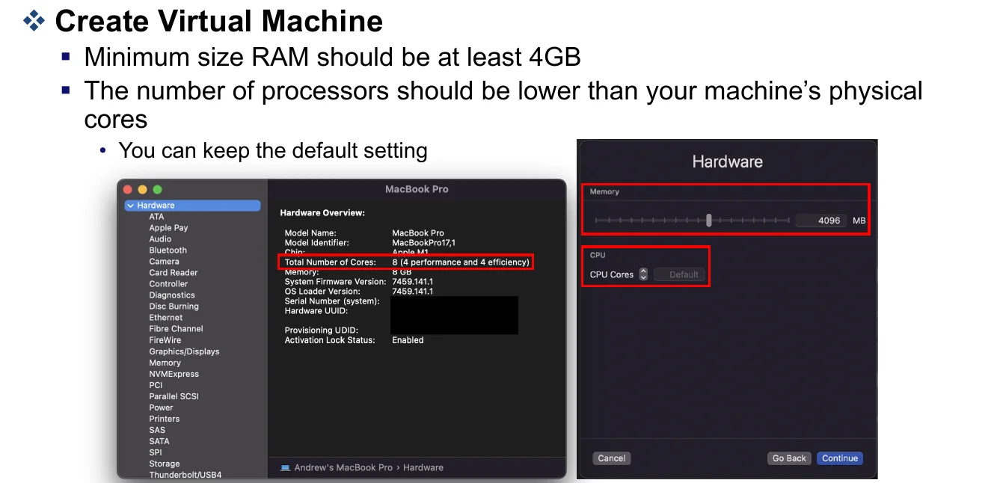

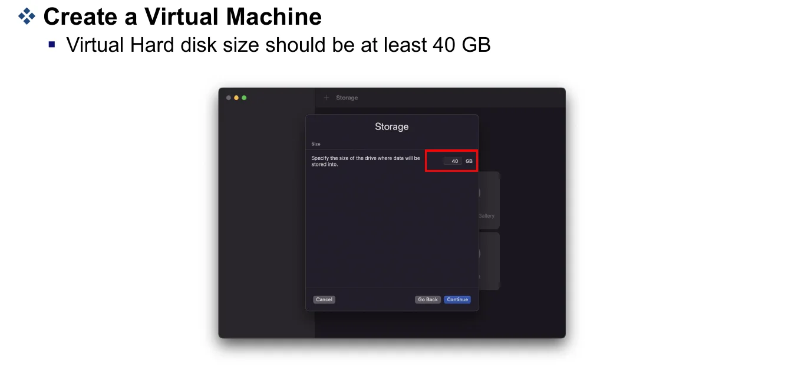

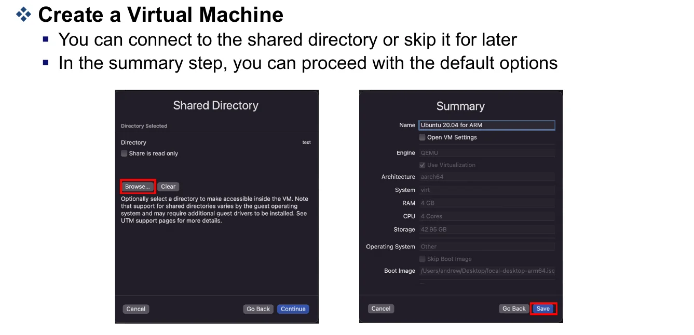

</details>

<details>
<summary>UTM의 부팅·설치·ISO 제거 화면</summary>

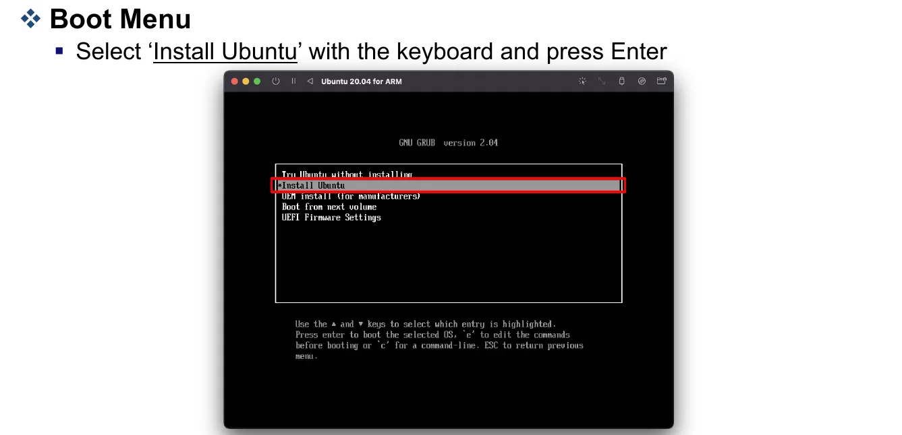

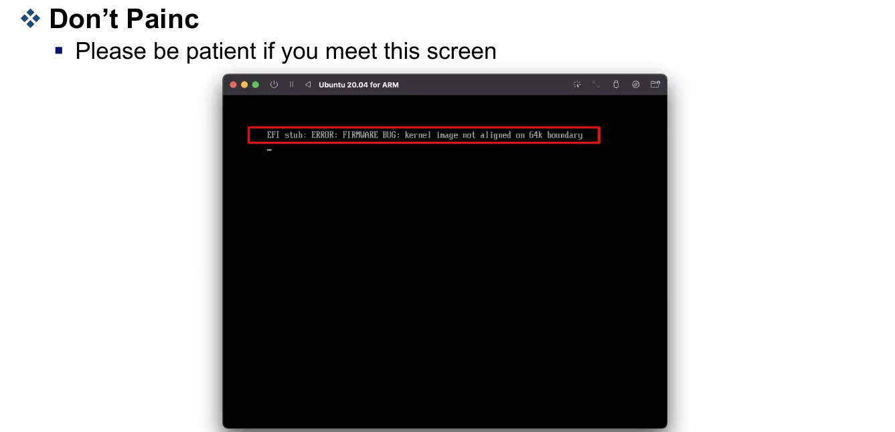

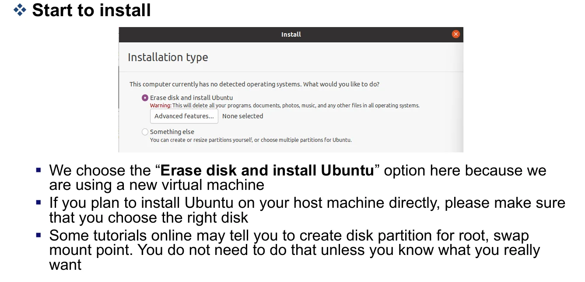

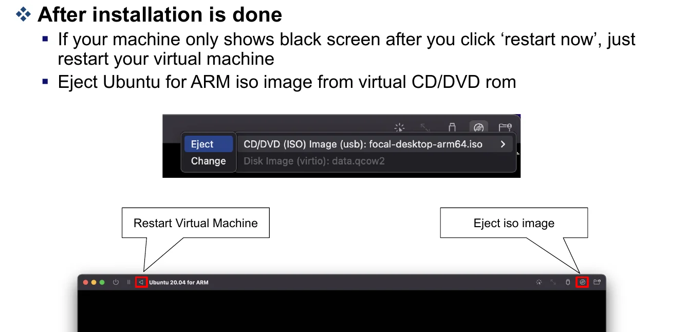

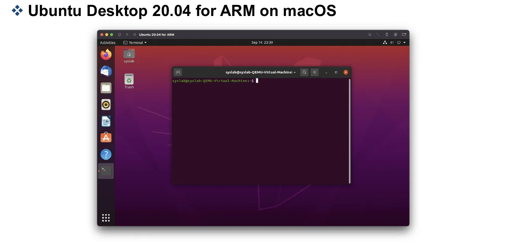

</details>

### UTM: SPICE 공유 폴더

자료의 부록은 게스트 Ubuntu에서 다음 패키지를 설치하도록 안내한다.

```bash
sudo apt install spice-vdagent spice-webdavd
```

SPICE WebDAV 공유를 사용하면 공유 디렉터리에 **게스트 내부의** `http://127.0.0.1:9843/`로 접근한다. WebDAV 클라이언트를 사용하거나 `davfs2`로 마운트하는 방법이 제시되어 있다. 아래는 자료의 `<mount_point>` 자리에 `~/host-share`를 넣은 예시다.

```bash
sudo apt install davfs2
mkdir -p ~/host-share
sudo mount.davfs http://127.0.0.1:9843/ ~/host-share
```

**보충:** 이 절차는 UTM에서 SPICE WebDAV 방식의 공유 디렉터리를 설정한 경우에 해당한다. UTM의 다른 공유 방식에 그대로 적용하는 명령은 아니다. [UTM의 Linux 게스트 문서](https://docs.getutm.app/guest-support/linux/)는 SPICE WebDAV와 VirtFS 등 여러 방식을 구분한다. 자료의 공식 참고 링크는 [Ubuntu 20.04 갤러리](https://mac.getutm.app/gallery/ubuntu-20-04)와 [spice-vdagent 매뉴얼](https://manpages.ubuntu.com/manpages/focal/man1/spice-vdagent.1.html)이다.

## 15. 과제 1: Linux 설치 결과 확인

*Assignment-1 1~4쪽 / About Assignment 1~5쪽*

첫 과제는 VirtualBox 또는 Apple Silicon용 UTM에 **Ubuntu 20.04를 설치하고 실행 결과를 PDF로 제출하는 것**이다. 물리 컴퓨터에 직접 Ubuntu를 설치하는 경우도 허용하며, 그때는 해당 Ubuntu 화면을 캡처하도록 되어 있다.

| 환경 | 과제에서 요구한 증빙 |
|---|---|
| Ubuntu Desktop | `Settings → About`에서 Ubuntu 버전을 표시하고, 텍스트 편집기에 이름·학번을 표시한 화면 |
| Ubuntu Server | `lsb_release -a` 결과와 이름·학번이 들어 있는 텍스트 파일을 출력한 화면 |

자료의 명령 표기에서 긴 대시처럼 보이는 부분은 실제 셸에서는 일반 하이픈 `-`으로 입력한다.

```bash
lsb_release -a
cat student-info.txt
```

`student-info.txt`는 자신의 제출용 식별 정보를 적은 파일의 예시 이름이다. 제출 보고서에는 과제 요구에 맞게 표시하고, 공개 블로그에 올리는 화면에서는 식별 정보를 제외할 수 있다.

과제 1 보고서에는 **VirtualBox에 Ubuntu 20.04.6 LTS를 설치하고, 설정 화면과 터미널에서 Ubuntu 버전을 확인했다**고 기록되어 있다.

### 과제 안내에 적힌 운영 방식

실습은 기본 CLI 명령부터 간단한 커널 프로그래밍까지 익히는 과정이며, 각 실습 수업 뒤에 과제가 이어진다. `About Assignment`의 당시 안내는 다음과 같다.

- 필요한 소스 코드와 보고서를 e-class에 제출한다. 보고서 형식은 PDF이며, 다른 형식은 채점하지 않는다고 명시되어 있다.
- 지각 제출은 받지 않는다고 명시되어 있다.
- 다른 사람의 과제를 복사하면 양쪽 모두 0점과 추가 불이익을 받을 수 있다고 안내한다.
- 질문은 e-class 문의게시판에서 기존의 유사 질문을 먼저 확인하고, 없으면 환경·오류·재현 과정 등 충분한 맥락을 붙여 작성한다.
- 분반별 조교 연락처는 원본 안내에서 확인한다.

이 과제는 설치 버튼을 눌렀다는 기록보다 **후속 커널 실습을 할 수 있는 환경이 준비되었는지 확인하는 단계**로 이해하면 된다. 설치한 배포판 버전과 실행 환경을 설명할 수 있어야 한다.

## 16. 복습문제

해설을 보기 전에 각 질문에 짧게 답해 보자.

### 1. Linux 커널, Ubuntu, 셸은 각각 무엇인가?

<details>
<summary>해설 보기</summary>

Linux 커널은 자원 관리와 보호, 시스템 서비스의 핵심이다. Ubuntu는 Linux 커널에 여러 소프트웨어와 관리 도구를 묶은 배포판이다. 셸은 사용자의 명령을 해석하고 프로그램 실행 등을 요청하는 사용자 공간 프로그램이다.

</details>

### 2. 커널의 네 가지 주요 역할을 파일 읽기와 연결해서 설명하라.

<details>
<summary>해설 보기</summary>

프로세스 관리는 CPU 실행 기회를 배정한다. 메모리·저장장치 관리는 파일과 캐시·버퍼를 다룬다. 드라이버는 필요시 실제 저장장치와 통신한다. 시스템 콜과 보안 기능은 읽기 요청을 받아 인자·권한 등을 확인한다. 하나의 작업에 여러 기능이 협력한다.

</details>

### 3. 시스템 콜을 호출하면 프로그램이 커널 메모리를 마음대로 읽고 쓸 수 있는가?

<details>
<summary>해설 보기</summary>

아니다. 프로그램이 정해진 인터페이스로 서비스를 요청하면 커널이 요청을 검사하고 처리한다. 임의의 커널 메모리 접근권을 주는 것이 아니다. 예를 들어 `read()`는 지정한 파일에서 사용자 버퍼로 데이터를 읽어 오는 요청이다.

</details>

### 4. 시스템 소프트웨어는 모두 커널 공간에서 실행되는가? glibc와 컴파일러는 어디에 해당하는가?

<details>
<summary>해설 보기</summary>

모두 커널 공간에서 실행되는 것은 아니다. 소프트웨어의 역할에 따른 분류와 CPU 권한·주소 공간의 구분은 다르다. glibc는 사용자 공간 라이브러리이고, 컴파일러도 보통 사용자 공간 프로그램이다.

</details>

### 5. 32비트 Linux의 3G/1G 그림은 RAM을 물리적으로 3:1로 나눈다는 뜻인가?

<details>
<summary>해설 보기</summary>

아니다. 4 GiB 가상 주소 공간을 사용자 영역 3 GiB와 커널 영역 1 GiB로 나눈 구성 예시다. 그림의 경계는 `0xC0000000`이다. 물리 RAM 용량과 구분해야 하고, 다른 아키텍처나 설정에 그대로 일반화하면 안 된다.

</details>

### 6. read()를 두 번 호출하면 저장장치도 반드시 두 번 읽는가?

<details>
<summary>해설 보기</summary>

아니다. buffered read에서 필요한 데이터가 유효한 page cache에 있으면 해당 데이터를 저장장치에서 다시 읽지 않고 사용자 버퍼에 전달할 수 있다. 고수준 언어의 읽기 함수라면 사용자 공간 버퍼 때문에 매번 시스템 콜이 생기지 않는 경우도 구분한다.

</details>

### 7. 72코어를 사용해도 프로그램이 72배 빨라지지 않을 수 있는 이유는?

<details>
<summary>해설 보기</summary>

직렬 실행 부분과 동기화 비용, 락 경합, 메모리·I/O 병목 등이 남기 때문이다. 코어 수 증가가 프로그램 전체의 실행 시간을 같은 비율로 줄인다는 보장은 없다. 저장장치 속도 향상도 같은 관점에서 소프트웨어 비용을 함께 봐야 한다.

</details>

### 8. 커널의 격리와 상호작용은 왜 함께 고려해야 하는가?

<details>
<summary>해설 보기</summary>

프로세스가 서로의 데이터나 시스템 자원을 무단으로 변경하지 못하도록 보호해야 한다. 동시에 파일·네트워크·프로세스 간 통신처럼 필요한 협력은 가능해야 한다. 따라서 무조건 차단하거나 무조건 공유하는 대신 권한과 인터페이스를 설계해야 한다.

</details>

### 9. 가상머신의 CPU·RAM·디스크를 구분하고, 커널 실습에서 디스크 여유가 필요한 이유를 설명하라.

<details>
<summary>해설 보기</summary>

가상 CPU는 게스트가 사용할 실행 자원, RAM은 실행 중인 코드와 데이터가 사용하는 메모리, 가상 디스크는 OS·소스·파일·빌드 결과를 저장하는 공간이다. 커널 소스와 컴파일 결과가 디스크 공간을 사용하므로 OS 설치에 필요한 최소 공간만 잡으면 후속 실습에서 부족해질 수 있다.

</details>

### 10. 과제 1에서 무엇을 보여 주어야 하는가? Ubuntu 버전과 커널 버전은 같은가?

<details>
<summary>해설 보기</summary>

Ubuntu 실행 환경과 배포판 버전, 과제에서 요구한 제출자 식별 정보를 보여 주어야 한다. Desktop은 Settings의 About, Server는 `lsb_release -a` 등을 사용한다. Ubuntu 버전과 커널 버전은 다르다. 보충 명령인 `uname -r`은 실행 중인 커널 릴리스 문자열을 확인할 때 사용한다.

</details>

### 마지막으로 비교할 용어

| 구분 | 기억할 차이 |
|---|---|
| OS / Kernel / Distribution | 운영체제 전체 / 핵심 자원 관리 구성 요소 / 커널과 도구를 묶은 배포 구성 |
| Shell / Kernel | 명령을 해석하는 프로그램 / 시스템 자원과 서비스를 관리하는 핵심 |
| Library call / System call | 라이브러리 함수 호출 / 커널 서비스 요청. 모든 라이브러리 호출이 시스템 콜을 발생시키지는 않음 |
| User space / Kernel space | 응용프로그램 등의 영역 / 보호된 커널 영역 |
| Virtual address / Physical memory | 프로그램이 사용하는 주소 체계 / 실제 메모리 자원 |
| Page cache hit / miss | 유효한 데이터가 메모리에 준비됨 / 추가로 데이터를 가져올 필요가 있음 |
| Host / Guest | VM을 실행하는 바깥 환경 / VM 안의 환경 |
| Extension Pack / Guest Additions | VirtualBox 호스트 확장 / 게스트 내부 지원 소프트웨어 |

## 자료 범위와 출처

수업자료: 중앙대학교 리눅스 시스템 응용 설계, 손용석 교수, Systems and Storage Lab. 아래 쪽수는 PDF 페이지 기준이다.

| 원본 자료 | 반영한 내용 |
|---|---|
| `2. Introduction.pdf`, 1~12쪽 | OS·Linux·장점·활용 분야·산업 사례·소프트웨어 분류 |
| 같은 자료, 13~21쪽 | 커널·셸·저장 계층·주요 역할·설계 상충·연구 문제·개발 규모 |
| 같은 자료, 22~30쪽 | OS 구조·시스템 콜·주소 공간·ext4 읽기 그림·kernel map·배포판 |
| `[Practical Class 1] Linux Installation on VirtualBox.pdf`, 1~23쪽 | 가상화 목적·자원·BIOS·Hyper-V·설치·포워딩·공유·Guest Additions |
| `[Practical Class 1-b] Linux Installation on UTM.pdf`, 1~20쪽 | Apple Silicon·ARM 이미지·VM 설정·설치·재시작·SPICE 공유 |
| `Assignment-1.pdf`, 1~4쪽 | 설치 과제와 Desktop·Server 증빙 방식 |
| `About Assignment.pdf`, 1~5쪽 | 실습 목적·제출 정책·질문 방법. 연락처는 원본 참조 |
| 과제 1 제출 보고서 | 당시 VirtualBox·Ubuntu 20.04.6 LTS 설치 기록 |
