응용프로그램은 파일을 읽거나 새 프로세스를 만들 때 커널의 도움을 받는다. **시스템 콜은 권한이 제한된 프로그램이 정해진 절차로 커널 서비스를 요청하는 통로**다. 이번 주는 요청을 전달하는 레지스터와 커널 진입 경로를 따라간 뒤, 직접 커널을 빌드하고 부팅하는 과정까지 연결한다.

## 1. Processor mode와 보호

*강의 2쪽*

운영체제는 사용자 프로그램이 실행할 수 있는 명령과 접근할 수 있는 주소를 제한한다. 프로그램 하나의 실수가 다른 프로그램이나 운영체제 전체를 망가뜨리지 않도록 하기 위해서다.

| 구분 | User mode | Supervisor / Kernel mode |
|---|---|---|
| 실행 권한 | 제한된 명령을 실행 | 시스템을 제어하는 특권 명령 실행 가능 |
| 메모리 접근 | 허용된 사용자 주소 영역 | 커널 코드와 데이터 등 관리 대상 영역 |
| 하드웨어 제어 | 직접 제어하는 대신 서비스 요청 | 장치와 시스템 자원을 관리 |
| 예시 | 응용프로그램의 계산 | I/O 처리, 보호 설정 변경 |

사용자 모드에서 특권 명령을 실행하거나 허용되지 않은 주소에 접근하면 보호 예외가 발생한다. 커널은 해당 예외를 처리하며, 잘못된 사용자 접근은 프로세스 종료나 시그널로 이어질 수 있다. “사용자 프로그램이 직접 mode bit를 바꿔 커널이 된다”가 아니라, CPU와 운영체제가 정한 진입 절차를 이용한다.

시스템 콜은 이 제한을 없애는 대신, 커널이 준비한 코드만 정해진 입구에서 실행하게 한다. 프로그램이 파일 읽기를 요청하면 커널은 파일과 버퍼 주소 등 인자를 검사한 뒤 필요한 작업을 수행한다. 사용자 프로그램의 임의 코드가 갑자기 높은 권한을 얻어 계속 실행되는 것이 아니다.

## 2. Interrupt: 실행 중인 흐름에 사건을 알리기

*강의 3~5쪽*

인터럽트는 CPU가 현재 실행 흐름을 잠시 바꾸어 처리해야 할 사건을 알리는 방식이다. 인터럽트를 받아들이면 필요한 상태를 보존하고 handler를 실행한다. 처리가 끝나면 원래 작업으로 복귀할 수 있다.

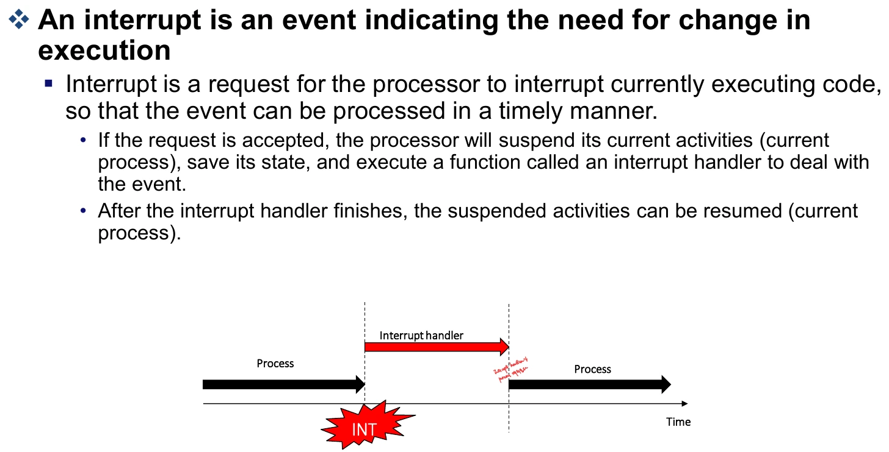

저장장치 I/O를 예로 들면 다음과 같다.

1. CPU가 장치에 I/O를 요청한다.
2. 장치가 처리하는 동안 CPU는 다른 일을 수행할 수 있다.
3. 장치가 I/O를 완료한다.
4. 장치 컨트롤러가 인터럽트를 전달한다.
5. CPU가 handler를 실행해 완료 사실을 처리한다.

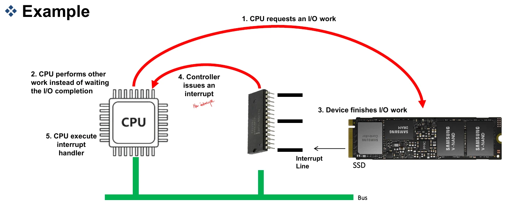

장치의 완료 시점은 현재 사용자 프로그램의 특정 명령과 직접 맞물리지 않으므로 하드웨어 인터럽트를 **비동기적** 사건으로 설명한다. 인터럽트 처리 후 항상 곧바로 동일 프로세스가 계속 실행된다고 단정할 수는 없다. 스케줄링이 필요해 다른 태스크를 실행할 수도 있다.

여기서 “CPU가 다른 일을 한다”는 것과 “읽기를 요청한 프로그램이 다음 줄로 진행한다”는 것은 다르다. Blocking read를 요청한 태스크는 결과를 기다리며 잠들 수 있고, 그동안 CPU는 다른 태스크를 실행한다. 장치 완료 통지, 기다리던 태스크의 깨우기, 그 태스크의 실제 재실행은 이어지는 별도 단계다.

## 3. Trap, 시스템 콜, 라이브러리 함수

*강의 6~8쪽*

강의에서는 trap을 프로그램 실행에 의해 발생하는 동기적 소프트웨어 인터럽트로 설명한다. 명령 실행 오류, 잘못된 메모리 접근, 커널 서비스 요청 등이 현재 실행 중인 명령과 관련되어 발생한다.

| 비교 기준 | Trap: 강의의 넓은 의미 | 하드웨어 interrupt |
|---|---|---|
| 발생 원인 | 프로그램의 명령·서비스 요청·예외 | 장치의 외부 사건 |
| 실행 흐름과 관계 | 동기적 | 비동기적 |
| 처리 | 예외·요청에 맞는 커널 처리 | 장치·사건에 맞는 interrupt handler |
| 예시 | 시스템 콜, 명령 실행 중 예외 | 디스크 I/O 완료 |

**보충:** CPU 매뉴얼은 exception을 fault·trap·abort 등으로 더 세분한다. 따라서 0으로 나누기와 잘못된 메모리 접근을 모두 x86의 엄밀한 분류에서 “trap”이라고 외우지는 않는다. 이 강의의 비교는 프로그램 실행에 따른 사건과 외부 하드웨어 사건을 구분하는 데 초점이 있다.

### printf()를 호출하면 무슨 일이 생기는가?

```text
사용자 코드의 printf()
    → C 라이브러리의 형식 변환·버퍼 처리
    → 출력이 필요할 때 write 계열 시스템 콜
    → 커널의 출력 처리
```

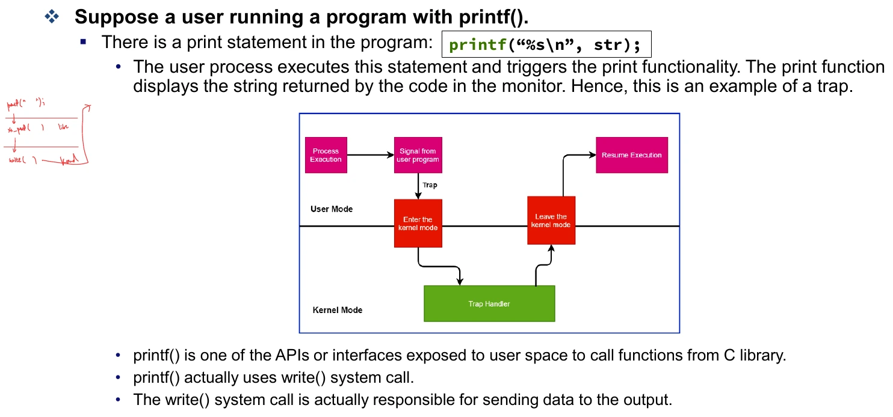

`printf()`는 C 라이브러리 함수이고 시스템 콜 자체가 아니다. 내부 버퍼에 데이터를 모았다가 나중에 내보낼 수 있으므로 `printf()` 한 번과 시스템 콜 한 번이 항상 일대일로 대응하지도 않는다. 필기의 사용자/커널 경계 그림도 **사용자 함수 호출과 실제 커널 진입 지점을 나누어 보는 것**과 연결된다.

## 4. x86-64에서 read()가 커널로 들어가는 과정

*강의 9~13쪽*

```c
count = read(fd, buffer, nbytes);
```

위 호출을 처리하려면 커널에 최소한 “어떤 서비스인가”, “대상 파일은 무엇인가”, “어디에 몇 바이트를 읽을 것인가”를 전달해야 한다.

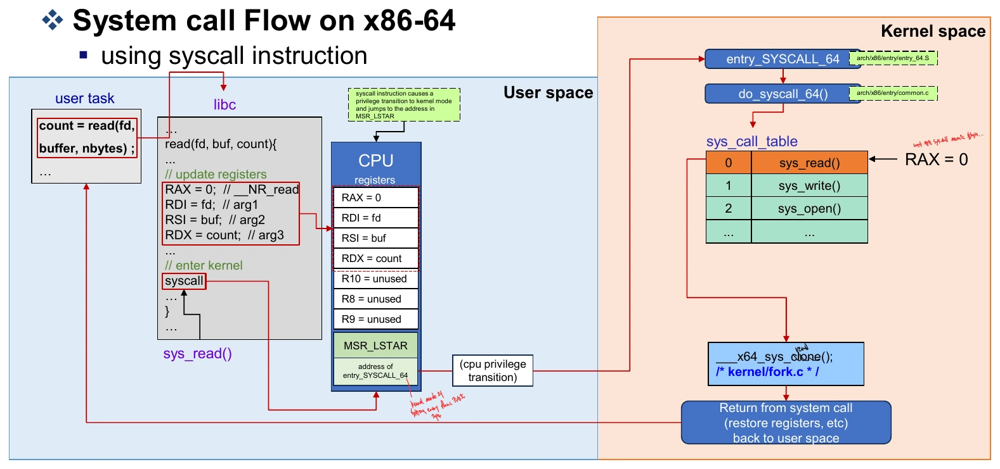

| 레지스터 | 시스템 콜에서의 역할 | read 예시 |
|---|---|---|
| RAX | 진입 전 시스템 콜 번호, 복귀 시 반환값 | 진입 전 `0` |
| RDI | 첫 번째 인자 | `fd` |
| RSI | 두 번째 인자 | `buffer` |
| RDX | 세 번째 인자 | `nbytes` |
| R10 | 네 번째 인자 | 사용하지 않음 |
| R8 | 다섯 번째 인자 | 사용하지 않음 |
| R9 | 여섯 번째 인자 | 사용하지 않음 |
| IA32_LSTAR / MSR_LSTAR | 64비트 시스템 콜의 커널 진입 주소를 보관하는 MSR | `entry_SYSCALL_64`의 주소 |

MSR은 Model-Specific Register다. `MSR_LSTAR`는 함수 인자용 범용 레지스터가 아니라 커널 진입점을 설정하는 특수 레지스터다. 사용자 코드가 시스템 콜마다 여기에 임의의 주소를 적는 것은 아니다.

강의에 제시된 흐름은 다음과 같다.

```text
read(fd, buffer, nbytes)
  → libc가 시스템 콜 번호와 인자를 준비
  → syscall 명령
  → entry_SYSCALL_64                 arch/x86/entry/entry_64.S
  → do_syscall_64()                  arch/x86/entry/common.c
  → 시스템 콜 번호 검사·분기
  → __x64_sys_read() 등 해당 처리 함수
  → 결과와 필요한 실행 상태 복원
  → 사용자 코드로 복귀
```

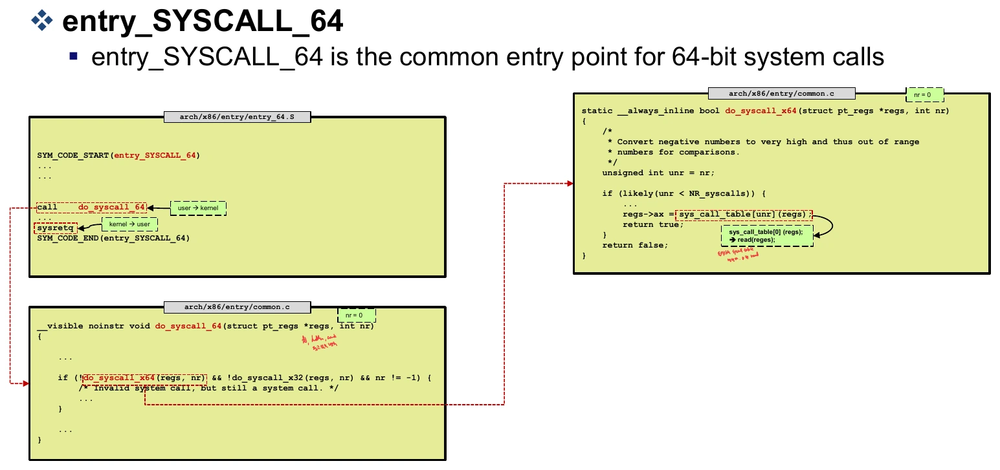

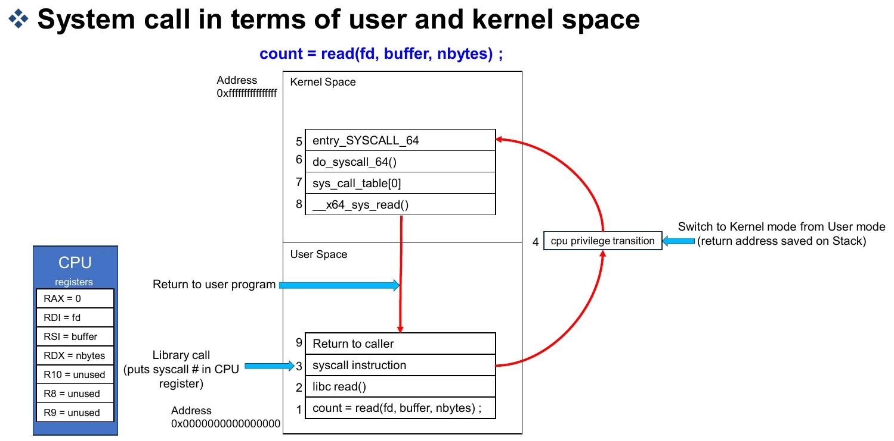

**주의할 구분:** 시스템 콜에 의한 **mode switch**와 다른 태스크로 바꾸는 **context switch**는 다르다. `read()`를 요청한 태스크가 커널 모드에서 자기 요청을 처리하다 돌아올 수도 있다. I/O를 기다리며 잠들면 그 사이에 다른 태스크로 문맥 전환할 수 있다.

따라서 진입 경로를 읽을 때는 현재 태스크와 현재 실행 모드를 따로 표시하면 좋다. 태스크 A가 사용자 모드에서 호출하고 A의 요청을 커널 모드에서 처리하다가 그대로 돌아오면 태스크는 계속 A다. A가 대기하면서 B로 바뀌는 순간에 태스크 문맥 전환이 추가된다. 시스템 콜을 할 때마다 별도의 “커널 프로세스”로 일을 넘기는 구조로 이해하면 안 된다.

**보충:** 그림의 “복귀 주소를 stack에 저장”은 전체 진입 절차를 단순화한 표현이다. x86-64 `SYSCALL` 명령 자체는 복귀 RIP를 RCX, 플래그를 R11에 보존하며, 커널 진입 코드가 추가적인 레지스터·스택 처리를 수행한다. 일반 함수 호출 규약의 네 번째 인자 레지스터와 시스템 콜의 R10을 혼동하지 않는다. 아키텍처별 규약은 [Linux syscall 매뉴얼](https://man7.org/linux/man-pages/man2/syscall.2.html)을 참고한다.

## 5. 시스템 콜 번호와 테이블

*강의 10~14쪽*

시스템 콜 번호는 어떤 커널 서비스를 호출할지 식별한다. 강의의 x86-64 예시에서는 `read=0`, `write=1`, `open=2`이며 등록 정보는 `arch/x86/entry/syscalls/syscall_64.tbl`에 있다.

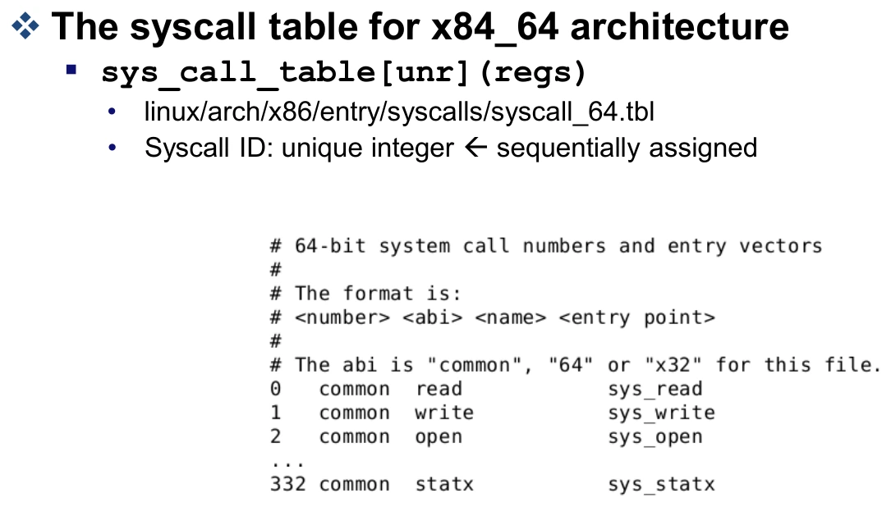

강의 코드의 `sys_call_table[unr](regs)`는 번호를 이용해 handler를 선택한다는 의미다. 번호 범위를 검사해 유효하지 않은 호출을 처리한다. 이 구현 방식과 내부 함수 이름은 커널 버전에 따라 달라질 수 있다. **서비스 식별자와 인자를 전달해 커널의 해당 기능으로 분기한다**는 원리를 먼저 잡는다.

자료는 Linux·OpenBSD의 300개 이상, NetBSD 약 500개, FreeBSD 500개 이상, Windows 7 약 700개의 호출을 예로 든다. 이는 자료의 시대와 집계 기준에 따른 규모 설명이다. 번호와 개수를 모든 OS·아키텍처에서 동일하게 취급하지 않는다.

## 6. 시스템 콜의 여섯 가지 분류

*강의 15~21쪽*

| 분류 | 요청하는 기능 | 자료의 예시 |
|---|---|---|
| Process control | 생성·종료·적재·실행, 속성 조회·변경, 대기·이벤트, 메모리 관리 | `fork`, `exit`, `wait`, exec 계열 |
| File management | 생성·삭제·열기·닫기·읽기·쓰기·위치 변경·속성 관리 | `open`, `close`, `read`, `write`, `lseek`, `stat` |
| Device management | 장치 요청·해제, 읽기·쓰기·속성 제어·연결 | `ioctl`, `read`, `write` |
| Information maintenance | 시간·날짜·시스템·프로세스 등의 정보 관리 | `getpid`, `time`, `alarm` |
| Communication | 통신 연결 생성·삭제, 메시지 송수신, 상태 전달, 공유 | `pipe`, `shmget`, `mmap` |
| Protection | 권한·소유권 등의 관리 | `chmod`, `umask`, `chown` |

자료 표에는 `sleep()`도 나오지만 라이브러리 API와 실제 커널 시스템 콜을 구분해야 한다. 기능별 분류도 완전히 배타적인 것은 아니다. `mmap()`은 통신뿐 아니라 파일 매핑과 메모리 관리에도 쓰인다.

### 파일·디렉터리 관련 호출 읽기

| 호출 | 의미 |
|---|---|
| `open(path, flags, ...)` | 파일을 열고 디스크립터를 받음 |
| `close(fd)` | 열린 디스크립터를 닫음 |
| `read(fd, buf, n)` | 파일에서 사용자 버퍼로 최대 n바이트 읽기 |
| `write(fd, buf, n)` | 사용자 버퍼에서 파일로 쓰기 |
| `lseek(fd, offset, whence)` | 파일 오프셋 조정 |
| `stat(path, &buf)` | 파일 상태·속성 확인 |
| `mkdir(path, mode)` | 디렉터리 생성 |
| `rmdir(path)` | 빈 디렉터리 삭제 |
| `link(oldpath, newpath)` | 같은 파일을 가리키는 새 하드 링크 생성 |
| `unlink(path)` | 디렉터리 항목 제거 |
| `mount(...)`, `umount(...)` | 파일시스템 연결·해제 |
| `chdir(path)` | 현재 작업 디렉터리 변경 |
| `kill(pid, sig)` | 프로세스에 시그널 전달 |

`read`·`write`의 반환값은 실제 처리한 바이트 수일 수 있어 요청한 수와 항상 같지 않다. `unlink`도 호출 즉시 파일의 저장 공간이 반드시 모두 회수된다는 뜻은 아니다. `kill`의 이름만 보고 모든 시그널이 강제 종료라고 생각하지 않는다. 자료의 `unmount` 표기는 Linux API를 찾을 때 `umount`로 확인한다.

일반 파일에 `read(fd, buf, 100)`을 요청했는데 현재 위치부터 끝까지 40바이트만 남았다면 40을 반환할 수 있다. 이는 오류가 아니라 실제 읽은 양이며, 버퍼에서는 그 40바이트를 처리해야 한다. 파일 끝에서 양수 길이의 읽기를 다시 요청하면 0을 반환하고, 오류는 -1과 `errno`로 구분한다. 요청 인자뿐 아니라 반환값까지 읽어야 시스템 콜의 의미가 완성된다. [read(2) 반환값 설명](https://man7.org/linux/man-pages/man2/read.2.html)

## 7. 태스크 생성: fork와 clone

*강의 22~24쪽*

`fork()`는 부모와 구별되는 자식 프로세스를 만드는 인터페이스다. `clone()` 계열은 어떤 실행 자원을 공유할지 플래그로 더 세밀하게 선택할 수 있다.

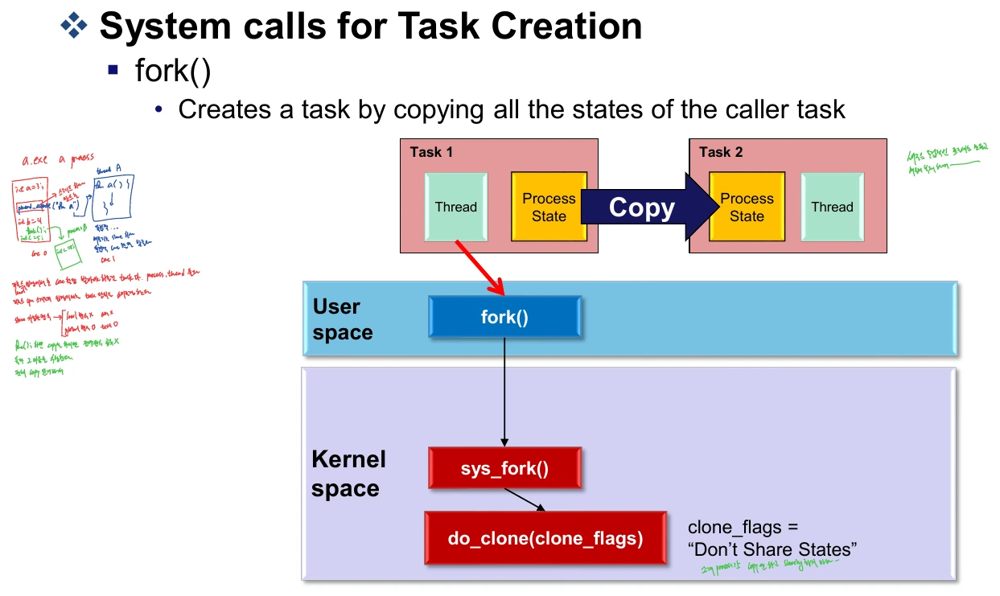

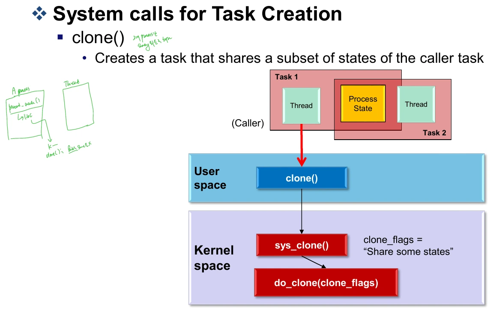

자료의 공통 생성 흐름은 `copy_process()`로 태스크 상태를 준비하고, PID를 마련한 뒤, `wake_up_new_task()`로 실행 가능한 상태에 놓는 것이다.

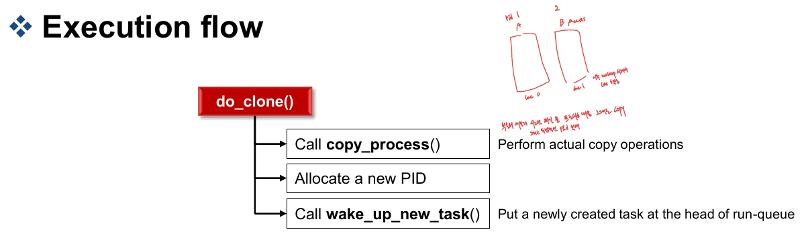

“복사”는 모든 물리 메모리를 생성 순간에 통째로 복제한다는 뜻은 아니다. 다음 주차의 copy-on-write처럼 실제 데이터 복사를 지연할 수 있다. 공유와 복사의 차이는 **자원 객체를 함께 가리키는지, 별도 상태를 갖는지**로 판단해야 한다. 새 태스크를 깨웠다는 사실도 즉시 CPU를 얻었다는 뜻은 아니다.

## 8. 실습: Linux 명령어와 도구

*Practical Class 2, 1~37쪽*

터미널은 입력과 출력을 주고받는 환경이고 셸은 명령을 해석하는 프로그램이다. Ubuntu의 자료 예시에서는 `Ctrl+Alt+T`로 터미널을 연다.

### 파일과 디렉터리

| 명령 | 기본 사용과 의미 |
|---|---|
| `pwd`, `cd path` | 현재 경로 출력, 작업 디렉터리 이동 |
| `ls`, `ls -l`, `ls -a`, `ls -al` | 목록, 상세 정보, 숨김 항목, 둘 다 |
| `mkdir linux_system` | 디렉터리 생성 |
| `touch syslab.c` | 없으면 빈 파일 생성, 있으면 타임스탬프 갱신 |
| `mv old new` | 이동 또는 이름 변경 |
| `cp source target` | 복사. 디렉터리 복사는 관련 옵션 확인 |
| `rm file` | 파일 삭제 |
| `ln`, `ln -s` | 하드 링크, 심볼릭 링크 |
| `cat`, `less`, `head`, `tail` | 전체·페이지 단위·앞부분·뒷부분 출력 |
| `diff`, `cmp`, `comm` | 줄 차이·바이트 비교·정렬된 두 파일의 공통/고유 줄 비교 |
| `sort` | 줄 정렬 |
| `tar`, `zip`, `unzip` | 아카이브 생성·해제와 압축 파일 처리 |

```bash
mkdir linux_system
cd linux_system
touch syslab.c
cp syslab.c syslab-backup.c
mv syslab-backup.c old-syslab.c
ls -al
tar -cvf sources.tar syslab.c old-syslab.c
tar -xvf sources.tar
```

`tar -cvf`는 파일을 하나의 아카이브로 묶는다. 그 자체로 압축한다는 뜻은 아니며 gzip 등의 압축 옵션은 별도다. `touch`도 기존 파일 내용을 비우는 명령은 아니다.

### 프로세스·계정·패키지·네트워크

| 명령 | 용도 |
|---|---|
| `ps`, `ps -Af` | 프로세스 상태와 PID 확인. `-A`는 전체, `-f`는 상세 형식 |
| `top` | CPU·메모리·swap·태스크 상태를 동적으로 관찰 |
| `kill`, `killall` | PID 또는 이름으로 시그널 전달 |
| `sudo command` | 허용된 정책에 따라 다른 권한으로 명령 실행 |
| `whoami`, `passwd`, `useradd`, `usermod` | 사용자 확인·암호 변경·계정 관리 |
| `shutdown` | 종료·재부팅 예약과 실행 |
| `apt update` | 패키지 목록 갱신 |
| `apt upgrade`, `apt install`, `apt remove` | 패키지 갱신·설치·제거 |
| `pacman`, `yum`, `rpm` | 배포판별 패키지 관리 도구 |
| `ssh user@host` | 원격 로그인 |
| `wget` | URL의 파일 다운로드 |
| `ifconfig`, `traceroute` | 인터페이스 정보, 네트워크 경로 확인 |
| `ufw`, `iptables` | 방화벽 정책 관리 |
| `df`, `mount` | 파일시스템 용량 확인, 마운트 |
| `chmod`, `chown` | 접근 권한·소유권 변경 |
| `dd` | 지정한 입력을 읽어 출력에 복사·변환 |

자료의 `kill -9 PID`는 SIGKILL 예시다. 일반적인 종료 요청과 강제 종료를 구분한다. `top`에서는 uptime, 실행·수면·정지·zombie 태스크 수, CPU 사용, 메모리 및 swap을 순서대로 살펴본다. `apt update`는 설치된 모든 프로그램을 업그레이드하는 명령이 아니다.

### 검색과 작업 편의

| 명령 | 용도 |
|---|---|
| `grep 'printf' file` | 파일에서 문자열에 맞는 줄 검색 |
| `grep 'printf' *` | 현재 디렉터리의 셸 확장 결과를 대상으로 검색 |
| `uname -r`, `uname -a` | 커널 릴리스, 시스템 정보 |
| `man`, `whatis`, `whereis` | 매뉴얼·간단 설명·관련 파일 위치 |
| `history` | 명령 실행 기록 |
| `echo`, `clear`, `cal` | 문자열 출력, 화면 정리, 달력 |
| `export`, `alias` | 자식 프로세스에 환경변수 전달, 명령 별칭 |

### ctags, cscope, tmux

`ctags -R`은 소스의 식별자 위치를 찾기 위한 태그를 만든다. `cscope`는 큰 코드베이스에서 함수 정의·호출·문자열 등을 찾아보는 도구다. 자료는 `vfs_read`를 검색한 뒤 Vim에서 `Ctrl+]`로 정의를 따라가고 `Ctrl+t`로 돌아오는 예를 보여 준다.

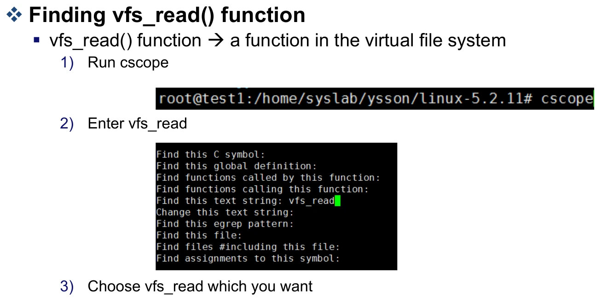

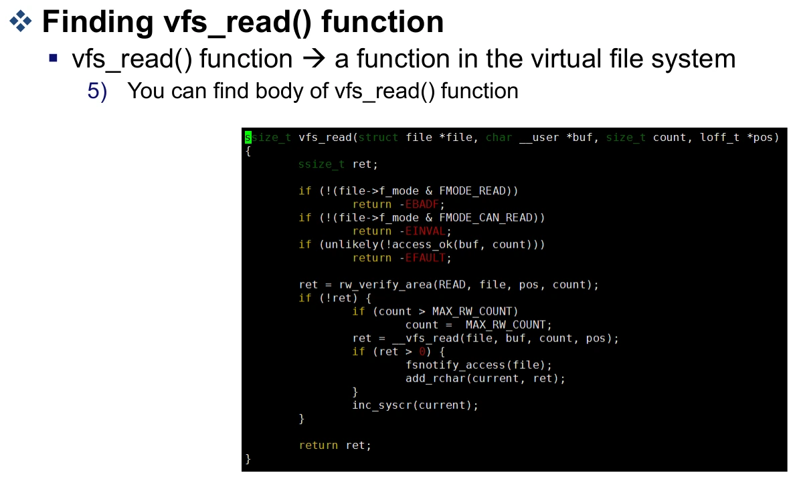

Tmux는 한 창에서 여러 터미널 세션과 pane을 다루는 도구다. 기본 prefix인 `Ctrl+b`를 누른 뒤 다음 키를 입력한다.

| 키 | 동작 |
|---|---|
| `%`, `"` | 좌우 분할, 상하 분할 |
| `o`, 방향키 | 다음 pane, 방향에 있는 pane으로 이동 |
| `[` | 스크롤·복사 모드 진입 |
| `z` | pane 확대·복귀 |
| `c`, 숫자 N | 새 window, N번 window로 이동 |
| `d` | 세션에서 detach |

`tmux`로 시작하고 `tmux a`로 기존 세션에 다시 연결한다. 컴파일을 실행하는 창과 소스를 보는 창을 나누면 편하다.

## 9. 실습: Linux 커널 컴파일

*Practical Class 3, 1~29쪽*

### 소스와 준비 도구

소스를 얻는 방법은 kernel.org의 압축 파일, Git 저장소, 배포판의 source package 세 가지다. 배포판 소스에는 배포판의 패치가 들어 있을 수 있다. 강의의 빌드 예시는 Linux **5.4.214**다.

```bash
sudo apt build-dep linux
sudo apt install libncurses-dev
```

자료는 의존성 부족 시 `linux-image-$(uname -r)`의 빌드 의존성과 `gawk`, `flex`, `bison`, `openssl`, `libssl-dev`, `dkms`, `libelf-dev`, `libudev-dev`, `libpci-dev`, `libiberty-dev`, `autoconf`, `llvm` 등을 추가 확인하도록 안내한다.

`apt build-dep`에서 source URI가 없다고 나오면 Ubuntu의 Software & Updates에서 Source code를 활성화하거나, 해당 환경의 저장소 설정에서 `deb-src`를 활성화한 뒤 `apt update`를 수행한다.

### .config와 Local version

`.config`는 커널 소스 최상위 디렉터리의 빌드 설정 파일이다.

| 준비 방법 | 의미 |
|---|---|
| `/boot`의 기존 config 재사용 | 배포판이 쓰던 하드웨어·기능 구성을 출발점으로 사용 |
| `make config`, `make menuconfig` | 항목을 직접 선택 |
| `make defconfig` | 해당 아키텍처의 기본 설정 생성 |

자료는 `make menuconfig`에서 `General setup → Local version`에 식별 가능한 이름을 넣도록 한다. Enter는 하위 메뉴, Esc 두 번은 돌아가기, Tab은 하단 동작 선택이다.

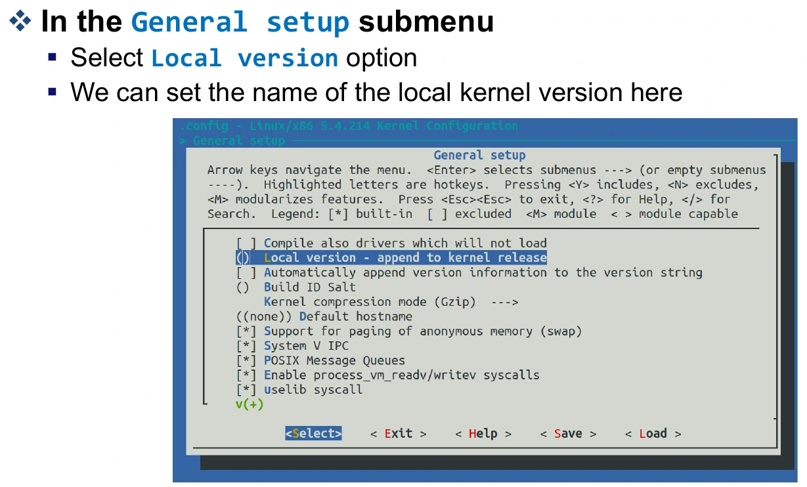

기존 배포판 설정에 소스 트리에 없는 `debian/canonical-certs.pem`이 지정되어 있으면 빌드 문제가 날 수 있다. 자료는 `Cryptographic API → Certificates for signature checking → Additional X.509 keys for default system keyring`의 문자열을 제거하는 예를 보여 준다. 모든 인증서·서명 기능을 무조건 끄라는 뜻은 아니다.

커널 소스에 기능의 코드가 존재하는 것과 빌드 결과에 그 기능이 포함되는 것은 다르다. `.config`가 어떤 코드를 포함하고 어떤 기능을 모듈로 만들지 정한다. Local version은 결과를 구별하는 이름이고, 기능 선택 자체를 대신하지 않는다. 따라서 같은 소스라도 설정이 다르면 다른 커널 결과물이 나올 수 있다.

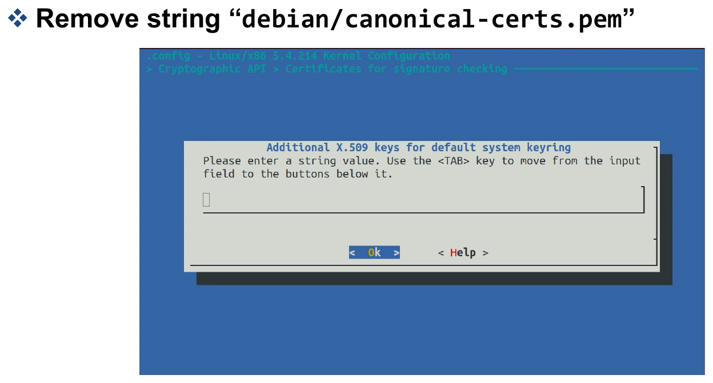

### 빌드와 설치

아래 `4`는 예시 병렬 작업 수다. 호스트·VM의 CPU와 메모리 여유에 맞게 고른다.

```bash
make -j4
make -j4 modules
sudo make modules_install
sudo make install
```

커널을 빌드하는 것과 그 커널로 **실제로 부팅한 것**은 다르다. 모듈 설치는 해당 커널의 모듈 디렉터리에 결과물을 놓는 단계이고, 커널 설치 뒤에는 부트로더 설정을 확인해야 한다.

실습 흐름은 소스와 설정으로 결과물을 만드는 빌드, 부팅 때 사용할 위치에 놓는 설치, 그 결과물을 선택해 실행하는 부팅으로 나뉜다. 첫 단계가 성공해도 현재 실행 중인 커널은 바뀌지 않는다. 그래서 마지막에 `uname -r`로 확인해야 소스 수정부터 실제 실행까지 연결되었음을 알 수 있다.

### GRUB와 부팅 확인

`/etc/default/grub`에서 숨김 메뉴 설정을 조정하고 `GRUB_TIMEOUT`을 정하면 커널 선택 메뉴를 볼 수 있다. 수정 후에는 `sudo update-grub`로 생성 설정에 반영한다. `Advanced options for Ubuntu`에서 새 커널 또는 이전 커널을 선택한다.

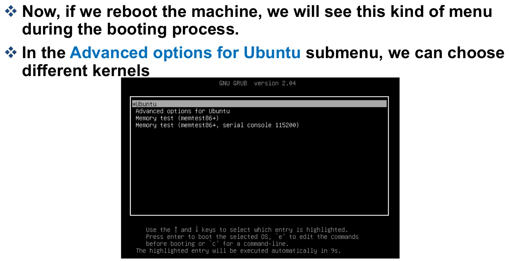

기본 커널을 바꿀 때는 `/boot/grub/grub.cfg`의 menuentry ID를 읽어 `/etc/default/grub`에 `GRUB_DEFAULT="submenu_id>entry_id"` 형식으로 지정하는 방법이 소개된다. 예시 UUID를 그대로 복사하지 않고 자신의 항목을 사용한다. 생성 파일인 `grub.cfg`를 직접 편집하는 것과 원본 설정을 수정하는 것도 구분한다.

```bash
uname -r
```

부팅 후 이 명령의 결과에 설정한 Local version이 있는지 확인한다. 별도 필기의 커널 버전 확인 메모 역시 “설치한 파일”보다 **현재 실행 중인 커널**을 확인하는 과정으로 이해할 수 있다.

## 10. 커널 부팅 문제와 initramfs

*Practical Class 3, 30~33쪽*

| 자료의 문제 | 자료에서 제시한 대응 |
|---|---|
| initial ramdisk 적재 중 메모리 부족 | `sudo make INSTALL_MOD_STRIP=1 modules_install`로 모듈의 디버그 정보 등을 줄이는 방법 |
| `TSC_DEADLINE disabled due to Errata` | BIOS·마이크로코드 관련 문제 확인. 자료는 펌웨어 갱신을 제시 |
| `Initramfs unpacking failed: invalid magic...` | `/etc/initramfs-tools/initramfs.conf`의 압축 방식과 커널 지원 확인. 자료는 `COMPRESS=gzip` 및 initramfs 재생성을 제시 |

initramfs는 부팅 중 실제 루트 파일시스템을 사용하기 전에 필요한 임시 루트 환경을 제공한다. 관련 이미지가 `/boot`에 놓인다. 예를 들어 특정 설치 커널의 이미지를 갱신할 때는 `sudo update-initramfs -u -k <해당 커널 릴리스>`처럼 대상 버전을 확인한다. 오류 문구가 같아도 원인은 다를 수 있으므로 표의 방법을 모든 부팅 실패에 일괄 적용하지 않는다.

## 11. 과제 2: 직접 빌드한 커널로 부팅하기

*Assignment-2, 2쪽*

과제는 **자신의 이름을 포함한 Local version으로 커널을 빌드하고 부팅한 뒤, 소스와 Git 기록을 확인하는 것**이다.

1. 새 커널로 부팅하고 `uname -r` 출력에서 변경한 이름을 확인한다.
2. GitHub·GitLab·Bitbucket 등의 원격 저장소에 커널 소스를 관리한다.
3. 로컬 커밋 로그와 원격 커밋 로그를 각각 캡처한다.
4. 커널 버전 화면 1개와 커밋 로그 화면 2개, 총 3개의 증빙을 PDF에 넣는다.

자료는 제출용 화면에 이름과 학번을 포함하도록 한다. `.gitignore`로 `.o` 같은 빌드 결과물을 제외하고, 업로드 전 `make clean`을 사용하는 방법도 안내한다. 중요한 것은 바이너리·중간 산출물과 수정한 소스의 구분이다.

## 12. 복습문제

### 1. 시스템 콜의 mode switch와 태스크 context switch는 어떻게 다른가?

<details><summary>해설 보기</summary>

Mode switch는 실행 권한이 사용자 모드와 커널 모드 사이에서 바뀌는 것이다. Context switch는 CPU가 실행하는 태스크를 바꾸며 실행 상태를 저장·복원하는 것이다. 시스템 콜이 태스크 변경을 반드시 동반하지는 않는다.

</details>

### 2. x86-64 read(fd, buf, n)의 번호와 인자를 어디에 넣는가?

<details><summary>해설 보기</summary>

진입 전 RAX에 번호 0, RDI에 fd, RSI에 buf, RDX에 n을 넣는다. 네 번째부터는 R10·R8·R9다. MSR_LSTAR는 인자 저장소가 아니라 커널 진입 주소를 설정하는 MSR이다.

</details>

### 3. printf 한 번이 항상 write 시스템 콜 한 번인가?

<details><summary>해설 보기</summary>

아니다. printf는 라이브러리 함수이며 출력 버퍼링을 수행할 수 있다. 실제 출력 시점에 시스템 콜이 발생하므로 호출 횟수가 일대일로 대응하지 않을 수 있다.

</details>

### 4. 하드웨어 인터럽트와 프로그램 실행 중 예외의 동기성은 어떻게 다른가?

<details><summary>해설 보기</summary>

장치의 완료 통지 등은 현재 실행 명령과 독립적으로 발생하는 비동기적 사건이다. 프로그램의 명령 때문에 발생하는 예외나 명시적 서비스 요청은 실행 흐름에 관련된 동기적 사건이다.

</details>

### 5. fork에서 상태를 복사한다는 것은 모든 물리 페이지를 즉시 복제한다는 뜻인가?

<details><summary>해설 보기</summary>

아니다. 주소 공간을 논리적으로 구분하되 실제 데이터 페이지 복사는 copy-on-write로 지연할 수 있다. clone은 플래그에 따라 주소 공간이나 파일 테이블 같은 자원의 공유 여부를 선택한다.

</details>

### 6. .config, make, modules_install, uname -r은 각각 무엇을 확인하는 단계인가?

<details><summary>해설 보기</summary>

.config는 빌드할 기능과 설정, make는 컴파일, modules_install은 만들어진 모듈 설치, uname -r은 현재 실행 중인 커널 확인이다. 소스 준비와 실행 환경 검증을 구분해야 한다.

</details>

### 7. tar -cvf와 apt update에서 흔히 혼동하는 점은?

<details><summary>해설 보기</summary>

tar -cvf는 아카이브 생성이며 그 자체로 압축을 뜻하지 않는다. apt update는 패키지 목록 갱신이며 설치된 패키지를 모두 업그레이드하는 단계는 아니다.

</details>

### 8. 과제 2의 세 가지 증빙은 무엇인가?

<details><summary>해설 보기</summary>

변경한 Local version으로 부팅한 커널 버전 화면, 로컬 커밋 로그, 원격 커밋 로그다. 빌드 산출물이 아니라 소스를 올바르게 버전 관리했는지도 확인한다.

</details>

## 자료와 출처

중앙대학교 리눅스 시스템 응용 설계, 손용석 교수, Systems and Storage Lab.

| 자료 | 범위 |
|---|---|
| `3. System call.pdf` | 1~25쪽: 모드·인터럽트·트랩·시스템 콜 경로·분류·태스크 생성 |
| `[Practical Class 2] linux commands and tools.pdf` | 1~37쪽: 명령어·소스 탐색·tmux |
| `[Practical Class 3] Kernel Compile.pdf` | 1~33쪽: 소스·설정·빌드·설치·부팅·문제 해결 |
| `Assignment-2.pdf` | 1~2쪽: 커널 빌드 과제 |
| `note.pdf` | 사용자/커널 경계와 커널 버전·태스크 생성 관련 필기 |
