프로그램을 실행하면 커널은 명령어만 실행하는 것이 아니라 주소 공간, 열린 파일, 실행 상태, 스케줄링 정보도 함께 관리한다. **프로세스와 스레드의 차이는 실행 흐름의 수와 자원을 공유하는 범위에서 드러난다.** 이번 주는 새 태스크가 만들어질 때 무엇을 복사하고 무엇을 공유하는지 따라간다.

## 1. Program에서 Process로

*강의 2~5쪽*

프로그램은 명령어, 데이터, 적재·실행에 필요한 메타데이터를 포함한다. 소스를 빌드하면 저장장치의 실행 파일이 되고, 이를 실행하면 프로세스가 된다.

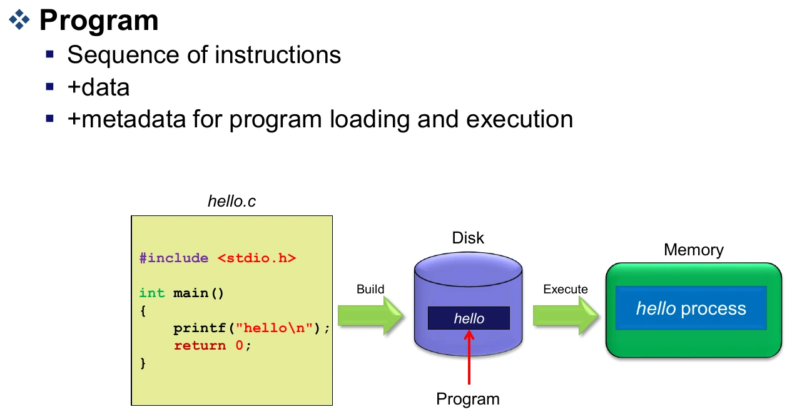

프로세스는 실행 중인 프로그램의 인스턴스다. 같은 실행 파일을 여러 번 실행하면 서로 다른 프로세스가 생길 수 있다. PID는 프로세스를 식별하며, 종료된 프로세스의 번호가 나중에 재사용될 수 있다.

**보충:** 자료의 “PID는 5자리”는 일반적인 제한이 아니다. PID 범위는 시스템 설정 등에 따라 달라진다. 셸 명령마다 무조건 새 프로세스가 생기는 것도 아니다. `cd` 같은 내장 명령은 셸 자체의 상태를 바꾼다.

### fork의 세 가지 반환값

| 결과 | 호출자에게 보이는 값 |
|---|---|
| 실패 | 부모에서 `-1`, 새 자식은 없음 |
| 성공한 부모 | 새 자식의 PID |
| 성공한 자식 | `0` |

성공하면 부모와 자식이 모두 `fork()` 다음 지점부터 실행한다. 같은 한 번의 호출에서 두 실행 흐름이 생기고 각자 다른 반환값을 받는 것이다.

```c
/* 부모·자식의 분기를 보여 주는 핵심 부분 */
pid_t pid = fork();
if (pid == -1) {
    /* 생성 실패 처리 */
} else if (pid == 0) {
    /* 자식 */
} else {
    /* 부모: pid는 자식의 PID */
}
```

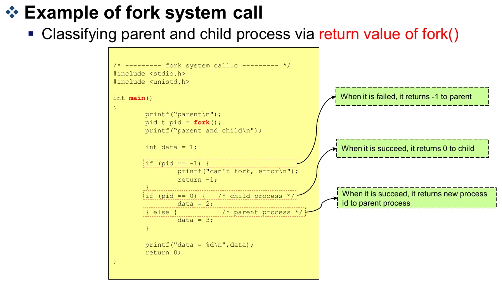

자료의 `data=2`와 `data=3`은 각 프로세스의 변수 상태다. 부모가 먼저 출력할지 자식이 먼저 출력할지는 이 분기만으로 결정되지 않는다. fork 이전의 표준 입출력 버퍼가 복제되는 문제도 있으므로 출력 문자열 개수를 따질 때는 버퍼 상태까지 고려한다.

## 2. task_struct와 연결 리스트

*강의 6~7쪽*

Linux는 태스크의 정보를 `struct task_struct`에 보관한다. 실행 상태와 스케줄링 정보, 부모·자식 관계, 주소 공간과 파일 관련 객체를 가리키는 정보 등이 연결된다. 자료는 `<linux/sched.h>`의 정의와 순환 이중 연결 리스트인 task list를 소개한다.

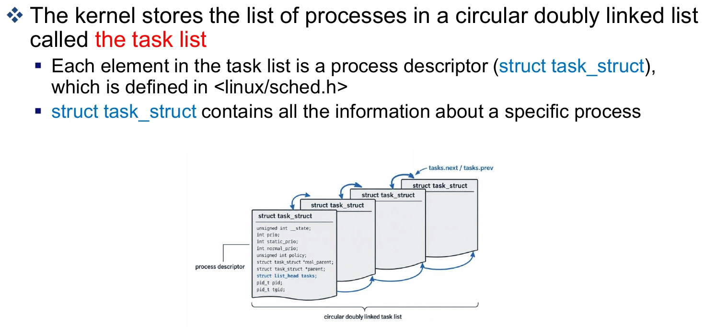

부모의 `children`은 자식 목록의 머리이고, 각 자식의 `sibling`은 그 형제 목록에 연결되는 노드다. “부모의 자식 목록”과 “모든 태스크의 목록”을 같은 링크라고 생각하지 않는다.

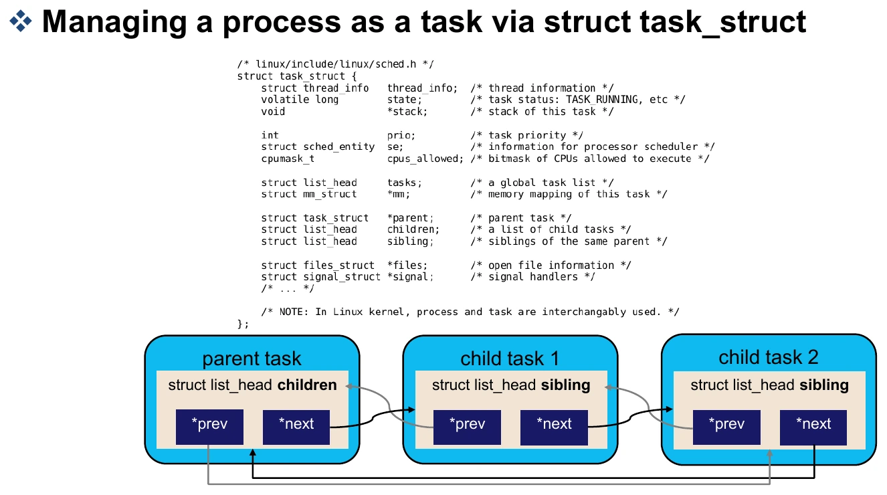

`task_struct`에 모든 자원 내용이 통째로 들어 있는 것도 아니다. 예를 들어 `mm_struct`, `files_struct`처럼 별도 객체를 가리키므로, 생성 시 그 객체를 새로 만들지 공유할지를 선택할 수 있다.

## 3. 프로세스 상태와 수면·깨우기

*강의 8~12쪽*

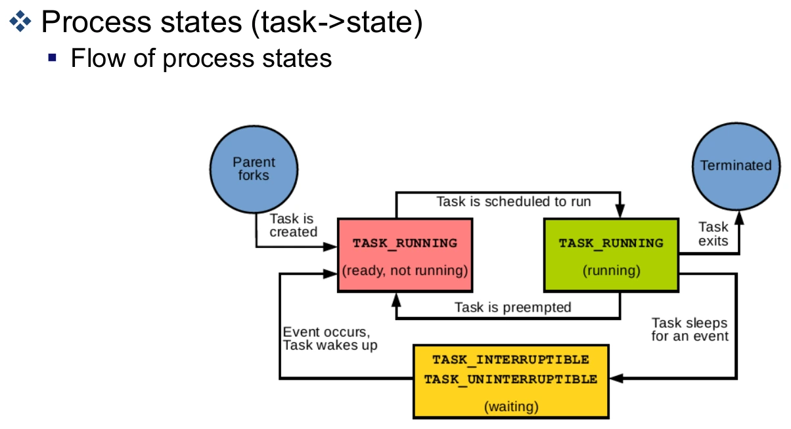

| 상태 | 의미 |
|---|---|
| `TASK_RUNNING` | 현재 실행 중이거나 runqueue에서 CPU를 기다리는 실행 가능 상태 |
| `TASK_INTERRUPTIBLE` | 사건을 기다리며 잠든 상태. 조건 충족 또는 처리할 시그널 등으로 깨어날 수 있음 |
| `TASK_UNINTERRUPTIBLE` | 일반 시그널로 수면을 깨우지 않는 대기 상태. 기다리던 조건의 충족 등이 필요 |
| `TASK_STOPPED` | 정지 시그널 등으로 실행을 중단한 상태 |

`TASK_RUNNING`이라고 해서 반드시 CPU 위에서 실행 중이라는 뜻은 아니다. **Running과 runnable을 하나의 커널 상태값으로 묶어 표현한다**는 점이 중요하다. 상태값을 바꾸는 것과 실제로 스케줄러가 해당 태스크를 선택하는 것도 다른 단계다.

자료에서는 `set_current_state()`와 `set_task_state()`로 상태를 변경하는 형태를 보여 준다. 필드·도우미 이름은 대상 커널 버전을 기준으로 확인한다.

### Producer–Consumer와 lost wakeup

생산자는 목록에 사건을 넣고 소비자를 깨운다. 소비자는 목록에 일이 있으면 처리하고, 없으면 잠든다.

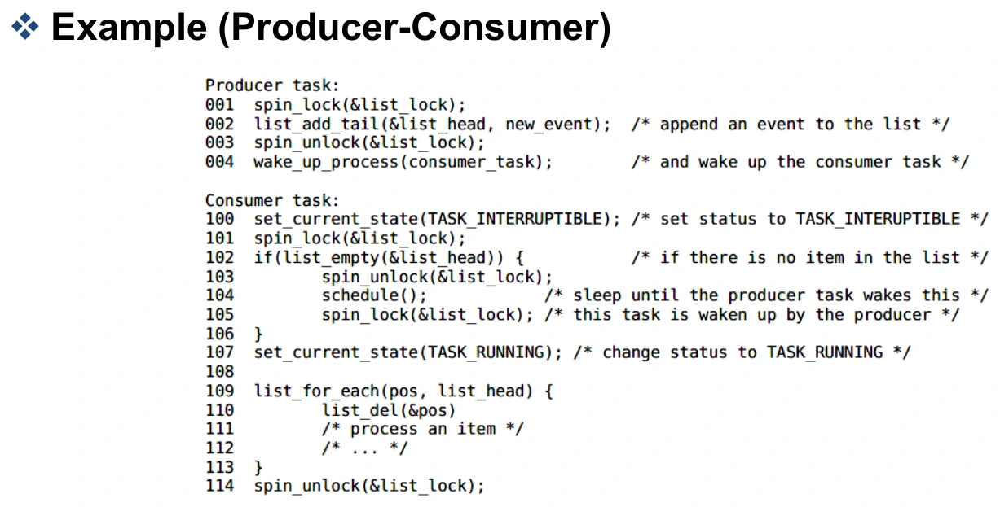

단순히 “비었는지 확인한 뒤 잠든다”만 구현하면 문제가 생길 수 있다.

```text
소비자: 목록이 비었다고 확인
생산자: 사건을 추가하고 wakeup
소비자: 뒤늦게 잠듦
```

이미 발생한 깨우기를 놓치면 일이 있는데도 잠든 상태가 된다. 이를 lost wakeup이라고 한다. **조건 검사, 수면 상태 설정, 깨우기의 순서를 동기화해야 한다.** 실제 커널 코드에서는 wait queue 계열 인터페이스와 조건 재검사를 함께 고려한다.

## 4. fork와 clone의 공통 생성 과정

*강의 13~20, 26~27쪽*

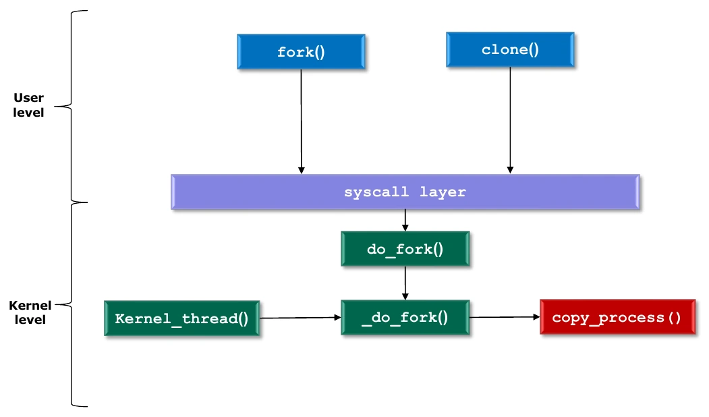

자료의 `_do_fork()` 계열 흐름은 다음과 같다.

1. `copy_process()`에서 새 태스크를 준비한다.
2. 새 태스크의 PID 정보를 얻는다.
3. `wake_up_new_task()`로 실행 가능한 상태에 놓는다.
4. 부모에게 결과를 반환한다.

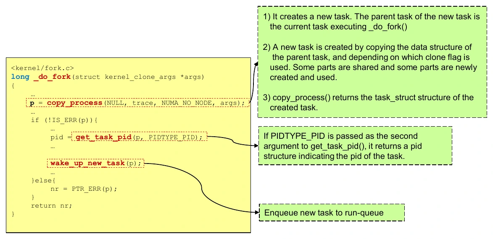

**보충:** 강의의 개요에는 `get_task_pid()`를 PID 할당 단계처럼 표기하지만, 이 함수 자체는 이미 있는 태스크의 PID 객체에 대한 참조를 얻는 함수다. PID의 실제 준비는 생성 과정 안에서 이루어진다. 또한 `wake_up_new_task()`를 모든 스케줄러에서 “큐 맨 앞에 넣기”로 일반화하지 않는다.

### copy_process가 하는 일

| 단계 | 확인·처리할 내용 |
|---|---|
| 플래그 검증 | 공유 옵션 조합이 가능한지 확인 |
| 태스크 구조 준비 | 새 `task_struct`를 만들고 기본 상태 복제 |
| 자원 제한 검사 | 생성 가능한 태스크 수 등의 제한 확인 |
| 초기화 | 관계·통계·스케줄링 필드 등 준비 |
| `sched_fork()` | 스케줄러 관련 초기화 |
| 자원 복사·공유 | 파일, 파일시스템 정보, 시그널, 메모리, namespace, 아키텍처별 실행 상태 |
| 관계 확정 | ID와 부모·자식 관계 등 설정 |

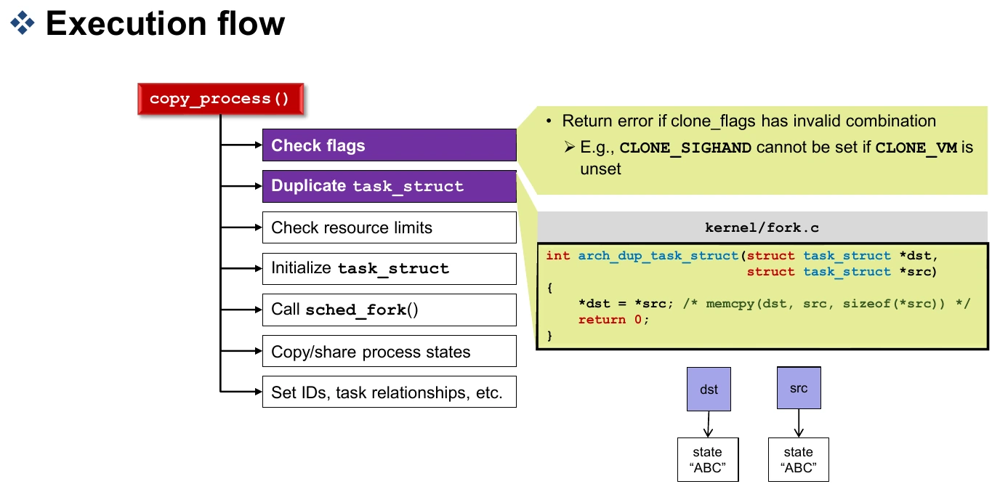

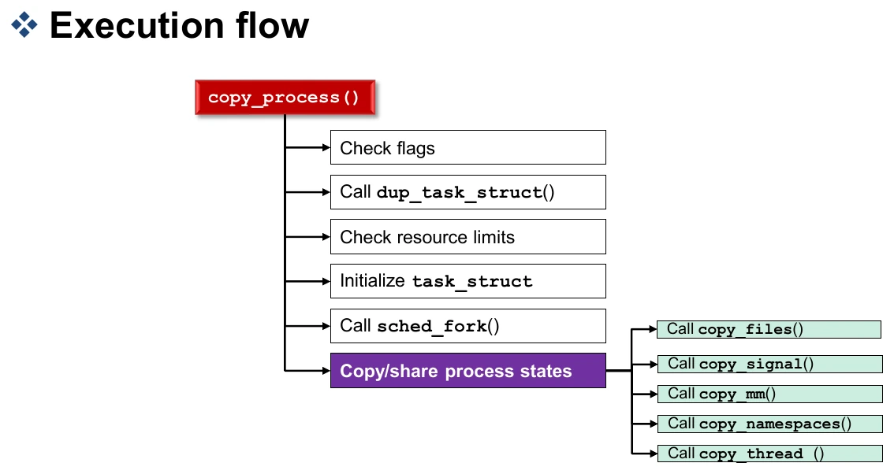

구조체를 한 번 복사했다고 새 태스크 생성이 끝나는 것은 아니다. 포인터가 가리키는 객체와 참조 수, 동기화 상태, 새 태스크에서 달라져야 하는 필드를 후속 단계에서 처리해야 한다.

## 5. 공유 플래그와 참조 수

*강의 15~16, 21, 27, 30~34쪽*

| 플래그 | 공유하는 주요 상태 |
|---|---|
| `CLONE_VM` | 주소 공간, `mm_struct` |
| `CLONE_FS` | 루트·현재 디렉터리·umask 등의 `fs_struct` |
| `CLONE_FILES` | 열린 파일 디스크립터 테이블, `files_struct` |
| `CLONE_SIGHAND` | 시그널 disposition/handler 테이블, `sighand_struct` |
| `CLONE_THREAD` | 같은 thread group에 속하도록 구성 |

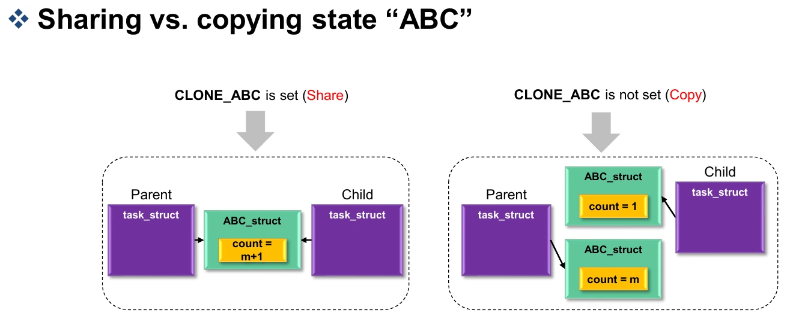

공유하면 두 태스크의 포인터가 같은 객체를 가리키고 참조 수를 늘린다. 복사하면 새 객체를 마련한다. 다만 **바깥 구조체가 복사되어도 그 안의 포인터가 가리키는 객체까지 모두 복제되는 것은 아니다.**

### files_struct → fdtable → file

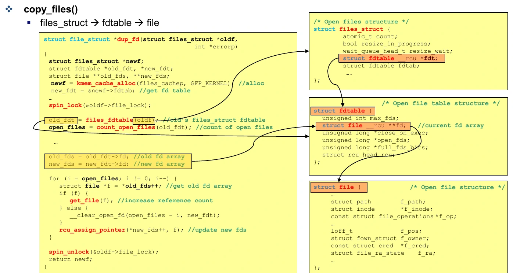

`copy_files()`는 `CLONE_FILES`가 있으면 테이블 객체를 공유하고 참조 수를 늘린다. 없으면 `dup_fd()`로 별도의 테이블을 만든다. 새 테이블의 항목들은 기존 `struct file`을 가리킬 수 있고, 그 파일 객체의 참조 수를 증가시킨다.

따라서 fork 뒤에 **서로 다른 디스크립터 테이블이 같은 open file description을 참조**할 수 있다. 디스크립터 번호만 복사했다고 파일 오프셋까지 완전히 독립적이라고 결론 내리면 안 된다.

### fs_struct와 sighand_struct

`copy_fs()`는 `CLONE_FS`가 있으면 `users`를 늘려 공유한다. 없으면 새 `fs_struct`를 만들고 umask·root·pwd를 복사하며 경로 객체의 참조를 얻는다. 파일 디스크립터를 관리하는 `files_struct`와 역할이 다르다.

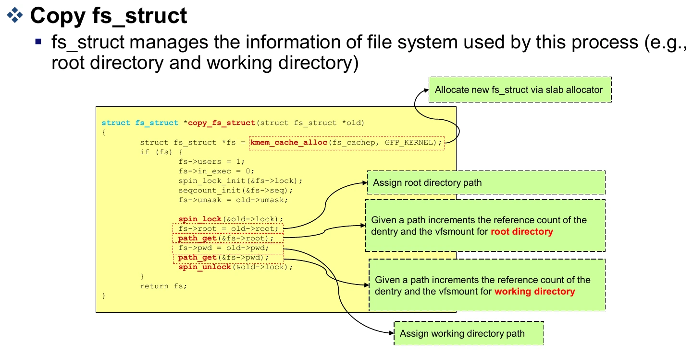

`copy_sighand()`는 handler 테이블을 공유하거나 새 테이블에 action을 복제한다. 자료의 `CLONE_SIGHAND` 설명에 blocked signals가 함께 등장하지만, **각 스레드의 signal mask까지 이 플래그 하나로 공동 상태가 되는 것은 아니다.** `CLONE_SIGHAND`에는 `CLONE_VM`이 필요한 것처럼 플래그 조합 제약도 있다. [clone 매뉴얼](https://man7.org/linux/man-pages/man2/clone.2.html)

## 6. Copy-on-Write

*강의 22~25쪽*

fork할 때 부모의 모든 물리 페이지를 즉시 복사하면 시간이 오래 걸리고, 자식이 곧 다른 프로그램을 실행하면 복사 비용이 낭비될 수도 있다. Copy-on-write(COW)는 **실제 쓰기가 일어날 때 복사하는 방식**이다.

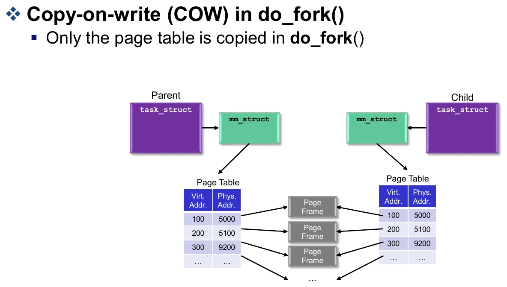

1. 부모와 자식은 별도 주소 공간을 갖는다.
2. 복사 가능한 private 페이지의 물리 프레임은 처음에 함께 참조할 수 있다.
3. 쓰기 시 커널이 개입할 수 있게 페이지 보호 상태를 설정한다.
4. 부모 또는 자식이 쓰면 필요한 페이지를 복사하고 쓰는 쪽의 매핑을 바꾼다.
5. 이후 수정은 그쪽 페이지에 적용된다.

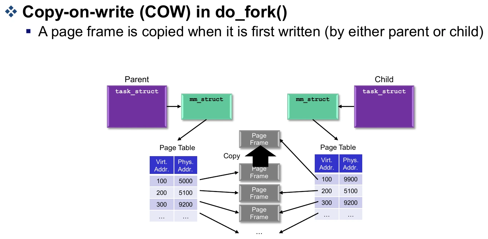

그림에서는 가상주소 100이 부모에서는 물리 프레임 5000, 자식에서는 새 프레임 9900을 가리킨다. 나머지 프레임은 계속 공유할 수 있다. 별도 필기에서도 “페이지 테이블 복사”와 “쓰기 때 실제 페이지 복사”를 나누어 표시한다.

**주의:** COW와 `CLONE_VM`에 의한 주소 공간 공유는 다르다. COW는 논리적으로 독립적인 주소 공간의 복사를 최적화한다. `CLONE_VM`은 같은 주소 공간을 함께 사용한다. 강의의 “페이지 테이블만 복사”는 private 메모리의 대표적 설명이며, 공유 매핑이나 특수 매핑까지 모두 같은 방식으로 처리된다는 뜻은 아니다.

## 7. Signal

*강의 28~29쪽*

시그널은 프로세스에 사건을 알리는 수단이다. 기본 동작으로 종료·정지·계속 실행·무시 등이 있고, 일부 시그널에는 handler를 등록할 수 있다.

| 이름 | 의미 |
|---|---|
| `SIGHUP` | 터미널 연결 종료 등 |
| `SIGINT` | 보통 터미널의 Ctrl+C |
| `SIGQUIT` | 종료 요청, 기본적으로 core dump를 동반할 수 있음 |
| `SIGILL` | 잘못된 명령 실행 |
| `SIGABRT` | abort에 의한 종료 |
| `SIGKILL` | 잡거나 무시할 수 없는 강제 종료 |
| `SIGALRM` | 알람 타이머 |
| `SIGCONT` | 정지된 프로세스의 실행 재개 |
| `SIGCHLD` | 자식 상태 변화 통지 |

자료의 숫자 표는 아키텍처별 차이를 주의해야 한다. 예를 들어 x86/ARM의 Linux에서는 `SIGCONT=18`, `SIGCHLD=17`이며, 자료의 19·20을 그대로 이 환경에 적용하면 틀린다. 숫자를 하드코딩하기보다 이름을 사용하고 [signal 매뉴얼의 아키텍처별 표](https://man7.org/linux/man-pages/man7/signal.7.html)를 확인한다.

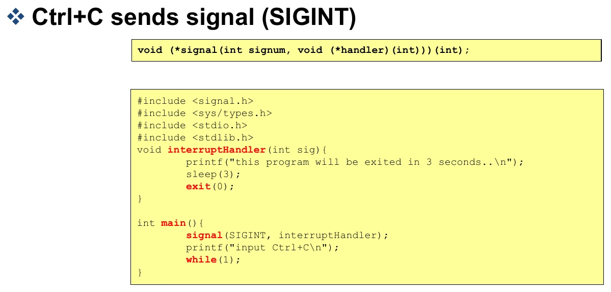

자료의 `signal(SIGINT, interruptHandler)`는 handler 등록 개념을 보여 준다. 다만 handler 안의 `printf`, `sleep`, `exit` 등을 그대로 일반적인 안전한 패턴으로 받아들이지 않는다. 실제 프로그램에서는 async-signal-safe 조건을 고려하고, handler에서 `volatile sig_atomic_t` 플래그를 설정한 뒤 주 실행 흐름에서 출력·정리를 수행하는 방식을 쓸 수 있다.

## 8. Thread와 pthread

*강의 35~39쪽*

스레드는 프로그램 카운터, 실행 스택, ID 등 자체 실행 상태를 갖는 CPU 실행 흐름이다. 한 프로세스 안의 여러 스레드는 주소 공간을 공유한다. 문서 편집에서 입력 처리와 화면 갱신을 나누는 것처럼 여러 작업을 동시에 진행할 때 사용한다.

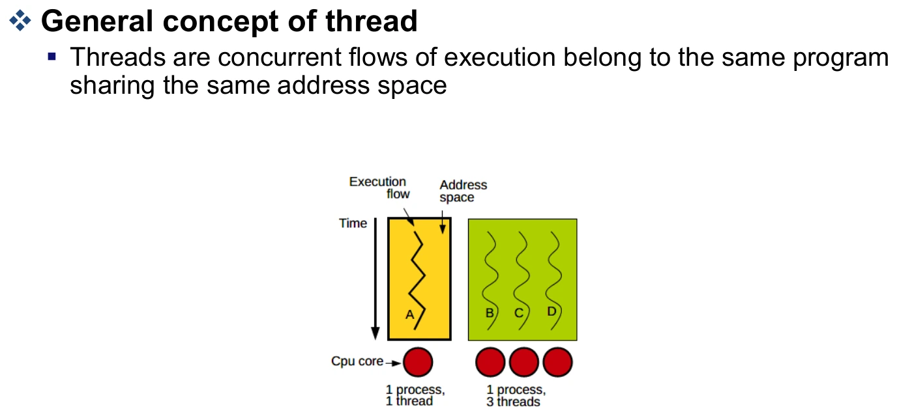

| 항목 | 같은 프로세스의 스레드 |
|---|---|
| 주소 공간·전역 데이터 | 공유 |
| 각 스레드의 스택·레지스터·실행 위치 | 별도 실행 상태 |
| 스케줄링 | Linux의 각 스레드는 스케줄링 대상 태스크 |
| 주의점 | 공유 데이터에 대한 동기화 필요 |

`pthread_create()`는 새 스레드가 시작할 함수와 인자를 지정하고, `pthread_join()`은 join 가능한 스레드의 종료를 기다리며 반환값을 회수한다.

```c
int rc = pthread_create(&thread, NULL, worker, argument);
if (rc != 0) {
    /* rc가 오류 번호다. pthread_create는 -1만으로 실패를 알리지 않는다. */
}
/* ... */
void *result = NULL;
pthread_join(thread, &result);
```

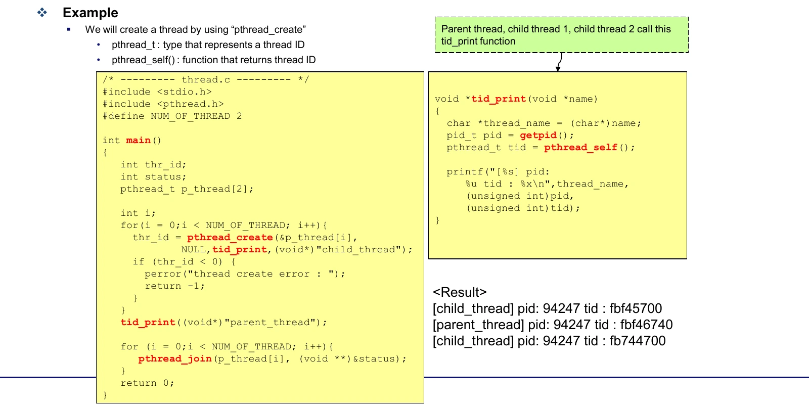

자료 예제의 `thr_id < 0` 검사와 `int status`를 `void **`로 강제 변환하는 부분은 그대로 따라 쓰지 않는다. 실패 검사는 `rc != 0`, 반환값 저장은 `void *` 또는 불필요하면 `NULL`을 사용한다. `pthread_t`도 모든 구현에서 32비트 정수라고 가정하지 않는다.

종료된 joinable 스레드를 join하거나 detach하지 않으면 회수되지 않은 자원이 남을 수 있다. 단순히 “join이 한 번 실패하면 반드시 zombie가 된다”로 외우기보다 스레드의 수명과 자원 회수 책임을 구분한다.

## 9. 커널 스레드

*강의 40~47쪽*

커널 스레드는 커널 내부의 백그라운드 작업을 수행한다. 예를 들어 `kswapd`는 메모리 여유가 낮아지면 회수 작업을 진행하고, ext4의 JBD2 스레드는 저널링 작업에 관여한다.

**용어 주의:** 자료의 “journald”와 여기서 보려는 `kjournald2`/`jbd2`는 구분해야 한다. 사용자 공간의 `systemd-journald` 로그 수집 서비스와 파일시스템의 저널 커밋 커널 스레드는 다른 것이다.

| API | 역할 |
|---|---|
| `kthread_create()` | 커널 스레드 생성. 생성 뒤 실행을 깨우는 단계가 별도 |
| `kthread_run()` | 생성 후 깨우기까지 수행 |
| `kthread_should_stop()` | 종료 요청이 왔는지 확인 |
| `kthread_stop()` | 종료를 요청하고 스레드가 끝날 때까지 기다림 |

`kthread_stop()`은 임의의 코드를 그 자리에서 강제 제거하는 함수가 아니다. worker가 종료 조건을 확인하고 return하는 협력이 필요하다.

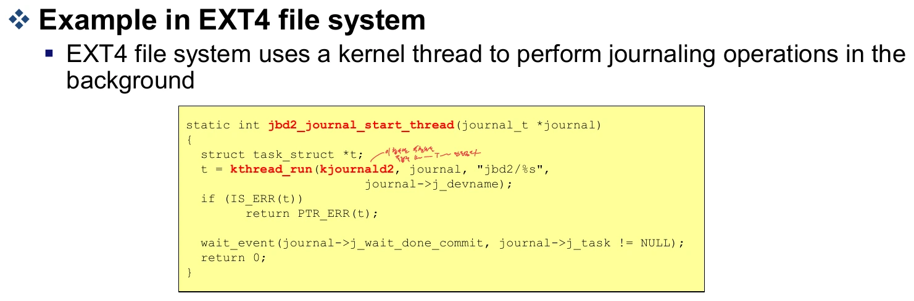

자료의 `kthread_run(kjournald2, journal, "jbd2/%s", ...)` 뒤에는 `IS_ERR()`와 `PTR_ERR()`로 생성 오류를 다루고, 필요한 준비가 끝났는지 기다리는 코드가 있다. ext4 lazy inode table initialization은 모든 초기화를 즉시 수행하지 않고 백그라운드에서 나누어 진행하는 다른 사례다.

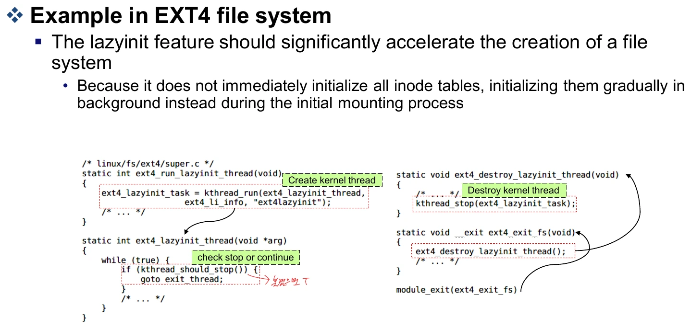

### 모듈 안에서 스레드 사용하기

Makefile은 실행 중인 커널의 build 디렉터리를 사용해 외부 모듈을 빌드한다.

```makefile
obj-m := kthread_module.o
KERNEL_DIR := /lib/modules/$(shell uname -r)/build
PWD := $(shell pwd)

all:
	$(MAKE) -C $(KERNEL_DIR) M=$(PWD) modules
clean:
	$(MAKE) -C $(KERNEL_DIR) M=$(PWD) clean
```

자료의 10개 스레드 예제는 각 인자를 `kmalloc`으로 할당하고 worker가 출력 후 `kfree`하는 구조다.

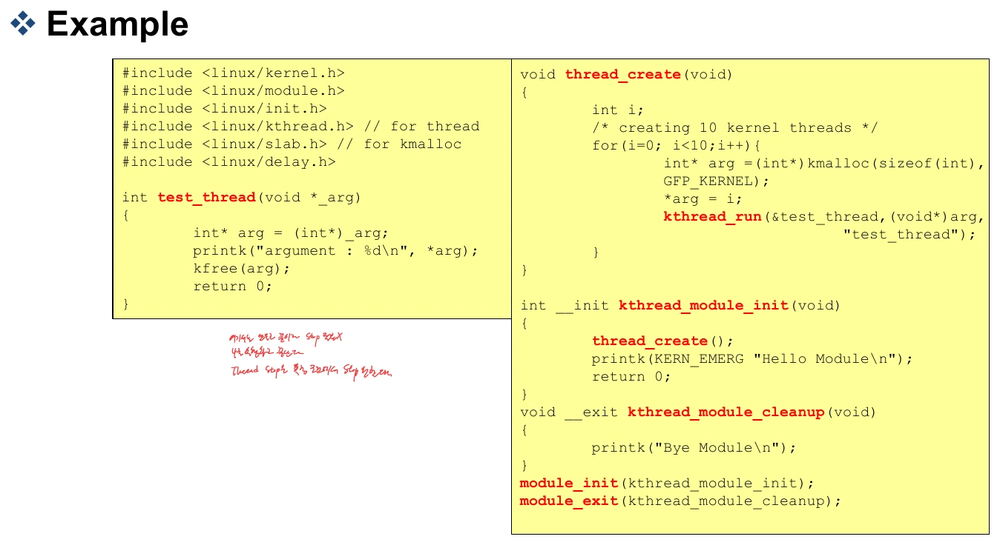

```bash
make
sudo insmod kthread_module.ko
sudo dmesg
sudo rmmod kthread_module
```

실제로 구현할 때는 메모리 할당 실패와 `kthread_run()`의 오류 포인터를 검사하고, **모듈이 내려가기 전에 해당 모듈 코드를 실행하는 스레드가 모두 종료되었는지 보장**해야 한다. 자료의 짧은 예제만으로 그 수명 관리가 자동 해결되는 것은 아니다.

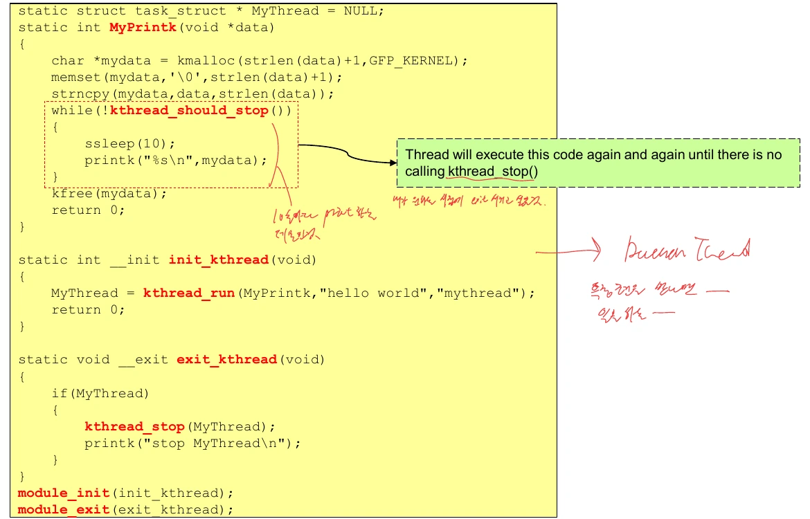

빈 반복문은 CPU를 계속 소비한다. 기다릴 일이 있으면 수면·이벤트 대기를 적절히 사용하고, 깨어난 뒤 종료 조건도 확인한다. 필기의 “kernel thread”와 사용자 영역의 thread 그림 역시 **어느 실행 영역에서 어떤 자원을 사용하고 누가 수명을 관리하는가**로 연결된다.

## 10. 실습: 자신의 시스템 콜 추가하기

*Practical Class 4, 1~12쪽*

이번 실습은 `mycall`이라는 새 커널 서비스를 등록한 뒤 사용자 프로그램에서 호출하는 것이다. 강의는 주로 Linux 5.x 소스를 예로 든다.

### 구현과 빌드 대상 등록

`kernel/my_syscall.c`에 인자가 없는 시스템 콜을 정의하고, `kernel/Makefile`의 빌드 대상에 추가한다.

```c
#include <linux/syscalls.h>

SYSCALL_DEFINE0(mycall)
{
    printk("System Call Example\n");
    return 0;
}
```

```makefile
obj-y += my_syscall.o
```

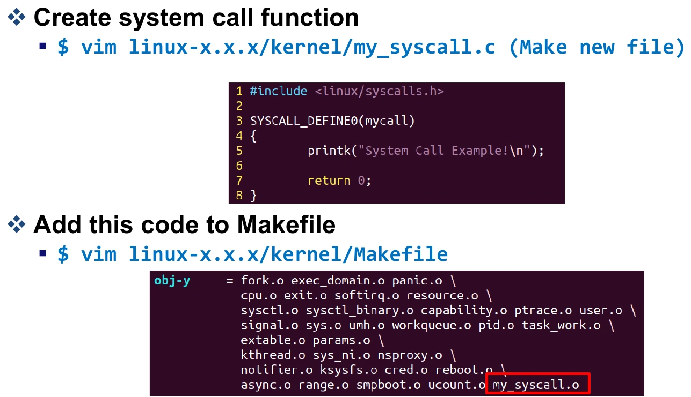

### 아키텍처와 번호 등록

먼저 `uname -m`으로 x86-64인지 ARM64인지 확인한다. 자료에서 제시한 등록 위치는 다음과 같다.

| 자료의 대상 | 등록 위치 |
|---|---|
| x86-64 | `arch/x86/entry/syscalls/syscall_64.tbl` |
| 해당 ARM64 예시 | `include/uapi/asm-generic/unistd.h` |
| 함수 선언 | `include/linux/syscalls.h` |

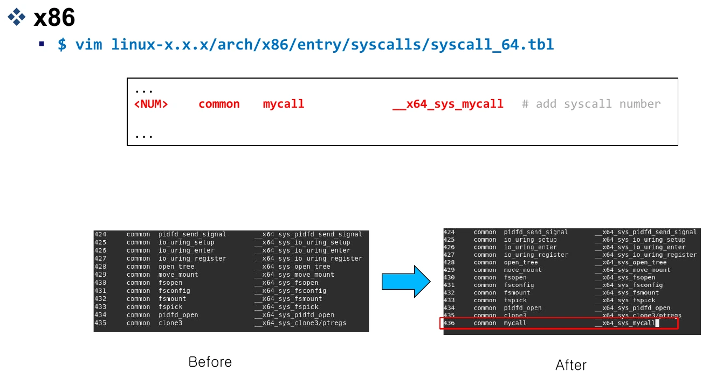

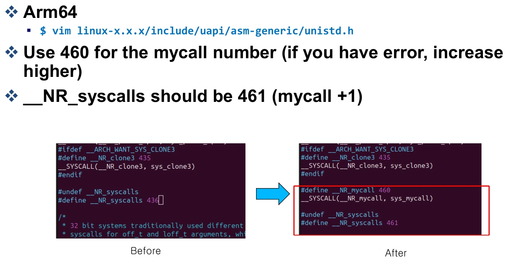

헤더에는 해당 버전의 규칙에 맞게 `asmlinkage long sys_mycall(void);` 같은 선언을 추가한다. `SYSCALL_DEFINE0`로 생성되는 이름, 테이블 entry의 이름, 아키텍처별 wrapper를 함께 확인해야 한다.

**중요:** 자료의 x86 번호 436과 ARM64 번호 460은 실습 당시의 예시다. 새 버전에서도 비어 있는 번호라고 가정하면 안 된다. 번호 충돌이 없는지 **선택한 소스의 테이블**에서 확인하고, 사용자 프로그램에 같은 번호를 사용한다. 등록 파일과 생성 방식도 버전별로 달라질 수 있다. [커널의 시스템 콜 추가 문서](https://docs.kernel.org/process/adding-syscalls.html)

### 빌드·부팅·호출

```bash
make menuconfig
make -j4
make modules -j4
sudo make modules_install
sudo make install
```

필요하면 `/etc/default/grub`의 기본 항목을 조정하고 `sudo update-grub`를 수행한다. 재부팅 후 `uname -r`로 새 커널인지 확인한다.

사용자 프로그램은 libc의 `syscall()`을 통해 등록한 번호를 요청한다. 아래의 `MYCALL_NR`는 선택한 소스에 등록한 번호로 정의해야 하는 값이다.

```c
#include <stdio.h>
#include <unistd.h>
#include <sys/syscall.h>

int main(void)
{
    long ret = syscall(MYCALL_NR);
    if (ret == -1) {
        perror("mycall");
        return 1;
    }
    printf("mycall returned %ld\n", ret);
    return 0;
}
```

반환값이 0인지와 `sudo dmesg`에 지정한 메시지가 있는지 확인한다. 선언이 없다는 컴파일 경고를 무시하는 대신 필요한 헤더와 feature macro 조건을 확인한다. 호출 번호가 없으면 `ENOSYS`가 나타날 수 있지만, **다른 실제 시스템 콜과 번호가 충돌한 경우에는 단순히 ENOSYS로 끝나지 않을 수 있다.**

## 11. 과제 3: 시스템 콜 호출 증명

*Assignment-3, 1~3쪽*

과제의 순서는 새 시스템 콜 구현 → 커널 재컴파일 → 해당 커널로 부팅 → 호출 프로그램 작성·실행 → `dmesg` 확인이다. 호출 결과가 보이는 화면을 PDF 보고서에 넣고 제출용 식별 정보를 포함한다.

확인해야 할 연결은 세 가지다. **커널에 구현이 들어갔는지**, **그 커널이 실행 중인지**, **사용자 프로그램이 그 구현의 번호를 호출하는지**다. 소스에 함수가 있다는 사실만으로 실행 증명이 되지는 않는다.

## 12. 복습문제

### 1. fork가 성공했을 때 부모와 자식은 각각 어떤 값을 받는가?

<details><summary>해설 보기</summary>

부모는 자식 PID, 자식은 0을 받는다. 둘 다 fork 다음부터 실행한다. 실패하면 부모가 -1을 받고 자식은 만들어지지 않는다.

</details>

### 2. TASK_RUNNING은 반드시 CPU에서 실행 중임을 뜻하는가?

<details><summary>해설 보기</summary>

아니다. 현재 실행 중인 상태와 runqueue에서 기다리는 실행 가능 상태를 포함한다.

</details>

### 3. CLONE_FILES 없이 fork했는데 왜 파일 오프셋이 공유될 수 있는가?

<details><summary>해설 보기</summary>

디스크립터 테이블은 별도여도 항목들이 같은 struct file/open file description을 참조할 수 있기 때문이다. 테이블 복사와 그 안의 객체 복사는 구분해야 한다.

</details>

### 4. COW와 CLONE_VM의 차이는 무엇인가?

<details><summary>해설 보기</summary>

COW는 별도 주소 공간을 효율적으로 복제하기 위해 물리 페이지 복사를 쓰기 시점까지 미룬다. CLONE_VM은 주소 공간 자체를 공유한다.

</details>

### 5. 소비자가 조건을 검사한 뒤 아무 동기화 없이 잠들면 어떤 문제가 생기는가?

<details><summary>해설 보기</summary>

조건 검사와 수면 사이에 생산자의 wakeup이 발생하면 이를 놓치고 일이 있는데도 잠들 수 있다. 상태 설정·조건 검사·깨우기를 적절히 연결해야 한다.

</details>

### 6. pthread_create의 오류를 rc < 0으로만 검사하면 왜 잘못인가?

<details><summary>해설 보기</summary>

pthread_create는 성공 시 0, 실패 시 오류 번호를 반환한다. 음수만 검사하면 양수 오류 번호를 놓친다. `rc != 0`으로 확인한다.

</details>

### 7. kthread_stop을 호출하면 worker의 실행 위치와 무관하게 즉시 사라지는가?

<details><summary>해설 보기</summary>

아니다. 종료 요청을 표시하고 worker의 종료를 기다린다. worker는 종료 조건을 확인해 return해야 하며 모듈 해제 전 수명을 정리해야 한다.

</details>

### 8. 실습자료의 시스템 콜 번호를 다른 커널에 그대로 쓰면 안 되는 이유는?

<details><summary>해설 보기</summary>

버전·아키텍처마다 번호 배정과 등록 방식이 다르며 이미 다른 서비스가 사용할 수 있다. 대상 소스에서 충돌 여부를 확인하고 사용자 호출 번호와 맞춰야 한다.

</details>

## 자료와 출처

중앙대학교 리눅스 시스템 응용 설계, 손용석 교수, Systems and Storage Lab.

| 자료 | 범위 |
|---|---|
| `5. Process and Thread.pdf` | 1~47쪽: 프로세스·상태·생성·COW·시그널·사용자/커널 스레드 |
| `[Practical Class 4] Linux System Call.pdf` | 1~12쪽: 새 시스템 콜 구현·등록·빌드·호출 |
| `Assignment-3.pdf` | 1~3쪽: 호출 결과 보고 |
| `note.pdf` | 4~5쪽의 프로세스·스레드·복사/공유·COW 관련 필기 |
