여러 실행 흐름이 같은 데이터를 수정할 때는 한 줄짜리 코드도 예상과 다른 결과를 만든다. 동기화의 출발점은 **공유 데이터에 대한 연산이 어느 지점에서 끼어들 수 있는지** 찾는 것이다.

## 1. Shared resource와 Critical section

*Synchronization (1), 2~6쪽*

공유 자원은 둘 이상의 실행 흐름이 접근하는 대상이다. 같은 프로세스의 스레드는 전역 변수와 힙 객체를 공유한다. 다른 프로세스도 공유 메모리를 매핑하면 같은 데이터를 읽고 쓸 수 있다.

각 스레드의 스택에 따로 만들어지는 지역 변수 자체는 보통 독립적이다. 다만 지역 변수에 저장한 포인터가 같은 힙 객체를 가리키면 **포인터가 지역 변수라는 사실과 대상의 공유 여부는 별개**다.

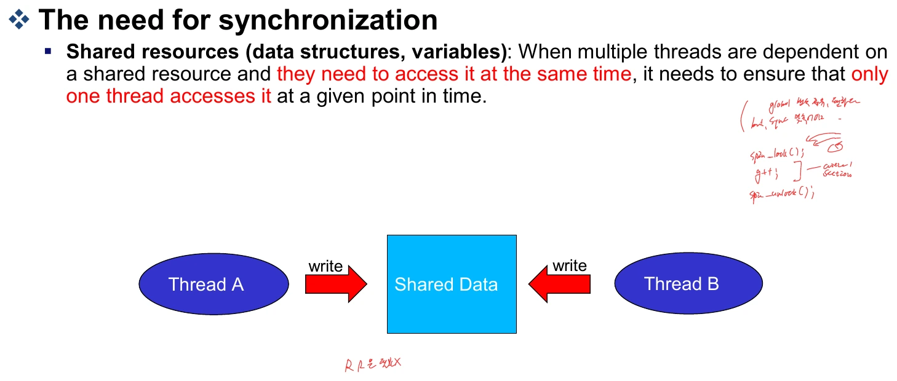

임계 구역은 공유 자원에 접근하며 일관성을 지켜야 하는 코드 구간이다. 전체 프로그램이 아니라, 다른 실행 흐름과 동시에 수행하면 문제가 생기는 구간을 말한다.

```text
entry section       진입 조건 확인·락 획득
critical section    공유 자원 읽기·수정
exit section        락 해제
remainder section   나머지 작업
```

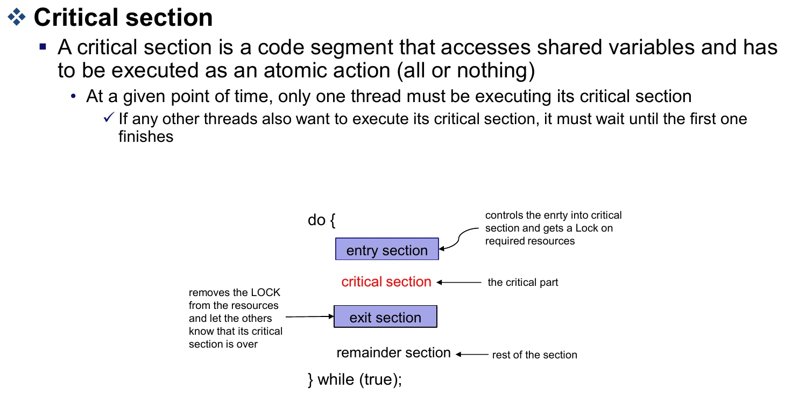

임계 구역의 경계는 지키려는 조건에서 정한다. 예를 들어 큐에 항목을 넣고 개수도 증가시켜야 한다면, 두 변경 사이를 다른 실행 흐름이 관찰해 “목록에는 있는데 개수는 0”인 상태를 사용하지 못하게 해야 한다. 단순히 마지막 대입문 하나를 보호하는 것보다 목록과 개수를 함께 일관되게 갱신하는 범위가 중요하다.

## 2. i++가 원자적이지 않은 이유

*Synchronization (1), 7~9쪽*

`i++`는 개념적으로 읽기, 계산, 쓰기의 세 단계다. 기계어 한 줄처럼 보이는 연산도 다른 CPU에 대한 원자성이 자동으로 보장되는 것은 아니다.

```text
load  i → register
add   1 → register
store register → i
```

`i = 7`에서 두 스레드가 한 번씩 증가시키면 기대값은 9다. 하지만 다음 순서면 8이 된다.

| 순서 | 스레드 A | 스레드 B | 공유 i |
|---|---|---|---|
| 1 | 7을 읽음 | | 7 |
| 2 | | 7을 읽음 | 7 |
| 3 | 자신의 레지스터에서 8 계산 | | 7 |
| 4 | | 자신의 레지스터에서 8 계산 | 7 |
| 5 | 8 저장 | | 8 |
| 6 | | 8 저장 | 8 |

한 스레드의 갱신이 사라지는 **lost update**다. 실행 순서에 따라 결과가 바뀌는 상황을 race condition이라고 한다.

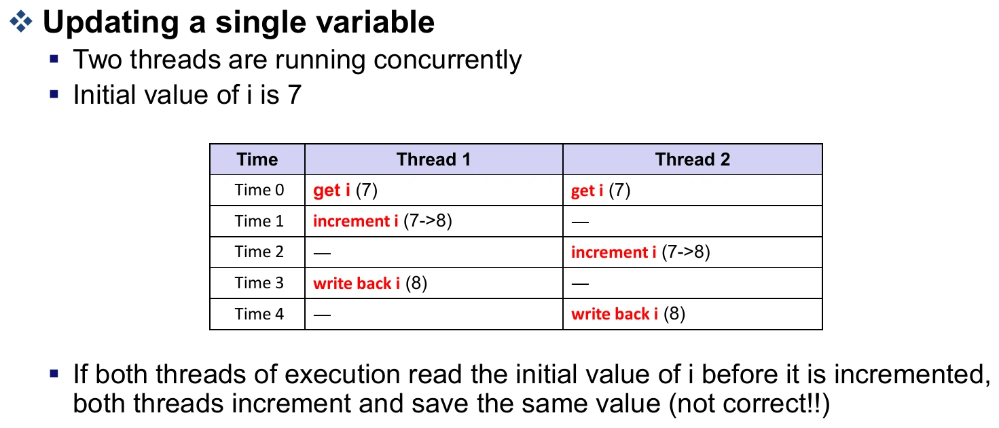

`volatile`은 이런 read-modify-write를 하나의 원자적 연산으로 바꿔 주지 않는다. 단순히 소스 한 줄을 보호하는 것이 아니라, 공유 상태의 불변식을 깨뜨릴 수 있는 전체 연산을 보호해야 한다.

이 시간선은 경쟁이 생기는 원리를 보여 주는 모형이다. 사용자 공간의 일반 C 코드에서 동기화 없이 같은 변수를 동시에 읽고 쓰면 언어 수준의 data race가 되어 동작 자체가 정의되지 않을 수 있다. 따라서 실제 실행 결과가 항상 8 또는 9 중 하나라고 보장하는 예제로 읽지는 않는다. 핵심은 서로의 갱신을 보존하도록 적절한 동기화 연산을 사용해야 한다는 점이다. [C11 초안 N1570 §5.1.2.4](https://www.open-std.org/jtc1/sc22/wg14/www/docs/n1570.pdf)

## 3. 커널에서 실행이 끼어드는 세 가지 경우

*Synchronization (1), 10~14쪽*

장치 드라이버의 큐를 생각해 보자. 인터럽트 핸들러는 큐에 항목을 넣고, `read()` 경로는 길이를 확인하고 메모리를 확보한 다음 항목을 꺼낸다. 길이를 확인한 시점과 실제 접근 시점 사이에 큐가 바뀌면 앞에서 계산한 조건이 더 이상 맞지 않을 수 있다.

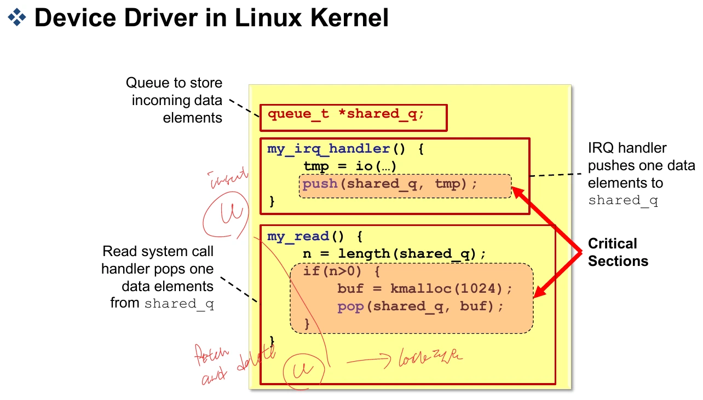

| 끼어드는 경로 | 단일 코어에서도 발생하는 이유 |
|---|---|
| Interrupt | 실행 중인 태스크를 멈추고 ISR이 같은 자료에 접근 |
| Kernel preemption | 커널 코드를 실행하던 태스크 대신 다른 태스크가 실행 |
| Sleep·blocking | 현재 태스크가 기다리는 동안 스케줄러가 다른 태스크 실행 |

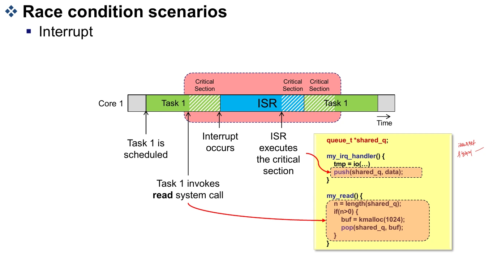

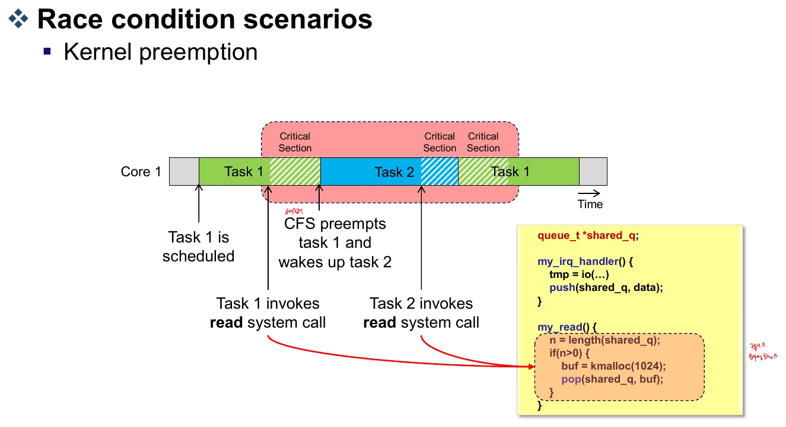

메모리 할당도 항상 즉시 끝나는 것은 아니다. 예를 들어 `kmalloc(..., GFP_KERNEL)`은 메모리를 확보하는 과정에서 잠들 수 있다. 따라서 “내 코드에 직접 `schedule()`이 없으니 중간에 바뀌지 않는다”라고 판단하면 안 된다.

멀티코어에서는 여기에 **다른 CPU의 실제 동시 실행**이 추가된다. 현재 CPU에서 선점이나 인터럽트를 막아도 다른 CPU는 계속 실행한다.

한 코어에서는 A가 작업을 끝내기 전에 B가 끼어들어도 경쟁이 생기고, 여러 코어에서는 A와 B가 실제로 같은 순간에 접근할 수도 있다. 그래서 동기화 방법을 정할 때는 코어 수만 보지 말고 “이 자료에 접근할 수 있는 실행 경로가 무엇인가”를 먼저 찾아야 한다. 태스크끼리만 공유하는지, ISR도 접근하는지에 따라 필요한 보호가 달라진다.

## 4. Preemption 제어

*Synchronization (2), 2~5쪽*

`preempt_disable()`은 현재 CPU에서 태스크 선점을 막고, `preempt_enable()`은 대응하는 선점 금지 범위를 끝낸다. 중첩 호출을 다루기 위해 단순 Boolean 대신 카운터를 이용한다.

```text
초기:                   count = 0
바깥 preempt_disable:   count = 1
안쪽 preempt_disable:   count = 2
안쪽 preempt_enable:    count = 1
바깥 preempt_enable:    count = 0
```

선점을 다시 허용할 때 재스케줄링이 필요한지도 확인할 수 있다. 강의의 `preempt_enable_no_resched()`는 재스케줄링 검사를 바로 수행하지 않는 경로를 보여 준다. `preempt_count`의 저장 위치와 매크로 세부 구현은 커널 버전·아키텍처에 따라 달라진다.

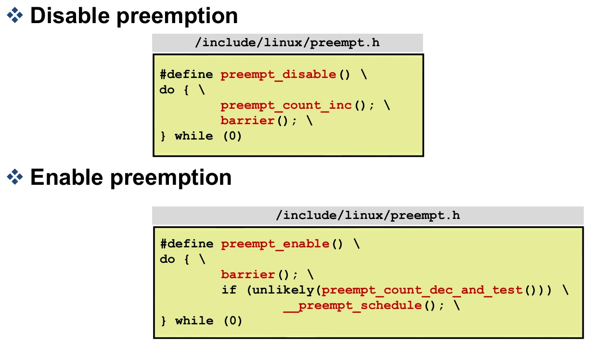

**선점 금지는 인터럽트 금지가 아니다.** ISR이 같은 자료를 수정하거나 다른 CPU가 접근하는 문제는 별도로 해결해야 한다.

## 5. Interrupt 제어

*Synchronization (2), 6~8쪽*

`local_irq_disable()`과 `local_irq_enable()`은 현재 CPU의 일반적인 마스킹 가능한 인터럽트를 제어한다. 이미 인터럽트가 꺼진 문맥에서도 호출될 수 있다면 무조건 enable로 끝내면 안 된다.

```c
unsigned long flags;
local_irq_save(flags);
/* 짧은 임계 구역 */
local_irq_restore(flags);
```

`save`는 이전 상태를 저장한 뒤 끄고, `restore`는 저장한 상태를 되돌린다. 원래 꺼져 있었으면 끝날 때도 꺼져 있어야 한다.

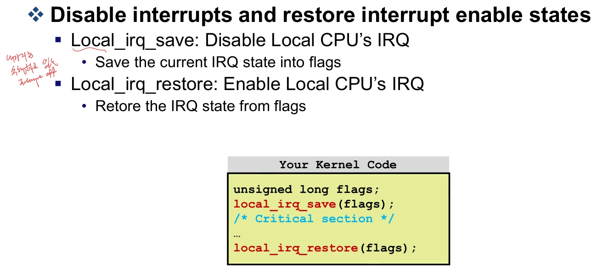

여기서 `local`이 중요하다. 다른 CPU의 인터럽트나 메모리 접근까지 막는 전역 잠금이 아니다. 선점·인터럽트 제어는 CPU 내부의 실행 관계를 다루고, CPU 사이의 경쟁에는 원자적 연산이나 락이 필요하다.

## 6. Atomic operation

*Synchronization (2), 9~17쪽*

원자적 연산은 다른 참여자가 중간 상태를 관찰해 연산을 끼워 넣지 못하도록 수행하는 연산이다. 핵심은 계산 속도가 빠르다는 것이 아니라 **공유 값에 대한 읽기·변경·쓰기가 하나의 단위로 보인다**는 점이다.

```c
atomic_t counter = ATOMIC_INIT(0);
atomic_set(&counter, 4);
atomic_add(2, &counter);
atomic_inc(&counter);       /* 이제 7 */
```

| API 계열 | 의미 |
|---|---|
| `ATOMIC_INIT`, `atomic_set`, `atomic_read` | 초기화·저장·읽기 |
| `atomic_add`, `atomic_sub` | 지정한 값만큼 더하기·빼기 |
| `atomic_inc`, `atomic_dec` | 1 증가·감소 |
| `atomic_sub_and_test`, `atomic_inc_and_test`, `atomic_dec_and_test` | 연산 후 결과가 0인지 반환 |
| `atomic_add_negative` | 더한 결과가 음수인지 반환 |
| `atomic_add_return`, `atomic_sub_return` | 연산 후 값 반환 |
| `atomic64_*` | 64비트 정수에 대응하는 연산 |

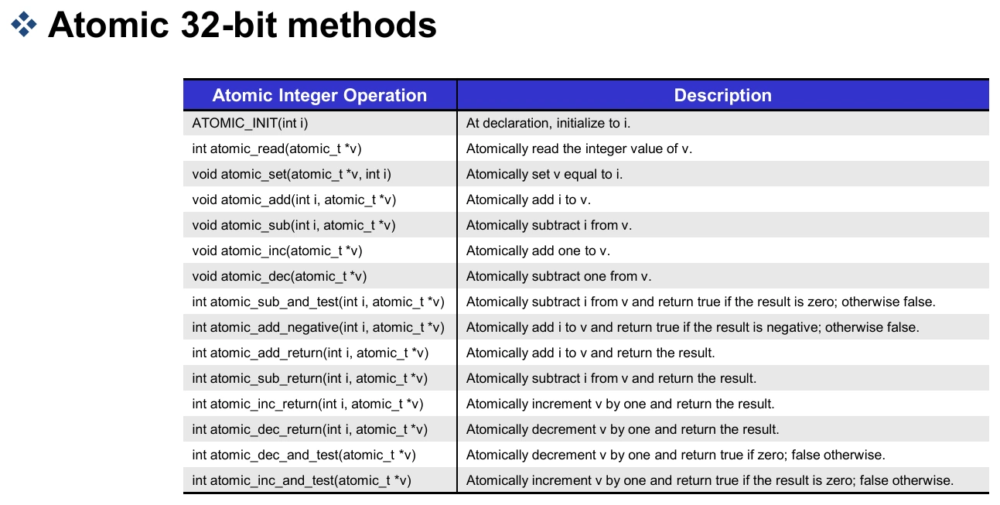

커널의 `atomic_t`는 `int`, `atomic64_t`는 `s64`, `atomic_long_t`는 `long`을 기반으로 한다. **각 연산 하나의 원자성과 여러 연산을 묶은 일관성은 다르다.** `atomic_read()` 후 조건을 검사하고 `atomic_set()`하는 전체 구간이 자동으로 원자적이 되는 것은 아니다. API마다 메모리 순서 보장도 구분해야 한다. [Linux atomic types 문서](https://docs.kernel.org/core-api/wrappers/atomic_t.html)

예를 들어 남은 슬롯이 1일 때 두 태스크가 각각 값을 읽고 “1보다 크거나 같으니 사용 가능하다”고 판단할 수 있다. 뒤의 감소 연산만 원자적으로 만들어도 두 태스크가 모두 진입하는 문제는 남는다. 자원이 있는지 확인하는 조건과 실제로 차지하는 변경을 하나의 동기화된 절차로 묶어야 한다. 단일 카운터 증가와 조건부 자원 획득이 다른 문제인 이유다.

비트 단위 API도 있다.

| API | 동작 |
|---|---|
| `set_bit`, `clear_bit`, `change_bit` | 특정 비트를 1·0·반전 |
| `test_and_set_bit`, `test_and_clear_bit`, `test_and_change_bit` | 변경하면서 **이전 비트 값** 반환 |
| `test_bit` | 해당 비트 확인 |

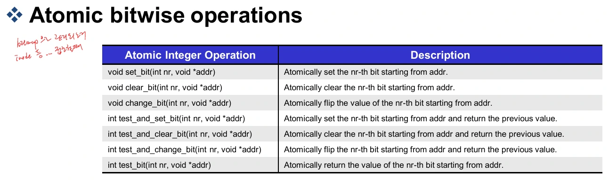

## 7. x86 atomic_add 코드 읽기

*Synchronization (2), 12~14쪽*

강의는 x86의 잠금 접두어가 붙은 덧셈으로 원자적 갱신을 설명한다.

```c
asm volatile(LOCK_PREFIX "addl %1,%0"
             : "+m" (v->counter)
             : "ir" (i));
```

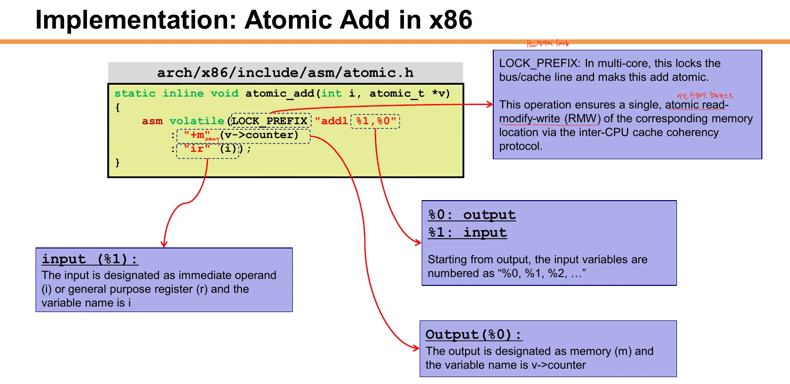

- `%0`은 출력 피연산자인 `v->counter`, `%1`은 입력 `i`다.
- `+m`은 읽고 쓰는 메모리 피연산자를 뜻한다.
- `ir`은 즉시값 또는 레지스터 입력을 허용한다.
- `addl`은 32비트 덧셈이다. 항상 1이 아니라 **인자로 받은 i만큼** 더한다.
- `static`은 해당 정의의 연결 범위를 제한하고, `inline`은 인라인 확장을 허용하는 선언이다.
- `asm volatile`과 하드웨어 원자성은 다른 개념이다. `volatile`이라는 단어만으로 CPU 사이의 동기화가 완성되지 않는다.

LOCK 동작을 모든 경우 “전체 버스를 잠근다”로만 이해하면 부정확하다. 일반적인 캐시 가능한 메모리에서는 캐시 일관성 메커니즘을 통해 다른 코어와 원자적 접근을 조정한다.

## 8. Fetch-and-add, Test-and-set, CAS

*Synchronization (2), 18~23쪽*

강의의 GCC `__sync_*` 예제는 **반환값이 변경 전 값**이라는 공통점을 가진다.

| 연산 | 호출 전 | 호출 | 반환값 | 호출 후 |
|---|---:|---|---:|---:|
| Fetch-and-add | x=4 | `__sync_fetch_and_add(&x, 3)` | 4 | 7 |
| Test-and-set | x=0 | `__sync_lock_test_and_set(&x, 1)` | 0 | 1 |
| CAS 성공 | x=4 | `__sync_val_compare_and_swap(&x, 4, 9)` | 4 | 9 |
| CAS 실패 | x=5 | `__sync_val_compare_and_swap(&x, 4, 9)` | 5 | 5 |

CAS는 현재 값이 예상값과 같을 때만 새 값으로 바꾼다. 반환값과 예상값을 비교하면 성공 여부를 알 수 있다.

CAS로 증가시키는 경우에는 현재 값을 읽어 `old`에 두고, `old + 1`로 교환을 시도한다. 실패했다면 다른 실행 흐름이 먼저 값을 바꿨다는 뜻이므로 최신 값을 바탕으로 다음 후보를 다시 계산해야 한다. 실패했는데 오래된 `old + 1`을 일반 대입으로 저장하면 다른 갱신을 덮어써 원래의 문제로 돌아간다.

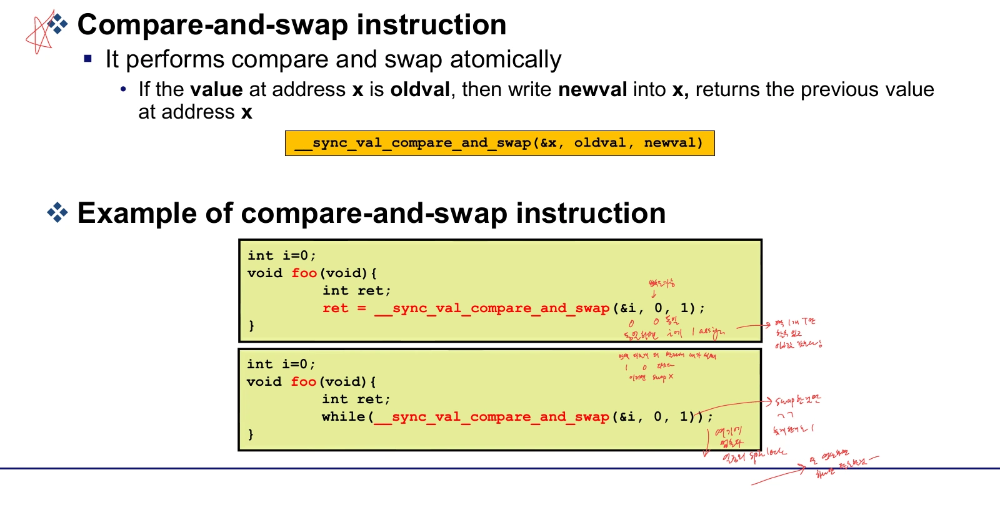

```c
while (__sync_val_compare_and_swap(&held, 0, 1) != 0) {
    /* 다른 실행 흐름이 보유 중이면 재시도 */
}
```

처음 `held=0`이면 1로 바꾸고 0을 반환하므로 반복문에서 빠져나온다. 이미 1이면 1을 반환하고 계속 반복한다. **아무도 0으로 돌려놓지 않으면 끝나지 않는다.** 강의의 두 번째 반복문이 계속 출력되는 이유도 여기에 있다.

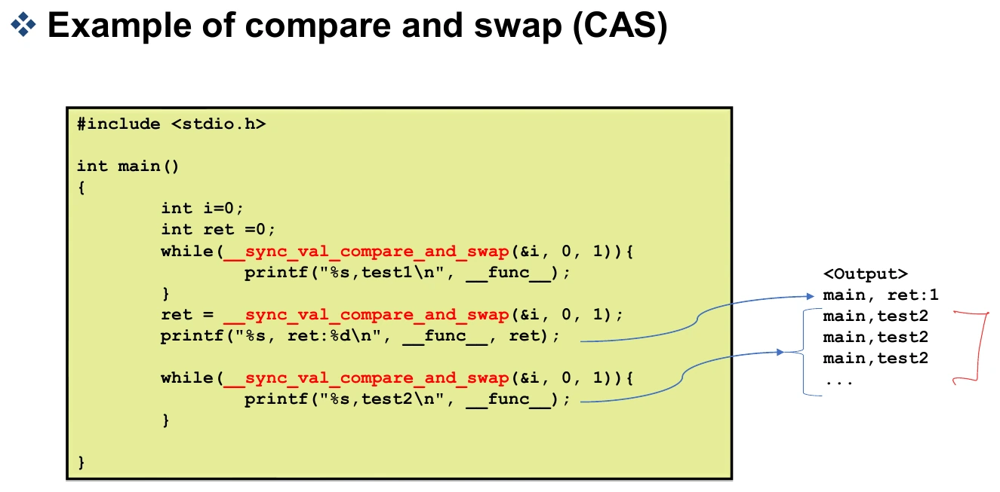

`__sync_*`는 기존 코드의 의미를 이해하기 위한 API다. GCC는 새 코드에 메모리 모델을 지정하는 `__atomic_*` 사용을 권한다. 또한 `__sync_lock_test_and_set`의 acquire와 `__sync_lock_release`의 release 의미를 구분해야 한다. [GCC atomic built-ins](https://gcc.gnu.org/onlinedocs/gcc/_005f_005fsync-Builtins.html)

## 9. 원자적 연산으로 락 만들기

*Synchronization (2), 24~25쪽*

단순 spinlock은 lock 값을 0에서 1로 바꾸는 데 성공한 실행 흐름만 진입하도록 한다. 대기자는 반복 검사하며 CPU를 사용한다. 해제는 임계 구역의 쓰기가 다음 소유자에게 올바른 순서로 보이도록 해야 한다.

강의와 같은 GCC built-in 계열로 표현하면 다음 구조다. 커널 실습에서는 직접 만든 락보다 커널이 제공하는 `spinlock_t`를 쓰는 편이 적절하다.

```c
/* GCC built-in 동작을 설명하는 예 */
static int held;

static void acquire(void)
{
    while (__sync_lock_test_and_set(&held, 1)) {
    }
}

static void release(void)
{
    __sync_lock_release(&held);
}
```

단순 경쟁에서는 나중에 온 스레드가 먼저 락을 얻을 수 있다. **Ticket lock**은 번호표를 뽑아 순서를 정한다.

```text
my_ticket = atomic_fetch_add(next, 1)
owner == my_ticket가 될 때까지 대기
임계 구역 실행
owner를 1 증가시키며 해제
```

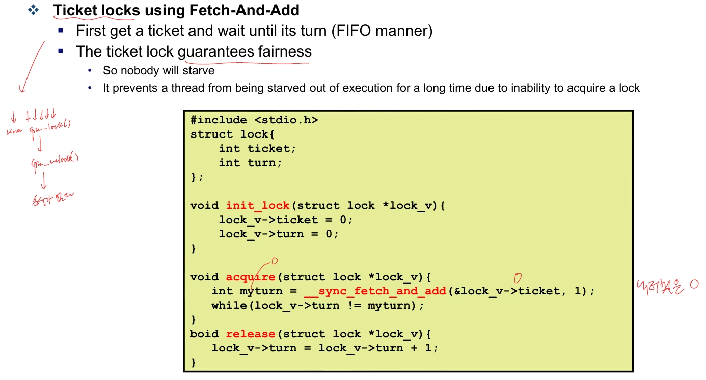

`next`는 다음에 나눠 줄 번호, `owner`는 지금 들어갈 번호다. FIFO 순서를 주지만, 번호를 받은 앞 태스크가 오래 지연되면 뒤 태스크도 기다린다. `owner`의 접근과 갱신에도 올바른 원자성·메모리 순서가 필요하다.

예를 들어 `owner=7`, `next=8`이면 7번이 현재 차례이고, 새로 온 태스크는 8번을 받은 뒤 `next`를 9로 올린다. 8번 태스크가 기다리는 대상은 `next`가 아니라 `owner`다. 7번이 해제하면서 `owner`를 8로 바꿔야 진입할 수 있다. 번호 발급과 입장 허용을 서로 다른 값으로 관리하는 구조다.

## 10. 실습: EXT4를 PXT4 모듈로 분리하기

*Practical Class 5, 2~19쪽*

커널 모듈은 실행 중인 커널에 적재하고 제거할 수 있는 코드다. 파일시스템을 외부 모듈로 만들면 수정할 때마다 전체 커널을 다시 빌드하지 않고 해당 모듈을 교체할 수 있다.

실습은 EXT4 본체를 `pxt4`, 저널링을 담당하는 JBD2를 `jbd3`로 복사한다. 기존 EXT4와 심볼·이름이 충돌하지 않게 하는 것이 핵심이다.

```bash
cp -r <커널소스>/fs/ext4 pxt4
cp -r <커널소스>/fs/jbd2 jbd3
```

두 디렉터리의 코드에서 다음 문자열을 점검한다. `cscope`의 변경 기능에서는 `Ctrl+A`로 항목을 선택하고 `Ctrl+D`로 적용할 수 있다.

| 원래 이름 | 실습 이름 |
|---|---|
| `ext4`, `EXT4` | `pxt4`, `PXT4` |
| `jbd2`, `JBD2` | `jbd3`, `JBD3` |
| `ext2`, `EXT2` | `pxt2`, `PXT2` |

파일명도 바꿔야 한다. 단순 일괄 치환 후에는 다음 예외를 확인한다.

- `acl.h`, `xattr.h`의 설정 검사는 기존 커널 설정인 `CONFIG_EXT4...`를 참조하도록 유지한다.
- `pxt4.h`의 `EXT2`, `EXT3` 관련 정의와 `EXT##` 토큰 결합을 확인한다.
- `super.c`의 `pxt4_has_unknown_ext4_incompat_...`, `...ro_compat_...`처럼 생성 매크로와 연결되는 이름을 일치시킨다.
- 커널 `include/linux`의 `jbd2.h`, `journal-head.h`를 `jbd3.h`, `journal-head3.h`로 복사한다.
- `include/trace/events`의 `jbd2.h`, `ext4.h`도 각각 복사하고 내부 이름을 수정한다.
- 새 `jbd3.h`가 `journal-head3.h`를 포함하도록 한다.
- `include/uapi/linux/magic.h`에 `PXT4_SUPER_MAGIC`을 추가한다. 실습은 EXT4와 같은 디스크 형식이므로 값 `0xEF53`을 사용한다.

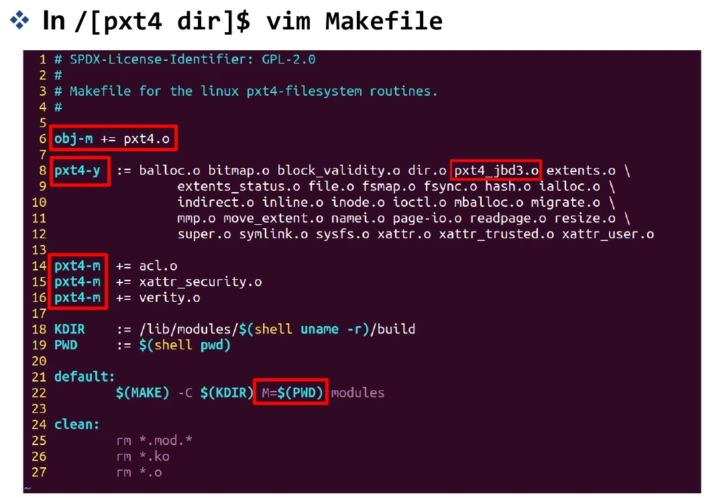

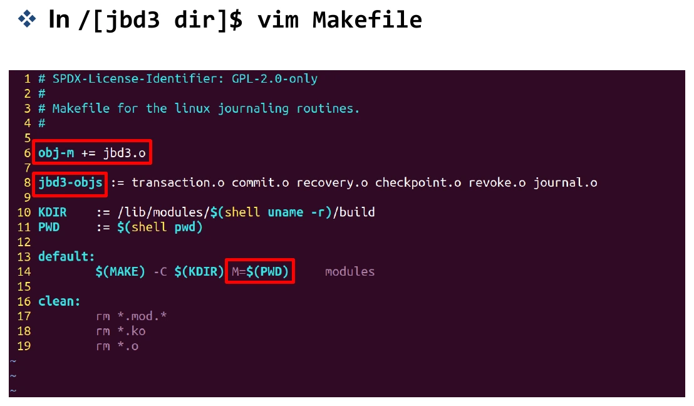

실습 구조는 `jbd3` 디렉터리를 `pxt4` 아래에 놓고 먼저 빌드한다. 그 `Module.symvers`를 상위로 복사해 PXT4가 참조하는 심볼 정보를 전달한 뒤 PXT4를 빌드한다.

```text
pxt4/
  Makefile
  ...
  jbd3/
    Makefile
    jbd3.ko
    Module.symvers
```

적재도 의존 관계에 따라 **jbd3 → pxt4** 순서다.

```bash
sudo insmod jbd3/jbd3.ko
sudo insmod pxt4.ko
lsmod
```

`invalid module format`이면 실행 커널과 빌드 대상, 설정·심볼 버전이 맞는지 `uname -r`, 빌드 경로, `dmesg`를 확인한다. `Unknown symbol`은 의존 모듈 적재와 심볼 이름·내보내기·버전 정보를 점검한다.

## 11. 실습: 새 디스크와 마운트

*Practical Class 5-b, 3~10쪽; Practical Class 5, 18~19쪽*

VirtualBox에서 VM을 끈 다음 Virtual Media Manager로 새 가상 디스크를 만들고, VM Settings → Storage에서 연결한다. VM을 부팅한 뒤 `sudo fdisk -l`이나 `lsblk`로 새 장치를 구별한다.

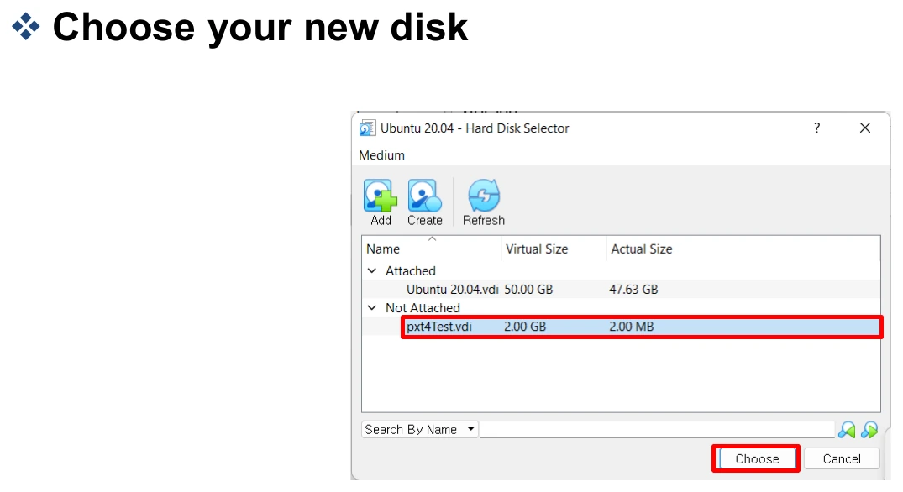

실습용 새 장치에 EXT4 디스크 형식을 만들고, 이를 PXT4 드라이버로 마운트한다. **포맷은 선택한 장치의 데이터를 지우므로, 아래 장치명은 실제로 추가한 빈 디스크로 바꿔야 한다.** 시스템 디스크 이름을 추측해 실행하지 않는다.

```bash
lsblk -f
sudo mkfs -t ext4 /dev/<실습용-새-장치>
sudo mkdir -p /mnt/pxt4-test
sudo mount -t pxt4 /dev/<실습용-새-장치> /mnt/pxt4-test
mount -l | grep pxt4
```

`mkfs -t ext4`는 디스크 위 자료구조를 만들고, `mount -t pxt4`는 그 구조를 해석할 커널 파일시스템 구현을 선택한다. 모듈 이름을 바꿨다고 새로운 `mkfs.pxt4` 도구가 생기는 것은 아니다.

작업을 끝내면 마운트를 해제한 후 의존 관계의 역순으로 모듈을 제거한다.

```bash
sudo umount /mnt/pxt4-test
sudo rmmod pxt4
sudo rmmod jbd3
```

## 12. 함수 포인터와 파일시스템의 간접 호출

*Practical Class 5, 20~31쪽*

함수 포인터는 실행할 함수의 주소를 저장한다. 같은 호출 표현식으로도 실행 시점에 연결된 함수가 달라질 수 있다.

```c
void func(int value);
void (*func_ptr)(int) = func;

func_ptr(10);
(*func_ptr)(10); /* 같은 호출 */
```

`void (*func_ptr)(int)`는 함수 포인터지만, `void *func_ptr(int)`는 `void *`를 반환하는 함수 선언이다. 괄호의 위치가 의미를 바꾼다. 초기화에서 `func`와 `&func`는 모두 사용할 수 있다.

파일시스템에서는 연산 표에 함수를 연결한다. 강의 버전의 `address_space_operations`는 `write_begin`, `write_end` 등을 갖고, EXT4·EXT2·FAT가 각각 구현 함수를 넣는다.

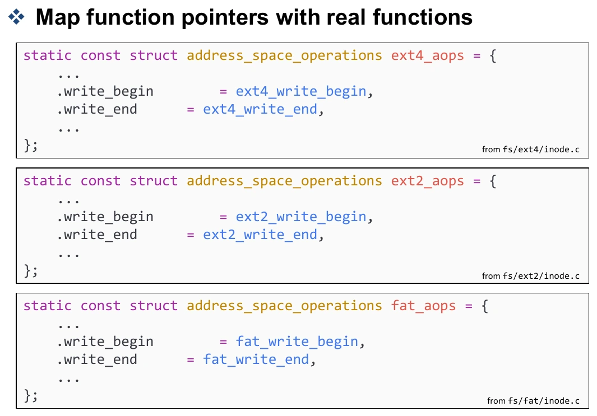

```text
generic_perform_write(file, ...)
    → file->f_mapping
    → mapping->a_ops
    → a_ops->write_begin(...)
    → 해당 파일시스템의 실제 함수
```

이 방식은 공통 계층이 파일시스템별 구현을 직접 하드코딩하지 않고 호출하게 한다.

호출문을 읽을 때는 함수 이름만 찾기보다 함수 포인터가 어디서 채워졌는지 거꾸로 따라가면 된다. `a_ops->write_begin()`의 실제 동작은 해당 파일의 mapping에 어떤 연산 표가 연결됐는지에 달려 있다. 이 연결을 이해해야 나중에 PXT4 함수에 계측 코드를 넣었을 때 실제 쓰기 요청이 그 코드를 통과하는지도 확인할 수 있다.

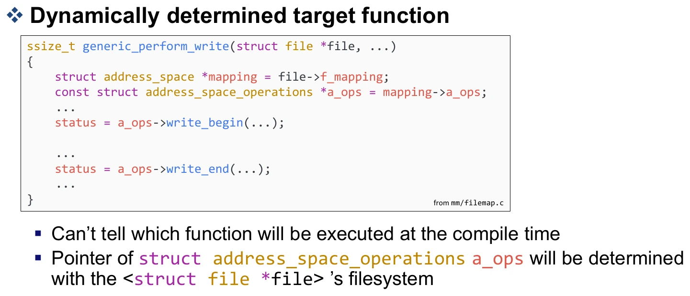

실습의 다른 예는 커널 쪽 함수 포인터를 `EXPORT_SYMBOL`로 공개하고, 모듈 초기화 시 PXT4 함수를 연결하는 callback 구조다. 종료 시 포인터를 `NULL`로 돌린다.

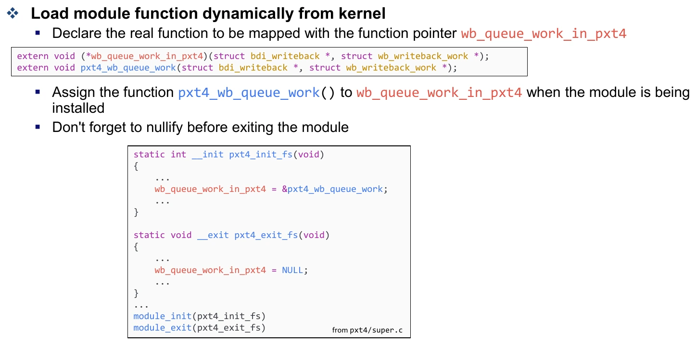

다만 실제 동시 실행에서는 `NULL` 대입만으로 안전한 unload가 보장되지 않는다. 이미 포인터를 읽었거나 함수 안에 있는 호출자가 끝날 때까지 기다리는 수명 관리도 필요하다.

## 13. 과제 5: Kernel Module

*Practical Class 5, 32~35쪽*

과제는 두 부분이다. 첫째는 “simple module” 메시지를 출력하는 간단한 모듈, 둘째는 JBD3·PXT4 파일시스템 모듈을 만들고 실제 장치에 마운트하는 작업이다.

제출 PDF에는 최소 다음 세 화면이 필요하다.

1. 간단한 모듈이 출력한 메시지를 확인하는 `dmesg` 화면.
2. JBD3·PXT4 적재 후 `lsmod | grep pxt4` 결과.
3. 실습용 장치를 포맷하고 마운트한 뒤 `mount -l | grep pxt4` 결과.

이름·학번도 포함한다. VirtualBox에서는 추가 가상 디스크, 네이티브 Linux에서는 별도 USB 같은 실습용 장치를 활용할 수 있다. 결과에서 확인할 것은 각각 **코드 실행, 모듈 적재, 파일시스템 연결**이다.

## 14. 복습문제

해설을 보기 전에 각 질문에 짧게 답해 보자.

<details><summary>1. i=7을 두 스레드가 한 번씩 증가시켰는데 8이 되는 순서를 설명하라.</summary>

둘 다 7을 읽은 뒤 각자 8을 계산하고 저장하면 마지막 저장도 8이다. 읽기·계산·쓰기가 하나의 원자적 단위가 아니어서 갱신 하나가 사라진다.

</details>

<details><summary>2. preempt_disable만으로 멀티코어 공유 자료를 보호할 수 없는 이유는?</summary>

현재 CPU의 태스크 선점만 제어한다. 같은 CPU의 ISR과 다른 CPU의 실행까지 막지 않으므로 이들과의 공유에는 추가 동기화가 필요하다.

</details>

<details><summary>3. irq_enable 대신 irq_restore가 필요한 경우는?</summary>

진입 전에 인터럽트가 이미 꺼져 있을 수 있는 경우다. 무조건 enable하면 호출자가 유지하려던 임계 구역을 깨뜨린다.

</details>

<details><summary>4. x=5에서 CAS(&x, 4, 9)의 반환값과 최종값은?</summary>

이전 값 5를 반환하고 x도 5로 남는다. 현재 값과 예상값 4가 다르므로 교환하지 않는다.

</details>

<details><summary>5. atomic_read 후 atomic_set으로 증가시키면 atomic_inc와 같은가?</summary>

아니다. 두 호출 사이에 다른 실행 흐름이 값을 바꿀 수 있다. 증가 전체를 하나의 원자적 RMW로 수행해야 한다.

</details>

<details><summary>6. Ticket lock의 next와 owner는 각각 무엇인가?</summary>

next는 다음 번호표를 발급할 값, owner는 현재 진입할 차례다. 발급받은 번호가 owner와 같아지면 진입하고 해제 때 owner를 증가시킨다.

</details>

<details><summary>7. PXT4보다 JBD3를 먼저 빌드·적재하는 이유는?</summary>

PXT4가 JBD3의 저널링 심볼에 의존하기 때문이다. 빌드에는 심볼 정보가, 실행에는 실제 심볼 제공 모듈이 필요하다.

</details>

<details><summary>8. EXT4로 포맷한 장치를 PXT4로 마운트할 수 있는 이유는?</summary>

이 실습의 PXT4는 EXT4의 디스크 형식을 그대로 해석하는 별도 커널 구현이다. 포맷은 온디스크 구조 생성, 마운트 유형은 이를 처리할 구현 선택이다.

</details>

## 참고 자료

중앙대학교 리눅스 시스템 응용 설계, 손용석 교수, Systems and Storage Lab.

- 수업 자료: `6. Synchronization (1).pdf`, `6. synchronization (2).pdf`.
- 실습 자료: `[Practical Class 5] Making a File System Module.pdf`, `[Practical Class 5-b] Creating a new virtual hard disk for VirtualBox.pdf`.
