락을 선택할 때는 공유 데이터만 보면 부족하다. **누가 접근하는지, 기다리는 동안 잠들 수 있는지, 임계 구역이 얼마나 긴지**를 함께 봐야 한다. 이번 주는 spinlock의 실행 문맥부터 semaphore·mutex, 커널 연결 리스트를 보호하는 방법까지 이어진다.

## 1. Spinlock은 기다리는 동안 무엇을 하는가

*Synchronization (3), 2~7쪽*

Spinlock을 얻지 못한 실행 흐름은 락이 풀릴 때까지 반복 검사한다. 이런 대기를 busy waiting이라고 한다. 기다리는 동안 유용한 작업은 하지 않지만 CPU를 사용한다.

잠들고 깨는 스케줄링 비용을 피할 수 있어서 짧은 임계 구역에 적합하다. 반대로 락 보유 시간이 길면 여러 CPU가 기다리며 시간을 낭비한다.

강의의 ticket spinlock은 번호표 순서로 소유권을 준다. 다만 모든 버전·아키텍처의 Linux가 항상 같은 ticket 구현을 사용하는 것은 아니다. API와 그 아래의 구현을 구분해서 읽어야 한다.

| API | 의미 |
|---|---|
| `spin_lock_init(&lock)` | 락 초기화 |
| `spin_lock(&lock)` | 획득할 때까지 대기 |
| `spin_unlock(&lock)` | 해제 |
| `spin_trylock(&lock)` | 즉시 시도, 성공하면 1·실패하면 0 |
| `spin_is_locked(&lock)` | 그 순간의 잠김 상태 확인 |

`spin_is_locked()`가 0을 반환해도 다음 순간 다른 CPU가 획득할 수 있다. 상태 조회는 락 획득을 대신하지 않는다.

락은 보호할 데이터에 접근하는 모든 경로가 함께 따라야 하는 약속이다. A가 락을 잡았더라도 B가 그 락을 무시하고 같은 데이터를 수정하면 보호가 되지 않는다. 같은 변수를 보호하려고 스레드마다 서로 다른 락을 만들어도 둘 다 동시에 들어갈 수 있다. 공유 데이터와 그것을 보호하는 락의 대응을 먼저 정해야 한다. [커널 spinlock의 공유 규칙](https://docs.kernel.org/locking/spinlocks.html)

강의 예제는 두 커널 스레드가 `counter++`를 수행한다. 락으로 증가와 출력을 보호하고, `msleep(500)`은 **락을 해제한 다음** 실행한다.

```c
while (!kthread_should_stop()) {
    spin_lock(&counter_lock);
    counter++;
    spin_unlock(&counter_lock);
    msleep(500);
}
```

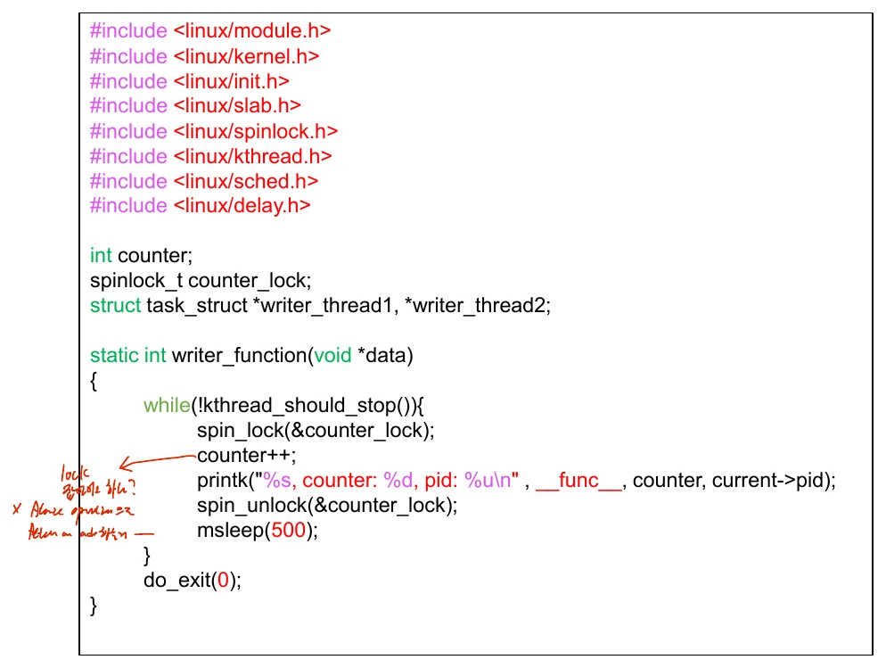

이 글의 spinlock 설명은 수업의 일반적인 non-PREEMPT_RT 커널 모델을 기준으로 한다. PREEMPT_RT에서는 `spinlock_t`의 의미가 달라지며, `raw_spinlock_t`와도 구분한다. [Linux lock types](https://docs.kernel.org/locking/locktypes.html)

## 2. 중첩 락과 preempt_count

*Synchronization (3), 8~10쪽*

일반적인 커널 spinlock 경로는 선점을 금지한 뒤 락을 획득한다. 소유자가 같은 CPU에서 선점되어 실행을 못 하는 동안 다른 태스크가 그 락을 계속 기다리는 상황을 피하기 위해서다.

중첩된 **서로 다른** 락 A, B를 잡는다고 하자.

| 동작 | preempt_count의 개념적 변화 |
|---|---:|
| 처음 | 0 |
| A 획득 | 1 |
| B 획득 | 2 |
| B 해제 | 1 |
| A 해제 | 0 |

Boolean이었다면 B 해제 때 선점이 허용되어, A를 아직 가진 상태를 표현하지 못한다. 그래서 중첩 깊이를 셀 수 있어야 한다.

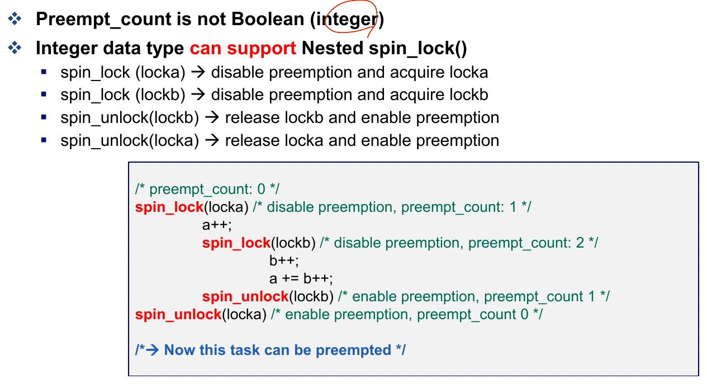

이것이 같은 락을 재귀적으로 잡아도 된다는 뜻은 아니다. 일반 spinlock은 재귀 락이 아니므로 같은 실행 흐름이 이미 가진 락을 또 기다리면 진행하지 못한다. 여러 락의 획득 순서도 모든 경로에서 일관되어야 한다.

예를 들어 한 태스크는 A를 잡고 B를 기다리고, 다른 태스크는 B를 잡고 A를 기다리면 어느 쪽도 필요한 락을 얻거나 가진 락을 풀지 못한다. 모든 경로에서 A 다음 B처럼 순서를 맞추는 이유다. 중첩 카운터가 올바르게 관리된다는 사실만으로 이런 락 사이의 교착까지 해결되는 것은 아니다.

## 3. 태스크와 ISR이 같은 락을 쓰면

*Synchronization (3), 11~18쪽*

태스크가 A를 잡은 상태에서 같은 CPU의 인터럽트가 발생하고, ISR도 A를 잡으려 하면 다음 순환이 생긴다.

```text
태스크: A 보유 → 인터럽트 때문에 실행 중단
ISR:    A가 풀리기를 기다림
태스크: ISR이 끝나야 다시 실행해 A를 풀 수 있음
```

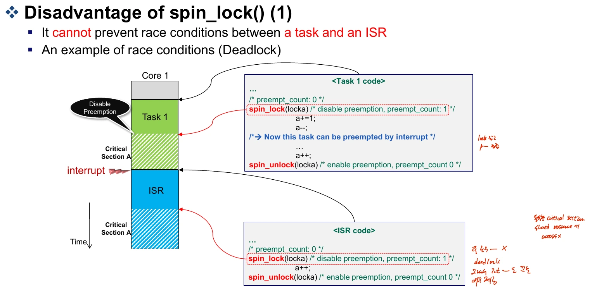

`spin_lock()`은 로컬 인터럽트까지 막지 않는다. 태스크와 ISR이 공유하는 락이라면 태스크 쪽에서 인터럽트에 의한 재진입도 막아야 한다.

| 획득·해제 쌍 | 추가 동작 | 사용할 때의 전제 |
|---|---|---|
| `spin_lock` / `spin_unlock` | 선점 제어 | 같은 CPU의 ISR이 그 락을 요구하지 않음 |
| `spin_lock_irq` / `spin_unlock_irq` | 로컬 IRQ disable / enable | 해제 시 IRQ를 켜도 됨 |
| `spin_lock_irqsave` / `spin_unlock_irqrestore` | 이전 IRQ 저장·disable / 복원 | 진입 전 IRQ 상태를 보존해야 함 |

IRQ 제어는 현재 CPU에 적용된다. 다른 CPU와의 상호 배제는 공통 락을 통해 이루어진다.

`irqsave` 형태의 역할을 둘로 나누어 읽으면 이해하기 쉽다. IRQ 금지는 같은 CPU에서 현재 태스크를 중단시킬 ISR의 재진입을 막고, 락 획득은 다른 CPU의 경쟁자를 막는다. 어느 한쪽만으로 두 종류의 경쟁을 모두 해결하는 것이 아니므로, 같은 자료를 만지는 실행 문맥에 맞춰 함께 사용한다.

### 중첩 irqsave에는 서로 다른 flags

안쪽 락을 풀 때 인터럽트를 무조건 켜면 바깥 임계 구역이 깨진다. 진입 상태를 각각 저장해야 한다.

```c
unsigned long flags_a, flags_b;

spin_lock_irqsave(&lock_a, flags_a); /* 원래 enabled였다면 저장 */
spin_lock_irqsave(&lock_b, flags_b); /* 이미 disabled인 상태 저장 */
/* 공유 데이터 처리 */
spin_unlock_irqrestore(&lock_b, flags_b); /* disabled 복원 */
spin_unlock_irqrestore(&lock_a, flags_a); /* 원래 상태 복원 */
```

**두 호출에 같은 flags 변수를 재사용하면 바깥 상태를 덮어쓴다.** 강의 16쪽의 변수 표기보다 17쪽의 `flaga`, `flagb` 그림이 이 관계를 정확히 보여 준다.

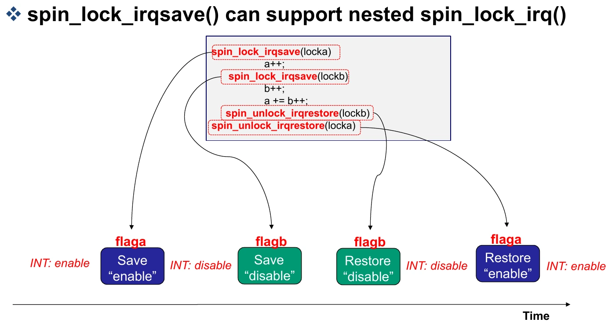

인터럽트를 오래 막으면 I/O 처리와 응답 지연에 영향을 준다. “가장 강한 형태를 무조건 사용”하기보다 실제 공유 문맥에 필요한 범위를 짧게 보호한다.

## 4. 공통 API에서 아키텍처 구현까지

*Synchronization (3), 19~31쪽*

강의가 보여 주는 타입 계층은 다음과 같다.

```text
spinlock_t
  └─ raw_spinlock_t rlock
       └─ arch_spinlock_t raw_lock
```

공통 코드는 초기화, 선점·IRQ 제어, 디버깅·락 의존성 추적을 담당하고, 최종 원자적 동작은 아키텍처별 함수로 내려간다.

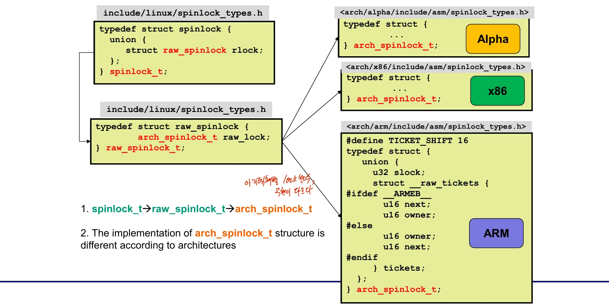

| 경로 | 주요 단계 |
|---|---|
| 초기화 | `spin_lock_init` → raw 초기화 → 아키텍처 unlocked 값 |
| 획득 | `spin_lock` → `raw_spin_lock` → `__raw_spin_lock` → `do_raw_spin_lock` → `arch_spin_lock` |
| 해제 | 락 추적 해제 → `arch_spin_unlock` → `preempt_enable` |
| irq 획득 | `local_irq_disable` → 선점 금지 → 락 획득 |
| irqsave 획득 | IRQ 저장·금지 → 선점 금지 → 락 획득 → flags 반환 |
| irqrestore 해제 | 락 해제 → IRQ 상태 복원 → 선점 금지 해제 |

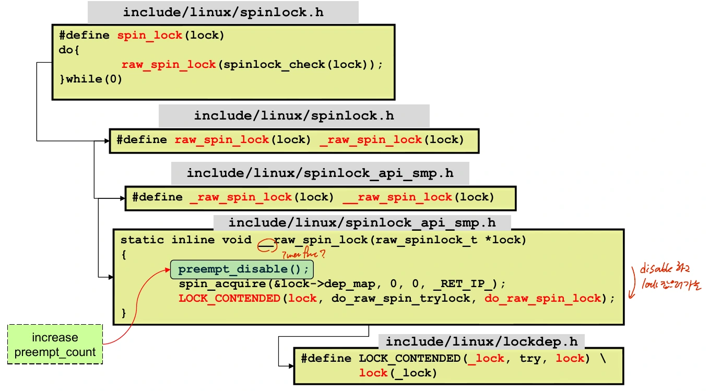

`spin_acquire`, `spin_release`, `LOCK_CONTENDED` 같은 이름은 락 추적·경쟁 처리 계층과 관련된다. 설정에 따라 매크로 전개가 달라지므로 한 슬라이드의 축약 코드를 모든 빌드에서 그대로 찾을 수 있다고 생각하면 안 된다.

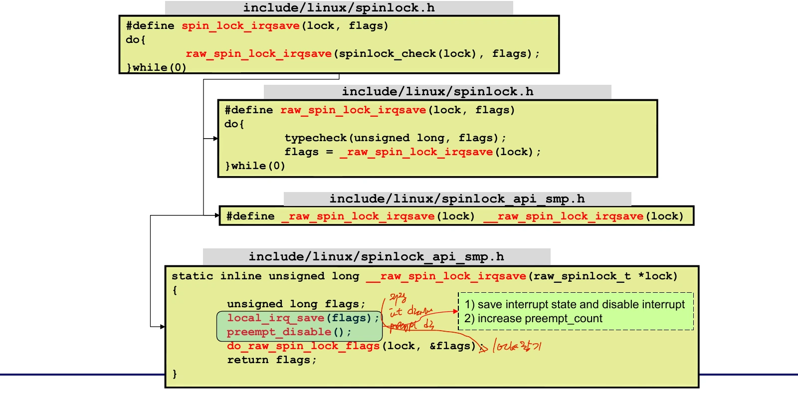

## 5. ARM의 IRQ 제어

*Synchronization (3), 32~35쪽*

강의는 32비트 ARM의 CPSR 기반 예제를 사용한다. ARM64의 레지스터 체계와 그대로 대응시키지 않는다.

| 명령·필드 | 역할 |
|---|---|
| `cpsid i` | IRQ 비활성화 |
| `cpsie i` | IRQ 활성화 |
| `mrs` | 상태 레지스터를 일반 레지스터로 읽기 |
| `msr` | 일반 레지스터 값을 상태 레지스터에 쓰기 |
| CPSR의 I bit | 1이면 IRQ 마스크, 0이면 허용 |
| `cpsr_c` | CPSR의 제어 필드 대상 |

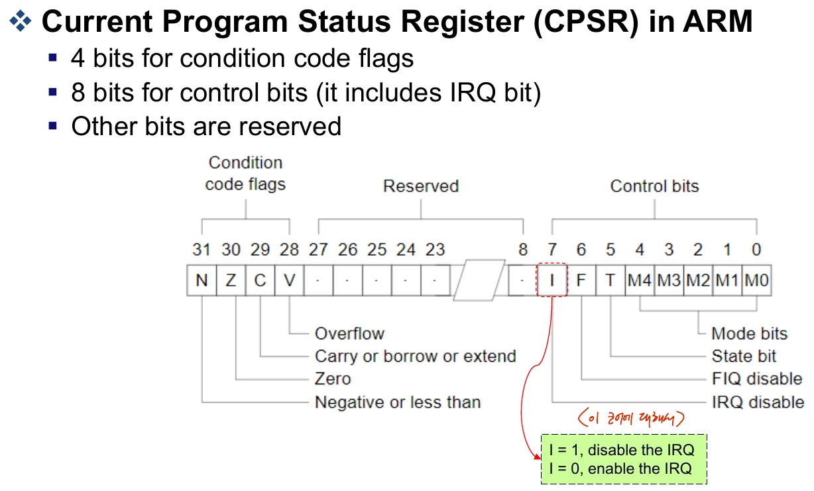

`arch_local_irq_save()`는 현재 CPSR 값을 읽어 저장하고 IRQ를 끈다. `arch_local_irq_restore()`는 저장했던 제어 상태를 되돌린다. inline assembly의 `memory` clobber는 컴파일러에 메모리 효과를 알리고, `cc`는 조건 코드가 영향을 받음을 알린다. 컴파일러 장벽과 CPU 메모리 장벽은 구분해야 한다.

## 6. ARM ticket spinlock의 원자적 번호표 발급

*Synchronization (4), 2~7쪽*

강의 구현은 32비트 `slock`을 16비트 `owner`, `next`로 나눠 본다. little-endian 예에서 `owner`가 하위 16비트, `next`가 상위 16비트이므로 `1 << 16`, 즉 `0x00010000`을 더해 다음 번호를 증가시킨다.

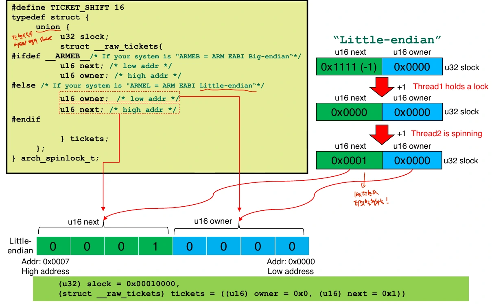

실제 주소 증가 단위와 비트 표현은 구분한다. `u32`는 4바이트이며, 그림의 16진수 숫자 한 자리 하나가 메모리 1바이트라는 뜻은 아니다.

발급 과정은 exclusive load/store로 구성된다.

1. `ldrex`: 현재 락 값을 읽고 exclusive 접근을 시작한다.
2. `add`: 상위 next 필드가 증가한 새 값을 계산한다.
3. `strex`: exclusive store를 시도한다.
4. 상태값이 0이면 저장 성공, 실패하면 다시 읽어 재시도한다.
5. 성공할 때 읽었던 **이전 next**가 자신의 번호표가 된다.

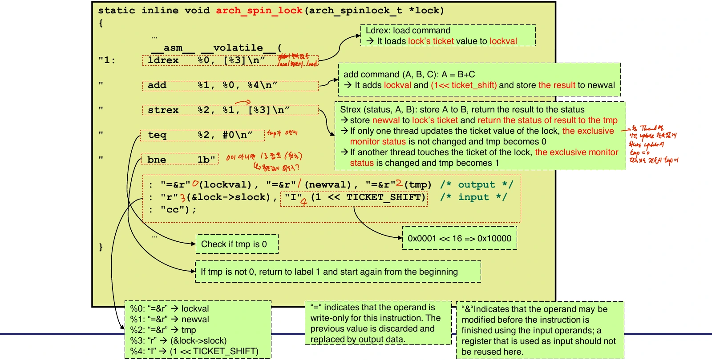

`=&r`의 `=`는 출력, `&`는 입력을 다 읽기 전에 출력이 바뀔 수 있는 early-clobber를 뜻한다. 그래서 아직 필요한 입력 레지스터를 출력에 겹쳐 배정하지 못하게 한다.

번호를 받았다고 바로 들어가는 것은 아니다. 로컬에 저장한 자기 번호와 공유 `owner`를 비교한다.

```text
내 번호 != owner:
    wfe로 이벤트 대기
    READ_ONCE로 owner 다시 읽기
같아짐:
    필요한 메모리 장벽 뒤 임계 구역 진입
```

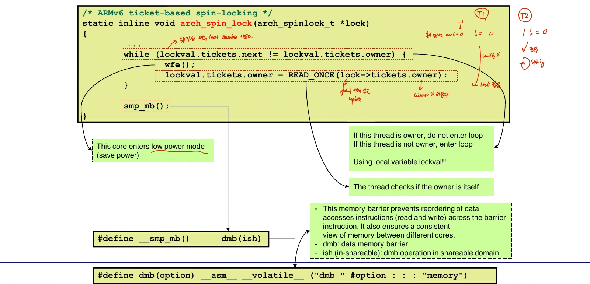

`wfe`는 이벤트를 기다리는 CPU 명령이며, 태스크를 sleep queue로 옮기는 semaphore 대기와 다르다. 해제 쪽은 장벽을 거쳐 `owner`를 증가시키고, `dsb_sev()`로 갱신과 이벤트 전달을 조정한다. 대기자는 깨어난 뒤 조건을 다시 확인한다.

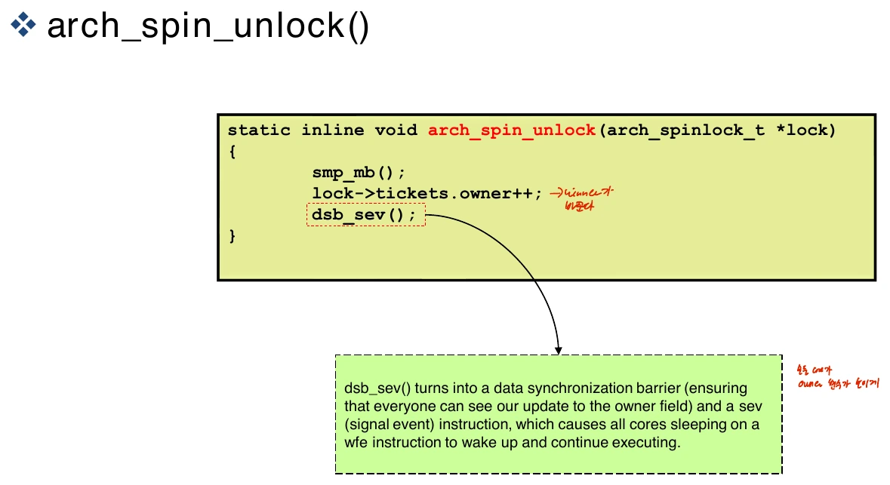

`READ_ONCE` 하나만으로 모든 동기화가 완성되는 것도 아니다. 접근이 임의로 합쳐지거나 반복 읽기가 사라지는 것을 막는 역할과, 임계 구역 메모리 접근 순서를 보장하는 장벽의 역할을 나눠 봐야 한다.

번호표 발급에 성공했다는 것은 대기 순서가 정해졌다는 뜻이고, 자기 번호가 `owner`와 같아졌다는 것이 실제 입장 조건이다. 여기에 이전 소유자가 임계 구역에서 쓴 데이터를 새 소유자가 올바른 순서로 보도록 하는 보장도 필요하다. 번호를 중복 없이 나누는 원자성, 차례를 기다리는 조건, 데이터 접근 순서라는 세 역할을 구분해 코드를 읽으면 된다.

## 7. Semaphore: 자원 수와 잠드는 대기자

*Synchronization (4), 8~11쪽*

Counting semaphore는 동시에 사용할 수 있는 자원 수를 센다. 초기 count가 2라면 두 실행 흐름이 자원을 얻을 수 있고, 추가 요청은 기다린다.

- `down`: 자원이 있으면 하나 얻는다. 없으면 잠들 수 있다.
- `up`: 자원을 돌려주고 필요하면 대기자를 깨운다.
- `sema_init(&sem, count)`: 초기 자원 수를 설정한다.

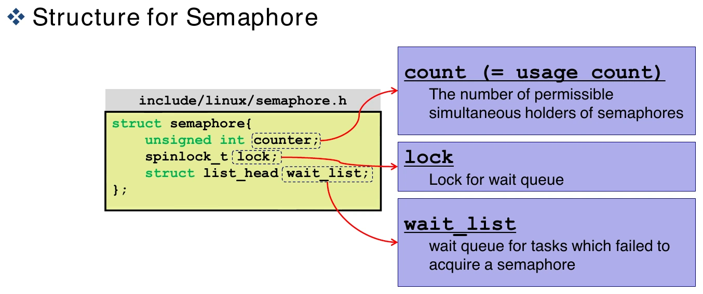

내부의 짧은 상태 변경을 보호하는 락과, 자원이 없어 태스크가 잠드는 대기는 다른 층위다. semaphore 내부에 spinlock이 있다고 해서 자원을 기다리는 내내 spinning하는 것은 아니다.

초기 자원이 두 개이고 A와 B가 하나씩 얻었다면, C는 자원이 돌아오기 전까지 기다려야 한다. C를 대기 목록에 등록하는 짧은 과정은 내부 락으로 보호하지만, 등록 후에는 그 락을 놓고 잠들 수 있다. 자원이 반환되면 대기자가 다시 진행할 수 있게 한다. 이렇게 내부 상태 보호와 긴 자원 대기를 분리한다.

```c
struct semaphore sem;
sema_init(&sem, 2);

/* 잠들 수 있는 태스크 문맥 */
down(&sem);
/* 제한된 자원 사용 */
up(&sem);
```

## 8. Read/Write semaphore

*Synchronization (4), 12~17쪽*

읽기만 하는 작업끼리는 데이터를 변경하지 않으므로 동시 진입을 허용할 수 있다. RW semaphore는 여러 reader 또는 하나의 writer를 허용한다.

| 현재 보유자 | 새 reader | 새 writer |
|---|---|---|
| 없음 | 진입 가능 | 진입 가능 |
| reader 있음 | 동시 읽기 가능하나 대기 정책 영향 | 대기 |
| writer 있음 | 대기 | 대기 |

```c
init_rwsem(&rwsem);

down_read(&rwsem);
/* 읽기 */
up_read(&rwsem);

down_write(&rwsem);
/* 변경 */
up_write(&rwsem);
```

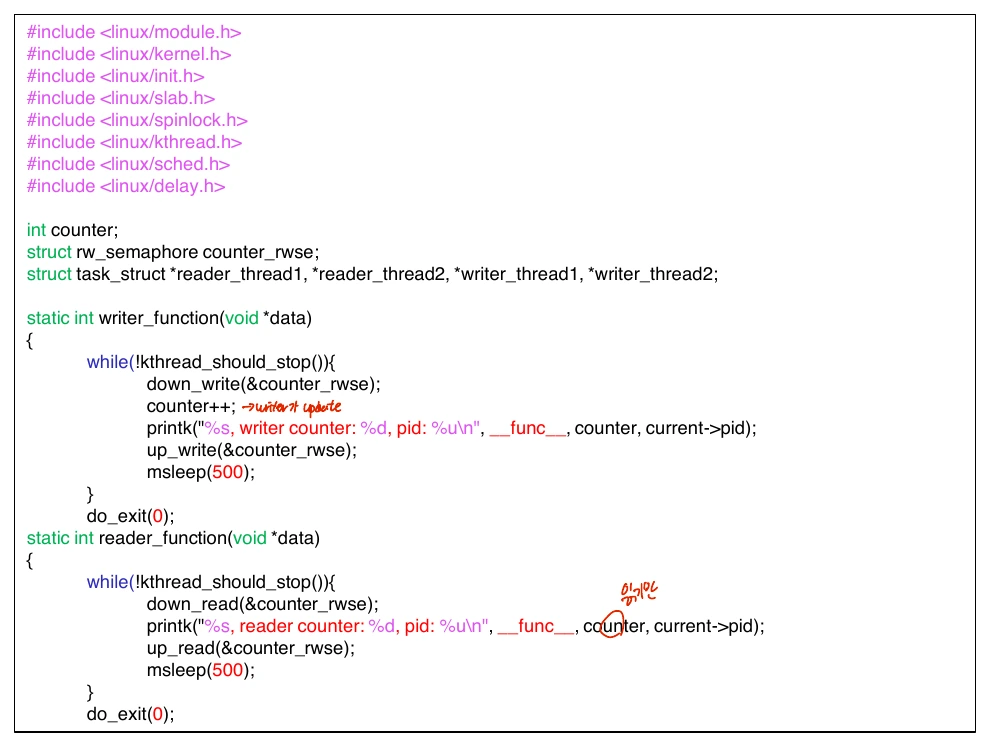

강의 예제는 reader 2개와 writer 2개를 만든다. writer는 counter를 증가시키고 reader는 값을 출력한다. 모두 종료 요청을 확인하며, 종료 때 네 스레드를 정리한다.

읽기 비율이 높다고 항상 더 빠르지는 않다. 락 관리 비용, writer 대기, 임계 구역 길이에 따라 달라진다. 리스트의 검색도 통계 카운터나 노드 내용을 변경한다면 순수 읽기가 아닐 수 있다.

## 9. Mutex와 sleeping lock의 제약

*Synchronization (4), 17~22쪽*

Mutex는 한 실행 흐름만 임계 구역에 들어가게 하는 상호 배제 도구다. 경쟁 시 잠들 수 있다.

```c
DEFINE_MUTEX(my_mutex);

mutex_lock(&my_mutex);
/* 공유 데이터 처리 */
mutex_unlock(&my_mutex);
```

동적 초기화에는 `mutex_init()`을 사용한다. 강의의 오래된 구조체 그림은 count, wait lock, wait list로 역할을 보여 주며, 현재 모든 버전의 정확한 구조체 정의를 뜻하지는 않는다.

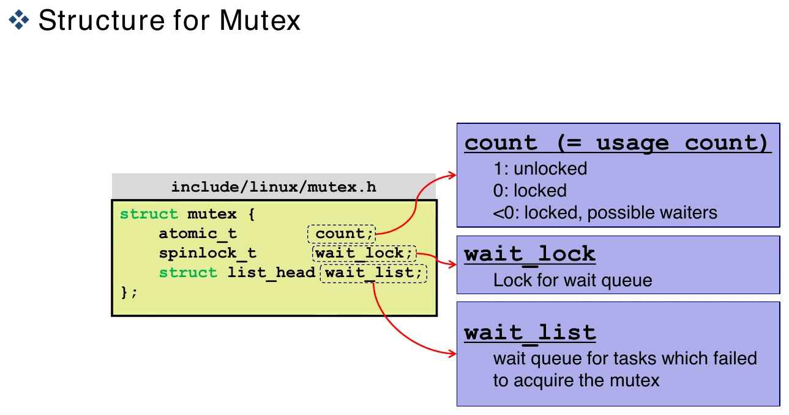

Binary semaphore와 mutex는 한 명만 진입한다는 점에서 비슷하지만 동등한 API는 아니다. **Mutex는 소유자가 직접 해제하는 규칙**을 가진다. Counting semaphore는 자원 수·이벤트 전달 등 다른 의미도 표현한다. [Linux 락 소유권 규칙](https://docs.kernel.org/locking/locktypes.html)

Sleeping lock은 일반적인 interrupt context에서 획득할 수 없다. 또한 spinlock을 가진 채 `down()`, `mutex_lock()` 같은 잠들 수 있는 연산을 호출해서도 안 된다.

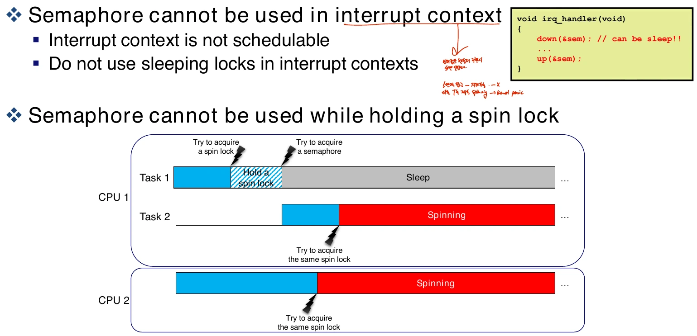

락을 가진 채 sleep한 태스크가 다시 실행되어야 풀리는 상황에서, 다른 태스크·CPU가 spinlock을 기다리면 진행과 지연 문제가 생긴다. `kmalloc(GFP_KERNEL)`처럼 간접적으로 잠드는 함수도 같은 관점으로 확인한다.

## 10. 동기화 범위와 선택 기준

*Synchronization (4), 23~27쪽*

| 방식 | 장점 | 비용·주의점 |
|---|---|---|
| Coarse-grained lock | 구조 전체를 하나의 락으로 보호, 이해하기 쉬움 | 독립 작업도 직렬화 |
| Fine-grained lock | 서로 다른 객체를 동시에 처리 | 락 수·순서·수명 관리가 복잡 |
| Lock-free 알고리즘 | CAS 등으로 전체 진행을 보장하도록 설계 | 재시도, 메모리 회수, ABA 등 별도 문제 |
| Per-CPU 자료 | 자주 쓰는 공유 위치를 분산 | 합산·이동·종료 때 조정 필요 |

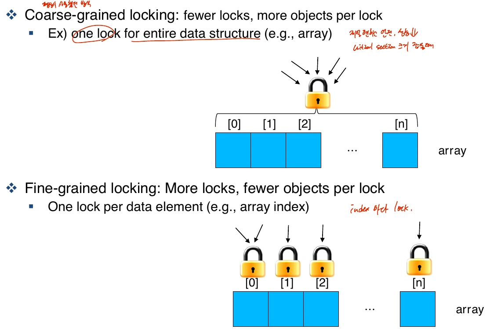

Atomic 연산을 썼다는 이유만으로 알고리즘 전체가 lock-free가 되는 것은 아니다. 여러 포인터를 함께 바꾸거나 객체를 해제하는 문제까지 해결해야 한다. Per-CPU도 서로의 데이터를 읽거나 통계를 합치는 순간 일관성 기준이 필요하다.

| 상황 | 우선 생각할 방식 |
|---|---|
| 아주 짧은 비수면 임계 구역 | spinlock |
| ISR과 공유 | 문맥에 맞는 spinlock·IRQ 제어 |
| 오래 걸리거나 잠들 수 있는 태스크 작업 | mutex 등 sleeping lock |
| 동시 자원 수 제한 | counting semaphore |
| 읽기 공유·쓰기 배타가 유리 | RW semaphore |
| 단일 정수의 단순 갱신 | 적절한 atomic API |

“원자적 연산이 언제나 빠르다”도 보장되지 않는다. 같은 캐시 라인에 경쟁이 몰리면 atomic 연산 자체가 병목이 된다.

## 11. 실습: Linux의 원형 이중 연결 리스트

*Practical Class 6, 2~11쪽*

일반적인 이중 연결 리스트는 앞뒤 포인터를 가지고, 원형 리스트는 끝이 다시 시작으로 연결된다. Linux의 `list_head`는 두 특징을 결합한다.

```c
struct list_head {
    struct list_head *next, *prev;
};

struct my_node {
    int data;
    struct list_head entry;
};
```

데이터 객체 안에 연결용 노드를 **내장**한다. 헤더는 실제 데이터가 없는 sentinel이며, 빈 리스트에서는 `head.next`와 `head.prev`가 자신을 가리킨다.

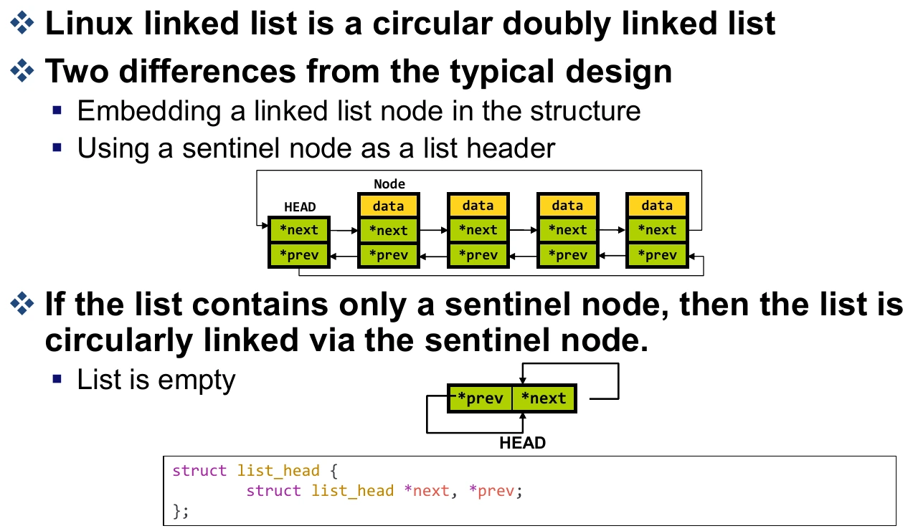

```c
LIST_HEAD(my_list);       /* 선언과 초기화 */
/* 이미 선언한 head에는 INIT_LIST_HEAD(&head) */
```

| 연산 | 의미 |
|---|---|
| `list_add(new, head)` | head 바로 뒤에 삽입, stack 형태에 적합 |
| `list_add_tail(new, head)` | head 바로 앞, 즉 맨 뒤에 삽입 |
| `list_del(entry)` | 연결에서 제거, 메모리는 해제하지 않음 |
| `list_for_each`, `list_for_each_prev` | 연결 노드로 정방향·역방향 순회 |
| `list_for_each_entry`, `..._reverse` | 자료형을 가진 데이터 객체로 순회 |
| `list_for_each_safe`, `..._prev_safe` | 다음 위치를 저장하며 순회 |
| `list_for_each_entry_safe`, `..._safe_reverse` | 삭제를 수반하는 객체 순회 |

`safe`는 **현재 순회에서 현재 노드를 지워도 다음 위치를 잃지 않는다**는 뜻이다. 다른 스레드의 동시 삭제에 자동으로 안전하다는 뜻은 아니다.

## 12. list_entry와 container_of

*Practical Class 6, 11~18쪽*

리스트는 `list_head *`로 연결되지만 실제로 필요한 것은 이를 포함한 `struct my_node *`다. `list_entry()`는 `container_of()`를 통해 바깥 객체의 시작 주소를 계산한다.

```text
객체 시작 주소 = 멤버 주소 − 객체 안에서의 멤버 오프셋
```

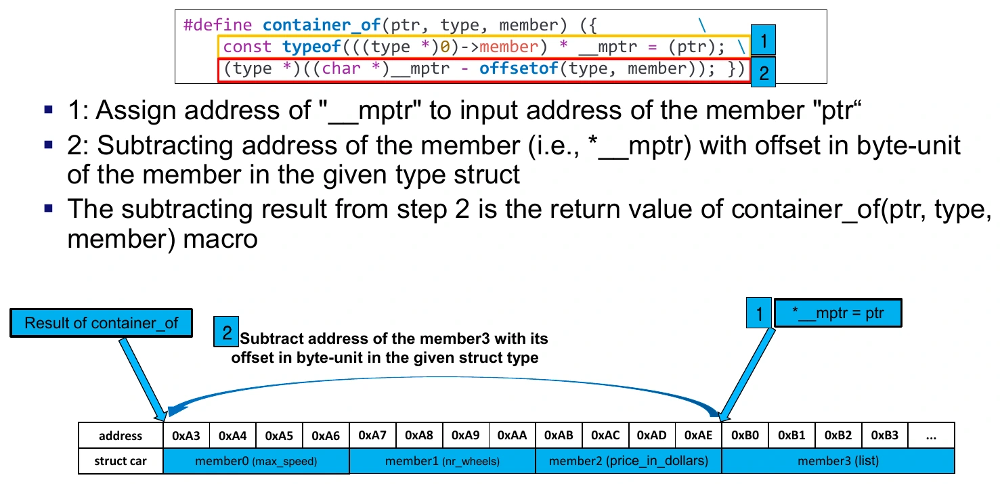

```c
struct my_node *node;
node = list_entry(link, struct my_node, entry);
```

강의의 GNU C 매크로를 읽는 데 필요한 문법은 다음과 같다.

- `({ ...; value; })`: statement expression. 마지막 표현식의 값을 결과로 쓴다.
- `typeof(expr)`: 표현식의 자료형을 얻는다.
- `offsetof(type, member)`: 구조체 시작에서 멤버까지의 바이트 거리다.
- `char *`로 바꾼 뒤 빼는 이유: 포인터 산술을 바이트 단위로 수행하기 위해서다.

`offsetof` 설명의 `&((TYPE *)0)->MEMBER`는 오프셋 계산을 보여 주는 전통적인 표현이다. 실제 프로그램에서 NULL을 역참조해 값을 읽는 방식으로 사용하면 안 된다. 제공되는 `offsetof`를 사용한다.

멤버의 오프셋에는 **정렬과 padding**도 반영된다. 강의의 `car.list`가 12인 출력은 특정 배치 예이고, 64비트 포인터 정렬에서는 16이 될 수 있다. 정수 필드 크기를 더해 하드코딩하지 않는다. 주소 출력은 `%p`, `size_t` 값은 `%zu`를 사용한다.

가령 어떤 구조체에서 `entry`의 실제 오프셋이 16바이트이고 객체 시작 주소가 1000이라면, `entry` 주소는 1016이다. 리스트가 돌려준 1016에서 오프셋 16을 빼면 바깥 객체의 1000을 얻는다. 숫자는 주소 계산을 설명하는 예시다. 전달한 주소가 정말 그 자료형의 해당 멤버를 가리켜야 하며, sentinel head를 실제 데이터 객체인 것처럼 변환해서는 안 된다.

## 13. 삽입·삭제·이동·합치기

*Practical Class 6, 19~29쪽*

`list_add`는 앞뒤 연결을 모두 맞춘다. `list_del`은 이웃끼리 다시 잇고 대상의 링크를 무효화하지만, `kmalloc`한 객체 자체는 남는다.

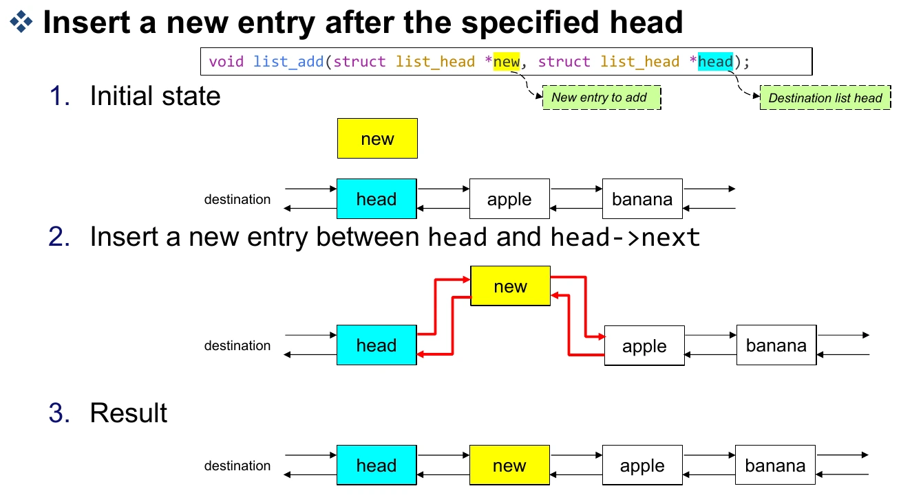

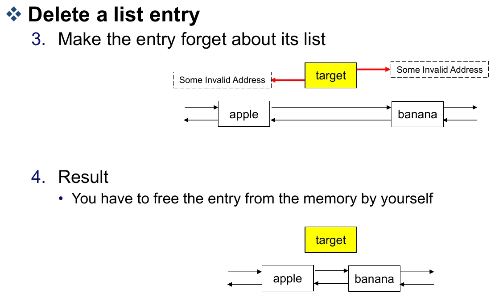

```c
/* 외부의 동시 접근이 없거나 적절한 락으로 보호된 구간 */
struct my_node *cur, *tmp;

list_for_each_entry_safe(cur, tmp, &my_list, entry) {
    list_del(&cur->entry);
    kfree(cur);
}
```

`list_move()`는 원래 리스트에서 떼어 다른 head 뒤에 붙이고, `list_move_tail()`은 목적지 끝에 붙인다.

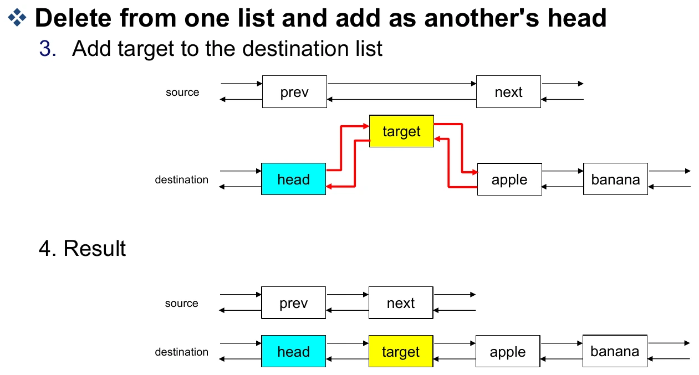

`list_splice()`는 여러 노드의 체인을 목적지에 연결한다. 원본 head를 빈 리스트로 재사용하려면 그 초기화까지 수행하는 `list_splice_init()` 계열을 고려해야 한다. 단순 splice 이후 원본 head를 그대로 정상적인 독립 리스트처럼 순회하면 안 된다.

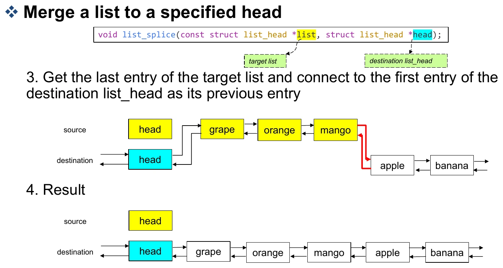

예제에서 0부터 9까지 `list_add()`하면 정방향 순서는 9부터 0, 역방향은 0부터 9다. `data == 2`인 노드를 찾아 제거할 때는 safe 순회를 쓰고, 종료 시 나머지 객체도 정리해야 한다. 할당 실패 검사 역시 필요하다.

## 14. 과제 6: Atomic 연산과 리스트 동기화

*Practical Class 6, 30~40쪽*

첫 번째 부분은 **커널 스레드 4개가 공유 counter를 1씩 증가시키고 출력**하도록 만드는 것이다. Fetch-and-add, test-and-set, CAS를 각각 이용한다.

Fetch-and-add는 직접 증가를 수행한다. Test-and-set은 일반적으로 잠금 상태를 얻어 counter 증가 구간을 보호하는 데 사용하며, `test_and_set(counter, 1)` 자체를 증가 연산으로 착각하지 않는다. CAS 증가는 읽은 값에 1을 더한 새 값으로 교환을 시도하고 실패 시 재시도하는 구조로 설계할 수 있다.

두 번째 부분은 전역 연결 리스트의 insert·search·delete를 다음 세 방식으로 보호하고 시간을 비교하는 것이다.

| 조건 | 요구사항 |
|---|---|
| 실행 흐름 | 커널 스레드 4개 |
| 데이터 | 총 1,000,000개, 스레드당 250,000개 |
| 공유 대상 | 전역 연결 리스트 하나 |
| 보호 방식 | spinlock, mutex, RW semaphore 각각 |
| 작업 순서 | 자기 범위 insert → search → delete |
| 측정 | 각 방식의 insert·search·delete 시간 |

범위가 서로 달라도 리스트의 head와 이웃 포인터는 공유한다. 데이터 값이 겹치지 않는 것만으로 동시 삽입·삭제가 안전해지지 않는다.

예를 들어 A는 값 1인 노드, B는 값 100인 노드를 넣더라도 둘 다 같은 head 바로 뒤에 삽입하면 `head->next`와 기존 첫 노드의 `prev`를 바꾼다. 값의 범위를 나누는 것은 어느 데이터를 담당할지 정하는 것이고, 연결 구조를 동시에 갱신할 수 있게 하는 동기화와는 별개다. 따라서 실제로 겹쳐 쓰는 포인터를 기준으로 임계 구역을 잡아야 한다.

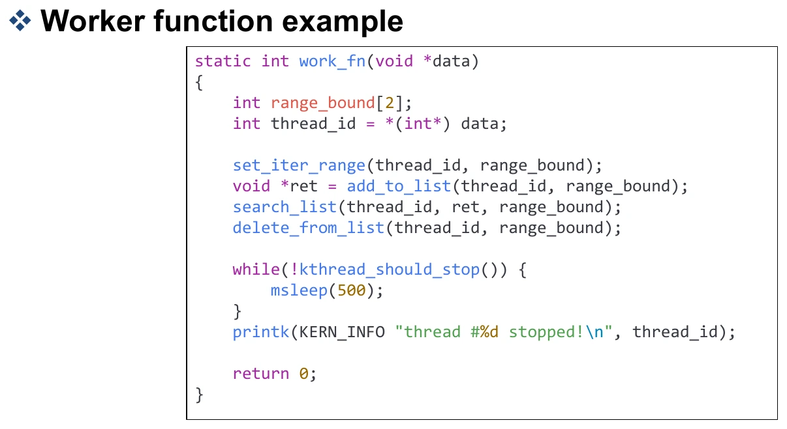

### 구현에서 확인할 점

1. 리스트와 락을 초기화한 후 스레드를 시작한다.
2. 각 스레드 인자 저장 공간은 스레드가 사용하는 동안 살아 있어야 한다.
3. `GFP_KERNEL` 할당을 spinlock 안에서 수행하지 않도록 할당·삽입 구간을 설계한다.
4. RW semaphore의 insert·delete는 write, 순수 search는 read로 보호한다.
5. 포인터를 락 밖으로 가져올 때는 다른 스레드가 해제할 가능성을 검토한다.
6. 측정 범위와 락 범위를 동일하게 맞춰 비교한다. 백만 번의 로그 출력이 결과를 지배하지 않게 한다.
7. 종료 요청, 생성 실패, 남은 노드 해제까지 처리한다.

원소마다 head부터 검색하면 총 검색 비용이 매우 커질 수 있다. 알고리즘과 순회 시작점이 다르면 락 성능 차이만 비교하는 실험이 아니므로 구현 조건을 기록해야 한다.

### 제출 항목

Atomic 부분은 각 연산의 짧은 설명, 모듈 코드 화면, 적재·제거 후 `dmesg` 화면을 포함한다. 리스트 부분은 각 락 방식의 `linked_list_impl.c` 화면과 지정한 노드 수에서의 세 연산 측정 화면이 필요하다. 이름·학번을 넣은 PDF와 소스 코드를 함께 제출한다.

## 15. 복습문제

해설을 보기 전에 각 질문에 짧게 답해 보자.

<details><summary>1. 같은 CPU의 태스크와 ISR이 spin_lock만 사용하면 왜 교착할 수 있는가?</summary>

태스크가 락을 가진 채 중단되고 ISR이 그 락을 기다리면, ISR이 끝나기 전에는 태스크가 실행되어 락을 풀 수 없다. 태스크 쪽에서 해당 인터럽트 재진입을 막는 설계가 필요하다.

</details>

<details><summary>2. 중첩 irqsave에서 같은 flags 변수를 쓰면 무엇을 잃는가?</summary>

바깥 진입 전의 IRQ 상태를 안쪽 진입 상태로 덮어쓴다. 각각 별도 변수에 저장하고 역순으로 복원해야 한다.

</details>

<details><summary>3. ARM ticket lock에서 0x10000을 더하는 이유는?</summary>

예제의 next가 32비트 값의 상위 16비트이기 때문이다. 번호 발급에 성공할 때 읽은 이전 next가 자기 번호이고, owner가 그 번호가 될 때 진입한다.

</details>

<details><summary>4. mutex와 count=1 semaphore는 완전히 같은가?</summary>

둘 다 한 번에 하나의 진입을 표현할 수 있지만 소유권 규칙과 용도가 다르다. Mutex는 획득한 태스크가 해제해야 한다.

</details>

<details><summary>5. list_for_each_entry_safe는 다른 스레드의 삭제에도 안전한가?</summary>

아니다. 자기 순회에서 현재 노드를 삭제해도 다음 위치를 이어 갈 수 있게 할 뿐이다. 다른 스레드와의 접근에는 별도 동기화·수명 관리가 필요하다.

</details>

<details><summary>6. list_del 뒤 kfree가 별도로 필요한 이유는?</summary>

연결 제거와 객체 메모리 반환이 별개이기 때문이다. 단, 다른 사용자가 객체를 참조 중이라면 즉시 kfree하면 안 된다.

</details>

<details><summary>7. container_of가 구조체 padding에도 대응하는 이유는?</summary>

멤버 크기를 추측해 더하는 대신 실제 타입의 offsetof를 사용해 멤버 주소에서 빼기 때문이다.

</details>

<details><summary>8. 스레드마다 데이터 범위가 다르면 전역 리스트 락이 필요 없는가?</summary>

필요하다. 서로 다른 값을 넣어도 head와 이웃의 next·prev를 동시에 변경한다. 값의 분할과 연결 구조의 공유는 별개다.

</details>

## 참고 자료

중앙대학교 리눅스 시스템 응용 설계, 손용석 교수, Systems and Storage Lab.

- 수업 자료: `6. synchronization (3).pdf`, `6. synchronization (4).pdf`.
- 실습·과제 자료: `[Practical Class 6] Linked list.pdf`.
