CPU가 하나여도 여러 태스크가 조금씩 번갈아 실행되면 동시에 진행하는 것처럼 보인다. 스케줄러는 **실행 가능한 태스크 중 누가, 언제, 얼마나 CPU를 사용할지** 정한다. 단순히 가장 빨리 고르는 것과 공정하게 나눠 주는 것은 서로 다른 문제다.

## 1. 스케줄링의 목표

*Scheduler (1), 2~4쪽*

여러 태스크가 메모리에 올라와도 한 논리 CPU에서 같은 순간 실행하는 태스크는 하나다. 시간을 나눠 사용하는 time-multiplexing과 실행 도중 CPU를 회수하는 preemption이 이를 연결한다.

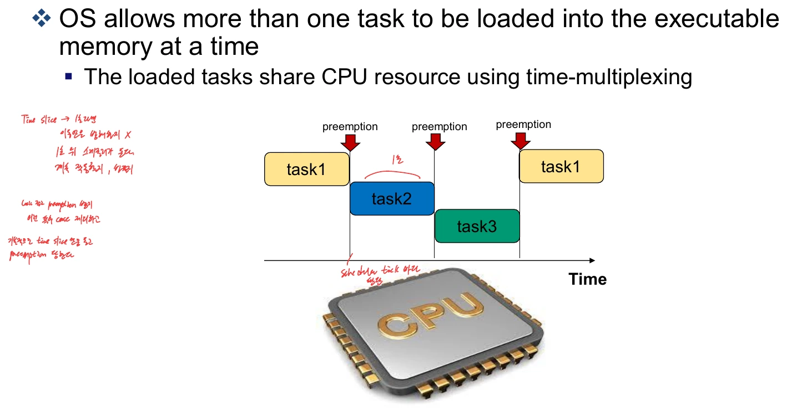

| 기준 | 질문 |
|---|---|
| Utilization | CPU가 유용한 작업을 수행하는 비율이 높은가? |
| Throughput | 단위 시간에 얼마나 많은 일을 완료하는가? |
| Turnaround time | 작업 제출부터 완료까지 얼마나 걸리는가? |
| Fairness | 각 태스크·그룹이 정해진 몫을 받는가? |
| Responsiveness | 입력이나 이벤트에 얼마나 빨리 반응하는가? |

같은 태스크를 오래 실행하면 전환 비용은 줄지만 다른 태스크의 응답은 늦어질 수 있다. 반대로 너무 짧게 나누면 context switch와 캐시 영향이 커진다.

사용자가 키를 눌렀을 때 화면이 빨리 바뀌는 것은 응답성이고, 큰 계산 작업을 초당 많이 끝내는 것은 처리량이다. 대화형 태스크에 짧고 빠른 실행 기회를 주면 응답은 좋아질 수 있지만 전환 횟수도 늘어난다. 따라서 어떤 스케줄러가 좋다는 평가는 무엇을 빠르게 하고 싶은지와 함께 읽어야 한다.

강의의 발전 흐름은 batch 처리 중심의 우선순위·RR에서 O(N), O(1), fair-share로 이어진다. 처리량뿐 아니라 대화형 프로그램, 서버의 자원 분배, 멀티코어 확장성이 중요해진 과정이다.

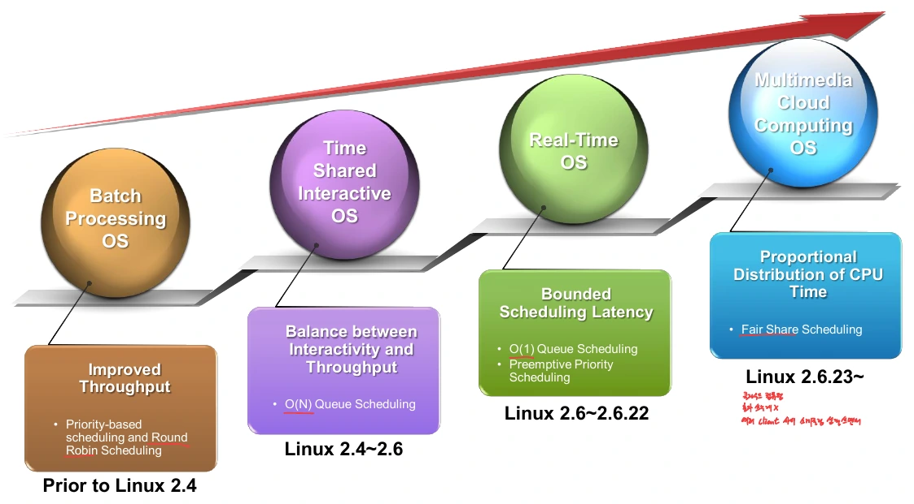

## 2. Round Robin

*Scheduler (1), 5~18쪽*

RR은 FIFO 순서로 각 태스크에 time slice를 준다. 시간을 다 쓰면 뒤로 보내고 다음 태스크를 실행한다. 끝나거나 잠든 태스크는 그만큼 CPU를 일찍 내놓는다.

동일한 slice q를 모두 끝까지 사용하고, runnable 태스크 수 n이 고정되어 있으며 전환 비용을 무시하면 한 바퀴 시간은 `q × n`이다. 강의의 10~100ms는 설명용 범위이지 모든 정책의 고정값은 아니다.

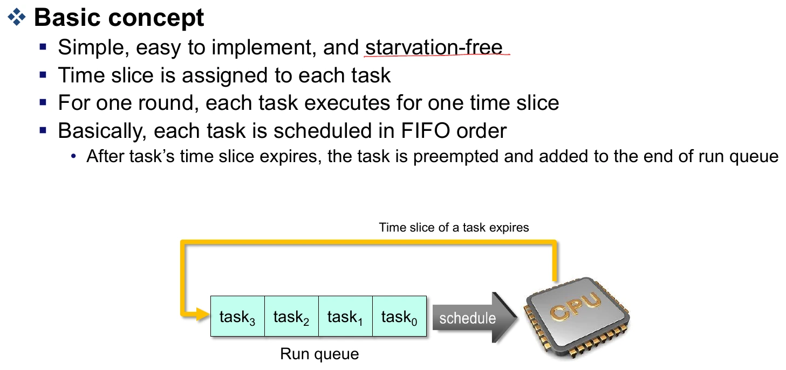

### 2ms 단위 예제

| 태스크 | 도착 | 필요한 CPU 시간 |
|---|---:|---:|
| T1 | 0ms | 6ms |
| T2 | 0ms | 8ms |
| T3 | 4ms | 6ms |

강의의 큐 삽입 순서에 따라 4ms에서 T3는 이미 대기 중인 T1 다음, 시간을 다 쓴 T2 앞에 놓인다.

| 구간(ms) | 실행 | 종료 시 남은 시간 T1/T2/T3 |
|---|---|---|
| 0~2 | T1 | 4 / 8 / 미도착 |
| 2~4 | T2 | 4 / 6 / 6 |
| 4~6 | T1 | 2 / 6 / 6 |
| 6~8 | T3 | 2 / 6 / 4 |
| 8~10 | T2 | 2 / 4 / 4 |
| 10~12 | T1 | 0 / 4 / 4 |
| 12~14 | T3 | 0 / 4 / 2 |
| 14~16 | T2 | 0 / 2 / 2 |
| 16~18 | T3 | 0 / 2 / 0 |
| 18~20 | T2 | 0 / 0 / 0 |

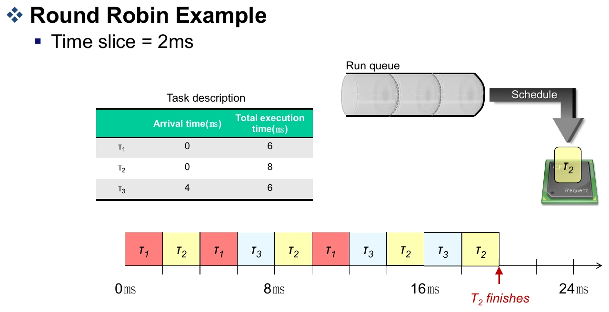

완료 시간은 T1=12, T2=20, T3=18ms다. Turnaround는 완료−도착이므로 12, 20, 14ms다. 이 예제처럼 I/O 대기가 없다면 ready queue 대기 시간은 turnaround−서비스 시간으로 6, 12, 8ms가 된다.

새 태스크 도착과 slice 종료가 정확히 같은 시각이면 처리 순서에 따라 타임라인이 달라질 수 있다. 예제를 풀 때 해당 규칙도 함께 고정한다.

이 예제에서 T3가 처음 실행된 시각은 6ms이므로 최초 응답까지의 대기는 `6−4=2ms`다. 반면 완료까지의 turnaround는 14ms다. 같은 태스크라도 “처음 CPU를 받기까지”, “CPU를 기다린 시간의 합”, “작업을 끝내기까지”는 다른 수치다. 타임라인을 그린 뒤 각 지표의 시작과 끝을 표시하면 혼동을 줄일 수 있다.

## 3. O(N): Credit과 Goodness

*Scheduler (1), 19~36쪽*

O(N) 모델은 후보를 훑어 가장 높은 goodness를 고른다. Credit은 사용할 수 있는 CPU 시간의 몫, goodness는 지금 선택할 필요성을 나타내는 점수다.

강의의 단순화된 계산식은 다음과 같다.

```text
일반 태스크, credit > 0: goodness = credit + priority
일반 태스크, credit = 0: goodness = 0
실시간 태스크:          goodness = 1000 + priority
선택하면 안 되는 상태:  goodness = -1000
```

실행하면 credit을 소모한다. 모두 소진하면 다시 채우며, 이전 몫을 다 쓰지 않고 잠든 태스크에는 남은 credit 일부를 반영한다. I/O를 기다리느라 CPU를 많이 쓰지 못한 태스크가 돌아왔을 때 응답성을 높이려는 방식이다.

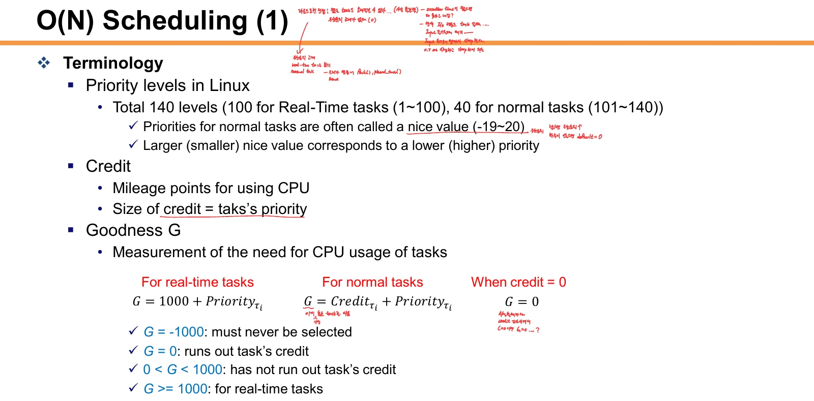

### 계산 예제

| 태스크 | priority | 초기 credit | 도착 | 총 실행 요구 |
|---|---:|---:|---:|---:|
| T1 | 50 | 50 | 0ms | 150ms |
| T2 | 40 | 40 | 0ms | 100ms |
| T3 | 10 | 10 | 30ms | 50ms |

10ms마다 계산하고, 점수가 같으면 현재 태스크를 유지하는 강의 예제다.

| 시각 | 남은 credit T1/T2/T3 | 다음 선택 이유 |
|---|---|---|
| 0 | 50/40/10 | T1: G=100, T2: G=80 |
| 20 | 30/40/10 | 둘 다 G=80, T1 유지 |
| 30 | 20/40/10 | T2의 80이 T1의 70보다 큼; T3 도착 |
| 40 | 20/30/10 | T1·T2가 70으로 같아 T2 유지 |
| 50 | 20/20/10 | T1=70, T2=60이므로 T1 |
| 70 | 0/20/10 | T1은 credit 소진으로 G=0, T2 선택 |
| 90 | 0/0/10 | T3만 credit이 남음 |
| 100 | 0/0/0 | 전체 re-credit |

```text
0~30 T1 → 30~50 T2 → 50~70 T1 → 70~90 T2 → 90~100 T3
```

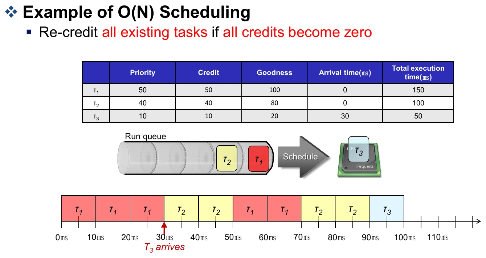

문제는 다음 후보를 고를 때마다 N개를 살핀다는 점이다. 태스크가 많으면 스케줄러 자신이 CPU를 상당히 사용한다. 하나의 전역 run queue와 락에 의존하는 구조는 멀티코어에서도 경쟁을 만든다.

## 4. 우선순위 숫자의 세 가지 표현

강의의 예제 priority와 실제 Linux의 사용자 API·커널 내부 인덱스는 구분해야 한다.

| 표현 | 범위·방향 |
|---|---|
| 일반 태스크의 nice | -20~19, 작을수록 높은 비중 |
| `SCHED_FIFO`, `SCHED_RR`의 사용자 RT priority | 1~99, 클수록 높음 |
| 전통적인 커널 내부 priority 인덱스 | RT 영역과 일반 영역으로 나뉘며 작은 인덱스가 높은 우선순위 |

일반 정책의 `sched_priority`는 0을 사용하며 nice와 별도다. 강의 (1)의 nice `-19~20` 표기, (2)의 RT `0~99` 그림은 그대로 API 입력 범위로 외우지 않는다. [Linux sched(7)](https://man7.org/linux/man-pages/man7/sched.7.html)

## 5. O(1): Active와 Expired

*Scheduler (1), 37~40쪽*

O(1) 스케줄러는 CPU마다 우선순위별 리스트 배열을 갖는다. Bitmap으로 비어 있지 않은 우선순위를 찾으므로 모든 태스크를 순회하지 않고 다음 후보를 찾을 수 있다.

- **Active**: 현재 epoch에서 실행할 몫이 있는 태스크.
- **Expired**: 몫을 다 사용해 다음 epoch를 기다리는 태스크.
- **Static priority**: 사용자가 설정하는 nice를 기반으로 한 값.
- **Dynamic priority**: 실행·수면 특성에 따른 보너스·패널티를 반영한 값.

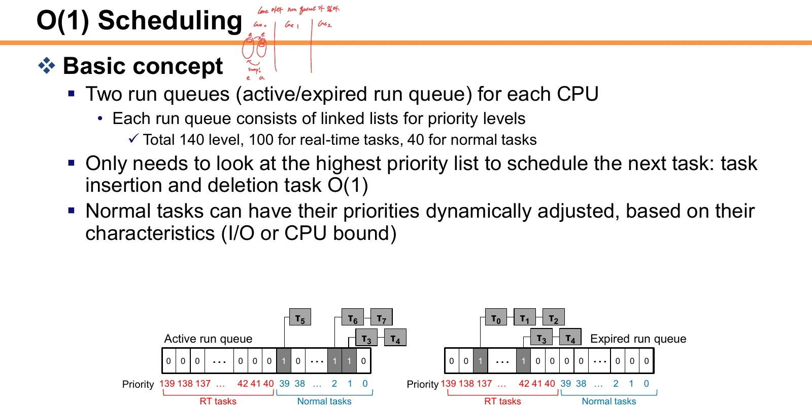

Active에서 가장 높은 우선순위의 태스크를 선택한다. 몫을 다 쓰면 expired로 옮긴다. Active가 비면 두 배열의 포인터를 바꾼다. 전체 태스크를 하나씩 복사하는 교체가 아니다.

각 우선순위에 태스크가 몇 개씩 있는지와 별개로 bitmap은 그 우선순위의 큐가 비어 있는지를 나타낸다. 따라서 다음 후보를 찾을 때 모든 태스크의 점수를 다시 계산할 필요 없이, 실행할 수 있는 가장 높은 우선순위의 큐를 먼저 찾는다. O(1)이라는 이름은 이런 선택 구조를 가리키며 실제 실행 시간이 0이거나 문맥 전환 비용이 없다는 뜻은 아니다.

강의는 sleep 특성을 이용한 보너스·패널티와 time slice 조정을 함께 설명한다. 실제 역사적 구현의 세부 계산 시점과 값은 버전에 따라 다르며, 핵심은 태스크 전체 스캔을 피하면서 대화형 작업을 우대하려는 구조다.

### 실행 예제

| 태스크 | 강의 priority | slice | 도착 | 총 요구 |
|---|---:|---:|---:|---:|
| T1 | 39 | 200ms | 0ms | 480ms |
| T2 | 29 | 150ms | 0ms | 400ms |
| T3 | 19 | 100ms | 300ms | 240ms |

이 표의 priority는 강의가 T1을 먼저 고르는 설명용 표기다. 앞 절의 실제 내부 인덱스 방향과 섞지 않는다.

| 구간(ms) | 실행·상태 변화 |
|---|---|
| 0~200 | T1 실행 후 expired |
| 200~350 | T2 실행 후 expired; 300ms에 T3 도착 |
| 350~450 | T3 실행 후 expired |
| 450 | active가 비어 두 배열 교환 |
| 450~650 | T1, 남은 요구 80ms |
| 650~800 | T2, 남은 요구 100ms |
| 800~900 | T3, 남은 요구 40ms |
| 900 | 다시 배열 교환 |
| 900~980 | T1 종료 |
| 980~1080 | T2 종료 |
| 1080~1120 | T3 종료 |

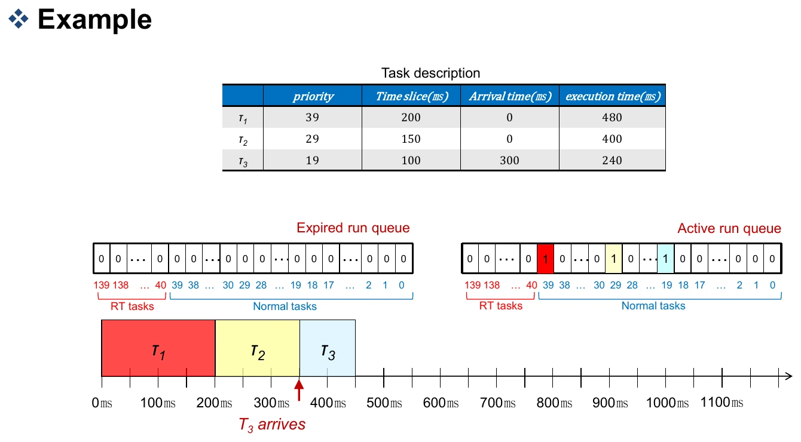

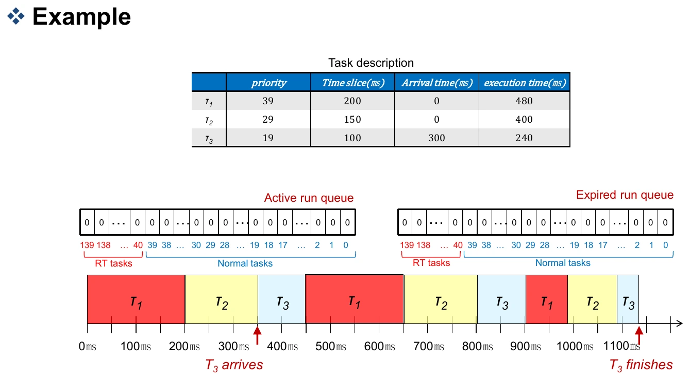

## 6. O(1)이 공정성 문제를 모두 해결하지 못한 이유

*Scheduler (1), 54~56쪽*

선택 비용이 일정하다는 것은 각 태스크가 공정한 비율을 받는다는 뜻이 아니다.

1. **절대 시간 차이와 비율 차이**: 100ms와 95ms의 차이는 작지만, 10ms와 5ms는 두 배 차이다. 같은 priority 한 단계가 같은 상대적 CPU 비중을 뜻하지 않는다.
2. **응답성과 처리량의 충돌**: 긴 slice는 대기 지연을 늘리고, 짧은 slice는 전환 비용을 늘린다.
3. **Expired 대기 문제**: active 쪽이 계속 채워지면 expired의 실행이 오래 지연될 수 있어 별도 방지 정책이 필요하다.
4. **대화형 작업 판별의 복잡성**: 오래 잠든 이유를 사용자 입력이라고 추정하지만 다른 이유로 잠들었을 수도 있다.

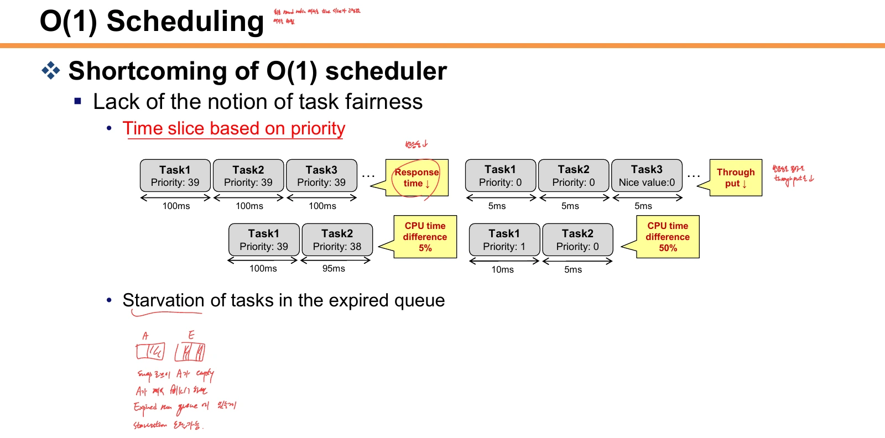

여기서 expired로 가는 것은 **종료한 태스크가 아니라 해당 몫을 다 쓴 runnable 태스크**다. 종료한 프로세스가 다음 epoch를 기다린다는 뜻이 아니다.

## 7. Fair-share와 CFS

*Scheduler (2), 2~6쪽*

Fair-share는 정해진 가중치에 비례해 CPU 시간을 나누는 모델이다. 같은 weight라면 같은 몫, 두 배 weight라면 두 배 몫을 목표로 한다.

```text
태스크 i의 이상적 CPU 시간
  = (weight_i / runnable 태스크들의 weight 합) × 관찰 시간
```

이는 한 CPU에서 경쟁 집합과 가중치가 일정한 이상적 상황의 식이다. 태스크가 잠들거나 새로 들어오면 분모와 실제 할당이 달라진다.

CFS는 Linux 2.6.23에 도입되었다. 수업은 전통적인 CFS의 vruntime 모델을 다룬다. 현재 커널의 fair scheduling은 EEVDF로 발전하고 있으므로 수업의 “최소 vruntime 선택”을 모든 최신 커널의 정확한 선택 규칙으로 확대하지 않는다. [Linux CFS 설계 문서](https://docs.kernel.org/scheduler/sched-design-CFS.html)

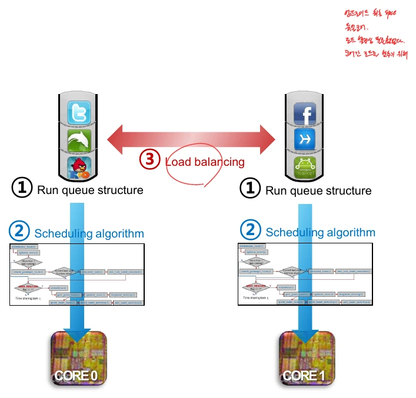

CFS 설명은 세 부분으로 나눌 수 있다. CPU별 run queue, 그 안에서의 태스크 선택, CPU 사이의 load balancing이다.

## 8. Scheduling class와 Run queue

*Scheduler (2), 7~13쪽*

기본 스케줄러가 모든 정책을 하나의 거대한 조건문으로 구현하는 대신, 클래스별 callback으로 정책을 분리한다.

| callback | 역할 |
|---|---|
| `enqueue_task` | runnable 집합에 추가 |
| `dequeue_task` | 제거 |
| `yield_task` | CPU 양보 처리 |
| `check_preempt_curr` | 현재 태스크를 선점할지 검사 |
| `pick_next_task` | 다음 태스크 선택 |
| `put_prev_task` | 이전 태스크의 실행 상태 정리 |

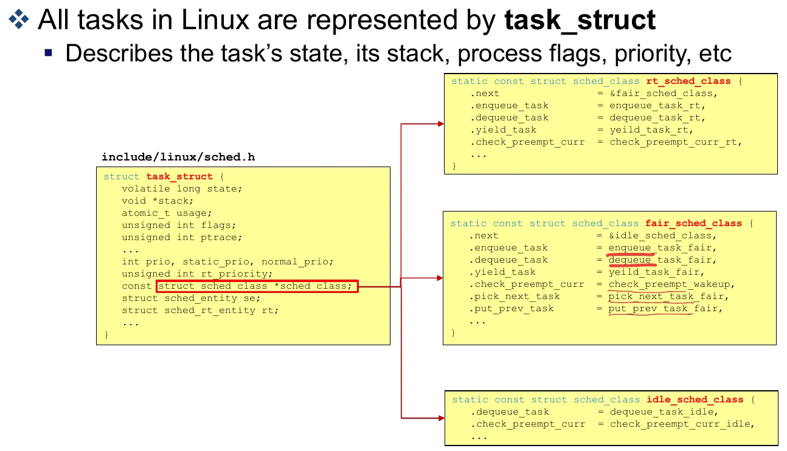

강의 그림은 `rt_sched_class → fair_sched_class → idle_sched_class`의 우선 관계를 보여 주는 단순화다. 실제 커널에는 다른 클래스도 있으며 구조·연결 방식은 버전마다 달라진다.

**Idle class의 대표는 CPU별 idle task인 swapper다. PID 1인 init이 idle task인 것은 아니다.** `task_struct`는 `sched_class`, 일반 태스크용 `sched_entity`, RT용 엔티티, priority 등의 정보를 갖는다.

CPU별 run queue 안에서 RT 태스크는 우선순위 배열, CFS 엔티티는 red-black tree로 관리된다.

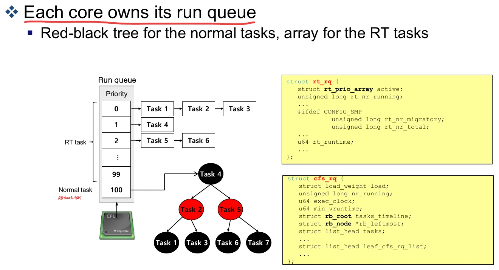

`cfs_rq`의 주요 필드는 weight 합인 `load`, runnable 수인 `nr_running`, 실행 시간, `min_vruntime`, tree root, 가장 왼쪽 노드를 가리키는 포인터다. Tree 삽입·삭제는 O(log n)이고, 최소 노드 포인터를 유지하면 최소 후보 접근은 빠르게 할 수 있다.

## 9. Nice에서 Weight로

*Scheduler (2), 14쪽*

CFS는 nice를 가중치로 바꾼다. 기준인 nice 0의 weight는 1024다.

| nice | weight |
|---:|---:|
| -20 | 88761 |
| -10 | 9548 |
| -5 | 3121 |
| -3 | 1991 |
| -1 | 1277 |
| 0 | 1024 |
| 1 | 820 |
| 5 | 335 |
| 10 | 110 |
| 19 | 15 |

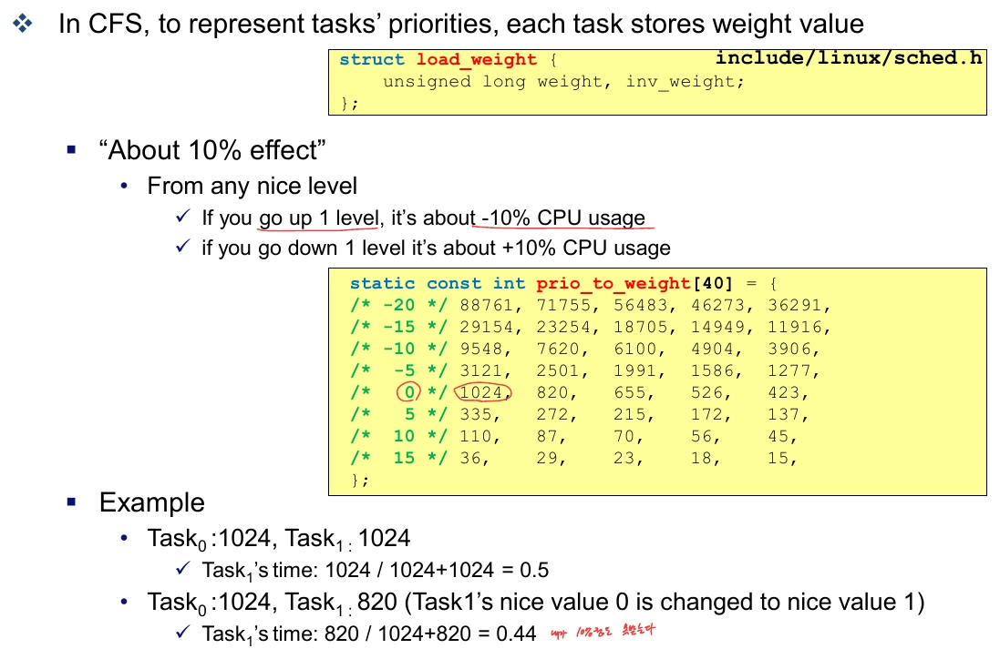

nice 한 단계는 weight가 대략 1.25배 비율로 바뀌도록 설계되어 있다. 두 태스크의 weight가 모두 1024면 각 50%다. 한쪽을 nice 1로 바꾸면 그 태스크 몫은 `820 / (1024+820) ≈ 44.47%`다.

강의의 “약 10% 효과”는 이런 상대적 몫의 변화 맥락이다. 어떤 경쟁 집합에서도 무조건 CPU 사용률이 10%p 줄어든다는 뜻은 아니다.

## 10. Virtual runtime

*Scheduler (2), 15~18쪽*

실제 실행 시간에 가중치를 반영한 값이 vruntime이다. 가중치가 고정된 구간에서는 다음처럼 증가한다.

```text
Δvruntime = Δ실제 실행 시간 × 1024 / weight
```

| weight | 실제 1ms 실행 시 vruntime 증가 |
|---:|---:|
| 1024 | 1ms |
| 1991 | 약 0.514ms |
| 3121 | 약 0.328ms |

높은 weight는 vruntime이 천천히 증가한다. 최소 vruntime을 우선 선택하면 이 태스크는 더 많은 실제 CPU 시간을 받아야 다른 태스크와 비슷한 vruntime에 도달한다.

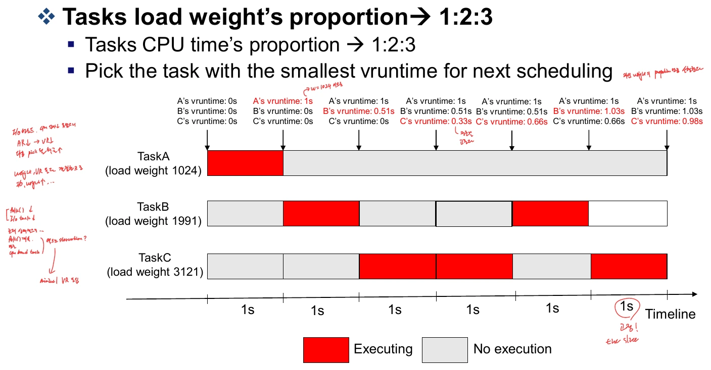

가중치가 대략 1:2:3이면 충분한 시간 동안의 실제 CPU 몫도 대략 1:2:3을 목표로 한다. 공정한 상태에서 비슷해지는 것은 실제 runtime이 아니라 **가중치로 정규화한 vruntime**이다.

계산을 쉽게 하려고 A의 weight를 1024, B를 그 두 배인 2048로 가정하자. A가 실제 1ms 실행하면 vruntime이 1ms 늘고, B가 실제 2ms 실행해도 1ms 늘어난다. 두 태스크가 같은 가상 실행량에 도달할 때 B가 실제 CPU 시간은 두 배 사용한 셈이다. 이 2048은 원리를 보여 주는 가상 가중치이며 nice 표의 특정 항목을 뜻하지 않는다.

새 태스크의 값을 기존 태스크들과 무관하게 0으로 두면 오래 실행한 태스크보다 계속 작아져 CPU를 독점할 수 있다. Run queue의 `min_vruntime`을 기준으로 배치하여 현재 시간축에 맞춘다.

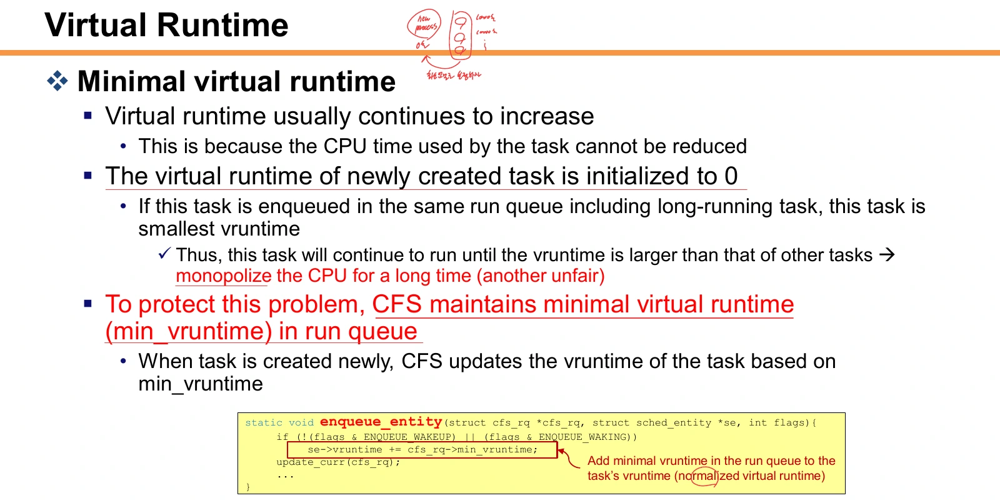

`min_vruntime`은 단순히 매 순간 tree의 맨 왼쪽 숫자를 복사한 값으로만 보면 부족하다. 실행 중인 엔티티를 포함한 진행 기준이며 단조 증가하도록 관리된다.

## 11. Scheduling period와 비례 slice 계산

*Scheduler (2), 19~23쪽*

강의의 CFS 모델에서는 목표 latency와 minimum granularity로 주기를 정한 다음 weight 비율로 나눈다.

```text
threshold = target_latency / min_granularity
period = target_latency                  (n ≤ threshold)
period = n × min_granularity             (n > threshold)
ideal_slice_i = period × weight_i / Σweight
```

여기서 threshold는 **태스크 수**이고 period는 **시간**이다. 슬라이드 19~20쪽은 `sched_nr_latency`를 시간처럼 표기한 부분이 있어 단위를 바로잡아 읽어야 한다.

강의의 수치 `target_latency=6ms`, `min_granularity=0.75ms`라면 threshold는 **8개**다.

| 같은 weight의 runnable 수 | 주기 | 태스크당 비례 몫 |
|---:|---:|---:|
| 3 | 6ms | 2ms |
| 6 | 6ms | 1ms |
| 8 | 6ms | 0.75ms |
| 12 | 9ms | 0.75ms |

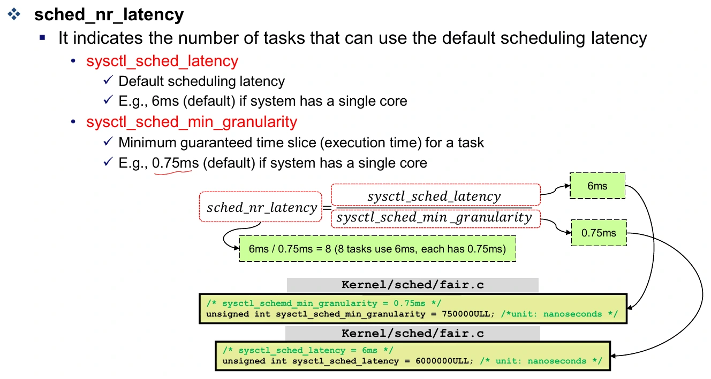

다른 예로 period를 18ms라고 가정하면 weight 1:2:3의 비례 몫은 3·6·9ms다. 실제 표의 1024·1991·3121을 그대로 넣으면 약 3.004·5.840·9.156ms로, 슬라이드의 3·6·9는 비율을 단순화한 값이다.

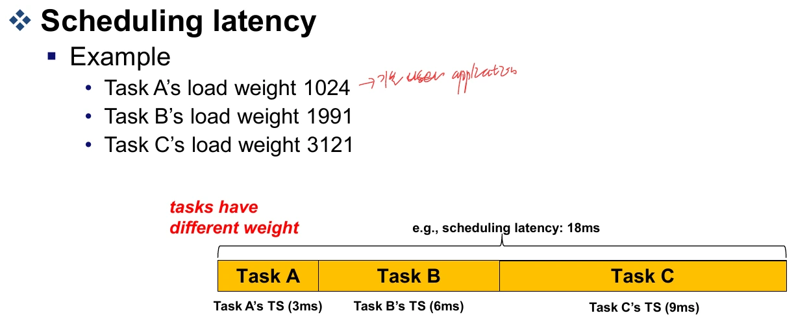

이 몫은 “어떤 상황에서도 절대 선점되지 않고 그 시간만큼 실행한다”는 보장이 아니다. 상위 클래스의 실행, block, wakeup 등 다른 사건이 개입한다. Minimum granularity 역시 모든 가중치의 태스크에 무조건 같은 최소 몫을 배정한다는 단순 규칙으로 해석하지 않는다.

동일 weight 태스크가 12개일 때도 주기를 6ms로 고정하면 각각의 몫은 0.5ms로 줄어든다. 강의 모델은 태스크 수가 임계값을 넘으면 주기를 9ms로 늘려 각각 0.75ms를 배정한다. 태스크가 늘어날수록 무작정 더 잘게 나누는 대신 한 바퀴를 길게 잡는 선택이며, 그만큼 각 태스크가 다음 차례까지 기다리는 시간은 늘어날 수 있다.

## 12. 실습: 내장 리스트에서 Lock-free 구조로

*Practical Class 7, 2~12쪽*

커널 자료구조는 스케줄러의 tree, 파일시스템의 transaction list처럼 실제 정책의 성능을 결정한다. 실습은 지난주의 `list_head`에서 출발한다.

자료형마다 `struct cat *next`, `struct dog *next`를 두면 연결 코드도 자료형에 묶인다. `list_head`를 내장하면 연결 자체를 공통 API로 처리할 수 있다. 다만 서로 다른 타입을 한 리스트에 넣었다면 순회 시 실제 객체 타입을 구별할 별도 설계가 필요하다. 모든 노드에 `list_entry(..., struct cat, ...)`를 적용하면 안 된다.

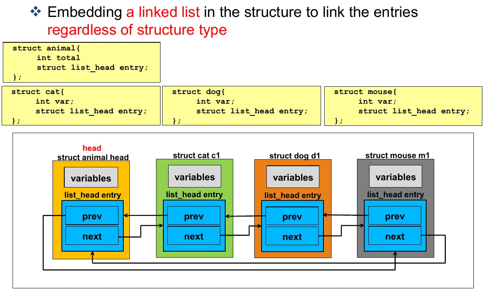

기존 리스트의 삽입은 새 노드와 이웃의 next·prev를 여러 번 수정한다. 전역 락으로 이 구간을 보호하면 단순하지만 모든 삽입이 직렬화된다.

실습의 lock-free 방식은 일반적인 원형 리스트와 다르다. `next=NULL`, `prev=self`로 시작하는 head를 두고, head의 prev를 tail로 이용한다. 데이터 노드는 `removed` 표시와 별도의 `gc_entry`도 가진다.

```c
struct cat {
    int var;
    struct list_head entry;
    atomic_t removed;
    struct list_head gc_entry;
};
```

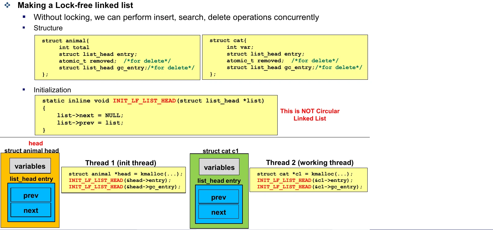

## 13. Atomic exchange로 tail 자리 예약하기

*Practical Class 7, 13~14쪽, 18~20쪽*

강의의 삽입 아이디어는 tail을 원자적으로 교체하고 이전 tail을 돌려받는 것이다.

```text
새 노드 초기화
old_tail = atomic_exchange(shared_tail, new_node)
new_node.prev = old_tail
old_tail.next = new_node
```

두 스레드가 동시에 삽입해도 exchange에 성공한 순서에 따라 서로 다른 이전 tail을 받는다.

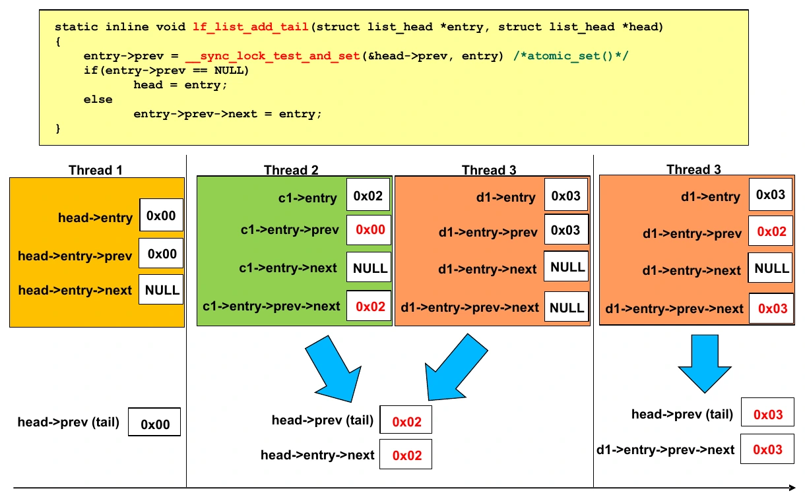

그러나 **tail 교환과 old_tail.next 연결은 두 단계**다. 앞 스레드가 교환 직후 멈추면 뒤 노드가 있어도 head에서 따라가는 경로가 잠시 끊길 수 있다. 검색의 종료 조건, 재시도, 공개 순서가 필요하다. atomic 하나를 사용했다는 사실만으로 임의의 검색·삭제가 모두 안전하거나 알고리즘 전체의 lock-free 진행성이 증명되는 것은 아니다.

빈 리스트에서 A가 tail을 자기 노드로 바꾸고 멈췄다고 하자. B는 그 뒤에 자기 노드를 붙일 수 있지만, A가 아직 `head->next`를 연결하지 않았다면 head에서 출발한 검색은 두 노드에 도달하지 못한다. 삽입 순서가 예약되었다는 것과 검색자에게 완성된 경로가 보인다는 것을 나누어 생각해야 하는 구체적인 경우다.

Sentinel은 빈 리스트와 첫 노드의 특별 처리를 줄이는 데 도움이 된다. Head·tail을 함수 매개변수로 전달하는 슬라이드 예제에서는 또 하나를 구분해야 한다. C에서 포인터를 값으로 전달한 뒤 로컬 `head`, `tail`만 바꿔도 호출자의 공유 포인터는 갱신되지 않는다. 실제 구현은 공유 저장 위치를 가리키거나 그 주소를 전달해야 한다.

## 14. 논리적 삭제와 메모리 회수

*Practical Class 7, 15~17쪽, 21~22쪽*

검색 중인 스레드가 노드 주소를 이미 가지고 있는데 다른 스레드가 즉시 `kfree()`하면 use-after-free가 된다. 그래서 삭제를 나눈다.

1. `removed`를 표시하여 더 이상 유효한 데이터로 선택하지 않게 한다.
2. GC 리스트에 연결한다.
3. 기존 노드는 순회 연결을 위해 메모리에 남긴다.
4. 더 이상 참조자가 없음을 확인한 뒤 실제 연결 제거·해제를 수행한다.

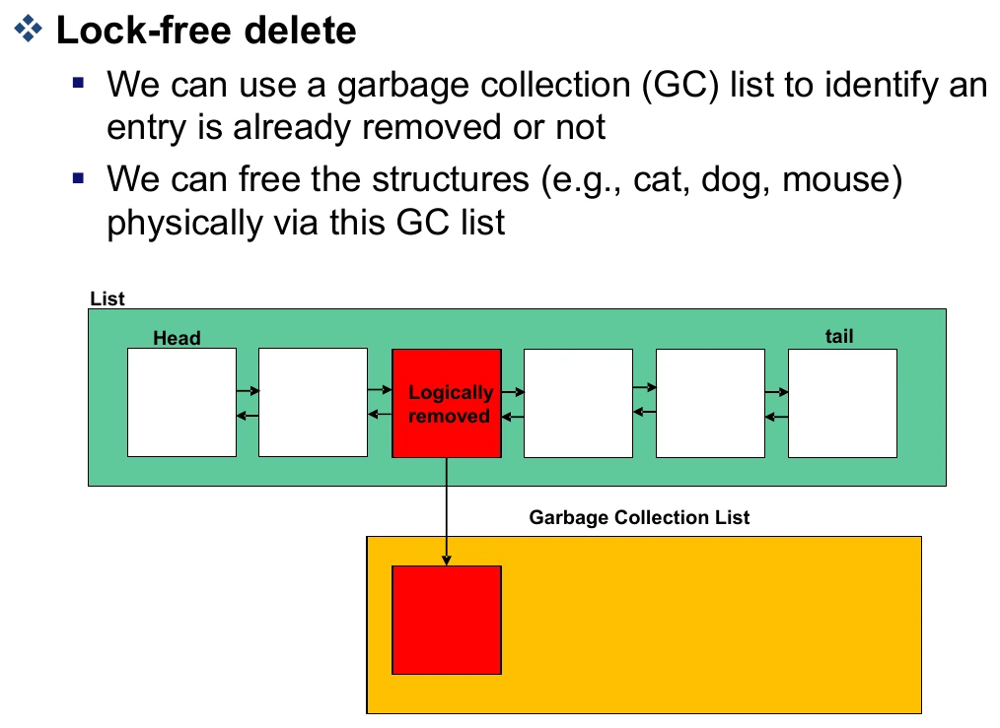

검색은 연결을 따라가되 sentinel과 논리 삭제된 노드를 건너뛴다. `removed`를 한 번 확인한 직후 다른 스레드가 삭제할 수 있으므로, 검색 후 데이터 사용까지 어떤 보장이 필요한지도 결정해야 한다.

슬라이드의 로컬 반복자 `iter`에 CAS를 적용하는 것만으로 공유 `next`나 객체 수명이 보호되지는 않는다. 중복 삭제 가능성이 있다면 `removed: 0 → 1`의 승자를 정하여 GC 등록과 total 감소가 한 번만 일어나게 해야 한다.

RCU는 읽기가 많은 커널 자료구조에서 제거와 해제를 분리하는 실제 기법의 한 예다. 읽는 쪽이 끝나기 전에는 객체를 반환하지 않도록 grace period를 이용한다. 이 실습의 종료 시 GC와 RCU는 동일한 구현은 아니지만 **참조가 남아 있는 동안 해제하지 않는다**는 문제의식을 공유한다. [Linux RCU 리스트 문서](https://docs.kernel.org/RCU/listRCU.html)

## 15. 과제 7: Spinlock 방식과 비교

*Practical Class 7, 23~34쪽*

과제는 강의의 lock-free 리스트를 구현하고, **같은 조건의 spinlock 리스트와 실행 시간을 비교**하는 것이다.

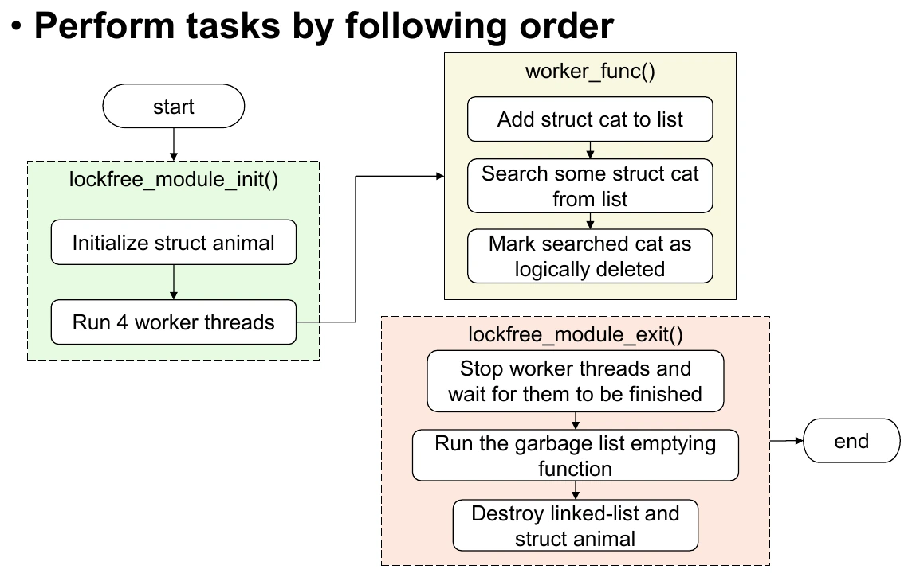

- 초기화: `animal` 컨테이너, 일반 리스트, GC 리스트를 초기화하고 worker 4개를 시작한다.
- Worker: 자신의 ID 범위를 정하고 삽입 → 대상 검색 → 논리적 삭제를 수행한다.
- 대기: 작업 후 종료 요청을 확인하며 기다린다.
- 종료: 모든 worker를 멈추고 완료를 기다린다. GC 리스트를 비우고 남은 리스트와 head를 해제한다.

검색 실패는 예제의 실제 반환 코드처럼 `-ENODATA`로 처리한다. 실패했는데 검색 결과 포인터를 사용해 삭제하지 않는다.

GC에서는 다음 위치를 먼저 저장하고, 일반 리스트와 GC 리스트 양쪽에서 노드를 떼어 낸 다음 메모리를 반환한다. Tail 삭제는 head가 가진 tail 정보까지 고쳐야 한다. 살아 있는 노드와 이미 GC로 해제한 노드를 다시 함께 해제하지 않도록 한다.

### 비교 결과를 읽는 기준

| 맞춰야 할 조건 | 이유 |
|---|---|
| 스레드·CPU·노드 수 | 경쟁 정도가 달라짐 |
| 할당을 포함하는 측정 범위 | 자료구조 연산과 할당 비용이 섞일 수 있음 |
| 검색 대상·순회 시작점 | 순회 길이 차이가 결과를 지배할 수 있음 |
| 삭제 의미 | 논리적 표시만 한 시간과 실제 해제까지 한 시간은 다름 |
| 로그 출력량 | printk 비용이 측정에 개입 |
| 완료 후 개수·구조 검증 | 빠르지만 잘못된 결과를 걸러야 함 |

메모리 회수를 종료 시점까지 미뤘다면 그 비용과 최대 메모리 사용량도 따로 설명한다. 네 스레드가 동시에 쓴 시간의 합과 작업 시작부터 전체 완료까지의 wall-clock 시간도 다른 지표다.

제출 PDF에는 두 구현의 소스 코드 화면과 각 결과 화면, 이름·학번이 필요하다. 측정값만 제시하기보다 삽입 수, 검색 성공, 논리 삭제 수, GC 후 상태가 일치하는지도 함께 확인한다.

## 16. 복습문제

해설을 보기 전에 각 질문에 짧게 답해 보자.

<details><summary>1. RR 예제에서 T3의 turnaround가 18ms가 아닌 이유는?</summary>

18ms는 완료 시각이다. T3는 4ms에 도착했으므로 turnaround는 18−4=14ms다.

</details>

<details><summary>2. O(N)과 O(1)의 이름은 CPU 시간 분배 비율을 뜻하는가?</summary>

아니다. 주로 다음 태스크 선택과 큐 관리의 복잡도를 설명한다. 선택이 빠르다고 공정성까지 자동으로 보장되는 것은 아니다.

</details>

<details><summary>3. O(1)의 active가 비면 태스크를 모두 복사하는가?</summary>

두 배열의 포인터 역할을 바꾼다. 기존 expired가 active가 되어 다음 몫을 실행한다.

</details>

<details><summary>4. Weight가 두 배이면 같은 실제 시간의 vruntime 증가는 어떻게 되는가?</summary>

절반으로 증가한다. 따라서 비슷한 vruntime에 도달할 때까지 더 많은 실제 CPU 시간을 사용할 수 있다.

</details>

<details><summary>5. 새 태스크의 vruntime을 무조건 0에서 시작시키면 생기는 문제는?</summary>

기존 태스크들의 값이 커져 있는 경우 새 태스크가 따라잡을 때까지 과도하게 선택될 수 있다. Run queue의 진행 기준에 맞춰 배치해야 한다.

</details>

<details><summary>6. 6ms/0.75ms의 결과 8은 시간인가, 개수인가?</summary>

기본 latency 안에서 해당 granularity를 나눌 수 있는 태스크 수다. 시간 단위는 서로 약분된다.

</details>

<details><summary>7. Tail exchange 성공 직후에도 검색 경로가 완성되지 않을 수 있는 이유는?</summary>

이전 tail의 next를 새 노드에 연결하는 단계가 아직 남아 있기 때문이다. 공유 tail의 갱신과 head에서 도달 가능한 연결의 공개는 별개의 사건이다.

</details>

<details><summary>8. 논리 삭제한 노드를 바로 kfree하지 않는 이유는?</summary>

다른 스레드가 이미 주소를 가지고 순회 중일 수 있다. 모든 참조자가 끝났음을 보장한 뒤 실제 해제해야 한다.

</details>

## 참고 자료

중앙대학교 리눅스 시스템 응용 설계, 손용석 교수, Systems and Storage Lab.

- 수업 자료: `7. Scheduler (1).pdf`, `7. Scheduler (2).pdf`.
- 실습·과제 자료: `[Practical Class 7] LinkedList_LockFree.pdf`.
