CFS의 가중치와 vruntime을 알았다면, 이제 실제 코드가 그 값을 **언제 갱신하고, 언제 태스크를 바꾸는지** 볼 차례다. 태스크가 runnable 집합에 있다는 것, RB tree 안에 있다는 것, 지금 CPU에서 실행한다는 것도 구별해야 한다.

## 1. 태스크의 공정성과 사용자의 공정성

*Scheduler (3), 2~4쪽*

같은 weight의 태스크 5개에 각각 20%를 주면 태스크 관점에서는 공정하다. 하지만 사용자 A가 4개, B가 1개를 실행했다면 사용자별 몫은 80%와 20%다.

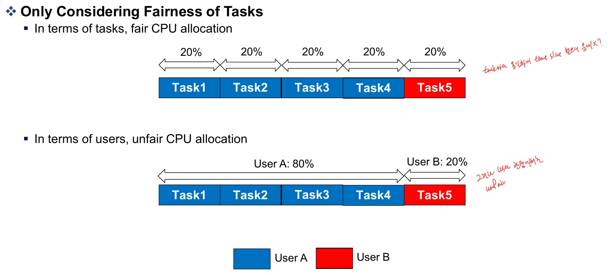

그룹 스케줄링은 먼저 그룹에 몫을 주고, 그룹 안에서 다시 나눈다. 같은 weight의 그룹 A·B를 50%씩 배정하면 A 안의 태스크 4개는 각각 12.5%, B의 태스크 하나는 50%를 받을 수 있다. 모든 태스크가 계속 runnable인 단일 CPU의 단순화된 예다.

그룹 안에 또 그룹을 둘 수 있다. A의 50% 중 하위 그룹 A-1이 절반을 받고 그 안에 태스크 두 개가 있으면 각각 `50% × 50% × 50% = 12.5%`다.

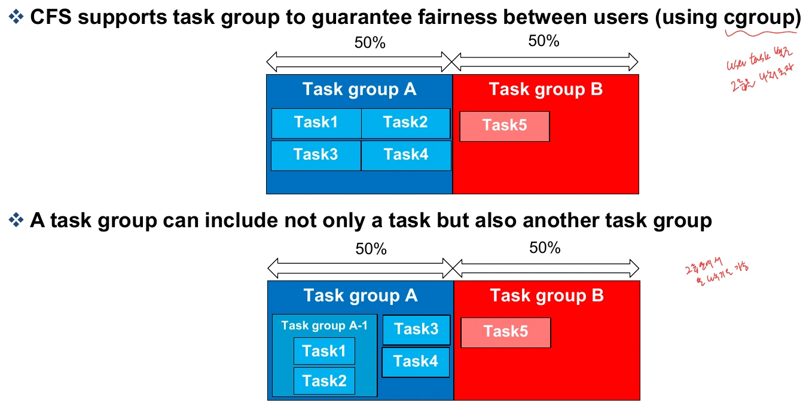

이 구조를 표현하는 공통 단위가 `sched_entity`다. 태스크 자체뿐 아니라 태스크 그룹도 스케줄링 후보가 될 수 있다. Cgroup의 구성과 가중치에 따른 분배이며, 사용자가 다르다는 이유만으로 자동으로 항상 50:50이 되는 것은 아니다.

## 2. sched_entity의 필드

*Scheduler (3), 4~6쪽*

| 필드 | 의미 |
|---|---|
| `load` | 가중치 |
| `run_node` | RB tree 안에 연결되는 노드 |
| `group_node` | 태스크 목록 연결에 사용하는 노드 |
| `on_rq` | 해당 엔티티가 runnable 집합에 포함되는지 |
| `exec_start` | 최근 실행 시간 회계의 시작 기준 |
| `sum_exec_runtime` | 누적 실제 실행 시간 |
| `vruntime` | weight로 보정한 누적 실행 시간 |
| `prev_sum_exec_runtime` | 이번 실행 구간 시작 시의 누적값 |
| `nr_migrations` | CPU 이동 횟수 |
| `parent`, `depth` | 그룹 계층의 부모와 깊이 |
| `cfs_rq` | 이 엔티티가 소속되는 run queue |
| `my_q` | 그룹 엔티티가 내부에 가진 자식 run queue |

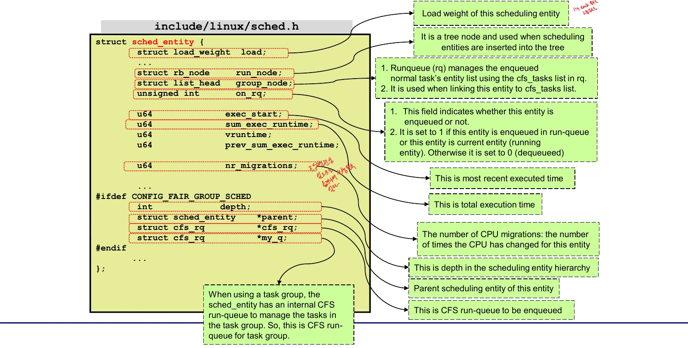

`run_node`는 엔티티 안에 내장된다. Tree에서 노드를 얻은 뒤 `rb_entry()`로 바깥 `sched_entity`를 얻는 방식은 연결 리스트의 `container_of`와 같은 발상이다.

`cfs_rq`와 `my_q`는 방향이 반대다. 그룹 엔티티가 부모 계층에서 다른 후보들과 경쟁하는 큐가 `cfs_rq`이고, 그 그룹 안의 자식 후보들을 담은 큐가 `my_q`다. 예를 들어 상위 큐에서 그룹 A가 선택되면 A의 `my_q`로 내려가 실제로 실행할 자식을 고른다. 같은 엔티티가 상위 단계의 후보이자 하위 단계로 들어가는 입구가 되는 구조다.

## 3. 스케줄링을 요청하는 두 경로

*Scheduler (3), 7~9쪽, 15~20쪽*

**주기적 검사**는 timer tick을 이용한다. **이벤트 기반 검사**는 wakeup, sleep, 양보, 우선순위·클래스 변경 등에서 발생한다.

Tick 주파수가 HZ라면 간격은 `1/HZ`초다. HZ=100은 10ms, HZ=1000은 1ms다. 이는 예제 설정이며, 실제 커널의 tickless·고해상도 타이머 설정까지 모두 같은 동작이라고 생각하면 안 된다.

```text
timer interrupt
 → scheduler_tick
 → 현재 클래스의 task_tick
 → 실행 시간 갱신
 → 선점 필요성 검사
 → NEED_RESCHED 설정
 → 스케줄링이 가능한 지점에서 schedule 계열 실행
```

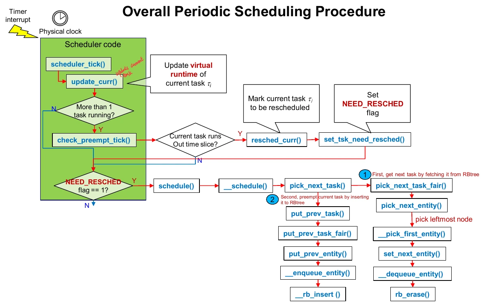

**재스케줄링 요청과 실제 context switch는 별개**다. Flag를 세웠다는 이유만으로 어떤 문맥에서든 즉시 스택과 태스크를 바꾸는 것은 아니다.

Timer tick은 현재 실행량을 점검하는 계기이지 “매 tick마다 반드시 다음 태스크로 교체하라”는 명령이 아니다. 아직 실행할 몫이 남았거나 더 적절한 후보가 없다면 같은 태스크가 계속 실행할 수 있다. 반대로 tick 사이에도 태스크가 잠들거나 다른 태스크가 깨어나는 사건 때문에 선택을 다시 해야 할 수 있다.

## 4. scheduler_tick과 update_curr

*Scheduler (3), 10~14쪽*

`scheduler_tick()`은 현재 CPU의 run queue와 현재 태스크를 얻고, run queue 락 아래에서 시계와 클래스별 tick 처리를 갱신한다.

CFS에서는 `task_tick_fair()`가 현재 태스크의 엔티티부터 부모 그룹까지 올라가며 `entity_tick()`을 수행한다. 그룹 자체의 CPU 사용량도 반영해야 하기 때문이다.

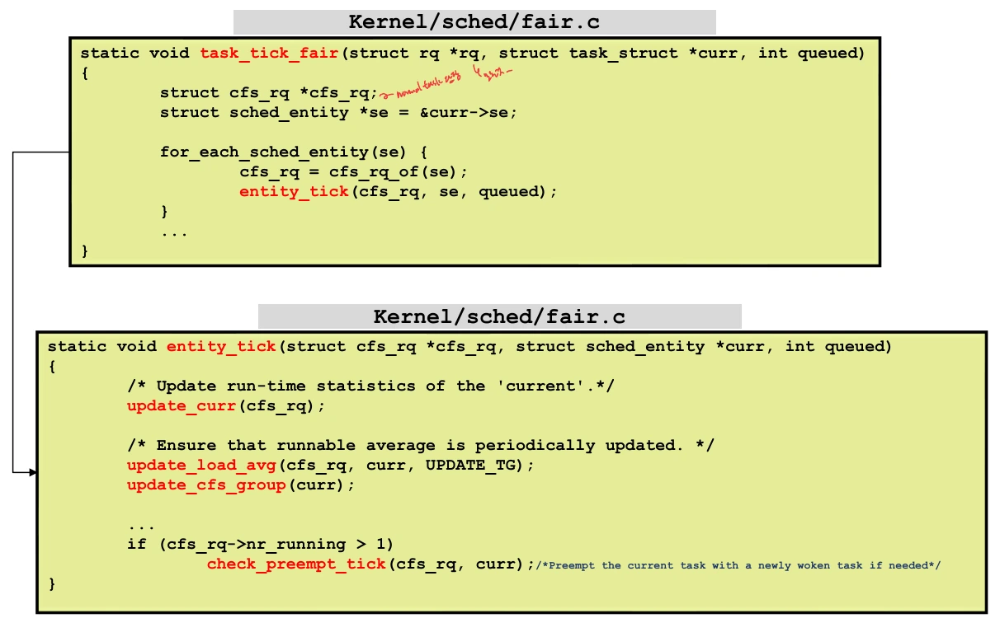

`update_curr()`의 핵심은 다음과 같다.

```text
now = 현재 run queue 시계
Δ실행 = now − curr.exec_start
curr.exec_start = now
curr.sum_exec_runtime += Δ실행
curr.vruntime += Δ실행 × 1024 / weight
run queue의 min_vruntime 갱신
```

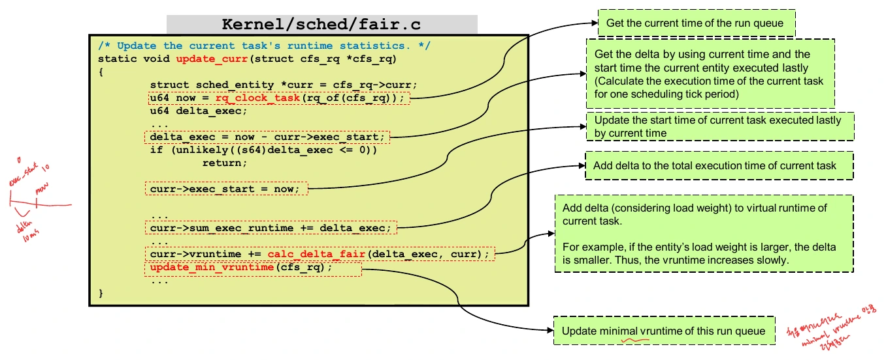

`sum_exec_runtime`은 태스크가 시작된 뒤의 벽시계 시간이 아니다. 실제로 CPU에서 실행한 시간을 누적한다. `prev_sum_exec_runtime`과의 차이를 구하면 이번에 선택된 이후 사용한 실행량을 얻는다.

예를 들어 이번에 선택될 때 누적 실행량이 20ms였고 현재 23ms라면, 이번 실행 구간에서 쓴 양은 3ms다. 중간 tick에서 시간을 정산하면 `exec_start`는 다음 정산의 시작점으로 이동하지만, 이번 선택의 기준인 `prev_sum_exec_runtime`까지 매 tick마다 바꾸지는 않는다. 그래서 작은 구간을 누적하면서도 이번 차례의 전체 사용량을 계산할 수 있다.

`check_preempt_tick()`은 `sched_slice()`가 계산한 이상적 몫과 이번 실행량을 비교하고, 필요한 경우 `resched_curr()`를 호출한다. 자료의 코드는 핵심 분기만 발췌한 것으로, 실제 구현에는 granularity와 다른 후보의 vruntime을 고려하는 검사도 있다.

`resched_curr()`는 이미 요청이 있으면 중복 작업을 피한다. 현재 CPU의 태스크에는 `TIF_NEED_RESCHED`와 선점 관련 상태를 설정하고, 원격 CPU를 다루는 경로는 별도 처리가 필요하다.

## 5. Wakeup, Sleep, Preemption enable

*Scheduler (3), 15~21쪽*

### Wakeup

잠든 태스크를 깨우면 runnable 상태로 만들고 해당 run queue에 넣는다. 이어 현재 태스크와 비교해 선점 여부를 판단한다.

```text
wake_up_process / wake_up_state
 → try_to_wake_up
 → 적절한 CPU의 큐에 활성화
 → enqueue_task
 → check_preempt_curr
 → 필요하면 resched_curr
```

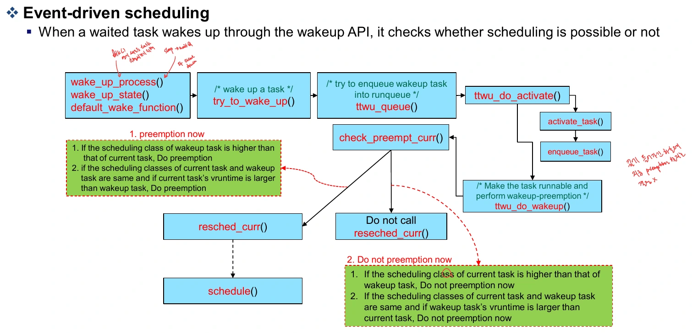

클래스가 더 높거나, 같은 fair 클래스에서 새 후보가 충분히 유리하면 재스케줄링을 요청할 수 있다. 단순히 “vruntime이 1 작으면 반드시 즉시 선점”이라는 규칙은 아니며 wakeup granularity와 정책을 함께 고려한다.

### Sleep

태스크가 기다려야 할 때는 상태를 바꾸고 CPU를 양보한다. 강의의 `nanosleep` 경로는 `TASK_INTERRUPTIBLE` 설정, 타이머 시작, `schedule()` 계열 호출, 타이머·시그널 확인으로 이어진다.

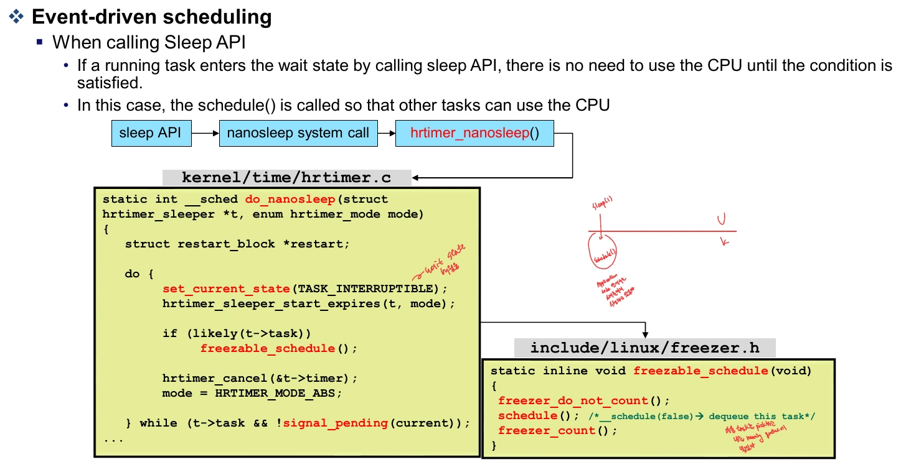

다른 언어에서도 C의 `sleep`, Python의 `time.sleep`, Java·C#의 `Thread.sleep/Sleep`, R의 `Sys.sleep`, Ruby·Perl·PHP의 `sleep`, MATLAB의 `pause`, SQL의 대기 기능처럼 시간 대기를 표현한다. 다만 언어·런타임마다 단위와 실행 모델이 다르다. 특히 JavaScript의 `setTimeout`은 callback을 예약하는 것이며 현재 스레드를 같은 방식으로 재우는 함수가 아니다.

### 선점 금지가 풀릴 때와 인터럽트 반환

선점 금지 동안 요청이 쌓였으면 `preempt_enable()` 경로에서 조건을 검사한다. IRQ 처리가 끝난 뒤에도 재스케줄링 가능 여부를 확인한다.

`schedule()` 내부는 선점을 제어하며 `__schedule(false)`를 호출하고, 일반적인 `preempt_enable()` 대신 재귀적인 재스케줄링을 피하는 해제 경로를 사용한다. 요청이 다시 있으면 반복한다.

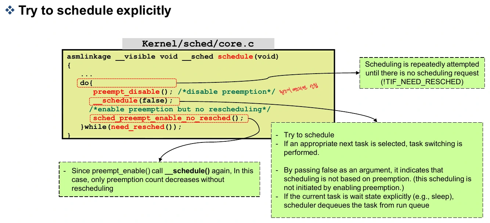

## 6. __schedule: 이전 태스크 처리와 다음 태스크 선택

*Scheduler (4), 2~4쪽*

강의 버전의 `__schedule(bool preempt)`는 현재 CPU의 `rq`, `prev`를 얻고 동기화된 상태에서 다음 작업을 한다.

1. 자발적 대기라면 이전 태스크의 상태를 확인한다.
2. Interruptible 상태에서 처리할 시그널이 있으면 runnable로 되돌릴 수 있다.
3. 실제로 잠들어야 하면 `deactivate_task()`로 runnable 집합에서 제외한다.
4. `pick_next_task()`로 다음 태스크를 고른다.
5. 재스케줄링 요청을 정리한다.
6. `prev != next`이면 전환 횟수·현재 태스크를 갱신하고 `context_switch()`한다.

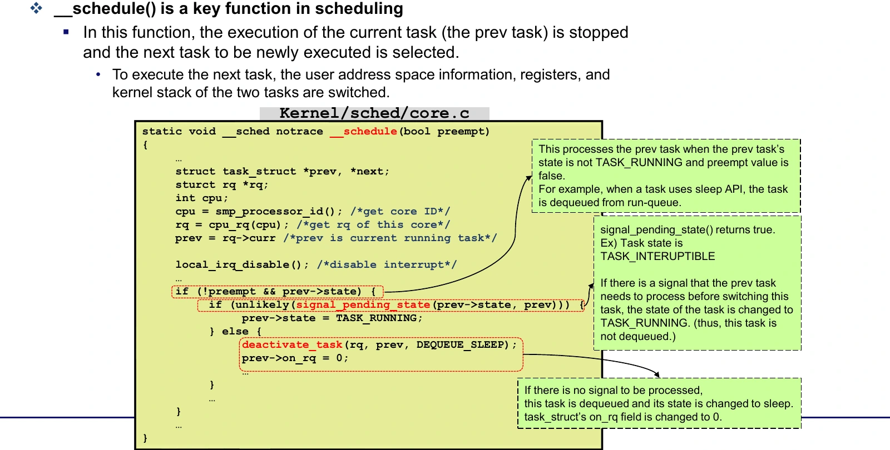

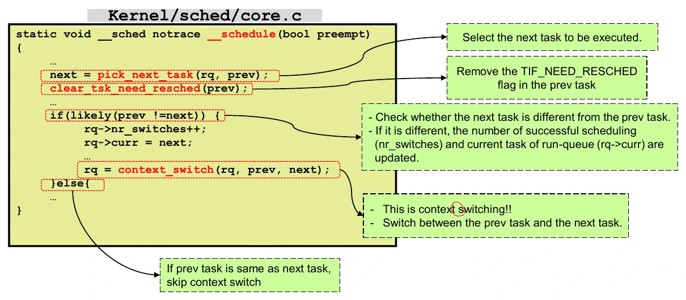

`__schedule()`을 호출했다고 항상 다른 태스크로 바뀌지는 않는다. 선택 결과가 같으면 실제 전환은 생략할 수 있다.

전환에는 필요한 레지스터·커널 스택·주소 공간 관리 상태가 포함된다. 같은 주소 공간을 공유하는 스레드끼리의 전환과 서로 다른 프로세스 간 전환은 필요한 MM 처리가 같지 않을 수 있다. 태스크 전환을 “메모리 전체 복사”로 이해하면 안 된다.

## 7. pick_next_task와 그룹 계층 내려가기

*Scheduler (4), 5~8쪽*

현재 태스크가 fair이고 runnable 태스크가 모두 fair인 경우에는 곧바로 fair 클래스에서 찾는 빠른 경로가 있다. 후보가 없으면 부하 분산을 시도하거나 idle을 고를 수 있다. `RETRY_TASK`가 나오면 클래스 전체를 다시 살핀다.

일반 경로는 우선순위 순서대로 각 클래스의 `pick_next_task()`를 호출하고, 후보가 발견되면 선택한다.

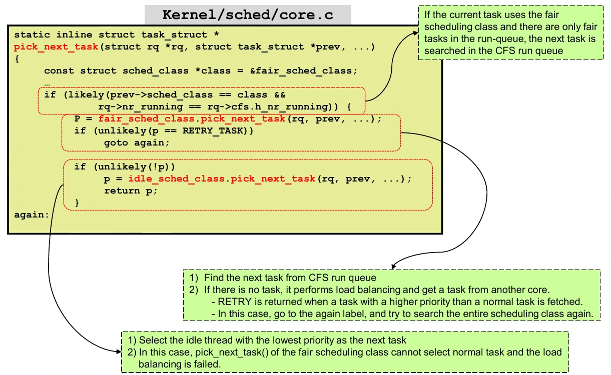

CFS 내부에서는 엔티티를 골랐다고 반드시 최종 태스크인 것은 아니다. 그룹 엔티티면 `my_q`에 해당하는 내부 run queue로 내려가 다시 고른다. 최종 태스크 엔티티에 도달해야 `task_of(se)`로 실행할 태스크를 얻는다.

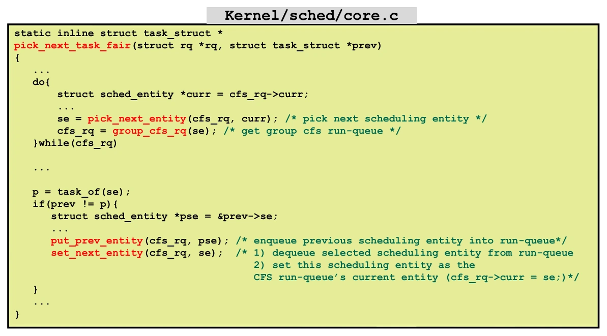

전통적인 CFS의 `pick_next_entity()`는 tree의 leftmost와 현재 엔티티를 비교한다. 현재 엔티티는 tree 밖에 있으므로 따로 후보에 포함해야 한다.

## 8. Runnable 집합과 RB tree는 같지 않다

*Scheduler (4), 9~12쪽*

이 부분이 코드 읽기의 핵심이다.

| 상태 | runnable 회계에 포함 | RB tree에 연결 | `cfs_rq->curr` |
|---|---|---|---|
| 실행을 기다리는 엔티티 | 예 | 예 | 아니오 |
| 현재 실행 중인 엔티티 | 예 | 보통 제외 | 예 |
| 잠든 엔티티 | 아니오 | 제외 | 아니오 |

현재 엔티티는 실행할수록 vruntime이 바뀐다. Tree에서 빼고 실행한 뒤, 다시 기다리게 될 때 갱신된 키로 넣는다. 이때 **`on_rq=1`이어도 tree 밖일 수 있다.**

A와 B가 runnable이고 A가 현재 실행 중이라면, 회계상 후보는 두 개지만 tree에는 기다리는 B만 있을 수 있다. 이후 A가 계속 실행 가능하면서 B로 전환되면 A를 갱신된 위치에 넣고 B를 꺼내 current로 삼는다. 따라서 tree 노드 수만 세어 전체 runnable 수를 구하면 현재 실행 중인 엔티티를 빠뜨리게 된다.

`put_prev_entity()`는 이전 엔티티가 여전히 runnable이면 시간을 정산하고 tree에 넣은 뒤 `curr`를 비운다. `set_next_entity()`는 새 엔티티를 tree에서 제거하고 실행 시작 기준과 `prev_sum_exec_runtime`을 설정한다.

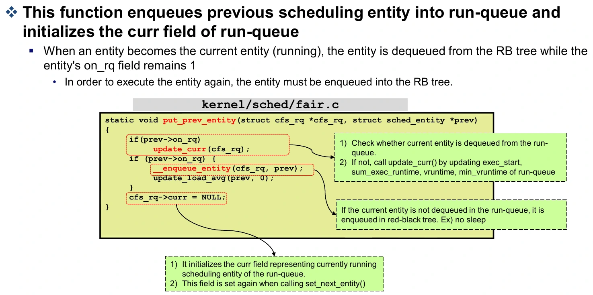

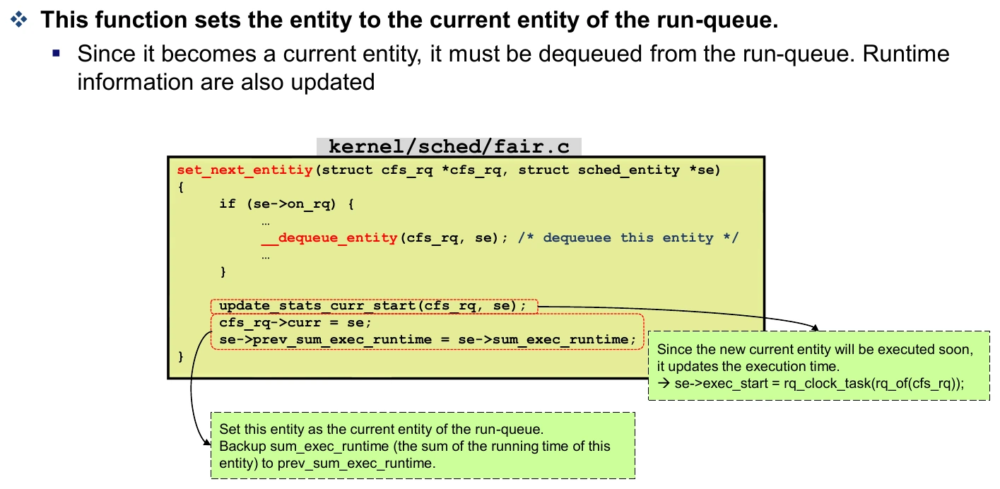

### Tree 삽입·삭제

삽입은 vruntime을 비교하며 왼쪽·오른쪽으로 내려가 적절한 위치를 찾는다. `rb_link_node()`로 연결하고 `rb_insert_color_cached()`로 균형과 leftmost cache를 갱신한다.

삭제할 노드가 leftmost면 다음 노드로 cache를 바꾼 뒤 `rb_erase()`를 수행한다. `__enqueue_entity()`와 `__dequeue_entity()`는 이런 **tree 조작**이며, 태스크의 전체 enqueue/dequeue 회계와 구분한다.

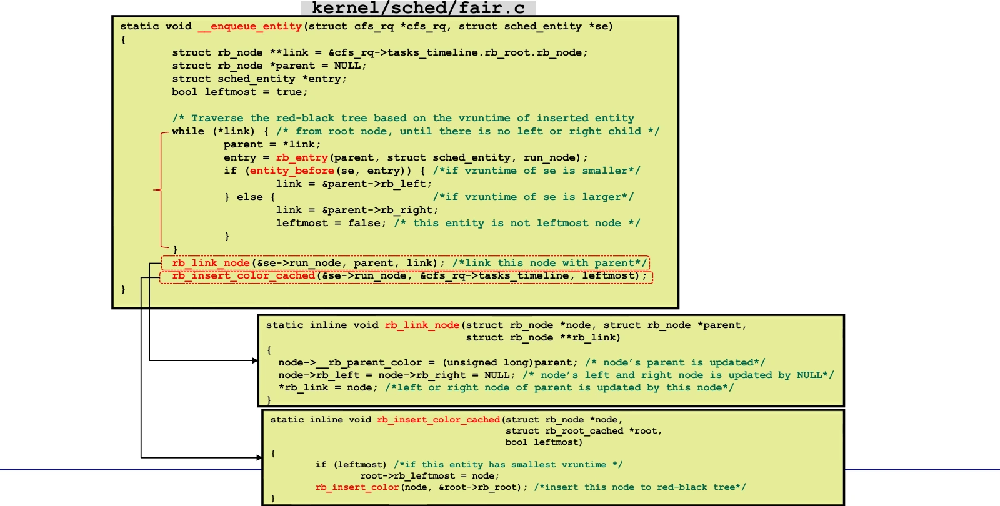

## 9. Enqueue·Dequeue와 상대 vruntime

*Scheduler (4), 13~17쪽*

Waking task를 넣는 `enqueue_task_fair()`는 태스크 엔티티에서 부모로 올라간다. 각 계층의 runnable 수와 load를 반영하며 이미 올라간 부모는 중복해서 넣지 않는다.

`enqueue_entity()`는 필요한 경우 해당 run queue의 `min_vruntime` 기준을 더해 좌표를 맞추고, 현재 실행량·load를 정산한 뒤 tree 연결과 `on_rq=1` 처리를 한다.

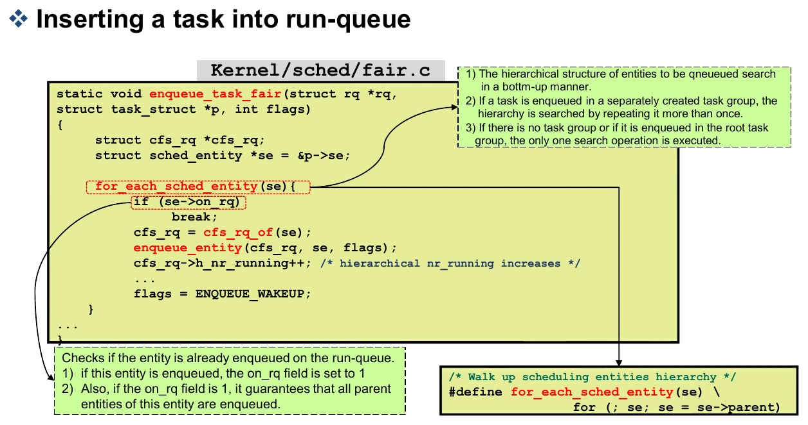

Dequeue는 sleep, nice·클래스 변경, CPU affinity 변경, migration 등에서 발생한다. `dequeue_task_fair()`는 계층을 따라 회계 정보를 감소시키고, `dequeue_entity()`는 필요하면 tree에서 제거하며 `on_rq=0`으로 바꾼다.

이동 등 특정 경로에서는 `min_vruntime`을 빼 상대값으로 만들고, 다시 넣을 때 새 기준을 더한다. 이것은 CPU를 옮겼다고 임의로 큰 이득이나 손해를 받지 않도록 시간축을 맞추는 문제다. 모든 wakeup에 동일한 덧셈을 무조건 수행하는 것은 아니며 flags에 따라 달라진다.

좌표 변환만 단순화하면, 이전 큐의 기준이 100이고 태스크 값이 103일 때 상대값은 3이다. 새 큐의 기준이 500이라면 503으로 놓아 그 큐의 기준보다 3만큼 앞선 관계를 유지한다. 103을 그대로 옮기면 새 큐에서는 지나치게 작은 값처럼 보일 수 있다. 숫자는 원리를 설명하는 예시이며 실제 배치는 해당 경로의 flags와 정책도 따른다.

## 10. CFS 실행 예제: 1ms Tick

*Scheduler (4), 18~31쪽*

강의 예제는 period=6ms, tick=1ms이며 태스크 5개가 처음 모두 vruntime=0이라고 가정한다.

| 태스크 | nice | weight | 이상적 비율 | 이상적 몫(ms) |
|---|---:|---:|---:|---:|
| T1 | -10 | 9548 | 약 0.67534 | 약 4.0521 |
| T2 | -5 | 3121 | 약 0.22075 | 약 1.3245 |
| T3 | 0 | 1024 | 약 0.07243 | 약 0.4346 |
| T4 | 5 | 335 | 약 0.02370 | 약 0.1422 |
| T5 | 10 | 110 | 약 0.00778 | 약 0.0467 |
| 합계 | | 14138 | 1 | 6 |

슬라이드는 비율을 먼저 반올림해 곱하므로 마지막 소수 자리가 조금 다르다.

Tick에서 몫 소진을 검사하는 단순화된 예에서는 T1이 5ms, T2가 2ms, 나머지가 각각 1ms 실행한다. 예를 들어 T1은 4ms 시점에는 4.05ms를 넘지 않았고, 다음 tick인 5ms에서 초과가 확인된다.

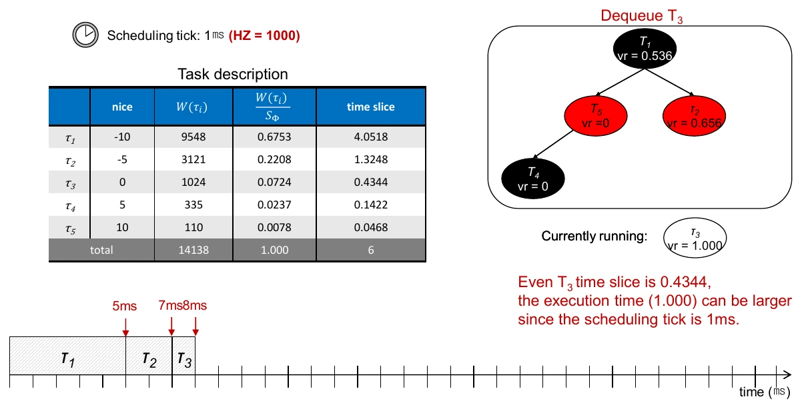

| 실행 구간(ms) | 태스크 | 실행 뒤 해당 태스크의 vruntime(ms) |
|---|---|---:|
| 0~5 | T1 | 0.536 |
| 5~7 | T2 | 0.656 |
| 7~8 | T3 | 1.000 |
| 8~9 | T4 | 3.057 |
| 9~10 | T5 | 9.309 |
| 10~15 | T1 | 1.072 |
| 15~17 | T2 | 1.312 |
| 17~18 | T3 | 2.000 |
| 18~23 | T1 | 1.609 |
| 23~25 | T2 | 1.969 |
| 25~30 | T1 | 2.145 |
| 30~32 | T2 | 2.625 |
| 32~33 | T3 | 3.000 |

실제 1ms를 쓴 T5의 vruntime은 `1 × 1024/110 ≈ 9.309ms`나 증가한다. 이후 다른 태스크들이 따라잡는 동안 선택되지 않는 이유다. 이는 같은 실제 시간을 쓰더라도 weight가 작으면 상대적으로 자신의 몫을 많이 사용한 것으로 계산하기 때문이다.

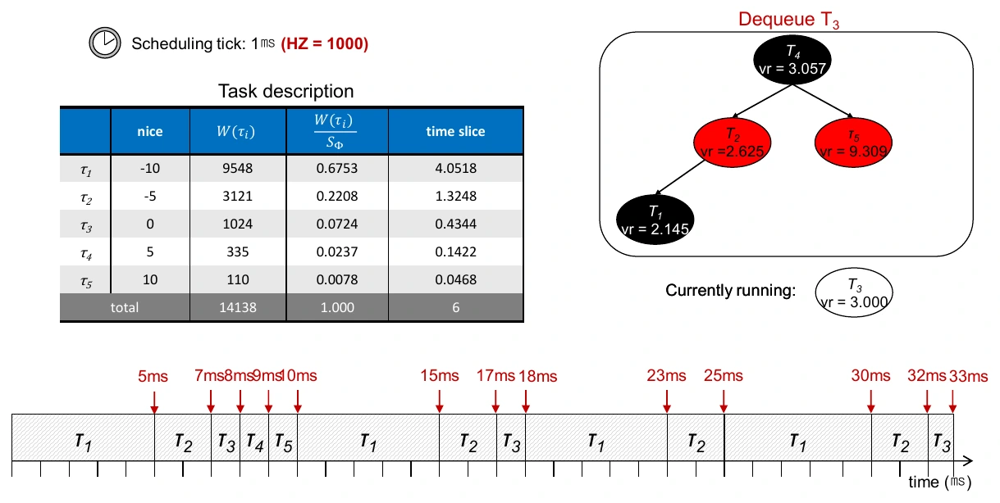

이 타임라인은 강의의 조건을 계산한 것이며 최신 커널을 실제로 계측한 결과는 아니다. 고해상도 tick과 세부 선점 검사 등이 달라지면 실행 구간도 달라질 수 있다.

## 11. 실습: fio Job 파일 읽기

*Practical Class 8, PDF 2~14쪽*

fio는 원하는 I/O 패턴을 여러 프로세스·스레드로 발생시키는 도구다. Job 파일은 workload 조건을 재현할 수 있게 기록한다.

```ini
[global]
name=fio-rand-write
directory=/mnt/test
rw=randwrite
bs=4K
direct=0
numjobs=72

[job1]
size=1G
group_reporting
```

이것은 강의의 random write 예제다. **과제 8의 요구는 뒤에서 설명하는 sequential write**이므로 그대로 혼동하지 않는다.

| 설정 | 의미 |
|---|---|
| `;`, `#`로 시작하는 줄 | 주석 |
| `[global]` | 뒤에 오는 job의 기본 설정 |
| `[job1]` | 개별 job 섹션; global 값을 덮어쓸 수 있음 |
| `name` | 출력 등에 쓸 작업 이름 |
| `numjobs` | 동일 job을 복제할 수 |
| `directory` | 테스트 파일을 둘 위치 |
| `filename` | 자동 파일명 대신 사용할 이름 |
| `rw=read/write` | 순차 읽기·쓰기 |
| `rw=randread/randwrite` | 무작위 읽기·쓰기 |
| `direct=0` | buffered I/O |
| `direct=1` | 보통 O_DIRECT를 이용하는 direct I/O |
| `bs=4K` | I/O 한 번의 블록 크기 |
| `size` | job별 작업 영역·크기 설정 |
| `group_reporting` | job 그룹 전체 결과로 집계 |

`numjobs=72`, `size=1G`라면 각 clone에 1G를 지정한 구성이다. `size`를 전체 합으로 착각하면 예상보다 훨씬 많은 공간을 사용한다.

Target 파일시스템을 먼저 마운트하고 job을 실행한다. `/mnt/test` 경로 자체가 root 권한을 필수로 만드는 것은 아니며, 실제 디렉터리·장치 접근 권한에 따라 `sudo`가 필요하다.

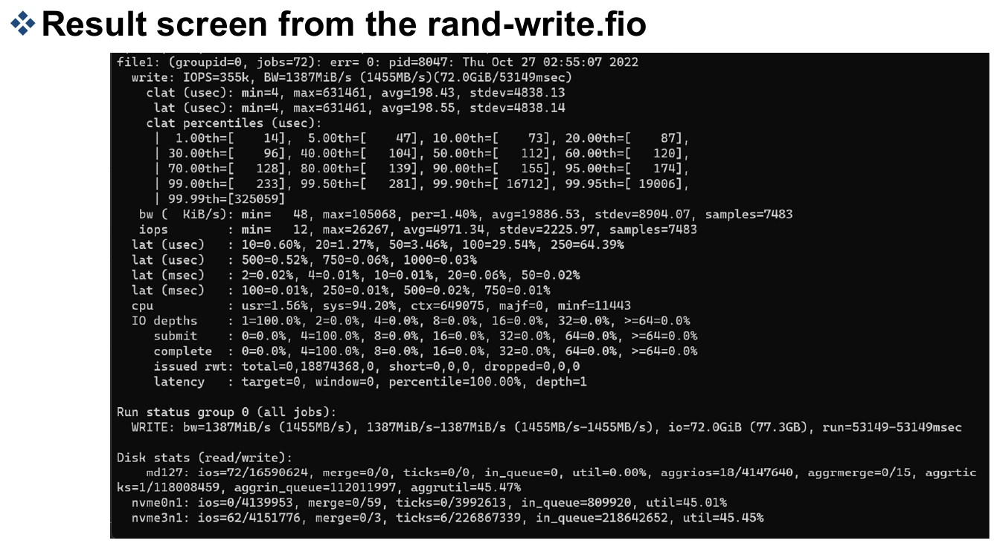

결과에서는 읽기·쓰기 구분, bandwidth, IOPS, latency, 총 I/O량, 실행 시간을 함께 확인한다. 고정 4KiB 요청에서는 대략 `BW = IOPS × 4KiB`로 수치 간 일관성을 점검할 수 있다.

### 강의의 측정 조건

- Buffered random read/write는 두 번 실행한 뒤 두 번째 결과를 사용한다.
- `numjobs`는 실습 머신의 CPU 수에 맞춘다.
- 전체 데이터는 RAM의 약 3배 이상을 권장한다. 공간이 부족하면 저장공간에 맞춘 규모와 이유를 기록한다.
- 블록 크기는 4K로 맞춘다.
- 순차 read/write를 random read/write보다 먼저 실행한다.

이 조건은 수업 비교를 위한 규칙이다. 모든 benchmark의 보편적 규칙은 아니며 cache의 영향이 완전히 사라졌다는 보장도 아니다.

자료의 `verify=meta`는 블록 위치 등의 검증 예다. 현재 fio 문서에서는 deprecated이며 일반 검증 header가 해당 메타데이터를 포함한다. 사용하는 fio 버전과 검증 옵션을 기록하고, 조건을 바꿨다면 변경 내용도 남긴다. [fio 공식 문서](https://fio.readthedocs.io/en/latest/fio_doc.html#verification)

## 12. calclock: 호출 구간의 시간을 합산하기

*Practical Class 8, PDF 16~31쪽*

계측할 함수 전후에 시각을 저장하고 차이를 구한다. 강의는 `struct timespec`과 `getrawmonotonic()`을 이용하며, `calclock()`에 시작·끝 시각과 누적 시간·횟수의 주소를 전달한다.

```text
시작 시각 기록
  → 원래 함수 호출
끝 시각 기록
  → delta 계산
  → total_time에 원자적으로 더함
  → total_count에 원자적으로 1 더함
  → 원래 반환값 반환
```

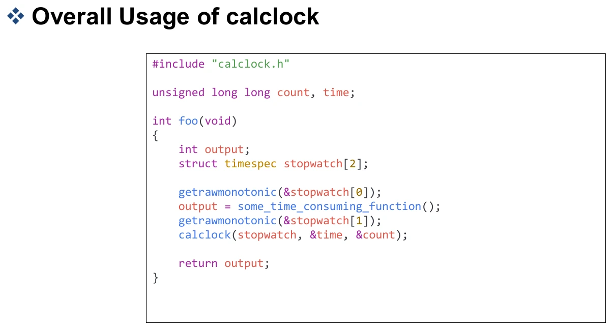

초·나노초 표현에서 `end.nsec < start.nsec`이면 1초를 빌려 계산한다.

| 시작 | 종료 | 계산 | 결과 |
|---|---|---|---|
| 1.2s | 3.7s | 2s + 0.5s | 2,500,000,000ns |
| 1.8s | 3.4s | 1s + 0.6s | 1,600,000,000ns |

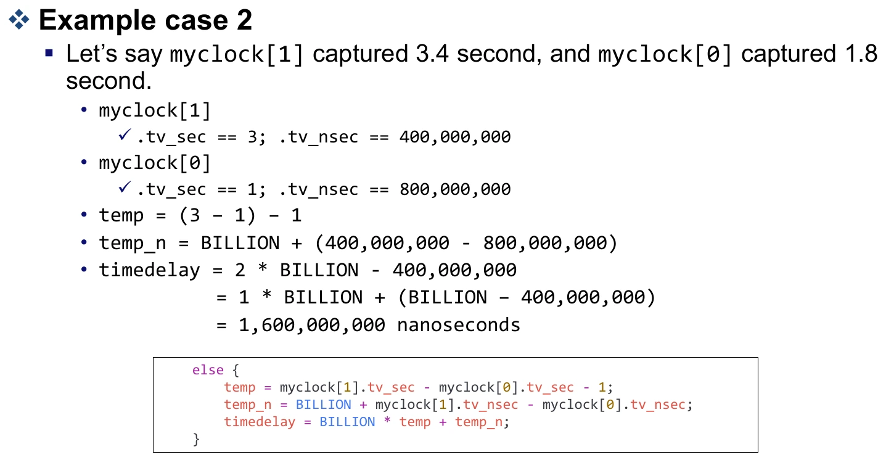

여러 스레드가 동시에 기록하므로 누적값과 횟수의 갱신은 원자적으로 수행한다. 다만 두 변수 각각의 원자성이 **두 값을 함께 읽는 snapshot의 일관성**까지 보장하는 것은 아니다. 최종 보고는 계측 작업이 끝난 뒤 하는 것이 명확하다.

Makefile에서는 복합 모듈의 객체 목록에 `calclock.o`를 포함해야 한다. Header만 include하고 구현을 링크하지 않으면 호출이 해결되지 않는다.

### API와 측정 의미

현재 커널에서는 `ktime_get_ns()`, `ktime_get_raw_ns()`, `ktime_get_raw_ts64()` 같은 API를 확인한다. 자료에 섞여 있는 `timespec`·`timespec64`는 함수 시그니처에 맞춰 일관되게 사용해야 한다. [Linux timekeeping 문서](https://docs.kernel.org/core-api/timekeeping.html)

나노초 단위 값을 반환한다는 것은 **정확도가 1ns라는 뜻이 아니다.** 시계 읽기와 계측 코드에도 비용이 있다. 이 구간에 잠들거나 선점된 시간이 있으면 경과 시간에 포함될 수 있으므로 순수 CPU 명령 실행 시간과도 구별한다.

| 지표 | 계산·해석 |
|---|---|
| 누적 호출 구간 시간 | 모든 호출의 경과 시간 합 |
| 평균 호출 지연 | 누적 시간 / 호출 횟수 |
| 전체 wall-clock | workload 시작부터 모든 작업 완료까지 |
| 스레드당 평균 누적 시간 | 누적 시간 / 스레드 수; 작업 분배 조건에 주의 |

**누적 시간을 스레드 수로 나누면 항상 실제 실행 시간이 나온다는 해석은 맞지 않는다.** 호출 수가 다르거나 구간이 겹치고 대기가 섞이면 전체 완료 시간과 일치하지 않는다.

두 스레드가 동시에 호출을 시작해 각각 10ms 뒤 반환했다면, 두 호출의 누적 구간 시간은 20ms지만 두 작업이 끝날 때까지의 wall-clock은 약 10ms일 수 있다. 반대로 같은 두 호출을 순서대로 실행하면 합계는 여전히 20ms이고 wall-clock도 약 20ms다. 합계만으로 동시 실행 정도를 알 수 없으므로, 비교할 때 지표의 분모와 시간 범위를 함께 적어야 한다.

## 13. 출력과 프로파일링 결과 해석

*Practical Class 8, PDF 32~39쪽*

측정 구간 안에서 매번 `printk()`하면 로그 비용을 함께 재게 된다. 누적만 수행하고 테스트 종료·모듈 제거 때 보고한다.

강의의 선택 예제는 큰 수를 문자열로 바꾸고 세 자리마다 쉼표를 넣는다. 뒤에서 읽어 임시 역순 문자열에 쉼표를 끼운 뒤 다시 뒤집는 방식이다. 출력 버퍼의 크기와 종료 NUL을 관리해야 한다.

또 다른 출력 예제는 함수 호출 계층을 들여쓰고 `해당 시간 × 100 / 전체 시간`으로 비율을 계산한다. 분모가 0이면 나눗셈을 피하고, 표시를 위해 원래 측정값을 1로 바꾸지는 않는 편이 낫다.

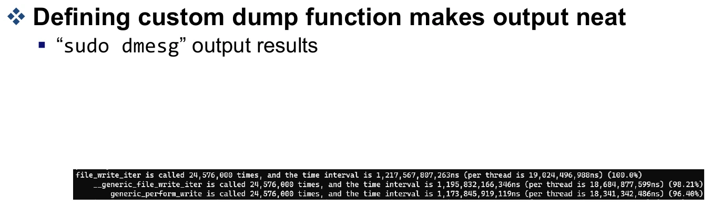

상위 함수의 측정 시간에는 하위 함수가 포함된다. 따라서 상위와 하위의 시간을 무조건 더하면 중복 계산한다. 이 값은 inclusive time이며, 자기 코드만의 exclusive time을 얻으려면 중첩 관계와 측정 구간을 고려해야 한다.

단일 호출에서 상위 함수가 10ms 걸렸고 그 안의 하위 호출 하나가 6ms였다면, 둘을 합친 16ms는 실제 총 경과 시간이 아니다. 하위의 6ms가 이미 상위의 10ms에 들어 있다. 다른 중첩이나 겹침이 없다는 조건에서 나머지 4ms를 상위의 다른 작업으로 볼 수 있지만, 여러 스레드의 누적 통계에는 이런 뺄셈도 호출 범위를 맞춘 뒤 적용해야 한다.

## 14. 과제 8: PXT4 쓰기 경로 프로파일링

*Practical Class 8, PDF 40~46쪽*

측정 대상은 `pxt4/file.c`의 `pxt4_file_write_iter()`다. 기존 구현을 내부 함수로 이름을 바꾸고 원래 이름의 wrapper에서 전후 시간을 재면 여러 return 경로를 놓치기 쉽지 않다.

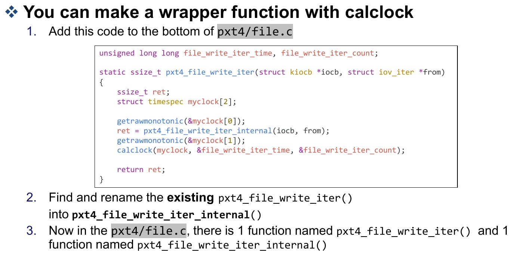

원래 파일 연산 표가 wrapper를 가리키는지, 내부 함수와 wrapper의 선언·시그니처가 맞는지 확인한다. Wrapper는 원래 반환값과 오류를 그대로 전달해야 한다.

| 항목 | 과제 조건 |
|---|---|
| I/O | Buffered Sequential Write |
| `rw` | `write` |
| `direct` | `0` |
| 블록 크기 | `4K` |
| `numjobs` | 실습 머신 CPU 수 |
| 전체 크기 | RAM의 약 3배; 공간 제약 시 자료의 예외 조건 기록 |
| 계측 위치 | `pxt4_file_write_iter()` |
| 출력 위치 | `pxt4_exit_fs()` |

예를 들어 RAM 4GiB, CPU 4개라면 총 12GiB를 위해 각 job에 3GiB를 지정할 수 있다. 실제로 쓸 수 있는 여유 공간과 파일시스템 메타데이터 공간도 확인한다.

```ini
; RAM 4GiB, CPU 4개인 경우의 크기 계산 예
[global]
name=pxt4-seq-write
directory=/mnt/pxt4-test
rw=write
bs=4K
direct=0
numjobs=4

[fio-test]
size=3G
group_reporting
```

자료의 과제 예제에는 `verify=meta`도 포함된다. 재현 시 설치 버전이 지원하는지 확인하고, 검증 옵션의 변경 여부와 readback 단계 유무를 결과에 명시한다.

수행 순서는 다음과 같다.

1. `cscope`로 대상 함수를 찾고 계측 코드를 추가한다.
2. 수정한 모듈을 빌드·적재하고 실습 장치를 PXT4로 마운트한다.
3. 조건을 기록한 fio job을 실행하고 오류 여부를 확인한다.
4. 마운트를 해제한 다음 PXT4 모듈을 제거한다.
5. `dmesg`에서 누적 호출 횟수와 시간을 확인한다.

Buffered write의 함수 반환은 데이터가 저장장치에 영구 반영되었다는 뜻이 아니다. 이 계측은 **해당 파일 쓰기 함수 구간의 경과 시간**이며, 전체 장치 flush 완료 시간과 같지 않다.

제출 PDF에는 실제 fio script 화면과 profiling 결과 화면, 이름·학번을 넣는다. 결과 해석을 위해 RAM·CPU·커널·fio 버전, 대상 mount, job별 크기와 총 크기도 함께 기록하면 좋다.

## 15. 복습문제

해설을 보기 전에 각 질문에 짧게 답해 보자.

<details><summary>1. 사용자 A의 태스크 4개와 B의 태스크 1개를 그룹별 50%로 나누면 각 몫은?</summary>

그룹 안에서도 같은 weight이며 계속 runnable이라고 가정하면 A의 각 태스크는 12.5%, B의 태스크는 50%다.

</details>

<details><summary>2. NEED_RESCHED가 설정되면 즉시 context switch한 것인가?</summary>

아니다. 요청을 표시한 상태이며 스케줄링 가능한 경로에서 다음 태스크를 선택하고 실제로 다를 때 전환한다.

</details>

<details><summary>3. on_rq=1인데 RB tree에서 찾을 수 없는 정상적인 경우는?</summary>

현재 실행 중인 엔티티다. Runnable 회계에는 포함되지만 tree에서 빠져 curr로 관리된다.

</details>

<details><summary>4. sum_exec_runtime과 prev_sum_exec_runtime의 차이는 무엇을 나타내는가?</summary>

이번에 선택된 실행 구간에서 현재까지 사용한 실제 CPU 시간이다. 이를 이상적 몫과 비교할 수 있다.

</details>

<details><summary>5. T5가 1ms 실행하고 vruntime은 약 9.309ms 증가하는 이유는?</summary>

Weight가 110이므로 1×1024/110으로 정규화된다. 실제 실행 시간이 9.309ms였다는 뜻은 아니다.

</details>

<details><summary>6. numjobs=4, size=3G이면 전체 데이터 규모는?</summary>

동일 job 4개가 각각 3G를 사용하므로 약 12G다. Size를 전체 합으로 해석하면 안 된다.

</details>

<details><summary>7. 누적 시간/스레드 수와 누적 시간/호출 수는 어떻게 다른가?</summary>

앞은 스레드당 평균 누적 구간 시간이고, 뒤는 호출당 평균 지연이다. 어느 쪽도 조건 없이 전체 wall-clock이나 순수 CPU 시간과 같다고 할 수 없다.

</details>

<details><summary>8. Buffered write 함수의 반환까지 재면 디스크 영구 저장 시간인가?</summary>

아니다. Page cache에 반영하고 반환할 수 있다. 실제 writeback과 동기화 완료는 별도 경로·조건이다.

</details>

## 참고 자료

중앙대학교 리눅스 시스템 응용 설계, 손용석 교수, Systems and Storage Lab.

- 수업 자료: `7. Scheduler (3).pdf`, `7. Scheduler (4).pdf`.
- 실습·과제 자료: `[Practical Class 8] fio+calclock.pdf`. 실습 부분의 쪽수는 PDF 순서 기준이다.
