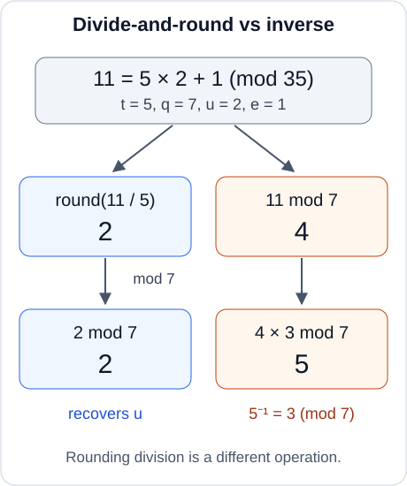

## 필기 원본

이 글에서 다룬 원본 PDF **28–33쪽**이다. 두 단과 여백 필기를 포함한 페이지 전체를 실었다. 이미지를 누르면 확대해서 볼 수 있다.

<figure style="margin: 2rem 0;">
  
  <figcaption>원본 PDF 28쪽.</figcaption>
</figure>

<figure style="margin: 2rem 0;">
  
  <figcaption>원본 PDF 29쪽.</figcaption>
</figure>

<figure style="margin: 2rem 0;">
  
  <figcaption>원본 PDF 30쪽.</figcaption>
</figure>

<figure style="margin: 2rem 0;">
  
  <figcaption>원본 PDF 31쪽.</figcaption>
</figure>

<figure style="margin: 2rem 0;">
  
  <figcaption>원본 PDF 32쪽.</figcaption>
</figure>

<figure style="margin: 2rem 0;">
  
  <figcaption>원본 PDF 33쪽.</figcaption>
</figure>

## 들어가며

[앞 글](/posts/ai-security-real-number-encoding-and-scale/)에서는 실수 계수 다항식을 정수화하고, 동형 덧셈과 공개 평문 곱셈의 스케일·오차를 추적했다. 이번에는 암호문 두 개를 곱하면서 생기는 비밀키의 제곱 항을 처리하고, 계속 계산할 수 있도록 표현을 정리한다.

**정리 범위는 원본 PDF의 28–33쪽이다.** 암호문 곱셈, relinearization, 일반적인 key switching, 단순한 키 전환의 잡음 문제, 보조 법 $Pq$와 divide-and-round, 최종 곱셈 알고리즘, rescaling을 원문 순서에 따라 다룬다. 마지막의 계수 인코딩 메모도 다음 주제와 연결한다.

원문의 관계식은 유지하고, 생략된 대표값 선택과 반올림 항을 명시한다. 추가 오차 상한·수치 예제는 보충으로 구별한다. 평가키의 안전성은 관련 공개정보와 가정을 포함해 조건부로 설명한다.

## 1. 덧셈과 평문 곱셈에서 이어받을 내용

### 1.1 표기와 복호화 조합

앞 글과 같은 환을 사용한다.

$$
R=\mathbb Z[X]/(X^N+1),\qquad R_q=R/qR.
$$

$N$은 $2$의 거듭제곱이다. 메시지는 $R_{\mathbb Q}=\mathbb Q[X]/(X^N+1)$의 다항식으로 표현한다.

암호문 성분은 $c=(u,v)$로 쓰고

$$
D_s(c)=u+vs\in R_q
$$

로 둔다. 원문의 $(b,a)$, $(b_i,a_i)$가 이 글의 $(u,v)$, $(u_i,v_i)$에 대응한다.

스케일 $\Delta$인 암호문이

$$
D_s(c)=[\Delta m+\eta]_q
$$

를 만족한다고 하자. $\eta$는 인코딩 반올림과 암호화·평가 과정을 거친 **총오차**다. 처음 잡음 분포에서 직접 뽑은 값과 구별한다. $\Delta m+\eta$의 합은 정수 계수 다항식이다.

이하 $[\cdot]_q$는 계수별 법 연산, $\operatorname{ctr}_q$는 계수를 $[-q/2,q/2)$의 중심 대표값으로 옮기는 연산이다. $\lfloor\cdot\rceil$는 계수별 최근접 정수 반올림이며, 추가 수치 예제의 중간값은 $0$에서 먼 정수를 택한다.

### 1.2 원문 28쪽의 복습

같은 키·법·스케일의 두 암호문을 더하면

$$
c_1\oplus c_2=(u_1+u_2,v_1+v_2),
$$

$$
D_s(c_1\oplus c_2)
=[\Delta(m_1+m_2)+\eta_1+\eta_2]_q.
$$

스케일은 $\Delta$, 성분 수는 두 개로 유지된다.

반면 스케일 $\Delta$로 인코딩한 공개 평문 $P_p=\lfloor\Delta p\rceil$를 곱하면

$$
P_p\odot c=(P_pu,P_pv)
$$

이고 출력 스케일은 $\Delta^2$다. 평문 반올림을 잠시 생략하고 중심 대표 범위 조건을 가정하면, 원문의 근사 관계를 다음처럼 읽을 수 있다.

$$
\operatorname{ctr}_q(D_s(P_p\odot c))
\approx\Delta^2pm+\Delta p\eta.
$$

반올림을 포함한 정확한 총오차는 앞 글의 식을 따른다.

$$
\eta_{\mathrm{pm}}
=\Delta p\eta+\Delta m\rho_p+\rho_p\eta,
\qquad \rho_p=P_p-\Delta p.
$$

여기서는 보조 법에 사용할 정수 $P$와 구별하기 위해 인코딩한 평문을 $P_p$로 적었다.

곱셈 결과를 표현하려면 스케일뿐 아니라 메시지와 오차까지 법 안에 들어가야 한다. 예를 들어

$$
\|\Delta^2pm+\eta_{\mathrm{pm}}\|_{\mathrm{coeff},\infty}
<q/2
$$

가 충분하다. 원문의 $\Delta^2\ll q$는 이 조건의 직관적인 요약이다. $\|\cdot\|_{\mathrm{coeff},\infty}$는 계수의 최대 절댓값이다.

## 2. 암호문 두 개를 곱하면 세 성분이 필요하다

### 2.1 성분별 곱셈만으로는 부족하다

두 암호문을

$$
c_1=(u_1,v_1),\qquad c_2=(u_2,v_2)
$$

라 하자. 성분별로 곱한 $(u_1u_2,v_1v_2)$의 복호화 조합은

$$
u_1u_2+v_1v_2s
$$

이다. 원하는 것은 다음 두 복호화 조합의 곱이다.

$$
(u_1+v_1s)(u_2+v_2s).
$$

교차항과 $s^2$ 항이 필요하므로 단순한 성분별 곱으로는 이 식을 표현할 수 없다.

**추가 검산:** $s=1$, $(u_1,v_1)=(1,2)$, $(u_2,v_2)=(3,4)$이면 원하는 값은 $3\cdot7=21$이지만 성분별 곱의 조합은 $3+8=11$이다. 이는 암호문의 대수적 형태를 확인하는 예제다.

### 2.2 곱의 세 계수

전개하면

$$
\begin{aligned}
(u_1+v_1s)(u_2+v_2s)
&=u_1u_2+(u_1v_2+v_1u_2)s+v_1v_2s^2.
\end{aligned}
$$

따라서 먼저 세 성분을 만든다.

$$
\begin{aligned}
d_0&=u_1u_2,\\
d_1&=u_1v_2+v_1u_2,\\
d_2&=v_1v_2.
\end{aligned}
$$

$$
c_{\mathrm{raw}}=(d_0,d_1,d_2)\in R_q^3.
$$

이에 대한 복호화 조합은

$$
D_s^{(2)}(c_{\mathrm{raw}})
=d_0+d_1s+d_2s^2.
$$

두 성분 암호문의 $D_s$와 구별해 위첨자 $(2)$를 붙였다. 여기서 $2$는 비밀키에 대한 최고 차수다.

### 2.3 곱셈의 총오차

입력 관계가

$$
D_s(c_i)=[\Delta m_i+\eta_i]_q
$$

이면 $R_q$에서 곱의 전개는

$$
\begin{aligned}
D_s^{(2)}(c_{\mathrm{raw}})
&=[(\Delta m_1+\eta_1)(\Delta m_2+\eta_2)]_q\\
&=[\Delta^2m_1m_2
+\Delta(m_1\eta_2+m_2\eta_1)
+\eta_1\eta_2]_q.
\end{aligned}
$$

원문의 $\widetilde e$를 다음 총오차로 적는다.

$$
\eta_{\mathrm{mult}}
=\Delta(m_1\eta_2+m_2\eta_1)+\eta_1\eta_2.
$$

출력 스케일은 $\Delta^2$다. 이 전개에는 두 오차의 독립성이 필요하지 않으므로 같은 암호문을 제곱할 때도 대수적으로 성립한다.

### 2.4 잡음과 성분 수의 증가

원문은 $\widetilde e\ll\Delta^2m_1m_2$라는 직관을 적은 뒤, 메시지 곱이 $0$일 수도 있으므로 실제 정확성에는 오차의 노름과 법 조건을 사용해야 한다고 보충한다.

충분조건을 계수 노름으로 쓰면

$$
\|\Delta^2m_1m_2+\eta_{\mathrm{mult}}\|_{\mathrm{coeff},\infty}
<q/2.
$$

허용할 수치 오차를 정할 때는 $\|\eta_{\mathrm{mult}}\|_{\mathrm{coeff},\infty}/\Delta^2$를 함께 본다. 메시지가 $0$이어도 이 절대오차 기준은 사용할 수 있다.

**보충 상한:** negacyclic 다항식 곱에는

$$
\|fg\|_{\mathrm{coeff},\infty}
\le N\|f\|_{\mathrm{coeff},\infty}
\|g\|_{\mathrm{coeff},\infty}
$$

가 성립한다. 각 결과 계수는 부호를 포함한 $N$개 곱의 합이기 때문이다. $\|m_i\|_{\mathrm{coeff},\infty}\le M_i$, $\|\eta_i\|_{\mathrm{coeff},\infty}\le B_i$이면

$$
\|\eta_{\mathrm{mult}}\|_{\mathrm{coeff},\infty}
\le N\Delta(M_1B_2+M_2B_1)+NB_1B_2.
$$

또 하나의 문제는 성분 수다. 이 상태로 계속 곱하면 $s^3,s^4,\ldots$의 계수까지 필요해진다. 이를 다시 두 성분으로 정리하는 연산이 relinearization이다.

## 3. Relinearization: 제곱 항을 두 성분으로 바꾸기

### 3.1 원문의 두 부분으로 나누기

곱셈 결과를

$$
h_1=(d_0,d_1),\qquad h_2=(0,d_2)
$$

로 나누어 생각하자.

$$
D_s(h_1)=d_0+d_1s,\qquad
D_{s^2}(h_2)=d_2s^2.
$$

두 번째 부분은 $s^2$를 비밀키처럼 사용하는 조합이다. 이 값을 원래 비밀키 $s$에 대한 두 성분으로 바꾸고 싶다.

### 3.2 필요한 관계를 먼저 가정한다

공개 평가키를 사용해 다음 관계를 만족하는 쌍을 계산할 수 있다고 하자.

$$
h_2'=(\beta,\alpha)\in R_q^2,
$$

$$
\beta+\alpha s=[d_2s^2+\xi]_q.
$$

$\xi$는 이 변환에서 더해지는 오차다. 그러면

$$
c_{\mathrm{rel}}=h_1+h_2'
=(d_0+\beta,d_1+\alpha)
$$

를 계산해

$$
\begin{aligned}
D_s(c_{\mathrm{rel}})
&=(d_0+\beta)+(d_1+\alpha)s\\
&=[d_0+d_1s+d_2s^2+\xi]_q\\
&=[\Delta^2m_1m_2+\eta_{\mathrm{mult}}+\xi]_q
\end{aligned}
$$

를 얻는다.

성분은 세 개에서 두 개가 되고, 원래 키 $s$로 복호화할 수 있다. **스케일은 여전히 $\Delta^2$다.** 이제 필요한 쌍 $(\beta,\alpha)$를 어떻게 계산하는지가 key switching의 문제다.

## 4. 일반적인 키 전환의 목표

### 4.1 $s_1$에서 $s_2$로

원문은 비밀키 $s_1$에 대한 암호문

$$
c=(u,v),\qquad D_{s_1}(c)=u+vs_1
$$

를 $s_2$에 대한 암호문 $c'$로 바꾸는 문제로 일반화한다. 목표 관계는

$$
D_{s_2}(c')=[D_{s_1}(c)+\xi]_q.
$$

작은 추가 오차를 제외하면 같은 메시지를 유지하고 키를 바꾼다. 변환을 실행하는 평가자는 비밀키를 직접 받지 않고, 미리 생성된 공개 key-switching key를 사용한다.

### 4.2 $u$는 유지하고 $vs_1$을 바꾼다

암호문을 나누면

$$
(u,v)=(u,0)+(0,v).
$$

첫 부분의 조합은 어떤 비밀키에서도 $u$다. 따라서 공개 계수 $v$에 대해

$$
\operatorname{KS}_{s_1\to s_2}(v)
=(\beta,\alpha),
$$

$$
\beta+\alpha s_2=[vs_1+\xi]_q
$$

를 계산할 수 있으면 된다. 이 글의 KS 표기는 **변환할 계수 하나**를 입력받아 두 성분을 돌려준다.

전체 암호문의 출력은

$$
c'=(u+\beta,\alpha)
$$

이고

$$
D_{s_2}(c')=[u+vs_1+\xi]_q.
$$

기존 관계가 $[\Delta m+\eta_{\mathrm{old}}]_q$였다면 변환 후에는

$$
[\Delta m+\eta_{\mathrm{old}}+\xi]_q
$$

가 된다. 키 전환의 출력 스케일은 그대로 $\Delta$다.

### 4.3 Relinearization은 이 변환의 특수한 경우

앞 절에 적용할 때는

$$
v=d_2,\qquad s_1=s^2,\qquad s_2=s
$$

로 놓는다. $(0,d_2)$를 변환한 뒤, 이미 $s$를 사용하는 $(d_0,d_1)$에 더하므로 최종 출력은 $(d_0+\beta,d_1+\alpha)$다.

일반 암호문 전체의 키 전환 출력 $(u+\beta,\alpha)$와 성분을 합치는 위치를 구별한다.

## 5. 단순한 평가키에는 잡음이 증폭되는 문제가 있다

### 5.1 원문의 첫 시도

원문은 $s_1$을 $s_2$ 아래에서 암호화한 보조 쌍을 생각한다.

$$
k=(b_k,a_k),\qquad
b_k+a_ks_2=[s_1+e_k]_q.
$$

여기의 $\operatorname{Enc}_{s_2}(s_1)$는 이 복호화 관계를 뜻하는 약칭으로 이해한다. 스케일 $1$에서 $s_1$을 정확히 복원할 수 있다는 보장까지 뜻하지 않는다.

공개된 $v$를 두 성분에 곱하면

$$
v\cdot k=(vb_k,va_k),
$$

$$
vb_k+va_ks_2=[vs_1+ve_k]_q.
$$

원하는 $vs_1$ 항은 생기지만 오차도 $v$배 된다. $v$는 작은 잡음 다항식이 아니라 암호문의 공개 성분이므로 계수가 법의 크기에 가까울 수 있다.

원문은 처음부터 $s_1$과 $e_k$가 비슷한 작은 크기일 수 있다고 지적한다. 필요한 것은 $vs_1$을 나타내는 전체 관계에서 추가 오차를 제어하는 일이다.

키 소유자가 보조 정보를 미리 만들면 평가자가 비밀키 없이 이 곱을 계산할 수 있다는 점은 맞다. 하지만 작은 $e_k$에 큰 $v$를 곱한 결과가 계속 작다는 보장은 없다.

### 5.2 큰 정수 $P$를 도입한다

원문의 다음 발상은 $s_1$ 대신 $Ps_1$이 들어간 평가키를 만드는 것이다.

$$
b_k+a_ks_2\equiv Ps_1+e_k.
$$

곱한 결과를 수치적으로 $P$로 나눌 수 있다면

$$
\frac{Pvs_1+ve_k}{P}
=vs_1+\frac{ve_k}{P}
$$

가 된다. 큰 공개 성분이 곱해진 잡음을 $P$로 줄이는 발상이다.

하지만 현재의 $R_q$에서 모듈러 역원 $[P^{-1}]_q$를 곱하는 것은 이런 나눗셈이 아니다. 역원이 존재하더라도 오차가 실수의 의미로 $1/P$배 된다고 볼 수 없다.

원문은 이를 해결하기 위해 평가키의 법을 $Pq$로 확장하고, 정수 대표값의 나눗셈과 반올림으로 다시 $q$로 내려오는 방식을 사용한다.

## 6. 법을 확장한 뒤 나누고 반올림하기

### 6.1 Divide-and-round의 정의

양의 정수 $t>1$에 대해 계수별 연산을

$$
\operatorname{DR}_{tq\to q}(x)
=\left[
\left\lfloor\frac{\operatorname{ctr}_{tq}(x)}{t}\right\rceil
\right]_q
$$

로 정의한다. 입력은 $R_{tq}$, 출력은 $R_q$다.

먼저 큰 법에서 중심 대표 정수를 고르고, 그 정수를 $t$로 나눠 반올림한 뒤 작은 법으로 보낸다. $R_{tq}$에서 $t$의 역원을 계산하는 절차가 아니다.

### 6.2 원문의 $(tu+e)\to u$ 관계

한 계수에 대해

$$
x=[tu+e]_{tq},\qquad |e|<t/2
$$

라고 하자. 어떤 정수 $k$가 있어

$$
\operatorname{ctr}_{tq}(x)=tu+e+tqk.
$$

이를 $t$로 나누면

$$
u+qk+e/t.
$$

$|e/t|<1/2$이므로 가장 가까운 정수는 $u+qk$다. 따라서

$$
\operatorname{DR}_{tq\to q}(x)=[u]_q.
$$

원문의 $tu+e\to tu\to u$ 흐름은 가까운 $t$의 배수로 정리한 뒤 $t$로 나누는 의미다. 이 충분조건은 메시지 $u$의 크기와 오차의 상대 비율이 아니라, 나누는 수 $t$에 대한 오차의 절대 크기를 사용한다. 정확한 중간값의 모호성도 엄격한 부등식으로 제외한다.

### 6.3 원문 예제: $11\bmod35$를 $2\bmod7$로

원문의 수치는

$$
t=5,\quad q=7,\quad u=2,\quad e=1
$$

이다.

$$
11=5\cdot2+1,\qquad
\left\lfloor11/5\right\rceil=2.
$$

반면 먼저 법 $7$로 줄여 $4$를 얻은 뒤, $5^{-1}\equiv3\pmod7$을 곱하면 $5$가 된다. 이 비교는 원문의 예제를 확장해 나눗셈과 모듈러 역원의 차이를 확인한 것이다.

*원문 32쪽의 법 확장·축소 그림과 $11=5\cdot2+1$ 예제를 다시 표현했다. 오른쪽 경로는 차이를 보여 주기 위해 추가했다.*

### 6.4 공개 계수의 대표값을 큰 환으로 올린다

실제 키 전환에서는 원문의 $a$, 이 글의 $v$를 중심 대표 다항식

$$
\widetilde v=\operatorname{ctr}_q(v)\in R
$$

로 고른 뒤, 같은 정수 계수를 $R_{Pq}$에서 사용한다.

이는 대표값을 선택해 다른 법으로 표현하는 단계다. 이 올림이 $R_q$에서의 모든 덧셈·곱셈을 보존하는 환 준동형이라는 뜻은 아니다. 기존 암호문 전체가 더 큰 법에서도 같은 복호화식을 자동으로 유지한다는 주장도 아니다.

평가키는 처음부터 $R_{Pq}$에서 생성하고, 이 공개 성분을 큰 법에서 평가키와 곱한 뒤 divide-and-round로 내려온다.

## 7. 보조 법 $Pq$를 사용하는 키 전환

### 7.1 평가키 생성

이제 원문의 큰 법을 사용하는 구성을 적자. $P>1$은 보조 법에 사용할 정수다.

$$
a_k\xleftarrow{\mathrm U}R_{Pq},\qquad e_k\leftarrow\chi^N,
$$

$$
b_k=[-a_ks_2+Ps_1+e_k]_{Pq},
\qquad \mathrm{ksk}_{s_1\to s_2}=(b_k,a_k).
$$

따라서

$$
b_k+a_ks_2=[Ps_1+e_k]_{Pq}.
$$

이 식으로 키를 생성하는 쪽은 관련 비밀키 정보를 사용한다. 평가하는 쪽에는 쌍 $(b_k,a_k)$를 공개하고, $s_1,s_2$를 직접 주지 않는다.

### 7.2 공개 계수 하나를 변환하는 알고리즘

입력은 $v\in R_q$와 위 평가키다. 계산은 다음 세 단계다.

1. $\widetilde v=\operatorname{ctr}_q(v)$를 구하고 그 정수 다항식을 큰 법에서도 사용한다.
2. 큰 법에서 두 곱을 계산해 중심 대표값을 고른다.
3. 각 곱을 $P$로 나눠 반올림하고 법 $q$로 줄인다.

두 번째 단계의 정수 대표값을

$$
\beta_*=
\operatorname{ctr}_{Pq}([\widetilde v b_k]_{Pq}),
$$

$$
\alpha_*=
\operatorname{ctr}_{Pq}([\widetilde v a_k]_{Pq})
$$

로 쓰자. 반올림 결과와 최종 출력은

$$
B=\left\lfloor\beta_*/P\right\rceil,\qquad
A=\left\lfloor\alpha_*/P\right\rceil,
$$

$$
(\beta,\alpha)=([B]_q,[A]_q).
$$

즉

$$
\operatorname{KS}_{s_1\to s_2}(v)
=\operatorname{DR}_{Pq\to q}
\bigl(\widetilde v\,(b_k,a_k)\bigr)
$$

이며 DR은 두 성분에 각각 적용한다. 법 $Pq$에서 $P$의 역원을 쓰는 과정이 아니다.

### 7.3 반올림 항까지 남긴 복호화 관계

반올림 오차를

$$
\rho_\beta=B-\beta_*/P,\qquad
\rho_\alpha=A-\alpha_*/P
$$

로 정의하자. 각각의 계수 절댓값은 $1/2$ 이하다.

평가키의 관계에 의해 어떤 $h\in R$가 있어

$$
\beta_*+\alpha_*s_2
=P\widetilde v s_1+\widetilde v e_k+Pqh.
$$

이를 사용하면 정수·유리수 계수 다항식의 의미로

$$
\begin{aligned}
B+As_2
&=\frac{\beta_*+\alpha_*s_2}{P}
+\rho_\beta+\rho_\alpha s_2\\
&=\widetilde v s_1
+\frac{\widetilde v e_k}{P}
+\rho_\beta+\rho_\alpha s_2+qh.
\end{aligned}
$$

따라서 추가 오차를

$$
\xi=\frac{\widetilde v e_k}{P}
+\rho_\beta+\rho_\alpha s_2
$$

로 두면 최종 출력은

$$
\beta+\alpha s_2=[vs_1+\xi]_q
$$

를 만족한다. $\xi$의 항들은 유리수처럼 표시되지만, 위 정수 관계에서 $B+As_2-\widetilde v s_1-qh$와 같으므로 합은 정수 계수 다항식이다.

원문에서 하나의 $e_{\mathrm{round}}$로 묶은 것은 $\rho_\beta+\rho_\alpha s_2$다. **두 번째 성분의 반올림 오차는 비밀키와 곱해진다.** 계수마다 단순히 $1/2$인 오차 하나가 더해진다고 볼 수는 없다.

### 7.4 보충: $P$와 실제 오차 상한

비밀키의 계수 절댓값 합을

$$
\|s_2\|_{\mathrm{coeff},1}
=\sum_{j=0}^{N-1}|(s_2)_j|
$$

로 정의한다. 반올림 부분은

$$
\|\rho_\beta+\rho_\alpha s_2\|_{\mathrm{coeff},\infty}
\le\frac{1+\|s_2\|_{\mathrm{coeff},1}}{2}.
$$

그러므로

$$
\|\xi\|_{\mathrm{coeff},\infty}
\le
\frac{\|\widetilde v e_k\|_{\mathrm{coeff},\infty}}{P}
+\frac{1+\|s_2\|_{\mathrm{coeff},1}}{2}.
$$

$\|e_k\|_{\mathrm{coeff},\infty}\le B_k$이고 중심 대표값의 계수가 $q/2$ 이하라는 사실을 쓰면

$$
\|\xi\|_{\mathrm{coeff},\infty}
\le\frac{NqB_k}{2P}
+\frac{1+\|s_2\|_{\mathrm{coeff},1}}{2}.
$$

이것이 원문에서 $P\approx q$를 제안하는 이유다. 큰 공개 성분에서 오는 $q$ 크기의 증폭을 완화할 수 있다. $P$를 늘리면 첫 항의 상한은 작아지지만 반올림 부분의 상한은 남는다. 또한 $N$, 잡음 크기, 비밀키 노름과 허용 정밀도가 남으므로 $P\approx q$만으로 모든 설정의 정확성이 보장되지는 않는다.

원문의 메시지 항과 오차를 비교하는 직관 대신, 실제 출력에서는

$$
\|\Delta m+\eta_{\mathrm{old}}+\xi\|_{\mathrm{coeff},\infty}<q/2
$$

와 수치 오차 $(\eta_{\mathrm{old}}+\xi)/\Delta$를 확인한다. 잡음 상한을 확률적으로 정할 때는 분포의 꼬리 확률도 포함한다.

### 7.5 평가키의 안전성과 구성의 범위

원문은 평가키를 공개해도 Ring-LWE의 난해성에 의해 비밀키를 드러내지 않는다고 설명한다. 이는 선택한 평가키 구성과 매개변수에 대한 안전성 전제를 포함해 읽어야 한다.

평가키가 공개되는 법은 $q$보다 큰 $Pq$이므로, 이 법과 추가 공개정보까지 포함해 안전성을 검토한다. $P$를 키워 잡음을 줄인다고 해서 비용과 안전성 매개변수가 그대로인 것은 아니다.

특히 relinearization에서는 $s_1=s^2$, $s_2=s$여서 비밀키에 의존한 값의 암호화가 등장한다. [네 번째 글](/posts/ai-security-homomorphic-encryption-definitions-and-security/)에서 구분했듯, 일반 PKE의 IND-CPA만으로 임의의 키 의존 보조 정보의 안전성이 자동으로 따라오지는 않는다. 해당 구성의 환원이나 필요한 가정을 확인해야 한다.

이번 글은 원문의 보조 법을 사용하는 방식을 설명한다. 공개 성분을 작은 자리수로 분해하는 방식이나, 분해와 보조 법을 함께 사용하는 방식도 있다. 이 구분과 단순한 곱셈의 잡음 문제는 OpenFHE의 [키 전환 설명](https://github.com/openfheorg/openfhe-development/blob/main/src/pke/include/keyswitch/keyswitch-base.h)에서도 확인할 수 있다.

## 8. 최종 동형 암호문 곱셈 알고리즘

### 8.1 곱셈 평가키

원문 33쪽의 곱셈 평가키는 $s^2$에서 $s$로 바꾸는 키다.

$$
\mathrm{mk}=(b_k,a_k)\in R_{Pq}^2,
$$

$$
b_k+a_ks=[Ps^2+e_k]_{Pq}.
$$

따라서 $\operatorname{KS}_{s^2\to s}(d_2;\mathrm{mk})$가 $d_2s^2$를 원래 키의 두 성분으로 표현한다. 입력은 두 성분 $v_1,v_2$를 그대로 나열한 것이 아니라 **그 곱**인 $d_2=v_1v_2$다.

### 8.2 공개 평가의 세 단계

입력은 같은 키·법·스케일의 $c_1=(u_1,v_1)$, $c_2=(u_2,v_2)$와 평가키 $\mathrm{mk}$다.

1. $d_0=u_1u_2$, $d_1=u_1v_2+v_1u_2$, $d_2=v_1v_2$를 계산한다.
2. $(\beta,\alpha)=\operatorname{KS}_{s^2\to s}(d_2;\mathrm{mk})$를 계산한다.
3. $c_{\mathrm{rel}}=(d_0+\beta,d_1+\alpha)\in R_q^2$를 출력한다.

복호화 관계는

$$
D_s(c_{\mathrm{rel}})
=[(u_1+v_1s)(u_2+v_2s)+\xi]_q
$$

이며

$$
D_s(c_{\mathrm{rel}})
=[\Delta^2m_1m_2+\eta_{\mathrm{mult}}+\xi]_q.
$$

계산하는 쪽에는 $s$를 직접 줄 필요가 없다. 이 과정에서 두 성분 형식은 복원되지만, 출력 스케일 $\Delta^2$는 아직 줄어들지 않았다.

## 9. Rescaling: 법과 스케일을 함께 줄인다

### 9.1 반복되는 곱셈의 스케일 증가

같은 스케일끼리 곱하면 스케일이 제곱된다. 예를 들어 rescaling 없이 제곱을 반복하면

$$
\Delta\longrightarrow\Delta^2
\longrightarrow\Delta^4
\longrightarrow\Delta^8\longrightarrow\cdots.
$$

모든 곱셈 순서가 이 지수열을 만드는 것은 아니지만, 곱셈 깊이가 늘 때 표현 크기가 빠르게 커지는 문제를 보여 준다.

원문은 곱셈 후 $\Delta^2$를 다시 $\Delta$ 근처로 조정하는 전형적인 흐름을 설명한다. 이를 rescaling이라고 한다. 같은 divide-and-round를 암호문의 두 성분에 적용한다.

### 9.2 입력과 출력의 법

곱셈 뒤 두 성분 암호문 $c=(u,v)\in R_q^2$가

$$
D_s(c)=[\Delta^2m+\eta_{\mathrm{pre}}]_q
$$

를 만족한다고 하자. 여기서 $m$은 곱의 목표 메시지, $\eta_{\mathrm{pre}}$는 relinearization 오차까지 포함한 총오차다.

$$
q=dq',\qquad d>1
$$

인 정수 인수 $d$를 선택한다. 원문은 $d\approx\Delta$로 설명한다.

기존 암호문의 중심 대표값을

$$
\widetilde u=\operatorname{ctr}_q(u),\qquad
\widetilde v=\operatorname{ctr}_q(v)
$$

라 하고

$$
U=\left\lfloor\widetilde u/d\right\rceil,\qquad
V=\left\lfloor\widetilde v/d\right\rceil
$$

를 계산한다. 출력은

$$
c_{\mathrm{rs}}=([U]_{q'},[V]_{q'})\in R_{q'}^2.
$$

오른쪽에서 나누는 값은 **입력 암호문의 기존 성분**이다. 새 출력 성분을 다시 나누는 순환적인 정의가 아니다.

### 9.3 비밀키와 결합한 뒤의 반올림 오차

각 반올림 오차를

$$
\rho_u=U-\widetilde u/d,\qquad
\rho_v=V-\widetilde v/d
$$

로 둔다. 복호화 조합에 들어오는 오차는

$$
e_{\mathrm{rs}}=\rho_u+\rho_vs.
$$

어떤 $h\in R$에 대해

$$
\widetilde u+\widetilde v s
=\Delta^2m+\eta_{\mathrm{pre}}+qh
$$

이므로, 법으로 줄이기 전에는

$$
\begin{aligned}
U+Vs
&=\frac{\widetilde u+\widetilde v s}{d}+e_{\mathrm{rs}}\\
&=\frac{\Delta^2}{d}m
+\frac{\eta_{\mathrm{pre}}}{d}
+e_{\mathrm{rs}}+q'h.
\end{aligned}
$$

따라서 출력 법 $q'$에서

$$
D_s(c_{\mathrm{rs}})
=\left[
\frac{\Delta^2}{d}m
+\frac{\eta_{\mathrm{pre}}}{d}
+e_{\mathrm{rs}}
\right]_{q'}.
$$

여기서 $1/d$는 정수 대표값을 나누는 수치 연산이다. $R_q$에서 $d^{-1}$라는 모듈러 역원을 곱하지 않는다.

새 스케일은 정확히

$$
\Delta_{\mathrm{out}}=\Delta^2/d.
$$

$d=\Delta$이면 $\Delta_{\mathrm{out}}=\Delta$이고, $d\approx\Delta$이면 대략 $\Delta$에 가깝다. 두 경우를 동일한 등식으로 취급하지 않는다. 출력 스케일이 정수일 필요도 없다.

### 9.4 원문의 $\Delta e$ 잡음 표기와 연결하기

원문은 입력을 $\Delta^2m+\Delta e_*$처럼 적는다. 이 표기를 사용하면 위 식의 오차는

$$
\frac{\Delta}{d}e_*+e_{\mathrm{rs}}.
$$

$d=\Delta$이면

$$
D_s(c_{\mathrm{rs}})=[\Delta m+e_*+e_{\mathrm{rs}}]_{q'}.
$$

여기의 $e_*$는 입력 총오차를 정규화한 표기다. 모든 곱셈 잡음이 $\Delta$의 정수배이거나, $e_*$가 처음의 분포에서 새로 뽑은 잡음이라는 뜻은 아니다.

### 9.5 보충: 범위와 수치 정밀도

반올림 부분의 계수 노름은

$$
\|e_{\mathrm{rs}}\|_{\mathrm{coeff},\infty}
\le\frac{1+\|s\|_{\mathrm{coeff},1}}2
=B_{\mathrm{round}}
$$

로 제한할 수 있다. 입력의 의도한 정수 다항식을 $t=\Delta^2m+\eta_{\mathrm{pre}}$라 하면, 출력의 중심 대표값을 올바르게 읽는 충분조건은

$$
\|t\|_{\mathrm{coeff},\infty}/d+B_{\mathrm{round}}<q'/2.
$$

입력 법으로 쓰면

$$
\|t\|_{\mathrm{coeff},\infty}+dB_{\mathrm{round}}<q/2.
$$

즉 원래 경계 안에 들어가는 것에 더해 새 반올림 항의 여유도 필요하다.

이 조건 아래에서 출력 스케일로 나누면

$$
\widehat m_{\mathrm{rs}}
=m+\frac{\eta_{\mathrm{pre}}}{\Delta^2}
+\frac{e_{\mathrm{rs}}}{\Delta^2/d}.
$$

기존의 정규화된 오차 항은 유지되고 반올림 항이 추가된다. 정수 표현에서 잡음이 작아졌다는 사실만으로 수치 정밀도가 높아졌다고 판단할 수는 없다.

실제 구현에서는 $q$의 소인수 하나를 제거하며, 그 인수 $d$가 목표 스케일과 가까운 값을 사용하기도 한다. 정확한 스케일·법을 추적하는 설명은 Yongsoo Song의 [Introduction to CKKS, Rescale·Theory to Practice](https://yongsoosong.github.io/files/slides/intro_to_CKKS.pdf)를 참고했다.

### 9.6 디코딩·키 전환과의 구별

Rescaling은 공개된 암호문을 다른 암호문으로 바꾼다. 비밀키로 복호화한 후 실수 값을 읽는 최종 디코딩과는 다른 단계다.

| 연산 | 성분·키의 변화 | 법 | 스케일 |
| --- | --- | --- | --- |
| 일반 키 전환 | 두 성분 유지, $s_1\to s_2$ | 일시적으로 $Pq$, 출력은 $q$ | 유지 |
| Relinearization | 세 성분을 $s$에 대한 두 성분으로 정리 | 출력은 $q$ | $\Delta^2$ 유지 |
| Rescaling | 두 성분과 키 $s$ 유지 | $q\to q/d$ | $\Delta^2\to\Delta^2/d$ |

각 단계의 정확성 조건과 평가키가 준비되어 있어야 한다. Relinearization과 rescaling의 실행 시점은 계산 계획에 따라 조정할 수 있으므로, 모든 구현에서 매 곱셈 직후 두 단계를 반드시 같은 순서로 실행한다는 일반 규칙으로 확대하지 않는다.

## 10. 추가 검산: 곱셈에서 rescaling까지 한 번 계산하기

원문에 없는 수치 예제다. 다항식을 모두 상수로 제한해 성분과 오차를 검산한다. 고정한 작은 표본이며 실제 보안 매개변수를 제안하는 예제는 아니다.

### 10.1 입력과 곱셈

$$
s=2,\qquad\Delta=100,\qquad q=1000700.
$$

두 암호문 관계를

$$
c_1=(34,100),\qquad c_2=(112,100)
$$

으로 정하면

$$
D_s(c_1)=234=100\cdot2.34,
$$

$$
D_s(c_2)=312=100\cdot3.12.
$$

이 예제의 입력 관계에는 오차를 두지 않았다. 원문의 실수 예제와 같은 두 값의 곱은 $7.3008$이다.

세 성분은

$$
(d_0,d_1,d_2)=(3808,14600,10000).
$$

$$
d_0+d_1s+d_2s^2=73008
=10000\cdot7.3008.
$$

### 10.2 평가키로 제곱 항 변환

$$
P=1000701,\qquad e_k=1,
$$

$$
a_k=12345600,\qquad b_k=-20688395.
$$

이 키는 큰 법에서

$$
b_k+a_ks=4P+1=Ps^2+e_k
$$

을 만족한다. $d_2=10000$을 곱한 두 값은 큰 법의 중심 범위 안에 있으므로, 이 예제에서는 그대로 나눌 수 있다.

$$
\beta=\left\lfloor
\frac{10000(-20688395)}{1000701}
\right\rceil=-206739,
$$

$$
\alpha=\left\lfloor
\frac{10000(12345600)}{1000701}
\right\rceil=123370.
$$

따라서

$$
\beta+\alpha s=40001=d_2s^2+1.
$$

추가 키 전환 오차는 $\xi=1$이다. Relinearization 결과는

$$
c_{\mathrm{rel}}=(-202931,137970),
$$

$$
D_s(c_{\mathrm{rel}})=73009.
$$

원래 곱의 스케일 $10000$은 유지된다.

### 10.3 Rescaling과 최종 오차

$$
d=100,\qquad q'=q/d=10007.
$$

각 기존 성분을 나누고 반올림한다.

$$
\left\lfloor-202931/100\right\rceil=-2029,
\qquad
\left\lfloor137970/100\right\rceil=1380.
$$

출력은 $c_{\mathrm{rs}}=(-2029,1380)$이고

$$
D_s(c_{\mathrm{rs}})=-2029+2\cdot1380=731.
$$

새 스케일 $100$으로 읽으면 $7.31$이다. 두 성분의 반올림 오차는 각각 $0.31$, $0.3$이므로

$$
e_{\mathrm{rs}}=0.31+2\cdot0.3=0.91.
$$

최종 오차는 앞 절의 식과 일치한다.

$$
7.31-7.3008
=\frac1{10000}+\frac{0.91}{100}
=0.0092.
$$

입력 곱 $73008$, relinearization 뒤 $73009$는 $q/2$보다 작고, rescaling 뒤 $731$은 $q'/2$보다 작다. 각 결과의 중심 대표 범위도 함께 확인할 수 있다.

## 11. 다음 문제: 다항식 곱을 데이터의 성분별 곱으로 읽기

원문 33쪽 마지막은 $m_1+m_2$와 $m_1m_2$의 암호문을 만들 수 있게 된 뒤, 실제 데이터 표현으로 관심을 옮긴다.

$N$개 실수를 다항식의 $N$개 계수에 그대로 넣는 방식이 coefficient encoding이다. 덧셈은 계수별 덧셈이 되지만, 곱셈은 여러 계수 곱의 합인 negacyclic 합성곱이 된다.

예를 들어 $N=4$에서

$$
(1+2X)(3+4X)=3+10X+8X^2
$$

는 계수 벡터 $(1,2)$와 $(3,4)$의 성분별 곱 $(3,8)$을 그대로 나타내지 않는다.

원문의 “곱셈이 의미 없다”는 메모는 다항식 곱 자체가 정의되지 않는다는 뜻이 아니다. 원하는 실수 벡터의 성분별 곱으로 바로 해석할 수 없다는 문제다. 이를 해결할 데이터 인코딩을 다음 글에서 다룬다. 원문 34쪽의 Week 4, Lagrange interpolation과 canonical embedding으로 이어진다.

## 참고 자료

- 원본 필기 PDF 28–33쪽: 곱셈 전개, relinearization, 키 전환, 법 확장, divide-and-round, rescaling 및 coefficient encoding 메모의 기준 자료.
- OpenFHE, [Key-switching 설명](https://github.com/openfheorg/openfhe-development/blob/main/src/pke/include/keyswitch/keyswitch-base.h): 단순한 전환의 잡음 증폭과 자리수 분해·보조 법 방식의 구별.
- Yongsoo Song, [Introduction to CKKS](https://yongsoosong.github.io/files/slides/intro_to_CKKS.pdf): Cipher–Cipher mult & Relinearization, Rescale, Theory to Practice의 단계·스케일·법 변화.
- Craig Gentry, [Fully Homomorphic Encryption Using Ideal Lattices, Section 1.2](https://www.cs.cmu.edu/~odonnell/hits09/gentry-homomorphic-encryption.pdf): 비밀키에 의존한 암호문을 공개하는 구성에서의 보안 가정 구별을 위한 참고 자료.
