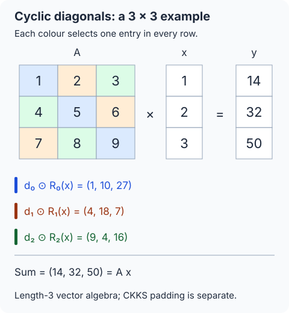
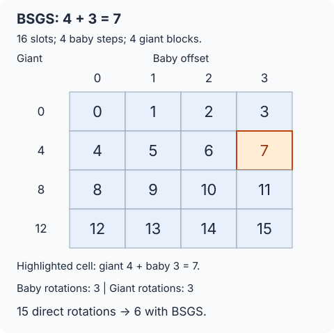

## 필기 원본

이 글에서 다룬 원본 PDF **39–42쪽**이다. 두 단과 여백 필기를 포함한 페이지 전체를 실었다. 이미지를 누르면 새 탭에서 원본 크기로 볼 수 있다.

[정리 글로 바로 가기](#들어가며)

<figure style="margin: 2rem 0;">
  
  <figcaption>원본 PDF 39쪽. 이 글은 오른쪽 단의 Week 5부터 다룬다. 왼쪽 단도 함께 보존했다. <a href="/images/posts/cryptography-handwritten-notes/page-039.webp" target="_blank" rel="noopener">원본 크기로 보기</a></figcaption>
</figure>

<figure style="margin: 2rem 0;">
  
  <figcaption>원본 PDF 40쪽. <a href="/images/posts/cryptography-handwritten-notes/page-040.webp" target="_blank" rel="noopener">원본 크기로 보기</a></figcaption>
</figure>

<figure style="margin: 2rem 0;">
  
  <figcaption>원본 PDF 41쪽. <a href="/images/posts/cryptography-handwritten-notes/page-041.webp" target="_blank" rel="noopener">원본 크기로 보기</a></figcaption>
</figure>

<figure style="margin: 2rem 0;">
  
  <figcaption>원본 PDF 42쪽. 이 글은 왼쪽 단의 BSGS까지 다룬다. 오른쪽 단도 함께 보존했다. <a href="/images/posts/cryptography-handwritten-notes/page-042.webp" target="_blank" rel="noopener">원본 크기로 보기</a></figcaption>
</figure>

## 들어가며

[앞 글](/posts/ai-security-slot-rotation-and-homomorphic-conjugation/)에서는 슬롯 회전과 켤레 연산을 만들었다. 이번에는 회전과 평문 곱을 조합하여 **공개 행렬과 암호화된 벡터의 곱**을 계산한다. 이어서 비싼 회전을 재사용하는 baby-step giant-step, 즉 BSGS 최적화를 유도한다.

**정리 범위는 원본 PDF의 39쪽 오른쪽부터 42쪽 왼쪽까지다.** Week 5의 CKKS 연산 요약, 머신러닝의 행렬 연산, 대각선 분해, 원문의 숫자 예제, BSGS의 수식과 연산 횟수를 다룬다. 42쪽 오른쪽에서 시작하는 합성곱은 다음 글로 넘긴다.

원문의 키 생성·암호화식도 생략하지 않는다. 유리수·실수 계수의 구별, 실제 슬롯 수, 스케일 변화, BSGS의 회전 방향은 앞 글들과 일관되게 적는다. 추가 예제와 일반화한 증명은 보충으로 구별한다.

## 1. CKKS 매개변수와 인코딩을 다시 정리한다

### 1.1 다항식 차수, 슬롯 수, 레벨 수

다항식 환은

$$
R=\mathbb Z[X]/(X^N+1),\qquad R_Q=R/QR
$$

이다. $N\ge2$는 $2$의 거듭제곱이며, 독립 복소 슬롯 수를

$$
n=N/2
$$

로 쓴다. 원문의 필기처럼

$$
N=2^{16}=65536
\quad\Longrightarrow\quad n=32768
$$

이다. 이는 슬롯 수를 계산하는 예시다.

앞 글에서는 슬롯 수를 $L$로 썼다. 이번에는 원문의 modulus chain 표기와 맞추기 위해 **슬롯 수**는 $n$, **최대 레벨**은 $L$로 구별한다.

법 체인은

$$
Q_\ell=\prod_{j=0}^{\ell}q_j,\qquad0\le\ell\le L
$$

로 둔다. 처음에는 $Q_L$을 사용하고, rescaling할 때

$$
Q_\ell\longmapsto Q_{\ell-1}=Q_\ell/q_\ell
$$

로 내려간다. 원문은 $q_1,\ldots,q_L$을 목표 스케일 $\Delta$에 가까운 크기로 정하는 구성을 설명한다.

### 1.2 스케일과 보조 법은 역할이 다르다

$\Delta>0$는 메시지를 정수 다항식으로 표현하는 스케일이고, $P$는 키 전환에서 임시로 법을 확장하는 보조 인수다.

$$
R_{Q_\ell}\longrightarrow R_{PQ_\ell}
\longrightarrow R_{Q_\ell}
$$

이라는 키 전환의 보조 계산과

$$
R_{Q_\ell}\longrightarrow R_{Q_{\ell-1}}
$$

이라는 rescaling의 레벨 감소를 구별한다.

같은 스케일의 두 값을 곱한 뒤 rescaling하면 정확한 새 스케일은

$$
\Delta_{\mathrm{new}}=\frac{\Delta^2}{q_\ell}.
$$

$q_\ell\approx\Delta$이면 이것이 다시 $\Delta$에 가까워진다. 일반적으로 정확히 같은 수가 되는 것은 아니다. 예를 들어 $\Delta=64$, $q_\ell=61$이면

$$
\Delta_{\mathrm{new}}=\frac{4096}{61}\approx67.14754.
$$

원문의 “곱셈에 맞춰 법과 스케일을 줄인다”는 필기는 이 레벨 체인의 의미다. 실제 소인수로 스케일을 나누는 구별은 CKKS 저자의 설명에서도 확인할 수 있다. [Yongsoo Song, Theory to Practice, PDF 22쪽](https://yongsoosong.github.io/files/slides/intro_to_CKKS.pdf)

### 1.3 벡터에서 정수 메시지로

입력은

$$
\boldsymbol z=(z_0,\ldots,z_{n-1})\in\mathbb C^n
$$

이다. 앞 글의 근 순서

$$
\xi_k=e^{\pi i5^k/N},\qquad0\le k<n
$$

를 사용한다. 켤레 쌍의 나머지 값까지 완성한 뒤 역변환하여

$$
m\in A_{\mathbb R}=\mathbb R[X]/(X^N+1),\qquad
m(\xi_k)=z_k
$$

인 이상적인 다항식을 얻는다. 실제 정수 인코딩은

$$
M=\lfloor\Delta m\rceil\in R
$$

이다. 반올림은 계수별로 한다.

원문의 화살표에 쓰인 유리수 계수 표기는 [07번 글](/posts/ai-security-lagrange-interpolation-and-canonical-embedding/)에서 구별한 조건에 따라 읽는다. 임의 복소 벡터의 정확한 역변환은 실수 계수 공간에서 설명하고, 정수화에는 근사 오차를 포함한다.

## 2. 키 생성·암호화·복호화의 전체 관계

### 2.1 키 생성

원문의 $\chi$는 작은 계수를 뽑는 분포를 나타낸다. 비밀키·임시 다항식·오차의 역할을 구별하기 위해 여기서는 각각 $\chi_s,\chi_r,\chi_e$로 적는다. 원문처럼 같은 기호로 묶는 것은 단순화된 표기다.

최초 법을 $q=Q_L$로 줄여 쓰자. 비밀키와 공개키는

$$
s\leftarrow\chi_s^N,\qquad\operatorname{sk}=s,
$$

$$
a_{\mathrm{pk}}\xleftarrow{\mathrm U}R_q,\qquad
e_{\mathrm{pk}}\leftarrow\chi_e^N,
$$

$$
b_{\mathrm{pk}}=[-a_{\mathrm{pk}}s+e_{\mathrm{pk}}]_q,
\qquad\operatorname{pk}=(b_{\mathrm{pk}},a_{\mathrm{pk}})
$$

로 만든다. 따라서

$$
b_{\mathrm{pk}}+a_{\mathrm{pk}}s=[e_{\mathrm{pk}}]_q.
$$

키 생성의 출력은 $(\operatorname{pk},\operatorname{sk})$다. 곱셈·회전에 필요한 평가키는 [06번 글](/posts/ai-security-ciphertext-multiplication-key-switching-and-rescaling/)과 앞 글의 구성을 추가로 사용한다.

### 2.2 공개키 암호화

정수 메시지 $M=\lfloor\Delta m\rceil$를 준비하고

$$
r\leftarrow\chi_r^N,\qquad
e_0,e_1\leftarrow\chi_e^N
$$

를 뽑는다. 원문과 같은 암호화식은

$$
\begin{aligned}
c=(u,v)
&=[r\operatorname{pk}+(e_0,e_1)+(M,0)]_q\\
&=([rb_{\mathrm{pk}}+e_0+M]_q,
[ra_{\mathrm{pk}}+e_1]_q).
\end{aligned}
$$

원문의 $(b,a)$는 이 글의 공개키 두 성분, $(u,v)$는 암호문 두 성분에 해당한다. 인코딩과 암호화는 별도의 단계다.

### 2.3 복호화 조합을 전개한다

$$
\begin{aligned}
D_s(c)=u+vs
&=[rb_{\mathrm{pk}}+e_0+M+(ra_{\mathrm{pk}}+e_1)s]_q\\
&=[M+r(b_{\mathrm{pk}}+a_{\mathrm{pk}}s)+e_0+e_1s]_q\\
&=[M+re_{\mathrm{pk}}+e_0+e_1s]_q.
\end{aligned}
$$

인코딩 반올림을

$$
\rho=M-\Delta m
$$

로 분리하면 총오차는

$$
\eta=\rho+re_{\mathrm{pk}}+e_0+e_1s
$$

이며

$$
D_s(c)=[\Delta m+\eta]_q.
$$

메시지와 오차의 합이 중심 대표 범위 안에 있을 때

$$
\operatorname{ctr}_q(D_s(c))=\Delta m+\eta
$$

를 읽고, 스케일로 나누어 근에서 평가한다.

$$
\widehat z_k
=\frac{\operatorname{ctr}_q(D_s(c))(\xi_k)}\Delta
=z_k+\frac{\eta(\xi_k)}\Delta.
$$

이것이 원문 39쪽의 $u+vs\approx\Delta m$ 뒤에 있는 인코딩·잡음·디코딩 관계다.

## 3. 사용할 기본 연산과 비용

### 3.1 다섯 연산의 메시지·스케일 변화

원문은 덧셈, 평문 곱셈, 암호문 곱셈, 회전, 켤레를 요약한다. 아래는 같은 키·법 아래에서 필요한 스케일을 맞춘 입력을 가정한 표다.

| 연산 | 이상적인 슬롯 결과 | 출력 스케일과 처리 |
| --- | --- | --- |
| 덧셈 | $\boldsymbol z_1+\boldsymbol z_2$ | 같은 입력 스케일 $\Delta$ 유지 |
| 평문 곱 | $\boldsymbol p\odot\boldsymbol z$ | 평문·암호문 스케일이 모두 $\Delta$면 $\Delta^2$ |
| 암호문 곱 | $\boldsymbol z_1\odot\boldsymbol z_2$ | $\Delta^2$; 세 성분의 곱을 relinearization으로 정리 |
| 왼쪽 $r$칸 회전 | $(z_{(k+r)\bmod n})_k$ | $\Delta$ 유지; 치환한 키를 원래 키로 전환 |
| 켤레 | $(\overline{z_k})_k$ | $\Delta$ 유지; 켤레 평가키로 키 전환 |

원문의 다항식 복호화 관계로도 적어 두자. 메시지와 오차가 현재 법의 중심 대표 범위에 있고 오차가 작다고 가정한다. 평문은 $M_1=\lfloor\Delta m_1\rceil$이며, 아래 암호문 곱은 relinearization까지 포함한 결과다.

$$
\begin{aligned}
\operatorname{ctr}_q(D_s(c_1\oplus c_2))
&\approx\Delta(m_1+m_2),\\
\operatorname{ctr}_q(D_s(M_1\odot c_2))
&\approx\Delta^2m_1m_2,\\
\operatorname{ctr}_q(D_s(c_1\otimes c_2))
&\approx\Delta^2m_1m_2,\\
\operatorname{ctr}_q(D_s(\operatorname{Rot}(c,r)))
&\approx\Delta m(X^{5^r}),\\
\operatorname{ctr}_q(D_s(\operatorname{Conj}(c)))
&\approx\Delta m(X^{-1}).
\end{aligned}
$$

$\odot$는 성분별 곱이다. 평문 곱에서 사용하는 것은 이상적인 벡터 자체가 아니라, 그 벡터를 인코딩한 다항식이다. 평문의 스케일이 $\Delta_p$, 암호문의 스케일이 $\Delta_x$이면 출력은 일반적으로

$$
\Delta_{\mathrm{out}}=\Delta_p\Delta_x
$$

다. 같은 스케일을 가정한 원문의 $\Delta^2$는 그 특수한 경우다. 곱셈 뒤의 rescaling은 앞 절의 레벨 체인과 연결된다.

### 3.2 왜 회전 수를 줄이는가

원문의 비용 비교는

$$
\operatorname{Add}\approx\operatorname{PMult}
\ll\operatorname{CMult}\approx\operatorname{Rot}\approx\operatorname{Conj}
$$

이다. 이는 이 단원에서 사용하는 구현의 비용을 크게 나눈 직관이다. 정확한 시간 비율이나 모든 매개변수에서의 등식으로 해석하지 않는다. 필기처럼 CMult에는 relinearization까지 포함해 비교한다.

특히 relinearization·회전·켤레에서 사용하는 **키 전환의 비용이 크므로**, 같은 결과를 더 적은 회전으로 계산하는 방법이 중요하다. 이 글의 BSGS는 그 회전 횟수를 줄인다.

## 4. 머신러닝의 행렬 연산으로 연결한다

### 4.1 공개 가중치와 암호화된 입력

원문은 기본 연산을 조합하는 응용으로 행렬 연산, 합성곱, ReLU, Softmax를 든다. CNN의 fully connected layer와 convolution 모두 행렬 연산과 연결된다. 합성곱에는 그 구조를 이용하는 전용 방법도 있으며 다음 글에서 다룬다.

공개 가중치 $w$를 가진 서버와 입력 $\boldsymbol x$를 가진 클라이언트를 생각하자. 클라이언트가 입력을 인코딩·암호화하고, 서버가 그 암호문과 공개 가중치로 함수를 평가한 뒤 결과 암호문을 돌려준다. 클라이언트는 복호화·디코딩하여 결과를 읽는다.

정확성을 수식으로 적으면

$$
\operatorname{Decode}_{\Delta_{\mathrm{out}}}
\left(\operatorname{Dec}_s
\left(\operatorname{Eval}_w(c_x)\right)\right)
\approx F(\boldsymbol x;w).
$$

여기서 $c_x$는 인코딩한 입력의 암호문이고, $\operatorname{Dec}_s$는 중심 대표의 정수 다항식을 반환한다. 암호문 성분 자체를 평문 함수값과 같다고 쓰지 않는다.

ReLU·Softmax는 일반 실수 입력 전체에서 유한한 덧셈·곱셈만으로 정확히 표현되는 다항식이 아니다. 원문의 응용 목록은 계산 가능한 기본 연산으로 적절한 근사 등을 설계하는 문제로 읽어야 한다.

### 4.2 Attention 안에서는 두 입력이 모두 암호문일 수도 있다

완전연결층의 공개 가중치 행렬과 암호화된 벡터의 곱은 평문·암호문 연산이다. 원문은 이와 달리 Transformer attention 안에 암호문 행렬끼리의 연산이 필요할 수 있음을 강조한다.

$$
\operatorname{Attention}(Q,K,V)
=\operatorname{softmax}\!\left(\frac{QK^{\mathsf T}}{\sqrt{d_k}}\right)V.
$$

여기서 $Q,K,V$는 query, key, value 행렬이며 $d_k$는 key의 차원이다. 앞 절의 암호문 법 $Q_\ell$과 다른 기호다. 이 식은 원 논문의 scaled dot-product attention이다. [Vaswani et al., §3.2.1](https://arxiv.org/pdf/1706.03762)

개인 입력에서 만든 $Q,K,V$를 모두 암호화한 설정이라면 $QK^{\mathsf T}$ 등의 계산에 암호문끼리의 곱이 필요하다. 이번 글은 우선 **행렬은 공개 평문, 벡터는 암호문**인 경우를 다룬다.

## 5. 행렬벡터곱을 순환 대각선으로 분해한다

### 5.1 목표와 회전 방향

공개 행렬과 입력 벡터를

$$
A\in\mathbb R^{n\times n},\qquad
\boldsymbol x=(x_0,\ldots,x_{n-1})^{\mathsf T}
$$

라 하자. 목표는

$$
\boldsymbol y=A\boldsymbol x,\qquad
y_j=\sum_{k=0}^{n-1}A_{j,k}x_k
$$

다. 같은 위치의 성분끼리만 곱해서는 서로 다른 입력 위치를 읽는 모든 항을 만들 수 없다.

이하 벡터의 왼쪽 회전을

$$
\mathcal R_i(\boldsymbol x)_j=x_{(j+i)\bmod n}
$$

로 쓴다. $i=1$이면

$$
\mathcal R_1(\boldsymbol x)
=(x_1,x_2,\ldots,x_{n-1},x_0)^{\mathsf T}.
$$

이는 앞 글의 암호문 회전 방향과 같다. 벡터 사상 $\mathcal R_i$와 암호문 연산 $\operatorname{Rot}(c,i)$는 구별한다.

### 5.2 첫 대각선과 다음 대각선

주대각선의 값들을

$$
\boldsymbol d_0=(A_{0,0},A_{1,1},\ldots,A_{n-1,n-1})^{\mathsf T}
$$

로 모으면

$$
\boldsymbol d_0\odot\boldsymbol x
=(A_{0,0}x_0,A_{1,1}x_1,\ldots,A_{n-1,n-1}x_{n-1})^{\mathsf T}.
$$

이것이 원문 40쪽에서 먼저 표시한 항들이다.

다음 대각선은 마지막 행에서 처음 열로 돌아온다.

$$
\boldsymbol d_1=(A_{0,1},A_{1,2},\ldots,A_{n-2,n-1},A_{n-1,0})^{\mathsf T}.
$$

그러면

$$
\boldsymbol d_1\odot\mathcal R_1(\boldsymbol x)
=(A_{0,1}x_1,A_{1,2}x_2,\ldots,A_{n-1,0}x_0)^{\mathsf T}.
$$

행렬의 오른쪽 끝을 넘으면 왼쪽 열로 돌아오는 **순환 대각선**을 사용한다. 원문의 $\boldsymbol a_i$가 이 글의 $\boldsymbol d_i$다.

### 5.3 모든 대각선을 더하면 원래 행렬곱이다

일반적으로

$$
(\boldsymbol d_i)_j=A_{j,(j+i)\bmod n},\qquad0\le i,j<n.
$$

원문의 $\boldsymbol x^{(i)}$는 이 글의 $\mathcal R_i(\boldsymbol x)$다. 따라서

$$
\boxed{A\boldsymbol x
=\sum_{i=0}^{n-1}\boldsymbol d_i\odot\mathcal R_i(\boldsymbol x)}.
$$

원문 41쪽 왼쪽의 필기처럼 출력 위치 $j$ 하나를 보면

$$
\begin{aligned}
\left(\sum_i\boldsymbol d_i\odot\mathcal R_i(\boldsymbol x)\right)_j
&=\sum_{i=0}^{n-1}A_{j,(j+i)\bmod n}x_{(j+i)\bmod n}\\
&=\sum_{k=0}^{n-1}A_{j,k}x_k\\
&=y_j.
\end{aligned}
$$

고정한 $j$에서 $(j+i)\bmod n$은 $i$가 변할 때 모든 열을 한 번씩 방문한다. 따라서 각 출력 위치에 해당 행의 내적이 완성된다. 같은 대각선 분해는 HElib의 선형대수 설명에서도 확인할 수 있다. [Halevi–Shoup, Algorithms in HElib, §4.3](https://shoup.net/papers/helib.pdf)

### 5.4 원문의 3×3 예제

원문은 벡터 계산을 보여 주기 위해

$$
A=\begin{pmatrix}1&2&3\\4&5&6\\7&8&9\end{pmatrix},\qquad
\boldsymbol x=\begin{pmatrix}1\\2\\3\end{pmatrix}
$$

를 사용한다. 이 절에서는 길이 $3$의 벡터에 대한 순환 연산을 계산한다. 실제 CKKS 슬롯에 넣는 방법은 다음 절에서 구별한다.

| 회전량 | 순환 대각선 | 회전한 입력 | 성분별 곱 |
| --- | --- | --- | --- |
| $0$ | $(1,5,9)$ | $(1,2,3)$ | $(1,10,27)$ |
| $1$ | $(2,6,7)$ | $(2,3,1)$ | $(4,18,7)$ |
| $2$ | $(3,4,8)$ | $(3,1,2)$ | $(9,4,16)$ |

세 결과를 더하면

$$
(1,10,27)+(4,18,7)+(9,4,16)=(14,32,50).
$$

직접 계산한

$$
A\boldsymbol x
=\begin{pmatrix}
1+4+9\\4+10+18\\7+16+27
\end{pmatrix}
=\begin{pmatrix}14\\32\\50\end{pmatrix}
$$

와 일치한다.

## 6. 세 값의 예제와 실제 네 슬롯을 구별한다

### 6.1 0 하나를 붙이면 회전의 주기도 달라진다

**보충:** 지금의 $N$은 $2$의 거듭제곱이므로 전체 독립 슬롯 수 $n=N/2$도 $2$의 거듭제곱이다. 앞 절의 길이 $3$ 예제를 곧바로 “세 슬롯짜리 CKKS”로 해석하지 않는다.

$N=8$의 네 슬롯에

$$
\boldsymbol x'=(1,2,3,0)^{\mathsf T}
$$

를 넣으면 기본 왼쪽 회전은

$$
\mathcal R_1(\boldsymbol x')=(2,3,0,1)^{\mathsf T}
$$

이다. 세 값만 주기적으로 도는 $(2,3,1,0)^{\mathsf T}$와 다르다.

### 6.2 행렬도 함께 확장하면 같은 결과를 얻는다

$$
A'=\begin{pmatrix}
1&2&3&0\\4&5&6&0\\7&8&9&0\\0&0&0&0
\end{pmatrix}
$$

로 두고 길이 $4$의 순환 대각선을 다시 구한다.

| 회전량 | 확장 행렬의 대각선 | 해당 곱의 결과 |
| --- | --- | --- |
| $0$ | $(1,5,9,0)$ | $(1,10,27,0)$ |
| $1$ | $(2,6,0,0)$ | $(4,18,0,0)$ |
| $2$ | $(3,0,7,0)$ | $(9,0,7,0)$ |
| $3$ | $(0,4,8,0)$ | $(0,4,16,0)$ |

합은

$$
A'\boldsymbol x'=(14,32,50,0)^{\mathsf T}.
$$

처음 세 출력이 원래 예제와 같다. 입력뿐 아니라 **실제 슬롯 수에 맞춰 행렬과 대각선도 함께 구성**해야 한다.

## 7. 대각선 분해를 암호문 연산으로 옮긴다

### 7.1 공개 대각선을 인코딩하고 입력을 회전한다

$c_x$는 $\boldsymbol x$를 스케일 $\Delta_x$로 인코딩·암호화한 두 성분 암호문이다. 각 공개 대각선을 같은 평문 스케일 $\Delta_p$로 인코딩하여

$$
P_i=\operatorname{Encode}_{\Delta_p}(\boldsymbol d_i)
$$

를 준비한다. 이 글의 $P_i$는 인코딩한 평문 다항식이며, 키 전환의 보조 인수 $P$와 다르다.

기본 알고리즘은

$$
\boxed{c_y^{\mathrm{raw}}
=\sum_{i=0}^{n-1}P_i\odot\operatorname{Rot}(c_x,i)}.
$$

이 식의 $\odot$는 평문 다항식과 암호문의 곱이다. 같은 기호로 표시한 벡터의 성분별 곱과는 층위가 다르지만, 인코딩의 대응에 의해 목표 슬롯 연산을 수행한다.

모든 대각선 항이 있는 기본 구성의 연산 횟수는

$$
\begin{aligned}
\text{평문 곱}&:n,\\
\text{암호문 덧셈}&:n-1,\\
\text{회전}&:n-1.
\end{aligned}
$$

$0$칸 회전은 원본을 재사용한다. 각 회전을 직접 실행하는 평가키가 있다는 가정으로 센다. 원문의 $O(n)$은 이러한 **포장된 암호문 연산의 개수**를 말한다. 한 연산의 내부 비용이나 행렬의 평문 전처리까지 상수 시간이라는 뜻은 아니다.

### 7.2 더할 때의 스케일과 마지막 rescaling

회전은 입력 스케일 $\Delta_x$를 유지한다. 각 평문 곱의 스케일은

$$
\Delta_x\Delta_p
$$

이므로 같은 법·레벨에서 이 항들을 더할 수 있다. 이상적인 결과와 실제 결과의 관계는

$$
\operatorname{Decode}_{\Delta_x\Delta_p}
\left(\operatorname{Dec}_s(c_y^{\mathrm{raw}})\right)
\approx A\boldsymbol x
$$

이다. 입력 오차, 평문 인코딩 반올림, 회전의 키 전환 오차가 포함된다.

중간 합이 법의 표현 범위 안에 들어가고 필요한 여유가 있으면, 같은 스케일의 항들을 먼저 더한 뒤 rescaling하는 계산 계획을 사용할 수 있다. 각 항을 먼저 rescaling하는 계획도 가능하지만 레벨·스케일을 맞춰 더해야 한다. 최종 rescaling의 새 스케일은

$$
\Delta_{\mathrm{out}}=\frac{\Delta_x\Delta_p}{q_\ell}
$$

이다. 평문 곱은 암호문의 성분 수를 세 개로 늘리지 않으므로, 이 행렬곱 자체에 암호문끼리의 곱셈용 relinearization을 추가할 필요는 없다.

## 8. BSGS는 작은 회전을 재사용한다

### 8.1 회전량을 블록과 블록 안 위치로 나눈다

기본 알고리즘은 서로 다른 $n-1$개의 회전을 사용한다. BSGS는 이 회전량을 작은 이동과 큰 이동의 합으로 분해한다.

$n=bg$인 양의 정수 $b,g$를 고르고

$$
i=kb+t,\qquad0\le k<g,\quad0\le t<b
$$

로 쓴다. $b$는 baby step의 블록 크기, $k$는 giant step의 블록 번호다.

대각선 합을 블록으로 나누면

$$
A\boldsymbol x
=\sum_{k=0}^{g-1}\sum_{t=0}^{b-1}
\boldsymbol d_{kb+t}\odot\mathcal R_{kb+t}(\boldsymbol x).
$$

### 8.2 가중치를 반대 방향으로 미리 돌린다

핵심 항등식은

$$
\boxed{
\boldsymbol d_{kb+t}\odot\mathcal R_{kb+t}(\boldsymbol x)
=\mathcal R_{kb}\!\left(
\mathcal R_{-kb}(\boldsymbol d_{kb+t})
\odot\mathcal R_t(\boldsymbol x)\right)}.
$$

왼쪽 회전은 성분별 곱을 보존하므로

$$
\mathcal R_a(\boldsymbol u\odot\boldsymbol v)
=\mathcal R_a(\boldsymbol u)\odot\mathcal R_a(\boldsymbol v).
$$

오른쪽 식을 전개하면 가중치는 원래 위치로 돌아오고 입력의 회전량은 더해진다.

$$
\mathcal R_{kb}\mathcal R_{-kb}(\boldsymbol d_{kb+t})
=\boldsymbol d_{kb+t},
$$

$$
\mathcal R_{kb}\mathcal R_t(\boldsymbol x)
=\mathcal R_{kb+t}(\boldsymbol x).
$$

그래서 사전 가중치 회전의 부호는 **마이너스**다. 공개 대각선은 미리 재배열할 수 있으므로, 이 작업에 암호문 키 전환을 사용할 필요가 없다.

### 8.3 합을 먼저 만들고 큰 회전은 한 번만 한다

사전 회전한 대각선을

$$
\widetilde{\boldsymbol d}_{kb+t}
=\mathcal R_{-kb}(\boldsymbol d_{kb+t})
$$

로 두자. 회전은 덧셈도 보존하므로

$$
\boxed{
A\boldsymbol x
=\sum_{k=0}^{g-1}\mathcal R_{kb}\!\left(
\sum_{t=0}^{b-1}
\widetilde{\boldsymbol d}_{kb+t}\odot\mathcal R_t(\boldsymbol x)
\right)}.
$$

각 블록에서 필요한 입력은 $\mathcal R_0(\boldsymbol x),\ldots,\mathcal R_{b-1}(\boldsymbol x)$로 같다. 블록마다 다른 것은 사전 회전한 가중치다. 이 작은 회전들을 한 번 만들어 모든 블록에 재사용한다.

### 8.4 암호문 알고리즘

먼저

$$
C_t=\operatorname{Rot}(c_x,t),\qquad0\le t<b
$$

를 저장한다. $C_0=c_x$다. 공개 평문은

$$
\widetilde P_{kb+t}
=\operatorname{Encode}_{\Delta_p}
\bigl(\widetilde{\boldsymbol d}_{kb+t}\bigr)
$$

로 미리 준비한다. 각 블록의 합은

$$
T_k=\sum_{t=0}^{b-1}\widetilde P_{kb+t}\odot C_t
$$

이고 최종 출력은

$$
\boxed{c_y^{\mathrm{BSGS}}
=\sum_{k=0}^{g-1}\operatorname{Rot}(T_k,kb)}.
$$

첫 블록은 $kb=0$이므로 사전 가중치 회전과 바깥 회전이 모두 항등이다. 이 때문에 원문의 첫 블록에는 원래 $P_i$가, 이후 블록에는 사전 회전한 $\widetilde P_i$가 나타난다.

각 $T_k$의 스케일은 $\Delta_x\Delta_p$이고 큰 회전도 그 스케일을 유지한다. 최종 합의 레벨·스케일 처리 조건은 앞 절과 같다. 정확한 벡터 항등식이 성립해도 두 암호문 알고리즘의 반올림·키 전환 오차나 성분들이 동일하다는 뜻은 아니다.

## 9. 원문의 16슬롯 예제를 항별로 확인한다

### 9.1 작은 회전 네 개로 시작한다

원문의 예제는 $n=16$, $b=4$, $g=4$다. 기본 방법은

$$
P_0\odot c_x+P_1\odot\operatorname{Rot}(c_x,1)
+\cdots+P_{15}\odot\operatorname{Rot}(c_x,15)
$$

로 $15$회의 회전을 사용한다.

BSGS에서는

$$
C_0=c_x,\quad
C_1=\operatorname{Rot}(c_x,1),\quad
C_2=\operatorname{Rot}(c_x,2),\quad
C_3=\operatorname{Rot}(c_x,3)
$$

를 만든다. 필요한 회전은 $3$회다.

### 9.2 다음 블록의 4, 5, 6, 7은 어떻게 만드는가

두 번째 블록은 회전량 $4,5,6,7$에 해당한다.

$$
4=4+0,\quad5=4+1,\quad6=4+2,\quad7=4+3.
$$

가중치를 각각 오른쪽으로 네 칸, 즉 왼쪽으로 $-4$칸 돌려 놓고

$$
T_1=\widetilde P_4\odot C_0
+\widetilde P_5\odot C_1
+\widetilde P_6\odot C_2
+\widetilde P_7\odot C_3
$$

를 먼저 계산한다. 그 후

$$
\operatorname{Rot}(T_1,4)
$$

를 한 번 적용하면 된다. 이 바깥 회전이 네 항 모두의 입력 위치를 네 칸 더 이동시킨다.

안쪽 마지막 회전은 $3$, 바깥 회전은 $4$다. 원문 41쪽 오른쪽과 42쪽 왼쪽에도 안쪽 값은 $0,1,2,3$으로 적혀 있다. 두 역할을 섞으면 목표 회전량 $7$을 다른 값으로 바꾸게 된다.

### 9.3 가중치를 미리 옮기는 이유를 한 항으로 본다

원문 42쪽 왼쪽의 필기는 출력 $0$번에 $A_{0,4}x_4$를 만들고 싶다는 예다.

$C_0$의 입력 $x_4$는 슬롯 $4$에 있다. 그래서 $\boldsymbol d_4$의 슬롯 $0$에 있던 가중치 $A_{0,4}$를 사전 오른쪽 회전으로 슬롯 $4$에 둔다.

$$
\bigl(\mathcal R_{-4}(\boldsymbol d_4)\bigr)_4
=(\boldsymbol d_4)_0=A_{0,4}.
$$

성분별 곱을 하면 슬롯 $4$에서 $A_{0,4}x_4$가 만들어진다. 마지막 왼쪽 네 칸 회전이 이 값을 출력 슬롯 $0$으로 옮긴다.

원문의 항별 약식 등식에는 이 **마지막 회전까지 포함**해야 한다. 벡터 수준의 정확한 식은

$$
\mathcal R_4\!\left(
\mathcal R_{-4}(\boldsymbol d_4)\odot\boldsymbol x\right)
=\boldsymbol d_4\odot\mathcal R_4(\boldsymbol x),
$$

$$
\mathcal R_4\!\left(
\mathcal R_{-4}(\boldsymbol d_5)\odot\mathcal R_1(\boldsymbol x)\right)
=\boldsymbol d_5\odot\mathcal R_5(\boldsymbol x)
$$

이다. 바깥 회전을 제외한 왼쪽의 중간 곱이 오른쪽의 최종 항과 같은 벡터라고 쓰지는 않는다.

**추가 숫자 검산:** $16\times16$ 행렬과 입력을

$$
A_{j,k}=100j+k+1,\qquad x_k=k+1
$$

로 정하면 두 번째 블록이 출력 $0$에 주는 값은

$$
\sum_{k=4}^{7}A_{0,k}x_k
=5^2+6^2+7^2+8^2=174.
$$

BSGS의 블록 합을 만든 뒤 네 칸 회전해도 정확히 $174$를 얻었다. 마지막 baby step을 잘못 $4$로 바꾸면 이 예제에서는 $182$가 되어 목표와 달라진다. 이는 인덱스 확인을 위한 추가 벡터 계산이다.

## 10. 회전 횟수는 얼마나 줄어드는가

### 10.1 원문의 15회에서 6회, 255회에서 30회

$n=bg$일 때 필요한 작은 회전은 $b-1$회, 큰 회전은 $g-1$회다. 따라서

$$
\boxed{\text{BSGS 회전 수}=b+g-2=b+\frac nb-2}.
$$

평문 곱은 여전히 $n$회다. 덧셈은 블록 내부와 블록 사이를 합쳐

$$
g(b-1)+(g-1)=n-1
$$

회다. 모든 대각선 항이 있는 구성에서, 필요한 직접 회전키를 갖췄다고 가정한 횟수다.

| 구성 | 기본 | 작은 회전 | 큰 회전 | 합계 |
| --- | --- | --- | --- | --- |
| $n=16$ $b=g=4$ | $15$ | $3$ | $3$ | $6$ |
| $n=2^8$ $b=g=16$ | $255$ | $15$ | $15$ | $30$ |

이것이 원문 41쪽의 $255\to30$, 42쪽 필기의 $15\to6$이다. 첫 구성의 바깥 회전량은 $4,8,12$이며, 원본인 $0$칸은 세지 않는다.

### 10.2 블록을 제곱근 크기로 잡는 이유

원문 마지막 필기는 산술·기하평균 부등식을 적용한다.

$$
b+\frac nb\ge2\sqrt n.
$$

실수 변수로 보면 같아지는 지점은

$$
b=\frac nb,\qquad b=\sqrt n.
$$

따라서 정수 인수 제약 아래에서 $b,g$를 가능한 한 비슷하게 잡는다. $n$이 완전제곱수이고 $b=g=\sqrt n$이면 정확히

$$
2\sqrt n-2
$$

회의 회전으로 계산한다. 완전제곱수가 아닌 경우에는 $n=bg$를 만족하는 가까운 인수 쌍을 사용한다. $n$이 $2$의 거듭제곱이면 지수를 가능한 한 반씩 나누면 된다.

회전 수는 $O(n)$에서 $O(\sqrt n)$으로 줄지만, 평문 곱과 덧셈까지 모두 $O(\sqrt n)$개가 되는 것은 아니다. 공개 가중치의 사전 재배열과 작은 회전 결과를 보관하는 작업도 함께 필요하다.

다음 글은 **42쪽 오른쪽의 Homomorphic Convolution**부터 이어간다. 행렬곱에서 사용한 회전·성분별 곱·합을 이미지의 이웃 값과 커널 가중치에 연결하고, 경계에서 순환한 값이 섞이지 않도록 처리하는 과정을 살펴본다.
