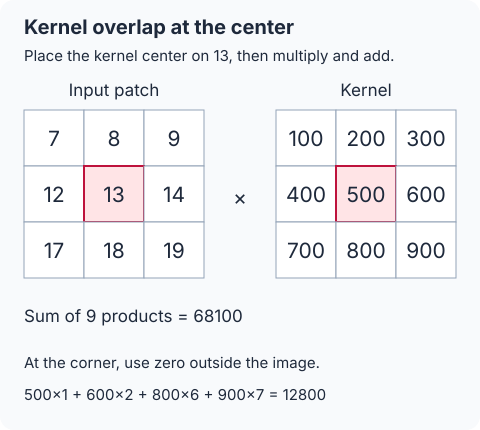
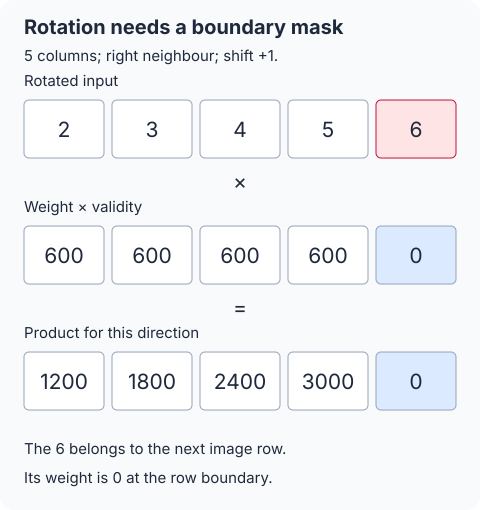
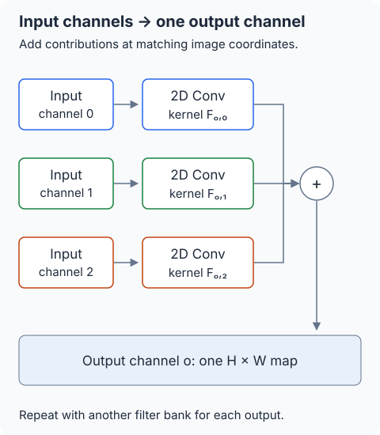

## 필기 원본

이 글에서 다룬 원본 PDF **42–43쪽**이다. 두 단과 여백 필기를 포함한 페이지 전체를 실었다. 이미지를 누르면 확대해서 볼 수 있다.

<figure style="margin: 2rem 0;">
  
  <figcaption>원본 PDF 42쪽. 이 글은 오른쪽 단의 동형 합성곱부터 다룬다. 왼쪽 단도 함께 보존했다.</figcaption>
</figure>

<figure style="margin: 2rem 0;">
  
  <figcaption>원본 PDF 43쪽. 왼쪽 단의 필기와 나머지 여백을 함께 보존했다.</figcaption>
</figure>

## 들어가며

[앞 글](/posts/ai-security-ckks-matrix-vector-multiplication-and-bsgs/)에서는 회전과 평문 곱을 합쳐 행렬벡터곱을 계산했다. 합성곱도 같은 연산들을 사용하지만, 먼저 이미지에서 하는 계산을 보자. **현재 픽셀에 커널의 중심을 놓고, 겹치는 값끼리 곱한 뒤 더한다.** 동형암호의 회전은 이때 필요한 이웃 픽셀을 같은 슬롯으로 가져오는 역할이다.

**정리 범위는 원본 PDF의 42쪽 오른쪽부터 43쪽 왼쪽까지, Homomorphic Convolution 단원 전체다.** 실제 포함된 슬라이드 번호는 16–21, 23–24다. 이미지의 채널별 벡터 표현, 아홉 가중치 마스크, 회전한 입력과의 곱·합, 다중 입력·출력 채널을 차례로 다룬다.

원문의 그림은 수식과 작은 숫자 예제로 다시 풀어 쓴다. 예제는 보충으로 구별하고, 일반 합성곱·인코딩된 슬롯 연산·암호문 연산은 구분한다. 커널 방향과 실제 슬롯 수, 채널 배치도 명시한다.

## 1. 먼저 커널을 겹쳐서 계산한다

### 1.1 커널의 중심을 현재 픽셀에 놓는다

입력 이미지 한 채널과 커널을 다음처럼 정하자. 원문 그림을 이해하기 위한 **추가 예제**다.

$$
A=\begin{pmatrix}
1&2&3&4&5\\
6&7&8&9&10\\
11&12&13&14&15\\
16&17&18&19&20\\
21&22&23&24&25
\end{pmatrix},\qquad
K=\begin{pmatrix}
100&200&300\\
400&500&600\\
700&800&900
\end{pmatrix}.
$$

좌표는 $0$부터 센다. 출력 위치 $(2,2)$를 계산하려면 입력의 $13$ 위에 커널의 중심 $500$을 놓는다. 그때 겹치는 입력은

$$
\begin{pmatrix}7&8&9\\12&13&14\\17&18&19\end{pmatrix}
$$

이다. 같은 위치끼리 곱해 더하면

$$
\begin{aligned}
B_{2,2}
&=7\cdot100+8\cdot200+9\cdot300\\
&\quad+12\cdot400+13\cdot500+14\cdot600\\
&\quad+17\cdot700+18\cdot800+19\cdot900\\
&=68100.
\end{aligned}
$$

이것이 출력 픽셀 하나다. 이미지 전체에서 커널 중심을 옮기며 같은 계산을 반복한다.

### 1.2 이미지 밖은 0으로 본다

왼쪽 위 출력 $(0,0)$에서는 입력 $1$에 커널 중심을 놓는다. 필요한 입력 중 이미지 밖에 있는 위치를 $0$으로 채우면

$$
\begin{pmatrix}0&0&0\\0&1&2\\0&6&7\end{pmatrix}
$$

을 사용한다. 따라서

$$
B_{0,0}=1\cdot500+2\cdot600+6\cdot800+7\cdot900=12800.
$$

커널 중심을 놓는 것과 경계의 값을 $0$으로 처리하는 것은 서로 다른 역할이다. 뒤에서 사용할 마스크는 순환이동 때문에 들어오는 잘못된 이웃 값을 배제하기 위한 것이다.

### 1.3 이 글의 커널 방향과 출력 크기

원문의 CNN 그림처럼 **커널을 뒤집지 않고** 사용한다. 엄밀히는 cross-correlation에 해당하지만 머신러닝에서는 보통 이 연산을 convolution이라고 부른다. 공식 Conv2d 설명도 이 방향의 연산과 입력 채널 합을 사용한다. [PyTorch Conv2d 문서](https://docs.pytorch.org/docs/2.15/generated/torch.nn.Conv2d.html)

이 글은 원문의 그림에 맞춰 stride $1$, dilation $1$, 홀수 크기 커널, 이미지 밖을 $0$으로 보는 same padding을 사용한다. 출력의 높이·너비는 입력과 같다.

커널을 상하좌우로 뒤집는 수학적 합성곱을 구현한다면 그에 맞춰 가중치도 뒤집어야 한다. 예제에서 뒤집힌 커널의 왼쪽 위 결과는 $3200$이므로, 두 방향을 섞으면 다른 답이 나온다.

## 2. 원문의 이미지와 커널을 수식으로 정한다

### 2.1 단일 입력 채널의 정의

높이·너비를 $H,W$, 입력 한 채널을 $A\in\mathbb R^{H\times W}$라 하자. 커널은

$$
K\in\mathbb R^{K_h\times K_w},\qquad
p_h=(K_h-1)/2,\quad p_w=(K_w-1)/2
$$

이다. 범위 밖이 $0$인 확장 입력을

$$
\widetilde A_{r,t}=
\begin{cases}
A_{r,t},&0\le r<H,\ 0\le t<W,\\
0,&\text{그 밖}
\end{cases}
$$

로 두면

$$
\boxed{B_{r,t}
=\sum_{u=0}^{K_h-1}\sum_{v=0}^{K_w-1}
K_{u,v}\widetilde A_{r+u-p_h,\,t+v-p_w}}.
$$

원문의 $3\times3$ 커널은

$$
\begin{pmatrix}
k_{11}&k_{12}&k_{13}\\
k_{21}&k_{22}&k_{23}\\
k_{31}&k_{32}&k_{33}
\end{pmatrix}
$$

이다. 원문의 가중치 인덱스는 $1$부터, 일반식의 $K_{u,v}$ 인덱스는 $0$부터 센다. 예를 들어 $k_{11}=K_{0,0}$, $k_{22}=K_{1,1}$이다.

### 2.2 원문은 채널마다 32×32 이미지를 그린다

원문 16번 슬라이드의 입력 모양은

$$
H\times W\times C_{\mathrm{in}}=32\times32\times3
$$

이다. RGB처럼 세 입력 채널이 있고, 각 채널의 픽셀을 같은 순서로 나열한 벡터를 그린다.

본문의 기본 배치는 **한 입력 채널을 한 벡터·한 암호문에 넣는 방식**이다. 이 배치에서는 입력 채널마다 같은 좌표가 같은 슬롯에 있으므로 채널별 결과를 바로 더할 수 있다. 여러 채널을 한 암호문에 묶는 경우는 8.3절에서 별도로 설명한다.

원문의 입력은 필터와 암호화된 이미지이며, 목표는 $B=F*A$에 대응하는 결과 암호문을 얻는 것이다. 실제 CKKS에서는 최종 복호화·디코딩 값이 이 결과에 근접한다.

## 3. 이미지의 이웃을 슬롯 회전으로 가져온다

### 3.1 행 우선 순서로 펼친다

이미지를 왼쪽에서 오른쪽, 위에서 아래 순서로 나열한다.

$$
\iota(r,t)=rW+t.
$$

실제 CKKS 독립 슬롯 수는

$$
n=N/2\ge HW
$$

이고, $N$은 $2$의 거듭제곱이다. 한 채널의 슬롯 벡터를

$$
a_j=
\begin{cases}
A_{r,t},&j=rW+t<HW,\\
0,&HW\le j<n
\end{cases}
$$

로 둔다. 원문의 채널별 벡터는

$$
(a^c_{1,1},a^c_{1,2},\ldots,a^c_{32,32})
$$

의 순서이며, 좌표를 $0$부터 센 위 표현과 같은 행 우선 배치다.

예제의 $5\times5$ 이미지는 $25$개 값을 갖지만, 이 설정의 전체 슬롯 수를 $25$로 정할 수는 없다. 검산에서는 $n=32$, $N=64$의 작은 크기를 사용하고 뒤의 일곱 슬롯은 $0$으로 둔다. 회전 주기는 실제 $32$슬롯이다.

### 3.2 한 이웃 방향은 하나의 회전량이 된다

커널 위치 $(u,v)$에 대해

$$
\delta_r=u-p_h,\qquad\delta_t=v-p_w
$$

라 두면, 같은 출력 위치에서 읽고 싶은 이웃은

$$
A_{r+\delta_r,t+\delta_t}.
$$

그 이웃의 펼친 위치는

$$
\begin{aligned}
\iota(r+\delta_r,t+\delta_t)
&=(r+\delta_r)W+t+\delta_t\\
&=\iota(r,t)+\delta_rW+\delta_t.
\end{aligned}
$$

따라서 필요한 왼쪽 회전량은

$$
\boxed{s_{u,v}=\delta_rW+\delta_t}.
$$

벡터 회전은 앞 글과 같은 방향으로

$$
\mathcal R_s(\boldsymbol a)_j=a_{(j+s)\bmod n}
$$

로 정의한다. 회전량이 음수이면 반대 방향으로 이동하며, 슬롯 인덱스는 실제 $n$을 법으로 해석한다.

### 3.3 3×3 커널의 아홉 회전과 경계 조건

원문의 $W=32$에 적용하면 다음과 같다. 경계 조건은 출력 픽셀 $(r,t)$를 기준으로 적었다.

| 가중치 | 회전량 | 가중치를 0으로 둘 경계 |
| --- | --- | --- |
| $k_{11}$ | $-33$ | 맨 위 또는 맨 왼쪽 |
| $k_{12}$ | $-32$ | 맨 위 |
| $k_{13}$ | $-31$ | 맨 위 또는 맨 오른쪽 |
| $k_{21}$ | $-1$ | 맨 왼쪽 |
| $k_{22}$ | $0$ | 이미지 내부에는 없음 |
| $k_{23}$ | $1$ | 맨 오른쪽 |
| $k_{31}$ | $31$ | 맨 아래 또는 맨 왼쪽 |
| $k_{32}$ | $32$ | 맨 아래 |
| $k_{33}$ | $33$ | 맨 아래 또는 맨 오른쪽 |

유효 이미지 밖의 여분 슬롯에서는 모든 가중치를 $0$으로 둔다. 같은 식에 $W=5$를 넣으면 예제의 회전량은

$$
-6,-5,-4,-1,0,1,4,5,6
$$

이 된다. **폭이 회전 간격을 결정한다.**

## 4. 원문의 수정된 커널 벡터는 경계 마스크다

### 4.1 순환이동은 2D 경계를 알지 못한다

예제에서 오른쪽 이웃을 가져오려고 한 칸 왼쪽으로 회전하면 첫 행의 출력 위치에는

$$
(2,3,4,5,6)
$$

이 들어온다. 마지막 값 $6$은 다음 행의 첫 픽셀이다. 첫 행의 오른쪽 끝에서 필요한 것은 이미지 밖의 $0$이다.

회전은 슬롯 번호만 바꾸므로 이러한 행 경계를 자동으로 처리하지 않는다. 원문의 회전 그림에 표시된 `X`는 결과에 사용하면 안 되는 위치다. 그 위치의 값을 실제로 $0$이라고 가정하지 않고, 가중치를 $0$으로 만들어 배제한다.

### 4.2 각 가중치를 유효한 출력 위치에만 반복한다

슬롯 $j$의 좌표를 $r=\lfloor j/W\rfloor$, $t=j\bmod W$로 읽는다. 회전량 $s_{u,v}$에 대응하는 평문 가중치 벡터를

$$
m^{(u,v)}_j=
\begin{cases}
K_{u,v},&\substack{0\le j<HW,\\0\le r+\delta_r<H,\\0\le t+\delta_t<W},\\
0,&\text{그 밖}
\end{cases}
$$

로 정의한다. 첫 경우의 조건은 모두 동시에 만족해야 한다. 이는 커널 값과 유효 위치의 $0/1$ 마스크를 합친 벡터다.

원문 17번 슬라이드는 $3\times3$ 커널의 각 값으로 이런 벡터 아홉 개를 만드는 그림이다. 매 슬롯에서 커널 전체를 다시 넣는 것이 아니라, **한 이웃 방향에 대응하는 가중치 하나를 필요한 위치에 반복**한다.

### 4.3 원문의 k11 벡터를 2D로 다시 읽는다

$k_{11}$은 왼쪽 위 이웃에 곱하는 값이다. 출력의 맨 위 행이나 맨 왼쪽 열에서는 그 이웃이 없으므로 가중치가 $0$이다.

원문 18번 슬라이드의 $32\times32$ 그림은 다음 패턴이다.

$$
M_{11}=\begin{pmatrix}
0&0&\cdots&0\\
0&k_{11}&\cdots&k_{11}\\
\vdots&\vdots&\ddots&\vdots\\
0&k_{11}&\cdots&k_{11}
\end{pmatrix}.
$$

이를 행 우선으로 펼치면 첫 $32$개 값이 $0$이고, 이후 각 행의 첫 값도 $0$인 원문의 긴 벡터가 된다. 나머지 여덟 커널 위치도 3.3절의 경계 조건에 따라 각자의 2D 가중치 배열을 만든다. 원문 19번 슬라이드가 이 아홉 배열을 함께 보여 준다.

그림의 채널 방향으로 쌓인 배열은 각 입력 채널의 필터 조각에 해당한다. 서로 다른 입력 채널의 실제 커널 값이 모두 같아야 한다는 뜻은 아니다.

### 4.4 오른쪽 이웃 예제에 가중치를 적용한다

예제의 오른쪽 이웃 가중치는 $k_{23}=600$이다. 첫 행에서는

$$
(600,600,600,600,0)
$$

을 사용하므로

$$
(600,600,600,600,0)\odot(2,3,4,5,6)
=(1200,1800,2400,3000,0).
$$

잘못 넘어온 $6$은 이 방향의 결과에 들어가지 않는다. 다른 방향도 같은 방식으로 처리한다.

### 4.5 아홉 결과를 더하면 원하는 합성곱이다

원문의 회전·곱·합을 수식으로 쓰면

$$
\boxed{\boldsymbol b
=\sum_{u=0}^{K_h-1}\sum_{v=0}^{K_w-1}
\boldsymbol m^{(u,v)}\odot
\mathcal R_{s_{u,v}}(\boldsymbol a)}.
$$

원문이 이를 inner product라고 부르는 것은 각 출력 위치에서 이웃 방향별 곱을 더한다는 뜻이다. 이미지 전체를 내적해 스칼라 하나로 만드는 것이 아니라, 모든 출력 위치를 동시에 계산해 2D 출력 채널을 얻는다.

이를 확인하기 위해 출력 $j=rW+t$ 하나를 보자. 이웃이 유효한 경우

$$
j+s_{u,v}=(r+\delta_r)W+(t+\delta_t)
$$

는 $0$부터 $HW-1$ 사이의 올바른 입력 위치다. 실제 슬롯 수가 $HW$보다 커도 유효한 항은 다른 위치로 순환하지 않는다.

이웃이 유효하지 않으면 $m^{(u,v)}_j=0$이다. 회전이 어떤 값을 가져왔든 그 항은 제외된다. 따라서

$$
b_{rW+t}
=\sum_{u,v}K_{u,v}\widetilde A_{r+u-p_h,t+v-p_w}
=B_{r,t}.
$$

뒤의 여분 출력 슬롯도 가중치가 모두 $0$이므로 이상적인 벡터 계산에서는 $0$이다. 원문 20–21번 슬라이드의 회전 텐서·평문 가중치 곱과 최종 2D 출력은 이 관계를 나타낸다.

촘촘하게 포장한 입력을 회전하고 위치별로 $0$을 포함하는 평문과 곱해 합하는 구조는 GAZELLE의 packed SISO 설명에서도 확인할 수 있다. 이 글의 CKKS 근사 연산과 해당 논문의 암호 체계·성능 수치를 동일시하지 않는다. [Juvekar–Vaikuntanathan–Chandrakasan, §6, Packed SISO](https://www.usenix.org/system/files/conference/usenixsecurity18/sec18-juvekar.pdf)

## 5. 회전·가중치 곱·합을 암호문으로 수행한다

### 5.1 가중치와 마스크를 한 평문으로 인코딩한다

입력 벡터 $\boldsymbol a$를 스케일 $\Delta_x$로 인코딩·암호화한 것을 $c_A$라 하자. 가중치 벡터마다

$$
P_{u,v}=\operatorname{Encode}_{\Delta_f}
\bigl(\boldsymbol m^{(u,v)}\bigr)
$$

를 준비한다. 마스크와 커널 값이 이미 하나의 벡터에 들어 있으므로, 두 가지를 위해 별도의 평문 곱을 두 번 할 필요는 없다.

평가 알고리즘은

$$
\boxed{c_B^{\mathrm{raw}}
=\sum_{u=0}^{K_h-1}\sum_{v=0}^{K_w-1}
P_{u,v}\odot\operatorname{Rot}(c_A,s_{u,v})}.
$$

여기서 $\operatorname{Rot}$는 [08번 글](/posts/ai-security-slot-rotation-and-homomorphic-conjugation/)의 키 전환을 포함하는 암호문 회전이다. $\odot$는 인코딩한 평문과 암호문의 곱이며, 슬롯에서 앞 절의 성분별 곱을 수행한다.

평가자는 입력을 복호화하지 않고 공개된 평문 가중치와 필요한 평가키로 계산한다. 원문에서 이미지와 필터의 합성곱 결과를 암호문으로 얻는다는 목표가 이 식으로 구체화된다.

### 5.2 스케일과 최종 결과

회전은 $\Delta_x$를 유지한다. 각 평문 곱과 그 합의 스케일은

$$
\Delta_{\mathrm{raw}}=\Delta_x\Delta_f.
$$

같은 법·레벨·스케일로 항들을 더하고, 필요한 표현 범위와 오차 여유를 확보한다. 최종 관계는

$$
\operatorname{Decode}_{\Delta_x\Delta_f}
\left(\operatorname{Dec}_s(c_B^{\mathrm{raw}})\right)
\approx\bigl(\operatorname{vec}(B),\boldsymbol0_{n-HW}\bigr)
$$

이다. 오른쪽은 이미지 벡터 뒤에 여분의 $0$슬롯을 붙인 이상적인 목표다. rescaling을 적용하면

$$
Q_\ell\longmapsto Q_{\ell-1},\qquad
\Delta_{\mathrm{out}}=\frac{\Delta_x\Delta_f}{q_\ell}
$$

로 변한다. 합산·rescaling 순서의 조건은 [앞 글](/posts/ai-security-ckks-matrix-vector-multiplication-and-bsgs/)과 같다.

### 5.3 이상적인 0 마스크와 CKKS의 근사 오차

벡터 항등식에서는 마스크가 $0$인 항이 정확히 사라진다. 실제 CKKS에서는 평문 인코딩 반올림과 암호화·회전의 키 전환·rescaling 오차를 함께 고려한다.

한 슬롯의 이상적인 가중치를 $m$, 회전한 입력을 $a$라 하고, 디코딩한 값이 각각 $m+\delta_m$, $a+\delta_a$이면

$$
(m+\delta_m)(a+\delta_a)
=ma+m\delta_a+a\delta_m+\delta_m\delta_a.
$$

경계의 이상적인 $m$이 $0$이어도 인코딩 오차 $\delta_m$까지 항상 정확한 $0$이라고 할 수는 없다. 경계 마스크의 정확한 선형변환과 실제 암호 계산의 근사 정확도를 구별한다.

## 6. 5×5 예제의 전체 결과를 검산한다

첫 절의 이미지와 커널을 직접 2D로 계산하면

$$
B=\begin{pmatrix}
12800&20200&24100&28000&18400\\
27600&41100&45600&50100&31800\\
44100&63600&68100&72600&45300\\
60600&86100&90600&95100&58800\\
32000&43600&45700&47800&28000
\end{pmatrix}.
$$

같은 입력을 실제 $32$슬롯에 넣고, 아홉 회전량

$$
(-6,-5,-4,-1,0,1,4,5,6)
$$

에 대해 경계 가중치를 곱해 더해도 **25개 출력 모두 같은 값**을 얻었다. 나머지 일곱 출력 슬롯은 이상적인 계산에서 $0$이다.

마스크를 빼고 회전한 값에 커널 상수를 그대로 곱하면 첫 행은

$$
(16300,20200,24100,28000,32200)
$$

이 된다. 경계 위치에서 정답과 달라진다. 커널을 뒤집거나 회전 방향을 반대로 해도 같은 계산이 되지 않는다.

이 절은 **정수 벡터 계산의 검산**이다. 실제 CKKS 라이브러리를 실행해 잡음이 있는 출력이 위 정수 행렬과 완전히 같았다는 뜻은 아니다.

## 7. 입력 채널을 더하고 출력 채널을 늘린다

### 7.1 입력 채널 하나가 곧 출력 채널 하나는 아니다

입력을

$$
A^{(c)}\in\mathbb R^{H\times W},\qquad
0\le c<C_{\mathrm{in}}
$$

로 쓰자. 출력 채널 $o$ 하나에 사용하는 필터는 입력 채널마다 별도의 2D 커널을 갖는다.

$$
F_{o,c}\in\mathbb R^{K_h\times K_w}.
$$

그 출력은

$$
\boxed{B^{(o)}_{r,t}
=\sum_{c=0}^{C_{\mathrm{in}}-1}
\sum_{u=0}^{K_h-1}\sum_{v=0}^{K_w-1}
F_{o,c,u,v}\widetilde A^{(c)}_{r+u-p_h,t+v-p_w}}.
$$

즉 각 입력 채널에서 2D 합성곱을 수행하고, **같은 출력 좌표끼리 더해서 한 출력 채널**을 만든다. 원문 23번 슬라이드의 주황·초록·파랑 결과를 더하는 그림이 이 과정이다.

### 7.2 원문의 3D·4D 표기를 구별한다

출력 채널 $o$ 하나의 필터 모양은

$$
K_h\times K_w\times C_{\mathrm{in}}
$$

이다. 원문의 “3D 입력 텐서와 3D 커널로 2D 채널 하나를 만든다”는 설명은 채널 축까지 포함해 센 것이다. 공간축이 세 개인 3D 합성곱을 뜻하지 않는다.

이러한 필터를 $C_{\mathrm{out}}$개 사용하면 전체 가중치는

$$
K_h\times K_w\times C_{\mathrm{in}}\times C_{\mathrm{out}}
$$

의 4D 배열로 볼 수 있고, 출력 모양은

$$
H\times W\times C_{\mathrm{out}}
$$

이 된다. 같은 입력을 다른 필터로 계산하여 출력 채널을 여러 개 만든다는 원문 24번 슬라이드의 구조다. 출력 채널 수는 입력 채널 수와 같을 필요가 없다.

### 7.3 채널별 암호문의 같은 위치끼리 더한다

채널마다 암호문 $c_c$를 준비했다면, 출력 $o$에 맞는 가중치 벡터를 인코딩하여

$$
P_{o,c,u,v}
=\operatorname{Encode}_{\Delta_f}
\bigl(\boldsymbol m_{o,c}^{(u,v)}\bigr)
$$

를 만든다. 마스크 조건은 앞과 같고, 유효한 위치에 넣을 커널 값만 $F_{o,c,u,v}$로 바뀐다.

$$
\boxed{c_{B_o}^{\mathrm{raw}}
=\sum_{c=0}^{C_{\mathrm{in}}-1}\sum_{u,v}
P_{o,c,u,v}\odot\operatorname{Rot}(c_c,s_{u,v})}.
$$

모든 입력 채널이 같은 이미지 좌표를 같은 슬롯에 두므로 결과를 그대로 더할 수 있다. 원문에서

$$
\operatorname{vec}(B^{(o)})
=\sum_c\operatorname{vec}(B^{(o,c)})
$$

에 대응하는 채널별 결과 암호문을 더하는 이유다. 최종적으로 출력 채널마다 결과 암호문을 하나씩 얻는다.

## 8. 다중 채널 예제와 배치 조건

### 8.1 세 입력에서 두 출력을 만드는 추가 예제

첫 절의 $A,K$를 재사용하여

$$
A^{(0)}=A,\qquad A^{(1)}=2A,\qquad
A^{(2)}=\boldsymbol1_{5\times5}
$$

로 두자. 다음 세 커널도 정의한다.

$$
S=\begin{pmatrix}1&0&-1\\2&0&-2\\1&0&-1\end{pmatrix},\qquad
E=\begin{pmatrix}0&0&0\\0&1&0\\0&0&0\end{pmatrix},\qquad
J=\boldsymbol1_{3\times3}.
$$

두 출력에 사용할 필터 묶음은

$$
(F_{0,0},F_{0,1},F_{0,2})=(K,S,5E),
$$

$$
(F_{1,0},F_{1,1},F_{1,2})=(E,E,J)
$$

로 정한다. 중앙 출력은 각각

$$
B^{(0)}_{2,2}=68100-16+5=68089,
$$

$$
B^{(1)}_{2,2}=13+26+9=48
$$

이다. 세 입력 채널을 합치되 필터 묶음에 따라 서로 다른 두 출력 채널을 얻는다. 채널별 회전·마스크 계산으로도 이 두 값을 확인했다.

### 8.2 원문 그림의 채널별 벡터와 실제 배치

원문 16번 슬라이드는 3D 이미지 텐서가 암호문에 저장된 상황을 소개하고, 채널마다 펼친 벡터를 따로 그린다. 23–24번 슬라이드도 채널별 중간 결과의 합과 출력 채널별 벡터를 그린다.

지금까지의 식은 이를 **채널마다 한 암호문**인 배치로 명시한 것이다. 한 이미지 채널의 $32\times32=1024$개 값이 들어가려면 그 암호문의 독립 슬롯이 최소 $1024$개여야 한다.

그림을 보고 채널별 배치와 모든 채널을 한 암호문에 넣는 배치의 회전량을 섞지 않는다. 원문의 그림이 나타내는 데이터 계산과, 실제 암호문의 배치 선택을 구별한다.

### 8.3 여러 채널을 한 암호문에 넣는 경우

**보충:** 모든 입력 채널을 순서대로 하나의 슬롯 벡터 $\boldsymbol v$에 넣는다면

$$
v_{cHW+rW+t}=A^{(c)}_{r,t},\qquad
n\ge C_{\mathrm{in}}HW
$$

이어야 한다. 세 채널의 $32\times32$ 이미지는 $3072$개의 유효 슬롯을 쓰므로, 예를 들어 $n=4096$인 배치에 들어간다.

출력 한 채널을 첫 $HW$슬롯에 모으기로 하면, 출력 위치 $p=rW+t$에서 채널 $c$의 이웃을 읽는 회전량은

$$
cHW+s_{u,v}
$$

가 된다. 따라서

$$
\boxed{\boldsymbol b_o
=\sum_c\sum_{u,v}
\boldsymbol m_{o,c}^{(u,v)}\odot
\mathcal R_{cHW+s_{u,v}}(\boldsymbol v)}.
$$

이때 가중치 벡터는 **출력을 모으는 첫 이미지 영역에만** 놓고, 그 밖은 $0$으로 둔다. 유효한 이웃인지의 2D 경계 조건도 그대로 적용한다. 채널 간격 $cHW$가 추가되므로 채널별 암호문의 회전식과 다르다.

추가 예제의 세 입력을 한 $128$슬롯 벡터에 포장한 경우와, 세 개의 $32$슬롯 벡터에 따로 넣은 경우에도 같은 유효 출력들을 얻었다. 이는 슬롯 배치에 따른 벡터 계산의 검산이다.

## 9. 회전은 출력 채널 사이에서도 재사용할 수 있다

### 9.1 단일 채널의 기본 연산 수

원문의 $32\times32$, $3\times3$ 커널에서 아홉 회전량은 서로 다르며 그중 하나는 $0$이다. 한 채널당 기본 구성은

$$
\begin{aligned}
\text{회전}&:8,\\
\text{평문·암호문 곱}&:9,\\
\text{덧셈}&:8
\end{aligned}
$$

이다. 중심 위치는 원본 암호문을 재사용한다. 마스크와 커널 값은 한 평문으로 합쳤다.

이는 이 배치의 기본 알고리즘에 필요한 연산 수이며, 모든 구현의 최적 하한이라는 뜻은 아니다. 필요한 직접 회전키가 있다는 가정으로 센다.

### 9.2 같은 입력의 회전은 여러 필터에서 재사용한다

입력 채널 $c$와 이웃 방향 $(u,v)$가 정해지면

$$
C_{c,u,v}=\operatorname{Rot}(c_c,s_{u,v})
$$

는 출력 채널 $o$와 무관하다. 여러 출력에서 달라지는 것은 곱하는 평문 가중치다. 따라서 회전 결과를 한 번 만들어 재사용할 수 있다.

채널별 암호문 배치에서 $C_{\mathrm{in}}=3$이고 같은 공간 크기의 출력을 만든다면, 기본 횟수는 다음과 같다.

| 출력 채널 수 | 회전 | 평문 곱 | 덧셈 |
| --- | --- | --- | --- |
| $1$ | $24$ | $27$ | $26$ |
| $2$ | $24$ | $54$ | $52$ |
| $C_{\mathrm{out}}$ | $24$ | $27C_{\mathrm{out}}$ | $26C_{\mathrm{out}}$ |

회전 결과를 재사용한 조건에서 센 표다. 입력 세 채널의 부분합을 더하는 덧셈도 포함했다. 일반적인 커널 항 수를 $T=K_hK_w$라 하면, 같은 조건에서

$$
\begin{aligned}
\text{회전}&:C_{\mathrm{in}}(T-1),\\
\text{평문 곱}&:C_{\mathrm{out}}C_{\mathrm{in}}T,\\
\text{덧셈}&:C_{\mathrm{out}}(C_{\mathrm{in}}T-1).
\end{aligned}
$$

위 회전 수는 중심이 항등이고 나머지 이웃 회전량들이 서로 다른 이 구성의 조건을 사용한다. 단일 암호문에 여러 채널을 합친 8.3절의 배치에는 추가 채널 이동이 있으므로 같은 횟수를 그대로 적용하지 않는다.

이것으로 원문의 동형 합성곱 단원을 마친다. 다음 글은 **44쪽의 Homomorphic Matrix Multiplication**, 즉 두 입력 행렬이 모두 암호화된 경우의 행렬곱부터 이어간다.
