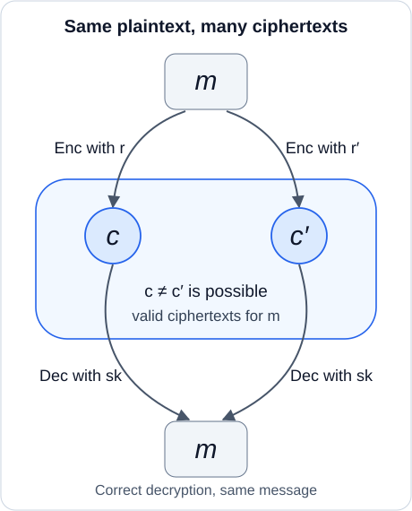

## 필기 원본

이 글에서 다룬 원본 PDF **18–23쪽**이다. 두 단과 여백 필기를 포함한 페이지 전체를 실었다. 이미지를 누르면 확대해서 볼 수 있다.

<figure style="margin: 2rem 0;">
  
  <figcaption>원본 PDF 18쪽.</figcaption>
</figure>

<figure style="margin: 2rem 0;">
  
  <figcaption>원본 PDF 19쪽.</figcaption>
</figure>

<figure style="margin: 2rem 0;">
  
  <figcaption>원본 PDF 20쪽.</figcaption>
</figure>

<figure style="margin: 2rem 0;">
  
  <figcaption>원본 PDF 21쪽.</figcaption>
</figure>

<figure style="margin: 2rem 0;">
  
  <figcaption>원본 PDF 22쪽.</figcaption>
</figure>

<figure style="margin: 2rem 0;">
  
  <figcaption>원본 PDF 23쪽.</figcaption>
</figure>

## 들어가며

[앞 글](/posts/ai-security-lwe-public-key-encryption-and-ring-lwe/)에서는 LWE와 Ring-LWE 공개키 암호의 키 생성, 암호화, 복호화를 전개했다. 이제 암호화한 데이터를 복호화하기 전에 계산하는 **동형암호**(homomorphic encryption, HE)로 넘어간다.

**정리 범위는 원본 PDF의 18–23쪽이다.** 준동형의 수학적 의미, 동형암호의 비형식적·형식적 정의, 정확성, 공개키 암호의 IND-CPA 실험, 공개 평가 연산과 안전성의 관계, 이후의 학습 흐름을 원문 순서에 따라 정리한다.

원문의 예제는 그대로 옮기고 추가 예제는 따로 표시한다. 함수 입력, 메시지 길이 조건, 평가키를 포함한 안전성의 전제를 보충한다. 원문에 생략된 compactness와 HE의 지원 범위 구분도 별도 보충으로 다룬다.

## 1. 준동형: 연산의 구조를 보존하는 사상

### 1.1 집합과 연산을 함께 본다

대수적 구조를 생각할 때는 원소가 모인 집합과 그 위의 연산을 함께 본다. 예를 들어

$$
(\mathbb Z,+),\qquad (\mathbb R,\times)
$$

처럼 쓸 수 있다. 군, 환, 체는 지정된 연산들이 각각의 공리를 만족하는 대수적 구조다.

같은 집합에 다른 연산을 지정하면 보존해야 하는 성질도 달라진다. 따라서 어떤 함수가 준동형인지를 판단하려면 **어떤 구조 사이에서 어떤 연산을 보존하는지**를 명시해야 한다.

여기서는 우선 두 구조의 이항연산 하나씩을 비교한다. 환의 준동형을 논할 때는 덧셈과 곱셈을 함께 보존하는지 확인해야 한다.

### 1.2 준동형의 정의

같은 종류의 대수적 구조에서 보존할 연산을 지정하자. 두 구조 $(A,*)$, $(B,\circ)$ 사이의 사상

$$
f:A\longrightarrow B
$$

가 모든 $a,b\in A$에 대해

$$
f(a*b)=f(a)\circ f(b)
$$

를 만족하면, $f$는 지정된 연산을 보존하는 준동형이다.

왼쪽은 $A$에서 먼저 계산한 뒤 $f$를 적용한다. 오른쪽은 각 원소에 $f$를 적용한 뒤 $B$에서 계산한다. 두 경로의 결과가 같다는 뜻이다.

정의역과 공역에서 사용하는 연산 기호가 같을 필요는 없다. 덧셈을 곱셈에 대응시키는 사상도 가능하다.

### 1.3 원문 예제: 같은 함수도 연산에 따라 달라진다

먼저

$$
f:(\mathbb Z,+)\longrightarrow(\mathbb Z,+),
\qquad f(x)=2x
$$

를 보자. 모든 $a,b\in\mathbb Z$에 대해

$$
\begin{aligned}
f(a+b)
&=2(a+b)\\
&=2a+2b\\
&=f(a)+f(b)
\end{aligned}
$$

이므로 덧셈을 보존한다.

이번에는 같은 함수가 곱셈도 보존하는지 확인한다.

$$
f:(\mathbb Z,\times)\longrightarrow(\mathbb Z,\times),
\qquad f(x)=2x.
$$

양쪽을 전개하면

$$
f(ab)=2ab,\qquad f(a)f(b)=4ab.
$$

모든 $a,b$에서 같아야 한다는 조건을 만족하지 않는다. 검산으로 $a=b=1$을 대입하면 각각 $2$와 $4$다. 따라서 이 함수는 곱셈을 보존하지 않는다.

### 1.4 원문 예제: 덧셈을 곱셈에 대응시키는 지수함수

$$
g:(\mathbb R,+)\longrightarrow(\mathbb R_{>0},\times),
\qquad g(x)=e^x.
$$

모든 $x,y\in\mathbb R$에 대해

$$
\begin{aligned}
g(x+y)
&=e^{x+y}\\
&=e^xe^y\\
&=g(x)g(y).
\end{aligned}
$$

정의역의 덧셈이 공역의 곱셈으로 이어진다. 여기서 $\mathbb R_{>0}$는 양의 실수 집합이다.

## 2. 암호화한 상태에서 계산한다는 의미

동형암호에서는 평문의 연산에 대응하는 암호문 연산을 제공한다. 키를 잠시 생략하면 원문의 두 식은 다음과 같다.

$$
\operatorname{Dec}\bigl(
\operatorname{Enc}(m_1)\oplus\operatorname{Enc}(m_2)
\bigr)=m_1+m_2,
$$

$$
\operatorname{Dec}\bigl(
\operatorname{Enc}(m_1)\odot\operatorname{Enc}(m_2)
\bigr)=m_1m_2.
$$

$\oplus$, $\odot$는 각각 평문의 덧셈과 곱셈에 대응하는 암호문 연산을 나타낸다. 실제 구현이 암호문 성분의 단순 덧셈·곱셈인지는 구성에 따라 다르다.

계산을 맡은 서버는 비밀키 없이 암호문을 입력받아 새 암호문을 만든다. 비밀키를 가진 사용자가 결과를 복호화하면, 평문을 직접 계산했을 때의 결과를 얻는다. 정확성의 실패 확률과 지원하는 계산의 범위는 뒤에서 명시한다.

또한 $+$와 $\times$는 **해당 평문 공간의 연산**이다. 예를 들어 평문 공간이 $\mathbb Z_t$라면 결과는 법 $t$의 값이다.

### 추가 예제: 평문 공간의 법도 계산에 포함된다

평문 공간을 $\mathbb Z_{17}$로 두고 $m_1=12$, $m_2=9$라고 하자.

$$
12+9=21\equiv4\pmod{17},
$$

$$
12\cdot9=108\equiv6\pmod{17}.
$$

이 경우 덧셈 결과 암호문을 복호화하면 $4$, 곱셈 결과 암호문을 복호화하면 $6$을 얻어야 한다. 정수 $21$, $108$을 그대로 복원하는 문제와는 평문 표현이 다르다.

## 3. 암호문 자체가 같을 필요는 없다

원문은 왜 다음과 같은 암호문 자체의 등식을 정의로 쓰지 않는지 묻는다.

$$
\operatorname{Enc}(m_1+m_2)
\stackrel{?}{=}
\operatorname{Enc}(m_1)\oplus\operatorname{Enc}(m_2).
$$

암호화는 난수를 사용하는 알고리즘이다. 난수를 명시하면

$$
c=\operatorname{Enc}_{pk}(m;r),\qquad
c'=\operatorname{Enc}_{pk}(m;r')
$$

처럼 쓸 수 있다. 같은 평문 $m$을 암호화해도 서로 다른 암호문 $c\ne c'$가 나올 수 있다. 두 암호문이 정상적으로 복호화되면

$$
\operatorname{Dec}_{sk}(c)
=\operatorname{Dec}_{sk}(c')=m.
$$

*원문 19쪽의 스케치를 다시 그렸다. 같은 평문으로 복호화되는 암호문이 여러 개일 수 있다. 그림은 정상적으로 복호화되는 경우를 나타낸다.*

따라서 동형 연산의 기본 요구는 결과 암호문을 복호화했을 때 원하는 평문을 얻는 것이다. 새로 암호화한 결과와 동형 연산으로 얻은 결과가 같은 비트열이어야 한다는 조건은 없다. 두 결과의 암호문 분포가 같아야 한다는 조건도 동형 정확성의 등식만으로 따라오지 않는다.

### 결정적 공개키 암호가 표준 IND-CPA를 만족할 수 없는 이유

암호화가 결정적이라고 가정하자. 공격자는 공개키로 서로 다른 후보 메시지 $m_0,m_1$을 직접 암호화할 수 있다.

$$
c_0=\operatorname{Enc}_{pk}(m_0),\qquad
c_1=\operatorname{Enc}_{pk}(m_1).
$$

도전 암호문이 $c_0$와 같은지 비교하면 어느 후보를 암호화했는지 알아낼 수 있다. 두 메시지가 정확히 복호화되는 키에서는 $c_0=c_1$일 수 없다. 같은 암호문이 서로 다른 두 메시지로 복호화되어야 하기 때문이다.

따라서 이 표준 실험에서 안전한 공개키 암호는 암호화의 결정성을 허용할 수 없다. 실패 확률이 negligible인 구성에서도 이 공격의 성공 확률은 $1$에 가깝다. IND-CPA 실험 자체는 7절에서 정의한다.

## 4. 덧셈·곱셈에서 회로 전체로

원문은 산술 연산 $(+,\times)$ 또는 비트 연산 AND, OR, NOT으로 만든 회로를 암호화된 상태에서 계산하는 것으로 설명한다.

평문 회로를 $C$, 이에 대응하는 암호문 계산을 $C'$라고 하면

$$
\operatorname{Dec}_{sk}\bigl(
C'(\operatorname{Enc}_{pk}(m_1),\ldots,
\operatorname{Enc}_{pk}(m_t))
\bigr)
=C(m_1,\ldots,m_t).
$$

여기서 $t$는 입력 메시지의 개수다. 앞 글의 격자 차원이나 다항식 차원과 구별하기 위해 입력 개수에 다른 문자를 사용한다.

형식적 정의에서는 $C'$를 매번 별도 알고리즘으로 만들기보다, 공개 알고리즘 $\operatorname{Eval}$에 계산할 회로를 입력한다.

**지원하는 회로의 범위도 명시해야 한다.** 일반적인 HE는 지정한 함수·회로 가족 $\mathcal F$에 대해 정의한다. 원문의 “임의의 회로”를 모두 지원한다는 설명은, 필요한 효율성과 compactness까지 갖추면 완전동형암호(FHE)에 해당한다.

덧셈만 반복해서 지원하는 것은 부분동형암호(PHE)의 한 예다. 부분동형암호에는 곱셈을 지원하는 경우도 있으므로, PHE를 덧셈 전용이라는 뜻으로 한정하지 않는다.

## 5. 동형암호의 네 알고리즘

평문 공간 $\mathcal M$에 대한 동형암호를 원문처럼

$$
\mathcal E=
(\operatorname{KeyGen},\operatorname{Enc},
\operatorname{Eval},\operatorname{Dec})
$$

로 쓴다.

이 알고리즘들은 확률적 다항 시간(PPT, probabilistic polynomial time) 알고리즘이다. 난수 사용을 허용하며, 실행 시간이 보안 매개변수와 적절한 입력 길이에 대해 다항식으로 제한된다는 뜻이다. 결정적 알고리즘도 그 특수한 경우에 포함된다.

Eval은 입력받은 회로를 처리하므로 회로의 크기도 실행 시간의 입력 규모에 포함한다.

### 5.1 KeyGen

$$
(sk,pk,evk)\leftarrow
\operatorname{KeyGen}(1^\lambda).
$$

- $\lambda$: 보안 매개변수.
- $sk$: 복호화에 사용하는 비밀키.
- $pk$: 암호화에 사용하는 공개키.
- $evk$: 동형 연산에 사용하는 공개 평가키(evaluation key).

$1^\lambda$는 길이가 $\lambda$인 단항 표현이다. 공개 평가키는 key switching, relinearization 등에서 사용하는 보조 정보를 포함할 수 있다. 구체적인 내용은 암호 구성에 따라 다르다.

### 5.2 Enc와 Dec

$$
c\leftarrow\operatorname{Enc}_{pk}(m),
\qquad m\in\mathcal M,
$$

$$
m'\leftarrow\operatorname{Dec}_{sk}(c).
$$

원문의 $\operatorname{Enc}(m,pk)$, $\operatorname{Dec}(c,sk)$와 같은 역할이다. 이 글에서는 키를 아래첨자에 놓아 수식을 간결하게 쓴다.

### 5.3 Eval

$$
c'\leftarrow
\operatorname{Eval}_{pk,evk}
(f;c_1,\ldots,c_t).
$$

Eval은 계산할 함수 또는 회로 $f$, 입력 암호문들, 필요한 공개정보를 받아 결과 암호문 $c'$를 출력한다.

**계산할 함수도 입력의 일부다.** 원문 19쪽 첫 알고리즘 목록에는 이 입력이 생략되어 있지만, 같은 쪽의 후속 설명과 20쪽 정확성 식에는 함수가 등장한다. 이를 반영해 $f$를 명시했다.

문헌에서는 필요한 공개키 정보를 평가키에 포함하거나 암묵적으로 둘 수도 있다. 여기서는 $pk$와 $evk$를 모두 표시한다. Eval을 실행하는 쪽에 $sk$를 주지 않는다.

## 6. 정확성: 어떤 결과가 나와야 하는가

### 6.1 기본 정확성

모든 적법한 메시지 $m\in\mathcal M$에 대해

$$
\Pr\!\left[
\operatorname{Dec}_{sk}
\bigl(\operatorname{Enc}_{pk}(m)\bigr)
\ne m
\right]
\le\operatorname{negl}(\lambda).
$$

암호화하고 곧바로 복호화했을 때 메시지를 복원해야 한다. 확률은 키 생성, 암호화 및 해당 구성의 다른 확률적 절차에서 사용하는 난수에 대해 취한다.

$\operatorname{negl}(\lambda)$는 negligible 함수다. 모든 상수 $d>0$에 대해 충분히 큰 $\lambda$에서

$$
\operatorname{negl}(\lambda)<\lambda^{-d}
$$

가 성립한다. 보안 매개변수가 커지면 어떤 역다항식보다도 빠르게 작아진다.

### 6.2 동형 정확성

지원하는 함수 가족을 $\mathcal F$라고 하자. 각 함수는 적절한 입력 개수 $t$에 대해

$$
f:\mathcal M^t\longrightarrow\mathcal M
$$

로 작용한다. 출력이 여러 메시지인 경우에는 그에 맞게 일반화할 수 있다.

입력 메시지들을 각각 새 난수로 암호화한다.

$$
\mathbf m=(m_1,\ldots,m_t),\qquad
c_i\leftarrow\operatorname{Enc}_{pk}(m_i),
$$

$$
\mathbf c=(c_1,\ldots,c_t).
$$

지원 범위 안의 모든 적법한 $f\in\mathcal F$와 $\mathbf m$에 대해

$$
\Pr\!\left[
\operatorname{Dec}_{sk}\bigl(
\operatorname{Eval}_{pk,evk}(f;\mathbf c)
\bigr)
\ne f(\mathbf m)
\right]
\le\operatorname{negl}(\lambda)
$$

가 성립하면 $\mathcal E$를 $\mathcal F$-homomorphic이라고 한다. 확률에는 평가 과정의 난수도 포함한다.

지원하는 회로의 크기·깊이, 입력 길이와 매개변수 조건은 이 정의를 적용하는 범위에 들어간다. 특정한 계산 한 번의 성공을 확인하는 것만으로 함수 가족 전체의 정확성이 증명되지는 않는다.

### 6.3 실패 확률과 격자 암호의 오차

앞 글의 Ring-LWE 암호에서는 복호화 후 메시지에 작은 오차가 더해졌다. 동형 연산을 계속하면 오차가 커져 복호화 경계를 넘을 수 있다.

정해진 계산 범위에서 그런 일이 일어날 확률을 negligible하게 만드는 것이 매개변수 선택의 일부다. 정확성 정의가 실패 확률 $0$만 허용하는 것은 아니며, 구성이 완전한 정확성을 제공할 수도 있다.

원문의 bootstrapping 메모는 이 오차 증가와 연결된다. 적절한 조건에서 암호문을 갱신해 후속 계산을 가능하게 하는 방법이며, 10절에서 학습 흐름과 함께 다시 언급한다.

지금의 등식은 **정확한 평문 연산을 지원하는 기본 정의**다. 이후 실수 근삿값을 다루는 동형암호에서는 의도한 수치와 복호화·디코딩 결과 사이의 허용 오차도 명시해야 한다. 이 오차 허용과 negligible한 복호화 실패 확률은 구별해서 다룬다.

### 6.4 안전성은 별도로 요구한다

정확성은 원하는 계산 결과를 얻는 성질이고, 안전성은 공격자가 평문을 구별하지 못하는 성질이다. 정확한 계산이 된다는 사실만으로 평문이 숨겨지지는 않는다.

원문은 안전성을 underlying PKE의 IND-CPA로 설명한다. 이 주장을 정확하게 읽으려면 먼저 IND-CPA 실험을 정의하고, 공개 평가키까지 포함한 공격자의 공개정보를 확인해야 한다.

## 7. 공개키 암호와 IND-CPA 실험

### 7.1 공개키 암호의 세 알고리즘

일반 공개키 암호는

$$
\Pi=(\operatorname{Gen},\operatorname{Enc},\operatorname{Dec})
$$

로 나타낸다.

$$
(sk,pk)\leftarrow\operatorname{Gen}(1^\lambda),
$$

$$
c\leftarrow\operatorname{Enc}_{pk}(m),\qquad
m'\leftarrow\operatorname{Dec}_{sk}(c).
$$

공개키로 암호화하고 비밀키로 복호화한다. 공개키는 공격자에게도 공개된다.

### 7.2 도전자와 공격자의 실험

공격자를 $\mathcal A$라 하고, 원문처럼 실험을

$$
\operatorname{PubK}^{\mathrm{CPA}}_{\mathcal A,\Pi}(\lambda)
$$

로 표기하자.

| 단계 | 도전자(challenger) | 공격자 $\mathcal A$ |
| --- | --- | --- |
| 1 | 키 쌍 $(sk,pk)$를 생성하고 $pk$를 보낸다. | 공개키 $pk$를 받는다. |
| 2 | 후보 메시지 두 개를 받는다. | 적법한 $m_0,m_1$을 골라 보낸다. 두 메시지의 길이는 같다. |
| 3 | $b\xleftarrow{\mathrm U}\{0,1\}$을 뽑고 $c^*\leftarrow\operatorname{Enc}_{pk}(m_b)$를 보낸다. | 도전 암호문 $c^*$를 받는다. |
| 4 | 추측 비트를 받는다. | 공개정보와 $c^*$를 사용해 $b'\in\{0,1\}$을 출력한다. |
| 5 | $b'=b$이면 실험 결과 $1$, 아니면 $0$을 출력한다. | $b$를 맞히면 승리한다. |

원문은 서로 다른 두 메시지를 선택한다. 표준 게임에서 두 메시지가 같아도 제출 자체는 가능하지만 구별할 내용이 없으므로, 공격을 설명할 때는 $m_0\ne m_1$을 생각하면 된다.

**길이가 같다는 조건은 원문에 보충했다.** 일반적인 암호가 허용하는 메시지 길이 노출만으로 후보를 구별하는 상황을 배제하기 위한 조건이다.

공격자는 두 후보 메시지를 모두 안다. 모르는 것은 도전자가 선택한 비트 $b$이며, 비밀키 $sk$는 받지 않는다.

### 7.3 선택 평문 공격에서 허용하는 계산

공격자는 공개키를 사용해 자신이 고른 메시지를 여러 번 암호화할 수 있다. 공개키 설정에서는 암호화 알고리즘을 스스로 실행할 수 있으므로, 같은 기능만 제공하는 별도 암호화 오라클은 필요하지 않다.

도전 암호문을 받은 뒤에도 공개 알고리즘으로 다항 시간 계산을 수행할 수 있다. 이 실험은 공격자에게 복호화 오라클을 주지 않는다.

아무 정보도 활용하지 않고 독립적인 균등 비트를 출력하면

$$
\Pr[b'=b]=\frac12.
$$

안전성을 깨는 공격은 이 기준보다 유의미하게 높은 성공 확률을 얻어야 한다.

## 8. IND-CPA 안전성의 정의

모든 PPT 공격자 $\mathcal A$에 대해 어떤 negligible 함수가 존재하여

$$
\Pr\!\left[
\operatorname{PubK}^{\mathrm{CPA}}_{\mathcal A,\Pi}(\lambda)=1
\right]
\le\frac12+\operatorname{negl}(\lambda)
$$

이면 $\Pi$를 IND-CPA 안전하다고 한다.

확률은 키 생성, 도전 비트, 암호화 난수, 공격자 자신의 난수에 대해 취한다. 특정 공격자 하나가 실패하는 것으로 충분하지 않고, 허용한 모든 PPT 공격자에 대한 요구다.

### 8.1 성공 확률과 advantage

이 글에서는 advantage를

$$
\operatorname{Adv}^{\mathrm{IND\text{-}CPA}}_{\Pi}(\mathcal A)
=\left|\Pr[b'=b]-\frac12\right|
$$

로 정의한다. 문헌에 따라 이 값의 두 배를 쓰기도 하므로 정의를 함께 확인한다.

원문은 성공 확률의 상한으로 정의한다. 모든 PPT 공격자를 대상으로 하기 때문에 이 정의로도 아래쪽 편차를 제한할 수 있다. 성공 확률이 $1/2$보다 유의미하게 낮은 공격자의 출력을 뒤집으면, 같은 만큼 높은 성공 확률을 얻기 때문이다.

### 8.2 원문의 확률 예제

$$
\Pr[b'=b]=\frac12+0.1
$$

이면 advantage가 상수 $0.1$이다. 보안 매개변수가 커져도 사라지지 않으므로 안전성 조건을 위반한다.

반면

$$
\Pr[b'=b]=\frac12+2^{-\lambda}
$$

의 추가 성공 확률은 negligible하다. 충분히 큰 보안 매개변수를 논하는 점근적 예제다.

**추가 설명:** $\lambda^{-100}$처럼 큰 차수의 역다항식은 작은 값일 수 있어도 negligible 함수는 아니다. 예를 들어 $\lambda^{-101}$보다 결국 작아진다는 조건을 만족하지 못한다.

### 8.3 계산적 구별 불가능성

IND는 indistinguishability, 즉 구별 불가능성을 뜻한다. 원문의 직관적 표기는

$$
\operatorname{Enc}_{pk}(m_0)
\approx_c
\operatorname{Enc}_{pk}(m_1)
$$

이다.

두 암호문이 실제로 같다는 뜻은 아니다. 공격자가 공개키와 자신의 상태를 가진 채 두 경우를 다항 시간에 구별하기 어렵다는 뜻이다. 후보 메시지를 공개키를 본 뒤 고를 수 있다는 조건도 위 실험에 포함된다.

## 9. 공개 동형 연산이 있어도 IND-CPA를 쓰는 이유

### 9.1 공개 계산은 원래 공격자의 능력에 포함된다

IND-CPA의 공격자는 암호문을 바라보기만 하는 존재가 아니다. 공개정보와 도전 암호문을 입력으로 임의의 PPT 계산을 실행할 수 있다.

예를 들어 공개된 계산 절차를 $g$라고 쓰면

$$
z\leftarrow g(pk,c^*)
$$

를 계산하는 것도 허용한다. HE에서는 평가키도 공개되므로

$$
z\leftarrow g(pk,evk,c^*)
$$

를 고려해야 한다.

Eval이 이 공개정보만으로 실행 가능한 다항 시간 알고리즘이라면, 공격자는 원래부터 직접 실행할 수 있다. Eval이라는 이름의 기능을 제공하는 것이 비밀키를 사용하는 새로운 복호화 오라클을 제공하는 것은 아니다.

이는 원문 23쪽의 큰 공격 집합 안에 동형 연산을 그려 넣은 그림의 의미다. 공개 Eval을 이용하는 공격도 모든 PPT 공격에 포함된다.

### 9.2 보충: 평가키까지 포함한 공개정보가 안전해야 한다

여기에는 중요한 전제가 있다. **공격자에게 실제로 공개하는 전체 정보에 대해 IND-CPA 안전성을 증명해야 한다.**

HE의 실험에서는 키 생성 결과 중 $(pk,evk)$를 공격자에게 준다. $pk$만 공개하는 PKE의 안전성을 증명한 뒤, 새로 공개할 $evk$의 영향을 생략할 수는 없다.

특히 평가키가 비밀키에 의존한 메시지의 암호화를 포함하는 구성에서는 그 보조 정보도 안전성 증명으로 다루어야 한다. 일반적인 IND-CPA에서 순환 보안이나 키 의존 메시지(KDM) 보안이 자동으로 따라오는 것은 아니다. 이에 관한 구분과 반례는 Alamati·Peikert의 [Three’s Compromised Too, Introduction](https://web.eecs.umich.edu/~cpeikert/pubs/circinsec.pdf)에서 확인할 수 있다.

구성에 따라 별도의 환원이나 추가 가정으로 이 부분을 다룬다. 모든 HE가 동일한 순환 보안 가정을 필요로 한다는 뜻은 아니다.

따라서 원문 20–23쪽의 주장은 다음처럼 조건을 붙여 읽는다.

> 평가키를 포함한 공개정보에 대해 이미 IND-CPA 안전한 암호에, 그 공개정보만 사용하는 다항 시간 평가 계산을 허용하는 것은 공격자의 기존 계산 능력에 포함된다.

### 9.3 공개 Eval을 사용하는 공격의 환원

평가키까지 포함한 공개정보에 대해 안전성을 가정하자. 이 실험의 공격자 $\mathcal B$는 다음처럼 Eval을 사용하는 공격자 $\mathcal A$를 실행할 수 있다.

1. 도전자로부터 받은 공개정보 $(pk,evk)$를 $\mathcal A$에 전달한다.
2. $\mathcal A$가 선택한 $(m_0,m_1)$을 도전자에게 전달한다.
3. 받은 도전 암호문 $c^*$를 $\mathcal A$에 전달한다.
4. $\mathcal A$가 요구하는 공개 Eval을 같은 공개정보로 실행한다.
5. $\mathcal A$의 추측 비트를 그대로 출력한다.

$\mathcal A$의 실행 시간과 평가 호출 수가 다항식으로 제한되면 $\mathcal B$도 PPT다. 공개 계산을 그대로 재현하므로 두 공격자의 승리 확률은 같다.

$$
\Pr[\mathcal B\text{ wins}]
=\Pr[\mathcal A\text{ wins}].
$$

따라서 공개 Eval로 유의미한 구별 이점을 얻는 공격이 있다면, 공개정보 전체를 제공하는 원래 IND-CPA 실험에도 그런 공격이 존재한다. 이 논증은 평가키를 새로 공개해도 괜찮다는 증명을 대신하지 않으며, 안전한 공개정보를 이용한 계산을 다룬다.

### 9.4 원문 예제: 암호문을 제곱할 수 있다면?

공격자가

$$
c^*\leftarrow\operatorname{Enc}_{pk}(m_b)
$$

를 받았다고 하자. 곱셈을 지원한다면

$$
c'\leftarrow
\operatorname{Eval}_{pk,evk}
(f_{\mathrm{sq}};c^*),
\qquad f_{\mathrm{sq}}(x)=x^2
$$

를 계산할 수 있다. 이는 같은 암호문 두 개를 입력으로 곱셈을 평가하는 것과 같은 평문 함수를 계산한다.

동형 정확성에 의해, 허용된 실패 확률을 제외하면

$$
\operatorname{Dec}_{sk}(c')=m_b^2.
$$

공격자가 만든 것은 $m_b^2$의 **암호문**이다. 비밀키 없이 이 암호문을 만들 수 있다는 사실이 복호화 결과까지 알려 주지는 않는다.

**추가 수치 예제:** $\mathbb Z_{17}$에서 후보를 $m_0=2$, $m_1=3$으로 정하면 $c'$의 평문 후보는 $4$, $9$다. 공격자는 이 후보들도 계산할 수 있다. 어느 후보가 실제로 암호화되어 있는지를 구별하는 능력은 여전히 IND-CPA 게임이 제한한다.

### 9.5 이 논의의 안전성 범위

지금 다룬 실험에서는 공격자에게 비밀키나 도전 암호문의 복호화 결과를 제공하지 않는다. 복호화 결과·오류 등을 공격자에게 돌려주는 인터페이스가 생기면 그 정보를 포함한 모델을 별도로 분석해야 한다. NIST의 [FHE 설명 중 IND-CPA-D 항목](https://csrc.nist.gov/Projects/pec/fhe)도 이 구분을 다룬다.

또한 정직하게 Eval을 실행했을 때의 정확성이 서버의 부정한 계산까지 검증해 주는 것은 아니다. 기밀성, 동형 정확성, 계산 결과의 검증은 서로 다른 요구다.

## 10. Ring-LWE에서 완전동형암호와 머신러닝으로

원문 23쪽은 지금까지의 내용과 앞으로의 내용을 다음 순서로 연결한다.

1. **LWE:** 오차가 섞인 선형 관계의 판정·탐색 난해성을 출발점으로 삼는다.
2. **Ring-LWE:** 행렬의 선형변환을 구조화된 다항식 연산으로 표현해 공개키와 계산 표현을 줄인다.
3. **IND-CPA 안전한 Ring-LWE PKE:** 선택한 Ring-LWE 가정과 매개변수 아래 공개키 암호를 구성한다.
4. **동형 곱셈과 데이터 인코딩:** 암호문에서 계산하는 방법과 실제 데이터를 평문 공간에 담는 방법을 마련한다.
5. **Ring-LWE 기반 leveled HE:** 미리 정한 계산 깊이에 맞추어 계산을 지원한다.
6. **Bootstrapping:** 적절한 조건에서 암호문을 갱신해 계산을 이어 갈 수 있게 한다.
7. **Ring-LWE 기반 FHE:** 완전동형 연산으로 연결한다.
8. **머신러닝에 적용:** 지원하는 연산으로 모델의 계산을 표현한다.
9. **Privacy-preserving machine learning:** 암호화한 데이터의 계산을 개인정보를 보호하는 머신러닝에 활용한다.

이는 이 강의에서 따르는 구성의 흐름이다. 모든 동형암호가 Ring-LWE를 사용하거나, 모든 leveled HE가 bootstrapping을 실행해야 한다는 분류는 아니다.

### 10.1 보충: 지원 범위에 따른 구분

| 구분 | 이 글에서의 의미 |
| --- | --- |
| HE | 지정한 함수·회로 가족 $\mathcal F$에 대한 암호문 계산을 지원한다. |
| PHE | 덧셈 또는 곱셈처럼 제한된 연산 종류를 반복해서 지원하는 형태다. |
| Leveled HE | 계산 깊이의 상한 $L$을 미리 정하고, 그 범위에 맞춰 매개변수·키 등을 설정한다. |
| FHE | 특정 깊이 상한을 계산마다 키 생성에 미리 고정하지 않고, 임의의 다항 크기 회로에 대해 동형 계산과 compactness를 제공한다. |

Leveled HE의 깊이 입력을 드러내려면 키 생성을

$$
\operatorname{KeyGen}(1^\lambda,1^L)
$$

처럼 쓸 수 있다. 여기서 다항 시간에는 $L$도 반영된다. 단순한 연산 개수와 회로의 깊이는 다르며, 격자 기반 산술 HE에서는 특히 곱셈 깊이가 오차·수준 관리에 중요하다.

이러한 leveled/FHE 구분과 bootstrapping의 연결은 Gentry의 [Fully Homomorphic Encryption Using Ideal Lattices, Section 1](https://www.cs.cmu.edu/~odonnell/hits09/gentry-homomorphic-encryption.pdf)을 참고했다.

### 10.2 보충: 정확성 외에 compactness가 필요한 이유

동형 정확성의 등식만 요구하면 계산을 사용자에게 그대로 미루는 방식도 생각할 수 있다. Eval이 단지

$$
c'=(f,c_1,\ldots,c_t)
$$

를 반환하고, 복호화 알고리즘이 각 $c_i$를 복호화한 뒤 $f$를 직접 계산하도록 만들면 등식 자체는 만족할 수 있다. 이때 결과의 크기와 복호화 비용이 회로와 입력 전체에 의존한다.

그래서 FHE의 표준적인 정의에는 **compactness**가 들어간다. 고정된 출력 길이에 대해 평가된 암호문의 크기와 복호화 비용이 회로 크기와 무관하게 보안 매개변수의 다항식으로 제한되어야 한다. 여러 출력이 있으면 그 출력 길이도 반영한다.

Eval 자체의 실행 시간은 회로 크기에 의존할 수 있다. 회로를 평가하는 비용과 결과를 돌려받아 복호화하는 비용을 구분하는 조건이다. 이 보충은 Gentry 등의 [Using Fully Homomorphic Hybrid Encryption to Minimize Non-Interactive Zero-Knowledge Proofs, Section 2.1](https://sites.cc.gatech.edu/fac/cpeikert/pubs/FHENIZK.pdf)의 정의와 함께 확인했다.

### 10.3 Bootstrapping과 머신러닝의 연결

Bootstrapping은 암호화된 비밀키 정보 등을 이용해 **복호화 회로 자체를 동형적으로 평가**하여, 같은 메시지를 담으면서 추가 계산에 적합한 암호문을 얻는 기법이다. 갱신이 가능한 오차 범위와 회로 평가 능력, 공개 보조 정보의 안전성 조건이 함께 필요하다. 서버에 평문이나 비밀키를 직접 제공하는 절차가 아니다.

이후 머신러닝에 적용하려면 데이터 인코딩, 모델의 연산 표현, 수치 오차와 계산 비용을 함께 다룬다. 암호화한 입력으로 추론하고 결과도 암호문으로 돌려주는 구성이 그 활용 예다.

다음 글은 원문 24쪽부터 이어진다. 실수 값을 정수 계수 다항식으로 옮기고, 스케일을 둔 암호화·복호화와 덧셈·곱셈에서 어떤 오차가 남는지 살펴본다.

## 참고 자료

- 원본 필기 PDF 18–23쪽: 본문의 정의, 세 가지 준동형 예제, 확률 예제, IND-CPA 실험, 제곱 연산 예제와 학습 흐름의 기준 자료.
- Craig Gentry, [Fully Homomorphic Encryption Using Ideal Lattices](https://www.cs.cmu.edu/~odonnell/hits09/gentry-homomorphic-encryption.pdf), Section 1: 동형성·효율성, leveled/FHE, bootstrapping과 키 의존 메시지의 구분.
- Craig Gentry et al., [Using Fully Homomorphic Hybrid Encryption to Minimize Non-Interactive Zero-Knowledge Proofs](https://sites.cc.gatech.edu/fac/cpeikert/pubs/FHENIZK.pdf), Section 2.1: FHE 알고리즘과 compactness의 정의.
- Navid Alamati, Chris Peikert, [Three’s Compromised Too: Circular Insecurity for Any Cycle Length from (Ring-)LWE](https://web.eecs.umich.edu/~cpeikert/pubs/circinsec.pdf), Introduction: 일반 IND-CPA와 순환·KDM 보안의 구별.
- NIST, [Fully-Homomorphic Encryption](https://csrc.nist.gov/Projects/pec/fhe), FHE Conceptualization: 암호문 평가의 의미와 복호화 정보가 노출되는 모델의 구별.
