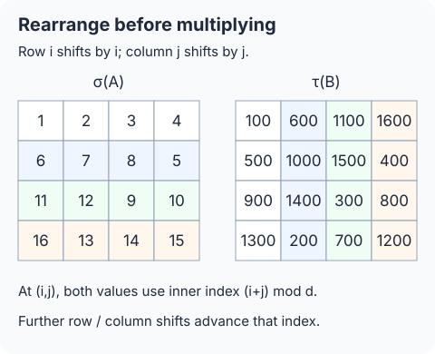
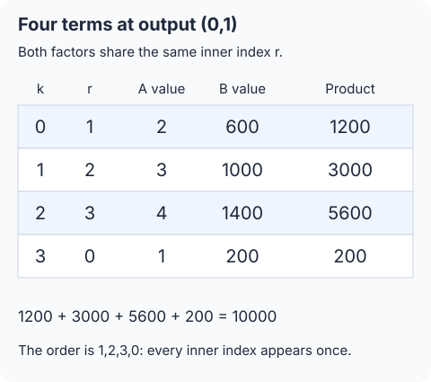
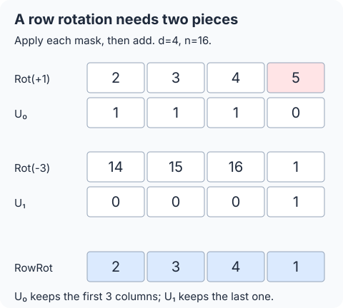

## 필기 원본

이 글에서 다룬 원본 PDF **44–45쪽**이다. 두 단과 여백 필기를 포함한 페이지 전체를 실었다. 이미지를 누르면 확대해서 볼 수 있다.

<figure style="margin: 2rem 0;">
  
  <figcaption>원본 PDF 44쪽.</figcaption>
</figure>

<figure style="margin: 2rem 0;">
  
  <figcaption>원본 PDF 45쪽.</figcaption>
</figure>

## 들어가며

[앞 글](/posts/ai-security-homomorphic-convolution-rotations-masks-and-channels/)에서는 공개된 커널을 암호화된 입력과 곱했다. 이번에는 **두 입력 행렬이 모두 암호화된 경우**다. 행렬곱의 한 출력에는 한 행과 한 열의 내적이 필요하다. 데이터를 먼저 재배치하면, 같은 슬롯에 그 내적의 두 피연산자를 놓고 모든 출력 위치를 동시에 계산할 수 있다.

**정리 범위는 원본 PDF 44~45쪽의 Homomorphic Matrix Multiplication 단원 전체다.** 슬라이드 25–35와 두 쪽의 관련 필기를 포함한다. 행·열 순환이동, 네 재배치 연산, 평문 마스크를 이용한 구현, BSGS와 전체 회전 횟수를 옮긴다. 원문의 표기 오류는 올바른 식과 구별해 11절에 기록한다.

## 1. 같은 슬롯끼리 곱하면 행렬곱이 되는가

### 1.1 필요한 것은 한 행과 한 열의 내적이다

$A,B\in\mathbb R^{d\times d}$의 행렬곱을 $C=AB$라 하자. 원하는 출력은

$$
C_{i,j}=\sum_{r=0}^{d-1}A_{i,r}B_{r,j}.
$$

반면 같은 슬롯의 값을 바로 곱하면

$$
(A\odot B)_{i,j}=A_{i,j}B_{i,j}
$$

이다. $\odot$는 성분별 곱, 즉 Hadamard product다. 원문 도식의 곱 기호도 이 계산 내용에 맞춰 $\odot$로 통일한다.

행렬곱을 만들려면 **서로 다른 위치에 있는 값들을 같은 출력 슬롯으로 가져온 뒤, 필요한 곱을 더해야 한다.**

### 1.2 원문이 attention을 예로 드는 이유

원문의 동기는 Transformer의 attention이다.

$$
\operatorname{Attention}(Q,K,V)
=\operatorname{softmax}\!\left(\frac{QK^{\mathsf T}}{\sqrt{d_k}}\right)V.
$$

$d_k$는 query와 key의 차원이다. 이 식은 원 논문의 scaled dot-product attention과 같다. [Vaswani et al., §3.2.1](https://arxiv.org/pdf/1706.03762)

$Q,K,V$를 암호화해 평가하는 설정에서는 $QK^{\mathsf T}$ 같은 계산에 두 암호문의 곱이 필요하다. 여기서는 그 행렬곱의 구성을 다룬다. softmax까지 이 단원의 선형 재배치만으로 계산한다는 뜻은 아니다.

### 1.3 원문 필기의 숫자를 고정한다

필기에 등장하는 $1$부터 $16$까지의 행렬과, 그 $100$배 값을 쓰는 행렬을 사용하자.

$$
A=\begin{pmatrix}
1&2&3&4\\
5&6&7&8\\
9&10&11&12\\
13&14&15&16
\end{pmatrix},\qquad
B=\begin{pmatrix}
100&200&300&400\\
500&600&700&800\\
900&1000&1100&1200\\
1300&1400&1500&1600
\end{pmatrix}.
$$

좌표는 $0$부터 센다. 왼쪽 위 출력은

$$
C_{0,0}=1\cdot100+2\cdot500+3\cdot900+4\cdot1300=9000.
$$

마지막 항에 필요한 값은 첫 열의 $B_{3,0}=1300$이다. 오른쪽 아래 값 $B_{3,3}=1600$을 넣지 않는다. 이 네 곱을 한 출력 슬롯에서 차례로 만들 수 있도록 배치를 정하는 것이 목표다.

## 2. 슬롯 전체의 회전과 행·열 회전을 구별한다

### 2.1 행 우선으로 넣고 회전 방향을 정한다

행렬을 행 순서로 펼친 벡터를

$$
\boldsymbol a=\operatorname{vec}(A),\qquad a_{di+j}=A_{i,j}
$$

로 둔다. 벡터의 왼쪽 회전은

$$
\mathcal R_s(\boldsymbol a)_p=a_{(p+s)\bmod n}
$$

이다. 암호문 회전 $\operatorname{Rot}(c,s)$는 이 슬롯 변환을 근사적으로 수행한다.

우선 행렬이 전체 슬롯을 채우는

$$
n=d^2=N/2
$$

설정으로 설명한다. 예제는 $d=4$, $n=16$, $N=32$의 작은 계산 모형이다. 이 CKKS 설정에서 $N$은 $2$의 거듭제곱이다. 실제 슬롯이 더 많을 때와 행렬 크기가 맞지 않을 때는 10절에서 따로 다룬다.

### 2.2 전체를 한 칸 돌리면 행 끝에서 다른 값이 온다

예제의 펼친 입력은

$$
(1,2,3,4,5,6,\ldots,16).
$$

이를 전체적으로 한 칸 돌리면

$$
\mathcal R_1(\boldsymbol a)=(2,3,4,5,6,7,\ldots,16,1).
$$

첫 행에 대응하는 네 슬롯은 $(2,3,4,5)$다. 각 행 안에서 한 칸 순환시키려면 $(2,3,4,1)$이어야 한다. 원문 필기의 전역 회전 그림과 행별 회전을 혼동하지 않는다.

### 2.3 RowRot와 ColRot의 의미

이 글에서 행별 왼쪽 회전과 열별 위쪽 회전은

$$
\begin{aligned}
\operatorname{RowRot}(X,k)_{i,j}&=X_{i,(j+k)\bmod d},\\
\operatorname{ColRot}(X,k)_{i,j}&=X_{(i+k)\bmod d,j}
\end{aligned}
$$

로 정의한다. 원문의 연산 방향과 같다. 행별 회전은 각 행 안에서 순환하고, 열별 회전은 각 열 안에서 순환한다.

원본 $A$에 한 칸씩 적용하면

$$
\operatorname{RowRot}(A,1)=\begin{pmatrix}
2&3&4&1\\6&7&8&5\\10&11&12&9\\14&15&16&13
\end{pmatrix},
$$

$$
\operatorname{ColRot}(A,1)=\begin{pmatrix}
5&6&7&8\\9&10&11&12\\13&14&15&16\\1&2&3&4
\end{pmatrix}.
$$

뒤에서 행별 회전은 마스크와 두 슬롯 회전으로, 열별 회전은 한 슬롯 회전으로 구현한다.

## 3. 모든 출력 위치에 맞게 두 행렬을 재배치한다

### 3.1 먼저 출력 (0,0) 하나만 생각한다

원문 26번 슬라이드는 $A$의 첫 행과 $B$의 첫 열을 먼저 정하고 나머지는 회색으로 비워 둔다. 회색은 배치를 아직 정하지 않았다는 표시다. 실제 입력의 나머지 값을 $0$으로 지운다는 뜻은 아니다.

위쪽 행을 왼쪽으로, 왼쪽 열을 위로 같은 횟수만큼 돌리면 $(0,0)$ 위치의 곱은

$$
A_{0,0}B_{0,0},\quad A_{0,1}B_{1,0},\quad\ldots,\quad A_{0,d-1}B_{d-1,0}
$$

를 차례로 읽는다. 이들을 더하면 첫 출력이 된다.

### 3.2 출력 (0,1)에는 B의 두 번째 열을 다르게 놓는다

$A$의 첫 행은 이미 원래 순서다. $(0,1)$에는 $A_{0,1}$이 있으므로, 처음 짝지을 값은 $B_{1,1}$이어야 한다.

따라서 $B$의 두 번째 열을 위로 한 칸 순환시켜

$$
(B_{1,1},B_{2,1},\ldots,B_{d-1,1},B_{0,1})^{\mathsf T}
$$

순서로 놓는다. 같은 회전·곱·합은 $(0,1)$에서

$$
A_{0,1}B_{1,1}+A_{0,2}B_{2,1}+\cdots+A_{0,0}B_{0,1}
$$

를 만든다. 항의 순서가 순환했지만 필요한 내적은 같다.

### 3.3 모든 열을 채운다

같은 논리로 $B$의 $j$번째 열을 위로 $j$칸 이동한다. 원문 28번 슬라이드의 배열이다.

$$
V=\tau(B),\qquad V_{i,j}=B_{(i+j)\bmod d,j}.
$$

$d=4$이면 기호로는

$$
V=\begin{pmatrix}
b_{00}&b_{11}&b_{22}&b_{33}\\
b_{10}&b_{21}&b_{32}&b_{03}\\
b_{20}&b_{31}&b_{02}&b_{13}\\
b_{30}&b_{01}&b_{12}&b_{23}
\end{pmatrix}.
$$

### 3.4 A의 나머지 행도 채운다

출력의 $i$번째 행을 맞추려면 $A$의 $i$번째 행을 왼쪽으로 $i$칸 이동한다. 원문 29번 슬라이드는 두 번째 행을, 30번은 전체 행을 채운다.

$$
U=\sigma(A),\qquad U_{i,j}=A_{i,(i+j)\bmod d}.
$$

$d=4$일 때는

$$
U=\begin{pmatrix}
a_{00}&a_{01}&a_{02}&a_{03}\\
a_{11}&a_{12}&a_{13}&a_{10}\\
a_{22}&a_{23}&a_{20}&a_{21}\\
a_{33}&a_{30}&a_{31}&a_{32}
\end{pmatrix}.
$$

이제 같은 좌표 $(i,j)$의 두 값은 공통 내부 인덱스 $(i+j)\bmod d$를 사용한다. 이후 $U$는 행별로, $V$는 열별로 같은 횟수만큼 더 돌리면 된다.

## 4. 네 연산으로 행렬곱 항등식을 쓴다

### 4.1 원문의 σ·τ·φ·ψ

행렬 인덱스를 $d$로 나눈 나머지로 읽는다는 조건 아래, 네 연산은 다음과 같다.

| 연산 | 성분 정의 | 하는 일 |
| --- | --- | --- |
| $\sigma(X)$ | $X_{i,(i+j)\bmod d}$ | 각 행을 그 행 번호만큼 왼쪽 이동 |
| $\tau(X)$ | $X_{(i+j)\bmod d,j}$ | 각 열을 그 열 번호만큼 위로 이동 |
| $\phi(X)$ | $X_{i,(j+1)\bmod d}$ | 모든 행을 각각 한 칸 왼쪽 이동 |
| $\psi(X)$ | $X_{(i+1)\bmod d,j}$ | 모든 열을 각각 한 칸 위로 이동 |

두 번째 열의 식은 각 연산의 $(i,j)$ 성분이다. $\phi^k$와 $\psi^k$는 각각 $k$칸 이동을 뜻하고, $k=0$이면 항등 연산이다. 이 거듭제곱은 행렬 자체의 곱을 뜻하지 않는다.

### 4.2 같은 k끼리 곱해 더한다

원문의 핵심 식은

$$
\boxed{AB=\sum_{k=0}^{d-1}
\phi^k\bigl(\sigma(A)\bigr)\odot
\psi^k\bigl(\tau(B)\bigr)}.
$$

재배치 $U,V$를 사용하면

$$
AB=\sum_{k=0}^{d-1}
\operatorname{RowRot}(U,k)\odot\operatorname{ColRot}(V,k).
$$

첫 행렬을 한 칸씩, 두 번째 행렬도 같은 횟수만큼 이동해 곱한다. 필요한 곱은 $d$개다. 이때 각각의 성분별 곱 한 번으로 $d^2$개 출력 위치의 항을 동시에 만든다.

### 4.3 모든 출력 성분에서 맞는 이유

출력 $(i,j)$에서 $k$번째 항은

$$
\begin{aligned}
\phi^k(\sigma(A))_{i,j}
&=A_{i,(i+j+k)\bmod d},\\
\psi^k(\tau(B))_{i,j}
&=B_{(i+j+k)\bmod d,j}.
\end{aligned}
$$

두 항의 내부 인덱스가 정확히 같다. $k$가 $0$부터 $d-1$까지 변하면

$$
r=(i+j+k)\bmod d
$$

도 $0,1,\ldots,d-1$을 한 번씩 지난다. 따라서

$$
\begin{aligned}
\sum_{k=0}^{d-1}
\phi^k(\sigma(A))_{i,j}\,
\psi^k(\tau(B))_{i,j}
&=\sum_{r=0}^{d-1}A_{i,r}B_{r,j}\\
&=(AB)_{i,j}.
\end{aligned}
$$

원문의 네 순열과 이 항등식은 같은 방법을 제시한 논문의 §3.1과도 대조했다. [Jiang–Kim–Lauter–Song, Secure Outsourced Matrix Computation](https://yongsoosong.github.io/files/papers/matrix.pdf)

## 5. 4×4 필기 예제를 끝까지 계산한다

### 5.1 두 재배치 결과

1절의 숫자를 넣으면

$$
U=\sigma(A)=\begin{pmatrix}
1&2&3&4\\6&7&8&5\\11&12&9&10\\16&13&14&15
\end{pmatrix},
$$

$$
V=\tau(B)=\begin{pmatrix}
100&600&1100&1600\\
500&1000&1500&400\\
900&1400&300&800\\
1300&200&700&1200
\end{pmatrix}.
$$

원문 필기의 두 재배치 배열과 같은 결과다.

### 5.2 네 번의 곱이 만드는 값

각 출력 위치에서 생기는 곱을 확인하자. 표의 네 항은 $k=0,1,2,3$ 순서다.

| 출력 위치 | 내부 인덱스 순서 | 네 항의 값 | 합 |
| --- | --- | --- | --- |
| $(0,0)$ | $0,1,2,3$ | $100,1000,2700,5200$ | $9000$ |
| $(0,1)$ | $1,2,3,0$ | $1200,3000,5600,200$ | $10000$ |
| $(1,0)$ | $1,2,3,0$ | $3000,6300,10400,500$ | $20200$ |
| $(3,3)$ | $2,3,0,1$ | $18000,25600,5200,11200$ | $60000$ |

예를 들어 $(0,1)$에서는

$$
2\cdot600+3\cdot1000+4\cdot1400+1\cdot200=10000.
$$

이는 원래 순서의

$$
1\cdot200+2\cdot600+3\cdot1000+4\cdot1400
$$

와 같다. 한 위치의 계산을 맞추기 위해 다른 위치를 차례로 덮어쓰는 과정이 아니라, 모든 출력 위치에서 이 관계가 동시에 성립한다.

필기의 다른 내적도 원래 행·열 순서로 확인하면

$$
C_{0,2}=1\cdot300+2\cdot700+3\cdot1100+4\cdot1500=11000,
$$

$$
C_{1,0}=5\cdot100+6\cdot500+7\cdot900+8\cdot1300=20200
$$

이다. 항등식으로 계산한 같은 위치의 값과 일치한다.

회전의 입력도 구별한다. $\phi(A)$의 두 번째 행은 $(6,7,8,5)$지만, 이미 재배치한 $U$를 회전한 $\phi(U)$의 두 번째 행은 $(7,8,5,6)$이다. 원본 행렬의 한 칸 이동 예시를 그대로 $\phi(\sigma(A))$의 값으로 쓰지 않는다.

### 5.3 전체 16개 출력

직접 행렬곱과 재배치·회전·성분별 곱의 합은 모두

$$
AB=\begin{pmatrix}
9000&10000&11000&12000\\
20200&22800&25400&28000\\
31400&35600&39800&44000\\
42600&48400&54200&60000
\end{pmatrix}
$$

을 준다. 펼친 벡터의 실제 $16$슬롯 회전과 다음 절의 마스크를 사용한 계산에서도 모든 출력이 같았다. 이는 정수 벡터 계산의 검산이며, CKKS 암호 라이브러리의 잡음 실험은 아니다.

## 6. σ와 τ를 평문 마스크·슬롯 회전으로 구현한다

### 6.1 σ에서 한 행은 두 조각으로 나뉜다

$i$번째 행을 왼쪽으로 $i$칸 옮기려면, 출력 열 $j$에 따라

$$
\sigma(A)_{i,j}=
\begin{cases}
A_{i,j+i},&0\le j<d-i,\\
A_{i,j+i-d},&d-i\le j<d
\end{cases}
$$

이다. 펼친 벡터에서 필요한 회전량은 각각 $i$, $i-d$다.

원문처럼 마스크 이름을 $R_k$로 두자. $0\le k<d$에 대해

$$
(R_k)_{i,j}=
\begin{cases}
1,&i=k,\quad 0\le j<d-k,\\
0,&\text{그 밖}
\end{cases}
$$

이다. 즉 $k$번째 행의 앞부분을 고른다.

음수 회전은 $1\le h<d$에 대해

$$
(R_{-h})_{i,j}=
\begin{cases}
1,&i=d-h,\quad h\le j<d,\\
0,&\text{그 밖}
\end{cases}
$$

로 정의한다. 이 마스크는 해당 행의 뒤쪽 순환 부분을 고른다. 두 종류를 합치면

$$
\boxed{\operatorname{vec}(\sigma(A))
=\sum_{k=-(d-1)}^{d-1}
\operatorname{vec}(R_k)\odot\mathcal R_k(\operatorname{vec}(A))}.
$$

마스크는 총 $2d-1$개이며, $k=0$은 회전 없이 원본을 쓴다.

### 6.2 필기의 두 번째 행을 마스크로 분리한다

$d=4$의 두 번째 행은 원래 $(5,6,7,8)$이고, 재배치 목표는 $(6,7,8,5)$다.

$$
\begin{aligned}
R_1\text{에 대응하는 결과 행}&=(6,7,8,0),\\
R_{-3}\text{에 대응하는 결과 행}&=(0,0,0,5).
\end{aligned}
$$

두 결과를 더하면 목표 행이 된다. 원문 필기의 여러 조각을 더하는 그림과 $0/1$ 배열은 이렇게 필요한 위치만 남기는 평문 마스크다.

| 출력 행 | 앞부분 회전 | 앞부분 값 | 뒤쪽 회전 | 뒤쪽 값 |
| --- | --- | --- | --- | --- |
| $0$ | $0$ | $1,2,3,4$ | 없음 | 없음 |
| $1$ | $1$ | $6,7,8$ | $-3$ | $5$ |
| $2$ | $2$ | $11,12$ | $-2$ | $9,10$ |
| $3$ | $3$ | $16$ | $-1$ | $13,14,15$ |

### 6.3 τ는 열마다 다른 전체 회전을 고른다

원문의 $C_k$는 $k$번째 열만 $1$인 마스크다.

$$
(C_k)_{i,j}=\begin{cases}1,&j=k,\\0,&j\ne k.\end{cases}
$$

행 우선 배치에서 $kd$슬롯 회전은 각 열을 위로 $k$칸 옮긴다. 그 결과 중 $k$번째 열만 남기면

$$
\boxed{\operatorname{vec}(\tau(B))
=\sum_{k=0}^{d-1}\operatorname{vec}(C_k)
\odot\mathcal R_{kd}(\operatorname{vec}(B))}.
$$

$d=4$의 열별 회전량은 $0,4,8,12$다. 원문 필기에 적힌 네 숫자는 이 간격이다. 모든 열에 같은 네 칸 회전을 적용한 것이 아니라, **열마다 해당 회전의 결과를 골라 합친다.**

### 6.4 마스크가 공개된 평문이어도 되는 이유

$R_k,C_k$는 행렬 크기와 슬롯 위치로 정해지는 $0/1$ 배열이다. 비밀인 $A,B$의 원소를 담지 않는다. 따라서 평가자가 이 마스크를 공개된 평문으로 준비해도 입력 행렬을 복호화할 필요가 없다.

이 점이 필기의 “마스크가 plaintext인가?”라는 질문에 대한 답이다. 암호화된 두 입력과, 위치를 선택하기 위한 공개 마스크는 역할이 다르다.

## 7. φ는 두 회전, ψ는 한 회전이다

### 7.1 한 행 안의 순환은 끝 열을 따로 가져온다

마지막 열을 제외한 위치가 $1$인 $U_0$, 마지막 열만 $1$인 $U_1$을 정의한다. $d=4$이면

$$
U_0=\begin{pmatrix}1&1&1&0\\1&1&1&0\\1&1&1&0\\1&1&1&0\end{pmatrix},
\qquad
U_1=\begin{pmatrix}0&0&0&1\\0&0&0&1\\0&0&0&1\\0&0&0&1\end{pmatrix}.
$$

$\boldsymbol x=\operatorname{vec}(X)$라 하면

$$
\boxed{\operatorname{vec}(\phi(X))
=\operatorname{vec}(U_0)\odot\mathcal R_1(\boldsymbol x)
+\operatorname{vec}(U_1)\odot\mathcal R_{-(d-1)}(\boldsymbol x)}.
$$

첫 회전은 각 행의 앞 $d-1$개 출력에 필요한 값을 가져온다. 두 번째 회전은 각 행의 마지막 출력에 그 행의 첫 값을 가져온다. 마스크가 두 결과를 올바르게 이어 붙인다.

### 7.2 열별 한 칸 이동은 d슬롯 이동이다

전체 슬롯이 행렬 한 개를 채우는 조건에서

$$
\boxed{\operatorname{vec}(\psi(X))=\mathcal R_d(\operatorname{vec}(X))}.
$$

한 행의 길이가 $d$이므로 위로 한 행을 가져오면 된다. 마지막 행은 전체 슬롯의 순환으로 첫 행을 읽는다. 원문 34번 슬라이드의 두 연산은 각각 슬롯 회전 두 번과 한 번을 요구한다.

### 7.3 k칸 이동도 원래 입력에서 직접 만든다

$1\le k<d$에 대해 앞 $d-k$개 열이 $1$인 마스크 $U^{(k)}_0$, 나머지 $k$개 열이 $1$인 마스크 $U^{(k)}_1$을 쓰면

$$
\operatorname{vec}(\phi^k(X))
=\operatorname{vec}(U^{(k)}_0)\odot\mathcal R_k(\boldsymbol x)
+\operatorname{vec}(U^{(k)}_1)\odot\mathcal R_{k-d}(\boldsymbol x),
$$

$$
\operatorname{vec}(\psi^k(X))=\mathcal R_{kd}(\boldsymbol x).
$$

따라서 각 $k$의 결과를 같은 재배치 입력에서 독립적으로 만들 수 있다. $\phi$를 $k$번 연속 실행하며 평문 곱의 단계를 계속 쌓아야 한다는 뜻이 아니다. 항등인 $k=0$은 재배치 결과를 재사용한다.

## 8. BSGS로 준비 단계의 회전을 줄인다

### 8.1 먼저 직접 계산하는 횟수

항등 회전을 제외하고 필요한 직접 회전키가 있다고 가정한다. 기본 구현의 회전 횟수는

| 단계 | 회전 횟수 |
| --- | --- |
| $\sigma(A)$ 준비 | $2d-2$ |
| $\tau(B)$ 준비 | $d-1$ |
| $\phi^k(U)$, $1\le k<d$ | $2(d-1)$ |
| $\psi^k(V)$, $1\le k<d$ | $d-1$ |
| 전체 | $6(d-1)$ |

원문은 앞의 두 준비 단계를 [09번 글의 BSGS](/posts/ai-security-ckks-matrix-vector-multiplication-and-bsgs/)로 최적화한다. 준비 후의 행·열 이동은 각 항당 회전 두 번·한 번인 구조를 유지한다.

### 8.2 음수 오프셋과 d 간격도 같은 방식으로 묶는다

보충으로, 다음 형태의 선형변환을 생각하자. $\boldsymbol M_t$는 공개된 평문 슬롯 벡터다.

$$
T(\boldsymbol x)=\sum_{t=t_0}^{t_0+L-1}
\boldsymbol M_t\odot\mathcal R_{st}(\boldsymbol x).
$$

두 재배치에 적용할 값은

| 변환 | $t_0$ | 항 수 $L$ | 슬롯 간격 $s$ |
| --- | --- | --- | --- |
| $\sigma$ | $-(d-1)$ | $2d-1$ | $1$ |
| $\tau$ | $0$ | $d$ | $d$ |

블록 크기를 $b$, 블록 수를 $g=\lceil L/b\rceil$로 두고

$$
t=t_0+\ell b+r,\qquad
0\le\ell<g,\quad0\le r<b,
$$

$$
\gamma_\ell=s(t_0+\ell b)
$$

라 하자. 원래 범위 밖의 마스크는 $\boldsymbol0$으로 두면

$$
\boxed{T(\boldsymbol x)
=\sum_{\ell=0}^{g-1}\mathcal R_{\gamma_\ell}
\left(\sum_{r=0}^{b-1}
\mathcal R_{-\gamma_\ell}(\boldsymbol M_{t_0+\ell b+r})
\odot\mathcal R_{sr}(\boldsymbol x)\right)}.
$$

바깥 회전이 평문 벡터의 사전 회전과 상쇄되고, 입력에는 총

$$
sr+\gamma_\ell=s(t_0+\ell b+r)=st
$$

만큼의 회전이 남는다. 평문 마스크의 사전 회전은 공개 데이터의 준비 계산이다. 암호문의 회전 횟수에 넣지 않는다.

안쪽 회전은 $b-1$번이고, 바깥 회전은 많아야 $g$번이다. 바깥 오프셋이 $0$인 블록은 그 회전도 생략한다. 특히 $t_0=0$인 $\tau$에서는 첫 블록의 바깥 회전이 항등이므로

$$
(b-1)+(g-1)
$$

번이면 된다. 이 식은 마지막 블록이 덜 차는 경우에도 적용된다.

### 8.3 4×4에서 실제 그룹을 확인한다

$\sigma$의 항 수는 $7$개다. $b=3$으로 묶으면

$$
\{-3,-2,-1\},\quad\{0,1,2\},\quad\{3\}
$$

의 세 블록이다. 안쪽 입력 회전은 $1,2$, 바깥 회전은 $-3,0,3$이다. 항등을 빼면 총 $4$번이다. 각 블록의 마스크를 반대 방향으로 사전 회전하는 단계도 포함해야 같은 변환이 된다.

$\tau$는 $b=2$로 묶는다. 안쪽 입력 회전은 $4$, 바깥 회전은 $0,8$이다. 항등을 빼면 총 $2$번이다.

### 8.4 원문의 근사 회전 수와 전체 비용

균형 있게 $b\approx\sqrt L$로 잡으면 원문에 적힌 준비 단계의 근사 횟수

$$
\sigma:\ 2\sqrt{2d},\qquad
\tau:\ 2\sqrt d
$$

를 얻는다. 여기에 나머지 $3(d-1)$번을 더하면

$$
\begin{aligned}
\#\operatorname{Rot}
&\approx2\sqrt{2d}+2\sqrt d+3(d-1)\\
&=(2+2\sqrt2)\sqrt d+3d-3.
\end{aligned}
$$

원문 35번 슬라이드는 상수항과 정수 블록의 차이를 생략해

$$
\boxed{(2+2\sqrt2)\sqrt d+3d=O(d)}
$$

로 적는다. 정확한 작은 크기의 횟수는 블록 선택과 항등 생략을 따로 계산해야 한다.

다음은 위 구성에서 확인한 선택 예다. 최적 하한이나 실측 시간이 아니다.

| $d$ | $\sigma$ 블록 $b$ | $\tau$ 블록 $b$ | 직접 구현 | BSGS 사용 |
| --- | --- | --- | --- | --- |
| $4$ | $3$ | $2$ | $18$ | $4+2+9=15$ |
| $16$ | $5$ | $4$ | $90$ | $10+6+45=61$ |
| $64$ | $11$ | $8$ | $378$ | $22+14+189=225$ |

대조 논문의 §3.3.3은 다른 블록 구분으로 준비 단계의 $3\sqrt d+2\sqrt d$를 제시한다. 본문의 $(2+2\sqrt2)\sqrt d$는 이번 강의 원문의 구분에 맞춰 유도한 값이다. 두 계수를 같은 숫자라고 옮기지 않는다.

## 9. 암호문 행렬곱으로 연결한다

### 9.1 일반 배치의 두 암호문에서 시작한다

같은 비밀키로 암호화한 입력 $c_A,c_B$가 있고, 각 입력 행렬을 행 우선으로 담았다고 하자. 필요한 회전키와 재선형화키가 준비됐다고 가정한다.

평문 마스크를 인코딩한 것을 $\widehat R_k,\widehat C_k$라 하면 선형 재배치의 계산 구조는

$$
c_U^{\mathrm{lin}}
=\sum_{k=-(d-1)}^{d-1}\widehat R_k\odot\operatorname{Rot}(c_A,k),
$$

$$
c_V^{\mathrm{lin}}
=\sum_{k=0}^{d-1}\widehat C_k\odot\operatorname{Rot}(c_B,kd)
$$

이다. 이때 $\odot$는 평문·암호문 곱이다. BSGS를 쓰면 같은 선형변환을 8.2절의 순서로 평가한다.

여기서는 소유자가 미리 재배치한 입력을 보내 주는 비용을 무료로 가정하지 않는다. 서버가 일반 배치의 암호문에서 $\sigma,\tau$를 계산하는 준비 비용까지 포함했다.

### 9.2 서로 대응하는 두 암호문을 곱한다

재배치와 필요한 스케일 처리를 마친 암호문을 $c_U,c_V$라 하자. 각 $k$에 대해

$$
c_{U,k}\longleftrightarrow\operatorname{vec}(\phi^k(U)),\qquad
c_{V,k}\longleftrightarrow\operatorname{vec}(\psi^k(V))
$$

를 만든다. 왼쪽은 암호문, 오른쪽은 이상적인 슬롯 값의 대응이며, 실제 디코딩에는 근사 오차가 있다.

최종 계산은

$$
\boxed{c_{AB}^{\mathrm{raw}}
=\sum_{k=0}^{d-1}\operatorname{MulRaw}(c_{U,k},c_{V,k})}.
$$

이 곱은 앞의 마스크 곱과 달리 **암호문·암호문 곱**이다. 합산 직전의 피연산자들을 같은 법·레벨과 대응 스케일로 맞춘다.

재배치 이후의 성분별 암호문 곱은 $d$번, 그 결과의 덧셈은 $d-1$번이다. 각 곱은 $d^2$개 슬롯 위치를 한꺼번에 처리한다. 평문 마스크 곱과 재배치 안의 덧셈 횟수는 이 마지막 단계의 숫자에 포함하지 않았다.

### 9.3 스케일·재선형화·rescaling

마스크를 스케일 $\Delta_m$으로 인코딩했다면 입력 스케일 $\Delta_A$는 그 평문 곱에서

$$
\Delta_A\Delta_m
$$

이 된다. $\sigma,\tau$ 준비와 $\phi^k$의 마스크 곱이 추가하는 스케일·레벨을 처리해야 한다. $k=0$의 재사용 입력과 다른 $k$의 결과도 맞춰야 한다. 스케일 숫자를 임의로 바꾸어 같다고 선언하는 것으로 이 과정을 대신하지 않는다.

모든 $c_{U,k}$와 $c_{V,k}$를 유효한 공통 레벨에 맞추고, 스케일을 각각 $\Delta_U,\Delta_V$로 준비했다면 raw 곱과 그 합의 스케일은

$$
\Delta_{\mathrm{raw}}=\Delta_U\Delta_V.
$$

보통의 두 성분 암호문을 곱한 raw 결과는 비밀키 $s$에 대해

$$
w_0+w_1s+w_2s^2
$$

로 복호화되는 세 성분을 가진다. [06번 글의 재선형화](/posts/ai-security-ciphertext-multiplication-key-switching-and-rescaling/)는 이를 두 성분 표현으로 돌려놓는다. 원문 필기의 key switching 비용과 연결되는 부분이다. 슬롯 회전에도 [08번 글의 키 전환](/posts/ai-security-slot-rotation-and-homomorphic-conjugation/)이 들어간다.

곱마다 재선형화하거나, 같은 형태의 raw 곱들을 먼저 더한 뒤 재선형화하는 구성을 사용할 수 있다. rescaling도 합의 표현 범위·오차 조건을 확인해 배치한다. $q_\ell=Q_\ell/Q_{\ell-1}$로 rescale하면

$$
Q_\ell\longmapsto Q_{\ell-1},\qquad
\Delta_{\mathrm{out}}=\frac{\Delta_U\Delta_V}{q_\ell}.
$$

최종 암호문 $c_{AB}$의 목표 관계는

$$
\operatorname{Decode}_{\Delta_{\mathrm{out}}}
\bigl(\operatorname{Dec}_s(c_{AB})\bigr)
\approx\operatorname{vec}(AB)
$$

이다. 이는 2.1절의 한 행렬·전체 슬롯 조건에서 쓴 식이다.

### 9.4 d개의 곱과 곱셈 깊이는 다르다

마지막 단계의 $d$개 암호문 곱은 서로 독립적으로 계산해 더한다. 따라서 이 단계의 **암호문·암호문 곱 깊이는 1**이다. 곱을 $d$개 수행한다고 깊이가 $d$가 되는 것은 아니다.

다만 앞의 선형 재배치에도 인코딩된 마스크 곱과 스케일 처리가 있다. 전체 CKKS 계산이 항상 법 체인 한 단계만 소비한다고 해석하지 않는다. 원문의 $O(d)$ 회전 수도 암호문 곱·재선형화·평문 곱·메모리·실제 시간을 모두 포함한 비용 단위는 아니다.

행렬 크기와 함께 필요한 슬롯 수도 커지므로, 회전 한 번의 비용도 고정된 상수로 볼 수 없다.

## 10. 실제 슬롯 수가 행렬 크기와 다르면

### 10.1 남는 슬롯을 0으로 채우기만 하면 원문 식이 깨질 수 있다

$4\times4$ 행렬을 $32$슬롯의 앞 $16$개에 넣고 나머지는 $0$으로 두었다고 하자. 전체를 $4$슬롯 회전하면 첫 행이 마지막 행으로 순환해 오지 않는다. 원본 $A$에서 마지막 출력 행은

$$
(0,0,0,0)
$$

이지만, 원하는 $\psi(A)$의 마지막 행은

$$
(1,2,3,4)
$$

이다. 따라서 단순히 $n\ge d^2$라는 조건만 붙여 원문의 한 번짜리 열 회전을 그대로 사용하지 않는다.

### 10.2 같은 행렬 블록을 반복하면 논리적 순환을 유지할 수 있다

보충으로 $d^2$가 $n$을 나누고, 같은 행렬의 벡터를 전체 슬롯에 반복해서 넣으면

$$
a_p=\operatorname{vec}(A)_{p\bmod d^2},\qquad 0\le p<n
$$

이다. $B$와 평문 마스크도 같은 블록 주기로 반복한다. 그러면 슬롯 회전은 각 출력에서 원래 $d^2$주기의 값과 동일하게 읽히고, 결과도 $AB$의 반복 블록이 된다.

이것은 **동일한 행렬을 반복하는 배치**다. 서로 다른 행렬을 연속 블록에 넣고, 경계 처리 없이 같은 공식이 독립적으로 적용된다고 주장하지 않는다.

예제는 $16,32,64,128$슬롯에서 이 반복 배치를 검산했고, 모든 결과 블록이 5.3절과 같았다. 실제 CKKS 라이브러리의 실행이나 보안 매개변수 검증을 한 것은 아니다.

### 10.3 행렬 차원을 맞추는 패딩도 슬롯 뒤에 0을 붙이는 것과 다르다

$3\times3$ 행렬 두 개를 $4\times4$로 확장하려면 행과 열을 각각 $0$으로 채운다.

$$
\overline A=\begin{pmatrix}A&0\\0&0\end{pmatrix},\qquad
\overline B=\begin{pmatrix}B&0\\0&0\end{pmatrix},\qquad
\overline A\,\overline B=\begin{pmatrix}AB&0\\0&0\end{pmatrix}.
$$

이 경우 회전식·마스크·비용 계산의 행렬 차원은 $4$이고, $16$개 슬롯에 확장 행렬을 행 우선으로 넣는다. 원래 아홉 값을 연속으로 놓고 뒤에만 일곱 개의 $0$을 붙이는 배치와는 다르다.

## 11. 원문의 표기와 필기를 옮기며 점검한 부분

1. **31번 슬라이드 위쪽 합.** 상한 $d$와 첫 회전 인자 $1$이 아래 항등식과 맞지 않는다. 합의 범위는 $k=0,\ldots,d-1$로, 두 회전의 인자는 모두 $k$로 바로잡았다.

2. **33번 슬라이드 음수 마스크.** 끝 좌표가 $(d-k,d-d-1)$로 인쇄돼 마지막 열을 지정하지 못한다. 올바른 범위는 $(d-k,k),\ldots,(d-k,d-1)$이다.

3. **44쪽 전역 회전 필기.** 전체 한 칸 회전과 행별 한 칸 회전의 경계가 다르다. 2.2절의 반례와 7.1절의 두 마스크로 구별했다.

4. **숫자 필기의 입력 구별.** $A$를 회전한 값과 $U=\sigma(A)$를 회전한 값은 다르다. 2.3절과 5.2절에서 각각 계산했다.

특히 행렬곱 항등식의 합은 $d$개 항이다. 상한을 $d$로 두면 항이 하나 더 생기고, 첫 회전 인자를 상수 $1$로 두면 같은 입력 원소만 반복해서 곱하게 된다. 음수 마스크의 끝 열도 실제 슬롯 인덱스에서 유도해 바로잡았다.

원문의 $R_k,C_k,U_0,U_1$는 평문 위치 선택 마스크이며, $A,B$는 암호화된 데이터다. 그림의 배열, 공개 마스크, 암호문 평가를 구별해 읽는다. 이상적인 $0/1$ 마스크의 항등식과 실제 CKKS 인코딩·키 전환·재선형화·rescaling 오차도 구별한다.

원문에 있는 네 연산의 정의와 구현, BSGS 준비, 최종 $O(d)$ 회전 구성을 여기까지 옮겼다. 다음 범위는 **46쪽 Activation Functions와 Polynomial Approximation**부터다.
