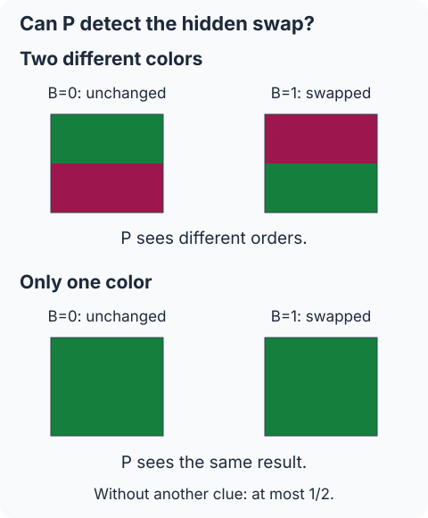
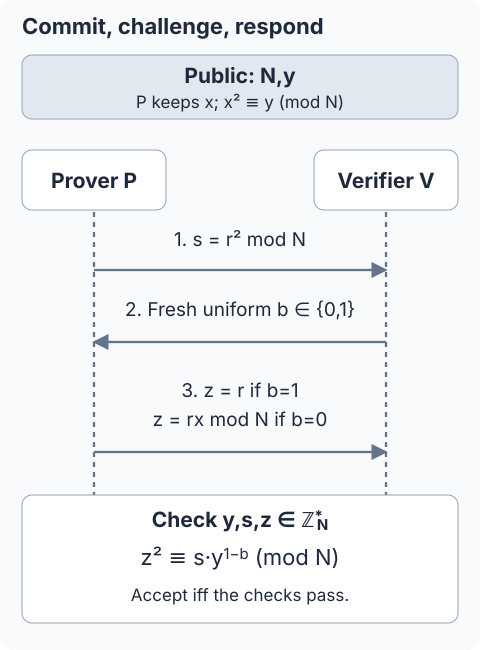
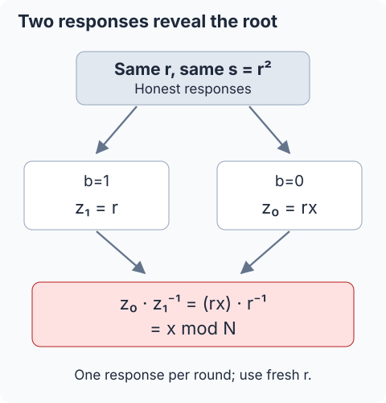

## 필기 원본

이 글에서 다룬 원본 PDF **50–53쪽**과 마지막 **54쪽의 제목 메모**를 함께 실었다. 두 단과 여백 필기를 포함한 페이지 전체를 보존했다. 이미지를 누르면 확대해서 볼 수 있다.

<figure style="margin: 2rem 0;">
  
  <figcaption>원본 PDF 50쪽.</figcaption>
</figure>

<figure style="margin: 2rem 0;">
  
  <figcaption>원본 PDF 51쪽.</figcaption>
</figure>

<figure style="margin: 2rem 0;">
  
  <figcaption>원본 PDF 52쪽.</figcaption>
</figure>

<figure style="margin: 2rem 0;">
  
  <figcaption>원본 PDF 53쪽.</figcaption>
</figure>

<figure style="margin: 2rem 0;">
  
  <figcaption>원본 PDF 54쪽. 추가 본문 없이 제목 메모만 있는 마지막 페이지도 함께 보존했다.</figcaption>
</figure>

## 들어가며

[앞 글](/posts/ai-security-np-proofs-witnesses-and-zero-knowledge/)에서는 witness를 직접 보내면 검증과 함께 비밀도 공개된다는 문제를 봤다. 이번에는 **증거를 통째로 보내는 대신, 검증자의 무작위 질문에 응답하는 방식**을 살펴본다. 검증 결과의 올바름과 대화에서 비밀이 드러나지 않는 성질은 따로 확인한다.

**범위는 원본 PDF 50–53쪽 전체다.** 영지식증명의 목표, 상호작용과 무작위성, 대화형 증명 모형, 색 구별 실험, 제곱잉여(QR) 프로토콜, 완전성·건전성, 반복 증폭, 두 응답의 공개와 난수 재사용, 마지막 구조 요약까지 포함한다. 54쪽에는 제목 메모만 있고 추가 본문은 없다.

51쪽의 비어 있는 응답식은 52쪽 설명으로 채운다. 단위군과 역원 조건은 앞 글의 정의에 맞춰 명시한다. 수치 예제와 마지막의 정직한 검증자 시뮬레이션은 **보충**으로 구별한다.

## 1. 납득시키는 일과 증거를 공개하는 일을 나눈다

### 1.1 비밀을 아는 증명자는 질문에 답한다

원문은 증명자 $P$가 비밀 witness를 가지고 있다고 출발한다. $P$는 그것을 그대로 보내는 대신, 그 비밀을 이용해 검증자 $V$의 질문에 응답한다. $V$는 받은 응답이 정해진 검증 조건을 만족하는지 검사할 수 있어야 한다.

이때 목표는 두 가지다.

1. 검증자가 주장이 참이라고 납득하게 한다.
2. 그 근거로 사용하는 비밀 witness 자체는 공개하지 않는다.

원문의 파란 필기는 witness를 직접 숨긴 것만으로는 충분하지 않다고 덧붙인다. 응답을 통해 비밀의 일부가 새거나 다른 추가 정보가 드러나는지도 확인해야 한다. **검증 성공과 영지식은 같은 조건이 아니다.**

### 1.2 대화형 증명과 지식증명의 표현을 구별한다

“비밀을 알아야 가능한 응답 능력을 보인다”는 말은 원문의 직관이다. 이를 엄밀히 다루려면, 참인 주장을 검증한다는 성질과 witness를 안다는 것을 보이는 성질을 구별해야 한다.

이 글에서는 먼저 **거짓인 입력이 통과할 확률**로 건전성을 설명한다. 뒤에서는 같은 첫 메시지에 대한 서로 다른 두 응답으로 witness를 계산할 수 있음을 보인다. 이는 지식 추출 분석과 연결되지만, 일반적인 대화형 증명의 정의만으로 지식증명까지 자동으로 정의되는 것은 아니다.

## 2. 새로 들어오는 두 요소

### 2.1 상호작용: 검증자가 대화에 참여한다

앞의 정적인 NP 증명에서는 $P$가 witness를 보내고 $V$가 검사했다. 대화형 증명에서는 메시지가 오간다. 원문의 그림은 증명자의 메시지 $a_i$와 검증자의 질문 $q_i$를 번갈아 배치한다.

$$
P\xrightarrow{a_1}V
\xrightarrow{q_1}P
\xrightarrow{a_2}V
\xrightarrow{q_2}\cdots.
$$

검증자의 질문은 앞서 받은 메시지에 따라 달라질 수 있다. 증명자는 질문에 응답하고, 검증자는 마지막에 accept 또는 reject를 출력한다. 완성된 문자열을 한 번 전달하는 모형에 **대화의 순서와 질문 선택**이 추가된다.

원문의 “실시간 interaction”은 이 메시지 교환을 뜻한다. 특정 네트워크 속도나 물리적인 시간 제한을 별도로 정의한 것은 아니다.

### 2.2 무작위성: 질문을 미리 알 수 없게 한다

검증자는 동전 던지기 같은 무작위 선택을 사용한다. 증명자가 첫 메시지를 정할 때 검증자의 질문을 미리 알 수 없다는 점이 중요하다.

두 질문 중 하나를 공정하게 고르고, 거짓 주장을 하는 증명자가 최대 한 질문에만 성공적으로 답할 수 있다면, 한 번의 수락 확률은 최대 $1/2$다. 반복하면 이 오류 확률을 줄일 수 있다.

여기서 무작위 선택을 영원히 비공개로 유지해야 한다는 뜻은 아니다. 뒤의 QR 프로토콜에서는 **첫 메시지를 받은 다음 질문 비트 $b$를 공개해서 보낸다.**

### 2.3 검증자는 PPT 알고리즘이다

원문은 $P$의 계산 능력을 제한하지 않는 대화형 증명 모형을 사용한다. 반면 $V$는 확률적 다항시간 알고리즘, 즉 PPT(probabilistic polynomial time)여야 한다.

공개 입력의 비트 길이를 $n$이라 하면 전체 검증 과정의 시간은 다항식으로 제한된다. 한 번의 계산만 빠르면 되는 것이 아니라 대화 전체를 포함한다. 반복 횟수도 입력 길이에 대한 다항식 범위 안에서 정해야 한다.

실제 QR 예제에서는 $P$에게 비밀 제곱근이 주어지면 각 응답도 효율적으로 계산할 수 있다. 이상적인 모형에서 증명자를 unbounded로 둔다는 것과, 매 라운드가 큰 계산을 요구한다는 것은 다른 말이다.

## 3. 두 색을 직접 구별하지 못하는 검증자

### 3.1 무엇을 증명하는가

50쪽의 주장은 “이 종이에는 서로 다른 두 색이 있다”이다. $P$는 두 색을 구별할 수 있지만 $V$는 직접 구별하지 못한다고 가정한다. 그래도 $V$는 자신이 종이의 두 색 위치를 뒤집었는지, 그대로 두었는지는 안다.

처음의 배치를 $P$가 본 상태에서 시작한다. 한 라운드는 다음 순서다.

1. $V$가 공정한 동전을 던져 비트 $B\in\{0,1\}$를 고른다.
2. $B=1$이면 두 색의 위치를 뒤집고, $B=0$이면 그대로 둔다.
3. 조작이 끝난 종이만 $P$에게 보여 준다.
4. $P$는 뒤집었는지에 대한 답 $\widehat B$를 보낸다.
5. $V$는 $\widehat B=B$이면 받아들이고, 다르면 거부한다.

**동전 결과와 조작 과정은 $P$에게 보이지 않아야 한다.** $P$가 둘 중 어느 것을 골랐는지 직접 보면, 같은 색이어도 답을 알 수 있기 때문이다. 종이의 다른 표식 등으로 조작 여부를 알아낼 수 없는 이상적인 실험으로 읽는다.

### 3.2 완전성: 정말 두 색이면 항상 맞힌다

두 색이 실제로 다르면, 색을 구별할 수 있는 정직한 $P$는 원래 배치와 바뀌었는지 확인하면 된다. 두 동전 결과 모두 맞게 답할 수 있다.

$$
\Pr[\mathrm{accept}\mid
\text{서로 다른 두 색, 정직한 실행}]=1.
$$

이는 이 이상적인 모형의 완전성이다.

### 3.3 건전성: 한 색이면 조작 여부를 볼 수 없다

실제로는 위아래가 같은 색인데 $P$가 두 색이라고 주장했다고 하자. 뒤집어도, 그대로 둬도 $P$에게 보이는 모습은 같다. 다른 단서가 없으므로 공정한 동전의 결과를 추측해야 한다.

$$
\Pr[\mathrm{accept}\mid
\text{한 색, 임의의 속이는 전략}]\le\frac12.
$$

$V$는 구체적인 색 이름을 배우지 않고도 응답의 정확성을 확인한다. 이 비유는 검증의 직관을 보여 준다. 실제 암호 프로토콜의 영지식 성질까지 이 물리적인 예만으로 증명한 것은 아니다.

## 4. 반복하면 왜 확률이 줄어드는가

### 4.1 매번 새로운 질문, 모든 라운드 통과

51쪽에서는 실험을 $k$번 반복하고 **모든 답이 맞을 때만** 최종 수락한다. 매 라운드에 검증자가 새로운 독립 동전을 사용한다.

$$
\Pr[\text{거짓 주장이 }k\text{번 모두 통과}]
\le\left(\frac12\right)^k=2^{-k}.
$$

정직한 $P$가 서로 다른 두 색을 볼 수 있다면 매번 맞게 답하므로, 이 모형에서는 반복 후에도 수락 확률이 $1$이다.

### 4.2 증명자의 전략까지 독립이라고 가정할 필요는 없다

앞선 대화에 따라 전략을 바꾸는 증명자도 고려해야 한다. $A_i$를 $i$번째 라운드의 성공 사건이라 하자. 앞선 성공 이력을 조건으로 주더라도 다음 질문을 미리 알 수 없어

$$
\Pr[A_i\mid A_1\cap\cdots\cap A_{i-1}]
\le\frac12
$$

라면, 조건부확률의 곱으로

$$
\Pr\!\left[\bigcap_{i=1}^k A_i\right]
=\prod_{i=1}^k
\Pr[A_i\mid A_1\cap\cdots\cap A_{i-1}]
\le2^{-k}
$$

를 얻는다. 어떤 앞선 성공 사건의 확률이 이미 $0$이면 전체 성공 확률도 $0$이다. 곱셈의 근거는 매번의 조건부 성공 상한이다.

### 4.3 반복의 조건을 바꾸면 같은 식을 쓸 수 없다

같은 동전 결과를 매번 재사용하면, 한 가지 고정 답을 반복하는 전략이 전부 통과할 확률은 $1/2$일 수 있다. 이것을 $2^{-k}$라고 계산하면 안 된다.

또 “전부 맞아야 수락”을 “하나라도 맞으면 수락”으로 바꾸면 오류가 줄지 않는다. 독립된 고정 추측을 예로 들면

$$
\Pr[\text{한 번 이상 맞힘}]=1-2^{-k}
$$

로 오히려 증가한다. 원문의 AND 조건을 그대로 유지해야 한다.

## 5. 제곱잉여의 대화형 증명으로 옮기기

### 5.1 공개 입력과 비밀의 표기

앞 글에서는 공개 인스턴스 전체를 $x$, 제곱근을 $r$로 썼다. 이번 원문은 **비밀 제곱근**에 $x$, **매 라운드의 난수**에 $r$를 사용한다. 이를 따르되 공개 입력은 $(N,y)$로 적는다.

$$
N\ge2,\qquad y\in\mathbb Z_N^*,\qquad
x\in\mathbb Z_N^*,\quad x^2\equiv y\pmod N.
$$

양쪽은 $N,y$를 알고 있고, 정직한 $P$는 witness $x$를 안다. 증명하려는 것은 $(N,y)\in L_{\mathrm{QR}}$, 즉 $y$가 법 $N$의 제곱잉여라는 사실이다.

$$
\mathbb Z_N^*
=\{a\in\{0,\ldots,N-1\}:\gcd(a,N)=1\}.
$$

역원이 있는 원소들의 집합이다. 모듈러 값은 $0$ 이상 $N$ 미만의 대표값으로 주고받는다. 공개 입력이나 메시지의 형식·범위가 잘못됐으면 거부한다.

### 5.2 첫 메시지를 보낸 뒤 질문을 받는다

원문의 한 라운드를 빠진 식까지 적으면 다음과 같다.

1. $P$는 $r$를 $\mathbb Z_N^*$에서 균등하게 뽑고 $s=r^2\bmod N$을 $V$에게 보낸다.
2. $V$는 $s\in\mathbb Z_N^*$인지 확인하고, 새 공정 비트 $b\in\{0,1\}$를 뽑아 보낸다.
3. $P$는 질문에 맞는 응답 $z$ 하나를 보낸다.
4. $V$는 $z\in\mathbb Z_N^*$인지와 해당 제곱식을 검사한다.

원문의 질문 번호를 바꾸지 않으면 다음 표가 된다.

| $b$ | 요구하는 것 | 응답 $z$ | 검사 |
| --- | --- | --- | --- |
| $1$ | $s$의 제곱근 | $r$ | $z^2\equiv s$ |
| $0$ | $sy$의 제곱근 | $rx\bmod N$ | $z^2\equiv sy$ |

표의 합동식은 모두 법 $N$에 관한 것이다. 51쪽에서 비어 있는 두 응답은 52쪽의 완전성 계산과 일치하도록 채웠다.

첫 메시지 $s$를 원문은 commitment라고 부른다. 여기서는 **질문 전에 정하는 첫 메시지**라는 뜻으로 사용한다. 이 이름만으로 별도의 일반적인 commitment scheme의 모든 보안 성질을 주장하지는 않는다.

### 5.3 검증식을 한 줄로 쓰기

원문의 분기 규칙은

$$
\boxed{\ z^2\equiv s\,y^{\,1-b}\pmod N\ }
$$

로 묶을 수 있다. $b=1$일 때 지수가 $0$이 되고, $b=0$일 때 지수가 $1$이 된다. **다른 자료의 질문 비트와 혼동해서 두 응답을 뒤집지 않는 것**이 중요하다.

단위군과 역원을 사용하는 검증 모형은 [Bellare의 공식 강의 자료](https://cseweb.ucsd.edu/~mihir/cse207/slides/s-zk.pdf)와도 대조했다. 그 자료의 메시지·질문 표기는 다른 형태이므로, 이 글의 응답 표는 첨부 원문의 표기를 따른다.

### 5.4 보충: 0을 허용하면 거짓 주장도 통과한다

단위군 조건을 빼고 제곱식만 검사한다고 하자. 거짓인 입력 $N=15,y=2$에 대해

$$
s=0,\qquad z=0
$$

을 내면

$$
0^2\equiv0\pmod{15},\qquad
0^2\equiv0\cdot2\pmod{15}
$$

로 두 질문을 모두 통과한다. 따라서 여기서는 처음부터 $y,s,z\in\mathbb Z_N^*$를 요구한다. 단위군 조건은 뒤의 역원 계산을 위해서도 필요하다. 정직한 실행에서는 $x,r$가 단위군 원소이므로 $s$와 $z$도 그 안에 있다.

## 6. 완전성: 정직한 증명자는 두 질문에 모두 답한다

### 6.1 두 분기를 직접 계산한다

$(N,y)\in L_{\mathrm{QR}}$이고 $P$가 $x^2\equiv y\pmod N$인 $x$를 안다고 하자.

$b=1$이면 $z=r$이므로

$$
z^2\equiv r^2\equiv s\pmod N.
$$

$b=0$이면 $z=rx\bmod N$이므로

$$
z^2\equiv r^2x^2\equiv sy\pmod N.
$$

검증자가 어느 질문을 골라도 통과한다. 그래서 정직한 실행의 한 라운드 수락 확률은 $1$이다. 원문의 unbounded 증명자 모형에서는 참인 입력의 근을 찾을 수 있다고 생각할 수 있지만, 실제 응답 계산은 이미 알고 있는 witness를 사용한다.

### 6.2 보충: N=15에서 두 분기를 확인하기

앞 글의 입력을 이어서

$$
N=15,\qquad y=4,\qquad x=2
$$

로 두고, 한 라운드의 난수를 $r=7$로 골라 보자.

$$
s=7^2\bmod15=4.
$$

| 질문 | 보내는 $z$ | $z^2\bmod15$ | 검사할 값 |
| --- | --- | --- | --- |
| $b=1$ | $7$ | $4$ | $s=4$ |
| $b=0$ | $14$ | $1$ | $sy\bmod15=1$ |

**실제 한 라운드에서는 이 중 하나만 공개한다.** 표는 두 선택의 계산을 비교하기 위해 나란히 적은 것이다. 작은 법 $15$는 계산을 확인하는 예이며, 암호학적 난도를 보여 주는 설정은 아니다.

## 7. 건전성: 거짓인 입력에서는 두 질문을 모두 통과할 수 없다

### 7.1 두 응답이 있다면 제곱근이 나온다

같은 첫 메시지 $s$에 대해 두 개의 올바른 응답 $z_1,z_0$가 있다고 가정하자. 아래첨자는 각각의 질문 비트다.

$$
z_1^2\equiv s\pmod N,\qquad
z_0^2\equiv sy\pmod N.
$$

$z_1$에 역원이 있으므로

$$
\widetilde x=z_0z_1^{-1}\bmod N
$$

을 계산할 수 있고,

$$
\widetilde x^{\,2}
\equiv z_0^2(z_1^2)^{-1}
\equiv(sy)s^{-1}
\equiv y\pmod N.
$$

따라서 **같은 $s$의 두 질문을 모두 통과하는 응답은 $y$의 유효한 제곱근을 준다.** 이 성질은 특수 건전성(special soundness)과 연결된다. 일반적으로 얻는 것은 유효한 근 하나이며, 증명자가 처음 사용했던 근과 반드시 같다고 단정하지 않는다.

### 7.2 거짓 주장에는 적어도 한 질문의 답이 없다

만약 $(N,y)\notin L_{\mathrm{QR}}$라면 유효한 제곱근이 존재하지 않는다. 따라서 앞의 두 응답이 동시에 존재할 수 없다. 이는 증명자의 계산 능력을 제한해서 얻은 결론이 아니라, 두 응답이 있으면 모순이 생기는 대수적 결론이다.

$P$가 $s$를 먼저 정하고, 그 뒤 $V$가 공정한 질문을 고르므로

$$
\Pr[\mathrm{accept}\mid
(N,y)\notin L_{\mathrm{QR}},P^*]\le\frac12
$$

다. 여기서 $P^*$는 프로토콜을 따르지 않을 수도 있는 임의의 증명자다. 앞의 성공 이력에 따라 다음 $s$를 바꾸더라도 새 질문을 미리 알 수 없다면 같은 한 라운드 상한을 적용한다.

### 7.3 ‘비밀을 모른다’와 ‘입력이 거짓이다’는 다르다

방금 식의 조건은 **입력 자체가 제곱잉여가 아니라는 것**이다. 참인 입력인데 어떤 사람이 근을 모른다는 상황을 이 조건과 그대로 바꾸면 안 된다.

원문의 “두 질문 모두에 답할 능력이 있다는 증거”는 7.1절의 추출 관계로 이해할 수 있다. 이를 지식증명으로 정식화하려면 추출기와 지식 오류 등에 관한 별도 정의가 필요하다. [Damgård, *On Σ-protocols*](https://www.cs.au.dk/~ivan/Sigma.pdf)

## 8. 질문을 먼저 알려 주면 왜 실패하는가

### 8.1 b=1을 미리 알면 제곱 하나로 준비한다

53쪽의 보충 필기는 메시지 순서를 강조한다. 증명자가 $b=1$을 미리 안다면, 비밀 $x$ 없이도 임의의 $t\in\mathbb Z_N^*$를 골라

$$
s=t^2\bmod N,\qquad z=t
$$

로 준비하면 된다. $z^2\equiv s\pmod N$이므로 통과한다.

### 8.2 b=0을 미리 알아도 준비할 수 있다

$y$에는 역원이 있으므로

$$
s=t^2y^{-1}\bmod N,\qquad z=t
$$

로 정하면

$$
sy\equiv t^2y^{-1}y\equiv t^2\equiv z^2\pmod N
$$

이다. 이 계산에도 witness $x$가 필요하지 않다.

보충으로 거짓인 입력 $N=15,y=2$와 $t=7$을 쓰면 다음과 같다.

| 미리 아는 질문 | 준비한 $s$ | 응답 $z$ | 해당 분기 |
| --- | --- | --- | --- |
| $b=1$ | $4$ | $7$ | 통과 |
| $b=0$ | $2$ | $7$ | 통과 |

각 행은 **서로 다른 첫 메시지를 준비한 별개의 실행**이다. 같은 $s$로 두 질문에 답한 반례가 아니다. 그래서 순서는 반드시

$$
\boxed{\ P\text{가 }s\text{ 전송}
\ \longrightarrow\ V\text{가 }b\text{ 선택}
\ \longrightarrow\ P\text{가 }z\text{ 응답}\ }
$$

이 되어야 한다. 정직한 프로토콜의 라운드를 수없이 반복해도, 애초에 질문을 먼저 알려 주는 잘못된 순서를 고쳐 주지는 못한다.

## 9. 반복과 건전성 증폭

### 9.1 같은 주장에 새 라운드를 실행한다

52쪽은 같은 공개 입력 $(N,y)$에 대해 프로토콜을 반복한다고 설명한다. 정직한 $P$는 매 라운드 새 독립 난수 $r_i$를 사용하고, $V$는 $s_i$를 받은 뒤 새 독립 질문 $b_i$를 보낸다.

$$
\begin{aligned}
s_i&=r_i^2\bmod N,\\
z_i&=
\begin{cases}
r_i,&b_i=1,\\
r_ix\bmod N,&b_i=0.
\end{cases}
\end{aligned}
$$

공개 입력과 비밀 $x$가 매번 바뀌어야 한다는 뜻은 아니다. **같은 주장과 같은 witness로도 난수를 새로 선택해서 다른 실행을 만들 수 있다.**

모든 라운드를 통과해야 최종 수락하면, 거짓 입력의 성공 확률은 4.2절과 같은 조건부확률 계산으로 최대 $2^{-k}$다. 이 오류 확률 감소를 건전성 증폭(soundness amplification)이라 부른다.

### 9.2 원문의 100회 반복

$$
2^{-100}
=\frac{1}{1267650600228229401496703205376}
\approx7.89\times10^{-31}.
$$

원문이 말한 매우 작은 확률은 $0$이라는 뜻은 아니다. 몇 가지 반복 수를 계산하면 다음과 같다.

| 반복 $k$ | 거짓 입력의 수락 상한 |
| --- | --- |
| $1$ | $1/2$ |
| $2$ | $1/4$ |
| $10$ | $1/1024$ |
| $20$ | $1/1048576$ |
| $100$ | $\approx7.89\times10^{-31}$ |

정직한 $P$는 어느 질문에도 답할 수 있으므로 이 이상적인 계산 모형에서 반복 후에도 수락 확률 $1$을 유지한다. 반복 횟수와 검증 시간의 제한은 2.3절처럼 함께 고려한다.

## 10. 한 라운드에서 두 응답을 주면 비밀이 나온다

### 10.1 같은 s, 같은 r의 두 응답

52쪽의 강조 문장은 검증자가 **같은 라운드의 두 응답을 모두 받지 않는다**는 것이다. 정직한 응답을 둘 다 보내면

$$
z_1=r,\qquad z_0=rx\bmod N
$$

이므로

$$
\boxed{\ x=z_0z_1^{-1}\bmod N\ }
$$

이다. 무작위로 가렸던 $r$가 나눗셈으로 사라진다. 검증자가 “더 확실하게 확인하겠다”며 두 답을 모두 요구하면 비밀이 공개된다.

보충 예제의 $r=7$, $z_0=14$에서는

$$
7^{-1}\equiv13\pmod{15},\qquad
14\cdot13\bmod15=2=x.
$$

### 10.2 다른 라운드에서 같은 r를 써도 위험하다

라운드마다 하나만 응답했어도, 같은 $r$를 재사용한 두 라운드에서 질문이 다르면 $r$와 $rx$가 함께 공개된다. 그러면 같은 역원 계산이 가능해진다.

원문의 새 난수 $r_1,r_2$를 사용한 식은

$$
z_1=r_1,\qquad z_0=r_2x\bmod N
$$

이며,

$$
z_0z_1^{-1}\equiv r_2xr_1^{-1}\pmod N.
$$

앞처럼 같은 $r$를 약분해서 바로 $x$를 얻는 계산과는 다르다. 예를 들어 $r_1=7,r_2=4,x=2,N=15$이면 이 비율은 $14$이고 $x=2$가 아니다.

### 10.3 보충: 새 난수와 항상 다른 첫 메시지는 같은 말이 아니다

새로 독립 추출해도 난수나 제곱값이 우연히 같아질 수 있다. 특히 **$r_1\ne r_2$라는 사실만으로 $r_1^2\ne r_2^2$가 보장되지는 않는다.** 법 $15$에서는 $7^2\equiv8^2\equiv4$다.

같은 $s$에 대한 두 유효 응답을 얻었다면, 난수가 서로 달랐더라도 7.1절에 따라 유효한 제곱근을 계산할 수 있다. 예를 들어 $r_1=7,r_2=8,x=2$에서 $z_1=7,z_0=1$이면 그 비율은 $13$이고 $13^2\equiv4\pmod{15}$다. 원래 근 $2$와 다른 유효한 근이 나온다.

따라서 원문의 새 난수 설명을 “서로 다른 숫자만 고르면 비밀 공개가 항상 불가능하다”는 주장으로 확대하지 않는다. 작은 예제의 높은 충돌 가능성을 실제 암호 매개변수의 보안 보장으로 사용하지도 않는다.

## 11. 마지막 쪽의 세 가지 구조

53쪽의 *What Made It Possible?*은 지금까지의 흐름을 세 가지로 묶는다.

1. **많은 실행을 만들 수 있다.** 새 $r_i$를 뽑아 $s_i=r_i^2$와 그 응답을 만든다. 같은 비밀로도 여러 실행이 가능하다.
2. **두 응답을 준비하지만 하나만 공개한다.** 두 질문에 대응할 수 있다는 성질은 검증의 근거가 되고, 두 응답을 함께 주지 않는 규칙은 직접적인 비밀 추출을 막는다.
3. **첫 메시지 다음에 무작위 질문이 온다.** 증명자가 질문에 맞춰 $s$를 뒤늦게 정할 수 없어야 한다. 거짓 입력에서는 최대 한 질문에만 답할 수 있어 성공 확률이 제한된다.

원문의 “질문 하나에 답했다”와 “두 질문에 모두 답할 능력이 있다”는 표현도 이 구조 안에서 구별한다. 실제 실행에서는 응답 하나만 본다. 건전성과 두 응답 사이의 추출 관계가 그 검증의 근거다.

## 12. 보충: 정직한 검증자에게 추가 정보가 없다는 것은 어떻게 보이는가

### 12.1 응답 하나만 보인다는 말에서 멈추지 않기

원문 마지막의 보충 설명은 정식 영지식 증명이 자료에 포함돼 있지 않다고 명시한다. 따라서 지금까지의 완전성·건전성 계산만으로 영지식을 결론 내리지는 않는다.

보충으로 **정직한 검증자에 대한 한 라운드의 대화 기록**을 분석하자. 검증자가 보는 메시지 기록은 $(s,b,z)$다. 비밀 $x$ 없이 같은 분포의 기록을 효율적으로 만들 수 있다면, 그 기록에서 비밀을 가진 증명자만이 줄 수 있는 추가 정보를 구별해 내지 못한다는 것을 설명할 수 있다.

### 12.2 공개 입력만으로 기록 만들기

$(N,y)\in L_{\mathrm{QR}}$인 입력에서 다음 시뮬레이터를 생각하자.

1. $b$를 공정하게, $t$를 $\mathbb Z_N^*$에서 균등하게 독립 추출한다.
2. 응답을 $z=t$로 정한다.
3. 다음 식으로 $s$를 계산하고 $(s,b,z)$를 출력한다.

$$
s=
\begin{cases}
t^2\bmod N,&b=1,\\
t^2y^{-1}\bmod N,&b=0.
\end{cases}
$$

이 계산에는 비밀 제곱근이 필요하지 않다. $b=1$의 실제 응답 $z=r$는 균등하고 $s=z^2$다. $b=0$에서는 $z=rx$인데, 고정된 단위군 원소 $x$를 곱하는 것은 전단사이므로 $z$도 균등하다. 이 경우에도

$$
s\equiv r^2\equiv z^2x^{-2}\equiv z^2y^{-1}\pmod N.
$$

따라서 참인 입력과 고정된 유효 witness에 대해, 정직한 실제 실행과 위 시뮬레이터는 **정확히 같은 기록 분포**를 만든다. 이는 이 모형에서의 완전한 정직한 검증자 영지식(perfect HVZK)을 보여 준다. 시뮬레이션을 통한 정의와 그 범위는 [Bellare의 강의 자료](https://cseweb.ucsd.edu/~mihir/cse207/slides/s-zk.pdf), [Damgård의 Σ-protocol 정의](https://www.cs.au.dk/~ivan/Sigma.pdf)와 대조했다.

### 12.3 시뮬레이션과 실제 대화의 순서는 다르다

시뮬레이터는 **완성된 기록을 오프라인으로 만들기 때문에** 질문 $b$와 응답 $z$를 먼저 고를 수 있다. 실제 대화의 증명자는 $s$를 보낸 뒤에야 검증자가 고른 $b$를 받는다. 8절의 “질문을 먼저 알면 준비할 수 있다”는 계산과 건전성 상한이 모순되지 않는 이유다.

여기서 보인 것은 공정한 질문을 따르는 정직한 검증자의 한 라운드 기록 분포다. 임의의 악의적인 검증자, 여러 실행이 얽히는 경우 등에 대한 보장까지 이 계산만으로 확장하지 않는다. 이 구별은 프로토콜이 그런 보장을 가질 수 없다는 뜻이 아니라, **지금 증명한 성질의 범위**를 분명히 하는 것이다.

## 13. 원문을 옮기며 보완한 조건

1. **응답식의 빈칸.** 51쪽의 $b=1,b=0$ 응답은 52쪽에 따라 각각 $r,rx\bmod N$으로 채웠다. 질문 번호를 유지했다.
2. **단위군.** $r,x,y,s,z$의 역원 조건을 명시했다. $s=z=0$을 허용하면 거짓 입력도 두 분기를 통과하는 반례가 있다.
3. **질문의 순서.** $s$를 먼저 받고 $b$를 나중에 뽑는다. 비트를 미리 알려 주면 두 경우 모두 비밀 없이 준비할 수 있다.
4. **반복 확률.** 새 독립 질문과 모든 라운드 통과 조건에서 $2^{-k}$를 얻는다. 증명자의 성공 사건들이 무조건 독립이라고 가정하지 않았다.
5. **두 응답의 추출.** 같은 $s$의 두 유효 응답으로 유효한 근을 얻는다. 정직한 동일 난수 응답에서는 원래 $x$가 나오지만 일반적으로는 다른 근일 수도 있다.
6. **새 난수와 충돌.** 새 독립 난수, 서로 다른 난수, 서로 다른 제곱값을 같은 조건으로 쓰지 않았다.
7. **보안 성질의 구별.** 완전성·건전성·지식 추출·영지식의 역할을 구별했다. 정식 증명이 없는 부분을 있는 것처럼 쓰지 않고, 12절의 보충은 한 라운드 perfect HVZK로 범위를 한정했다.

이 글로 첨부 정리본의 **본문이 있는 마지막 53쪽까지** 이어 썼다. 여기까지의 핵심 연결은 “먼저 정한 메시지에 대한 예측할 수 없는 질문”과 “두 응답을 함께 공개하지 않는 규칙”이며, 각각 검증의 올바름과 비밀 공개의 문제를 살피는 출발점이 된다.
