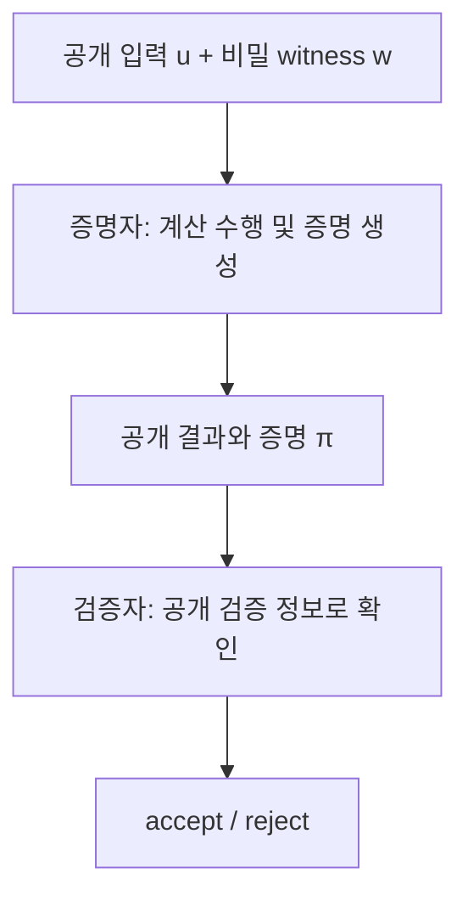
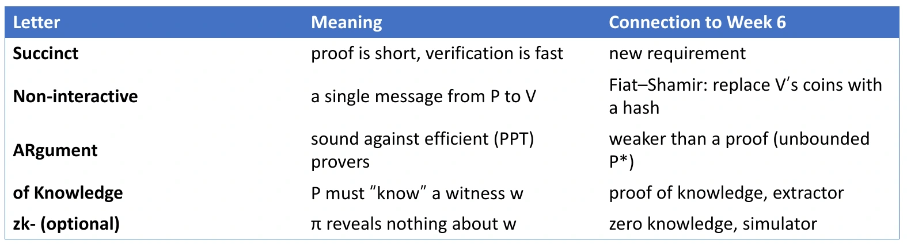
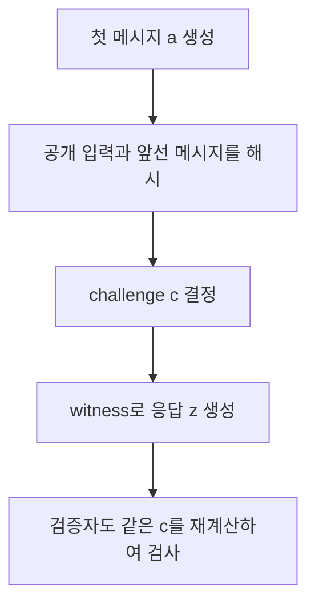
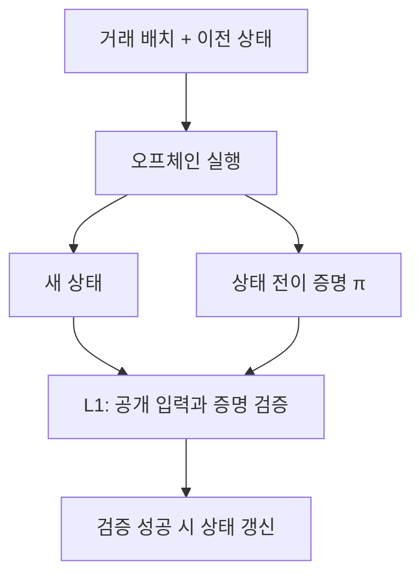
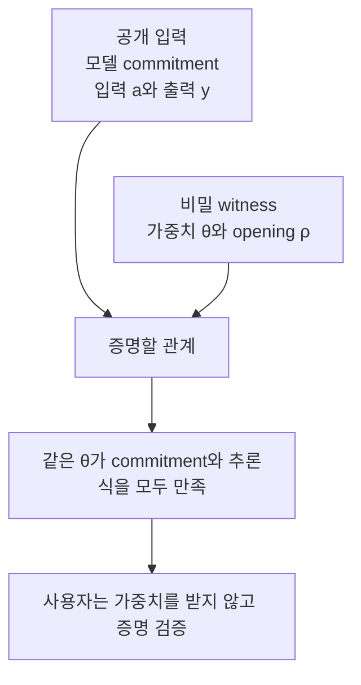

큰 계산을 맡긴 뒤 결과를 검증하려고 같은 계산을 처음부터 다시 하면, 검증 비용이 외주 계산의 이점을 줄일 수 있다. **결과와 함께 짧은 증명을 받아, 계산 전체를 다시 수행하는 것보다 적은 비용으로 확인할 수 있을까?** SNARK가 겨냥하는 문제다.

여기에 비밀 입력이나 모델 가중치까지 숨기는 성질을 더하면 zk-SNARK가 된다. 짧은 증명, 빠른 검증, 정보 비공개는 각각 구별해야 하는 요구다.

## 1. 대화형 증명에서 달라지는 요구

*Introduction to SNARK 강의 2쪽*

QR와 그래프 동형 프로토콜에서는 증명자와 검증자가 메시지를 주고받았다. 검증자는 대화에 참여해 적절한 시점에 무작위 질문을 골라야 했다.

또한 대화 기록만 제삼자에게 보여 주는 것으로는 같은 확신을 전달하지 못했다. Witness 없이도 시뮬레이터가 그런 기록을 만들 수 있기 때문이다.

SNARK에서 원하는 사용 방식은 다음과 같다.

1. 증명자가 계산 결과에 관한 **증명 $\pi$ 하나**를 만든다.
2. 검증자는 증명 생성 중에 온라인으로 질문을 보낼 필요가 없다.
3. 나중에 증명을 받은 사람도 공개된 검증 정보로 확인할 수 있다.
4. 원래 계산이 크더라도 증명이 짧고 검증이 빠르다.

이 그림은 역할을 설명하는 개념도다. 증명자가 비용 없이 $\pi$를 얻는다는 뜻은 아니다. 검증 비용을 줄이기 위해 증명 생성 쪽에 상당한 계산이 들어갈 수 있다.

## 2. Statement와 witness: 1GB 메시지의 예

*강의 3쪽*

강의의 예시는 다음 주장이다.

$$
\text{“}\operatorname{SHA256}(m)=0^{256}
\text{인 메시지 }m\text{을 알고 있다.”}
$$

- 공개 statement: 해시 출력이 지정된 값이라는 관계.
- 비밀 witness: 그 관계를 만족하는 메시지 $m$.
- 검증할 관계: $R(0^{256},m)=1$인지 여부.

메시지 $m$이 1GB라면 가장 직접적인 증명은 $m$ 자체를 보내는 것이다. 그러나 검증자는 1GB를 받아 모두 해시해야 한다. 통신도 크고 검증도 무겁다.

SNARK는 이 관계에 대한 짧은 증명과 빠른 검증을 목표로 한다. **zk-SNARK**는 여기에 $m$에 관한 추가 정보를 공개하지 않는 성질까지 요구한다.

| 방식 | 무엇을 전달하는가 | 검증할 때의 차이 | 비밀 보호 |
| --- | --- | --- | --- |
| Witness 직접 전달 | $m$ 전체 | 원래 관계를 직접 계산 | $m$이 드러남 |
| SNARK | 짧은 $\pi$ | 증명 검증 알고리즘 실행 | 이름만으로 ZK를 보장하지 않음 |
| zk-SNARK | 짧은 $\pi$ | 증명 검증 알고리즘 실행 | 공개 statement를 넘어서는 witness 정보의 누출을 막음 |

이 예시는 이미 witness를 아는 증명자를 가정한다. SNARK가 SHA-256의 원상을 쉽게 찾아 준다는 뜻은 아니다. Witness 찾기의 어려움과, 주어진 witness를 이용해 주장을 증명하는 문제는 별개다.

공개 statement와 증명 $\pi$도 다른 값이다. Statement는 “무엇이 참인지”를 지정하고, $\pi$는 그 주장을 받아들일 근거로 검증 알고리즘에 넣는 데이터다. 이 예제에서는 목표 해시값과 검사할 관계를 미리 알 수 있지만, 그것만으로 그 관계를 만족하는 비밀 메시지를 얻는 것은 아니다. 검증자는 메시지를 직접 받는 대신 해당 statement에 대한 $\pi$를 검사한다.

## 3. SNARK라는 이름을 풀어 읽기

*강의 4쪽*

$$
\textbf{S}uccinct\quad
\textbf{N}on\text{-interactive}\quad
\textbf{AR}gument\quad
\text{of }\textbf{K}nowledge.
$$

### S: Succinct

증명 길이와 검증 비용이 원래 큰 계산에 비해 작아야 한다. **증명이 짧다는 것과 검증이 빠르다는 것 모두** 포함한다.

관계를 검사하는 계산의 크기를 $T$라 할 때, 단순히 $T$에 비례하는 실행 기록 전체를 보내고 전부 재검사하게 하는 방식과 다르다. 구체적인 증명 길이와 검증 복잡도는 방식에 따라 달라지며, 이 도입 자료는 특정 수치를 정하지 않는다.

공개 입력 자체가 크면 그 입력을 읽는 비용도 있다. “어떤 크기의 공개 입력이든 아무 비용 없이 검증한다”거나 “모든 SNARK는 같은 크기의 증명을 가진다”는 뜻은 아니다.

### N: Non-interactive

증명자는 증명 메시지를 보내고, 검증자는 자신의 무작위 질문에 대한 추가 응답을 기다리지 않고 검사한다.

공개 매개변수나 검증키가 필요 없다는 뜻은 아니다. **증명 생성·검증 단계의 대화가 없다는 성질**과, 사전 설정을 어떻게 준비하는지는 별도 문제다.

### AR: Argument

건전성(soundness)을 **효율적인 PPT 증명자**에 대해 요구한다. 계산 능력이 무제한인 증명자까지 거짓 증명을 막는 proof와 구별한다.

수업이나 실무에서 $\pi$를 관례적으로 “proof”라고 부르더라도, SNARK의 엄밀한 분류는 argument다. 공격자의 계산 제한과 암호학적 가정이 보안의 일부다.

### K: Knowledge

검증자를 충분히 높은 확률로 설득하는 증명자의 동작에서 witness를 추출할 수 있어야 한다. 단순히 참인 명제가 존재한다는 membership soundness와 구별한다.

실제 검증자에게 witness가 전달된다는 뜻은 아니다. 추출기는 보안 정의에 등장하는 알고리즘이며, 실제 검증자가 받은 $\pi$를 해독해 비밀을 읽는 기능이 아니다.

### zk-: 선택적으로 추가하는 영지식성(zero-knowledge)

증명이 공개 입력과 주장의 참 여부를 넘어서는 witness 정보를 드러내지 않도록 한다. 강의에서 **zk-는 optional**이라고 한 이유다.

따라서 다음 두 문장은 다르다.

- SNARK이므로 지식 건전성(knowledge soundness)을 요구한다.
- zk-SNARK이므로 영지식성(zero-knowledge)도 요구한다.

짧음이 정보 비공개를 뜻하지는 않는다. 짧은 문자열에도 비밀의 특정 비트가 그대로 들어갈 수 있다.

## 4. 보충: 무엇을 증명하는지 먼저 정한다

강의의 여러 응용을 같은 방식으로 읽으려면 공개 입력과 witness를 나누면 된다.

$$
R(u,w)=1.
$$

$u$는 검증자가 확인하려는 공개 statement이고, $w$는 이를 만족시키는 증명자의 데이터다. 예를 들면 다음과 같다.

| 응용 | 공개 입력의 예 | Witness의 예 |
| --- | --- | --- |
| 해시 원상 지식 | 목표 해시값 | 원래 메시지 |
| 상태 전이 검증 | 이전·이후 상태에 대한 commitment, 배치 정보 | 거래 데이터와 실행에 필요한 내부 값 |
| 비공개 거래 | 공개 commitment와 중복 사용 방지 정보 | 소유권 비밀, 금액, commitment의 opening |
| 모델 추론 검증 | 입력·출력, 모델 commitment | 모델 가중치와 commitment의 opening |

이 표는 공개 범위를 설명하는 예다. 실제 구성에서는 어떤 값을 숨기고 어떤 값을 공개할지에 따라 $u,w$와 관계가 달라진다.

전형적인 인터페이스는 다음처럼 읽을 수 있다.

$$
\pi\leftarrow\operatorname{Prove}(\mathrm{pp},u,w),
\qquad
\operatorname{Verify}(\mathrm{vp},u,\pi)
\in\{\mathrm{accept},\mathrm{reject}\}.
$$

$\mathrm{pp}$와 $\mathrm{vp}$는 각각 증명과 검증에 쓰이는 매개변수다. 같은 매개변수를 공유하는 방식도 있고 별도 키를 사용하는 방식도 있다. 이 표현은 특정한 trusted setup 방식을 가정하지 않는다.

검증 성공이 뜻하는 것은 **선택한 관계 $R$에 관한 보장**이다. 관계에서 빠뜨린 조건까지 자동으로 검사해 주지는 않는다.

관계 $R$은 witness를 직접 받았다면 확인했을 검사 규칙이라고 생각하면 된다. 예를 들어 모델의 출력만 확인하도록 관계를 작성하면, 약속한 모델을 썼는지까지는 확인하지 못한다. 모델 commitment와 연결하는 조건도 관계 안에 넣어야 한다. 이 단계에서 빠진 조건은 증명 시스템 자체가 안전하더라도 보완되지 않는다.

## 5. Fiat-Shamir: 질문을 해시로 만드는 아이디어

*강의 4쪽의 연결 설명을 보충*

앞선 public-coin 프로토콜에서는 검증자가 무작위 challenge를 보냈다. Fiat-Shamir 변환은 적절한 프로토콜에서 그 challenge를 공개 입력과 앞선 transcript의 해시로 유도하는 방법이다.

개념적으로 첫 메시지를 $a$라 하면

$$
c=H(\text{프로토콜 식별자},u,a,\text{앞선 transcript})
$$

처럼 쓴다. 증명자는 이 $c$에 대한 응답 $z$를 계산하고, 검증자는 같은 해시를 다시 계산해 응답을 검사한다. 실제 인코딩에서는 각 필드를 모호하지 않게 구분해야 한다.

이 설명만으로 모든 대화형 증명을 안전하게 비대화형으로 바꿀 수 있다고 결론 내리면 안 된다. 적용할 프로토콜의 조건과 해시를 random oracle로 다루는 보안 분석 등이 필요하다. [Fiat-Shamir 변환 기술 초안](https://www.ietf.org/ietf-ftp/internet-drafts/draft-irtf-cfrg-fiat-shamir-03.html)

특히 앞 글의 **한 비트 QR 질문을 그대로 해시 한 비트로 바꾸는 것만으로 강한 보안을 얻지는 못한다.** 공격자가 자신이 답할 수 있는 질문에 맞춘 첫 메시지를 여러 번 시도할 수 있기 때문이다. 적절한 challenge 공간과 변환 전체의 분석이 필요하다.

앞 글의 시뮬레이터처럼 원하는 비트 $b$와 응답 $z$를 정하고 그에 맞는 첫 메시지 $s$를 만들었다고 하자. 이제 해시가 낸 질문이 우연히 $b$와 같으면 그 기록을 제출할 수 있다. 해시 한 비트가 독립적인 공정한 값처럼 나온다고 보면 새 후보마다 성공 확률이 $1/2$여서 평균 두 번의 시도로 맞출 수 있다. 상호작용을 지우는 것뿐 아니라, 이런 반복 시도로 질문을 골라 맞추는 공격도 막아야 하는 이유다.

또한 Fiat-Shamir는 주로 상호작용을 없애는 연결 고리다. **비대화형이 되었다고 증명 길이까지 자동으로 짧아지는 것은 아니다.**

### 공개 검증과 시뮬레이션은 어떻게 함께 가능한가

앞의 대화형 QR에서는 공개 입력만으로 누구나 수락 기록을 만들어 제삼자에게 전달할 수 있었다. 그런데 공개 검증 가능한 zk-SNARK에서도 시뮬레이터가 있으니 같은 일이 생기는 것은 아닐까?

보충으로, 비대화형 ZK의 시뮬레이션은 사용하는 모형의 설정까지 고려한다. CRS 모형의 시뮬레이터는 설정을 만들 때 얻는 시뮬레이션용 정보 등을 사용할 수 있고, random-oracle 모형에서는 오라클 프로그래밍이 쓰일 수 있다. 일반 검증자가 실제 공개 정보만으로 그 권한을 가지는 것은 아니다.

따라서 **실제 공개 검증자의 능력과 보안 증명 속 시뮬레이터의 권한**을 같다고 놓으면 안 된다. 비대화형 영지식의 설정과 시뮬레이션에 관한 설명은 [Thaler, Proofs, Arguments, and Zero-Knowledge](https://people.cs.georgetown.edu/jthaler/ProofsArgsAndZK.pdf)에서 더 다룬다.

## 6. Transferability와 공개 검증

*강의 2·4쪽*

여기서 다루는 공개 검증형 SNARK에서는 공개 입력, 검증 정보, 증명 $\pi$를 가진 사람이 검증할 수 있다. 증명 생성 당시 대화에 참여했던 특정 검증자일 필요가 없다.

| 대화형 QR·GI | 공개 검증형 SNARK |
| --- | --- |
| 검증자가 적절한 시점에 질문 선택 | 증명 메시지를 받아 검증 |
| 기록만으로 원래 대화를 제삼자에게 입증하기 어려움 | 같은 공개 입력과 검증 정보로 나중에도 확인 가능 |
| 시뮬레이션에 따른 부인 가능성이 특징 | 공개 재검증 가능성이 목표 |

다만 **non-interactive라는 단어 자체가 모든 체계의 공개 검증 가능성을 뜻하지는 않는다.** 이 강의가 대상으로 삼는 SNARK의 사용 방식에서 두 요구가 함께 등장하는 것이다.

Transferable하다는 말도 무조건 재사용해도 된다는 뜻은 아니다. 인증이나 거래 승인에 사용한다면 계정, 세션, 거래 내용 같은 맥락을 공개 statement에 결합해야 다른 상황으로 증명이 옮겨지는 문제를 막을 수 있다.

## 7. 계산보다 검증을 싸게 하기

*강의 5쪽*

강의는 Babai·Fortnow·Levin·Szegedy의 1991년 연구 **Checking Computations in Polylogarithmic Time**을 소개한다. 작은 신뢰 가능한 컴퓨터가 더 큰 비신뢰 계산 자원의 작업을 확인한다는 관점이다.

이를 블록체인에 옮기면 다음처럼 읽을 수 있다.

- 많은 계산은 오프체인의 서버나 GPU가 수행한다.
- 여러 참여자가 함께 검증해야 하는 L1은 짧은 증명을 검사한다.
- 계산을 수행하는 주체와, 결과를 신뢰할지 결정하는 주체를 나눈다.

$T$가 큰 계산이라고 해서 모든 검증자가 $T$만큼 다시 실행해야 하는 것은 아니라는 점이 핵심이다. 다만 증명자의 작업량, 증명 생성 시간, 검증 시간, 공개 입력 크기는 서로 다른 비용이다. 검증 비용 감소를 시스템 전체의 계산량 감소와 동일시하면 안 된다.

예를 들어 같은 계산 결과를 많은 참여자가 확인해야 한다면, 각자가 큰 계산을 반복하는 대신 한 번 생성한 증명을 각자 검증하는 방식이 유용할 수 있다. 증명 생성에는 추가 비용이 들지만 검증자마다 지출하는 비용을 줄일 수 있기 때문이다. 실제 이득은 증명 생성 비용과 검증 횟수 등을 함께 비교해야 하며, succinctness만으로 모든 상황에서 전체 비용이 줄어든다고 결론 내리지는 않는다.

## 8. 블록체인 응용 I: 계산 외주와 확장성

*강의 6쪽*

### Proof-based rollup

오프체인 서비스가 여러 거래를 묶어 처리하고, 처리 결과가 정해진 상태 전이 규칙을 만족한다는 증명을 만든다. L1은 거래 전체를 그대로 재실행하는 대신 해당 증명을 검증한다.

강의가 강조하는 것은 **이 사용 목적에는 영지식이 반드시 필요한 것은 아니라는 점**이다. 계산 결과의 정확성을 짧게 검증하는 succinctness가 중심이고, 거래 데이터를 모두 숨기는지는 별도 설계다.

이름에 zk가 들어간 zkRollup을 보더라도 어떤 정보가 공개되는지 따로 확인해야 한다.

### Bridge와 proof of consensus

Chain B가 Chain A의 어떤 블록에 대한 합의가 올바르게 성립했다는 증명을 검증하게 할 수 있다. 이를 바탕으로 체인 사이의 자산 이동이나 상태 연동을 설계한다.

여기서 증명해야 하는 것은 블록 데이터가 존재한다는 사실만이 아니다. **해당 체인의 합의 검증 규칙을 만족한다는 관계**가 포함돼야 한다. 강의는 이를 zkBridge의 사용 방향으로 제시한다.

보충으로, 올바른 상태 전이 증명을 받았다는 것과 사용자에게 필요한 데이터가 실제로 제공된다는 것은 다른 조건이다. Rollup의 데이터 가용성이나 bridge의 신뢰 기준까지 증명 길이 하나로 해결되는 것은 아니다.

## 9. 블록체인 응용 II: 프라이버시와 조건 증명

*강의 7쪽*

### 비공개 거래

공개 블록체인에서도 소유권과 금액 보존 같은 조건을 확인하면서 거래의 세부 값을 숨길 수 있다.

예를 들어 다음 관계를 생각할 수 있다.

$$
\text{소유권 조건이 성립하고,}\qquad
\sum_i\mathrm{input}_i
=
\sum_j\mathrm{output}_j+\mathrm{fee}.
$$

Witness에는 소유권을 나타내는 비밀과 금액 등이 들어가고, 공개 입력에는 관련 commitment와 중복 사용 방지 정보 등을 둘 수 있다. 공개하는 필드는 프로토콜에 따라 달라진다.

강의가 열거한 예시는 **Zcash, Tornado Cash, IronFish, Aleo**다. 서로 다른 시스템을 같은 프로토콜로 취급하기보다는, 유효성을 공개적으로 확인하면서 특정 데이터를 숨기려는 응용 예시로 이해하면 된다.

### 정책 준수와 지급 능력

강의는 다음 두 방향도 든다.

- 비공개 거래가 정해진 정책 조건을 만족함을 증명하는 예: Espresso.
- 개별 고객 잔액을 공개하지 않고 자산이 부채 이상임을 증명하는 예: Raposa.

후자의 관계를 단순화하면

$$
\mathrm{Assets}\geq\mathrm{Liabilities}
$$

다. 영지식은 그 부등식에 사용한 개별 값을 감추는 데 도움을 준다.

보충으로, **어떤 부채가 계산에 포함되었는지**도 중요하다. 일부 부채를 누락한 집합에서 부등식을 정확히 증명해도 전체 지급 능력을 보였다고 할 수 없다. 증명은 입력 데이터의 현실 세계 완전성까지 자동으로 보장하지 않는다.

정책 준수도 마찬가지다. 검증 가능한 조건을 관계로 표현하고 그 관계를 증명하는 것이며, 증명 하나가 모든 법적 판단을 대신한다는 뜻은 아니다.

## 10. AI 보안 I: 검증 가능한 추론

*강의 8쪽*

서비스가 “이 결과는 이 모델로 계산했다”고 말할 때 사용자는 실제로 약속한 모델을 사용했는지 확인하고 싶을 수 있다.

$$
y=f_\theta(a).
$$

$a$는 입력, $\theta$는 모델 가중치, $y$는 출력이다. 단순히 “어떤 모델이 이 출력을 낸다”는 주장만으로는 광고한 모델과 연결되지 않는다. 그래서 **미리 고정한 모델에 대한 commitment**가 필요하다.

### 보충 예제: 모델 commitment와 계산 결과 연결

모델 commitment를

$$
C_\theta=\operatorname{Com}(\theta;\rho)
$$

라 하자. 공개 입력을 $u=(a,y,C_\theta)$, witness를 $w=(\theta,\rho)$로 두면

$$
R(u,w)=1
\iff
\begin{cases}
\operatorname{Com}(\theta;\rho)=C_\theta,\\
f_\theta(a)=y.
\end{cases}
$$

라는 관계를 증명할 수 있다. 실제 증명 방식은 내부 계산 값도 witness의 일부로 사용할 수 있다.

Commitment는 서비스가 결과에 맞춰 다른 모델을 끼워 넣지 못하도록 모델의 정체를 연결한다. 그 commitment가 어떤 모델을 대표하는지에 대한 사전 등록이나 신뢰 기준도 있어야 한다.

Commitment는 값을 정해 둔 뒤 나중에 다른 값이었다고 바꾸기 어렵게 만드는 공개값이다. 여기서 opening은 그 공개값이 특정 $\theta$로 만들어졌음을 확인하는 데 필요한 데이터이며, 위 표기에서는 $\theta$와 난수 $\rho$가 그 역할을 한다. 모델을 숨기려면 commitment 자체도 적절한 은닉성을 가져야 한다. 첫 식은 “등록한 모델과 같은 모델인가”, 둘째 식은 “그 모델로 이 출력을 계산했는가”를 확인하므로 둘을 같은 witness에 묶는 것이 중요하다.

### 정확한 실행과 좋은 예측은 다르다

$y=f_\theta(a)$를 증명해도 $y$가 현실에서 올바른 답이라는 결론은 바로 나오지 않는다. 약속한 모델이 틀린 예측을 해도 실행 관계 자체는 참일 수 있다.

또한 모델을 실제 증명 관계로 옮길 때 양자화, 유한체 표현, 비선형 연산, 반올림 규칙 등을 정해야 한다. 증명은 **정의한 계산 의미**에 대해 성립한다. 구현한 계산과 원래 모델의 수치 의미가 맞는지 확인하는 문제가 남는다.

## 11. AI 보안 II: 모델을 숨긴 채 성능을 증명하기

*강의 8쪽*

가중치를 witness로 두면 모델을 공개하지 않고 특정 데이터셋에 대한 정확도도 증명할 수 있다. 강의의 예시는 **정확도 90% 이상**이다.

고정된 테스트셋 $D=\{(a_i,\ell_i)\}_{i=1}^n$에 대해

$$
\operatorname{Acc}(\theta,D)
=
\frac1n\sum_{i=1}^n
\mathbf1[f_\theta(a_i)=\ell_i].
$$

정수 연산으로 쓰면 90% 조건은

$$
10\sum_{i=1}^n\mathbf1[f_\theta(a_i)=\ell_i]
\geq9n
$$

이다. 모델 commitment와 이 조건을 함께 묶어 같은 모델이 해당 점수를 냈음을 증명한다.

보충 예제로 테스트셋이 20개라면 정답이 최소 18개여야 한다. 17개면 85%이므로 증명이 통과해서는 안 된다.

여기서 공개적으로 고정해야 하는 것은 모델만이 아니다. 테스트셋과 평가 규칙도 고정해야 유리한 데이터만 골라 평가하는 일을 막을 수 있다. 그리고 특정 테스트셋의 90%를 증명했다는 사실만으로 모든 실제 입력에 대한 정확도나 일반화 성능을 보장하지는 않는다.

위 식의 $\mathbf1[\cdot]$은 괄호 안 조건이 참이면 $1$, 거짓이면 $0$인 지시 함수다. 이를 모든 테스트 항목에 대해 더하면 정답 개수가 된다. $n$이 양수일 때 그 개수를 $n$으로 나눈 값이 $0.9$ 이상이라는 조건의 양변에 $10n$을 곱하면 정수 부등식을 얻는다. 따라서 90%라는 소수를 그대로 계산하지 않고도 동일한 평가 조건을 표현할 수 있다.

### zkML과 zkCNN

이처럼 영지식과 검증 가능한 머신러닝을 연결하는 분야를 **zkML**이라 부른다. 강의는 Liu·Xie·Zhang의 **zkCNN, CCS 2021**을 예로 든다.

zkCNN은 CNN의 추론 결과가 해당 모델의 계산에서 나왔음을 모델을 공개하지 않고 증명하며, 비밀 CNN의 공개 데이터셋 정확도 증명으로도 확장한다. [zkCNN 논문 정보와 초록](https://experts.illinois.edu/en/publications/zkcnn-zero-knowledge-proofs-for-convolutional-neural-network-pred/)

이 글의 90%와 20개 예제는 강의 조건을 설명하기 위한 계산이며, 특정 논문의 실험 성능 수치가 아니다.

## 12. AI 보안 III: 콘텐츠 출처와 C2PA

*강의 8쪽*

강의는 C2PA와 zk-SNARK를 결합하는 콘텐츠 출처 검증도 언급한다. 생성·편집 이력이나 특정 변환의 적법한 수행을 확인하면서 필요한 정보를 제한적으로 공개하는 방향으로 생각할 수 있다.

다만 다음 세 가지를 구별해야 한다.

| 질문 | 확인하려는 대상 |
| --- | --- |
| 서명과 출처 기록이 유효한가 | 어떤 주체가 어떤 이력에 서명했고 기록이 변조되지 않았는가 |
| 특정 연산이 수행되었는가 | 공개한 입력·출력 또는 commitment 사이의 계산 관계 |
| 사진에 담긴 사건이 실제로 일어났는가 | 현실 세계의 사실 |

C2PA의 provenance는 콘텐츠의 출처와 이력에 관한 검증 가능한 기록이다. 유효한 기록이 있다는 사실만으로 내용의 진실성을 판정하거나 모든 조작을 자동 탐지하는 것은 아니다. [C2PA 공식 설명의 목표와 비목표](https://spec.c2pa.org/specifications/specifications/2.2/explainer/Explainer.html)

zk-SNARK를 덧붙여도 보장 범위는 증명한 관계에 달려 있다. 예를 들어 “서명된 원본에서 허용된 편집을 수행했다”는 관계와 “원본이 현실의 참된 사건을 담았다”는 주장은 다르다.

## 13. 성질을 나눠서 확인하기

| 확인할 것 | 의미 | 자동으로 따라오지 않는 것 |
| --- | --- | --- |
| Succinctness | 증명이 짧고 검증이 빠름 | 빠른 증명 생성, 정보 비공개 |
| Non-interactivity | 증명 단계의 질문·응답이 불필요 | 사전 설정 불필요, 모든 체계의 공개 검증 |
| Argument soundness | 효율적인 거짓 증명자를 막음 | 무제한 계산 공격자에 대한 동일한 보장 |
| Knowledge soundness | 잘 설득하는 증명자에서 witness 추출 가능 | 실제 검증자가 비밀을 읽는 기능 |
| Zero knowledge | 공개 statement를 넘어서는 정보 누출을 막음 | 공개 입력·출력까지 숨기는 기능 |
| Verifiable inference | 정한 모델과 계산 규칙에 맞는 출력 | 예측의 진실성·공정성·일반화 성능 |

## 14. 복습문제

1. SNARK의 네 요소를 풀어 쓰고, zk-가 추가하는 조건을 설명하라.

Succinct, Non-interactive, ARgument of Knowledge다. 짧은 증명과 빠른 검증, 증명 단계의 비대화성, 효율적인 공격자에 대한 건전성(soundness), witness 지식을 요구한다. zk-는 영지식성(zero-knowledge) 조건을 추가한다.

2. SHA256(m)=0인 1GB 메시지를 그대로 보내면 왜 succinct한 방식이 아닌가?

메시지 전체를 전송해야 하고, 검증자가 1GB를 읽고 해시 계산을 수행해야 한다. 통신과 검증이 큰 witness 크기에 직접 비례한다.

3. SNARK가 있으면 SHA-256의 원상을 쉽게 찾을 수 있는가?

아니다. Witness 찾기와 주어진 witness로 증명을 생성하기는 다르다. 강의의 증명자는 관계를 만족하는 메시지를 이미 안다고 가정한다.

4. Proof와 argument의 차이는 검증자가 빠른지에 관한 것인가?

주된 구별은 건전성(soundness)에서 상대하는 증명자의 계산 능력이다. Proof는 무제한 증명자까지, argument는 PPT 증명자를 상대로 건전성(soundness)을 요구한다.

5. Fiat-Shamir로 비대화형이 되면 자동으로 SNARK가 되는가?

아니다. 안전한 변환을 위한 프로토콜·해시 모형·challenge 조건이 필요하고, 변환만으로 증명의 succinctness까지 자동으로 생기지 않는다.

6. zkRollup은 모든 거래 정보를 숨긴다는 뜻인가?

아니다. 강의에서 중심 역할은 오프체인 계산 결과를 L1이 짧은 증명으로 검증하는 것이다. 무엇을 숨기는지는 별도의 공개 입력·witness 설계에 달려 있다.

7. 자산≥부채의 증명이 유효하면 거래소의 모든 부채를 검증한 것인가?

아니다. 증명 관계에 들어간 데이터에 대해서만 부등식이 보장된다. 부채 누락 여부와 입력 데이터의 완전성은 추가로 확보해야 한다.

8. 모델 가중치를 숨기면서 약속한 모델을 썼음을 보이려면 무엇을 연결해야 하는가?

동일한 가중치가 공개 모델 commitment의 opening 조건과 추론식 $f_\theta(a)=y$를 모두 만족함을 하나의 관계로 묶어야 한다.

9. 20개 테스트 입력에서 정확도 90% 이상을 증명하려면 최소 몇 개가 정답이어야 하는가?

최소 18개다. $10\cdot18\geq9\cdot20$이고, 17개는 85%라 조건을 만족하지 않는다. 테스트셋과 평가 규칙도 고정되어 있어야 한다.

10. 검증 가능한 추론은 모델의 답이 현실에서도 맞음을 보장하는가?

아니다. 정한 모델과 수치 규칙으로 결과를 계산했다는 보장이다. 모델이 잘못된 예측을 하거나 편향된 답을 내는 문제와는 구별된다.

11. 공개 검증이 가능한데도 영지식을 가질 수 있는 이유는?

검증은 공개 statement와 증명의 유효성을 확인하는 과정이지 witness를 읽는 과정이 아니다. 비대화형 ZK의 시뮬레이터는 설정이나 random-oracle 모형에서 주어진 권한을 사용하며, 일반 공개 검증자가 같은 권한을 갖는 것은 아니다.

12. 유효한 C2PA 기록과 계산 증명만으로 사진 속 사건의 진실성을 확정할 수 있는가?

아니다. 출처 기록의 무결성, 특정 계산 관계, 현실 세계의 진실은 서로 다른 주장이다. 무엇이 공개 입력이고 무엇을 증명하는 관계인지 확인해야 한다.

