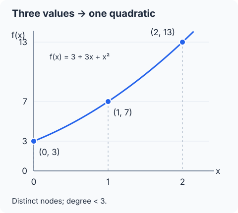
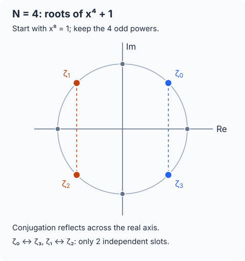

## 필기 원본

이 글에서 다룬 원본 PDF **34–36쪽**이다. 두 단과 여백 필기를 포함한 페이지 전체를 실었다. 이미지를 누르면 확대해서 볼 수 있다.

<figure style="margin: 2rem 0;">
  
  <figcaption>원본 PDF 34쪽.</figcaption>
</figure>

<figure style="margin: 2rem 0;">
  
  <figcaption>원본 PDF 35쪽.</figcaption>
</figure>

<figure style="margin: 2rem 0;">
  
  <figcaption>원본 PDF 36쪽.</figcaption>
</figure>

## 들어가며

[앞 글](/posts/ai-security-ciphertext-multiplication-key-switching-and-rescaling/)에서는 다항식으로 표현한 메시지를 암호화한 뒤 곱하고, 키와 스케일을 정리하는 과정을 살펴봤다. 이번에는 그보다 앞선 질문으로 돌아간다. **여러 데이터를 다항식 하나에 어떻게 넣어야 다항식 곱셈이 데이터의 성분별 곱셈이 될까?**

**정리 범위는 원본 PDF의 34–36쪽이다.** Lagrange interpolation, 몫환에서 평가가 잘 정의되는 조건, 복소수의 극형식과 단위근, canonical embedding의 켤레 대칭, 독립 슬롯 수, 다항식 치환을 원문 순서대로 다룬다.

원문에는 $\mathbb Q$ 계수와 $\mathbb R$, $\mathbb C$ 계수에서 성립하는 대응이 섞여 있다. 정확한 전단사를 설명할 때는 계수의 체를 구별하고, 실제 정수 인코딩에는 스케일과 반올림을 포함한다. 보간 공식의 전개와 마지막 인코딩 수치 예제는 이해를 위한 보충이다.

## 1. 계수에 데이터를 넣는 방법에서 평가값에 넣는 방법으로

### 1.1 계수별 곱과 다항식 곱은 다르다

데이터 $(m_0,\ldots,m_{N-1})$를 그대로 계수에 넣는 coefficient encoding은

$$
(m_0,\ldots,m_{N-1})
\longmapsto m_0+m_1X+\cdots+m_{N-1}X^{N-1}
$$

이다. 덧셈은 계수별 덧셈이지만 곱셈에서는 여러 계수가 섞인다. 예를 들어

$$
(1+2X)(3+4X)=3+10X+8X^2
$$

이며, 입력 벡터의 성분별 곱 $(3,8)$을 계수에 넣은 $3+8X$와 다르다.

이번 방법에서는 계수 대신 **정해진 점에서의 평가값**에 데이터를 넣는다.

$$
f(t_i)=m_i.
$$

그러면 곱셈의 성질만으로

$$
(fg)(t_i)=f(t_i)g(t_i)=m_i u_i
$$

가 된다. 이 관계를 동형암호에서 사용하는 몫환에서도 유지하는 것이 목표다.

### 1.2 사용할 환과 계수의 구별

이하 $N\ge2$는 $2$의 거듭제곱이고

$$
h(X)=X^N+1
$$

로 둔다. 앞 글의 정수 계수 환과 암호문용 환은

$$
R=\mathbb Z[X]/(h),\qquad R_q=R/qR
$$

이다. 정확한 보간을 설명하기 위해 다음 공간도 사용한다.

$$
K=\mathbb Q[X]/(h),\qquad
A_{\mathbb R}=\mathbb R[X]/(h),\qquad
A_{\mathbb C}=\mathbb C[X]/(h).
$$

각 원소는 차수가 $N$ 미만인 다항식 하나로 유일하게 대표된다. 계수를 어느 수의 범위에서 고르는지는 서로 다르다. 이 차이가 뒤에서 슬롯의 독립성과 정확한 인코딩 가능 범위를 결정한다.

## 2. Lagrange interpolation: 값들로부터 다항식을 정한다

### 2.1 서로 다른 점과 차수 조건

서로 다른 실수

$$
t_0,\ldots,t_{N-1}\in\mathbb R
$$

와 원하는 값

$$
\boldsymbol m=(m_0,\ldots,m_{N-1})\in\mathbb R^N
$$

을 정하자. 다음 조건을 만족하는 실수 계수 다항식 $f$가 유일하게 존재한다.

$$
\deg f<N,\qquad f(t_i)=m_i\quad(0\le i<N).
$$

이를 Lagrange interpolation, 즉 **라그랑주 보간**이라고 한다. 여기서 점들은 임의로 고를 수 있지만 서로 달라야 한다.

보간이 인코딩이라면 정해진 점들에서 다시 값을 읽는 평가는 디코딩에 해당한다.

$$
\boldsymbol m\longmapsto f
\longmapsto\bigl(f(t_0),\ldots,f(t_{N-1})\bigr)
=\boldsymbol m.
$$

### 2.2 보간 다항식이 존재하는 이유

**보충 전개:** 각 점에서 하나의 값만 남기는 다항식을 만든다.

$$
\ell_i(X)=\prod_{\substack{0\le j<N\\j\ne i}}
\frac{X-t_j}{t_i-t_j}.
$$

서로 다른 점을 골랐으므로 분모는 $0$이 아니다. 이 다항식은

$$
\ell_i(t_k)=
\begin{cases}
1,&k=i,\\
0,&k\ne i
\end{cases}
$$

를 만족한다. 따라서

$$
f(X)=\sum_{i=0}^{N-1}m_i\ell_i(X)
$$

로 두면 $f(t_k)=m_k$이고 차수는 최대 $N-1$이다.

### 2.3 유일성은 차수에서 나온다

같은 값들을 주는 두 다항식 $f,g$의 차수가 모두 $N$ 미만이라고 하자. 그러면

$$
(f-g)(t_i)=0\quad(0\le i<N).
$$

$f-g$는 차수가 $N$ 미만인데 서로 다른 $N$개의 근을 가진다. 따라서 영다항식이어야 한다.

$$
f-g=0,\qquad f=g.
$$

차수 제한이 없으면 $\prod_i(X-t_i)$의 배수를 더해도 평가값이 같아진다. 원문의 그래프에서 같은 데이터 점들을 지나는 여러 곡선이 가능한 이유다.

### 2.4 원문 예제: 세 값 3, 7, 13

원문의 데이터와 평가점은

$$
\boldsymbol m=(3,7,13),\qquad (t_0,t_1,t_2)=(0,1,2)
$$

이다. 이 예제는 일반 보간의 설명이므로 점의 개수는 $3$이며, 이후 암호용 $N$을 $2$의 거듭제곱으로 정하는 조건과 별개다.

$$
f(X)=a_0+a_1X+a_2X^2
$$

를 대입하면

$$
\underbrace{\begin{pmatrix}
1&0&0\\
1&1&1\\
1&2&4
\end{pmatrix}}_{V}
\begin{pmatrix}a_0\\a_1\\a_2\end{pmatrix}
=\begin{pmatrix}3\\7\\13\end{pmatrix}.
$$

이것이 Vandermonde 행렬이다. 일반적으로 $V_{ij}=t_i^j$이고

$$
\det V=\prod_{0\le i<j<N}(t_j-t_i).
$$

서로 다른 점을 사용하면 행렬식이 $0$이 아니므로 역행렬이 존재한다. 이 예제에서는

$$
\det V=(1-0)(2-0)(2-1)=2.
$$

연립방정식을 풀면

$$
a_0=3,\qquad a_1=3,\qquad a_2=1
$$

이므로

$$
f(X)=3+3X+X^2.
$$

보간 공식으로도 같은 결과를 얻는다.

$$
\ell_0=\frac{(X-1)(X-2)}2,\qquad
\ell_1=-X(X-2),\qquad
\ell_2=\frac{X(X-1)}2,
$$

$$
3\ell_0+7\ell_1+13\ell_2=3+3X+X^2.
$$

### 2.5 곱셈할 때 생기는 차수 문제

두 벡터를 각각 차수 $N$ 미만의 $f,g$로 인코딩하면

$$
\bigl((fg)(t_i)\bigr)_i
=\bigl(f(t_i)g(t_i)\bigr)_i
=\boldsymbol m\odot\boldsymbol u.
$$

$\odot$는 같은 위치의 성분끼리 곱하는 Hadamard product다. 덧셈 역시 같은 위치의 값끼리 더한다.

다만

$$
\deg(fg)\le2N-2
$$

이므로 곱이 처음 사용한 차수 $N$ 미만의 표현에 그대로 머무르지는 않는다. 원문의 “일대일 대응이 유지되지 않는다”는 설명은 이 표현 범위를 구별해서 읽어야 한다.

**평가값의 곱셈 성질은 여전히 맞다.** 문제가 되는 것은 곱을 다시 유일한 낮은 차수의 대표로 정리하는 과정이다. 예제의 $f^2$도 차수는 $4$지만 $0,1,2$에서의 값은 정확히 $(9,49,169)$다.

보충으로, 임의의 서로 다른 점들을 계속 사용하려면

$$
\mathbb R[X]\Big/\left(\prod_i(X-t_i)\right)
$$

를 택하는 방법이 있다. 여기서는 동형암호의 다항식 법 $X^N+1$이 이미 정해져 있으므로, **그 법으로 나머지를 구해도 평가값이 유지되는 점**을 찾아야 한다.

## 3. 몫환의 원소를 평가하려면 대표값과 무관해야 한다

### 3.1 다항식 하나와 동치류는 다르다

$A_{\mathbb C}$의 원소 $[f]$는 단일 다항식만을 뜻하지 않는다.

$$
[f]=\{f(X)+(X^N+1)a(X):a\in\mathbb C[X]\}.
$$

차수가 $N$ 미만인 $f$는 이 동치류의 대표다. 예를 들어 $f$와 $f+(X^N+1)a$는 몫환에서 같은 원소다.

$[f]\mapsto f(t)$가 의미 있는 함수가 되려면 어떤 대표를 사용해도 같은 값이 나와야 한다. 이것을 **잘 정의된다**, 즉 well-defined라고 한다.

### 3.2 필요한 조건은 t가 법다항식의 근이라는 것

같은 동치류의 다른 대표를

$$
p(X)=f(X)+(X^N+1)a(X)
$$

라 하면

$$
p(t)=f(t)+(t^N+1)a(t).
$$

모든 $a$에 대해 $p(t)=f(t)$가 되려면

$$
t^N+1=0
$$

이어야 한다. 필요성은 $a=1$만 골라도 알 수 있고, 충분성은 위 식에 대입하면 바로 확인된다.

따라서 **몫환 $\mathbb C[X]/(X^N+1)$의 평가점은 $X^N+1$의 근이어야 한다.** 같은 설명은 유리수·실수 계수 다항식을 복소수 점에서 평가할 때에도 적용된다.

### 3.3 곱을 낮은 차수로 줄여도 데이터가 유지된다

곱을 나누어

$$
f(X)g(X)=r(X)+(X^N+1)a(X),\qquad\deg r<N
$$

로 쓰자. $\zeta^N+1=0$이면

$$
r(\zeta)=f(\zeta)g(\zeta).
$$

나머지 $r$을 저장해도 근에서의 평가값은 변하지 않는다. 원문 하단의 “몫을 처리해도 데이터를 보존한다”는 메모가 가리키는 성질이다.

계수별 법 $q$ 연산까지 아무 제한 없이 무시해도 된다는 뜻은 아니다. $R_q$에서 계산한 값을 복소수 슬롯으로 읽을 때는 앞 글처럼 스케일과 중심 대표 범위를 함께 관리한다.

## 4. 복소수의 극형식과 단위근

### 4.1 크기와 각도로 복소수를 표현한다

원문의 복소평면 그림에서 $z=x+iy\ne0$를 잡으면

$$
r=|z|=\sqrt{x^2+y^2},\qquad
x=r\cos\theta,\qquad y=r\sin\theta.
$$

Euler 공식

$$
e^{i\theta}=\cos\theta+i\sin\theta
$$

을 사용하면

$$
z=r(\cos\theta+i\sin\theta)=re^{i\theta}
$$

가 된다. 이 표현이 polar form, 즉 극형식이다. $r$은 크기, $\theta$는 편각이며, 편각은 $2\pi$의 정수배만큼 다른 값들을 같은 방향으로 본다. $z=0$에서는 편각을 정하지 않는다.

### 4.2 곱셈은 크기를 곱하고 각도를 더한다

$$
z_1=r_1e^{i\theta_1},\qquad z_2=r_2e^{i\theta_2}
$$

를 곱해 원문처럼 전개하면

$$
\begin{aligned}
z_1z_2
&=r_1r_2\bigl[
\cos\theta_1\cos\theta_2-\sin\theta_1\sin\theta_2\\
&\hspace{35mm}+i(\sin\theta_1\cos\theta_2+\cos\theta_1\sin\theta_2)
\bigr]\\
&=r_1r_2\bigl(\cos(\theta_1+\theta_2)+i\sin(\theta_1+\theta_2)\bigr)\\
&=r_1r_2e^{i(\theta_1+\theta_2)}.
\end{aligned}
$$

따라서

$$
|z_1z_2|=|z_1||z_2|,\qquad
\arg(z_1z_2)\equiv\arg z_1+\arg z_2\pmod{2\pi}.
$$

편각을 특정 구간의 대표값으로 정하면 구간 밖의 합은 다시 그 구간으로 옮겨야 한다. 원문의 각도 덧셈식은 이 의미로 읽는다.

켤레복소수는 실수축에 대해 대칭인 점이다.

$$
\overline z
=r\cos\theta-ir\sin\theta
=r\cos(-\theta)+ir\sin(-\theta)
=re^{-i\theta}.
$$

### 4.3 2N제곱해서 1이 되는 수

$z^{2N}=1$의 해를 구하자. $z=re^{i\theta}$로 두면

$$
z^{2N}=r^{2N}e^{i2N\theta}=1.
$$

절댓값을 취하면 $r^{2N}=1$이므로 $r=1$이다. 각도는

$$
2N\theta=2\pi k,\qquad
\theta=\frac{\pi k}{N}\quad(k\in\mathbb Z)
$$

를 만족한다. 따라서 서로 다른 해는

$$
\omega^k=e^{i\pi k/N},\qquad k=0,\ldots,2N-1
$$

이며, 여기서 $\omega=e^{i\pi/N}$다. 단위원 위에 간격 $\pi/N$으로 놓인 $2N$개의 점이다.

차수 $2N$의 다항식에서 서로 다른 근 $2N$개를 찾았으므로 이들이 모든 근이다. 대수학의 기본정리에 따른 복소수에서의 인수분해는

$$
X^{2N}-1=\prod_{k=0}^{2N-1}(X-\omega^k)
$$

로 쓸 수 있다.

### 4.4 짝수 번째 근과 홀수 번째 근을 나눈다

$$
X^{2N}-1=(X^N-1)(X^N+1).
$$

전체 근에 대해

$$
(\omega^k)^N=e^{i\pi k}=(-1)^k
$$

이므로 $k$가 짝수이면 $X^N-1$의 근이고, 홀수이면 $X^N+1$의 근이다.

$X^N-1$의 근은

$$
e^{2\pi i k/N},\qquad k=0,\ldots,N-1
$$

이다. 두 인수의 근은 겹치지 않는다. 이제 원하는 근을 별도로 번호 매기면

$$
\boxed{\zeta_k=e^{i\pi(2k+1)/N}},\qquad k=0,\ldots,N-1.
$$

이들은 서로 다르고

$$
\zeta_k^N=e^{i\pi(2k+1)}=-1.
$$

전체 $2N$개 단위근 사이의 각도 간격은 $\pi/N$, 그중 홀수 번째만 고른 $N$개 근 사이의 간격은 $2\pi/N$이다. 두 간격을 구별하면 원문의 원 그림과 지수식이 연결된다.

## 5. Canonical embedding은 근에서 값을 읽는 사상이다

### 5.1 복소수 계수에서의 정확한 대응

근의 순서를 위의 $\zeta_0,\ldots,\zeta_{N-1}$로 고정하고

$$
\sigma_{\mathbb C}:A_{\mathbb C}\longrightarrow\mathbb C^N,
\qquad
[f]\longmapsto\bigl(f(\zeta_0),\ldots,f(\zeta_{N-1})\bigr)
$$

로 정의한다. 앞 절의 조건에 따라 대표값과 무관하게 잘 정의된다.

복소수에서도 서로 다른 점에 대한 Lagrange 보간이 성립한다. 따라서 임의의

$$
\boldsymbol z=(z_0,\ldots,z_{N-1})\in\mathbb C^N
$$

에 대해 차수 $N$ 미만의 **복소수 계수** 다항식 $f$가 유일하게 존재한다.

$$
f(\zeta_k)=z_k.
$$

이 의미에서

$$
A_{\mathbb C}\cong\mathbb C^N
$$

이다. 원문 34–35쪽의 임의 복소 벡터와의 전단사는 이 복소수 계수 공간에서 정확히 성립한다.

### 5.2 덧셈과 곱셈은 각 위치에서 따로 일어난다

$$
\sigma_{\mathbb C}(f+g)
=\sigma_{\mathbb C}(f)+\sigma_{\mathbb C}(g),
$$

$$
\sigma_{\mathbb C}(fg)
=\sigma_{\mathbb C}(f)\odot\sigma_{\mathbb C}(g).
$$

여기서 $fg$는 몫환의 곱이다. 다항식 곱의 나머지를 구해도 근에서의 값은 바뀌지 않는다.

$$
f\leftrightarrow(m_0,\ldots,m_{N-1}),\qquad
g\leftrightarrow(u_0,\ldots,u_{N-1})
$$

라면

$$
f+g\leftrightarrow(m_0+u_0,\ldots,m_{N-1}+u_{N-1}),
$$

$$
fg\leftrightarrow(m_0u_0,\ldots,m_{N-1}u_{N-1}).
$$

수론에서 $K$의 각 켤레 근에 대한 매장을 모은 사상을 canonical embedding이라고 한다. $K$에서도 덧셈·곱셈을 성분별 연산으로 보낸다. 위 $\sigma_{\mathbb C}$는 계수를 복소수까지 확장해 설명한 평가 사상이다. [Lyubashevsky–Peikert–Regev, §2.3.2](https://cims.nyu.edu/~regev/papers/ideal-lwe.pdf)

### 5.3 실수 계수라면 켤레인 점들의 값이 연결된다

원문 36쪽의 질문은 “유리수 계수 다항식으로 임의의 복소수 $N$개를 모두 넣을 수 있는가?”다. 유리수는 실수이므로 먼저 실수 계수에서 생기는 제약을 살펴보자.

근들의 켤레 관계는

$$
\begin{aligned}
\zeta_{N-1-k}
&=e^{i\pi(2N-2k-1)/N}\\
&=e^{2\pi i}e^{-i\pi(2k+1)/N}\\
&=\overline{\zeta_k}.
\end{aligned}
$$

$f(X)=\sum_{j=0}^{N-1}a_jX^j$의 계수가 실수이면 $\overline{a_j}=a_j$다. 따라서

$$
\begin{aligned}
f(\overline{\zeta_k})
&=\sum_{j=0}^{N-1}a_j\overline{\zeta_k}^{\,j}\\
&=\overline{\sum_{j=0}^{N-1}a_j\zeta_k^j}\\
&=\overline{f(\zeta_k)}.
\end{aligned}
$$

합과 곱의 켤레가 각각 켤레들의 합과 곱이라는 성질을 썼다. 결과적으로 평가 벡터에는

$$
z_{N-1-k}=\overline{z_k}
$$

라는 제약이 있다.

### 5.4 독립 복소 슬롯은 N/2개다

현재의 근 순서에서는 앞 절반의 값을 정하면 뒤 절반이 정해진다.

$$
(z_0,\ldots,z_{N/2-1},
\overline{z_{N/2-1}},\ldots,\overline{z_0}).
$$

원문의 $N=4$ 예제는

$$
(z_0,z_1,\overline{z_1},\overline{z_0})
$$

이다. 켤레들의 **순서가 뒤집힌다**는 점도 확인해야 한다.

이 벡터들의 집합을

$$
H=\{\boldsymbol z\in\mathbb C^N:
z_{N-1-k}=\overline{z_k}\text{ for all }k\}
$$

로 쓰자. 임의의 $\boldsymbol z\in H$를 복소수 계수로 보간한 다항식의 계수는 실제로 실수다. 이를 확인하려면

$$
\widetilde f(X)=\overline{f(\overline X)}
$$

를 잡으면 된다. 이 표기는 $f$의 계수 각각을 켤레로 바꾼 다항식을 뜻한다. 켤레 대칭에 의해

$$
\widetilde f(\zeta_k)
=\overline{f(\zeta_{N-1-k})}
=z_k=f(\zeta_k).
$$

보간의 유일성으로 $\widetilde f=f$이고, 모든 계수가 자신의 켤레와 같으므로 실수다. 따라서 정확한 대응은

$$
A_{\mathbb R}\cong H\cong\mathbb C^{N/2}
$$

이다. 이는 **실수 대수로서의 동형**이다. 실수 계수 $N$개와 복소수 값 $N/2$개는 각각 $N$개의 실수 자유도를 갖는다. 이를 $A_{\mathbb R}$가 복소수 벡터 공간이라는 주장과 혼동하지 않는다.

앞 절반을 고르는 사영을 $\pi:H\to\mathbb C^{N/2}$라 쓰면, 실제로 선택한 독립 슬롯을 읽는 사상은

$$
\operatorname{Slot}(f)=\pi\bigl(\sigma_{\mathbb R}(f)\bigr)
=\bigl(f(\zeta_0),\ldots,f(\zeta_{N/2-1})\bigr)
$$

이다. $\sigma_{\mathbb R}$는 $\sigma_{\mathbb C}$를 실수 계수 원소에 제한한 사상이다.

### 5.5 켤레 대칭만으로 유리수 계수가 되는 것은 아니다

원문 34–36쪽은 $K$에서 임의의 복소 벡터를 정확히 인코딩할 수 있는 것처럼 적은 뒤, 슬롯 수를 $N/2$로 조정한다. **슬롯 수를 줄이는 것만으로 계수의 유리수 제약까지 해결되지는 않는다.**

예를 들어 $N=2$이면

$$
f(X)=a+bX,\qquad a,b\in\mathbb Q,
$$

이고 $i,-i$에서의 값은 $(a+bi,a-bi)$다. 켤레 대칭인 벡터

$$
(\sqrt2,\sqrt2)
$$

를 정확히 표현하려면 $a=\sqrt2$, $b=0$이어야 한다. 이는 유리수 계수 조건을 만족하지 않는다.

따라서 $K$의 canonical embedding은 $H$로의 **단사**이지만 $H$ 전체로의 전사는 아니다. 정확한 대응과 실제 인코딩을 구별하면 다음과 같다.

| 계수의 범위 | 평가로 표현할 수 있는 값 |
| --- | --- |
| $\mathbb C$ | 임의의 $\mathbb C^N$ 벡터 |
| $\mathbb R$ | 켤레 대칭인 $H$ 전체, 독립 복소 값 $N/2$개 |
| $\mathbb Q$ | $H$의 일부. 켤레 대칭만으로는 충분하지 않음 |
| $\mathbb Z$ | 정수 계수라는 추가 제약. 일반 입력에는 스케일·근사화 필요 |

수론의 $K$와 실수 계수로 확장한 공간을 구별하는 관점은 원 논문의 $K_{\mathbb R}=K\otimes_{\mathbb Q}\mathbb R$와 $H$의 설명에도 나타난다. 이 글의 $A_{\mathbb R}$가 그 확장 공간에 해당한다. [Lyubashevsky–Peikert–Regev, §2.3.2](https://cims.nyu.edu/~regev/papers/ideal-lwe.pdf)

### 5.6 보충: 평가 행렬을 뒤집는 공식

근에서의 평가도 Vandermonde 행렬로 쓸 수 있다.

$$
\boldsymbol z=V\boldsymbol a,\qquad V_{kj}=\zeta_k^j.
$$

복소수 켤레 전치를 $V^*$라 하면

$$
(V^*V)_{j\ell}
=\sum_{k=0}^{N-1}\zeta_k^{\ell-j}
=\begin{cases}
N,&j=\ell,\\
0,&j\ne\ell.
\end{cases}
$$

마지막 등식은 등비수열의 합이다. $\ell-j$가 $0$이 아닌 경우에도 $|\ell-j|<N$이라 공비는 $1$이 아니며, 그 $N$제곱은 $1$이다. 따라서

$$
V^{-1}=\frac1N V^*,\qquad
\boxed{a_j=\frac1N\sum_{k=0}^{N-1}z_k\zeta_k^{-j}}.
$$

여기서 $|\zeta_k|=1$이라 $\overline{\zeta_k^j}=\zeta_k^{-j}$를 썼다. 이는 보간의 역변환을 명시한 공식이다. FFT를 이용하는 구현과도 연결되지만, 이 식 자체는 정확한 수학적 변환을 설명한다.

## 6. 스케일과 반올림을 거쳐 실제 정수 다항식으로 만든다

### 6.1 보간과 정수 인코딩은 서로 다른 단계다

독립 데이터

$$
\boldsymbol z=(z_0,\ldots,z_{N/2-1})\in\mathbb C^{N/2}
$$

를 인코딩하는 과정을 연결해 보자. 먼저 켤레 대칭 벡터로 완성한다.

$$
\pi^{-1}(\boldsymbol z)
=(z_0,\ldots,z_{N/2-1},
\overline{z_{N/2-1}},\ldots,\overline{z_0}).
$$

그 벡터를 역변환하여 이상적인 실수 계수 다항식을 얻는다.

$$
f=\sigma_{\mathbb R}^{-1}\bigl(\pi^{-1}(\boldsymbol z)\bigr)
\in A_{\mathbb R}.
$$

그다음 $\Delta>0$을 곱하고 **계수별로** 최근접 정수 반올림한다.

$$
M(X)=\lfloor\Delta f(X)\rceil\in R.
$$

이것이 앞 글들의 정수 인코딩과 이어지는 부분이다. 이상적인 슬롯 대응과 달리, 반올림한 후의 슬롯 값에는 일반적으로 작은 오차가 있다. CKKS 저자 발표 자료도 역변환 뒤 스케일을 곱하고 정수 다항식으로 반올림하는 예제를 제시한다. [Cheon–Kim–Kim–Song, Packing Method, PDF 12–13쪽](https://yongsoosong.github.io/files/slides/AC17.pdf)

이 설명의 계수별 반올림은 인코딩 원리를 확인하기 위한 구체적인 선택이다. 실제 구현의 반올림 방법·수치 정밀도·매개변수까지 모두 같은 것으로 가정하지 않는다.

### 6.2 계수 오차와 슬롯 오차는 같은 수치가 아니다

**보충 오차 계산:**

$$
\rho=M-\Delta f=\sum_{j=0}^{N-1}\rho_jX^j
$$

라 두면 각 계수는 $|\rho_j|\le1/2$다. 아래 식은 앞 절반에서 선택한 독립 슬롯에 적용한다. 정수 다항식을 스케일로 나누고 평가하면

$$
\frac{M(\zeta_k)}\Delta
=f(\zeta_k)+\frac{\rho(\zeta_k)}\Delta
=z_k+\frac{\rho(\zeta_k)}\Delta.
$$

단위원 위에서는

$$
\begin{aligned}
|\rho(\zeta_k)|
&\le\sum_{j=0}^{N-1}|\rho_j||\zeta_k|^j\\
&=\sum_{j=0}^{N-1}|\rho_j|\\
&\le\frac N2.
\end{aligned}
$$

따라서 계수별 최근접 정수 반올림에 대한 간단한 충분 상한은

$$
\boxed{\left|\frac{M(\zeta_k)}\Delta-z_k\right|
\le\frac{N}{2\Delta}}.
$$

계수의 오차가 $1/2$ 이하라는 이유만으로 모든 슬롯 오차가 $1/(2\Delta)$ 이하라고 할 수는 없다. 평가 과정에서 여러 계수의 오차가 더해진다. 위 식은 그 영향을 삼각부등식으로 잡은 상한이며, 언제나 달성되는 정확한 오차는 아니다.

### 6.3 추가 예제: 두 슬롯 1, 2를 인코딩한다

$N=4$이고 독립 입력을 $(1,2)$로 정하자. 현재의 근 순서에서는

$$
\zeta_0=e^{i\pi/4},\quad
\zeta_1=e^{3i\pi/4},\quad
\zeta_2=e^{5i\pi/4},\quad
\zeta_3=e^{7i\pi/4}
$$

이며, 완성된 벡터는 $(1,2,2,1)$이다. 역변환 결과는

$$
f(X)=\frac32-\frac{\sqrt2}{4}X+\frac{\sqrt2}{4}X^3.
$$

실제로

$$
\zeta_0^3-\zeta_0=-\sqrt2,\qquad
\zeta_1^3-\zeta_1=\sqrt2
$$

이므로

$$
f(\zeta_0)=1,\qquad f(\zeta_1)=2.
$$

입력 데이터가 정수여도 역변환한 계수는 무리수일 수 있다. 이 예제가 유리수 계수와 실수 계수를 구별해야 하는 또 하나의 이유다.

이제 $\Delta=1000$으로 정한다.

$$
\Delta f(X)
=1500-250\sqrt2X+250\sqrt2X^3,
$$

$$
250\sqrt2\approx353.5533906.
$$

계수별 반올림 결과는

$$
M(X)=1500-354X+354X^3.
$$

디코딩한 독립 슬롯은

$$
\begin{aligned}
\frac{M(\zeta_0)}{1000}
&=1.5-0.354\sqrt2\approx0.9993683989,\\
\frac{M(\zeta_1)}{1000}
&=1.5+0.354\sqrt2\approx2.0006316011.
\end{aligned}
$$

각 슬롯의 오차 크기는 약 $0.0006316011$이며, 상한

$$
\frac{N}{2\Delta}=\frac4{2000}=0.002
$$

보다 작다. 이 예제는 **인코딩 반올림만을 분리한 계산**이다. 암호화 잡음을 넣어 실행한 결과로 표시하지 않는다.

### 6.4 암호화 후에는 복호화 조합을 먼저 중심 대표로 읽는다

앞 글의 두 성분 암호문이

$$
D_s(c)=[M+e]_q
$$

를 만족한다고 하자. $e$는 인코딩 반올림 $\rho$와 구별한 정수 계수 암호화·평가 오차다. 여기서는

$$
\|M+e\|_{\mathrm{coeff},\infty}<q/2
$$

를 가정하여 중심 대표가 정확히 $M+e$가 되도록 한다. 그러면 슬롯 디코딩은

$$
\widehat{\boldsymbol z}
=\frac1\Delta\pi\left(
\sigma_{\mathbb R}\bigl(\operatorname{ctr}_q(D_s(c))\bigr)
\right)
$$

이고, 각 독립 슬롯은

$$
\widehat z_k
=z_k+\frac{\rho(\zeta_k)+e(\zeta_k)}\Delta.
$$

예를 들어 $\|e\|_{\mathrm{coeff},\infty}\le B$이면

$$
|\widehat z_k-z_k|\le\frac{N(B+1/2)}\Delta.
$$

이는 계수 오차를 슬롯 오차로 옮기는 충분 상한이다. 앞 글의 총오차 표기로는 $\eta=\rho+e$에 해당한다.

법 $q$에서의 원소를 대표 선택 없이 복소수에 바로 대입할 수는 없다. 예를 들어 $0$과 상수 다항식 $q$는 $R_q$에서 같지만, 복소수 값 $0$과 $q$는 다르다. 그래서 **계수 법 연산을 되돌려 읽는 단계**와 **근에서 평가하는 단계**를 구별한다.

## 7. 슬롯에서 덧셈·곱셈을 보면 무엇이 달라지는가

### 7.1 이상적인 실수 계수 표현에서는 정확한 성분별 연산이다

$$
\operatorname{Slot}(f)=\boldsymbol z,\qquad
\operatorname{Slot}(g)=\boldsymbol w
$$

이면

$$
\operatorname{Slot}(f+g)=\boldsymbol z+\boldsymbol w,
$$

$$
\operatorname{Slot}(fg)=\boldsymbol z\odot\boldsymbol w.
$$

즉 다항식의 한 번의 덧셈·곱셈으로 여러 슬롯에서 같은 종류의 연산을 수행한다. 원문의 성분별 연산 요약이 뜻하는 SIMD, single instruction, multiple data 구조다.

다만 덧셈·곱셈만 반복하면 각 출력 슬롯은 같은 위치의 입력 슬롯들에만 의존한다. 예를 들어 두 슬롯 $z_0,z_1$의 합을 한 슬롯에 모으려면 위치를 섞는 연산이 필요하다. 이것이 원문 36쪽 끝의 “순서는 어떻게 바꾸는가?”라는 다음 질문으로 이어진다.

### 7.2 정수 인코딩에서는 근사값과 스케일을 함께 추적한다

$M_f\approx\Delta f$, $M_g\approx\Delta g$라면 곱은

$$
M_fM_g\approx\Delta^2fg
$$

이므로 출력 스케일은 $\Delta^2$다. 슬롯을 읽을 때도 곱의 스케일로 나눠야 한다.

이미 읽은 근사 슬롯 값을 $\widehat z_k=z_k+\epsilon_k$, $\widehat w_k=w_k+\delta_k$라 하면, 추가 암호문 처리 오차를 잠시 제외한 곱의 오차는

$$
\widehat z_k\widehat w_k-z_kw_k
=z_k\delta_k+w_k\epsilon_k+\epsilon_k\delta_k.
$$

따라서 canonical embedding이 성분별 곱을 보존한다는 정확한 대수적 성질과, 실제 CKKS 계산에 반올림·암호화·키 전환·rescaling 오차가 있다는 사실은 함께 성립한다. 키 전환과 rescaling의 추가 오차는 앞 글의 계산을 따른다.

## 8. 다항식 치환은 슬롯 순서를 바꾸는 출발점이다

### 8.1 X에 다른 다항식을 넣어 본다

원문 36쪽 오른쪽에서는 지금까지의 덧셈·곱셈 외에

$$
\tau_5:[f(X)]\longmapsto[f(X^5)]
$$

라는 치환을 생각한다. 여기서는 먼저 $K=\mathbb Q[X]/(X^N+1)$ 위의 사상으로 살펴본다.

근에서 값을 읽으면

$$
(\tau_5 f)(\zeta_k)=f(\zeta_k^5).
$$

다른 근의 평가값을 현재 위치에서 읽게 되는 것이다. 이를 슬롯의 순환이동으로 사용하려면 근의 순서도 그에 맞게 정해야 한다. 지금의 자연스러운 각도 순서가 곧바로 한 칸 순환이동의 순서인 것은 아니다.

### 8.2 원문 N=8 예제의 모든 항을 줄여 본다

원문의 다항식은

$$
f(X)=1+2X-X^2+3X^3+4X^4-3X^5-2X^6-4X^7
$$

이며, 법은 $X^8+1$이다. 치환 직후에는

$$
f(X^5)=1+2X^5-X^{10}+3X^{15}+4X^{20}-3X^{25}-2X^{30}-4X^{35}.
$$

$X^8=-1$이므로 지수를 $8a+b$로 쓰면

$$
X^{8a+b}=(-1)^aX^b.
$$

각 항의 나머지는 다음과 같다.

| 원래 항 | $X\mapsto X^5$ 직후 | 법 $X^8+1$에서의 나머지 |
| --- | --- | --- |
| $1$ | $1$ | $1$ |
| $2X$ | $2X^5$ | $2X^5$ |
| $-X^2$ | $-X^{10}$ | $X^2$ |
| $3X^3$ | $3X^{15}$ | $-3X^7$ |
| $4X^4$ | $4X^{20}$ | $4X^4$ |
| $-3X^5$ | $-3X^{25}$ | $3X$ |
| $-2X^6$ | $-2X^{30}$ | $2X^6$ |
| $-4X^7$ | $-4X^{35}$ | $-4X^3$ |

차수 순서로 정리하면 원문과 같이

$$
\boxed{\tau_5 f
=1+3X+X^2-4X^3+4X^4+2X^5+2X^6-3X^7}.
$$

치환은 단순히 계수 배열을 다섯 칸 옮기는 연산이 아니다. 지수의 위치가 바뀌고, $X^8=-1$에 따라 부호도 바뀐다.

### 8.3 같은 동치류에 다른 대표를 골라도 같은 결과여야 한다

일반적인 양의 홀수 $r=2t+1$에 대해

$$
\tau_r:[f(X)]\longmapsto[f(X^r)]
$$

를 생각하자. 다음 조건을 확인해야 한다.

$$
[p]=[f]\quad\Longrightarrow\quad[p(X^r)]=[f(X^r)].
$$

같은 동치류라면 어떤 $a(X)$에 대해

$$
p(X)=f(X)+(X^N+1)a(X).
$$

이를 치환하면

$$
p(X^r)=f(X^r)+(X^{rN}+1)a(X^r).
$$

$r$이 홀수이므로

$$
\begin{aligned}
X^{rN}+1
&=(X^N+1)b_r(X),\\
b_r(X)
&=\sum_{j=0}^{r-1}(-1)^jX^{(r-1-j)N}.
\end{aligned}
$$

예를 들어 $r=5$이면 두 번째 인수는

$$
X^{4N}-X^{3N}+X^{2N}-X^N+1
$$

이다. 따라서

$$
p(X^r)
=f(X^r)+(X^N+1)b_r(X)a(X^r)
\in[f(X^r)].
$$

원문의 증명처럼 같은 동치류의 원소들은 치환 후에도 같은 동치류에 속한다. 그러므로 $\tau_r$는 몫환에서 잘 정의된다.

이 인수분해는 정수 계수 항등식이므로 계수를 법 $q$로 줄여도 성립한다. 따라서 홀수 지수 치환은 $R_q$ 위에서도 정의할 수 있다.

### 8.4 짝수 지수 치환이 실패하는 반례

원문 하단의 반례는 $\mathbb Q$ 계수 몫환에서

$$
[0]=[X^N+1]
$$

이라는 관계를 이용한다. $X\mapsto X^2$를 적용하면

$$
0\longmapsto0,
$$

$$
X^N+1\longmapsto X^{2N}+1
\equiv(-1)^2+1=2\pmod{X^N+1}.
$$

$K$에서는 $[0]\ne[2]$이므로 대표를 어떻게 고르느냐에 따라 결과가 달라진다. 따라서 이 짝수 지수 치환은 $K$ 위의 사상으로 잘 정의되지 않는다. 원문의 “아무 다항식 치환이나 몫환 연산으로 사용할 수는 없다”는 메모를 보여 주는 예다.

### 8.5 보충: 홀수 지수는 왜 근을 순열로 바꾸는가

현재의 조건 $N=2^n$에서는 홀수 $r$에 대해

$$
\gcd(r,2N)=1.
$$

그러므로 $\ell r\equiv1\pmod{2N}$을 만족하는 $\ell$이 존재한다. 몫환에서 $X^{2N}=1$이므로

$$
\tau_\ell\circ\tau_r=\tau_{\ell r}=\operatorname{id}.
$$

즉 $\tau_r$에는 역치환이 있고, 덧셈·곱셈을 보존하는 automorphism, 즉 환의 자기동형이다. 근에서도

$$
\{\zeta_k^r:0\le k<N\}=\{\zeta_k:0\le k<N\}
$$

가 되어 근들의 위치를 순열로 바꾼다. “홀수면 충분하다”는 설명에는 $N$이 $2$의 거듭제곱이라는 조건이 들어 있다. 일반적인 $N$에서는 $\gcd(r,2N)=1$인지 별도로 확인해야 한다.

다음 글은 37쪽의 **근을 $5$의 거듭제곱 순서로 재배열하는 과정**부터 이어간다. 그 순서에서 $f(X)\mapsto f(X^5)$가 독립 슬롯의 한 칸 순환이동이 되는 이유를 확인한다.
