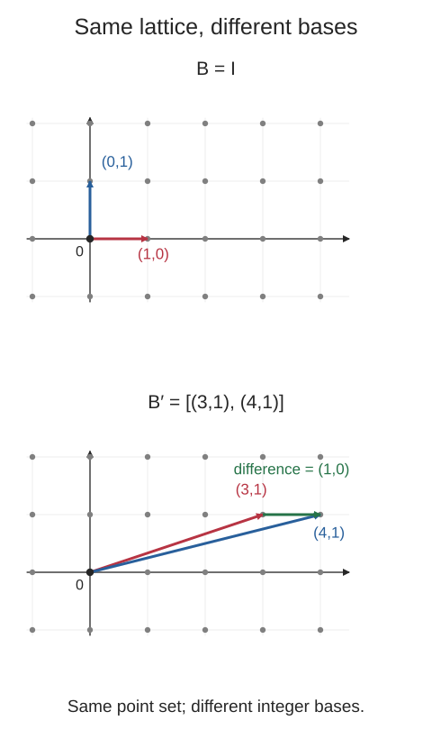
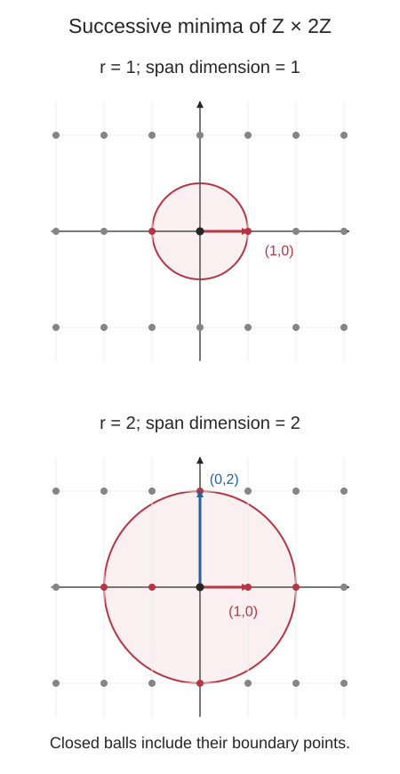

## 필기 원본

이 글에서 다룬 원본 PDF **6–10쪽**이다. 두 단과 여백 필기를 포함한 페이지 전체를 실었다. 이미지를 누르면 새 탭에서 원본 크기로 볼 수 있다.

[정리 글로 바로 가기](#들어가며)

<figure style="margin: 2rem 0;">
  
  <figcaption>원본 PDF 6쪽. <a href="/images/posts/cryptography-handwritten-notes/page-006.webp" target="_blank" rel="noopener">원본 크기로 보기</a></figcaption>
</figure>

<figure style="margin: 2rem 0;">
  
  <figcaption>원본 PDF 7쪽. <a href="/images/posts/cryptography-handwritten-notes/page-007.webp" target="_blank" rel="noopener">원본 크기로 보기</a></figcaption>
</figure>

<figure style="margin: 2rem 0;">
  
  <figcaption>원본 PDF 8쪽. <a href="/images/posts/cryptography-handwritten-notes/page-008.webp" target="_blank" rel="noopener">원본 크기로 보기</a></figcaption>
</figure>

<figure style="margin: 2rem 0;">
  
  <figcaption>원본 PDF 9쪽. <a href="/images/posts/cryptography-handwritten-notes/page-009.webp" target="_blank" rel="noopener">원본 크기로 보기</a></figcaption>
</figure>

<figure style="margin: 2rem 0;">
  
  <figcaption>원본 PDF 10쪽. <a href="/images/posts/cryptography-handwritten-notes/page-010.webp" target="_blank" rel="noopener">원본 크기로 보기</a></figcaption>
</figure>

## 들어가며

[앞 글](/posts/ai-security-lwe-mathematical-foundations/)에서는 LWE를 $\mathbf b=A\mathbf s+\mathbf e\pmod q$로 표현하고, 가우스 소거법을 적용해도 오차가 함께 변환된다는 점을 확인했다. 이번에는 그 직관을 넘어 LWE의 난해성을 어떤 문제와 연결하는지 정리한다.

**정리 범위는 원본 PDF의 6–10쪽이다.** 환원의 방향과 독립집합 문제 예제, 격자와 기저, successive minima, SVP와 SIVP, 근사 문제, Regev의 격자 문제에서 LWE로의 환원을 다룬다. 11쪽부터 시작하는 LWE 공개키 암호와 Ring-LWE는 다음 글의 범위다.

필기의 정의와 논리 전개를 원문 순서로 옮긴다. 설명을 위해 새로 만든 수치 예제는 **추가 예제**로 표시하고, 그림은 필기의 격자·기저·반경에 대한 설명을 정확한 좌표로 다시 그렸다. 환원 방향과 경계 조건처럼 보정이 필요한 부분도 따로 짚는다.

## 1. Reduction: 환원의 방향 다시 보기

문제 $A$를 문제 $B$로 다항시간에 환원할 수 있다는 것을

$$
A\le_{\mathrm p}B
$$

라고 쓰자. 이때 보장되는 방향은

$$
B\text{ is efficiently solvable}
\implies
A\text{ is efficiently solvable}
$$

이다. $A$의 입력을 $B$의 입력으로 바꾸고, $B$를 푼 결과를 이용해 $A$의 답을 얻기 때문이다.

이 명제의 대우는

$$
A\text{ is hard}\implies B\text{ is hard}
$$

라는 방향이다. **어려운 문제 $A$를 $B$로 환원해야 $B$의 난해성을 뒷받침할 수 있다.** 여기서 hard의 구체적인 뜻은 다항시간 알고리즘의 존재 여부, 성공 확률, 결정적·확률적·양자 계산 중 무엇을 허용하는지에 따라 정해야 한다.

### 필기에서 방향을 구별할 부분

원문에는 $A\le B$ 옆에 “$B$를 풀 수 없으면 $A$도 풀 수 없다”는 메모가 있다. 이 문장은 일반적으로 환원에서 따라오지 않는다. $B$가 어려워도 $A$ 자체는 쉬울 수 있기 때문이다.

같은 쪽의 이어지는 설명처럼, **$B$를 푸는 효율적인 알고리즘이 있으면 $A$도 효율적으로 푼다**고 읽어야 한다. 따라서 $A$가 어렵다는 가정을 사용해 $B$의 난해성을 설명하는 순서가 된다.

### 필기 예제: 3SAT에서 Independent Set으로

INDSET은 그래프 $G$와 정수 $k$를 받아, 서로 인접하지 않는 정점을 적어도 $k$개 고를 수 있는지 묻는 독립집합 문제다.

원문의 환원 예제는

$$
\mathrm{3SAT}\le_{\mathrm p}\mathrm{INDSET}
$$

이다. 3SAT 식의 만족 가능성에 관한 질문을 독립집합의 존재에 관한 질문으로 바꾼다. 만약 INDSET을 다항시간에 풀 수 있다면, 변환한 입력에 그 알고리즘을 사용해 3SAT도 다항시간에 풀 수 있다.

3SAT가 NP-hard라는 사실을 이용하면 INDSET의 NP-hardness를 보이는 방향도 이해할 수 있다. 다만 NP-hard라는 말 자체가 다항시간 알고리즘의 부재를 무조건 증명하는 것은 아니다. 예를 들어 $\mathrm P\ne\mathrm{NP}$를 가정하면 이 두 결정 문제에 다항시간 알고리즘이 없다는 결론을 얻는다.

## 2. Lattice: 정수 계수로 생성하는 점들의 집합

실수 공간 $\mathbb R^n$에서 선형독립인 벡터

$$
\mathbf b_1,\ldots,\mathbf b_m,\qquad m\le n
$$

을 고른다. 이 벡터들의 **정수 선형결합** 전체를 격자(lattice)라고 한다.

$$
\mathcal L=
\left\{
\sum_{i=1}^{m}z_i\mathbf b_i
\;\middle|\;
z_i\in\mathbb Z
\right\}.
$$

원문은 기저를 $\mathbf e_i$, 계수를 $a_i$로 쓴다. 여기서는 앞 글의 오차 $e_i$와 구별하기 위해 기저를 $\mathbf b_i$, 정수 계수를 $z_i$로 통일한다.

기저를 열벡터로 모으면

$$
B=
\begin{pmatrix}
\mathbf b_1&\cdots&\mathbf b_m
\end{pmatrix}
\in\mathbb R^{n\times m}
$$

이고,

$$
\mathcal L(B)=\{B\mathbf z\mid\mathbf z\in\mathbb Z^m\}
$$

로 쓸 수 있다.

| 기호 | 의미 |
|---|---|
| $n$ | 격자가 놓인 주변 공간의 차원, ambient dimension |
| $m$ | 독립인 기저 벡터의 개수, lattice rank |
| $B$ | 격자를 생성하는 기저 행렬 |
| $\mathcal L(B)$ | 그 기저가 만드는 점들의 집합 |

$m=n$이면 주변 공간 전체 차원의 격자다. $m<n$이면 더 큰 공간 안의 낮은 차원 부분공간에 격자가 놓인다.

**추가 예제.** $\mathbb R^3$에서

$$
\mathbf b_1=(1,0,0)^{\mathsf T},\qquad
\mathbf b_2=(0,2,0)^{\mathsf T}
$$

를 고르면

$$
\mathcal L=\{(z_1,2z_2,0)^{\mathsf T}\mid z_1,z_2\in\mathbb Z\}.
$$

주변 공간의 차원은 $3$, rank는 $2$다.

### 정수 계수라는 조건이 중요하다

계수로 모든 실수를 허용하면 벡터들이 생성하는 실수 부분공간 전체가 된다. 격자는 정수 계수만 허용하므로 점들이 이산적으로 놓인다. 유한한 반경 안에 격자점이 무한히 몰려들지 않는다는 성질이 최단 벡터를 논의할 때 중요하다.

정수 선형결합의 정의로부터

$$
\mathbf0\in\mathcal L,\qquad
\mathbf x,\mathbf y\in\mathcal L
\implies
\mathbf x-\mathbf y\in\mathcal L
$$

도 성립한다.

## 3. 같은 격자와 서로 다른 기저

격자 자체는 점들의 집합이다. 같은 격자에 여러 기저가 존재할 수 있으므로, 입력으로 주어진 기저의 모양만 보고 격자의 기하를 바로 알기는 어렵다.

벡터 공간의 기저를 바꿀 때는 가역인 실수 행렬을 사용할 수 있다. 격자의 기저를 바꿀 때는 **정수 계수로 생성되는 점들의 집합까지 유지해야 한다.**

두 기저의 관계를

$$
B'=BU
$$

라고 하자. $U\in\mathbb Z^{m\times m}$이고

$$
\det U=\pm1
$$

이면 $U^{-1}$도 정수 행렬이다. 이런 행렬을 **unimodular matrix**라고 한다.

이때

$$
\mathcal L(B')=\mathcal L(B).
$$

실제로 $\mathbf z\in\mathbb Z^m$에 대해 $U\mathbf z\in\mathbb Z^m$이므로

$$
B'\mathbf z=B(U\mathbf z)\in\mathcal L(B).
$$

따라서 $\mathcal L(B')\subseteq\mathcal L(B)$이다. 반대로 $U^{-1}$도 정수 행렬이므로 $B= B'U^{-1}$를 사용해 반대 포함 관계도 얻는다.

같은 격자의 두 기저 사이에는 이런 unimodular 변환이 존재한다. 단순히 행렬이 가역이라는 조건만으로는 충분하지 않다. 예를 들어 $B'=2B$는 보통 원래 격자의 일부 점만 생성한다.

### 추가 예제: 긴 기저 안에 짧은 벡터가 숨어 있다

표준 기저 $B=I_2$는 $\mathbb Z^2$를 생성한다. 다음 행렬도 같은 격자의 기저다.

$$
B'=
\begin{pmatrix}
3&4\\
1&1
\end{pmatrix},
\qquad
\det B'=-1.
$$

두 기저 벡터는

$$
\mathbf b'_1=(3,1)^{\mathsf T},\qquad
\mathbf b'_2=(4,1)^{\mathsf T}.
$$

길이는 각각 $\sqrt{10}$, $\sqrt{17}$이지만

$$
\mathbf b'_2-\mathbf b'_1=(1,0)^{\mathsf T}
$$

는 길이가 $1$이다. 또

$$
4\mathbf b'_1-3\mathbf b'_2=(0,1)^{\mathsf T}
$$

이므로 두 표준 기저 벡터를 정수 선형결합으로 복원할 수 있다.

두 패널의 격자점은 같다. 아래쪽에서는 두 긴 기저 벡터의 차이가 더 짧은 격자 벡터가 된다. 원문에 있는 직교에 가까운 기저와 비직교 기저의 스케치를, 같은 점집합을 유지하는 수치 예제로 다시 그린 것이다.

이 예제만 보아도 최단 벡터를 찾는 문제는 입력 기저에서 가장 짧은 열벡터를 고르는 문제와 다르다는 것을 알 수 있다.

## 4. Successive Minima: 독립인 방향을 확보하는 반경

이 글의 길이는 유클리드 노름을 사용한다.

$$
\|\mathbf x\|=\|\mathbf x\|_2
=\sqrt{x_1^2+\cdots+x_n^2}.
$$

### 4.1 열린 공과 successive minima의 정의

원문처럼 원점 중심의 열린 공을

$$
B^\circ(0,r)=
\{\mathbf x\in\mathbb R^n\mid\|\mathbf x\|<r\}
$$

로 쓰자. rank가 $m$인 격자의 $i$번째 successive minimum은

$$
\lambda_i(\mathcal L)=
\inf\left\{
r>0\;\middle|\;
\dim\operatorname{span}_{\mathbb R}
\bigl(\mathcal L\cap B^\circ(0,r)\bigr)\ge i
\right\},
\quad1\le i\le m.
$$

식을 안쪽부터 읽으면 다음과 같다.

1. $\mathcal L\cap B^\circ(0,r)$는 반경 $r$보다 가까운 격자점들이다.
2. 그 점들을 실수 계수로 span한다.
3. span의 차원이 $i$ 이상인지 확인한다.
4. 이 조건이 성립하는 반경들의 하한을 구한다.

벡터를 많이 모으는 것과 독립인 방향을 많이 확보하는 것은 다르다. $\mathbf v$와 $-\mathbf v$는 서로 다른 두 벡터지만 같은 한 방향만 span한다.

따라서 $\lambda_i$는 원점을 중심으로 반경을 늘릴 때 **선형독립인 격자 벡터를 $i$개 확보하는 경계 반경**으로 이해할 수 있다. 조건이 더 강해지는 순서이므로

$$
0<\lambda_1(\mathcal L)
\le\lambda_2(\mathcal L)
\le\cdots\le\lambda_m(\mathcal L).
$$

### 4.2 열린 공에서 inf를 사용하는 이유

길이가 정확히 $1$인 벡터는 열린 공 $B^\circ(0,1)$에 들어가지 않는다. 그래서 열린 공을 사용하는 위 정의에서 inf를 무심코 min으로 바꾸면 경계에서 문제가 생긴다.

닫힌 공

$$
\overline B(0,r)=
\{\mathbf x\in\mathbb R^n\mid\|\mathbf x\|\le r\}
$$

을 사용하면 경계의 벡터까지 포함한다. 격자의 이산성에 의해 같은 값은

$$
\lambda_i(\mathcal L)=
\min\left\{
r>0\;\middle|\;
\dim\operatorname{span}_{\mathbb R}
\bigl(\mathcal L\cap\overline B(0,r)\bigr)\ge i
\right\}
$$

로도 표현할 수 있다. 반경의 값은 같고, 경계의 점을 공에 포함하는지가 다르다.

### 추가 예제: 첫 방향과 두 번째 방향

$$
\mathcal L=\{(z_1,2z_2)^{\mathsf T}\mid z_1,z_2\in\mathbb Z\}
$$

를 생각하자.

- 길이가 $1$인 $(1,0)^{\mathsf T}$가 있으므로 $\lambda_1=1$이다.
- 길이가 $2$보다 작은 격자 벡터는 모두 $x$축 위에 있다.
- $(0,2)^{\mathsf T}$까지 포함하면 독립인 방향을 두 개 확보하므로 $\lambda_2=2$다.

이 그림은 경계를 포함하는 닫힌 공으로 그렸다. 원문의 $\lambda_1$·$\lambda_2$ 스케치가 나타내는 것은 점의 개수 자체가 아니라 span의 차원이 증가하는 순간이다.

### 4.3 첫 번째 minimum과 점 사이의 최단 거리

특히

$$
\lambda_1(\mathcal L)
=\min_{\mathbf x\in\mathcal L\setminus\{\mathbf0\}}
\|\mathbf x\|
$$

이다. 영벡터는 항상 격자에 들어가므로 제외해야 한다.

또한

$$
\lambda_1(\mathcal L)
=\min_{\substack{\mathbf x,\mathbf y\in\mathcal L\\
\mathbf x\ne\mathbf y}}
\|\mathbf x-\mathbf y\|.
$$

서로 다른 두 격자점의 차이 $\mathbf x-\mathbf y$는 영벡터가 아닌 격자 벡터다. 따라서 오른쪽의 어떤 거리도 $\lambda_1$보다 작을 수 없다. 반대로 최단 비영 벡터 $\mathbf v$와 원점 사이의 거리가 $\|\mathbf v\|=\lambda_1$이므로 두 최솟값이 같다.

즉 가장 가까운 두 격자점 사이의 거리를 구하는 문제는, 차이 벡터를 원점으로 옮겨 가장 짧은 비영 격자 벡터를 구하는 문제로 볼 수 있다.

## 5. SVP: 가장 짧은 비영 격자 벡터 찾기

이제 원문처럼 full-rank 정수 기저

$$
B\in\mathbb Z^{n\times n},\qquad\det B\ne0
$$

를 입력으로 받는 계산 문제를 생각한다. 격자를 $\mathcal L=\mathcal L(B)$라고 하자.

**Shortest Vector Problem**, 즉 SVP는

$$
\mathbf v\in\mathcal L\setminus\{\mathbf0\},
\qquad
\|\mathbf v\|=\lambda_1(\mathcal L)
$$

을 만족하는 벡터를 찾는 문제다.

입력은 기저 $B$이며, 출력은 최단 벡터다. 입력 기저의 벡터 길이 중

$$
\min_i\|\mathbf b_i\|
$$

를 계산하는 것으로 끝나지 않는다. 앞의 예제처럼 정수 선형결합에서 더 짧은 벡터가 나올 수 있다.

최단 벡터와 successive minima는 격자의 기하 구조를 이해하는 핵심 값이다. 정확한 유클리드 SVP에 대해서는 Ajtai의 1998년 논문에 [무작위 환원 아래의 NP-hardness 결과](https://doi.org/10.1145/276698.276705)가 있다. 이 결과에서 다루는 정확도와 환원의 종류를 이후의 근사 문제·양자 환원과 구별해서 읽어야 한다.

## 6. SIVP: 짧은 독립 벡터 여러 개 찾기

**Shortest Independent Vectors Problem**, 즉 SIVP는 기저 $B$가 주어졌을 때 선형독립인

$$
\mathbf v_1,\ldots,\mathbf v_n\in\mathcal L(B)
$$

을 찾아

$$
\|\mathbf v_i\|\le\lambda_n(\mathcal L(B)),
\qquad i=1,\ldots,n
$$

을 만족시키는 문제다.

SVP가 $\lambda_1$과 관련된다면 SIVP는 $\lambda_n$과 관련된다. 하나의 짧은 방향을 찾는 것에서 나아가, 전체 차원을 span할 수 있는 짧은 독립 벡터들을 찾는다.

여기서 모든 벡터의 기준은 공통된 $\lambda_n$이다. 각 $\mathbf v_i$가 반드시 길이 $\lambda_i$를 가져야 한다는 조건은 아니다.

### 독립 벡터들이 반드시 격자 기저인 것은 아니다

선형독립인 $n$개의 격자 벡터가 실수 공간을 span하더라도, 정수 선형결합으로 원래 격자의 모든 점을 생성한다고 보장할 수는 없다.

**추가 예제.** 앞의

$$
\mathcal L=\mathbb Z\times2\mathbb Z,
\qquad\lambda_2(\mathcal L)=2
$$

에서

$$
\mathbf v_1=(2,0)^{\mathsf T},\qquad
\mathbf v_2=(0,2)^{\mathsf T}
$$

를 고르자. 두 벡터는 독립이고 길이가 모두 $2$이므로 정확한 SIVP의 조건을 만족한다.

하지만 이들의 정수 선형결합은 $2\mathbb Z\times2\mathbb Z$만 만든다. 원래 격자에 속하는 $(1,0)^{\mathsf T}$는 생성하지 못한다. 원문의 “전체 격자를 생성하는 basis일 필요는 없다”는 메모가 가리키는 차이다.

## 7. 근사 문제와 approximation factor

정확한 최솟값을 요구하는 대신 일정한 배율까지 허용하는 문제를 생각할 수 있다. 근사계수는

$$
\gamma=\gamma(n)\ge1
$$

로 쓴다.

예를 들어 근사 SVP의 탐색 조건은

$$
\mathbf v\in\mathcal L\setminus\{\mathbf0\},
\qquad
\|\mathbf v\|\le\gamma(n)\lambda_1(\mathcal L)
$$

이다. $\gamma$가 작을수록 요구하는 벡터가 더 짧아야 한다.

원문에서는 이 근사 관점에서 GapSVP와 근사 SIVP를 정의한다.

### 7.1 GapSVP: 두 경우를 구별하는 약속 문제

$\mathrm{GapSVP}_{\gamma}$의 입력은 격자 기저 $B$와 양의 기준값 $d$다. 다음 두 경우를 구별한다.

$$
\begin{aligned}
\mathrm{YES}:&\quad\lambda_1(\mathcal L(B))\le d,\\
\mathrm{NO}:&\quad\lambda_1(\mathcal L(B))>\gamma(n)d.
\end{aligned}
$$

입력이 둘 중 하나에 속한다고 **약속**(promise)되어 있다. 따라서

$$
d<\lambda_1(\mathcal L(B))\le\gamma(n)d
$$

인 중간 구간은 약속 범위 밖이다. 이 구간의 입력에 대해 알고리즘이 YES와 NO 중 무엇을 내놓아야 하는지는 문제 정의에서 요구하지 않는다.

GapSVP의 출력은 YES 또는 NO다. 최단 벡터 자체나 그 정확한 길이를 출력하는 문제가 아니다.

### 필기 예제: $d=10$, $\gamma=2$

이때 조건은

$$
\mathrm{YES}:\lambda_1\le10,
\qquad
\mathrm{NO}:\lambda_1>20
$$

이다.

| $\lambda_1$의 값 | 구분 |
|---|---|
| $10$ 이하 | YES |
| $12$, $15$, $19$ | 중간 구간, 약속 범위 밖 |
| $20$ | 중간 구간의 오른쪽 경계, 약속 범위 밖 |
| $20$ 초과 | NO |

원문에 있는 $12,15,19$ 예제를 유지하고, 부등호를 확인하기 위해 경계 $20$도 추가했다. NO 조건이 엄격한 $>$라는 점이 중요하다.

$\gamma=1$이면 중간 구간은 사라진다. 이 경우에는 $\lambda_1\le d$인지 묻는 정확한 임계값 결정 문제가 된다. 필기의 “exact SVP”라는 메모는 이 의미로 읽을 수 있으며, 최단 벡터를 출력하는 앞 절의 탐색 문제와 출력 형식은 구별한다.

### 7.2 왜 중간 구간을 두는가

정확한 최단 길이를 구하는 대신, 아주 짧은 벡터가 있는 경우와 모든 비영 벡터가 충분히 긴 경우를 구별하도록 요구를 완화한다.

$\gamma$가 커질수록 YES와 NO 사이에서 구별하지 않아도 되는 구간이 커진다. 따라서 일반적으로 더 느슨한 근사 보장이다. 난해성 결과를 읽을 때는 어떤 $\gamma$를 사용하는지 확인해야 한다.

### 7.3 근사 SIVP

$\mathrm{SIVP}_{\gamma}$는 선형독립인 격자 벡터

$$
\mathbf v_1,\ldots,\mathbf v_n\in\mathcal L(B)
$$

을 찾아

$$
\|\mathbf v_i\|
\le\gamma(n)\lambda_n(\mathcal L(B)),
\qquad i=1,\ldots,n
$$

을 만족시키는 탐색 문제다.

$\gamma=1$이면 앞 절의 정확한 SIVP다. 근사 문제에서도 독립성을 요구하며, 단순히 같은 짧은 벡터를 여러 번 출력해서는 안 된다.

### 7.4 LLL: 실행시간과 근사계수를 구별하기

원문은 LLL이 $2^{O(n)}$ 수준의 근사를 다항시간에 제공할 수 있다는 예를 든다. 여기서 지수적인 것은 **최악 경우의 근사계수**이고, 실행시간이 지수시간이라는 뜻이 아니다.

**보충.** 표준적인 $\delta=3/4$ 설정에서 LLL로 얻은 기저의 첫 벡터는

$$
\|\mathbf b_1\|
\le2^{(n-1)/2}\lambda_1(\mathcal L)
$$

을 만족한다. 입력의 비트 길이에 대한 다항시간에 이런 기저를 구할 수 있다. 이 보장은 Regev의 [LLL 강의 노트, Claim 1과 실행시간 분석](https://cims.nyu.edu/~regev/teaching/lattices_fall_2004/ln/lll.pdf)에서 확인할 수 있다.

따라서 “격자 문제가 어렵다”는 문장을 읽을 때도 정확한 해를 요구하는지, 어느 정도의 근사를 허용하는지까지 함께 봐야 한다.

## 8. 격자 문제에서 LWE로의 환원

앞에서 정의한 격자 문제들이 LWE 난해성의 기반으로 등장한다. 필기의 핵심 방향은

$$
\text{worst-case lattice problems}
\longrightarrow
\text{LWE}
$$

이다.

격자 문제를 풀고 싶은 사람이 LWE를 푸는 알고리즘을 이용할 수 있도록 환원한다. 따라서 적절한 LWE를 효율적으로 풀 수 있다면 해당 격자 문제도 효율적으로 풀 수 있다는 방향이다.

이 절은 원노트에서 다루는 **Regev의 원래 정리**를 기준으로 한다. 여기서는 양자 알고리즘을 사용하는 환원이라는 조건을 유지한다.

### 8.1 매개변수와 오차 분포

앞 글에서는 법을 $q$로 썼지만 정리의 원문 표기에 맞춰 이 절에서는 $p$로 쓴다.

$$
n\ge1,\qquad p\ge2,\qquad0<\alpha<1,
\qquad\alpha p>2\sqrt n.
$$

여기서 $n,p$는 정수이고, 점근적인 정리에서는 매개변수가 $n$에 따라 정해진다.

| 기호 | 의미 |
|---|---|
| $n$ | LWE 비밀 벡터의 차원 및 정리에서 다루는 격자 차원 |
| $p$ | LWE의 법 |
| $\alpha$ | 가우스형 오차의 상대적인 폭을 정하는 매개변수 |
| $\alpha p$ | 정수 대표값에서의 오차 규모와 관련되는 값 |
| $\overline\Psi_\alpha$ | 정리에 지정된 $\mathbb Z_p$ 위의 가우스형 오차 분포 |

$\overline\Psi_\alpha$는 원점을 중심으로 한 주기적 가우스 분포를 이산화해 얻는 분포다. 정확한 분포의 정의와 상수까지 정리의 일부이므로, 단지 오차가 작다는 이유로 임의의 $\chi$를 대신 넣을 수는 없다.

### 8.2 Regev의 정리 읽기

원 논문의 Theorem 1.1에 해당하는 비형식적 진술은 다음과 같다.

> 위 조건을 만족하는 매개변수와 지정된 오차 분포에 대해 $\mathrm{LWE}_{p,\overline\Psi_\alpha}$를 효율적으로 푸는 알고리즘이 존재한다면, 최악 경우의 GapSVP와 SIVP를 $\widetilde O(n/\alpha)$의 근사계수로 푸는 효율적인 양자 알고리즘이 존재한다.

이를 기호로 요약하면, 적절한

$$
\gamma(n)=\widetilde O\left(\frac n\alpha\right)
$$

에 대해

$$
\begin{aligned}
\mathrm{GapSVP}_{\gamma}
&\le_{\mathrm Q}
\mathrm{LWE}_{p,\overline\Psi_\alpha},\\
\mathrm{SIVP}_{\gamma}
&\le_{\mathrm Q}
\mathrm{LWE}_{p,\overline\Psi_\alpha}.
\end{aligned}
$$

여기서 $\le_{\mathrm Q}$는 이 설명에서 효율적인 **양자 환원**임을 표시한 것이다. GapSVP에서는 약속된 YES·NO 입력을 판별하고, SIVP에서는 근사 길이 조건을 만족하는 독립 벡터들을 출력한다.

정리의 조건과 근사계수는 Regev의 [On Lattices, Learning with Errors, Random Linear Codes, and Cryptography, Theorem 1.1](https://cims.nyu.edu/~regev/papers/qcrypto.pdf)과 대조했다.

### 8.3 Soft-O 표기

원문에 나오는 $\widetilde O$는 로그 인자를 생략하는 표기다. 이 문맥에서

$$
\widetilde O(f(n))
$$

는 어떤 상수 $c\ge0$에 대해

$$
O\bigl(f(n)(\log n)^c\bigr)
$$

꼴의 인자를 허용한다고 이해할 수 있다. 따라서 $\widetilde O(n/\alpha)$를 정확히 $n/\alpha$배라는 수치 보장으로 읽어서는 안 된다.

### 추가 예제: 조건 검산하기

$$
n=64,\qquad p=257,\qquad\alpha=\frac18
$$

이면

$$
\alpha p=\frac{257}{8}=32.125,
\qquad
2\sqrt n=16.
$$

따라서 $\alpha p>2\sqrt n$을 만족한다. 또한

$$
\frac n\alpha=512.
$$

이것은 정리의 매개변수 부등식과 근사계수 안의 항을 확인하는 계산 예제다. 로그 인자와 상수가 생략되어 있으므로 실제 근사계수가 정확히 $512$라고 결론 내리는 계산은 아니다.

## 9. Worst-case에서 Average-case로

격자 문제에서는 특정한 좋은 모양의 기저만이 아니라, 임의로 주어진 기저에 대해 문제를 풀 수 있는지가 중요하다. 이것이 여기서 말하는 최악 경우 문제의 관점이다.

반면 LWE 표본은 고정된 비밀 $\mathbf s$에 대해

$$
\begin{aligned}
\mathbf a&\xleftarrow{\mathrm U}\mathbb Z_p^n,\\
e&\leftarrow\overline\Psi_\alpha,\\
b&=\langle\mathbf a,\mathbf s\rangle+e\pmod p
\end{aligned}
$$

처럼 무작위로 생성된다. 알고리즘의 성공 확률도 이런 표본의 무작위성과 알고리즘의 무작위성에 대해 생각한다.

“어떤 격자에는 어려운 입력이 있다”는 주장과 “무작위로 생성한 LWE 표본을 효율적으로 풀기 어렵다”는 주장은 서로 다른 종류의 주장이다. Regev의 환원은 지정된 분포의 LWE 표본을 푸는 알고리즘으로 임의의 입력 격자에 대한 해당 근사 문제를 해결할 수 있도록 연결한다.

환원 화살표를 다시 쓰면

$$
\text{worst-case GapSVP/SIVP}
\longrightarrow
\text{average-case LWE}.
$$

이를 대우로 읽으면, **대상 최악 경우 격자 문제가 효율적인 양자 알고리즘으로도 어렵다는 가정 아래에서, 해당 매개변수와 분포의 LWE도 어렵다**는 근거를 얻는다.

## 10. 정확한 SVP의 NP-hardness와 LWE 가정

원문은 이 부분을 별도로 주의해 두었다. 정확한 SVP가 NP-hard라는 사실과 Regev의 정리를 나란히 적었다고 해서, 곧바로 “LWE가 NP-hard다”라는 결론이 나오지는 않는다.

먼저 정리에서 연결하는 것은 지정된 근사계수의 GapSVP와 SIVP다. 정확한 최단 벡터를 구하는 문제의 난해성을, 더 느슨한 근사 문제에 조건 없이 옮길 수는 없다.

또한 원래 정리의 환원은 양자 알고리즘을 사용한다. 보통의 결정적 다항시간 환원과 같은 종류의 화살표로 바꾸어 읽어서는 안 된다.

따라서 이 글에서 사용하는 논리 순서는 다음과 같다.

1. 근사계수와 계산 모형까지 지정한 최악 경우 격자 문제의 난해성을 가정한다.
2. 매개변수와 오차 분포 조건을 갖춘 환원을 적용한다.
3. 그 조건의 무작위 LWE 표본을 효율적으로 푸는 알고리즘이 있다면 기반 가정에 어긋나는 알고리즘을 얻게 된다고 해석한다.

이렇게 읽어야 “격자 문제가 LWE 난해성의 근거다”라는 문장의 조건이 분명해진다.

## 11. 다시 확인할 내용

- $A\le_{\mathrm p}B$에서 $B$를 효율적으로 풀 수 있으면 $A$도 효율적으로 푼다. 난해성의 근거를 옮기는 방향은 $A$에서 $B$다.
- 격자는 독립인 기저 벡터의 정수 선형결합 전체다. 주변 공간의 차원과 격자의 rank를 구별한다.
- 같은 격자의 기저는 unimodular 정수 행렬로 바꿀 수 있다. 입력 기저의 가장 짧은 벡터가 전체 격자의 최단 벡터일 필요는 없다.
- $\lambda_i$는 독립인 격자 벡터를 $i$개 확보하는 경계 반경이다. 열린 공을 사용한 정의에서는 inf와 경계를 구별한다.
- $\lambda_1$은 가장 짧은 비영 격자 벡터의 길이이자, 서로 다른 두 격자점 사이의 최단 거리다.
- SVP는 하나의 최단 비영 벡터를, SIVP는 $\lambda_n$을 기준으로 짧은 독립 벡터 $n$개를 찾는다. SIVP의 출력이 반드시 원래 격자의 기저일 필요는 없다.
- GapSVP는 $\lambda_1\le d$와 $\lambda_1>\gamma d$를 구별하는 약속 문제다. 중간 구간은 약속 범위 밖이다.
- 근사계수, 실행시간, 환원의 종류는 서로 다른 조건이다.
- Regev의 원래 정리는 특정 분포의 LWE 풀이를 최악 경우 근사 격자 문제의 양자 풀이로 연결한다.

다음 글에서는 원본 11–17쪽으로 넘어가 LWE 공개키 암호의 키 생성·암호화·복호화와 Ring-LWE의 다항식 표현을 정리한다.

## 참고 자료와 원문 범위

- 개인 필기 「인공지능보안 중간정리」 PDF 6–10쪽. 환원, 격자, successive minima, SVP·SIVP와 근사 문제, LWE 난해성 정리를 원문 순서로 옮겼다.
- Miklós Ajtai, [The shortest vector problem in L2 is NP-hard for randomized reductions](https://doi.org/10.1145/276698.276705), STOC 1998. 원문의 정확한 SVP에 대한 난해성 진술을 확인했다.
- Oded Regev, [Lattices in Computer Science, Lecture 1](https://cims.nyu.edu/~regev/teaching/lattices_fall_2004/ln/introduction.pdf). 격자와 successive minima의 정의를 대조했다.
- Oded Regev, [Lattices in Computer Science, Lecture 2: LLL Algorithm](https://cims.nyu.edu/~regev/teaching/lattices_fall_2004/ln/lll.pdf), Claim 1. LLL의 근사계수와 다항시간 실행을 구별하는 보충 설명에 사용했다.
- Oded Regev, [On Lattices, Learning with Errors, Random Linear Codes, and Cryptography](https://cims.nyu.edu/~regev/papers/qcrypto.pdf), Theorem 1.1, Definitions 2.6–2.7. 정리의 조건과 GapSVP·SIVP의 부등호를 확인했다.
