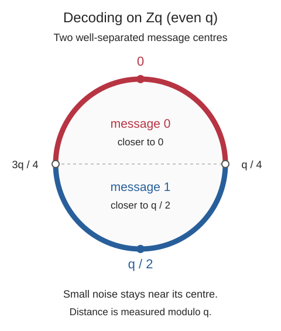

## 필기 원본

이 글에서 다룬 원본 PDF **11–17쪽**이다. 두 단과 여백 필기를 포함한 페이지 전체를 실었다. 이미지를 누르면 확대해서 볼 수 있다.

<figure style="margin: 2rem 0;">
  
  <figcaption>원본 PDF 11쪽.</figcaption>
</figure>

<figure style="margin: 2rem 0;">
  
  <figcaption>원본 PDF 12쪽.</figcaption>
</figure>

<figure style="margin: 2rem 0;">
  
  <figcaption>원본 PDF 13쪽.</figcaption>
</figure>

<figure style="margin: 2rem 0;">
  
  <figcaption>원본 PDF 14쪽.</figcaption>
</figure>

<figure style="margin: 2rem 0;">
  
  <figcaption>원본 PDF 15쪽.</figcaption>
</figure>

<figure style="margin: 2rem 0;">
  
  <figcaption>원본 PDF 16쪽.</figcaption>
</figure>

<figure style="margin: 2rem 0;">
  
  <figcaption>원본 PDF 17쪽.</figcaption>
</figure>

## 들어가며

[앞 글](/posts/ai-security-lattices-and-lwe-hardness/)에서는 격자 문제에서 LWE로 이어지는 난해성 환원을 정리했다. 이번에는 LWE 표본을 공개키로 사용하고, 비밀키로 복호화할 때 어떤 항이 소거되는지 살펴본다. 이어서 행렬 연산을 다항식 곱셈으로 표현하는 Ring-LWE로 넘어간다.

**정리 범위는 원본 PDF의 11–17쪽이다.** small-secret LWE, LPR 방식의 공개키 암호, 복호화 오차와 IND-CPA 안전성, Ring-LWE의 계수·행렬 표현, ideal lattice와의 연결, Ring-LWE 공개키 암호와 크기 비교를 원문 순서로 옮긴다.

필기의 알고리즘과 전개는 유지하면서 벡터의 차원, 오차의 부호, 복호화 경계를 명확히 적는다. 추가 수치 예제와 안전성 논증의 보충은 원문 내용과 구별한다.

## 1. Small-Secret LWE

앞에서 다룬 LWE는 비밀 벡터 $\mathbf s\in\mathbb Z_q^n$에 대해

$$
b=\langle\mathbf a,\mathbf s\rangle+e\pmod q
$$

꼴의 표본을 생성한다. 비밀을 $\mathbb Z_q^n$ 전체에서 균등하게 뽑는 대신, 작은 값에 집중된 분포에서 뽑는 변형을 생각할 수 있다.

$$
\mathbf s\leftarrow\chi^n.
$$

$\chi^n$은 각 좌표를 $\chi$에서 독립적으로 뽑는 곱분포다. 예를 들어 오차에 사용하는 적절한 가우스형 분포에서 비밀의 각 좌표도 뽑을 수 있다.

원문은 이를 **short-secret LWE**라고 부른다. 비밀을 오차 분포에서 뽑는 형태는 normal-form LWE라고도 한다. 표준 LWE에서 이 형태로의 환원이 있다는 것이 이 구성을 뒷받침한다.

다만 “작은 값만 사용하면 어떤 비밀·오차 분포든 같은 난해성을 갖는다”는 뜻은 아니다. 분포, 매개변수, 사용 가능한 표본 수에 관한 환원 조건을 함께 확인해야 한다. 이 구분과 normal-form 결과는 Micciancio의 [On the Hardness of Learning With Errors with Binary Secrets, Introduction](https://cseweb.ucsd.edu/~daniele/papers/BinLWE.pdf)에서도 설명한다.

### 비밀도 작게 뽑는 이유

아래 공개키 암호에서 복호화 후 남는 오차는

$$
\eta=\mathbf e^{\mathsf T}\mathbf r
+x'-\mathbf s^{\mathsf T}\mathbf x
$$

이다. $\mathbf s$가 크면 $\mathbf s^{\mathsf T}\mathbf x$도 작다고 보장하기 어렵다. 비밀을 작은 분포에서 뽑는 것은 복호화 오차를 제어하는 데 도움이 된다.

단순히 각각의 값이 작다는 관찰에서 끝내지 않고, 곱과 합을 거친 **최종 오차**가 얼마나 큰지를 계산해야 한다.

## 2. LWE 공개키 암호: KeyGen

원문에서 LPR PKE라고 부르는 small-secret LWE 기반 구성을 보자. 메시지는 우선 한 비트다.

$$
m\in\{0,1\}.
$$

비트 $0$과 $1$을 법 $q$의 원에서 멀리 떨어뜨리기 위해

$$
\Delta=\left\lfloor\frac q2\right\rfloor
$$

로 두고 $m$을 $m\Delta$로 표현한다.

### 2.1 매개변수와 비밀키

보안 매개변수 $1^\lambda$에 따라

$$
n=n(\lambda),\qquad
q=q(\lambda),\qquad
\chi=\chi(\lambda)
$$

를 정한다. 비밀키는

$$
\mathbf s\leftarrow\chi^n,\qquad sk=\mathbf s.
$$

이 글의 벡터는 모두 기본적으로 열벡터다.

### 2.2 공개키

서로 독립적으로

$$
A\xleftarrow{\mathrm U}\mathbb Z_q^{n\times n},
\qquad
\mathbf e\leftarrow\chi^n
$$

를 뽑고

$$
\mathbf y^{\mathsf T}
=\mathbf s^{\mathsf T}A+\mathbf e^{\mathsf T}
\pmod q
$$

를 계산한다. 공개키는

$$
pk=(A,\mathbf y^{\mathsf T})
$$

이다. $\mathbf y=A^{\mathsf T}\mathbf s+\mathbf e$라고 쓰는 것과 같은 식이다.

행렬 $A$의 열을 $\mathbf a_1,\ldots,\mathbf a_n$이라고 하면

$$
y_i=\langle\mathbf a_i,\mathbf s\rangle+e_i\pmod q.
$$

따라서 공개키는 같은 작은 비밀 $\mathbf s$를 사용하는 LWE 표본 $n$개를 담고 있다. 공격자는 $A,\mathbf y$를 알지만 $\mathbf s,\mathbf e$는 알지 못한다.

**표기 점검.** 첫 글에서 표본을 행으로 쌓으면 $\mathbf b=A\mathbf s+\mathbf e$였다. 여기서는 원문처럼 공개키의 표본을 $A$의 열로 두어 $\mathbf y^{\mathsf T}=\mathbf s^{\mathsf T}A+\mathbf e^{\mathsf T}$로 쓴다. 어느 쪽이든 행·열 방향을 일관되게 맞추어야 한다.

## 3. LWE 공개키 암호: Encryption

메시지 $m$을 암호화할 때마다 새로운 독립 난수를 뽑는다.

$$
\mathbf r,\mathbf x\leftarrow\chi^n,
\qquad x'\leftarrow\chi.
$$

여기서 $\mathbf r,\mathbf x$는 벡터이고 $x'$는 스칼라다. 다음을 법 $q$로 계산한다.

$$
\begin{aligned}
\mathbf a&=A\mathbf r+\mathbf x,\\
b&=\mathbf y^{\mathsf T}\mathbf r+x'+m\Delta.
\end{aligned}
$$

출력 암호문은

$$
C=(\mathbf a,b)
\in\mathbb Z_q^n\times\mathbb Z_q
$$

이다.

| 식 | 차원 |
|---|---|
| $A$ | $n\times n$ |
| $\mathbf r,\mathbf x,\mathbf s$ | $n\times1$ |
| $A\mathbf r+\mathbf x$ | $n\times1$ |
| $\mathbf y^{\mathsf T}$ | $1\times n$ |
| $\mathbf y^{\mathsf T}\mathbf r+x'+m\Delta$ | 스칼라 |

이 차원을 확인하면 암호문이 벡터 하나와 스칼라 하나라는 점이 분명해진다. 메시지 비트는 두 번째 성분에서 $0$ 또는 $\Delta$만큼의 이동으로 들어간다.

## 4. LWE 공개키 암호: Decryption

비밀키 $\mathbf s$로

$$
z=b-\mathbf s^{\mathsf T}\mathbf a\pmod q
$$

를 계산한다. 공개키와 암호문 정의를 대입하면

$$
\begin{aligned}
z
&=(\mathbf s^{\mathsf T}A+\mathbf e^{\mathsf T})\mathbf r
+x'+m\Delta\\
&\quad-\mathbf s^{\mathsf T}(A\mathbf r+\mathbf x)\\
&=\mathbf s^{\mathsf T}A\mathbf r
+\mathbf e^{\mathsf T}\mathbf r+x'+m\Delta\\
&\quad-\mathbf s^{\mathsf T}A\mathbf r
-\mathbf s^{\mathsf T}\mathbf x\\
&=\mathbf e^{\mathsf T}\mathbf r
+x'-\mathbf s^{\mathsf T}\mathbf x+m\Delta
\pmod q.
\end{aligned}
$$

큰 항 $\mathbf s^{\mathsf T}A\mathbf r$가 소거된다. 따라서

$$
\boxed{z=\eta+m\Delta\pmod q},
\qquad
\eta=\mathbf e^{\mathsf T}\mathbf r
+x'-\mathbf s^{\mathsf T}\mathbf x.
$$

$m=0$이면 $z$는 $0$ 근처에, $m=1$이면 $\Delta$ 근처에 놓인다. 남은 오차가 충분히 작으면 두 경우를 구별할 수 있다.

### 4.1 법 $q$에서의 거리

일반적인 정수의 절댓값 대신 법 $q$의 원에서 거리를 본다.

$$
d_q(t,c)=\min_{k\in\mathbb Z}|t-c-kq|.
$$

$0$으로부터의 거리는 중심 대표값의 절댓값과 같다. 중심 대표값은

$$
\left[-\frac q2,\frac q2\right)\cap\mathbb Z
$$

에서 고를 수 있다. 예를 들어 $q=97$일 때 나머지 $96$은 중심 대표값 $-1$이므로 $0$에서의 거리가 $1$이다.

복호화는 두 중심 $0,\Delta$ 중 가까운 쪽을 선택한다. 동점은 $1$로 정하는 규약을 사용하면

$$
\operatorname{Dec}(sk,C)=
\begin{cases}
0,&d_q(z,0)<d_q(z,\Delta),\\
1,&\text{otherwise}.
\end{cases}
$$

아래의 충분조건에서는 동점이 발생하지 않는다.

### 4.2 원문의 q/4 기준과 홀수 법의 경계

$q$가 짝수이면 $\Delta=q/2$이고 두 중심은 정확히 반 바퀴 떨어져 있다. 이때 원문처럼

$$
\operatorname{Dec}(sk,C)=
\begin{cases}
0,&d_q(z,0)<q/4,\\
1,&\text{otherwise}
\end{cases}
$$

라고 쓸 수 있다. 복호화의 충분조건은

$$
|\eta|<\frac q4.
$$

여기서 $|\eta|$는 모듈러 감소 전에 계산한 정수 오차의 크기다.

이 그림은 $q$가 짝수인 경우다. 원문에 있는 원형 그림처럼 $0$과 $q/2$ 부근을 구별하며, 경계를 넘을 정도로 오차가 커지면 복호화를 보장할 수 없다.

**보충: 홀수 $q$.** $\Delta=\lfloor q/2\rfloor$이면 두 중심 사이의 더 짧은 거리는 $\Delta$다. 두 중심에 대한 위의 거리 비교 복호화를 사용하면

$$
|\eta|<\frac{\Delta}{2}
$$

가 충분조건이다. 삼각부등식으로

$$
d_q(z,m\Delta)\le|\eta|,
\qquad
d_q(z,(1-m)\Delta)\ge\Delta-|\eta|
$$

이므로 올바른 중심이 더 가깝다.

원문의 $q/4$ 판정을 홀수 법에 그대로 적용하려면 반올림 효과까지 점검해야 한다. **추가 경계 예제.** $q=17$, $\Delta=8$, $m=1$, $\eta=-4$이면 $|\eta|=4<17/4$이지만

$$
z=8-4=4
$$

여서 단순한 $q/4$ 판정은 $0$을 출력한다. 따라서 홀수 법에서는 실제 두 중심과 복호화 오차의 여유를 정확히 정해야 한다. 이후 수치 예제는 두 중심까지의 거리를 직접 비교한다.

### 4.3 최종 오차의 크기

**추가 상한 계산.** $\mathbf s,\mathbf e,\mathbf r,\mathbf x$의 각 정수 좌표와 $x'$의 절댓값이 모두 $B$ 이하인 사건을 생각하자. 그러면

$$
\begin{aligned}
|\eta|
&\le|\mathbf e^{\mathsf T}\mathbf r|
+|x'|+|\mathbf s^{\mathsf T}\mathbf x|\\
&\le nB^2+B+nB^2\\
&=2nB^2+B.
\end{aligned}
$$

따라서

$$
2nB^2+B<\frac{\Delta}{2}
$$

이면 이 사건 안에서 올바르게 복호화된다. 이는 이해를 위한 단순한 충분조건이다.

가우스 분포처럼 지지가 무한한 분포를 사용하면 모든 값이 항상 $B$ 이하인 것은 아니다. 실제 correctness 분석에서는 꼬리 확률을 사용해 이 조건이 높은 확률로 성립하도록 매개변수를 정한다. 각 값이 작다는 말만으로 곱과 합 이후의 오차까지 자동으로 작다고 결론 내리지 않는다.

## 5. 추가 예제: 한 비트를 실제로 암호화하기

계산을 확인하기 위해

$$
q=97,\quad n=2,\quad\Delta=48
$$

로 두고 다음 값을 사용한다.

$$
A=
\begin{pmatrix}
12&23\\
7&31
\end{pmatrix},
\quad
\mathbf s=
\begin{pmatrix}1\\-1\end{pmatrix},
\quad
\mathbf e=
\begin{pmatrix}1\\0\end{pmatrix}.
$$

공개키의 두 번째 성분은

$$
\mathbf y^{\mathsf T}
=(1,-1)A+(1,0)
=(6,-8)\equiv(6,89)\pmod{97}.
$$

암호화 난수의 예를

$$
\mathbf r=(1,1)^{\mathsf T},\qquad
\mathbf x=(0,-1)^{\mathsf T},\qquad x'=1
$$

로 잡으면

$$
\mathbf a=A\mathbf r+\mathbf x
=(35,37)^{\mathsf T}.
$$

최종 오차는

$$
\eta=1+1-1=1
$$

이다. 두 메시지에 대해 계산하면 다음과 같다. 이 표는 두 계산을 비교하기 위한 것이며, 실제 암호화에서는 매번 새로운 난수를 뽑는다.

| 메시지 $m$ | $b$ | $z=b-\mathbf s^{\mathsf T}\mathbf a\bmod97$ | 가까운 중심 |
|---|---|---|---|
| $0$ | $96$ | $1$ | $0$ |
| $1$ | $47$ | $49$ | $\Delta=48$ |

$\mathbf s^{\mathsf T}\mathbf a=35-37=-2$이므로 각각 $96-(-2)\equiv1$, $47-(-2)=49$이다.

두 번째 경우 $49$의 중심 대표값은 $-48$이지만, 메시지 $1$의 중심 $48$과의 모듈러 거리는 $1$이다. 중심 대표값을 썼다는 이유만으로 메시지 $1$의 값까지 $0$ 근처가 되는 것은 아니다.

## 6. IND-CPA 안전성의 논리

원문은 이 방식이 small-secret LWE의 난해성 가정 아래에서 IND-CPA 안전하다고 설명한다. 여기서는 **판정형** 가정이 핵심이다. 공개된 값이 LWE 표본인지 균등분포인지 효율적으로 구별하기 어렵다는 가정을 사용한다.

비밀키를 복원하기 어렵다는 사실만으로 메시지 구별까지 곧바로 어렵다고 결론 내릴 수는 없다. 원문의 공개키를 균등분포로 바꾸는 직관에 암호문에 대한 단계를 더해 읽어 보자.

### 6.1 공개키를 균등분포로 바꾸기

먼저 적절한 small-secret LWE 가정으로

$$
(A,\mathbf s^{\mathsf T}A+\mathbf e^{\mathsf T})
\approx_{\mathrm c}
(A,\mathbf y^{\mathsf T})
$$

로 바꾼다. 오른쪽의 $\mathbf y$는 균등하고 $A$와 독립이다. $\approx_{\mathrm c}$는 계산적으로 구별하기 어렵다는 뜻이다.

### 6.2 암호문에도 가정을 적용하기

**보충 전개.** 균등 공개키를 사용한 세계에서

$$
M=
\begin{pmatrix}
A\\
\mathbf y^{\mathsf T}
\end{pmatrix}
\in\mathbb Z_q^{(n+1)\times n}
$$

는 균등한 행렬이다. 암호문의 메시지 이동을 제외한 부분은

$$
\begin{pmatrix}
\mathbf a\\
b-m\Delta
\end{pmatrix}
=M\mathbf r+
\begin{pmatrix}
\mathbf x\\x'
\end{pmatrix}
\pmod q.
$$

같은 작은 비밀 $\mathbf r$를 갖는 LWE 표본 $n+1$개다. 필요한 표본 수와 분포의 판정형 가정으로 이 부분도 균등하게 바꾼다.

마지막 성분의 균등한 값에 $m\Delta$를 더해도 균등분포는 유지된다. 따라서 마지막 세계의 암호문은 메시지 비트와 독립이고, 두 번의 구별 불가능성을 연결해 IND-CPA 논증을 얻는다.

이처럼 **공개키와 암호문에 가정을 두 번 적용하는 구조**가 중요하다. Ring-LWE의 compact PKE에 대해서도 [A Toolkit for Ring-LWE Cryptography, Lemma 8.3](https://sites.cc.gatech.edu/fac/cpeikert/pubs/toolkit.pdf)가 같은 두 단계의 논증을 제공한다. 위 행렬 전개는 필기의 구성을 설명하기 위해 추가한 것이다.

## 7. 행렬 기반 구성의 크기

법 $q$의 원소 하나를 고정 길이로 저장하는 비트 수를

$$
\ell_q=\lceil\log_2q\rceil
$$

라고 하자. 원문처럼 행렬과 벡터의 모든 계수를 직접 저장하는 표현에서는 다음과 같다.

| 대상 | 법 $q$의 계수 수 | 비트 수 |
|---|---|---|
| 공개키 $(A,\mathbf y^{\mathsf T})$ | $n^2+n$ | $(n^2+n)\ell_q$ |
| 암호문 $(\mathbf a,b)$ | $n+1$ | $(n+1)\ell_q$ |
| 평문 | 한 비트 | $1$ |

이 표현에서는 공개키가 차원에 대해 이차적으로 커지고, 한 비트를 암호화하는 데 벡터 하나와 스칼라 하나가 필요하다. 원문은 이 두 가지를 Ring-LWE로 넘어가는 동기로 든다.

아래 비교도 같은 **계수를 직접 저장하는 표현**을 기준으로 한다. 구현에서 사용할 수 있는 다른 저장·압축 방법까지 포함한 일반적인 최솟값을 주장하는 표는 아니다.

## 8. Ring-LWE: 행렬 대신 다항식 곱셈

다항식 환

$$
R_q=\mathbb Z_q[X]/(X^N+1)
$$

를 사용한다. 원소는

$$
a(X)=a_0+a_1X+\cdots+a_{N-1}X^{N-1},
\qquad a_i\in\mathbb Z_q
$$

로 표현한다. 계수는 법 $q$로 계산하고,

$$
X^N\equiv-1\pmod{X^N+1}
$$

을 사용해 높은 차수의 항을 줄인다.

계수 연산을 정의하는 데는 $N\ge1$, $q\ge2$이면 되지만, 난해성 정리를 적용할 때는 환과 매개변수에 대한 추가 조건이 있다. 여기서는 앞 글에서 정리한 $N=2^k$인 원분다항식의 경우를 중심으로 읽는다.

### 8.1 작은 비밀 다항식

비밀은 벡터 대신 다항식이다.

$$
s(X)=s_0+s_1X+\cdots+s_{N-1}X^{N-1}.
$$

원문의 $s\leftarrow\chi^N$은 각 계수를 작은 분포 $\chi$에서 독립적으로 뽑는다는 계수 표기다. 오차 다항식 $e(X)$도 같은 방식으로 작게 뽑는다.

다항식의 길이 $N$은 계수의 개수다. 비밀 다항식 하나가 $N$개의 작은 계수를 담고 있다.

### 8.2 Ring-LWE 표본

고정된 작은 비밀 $s$에 대해

$$
\begin{aligned}
a&\xleftarrow{\mathrm U}R_q,\\
e&\leftarrow\chi^N,\\
b&=as+e\in R_q
\end{aligned}
$$

를 생성하고

$$
(a,b)=(a,as+e)\in R_q^2
$$

를 공개한다. 새로운 표본에서는 $s$를 유지하고 $a,e$를 새로 독립적으로 뽑는다.

이 표본들로 $s$를 복원하는 것이 탐색형 질문이고, 표본이 균등한 $R_q^2$에서 나온 것과 구별되는지 묻는 것이 판정형 질문이다. PKE 안전성에서는 다시 판정형 난해성이 사용된다.

여기의 $\chi^N$은 필기의 연산을 설명하는 계수 기반 표기다. 난해성 정리의 가우스 분포·임베딩·정규화 조건은 10절에서 따로 구별한다.

## 9. 다항식 하나에 들어 있는 N개의 구조적 방정식

일반 LWE 표본 하나는 스칼라 등식 하나를 준다. Ring-LWE에서는

$$
b(X)=a(X)s(X)+e(X)
$$

를 계수별로 전개하면 $N$개의 등식이 나온다.

### 9.1 높은 차수에서 부호가 바뀌는 이유

$a_iX^i$와 $s_jX^j$의 곱에서 $i+j\ge N$이면

$$
X^{i+j}=X^N X^{i+j-N}
\equiv-X^{i+j-N}.
$$

따라서 $b_k$는

$$
b_k=
\sum_{\substack{0\le i,j<N\\i+j=k}}a_is_j
-
\sum_{\substack{0\le i,j<N\\i+j=k+N}}a_is_j
+e_k
\pmod q.
$$

이것이 **negacyclic** 구조다. 한 바퀴 돌아온 항에 음수가 붙는다.

### 9.2 계수 행렬

다항식의 계수 열벡터를 $\operatorname{coeff}(a)$라고 하자. 곱셈 $s\mapsto as$를 행렬 $M_a$로 나타내면

$$
\operatorname{coeff}(as+e)
=M_a\operatorname{coeff}(s)
+\operatorname{coeff}(e).
$$

$0$부터 시작하는 행·열 번호에 대해

$$
(M_a)_{ij}=
\begin{cases}
a_{i-j},&i\ge j,\\
-a_{N+i-j},&i<j.
\end{cases}
$$

예를 들어 $N=4$에서는

$$
M_a=
\begin{pmatrix}
a_0&-a_3&-a_2&-a_1\\
a_1&a_0&-a_3&-a_2\\
a_2&a_1&a_0&-a_3\\
a_3&a_2&a_1&a_0
\end{pmatrix}.
$$

원문의 첫 행에 음수가 생기는 이유도 $X^N=-1$ 때문이다. 다항식을 다시 복원할 때는

$$
as+e=
\begin{pmatrix}1&X&\cdots&X^{N-1}\end{pmatrix}
\operatorname{coeff}(as+e)
$$

처럼 기저의 행벡터와 계수의 열벡터를 곱한다.

### 9.3 일반 무작위 행렬과의 차이

일반 LWE의 $N\times N$ 균등 행렬에는 독립인 계수가 $N^2$개 있다. $M_a$는 다항식 $a$의 계수 $N$개로 모든 행이 정해진다.

따라서 $N$개의 등식은 서로 구조적으로 연결되어 있다. **독립적인 일반 LWE 표본 $N$개와 같은 분포라는 뜻은 아니다.** 행렬을 그대로 보관하지 않고 다항식으로 표현할 수 있는 효율성과, 별도의 구조적 난해성 가정이 함께 등장한다.

## 10. Ring-LWE와 Ideal Lattice의 난해성

원문은 Ring-LWE를 효율적으로 푸는 알고리즘이 있으면, ideal lattice 위의 최악 경우 근사 SIVP를 푸는 효율적인 양자 알고리즘을 얻는다는 방향을 적어 두었다.

근사계수의 요약은

$$
\widetilde O\left(\frac{\sqrt N}{\alpha}\right).
$$

앞 글의 일반 LWE 정리에서 나온 $\widetilde O(n/\alpha)$와 모양이 다르지만, **문제의 대상 격자군과 오차 매개변수의 정의도 함께 다르다.** 근사계수만 비교해서 두 가정의 강도를 판단해서는 안 된다.

Ideal lattice는 수체의 정수환에 속한 아이디얼을 적절한 임베딩으로 옮겨 얻는, 환의 곱셈 구조를 가진 격자다. 일반 격자 전체에 대한 문제와 구별한다.

**정리의 조건.** 원문의 난해성 메모는 조건을 생략한 요약이다. 원 논문의 cyclotomic 결과에는 수체와 정수환의 선택, 다항식 차원, 법 $q$의 크기·소수성·합동 조건, 정해진 가우스형 오차 분포 등이 포함된다. 예를 들어 $X^N+1$의 경우에 해당하는 분해 조건은

$$
q\equiv1\pmod{2N}
$$

꼴로 나타난다. 이는 원 논문의 해당 정리에 대한 조건이며, 모든 Ring-LWE 변형에 공통으로 요구된다고 일반화하는 문장은 아니다.

또한 논문의 $\alpha$는 지정된 임베딩에서 정규화한 오차 매개변수다. 계수별 분포 $\chi$의 표준편차를 확인 없이 그대로 $\alpha$라고 놓을 수는 없다.

따라서 계수 표현의 편리함과, 특정 분포·매개변수에서 성립하는 난해성 정리는 구분해서 읽는다. 환원의 방향과 조건은 [On Ideal Lattices and Learning with Errors Over Rings, Theorem 3.6과 Section 4](https://cims.nyu.edu/~regev/papers/ideal-lwe.pdf)에서 확인할 수 있다.

## 11. Ring-LWE 공개키 암호: KeyGen과 Encryption

이제 벡터·행렬 곱을 환의 곱셈으로 바꾼다. 모든 다항식 연산은 $R_q$ 안에서 수행한다.

### 11.1 KeyGen

보안 매개변수에 따라 $N,q,\chi$를 정하고

$$
s,e\leftarrow\chi^N,
\qquad
a\xleftarrow{\mathrm U}R_q
$$

를 독립적으로 뽑는다. 공개키와 비밀키는

$$
b=as+e,\qquad
pk=(a,b)\in R_q^2,\qquad sk=s.
$$

공개키의 $a$는 균등한 다항식이고, $s,e$는 작은 다항식이다.

### 11.2 메시지 다항식

한 비트 대신 $N$비트를 한꺼번에 표현한다.

$$
\mathbf m=(m_0,\ldots,m_{N-1})\in\{0,1\}^N.
$$

이를

$$
m(X)=m_0+m_1X+\cdots+m_{N-1}X^{N-1}
$$

로 바꾸고 각 계수를 $0$ 또는 $\Delta$로 이동시킨다.

$$
\Delta m(X)=
\Delta m_0+\Delta m_1X+\cdots+
\Delta m_{N-1}X^{N-1}.
$$

여기서는 계수 하나가 메시지 비트 하나를 담는다. 이후 동형암호에서 다룰 다른 데이터 인코딩과는 구별해서 읽는다.

### 11.3 Encryption

매번 새로운 독립 다항식

$$
r,e_1,e_2\leftarrow\chi^N
$$

를 뽑고

$$
\begin{aligned}
u&=ar+e_1,\\
v&=br+e_2+\Delta m
\end{aligned}
$$

을 계산한다. 암호문은

$$
C=(u,v)\in R_q^2.
$$

원문 알고리즘의 난수 설명에 남아 있는 벡터 방식의 $\mathbf x,x'$ 표기는, 이 다항식 방식에서는 $e_1,e_2$로 통일한다. 둘 다 $N$개의 계수를 가진 작은 다항식이다.

이 계수 표현의 암호화·복호화 수식은 Nadia Heninger의 [UCSD Applied Cryptography, Lecture 20의 Ring-LWE PKE 부분](https://cseweb.ucsd.edu/classes/fa20/cse291-e/lectures/20-pqc.pdf)과도 대조했다.

## 12. Ring-LWE 공개키 암호: Decryption

비밀키 $s$로

$$
z=v-us
$$

를 계산한다. 공개키와 암호문을 대입하면

$$
\begin{aligned}
z
&=(as+e)r+e_2+\Delta m-(ar+e_1)s\\
&=asr+er+e_2+\Delta m-ars-e_1s\\
&=er+e_2-e_1s+\Delta m.
\end{aligned}
$$

이 환의 곱셈은 교환적이므로 $asr=ars$이고 큰 항이 소거된다.

$$
\boxed{z=\eta(X)+\Delta m(X)},
\qquad
\eta(X)=er+e_2-e_1s.
$$

벡터 방식의

$$
\mathbf e^{\mathsf T}\mathbf r+x'
-\mathbf s^{\mathsf T}\mathbf x+m\Delta
$$

와 같은 모양이다. 내적이 다항식 곱셈으로 바뀌었고, 최종 오차도 다항식이 되었다.

### 12.1 계수별로 복호화하기

$z(X)$의 각 계수 $z_i$에 대해

$$
\widehat m_i=
\begin{cases}
0,&d_q(z_i,0)<d_q(z_i,\Delta),\\
1,&\text{otherwise}
\end{cases}
$$

를 계산한다.

모든 정수 오차 계수가

$$
\|\eta\|_\infty
:=\max_i|\eta_i|
<\frac{\Delta}{2}
$$

를 만족하면 모든 비트를 올바르게 복원한다. $\eta_i$는 작은 정수 계수들을 사용해 모듈러 감소 전에 전개한 negacyclic 곱셈 결과다.

$q$가 짝수이면 이 조건은 원문처럼 $\|\eta\|_\infty<q/4$가 된다. 홀수 법에 대한 경계 보정은 4절과 같다.

### 12.2 곱셈 후의 계수 크기

**추가 상한 계산.** 작은 다항식의 모든 정수 계수의 절댓값이 $B$ 이하라면, negacyclic 곱의 계수 하나는 $N$개의 부호 있는 곱의 합이므로

$$
\|er\|_\infty\le NB^2,\qquad
\|e_1s\|_\infty\le NB^2.
$$

따라서

$$
\|\eta\|_\infty\le2NB^2+B.
$$

다항식의 계수들이 작아도 곱셈과 합을 거치면 커질 수 있다. 실제 매개변수에서는 꼬리 확률과 모든 계수의 복호화 성공을 함께 분석한다.

## 13. 추가 예제: 네 비트의 암호화와 복호화

다음 환에서 계산한다.

$$
R_{97}=\mathbb Z_{97}[X]/(X^4+1),
\qquad\Delta=48.
$$

아래 벡터는 상수항부터 나열한 다항식의 계수다. 계산 예제로 다음 값을 정한다.

| 다항식 | 정수 계수 $(c_0,c_1,c_2,c_3)$ |
|---|---|
| $a$ | $(3,2,0,1)$ |
| $s$ | $(1,-1,0,1)$ |
| $e$ | $(0,1,-1,0)$ |
| $r$ | $(1,0,1,-1)$ |
| $e_1$ | $(0,-1,1,0)$ |
| $e_2$ | $(1,0,0,-1)$ |
| $m$ | $(1,0,1,1)$ |

곱셈에서는 $X^4=-1$로 줄인다. 예를 들어

$$
\operatorname{coeff}(as)=(2,-1,-3,4)
$$

이므로

$$
\operatorname{coeff}(b)
=(2,0,-4,4)
\equiv(2,0,93,4)\pmod{97}.
$$

암호문 두 성분은

$$
\begin{aligned}
\operatorname{coeff}(u)&=(5,0,5,0),\\
\operatorname{coeff}(v)&=(55,-8,50,49)\\
&\equiv(55,89,50,49)\pmod{97}.
\end{aligned}
$$

오차를 직접 전개하면

$$
\operatorname{coeff}(er+e_2-e_1s)=(2,2,-3,1).
$$

따라서

$$
\begin{aligned}
\operatorname{coeff}(v-us)
&=(2,2,-3,1)+48(1,0,1,1)\\
&=(50,2,45,49)\pmod{97}.
\end{aligned}
$$

각 계수를 $0$과 $48$에 대한 모듈러 거리로 판정한다.

| 계수 | $0$까지의 거리 | $48$까지의 거리 | 복원 비트 |
|---|---|---|---|
| $50$ | $47$ | $2$ | $1$ |
| $2$ | $2$ | $46$ | $0$ |
| $45$ | $45$ | $3$ | $1$ |
| $49$ | $48$ | $1$ | $1$ |

원래 메시지 $(1,0,1,1)$이 복원된다. 이 예제의 최종 오차 최대 크기는 $3$이고 $\Delta/2=24$보다 작다.

이 계산은 $\chi$의 구체적인 안전한 매개변수를 선정하는 예제가 아니라, 원문의 다항식 연산과 오차 소거를 확인하기 위해 추가한 예제다.

## 14. Ring-LWE 공개키 암호의 안전성과 크기

### 14.1 IND-CPA의 조건

원문은 Ring-LWE 기반 PKE도 Ring-LWE 난해성 가정 아래에서 IND-CPA 안전하다고 설명한다. 여기서도 작은 비밀에 대한 적절한 판정형 가정과 매개변수·분포 조건이 필요하다.

공개키 $(a,as+e)$를 균등한 $(a,b)$로 바꾼 다음, 암호문의

$$
(u,v-\Delta m)=(ar+e_1,br+e_2)
$$

를 같은 비밀 $r$를 사용하는 두 Ring-LWE 표본으로 본다. 이 두 성분도 균등하게 바꿀 수 있으면 메시지 이동은 마지막 균등분포에 영향을 주지 않는다.

이 역시 가정을 두 번 사용하는 구조다. 정확한 정리는 해당 분포에 대한 normal-form 변환과 암호화 방식에 맞는 증명을 사용한다. 환을 아무렇게나 선택하거나 임의의 작은 $\chi$를 넣었다는 이유로 안전성이 자동으로 따라오지는 않는다.

### 14.2 계수 수와 비트 수

공개키와 암호문은 각각 다항식 두 개다. 다항식 하나에 계수가 $N$개 있으므로

$$
\begin{aligned}
|pk|&=2N\ell_q\text{ bits},\\
|C|&=2N\ell_q\text{ bits}
\end{aligned}
$$

이다. 한 암호문이 메시지 $N$비트를 담으므로 평문 한 비트당 암호문 비트 수는

$$
\frac{2N\ell_q}{N}=2\ell_q.
$$

원문의 크기 비교를 계수를 직접 저장하는 표현으로 나란히 적으면 다음과 같다.

| 항목 | 벡터 LWE 방식 | Ring-LWE 방식 |
|---|---|---|
| 공개키 | $(n^2+n)\ell_q$비트 | $2N\ell_q$비트 |
| 암호문 | $(n+1)\ell_q$비트 | $2N\ell_q$비트 |
| 암호문 하나의 평문 | $1$비트 | $N$비트 |
| 평문 한 비트당 암호문 | $(n+1)\ell_q$비트 | $2\ell_q$비트 |

$n=N$으로 두면 공개키의 계수 수가 이차에서 일차로 바뀐다는 원문의 설명을 확인할 수 있다. 암호문 비교에서는 **담고 있는 평문의 비트 수**까지 함께 보아야 한다.

이 표는 같은 차원 기호를 놓고 표현 크기를 비교한 것이다. 같은 숫자의 차원이 두 방식에서 같은 보안 수준을 뜻한다고 결론 내리지는 않는다.

Ring-LWE의 효율성은 단순히 벡터의 이름을 다항식으로 바꾼 데서 나오지 않는다. $N$개의 계수로 구조적인 $N\times N$ 선형변환을 표현하고, 그 구조에 대응하는 ideal lattice 난해성 가정을 사용한다는 점이 핵심이다.

## 15. 다시 확인할 내용

- small-secret LWE에서는 비밀도 작은 분포에서 뽑는다. 난해성 환원의 분포·매개변수 조건을 함께 읽어야 한다.
- 벡터 방식의 공개키는 $(A,\mathbf y^{\mathsf T})$이고 $\mathbf y^{\mathsf T}=\mathbf s^{\mathsf T}A+\mathbf e^{\mathsf T}$이다.
- 복호화하면 큰 항이 소거되고 $\eta=\mathbf e^{\mathsf T}\mathbf r+x'-\mathbf s^{\mathsf T}\mathbf x$와 메시지 이동만 남는다.
- $q/4$라는 경계는 두 중심이 정확히 $q/2$ 떨어진 경우에 읽기 쉽다. 홀수 법에서는 $\Delta=\lfloor q/2\rfloor$의 반올림을 반영해야 한다.
- IND-CPA 논증에는 공개키와 암호문에 대한 판정형 가정의 적용이 모두 필요하다.
- Ring-LWE에서는 $X^N=-1$로 줄이는 다항식 곱셈이 부호를 가진 negacyclic 행렬을 만든다.
- 이 구조적 행렬의 행들은 독립적인 일반 LWE 표본들과 다른 분포다.
- Ring-LWE 방식에서도 $asr$와 $ars$가 소거되어 $\eta=er+e_2-e_1s$가 남는다.
- 메시지 $N$비트를 계수별로 표현하고, 모든 오차 계수가 충분히 작으면 각각 복호화할 수 있다.
- 크기를 비교할 때는 다항식·계수의 개수, 법 $q$의 비트 수, 암호문 하나에 담은 평문 크기를 함께 센다.

다음 글에서는 원본 18쪽부터 이어지는 동형암호의 정의와 암호문 연산을 정리한다.

## 참고 자료와 원문 범위

- 개인 필기 「인공지능보안 중간정리」 PDF 11–17쪽. 알고리즘과 전개를 원문 순서로 옮기고 차원·오차 부호·복호화 경계를 대조했다.
- Daniele Micciancio, [On the Hardness of Learning With Errors with Binary Secrets](https://cseweb.ucsd.edu/~daniele/papers/BinLWE.pdf), Introduction의 normal-form LWE 설명. 작은 비밀 분포에 대한 환원과 임의의 작은 분포를 구별하는 데 참고했다.
- Vadim Lyubashevsky, Chris Peikert, Oded Regev, [A Toolkit for Ring-LWE Cryptography](https://sites.cc.gatech.edu/fac/cpeikert/pubs/toolkit.pdf), Lemma 2.24, Section 8.2, Lemma 8.3. normal form과 공개키·암호문의 두 단계 안전성 논증을 대조했다.
- Vadim Lyubashevsky, Chris Peikert, Oded Regev, [On Ideal Lattices and Learning with Errors Over Rings](https://cims.nyu.edu/~regev/papers/ideal-lwe.pdf), Theorem 3.6과 Section 4. 구조적인 격자군, 양자 환원, 오차 분포·임베딩 조건을 확인했다.
- Nadia Heninger, [Applied Cryptography, Lecture 20](https://cseweb.ucsd.edu/classes/fa20/cse291-e/lectures/20-pqc.pdf), Ring-LWE PKE 부분. 계수 표현의 키 생성·암호화·복호화 수식을 대조했다.
