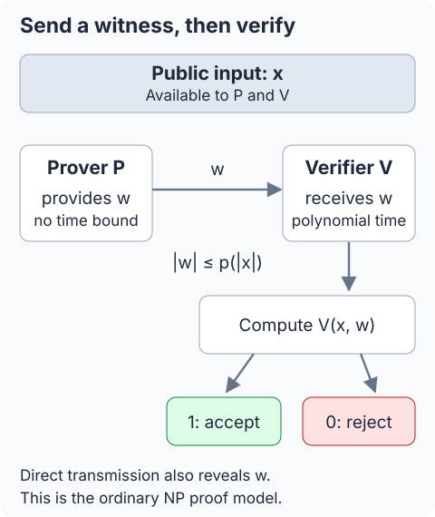
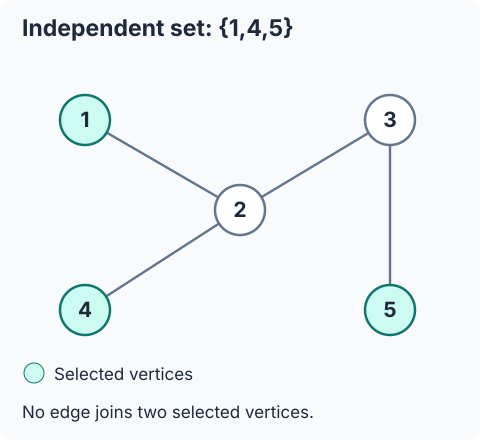
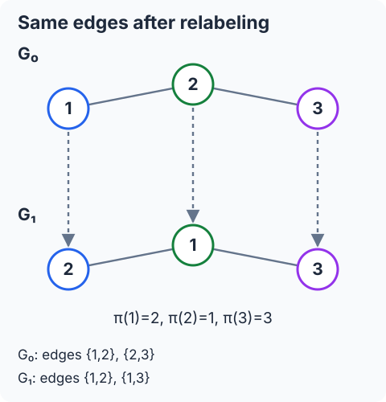

## 필기 원본

이 글에서 다룬 원본 PDF **47–49쪽**이다. 두 단과 여백 필기를 포함한 페이지 전체를 실었다. 이미지를 누르면 새 탭에서 원본 크기로 볼 수 있다.

[정리 글로 바로 가기](#들어가며)

<figure style="margin: 2rem 0;">
  
  <figcaption>원본 PDF 47쪽. <a href="/images/posts/cryptography-handwritten-notes/page-047.webp" target="_blank" rel="noopener">원본 크기로 보기</a></figcaption>
</figure>

<figure style="margin: 2rem 0;">
  
  <figcaption>원본 PDF 48쪽. <a href="/images/posts/cryptography-handwritten-notes/page-048.webp" target="_blank" rel="noopener">원본 크기로 보기</a></figcaption>
</figure>

<figure style="margin: 2rem 0;">
  
  <figcaption>원본 PDF 49쪽. <a href="/images/posts/cryptography-handwritten-notes/page-049.webp" target="_blank" rel="noopener">원본 크기로 보기</a></figcaption>
</figure>

## 들어가며

[앞 글](/posts/ai-security-polynomial-approximation-chebyshev-and-paterson-stockmeyer/)까지는 동형암호를 이용해 암호화된 데이터에서 계산하는 방법을 살펴봤다. Week 6에서는 증명으로 주제가 바뀐다. **어떤 주장이 참이라는 사실을 확인시키면서, 그 근거로 사용하는 비밀은 공개하지 않을 수 있을까?** 이 질문에 앞서, 계산 관점에서 증명과 검증이 무엇인지부터 정리한다.

**범위는 원본 PDF 47–49쪽 전체다.** Classical Proofs, Prover and Verifier, 효율적 검증, Witness and NP Proofs, 소인수분해·제곱잉여·그래프 동형, NP Languages, 완전성·건전성, witness를 숨기려는 동기를 포함한다. 50쪽부터의 대화형 증명 모형과 색 구별 실험은 다음 글에서 다룬다.

원문의 수치와 필기를 함께 옮긴다. 원문에 그래프의 간선 목록이 없는 독립집합 예제에는 **보충 그래프**를 붙이고, 제곱근과 공개 입력에 같은 문자를 쓰는 부분은 표기를 구별한다.

## 1. 주장이 참이라는 말과 그 근거는 다르다

### 1.1 고전적인 증명을 두 참여자의 통신으로 본다

수학에서 증명은 주어진 명제가 참임을 보이는 논리적 논증이다. 한 사람이 증명을 쓰고 다른 사람이 각 논리 단계를 확인하는 과정을, 컴퓨터과학에서는 두 참여자로 나눠 볼 수 있다.

| 기호 | 역할 |
| --- | --- |
| $P$ | 증명자(prover): 주장이 참이라고 제시한다. |
| $V$ | 검증자(verifier): 제시된 근거를 검사한다. |
| $x$ | 주장에 대응하는 공개 입력, 즉 문제 인스턴스다. |
| $w$ | 검증에 사용할 증거(witness)다. |

원문의 흐름은 다음과 같다.

$$
\text{Claim}+\text{Proof}\longrightarrow\text{Verification}.
$$

주장은 **무엇을 말하는지**를 정한다. 증거는 **왜 그 말을 받아들여도 되는지**를 뒷받침한다. 예를 들어 “이 수는 두 소수의 곱이다”가 주장이고, 실제로 곱해 볼 두 소수가 증거다.

### 1.2 검증자는 주장과 받은 증거를 함께 검사한다

현재 다루는 정적인 증명에서는 증명자가 $w$를 보내고, 검증자가 $x,w$를 입력으로 계산한다.

$$
V(x,w)=
\begin{cases}
1,&\text{accept},\\
0,&\text{reject}.
\end{cases}
$$

검증자는 증거가 주장을 뒷받침하면 받아들이고, 아니면 거부한다. 여기서 **특정 증거의 검증 실패와 주장 자체의 거짓을 구별해야 한다.** 참인 주장에 엉뚱한 증거를 붙여도 거부될 수 있다. 4절의 $91$과 8절의 제곱잉여 예제로 확인하자.

*이 그림은 witness를 직접 보내는 검증 모형이다. 비밀을 숨기는 프로토콜은 아직 구성하지 않았다.*

## 2. 증거를 찾는 일과 확인하는 일

### 2.1 증거의 길이와 검증 시간이 모두 제한된다

원문은 증명자가 증거를 찾는 데 많은 계산을 할 수 있더라도, **증거를 받은 검증자는 다항시간에 검사할 수 있어야 한다**고 설명한다. 증거 자체의 길이도 공개 입력의 길이에 대한 다항식으로 제한한다.

$n=|x|$를 공개 입력의 비트 길이라 하고, 길이 상한을 정하는 다항식을 $p$라 하면

$$
|w|\le p(n),\qquad T_V(n)\le q(n)
$$

인 다항식 $q$가 존재해야 한다. 검증 시간은 이 길이 제한 안의 증거에 대해 읽는다. 형식이 잘못됐거나 허용 길이를 넘은 증거는 거부하도록 검증기를 정한다.

원문 본문의 $|w|=\operatorname{poly}(|x|)$는 “길이가 다항식으로 제한된다”는 뜻이다. 같은 쪽의 보충 필기처럼 **상한을 뜻하는** $\le$로 쓰면 조건이 분명해진다.

### 2.2 ‘짧다’는 고정된 글자 수가 아니다

입력 길이가 $n$일 때 $n^2,n^3$은 다항식이고, $2^n$은 다항식 상한이 아니다. 원문의 “short”는 입력 크기에 비해 다항식으로 제한된다는 뜻이며, 모든 증거가 몇 줄이어야 한다는 뜻은 아니다.

정수를 이진수로 나타내면 값과 길이도 다르다. 예를 들어

$$
91=(1011011)_2,\qquad |\operatorname{bin}(91)|=7.
$$

따라서 “$N$에 대한 다항시간”과 “$\log N$에 대한 다항시간”을 혼동하면 안 된다. 여기서 입력 길이는 적절한 인코딩으로 나타낸 **비트 수**다.

### 2.3 NP는 모든 문제의 답을 찾기 어렵다는 정의가 아니다

핵심 비대칭은 다음과 같다. 유효한 증거를 **찾는 일은 어려울 수 있지만**, 제시된 증거를 **확인하는 일은 쉬울 수 있다.** NP는 두 번째 성질을 요구한다.

원문은 증명자의 계산 능력을 제한하지 않는 모형도 설명한다. 이는 유효한 witness의 **존재**에 초점을 두기 때문이다. witness를 효율적으로 찾는 알고리즘까지 NP의 정의에 포함하는 것은 아니다. 실제 암호 프로토콜의 증명자가 어떤 입력을 알고 어느 시간 안에 실행되는지는 별도로 정해야 한다.

또 NP의 이름은 nondeterministic polynomial time에서 왔다. “다항시간이 아닌 문제”라는 뜻이 아니다. $\mathsf P\subseteq\mathsf{NP}$이며, NP에 속한다는 이유만으로 모든 인스턴스가 어렵다고 결론 낼 수 없다. $\mathsf P=\mathsf{NP}$인지도 여전히 미해결 문제다. [Clay Mathematics Institute](https://www.claymath.org/millennium/p-vs-np/)

## 3. 독립집합: 정점 세 개를 받으면 무엇을 검사하는가

### 3.1 주장과 witness

그래프 $G=(U,E)$의 독립집합은 **선택된 서로 다른 두 정점 사이에 간선이 없는 정점 집합**이다. 원문의 주장은 “$G$에 크기 3인 독립집합이 존재한다”이고, 제시한 witness는

$$
x=(G,3),\qquad w=(1,4,5)
$$

다. 검증자는 $1,4,5$가 그래프의 서로 다른 정점인지, 개수가 맞는지, 그리고

$$
\{1,4\}\notin E,\qquad
\{1,5\}\notin E,\qquad
\{4,5\}\notin E
$$

인지 검사한다. 세 정점 사이의 세 쌍을 확인하면 된다. 같은 정점을 여러 번 써서 개수만 채우거나, 그래프에 없는 정점을 내는 경우도 거부해야 한다.

원문은 간선 목록을 지정하지 않았다. 따라서 $V((G,3),(1,4,5))=1$이라는 식은 **실제로 이 조건을 만족하는 $G$에 대해** 성립한다.

### 3.2 보충: 간선을 지정해서 직접 확인하기

그림으로 확인할 수 있도록 다음 그래프를 보충하자.

$$
\begin{aligned}
U&=\{1,2,3,4,5\},\\
E&=\{\{1,2\},\{2,3\},\{2,4\},\{3,5\}\}.
\end{aligned}
$$

이 그래프에서는 $w=(1,4,5)$가 검증을 통과한다. 반면 $(1,2,5)$는 $\{1,2\}\in E$이므로 통과하지 못한다. 이 실패는 그래프에 크기 3의 독립집합이 없다는 뜻이 아니다. 방금 본 $(1,4,5)$가 여전히 유효하다.

### 3.3 일반적인 크기와 검증 비용

일반 입력 $x=(G,k)$에서는 $k$개의 서로 다른 정점을 받고

$$
\binom{k}{2}=\frac{k(k-1)}2
$$

쌍에 간선이 없는지 확인할 수 있다. 인접 행렬을 사용하면 쌍별 검사는 $O(k^2)$번이고, 정점 수를 $n$이라 할 때 정점 번호 목록의 비트 길이는 $O(k\log n)$이다. $k>n$이면 바로 거부한다.

검증자는 다른 독립집합을 전부 찾아볼 필요가 없다. 받은 집합이 조건을 만족하는지만 검사한다. 다만 **$k=3$을 고정하면** 모든 세 정점 조합을 확인하는 방법도 다항시간이다. 원문의 작은 예제만으로 찾기가 본질적으로 어렵다는 결론을 내리지는 않는다. 일반 문제에서는 $k$도 입력의 일부다.

## 4. 소인수분해: 확인과 함께 인수도 공개된다

### 4.1 두 소수의 곱이라는 주장

원문의 예제는 큰 정수 $N$이 두 큰 소수의 곱이라는 주장이다. 자연스러운 witness는

$$
w=(p,q),\qquad N=pq
$$

다. 검증자는 곱이 맞는지와 **$p,q$가 소수인지**를 함께 확인한다. “두 소수”라는 주장을 확인하려면 곱셈만으로는 충분하지 않다. 예를 들어 $45=3\cdot15$이지만 $15$는 소수가 아니다.

소수 판정 자체에는 결정적 다항시간 알고리즘이 존재한다. 증거를 받은 뒤 두 수가 소수인지 확인하는 일과, $N$만 보고 그 인수를 찾는 일을 구별해야 한다. [Agrawal–Kayal–Saxena, *PRIMES is in P*](https://annals.math.princeton.edu/2004/160-2/p12)

### 4.2 원문의 91 예제와 잘못된 증거

47쪽 필기의 수치를 그대로 쓰면

$$
N=91,\qquad w=(7,13),\qquad 7\cdot13=91.
$$

$7,13$은 소수이므로 이 증거는 검증을 통과한다. 반면 증명자가 $(7,11)$을 내면

$$
7\cdot11=77\ne91
$$

이므로 거부된다. **$91$에 대한 주장은 여전히 참이다.** 검증에 실패한 것은 이번에 제출한 witness다.

### 4.3 검증자가 새로 알게 되는 것

이 방법은 두 가지를 함께 전달한다.

1. $N$이 두 소수의 곱이라는 사실.
2. 그 소수가 구체적으로 $p,q$라는 사실.

증명자가 $p,q$를 비밀로 유지하려 했다면 witness를 그대로 보내는 검증은 그 목적에 맞지 않는다. 원문의 질문은 “인수를 보내면 검증할 수 있다”에서 멈추지 않는다. **그 인수를 공개하지 않고도 같은 주장을 납득시킬 수 있는가?**

## 5. 제곱잉여: 존재하는 제곱근을 직접 보내기

### 5.1 단위군과 제곱잉여

$N\ge2$일 때 원문이 사용하는 단위군은

$$
\mathbb Z_N^*
=\{a\in\{0,\ldots,N-1\}:\gcd(a,N)=1\}
$$

이다. 원소마다 곱셈 역원이 존재한다. 이 글에서는 원문처럼 단위군 안에서 제곱잉여를 정의한다.

$$
y\in\operatorname{QR}_N
\quad\Longleftrightarrow\quad
\exists r\in\mathbb Z_N^*:\ r^2\equiv y\pmod N.
$$

원문의 제곱근 문자 $x$는 여기서 $r$로 바꿨다. 공개 입력 전체를 나타내는 $x$와 구별하기 위해서다. 예를 들어

$$
\begin{aligned}
\mathbb Z_{15}^*&=\{1,2,4,7,8,11,13,14\},\\
2^2&\equiv4\pmod{15}
\end{aligned}
$$

이므로 $4$는 법 $15$의 제곱잉여다.

### 5.2 원문의 N=15 예제를 전부 계산하기

단위군 원소를 모두 제곱하면 다음과 같다.

| $r$ | $r^2\bmod15$ |
| --- | --- |
| $1$ | $1$ |
| $2$ | $4$ |
| $4$ | $1$ |
| $7$ | $4$ |
| $8$ | $4$ |
| $11$ | $1$ |
| $13$ | $4$ |
| $14$ | $1$ |

따라서

$$
\operatorname{QR}_{15}=\{1,4\}.
$$

$4$의 제곱근은 이 단위군 안에 $2,7,8,13$ 네 개가 있다. 반면 나머지가 $2$인 제곱은 없다. 이 계산은 8절의 참인 입력 $(15,4)$와 거짓인 입력 $(15,2)$를 확인하는 데도 쓰인다.

### 5.3 N=4 필기는 전체 나머지와 단위군을 구별한다

48쪽의 붉은 필기에는 법 $4$에서 제곱하는 작은 그림이 있다. 전체 나머지에 대해 그대로 계산하면

| $r$ | $r^2\bmod4$ | $r\in\mathbb Z_4^*$ |
| --- | --- | --- |
| $0$ | $0$ | 아니오 |
| $1$ | $1$ | 예 |
| $2$ | $0$ | 아니오 |
| $3$ | $1$ | 예 |

이다. 전체 $\mathbb Z_4$에서 제곱으로 나오는 나머지는 $0,1$이고 $2,3$은 나오지 않는다. 하지만 이 글의 단위군 정의에서는

$$
\mathbb Z_4^*=\{1,3\},\qquad
\operatorname{QR}_4=\{1\}.
$$

$0$은 단위군 원소가 아니므로 포함되지 않는다. **어느 집합에서 제곱하는지**를 먼저 정해야 한다. 입력 $r=3$의 제곱이 $1$인 것과, 출력 후보 $y=3$이 제곱잉여가 아닌 것도 구별하자.

원문의 “$N/2$개는 나머지가 0”이라는 메모는 이 $N=4$ 표의 짝수 입력 두 개로 읽는다. 임의의 $N$에 대한 규칙은 아니다. 예를 들어 $2^2\bmod6=4$다.

### 5.4 검증자는 제곱근까지 알게 된다

공개 입력과 witness를

$$
x=(N,y),\qquad w=r
$$

로 두자. 검증자는 입력 형식과 범위를 확인하고, $r\in\mathbb Z_N^*$인지와 $r^2\equiv y\pmod N$인지를 검사한다. $r$은 $0\le r<N$인 대표값으로 보낸다.

이 경우에도 검증자는 두 가지를 배운다. $y$가 제곱잉여라는 사실과, 그 제곱근 하나가 **구체적으로** $r$이라는 사실이다. 제곱하고 비교하는 것은 쉽지만, 비밀로 두려던 제곱근이 그대로 공개된다.

원문은 제곱근 계산을 소인수분해 및 Rabin 암호와 연결한다. 여기에는 조건이 있다. 서로 다른 큰 홀수 소수의 곱인 모듈러스 등 적절한 설정에서, 제곱근을 일반적으로 구하는 능력과 소인수분해 사이에 환원 관계가 있다. **특정 제곱근 하나를 받으면 언제나 즉시 인수가 드러난다는 말은 아니다.** [Rabin의 원논문](https://publications.csail.mit.edu/lcs/pubs/pdf/MIT-LCS-TR-212.pdf)

보충으로 법 $15$에서 같은 값 $4$의 제곱근 $2,7$을 함께 알면

$$
\gcd(7-2,15)=5,\qquad \gcd(7+2,15)=3
$$

을 얻는다. 이는 $7\not\equiv\pm2\pmod{15}$인 서로 다른 두 근을 이용한 예다. $2$와 그 음수인 $13$을 골랐다면 이 계산은 비자명한 인수를 주지 않는다. 제곱잉여인지 **판정하는 문제**와 제곱근을 **찾는 문제**도 구별해야 한다.

작은 $15$나 $4$의 전수 계산은 정의를 설명하는 예다. 암호학적 어려움을 보여 주는 실험은 아니다. 모든 모듈러스나 모든 입력에서 판정이 어렵다고 주장하지도 않는다.

## 6. 그래프 동형: 정점 이름을 바꾸는 대응

### 6.1 witness는 순열이다

두 그래프 $G_0,G_1$가 동형이라는 말은, 정점 이름을 일관되게 바꾸면 같은 간선 관계가 된다는 뜻이다. 화면에서 정점을 어디에 그렸는지는 중요하지 않다.

두 단순 무방향 그래프의 정점 집합을 $[n]=\{1,\ldots,n\}$으로 쓰자. 원문의 정점 수 $N$을 여기서는 $n$으로 써서 법 $N$과 구별한다. witness는 순열, 즉 전단사

$$
\pi:[n]\longrightarrow[n]
$$

이다. 검증자는 정말 순열인지 확인한 뒤, 모든 $1\le i<j\le n$에 대해

$$
\{i,j\}\in E_0
\quad\Longleftrightarrow\quad
\{\pi(i),\pi(j)\}\in E_1
$$

인지 검사한다. **간선뿐 아니라 비간선 관계도 보존하는 필요충분 조건**이다. 인접 행렬로는 $O(n^2)$쌍을 검사할 수 있고, 대응 목록의 길이는 $O(n\log n)$비트다.

### 6.2 원문의 세 정점 예제

원문 필기의 간선 집합은

$$
\begin{aligned}
E_0&=\{\{1,2\},\{2,3\}\},\\
E_1&=\{\{1,2\},\{1,3\}\}
\end{aligned}
$$

이고, 제시한 순열은

$$
\pi(1)=2,\qquad \pi(2)=1,\qquad \pi(3)=3
$$

이다. 각 정점 쌍을 확인하면 다음과 같다.

| 원래 쌍 | 대응된 쌍 | 두 그래프의 관계 |
| --- | --- | --- |
| $\{1,2\}$ | $\{2,1\}$ | 모두 간선 |
| $\{2,3\}$ | $\{1,3\}$ | 모두 간선 |
| $\{1,3\}$ | $\{2,3\}$ | 모두 비간선 |

무방향 간선이므로 $\{2,1\}=\{1,2\}$다. 이 순열은 모든 관계를 보존한다.

### 6.3 존재를 증명하면서 구체적인 대응도 알려 준다

$\pi$를 보내면 검증자는 “두 그래프가 동형이다”라는 사실을 확인할 수 있다. 동시에 **어떤 정점이 어떤 정점으로 대응되는지**도 알게 된다. 원문의 질문은 여기서도 같다. 구체적인 동형사상을 공개하지 않고 두 그래프가 동형이라는 것만 증명할 수 있을까?

## 7. 계산 문제를 언어의 원소인지 묻는 문제로 쓴다

### 7.1 언어는 Yes인 입력들의 집합이다

복잡도 이론에서는 결정 문제를 언어로 나타낸다. 여기서 언어는 이진 문자열의 집합이다.

$$
L\subseteq\{0,1\}^*.
$$

그래프나 정수 쌍도 정해진 방식으로 이진 인코딩한다. 입력 $x$에 대한 질문은

$$
x\in L\ ?
$$

가 된다. 속하면 Yes이고, 속하지 않으면 No다. 아래에서는 읽기 쉽게 인코딩 기호를 생략하고 $(G,k)$나 $(N,y)$로 쓴다.

### 7.2 독립집합 언어

원문의 독립집합 결정 문제는

$$
L_{\mathrm{INDSET}}
=\{(G,k):G\text{에 크기 }k\text{ 이상의 독립집합이 존재}\}
$$

다. 따라서 $(G,3)\in L_{\mathrm{INDSET}}$인지 묻는 것은 “이 그래프에 크기 3 이상의 독립집합이 있는가?”와 같다.

앞의 witness는 정확히 세 정점을 제시했다. 더 큰 독립집합이 있으면 그중 세 정점을 고를 수 있으므로 “3 이상”이라는 언어 정의와도 맞는다. 일반적으로 $0\le k\le|U|$라 두면 정확히 $k$개를 증거로 보내도 된다.

### 7.3 제곱잉여 언어

같은 방식으로, 단위군 정의에 맞춘 언어는

$$
L_{\mathrm{QR}}
=\{(N,y):N\ge2,\ y\in\operatorname{QR}_N\}
$$

이고, 멤버십의 근거는

$$
(N,y)\in L_{\mathrm{QR}}
\quad\Longleftrightarrow\quad
\exists r\in\mathbb Z_N^*:\ r^2\equiv y\pmod N
$$

이다. 여기서 $y$는 $0\le y<N$인 대표값으로 인코딩한다. **입력 $x=(N,y)$와 증거 $w=r$는 서로 다른 역할**이다.

원문의 두 입력은

$$
(15,4)\in L_{\mathrm{QR}},\qquad
(15,2)\notin L_{\mathrm{QR}}.
$$

첫 입력에는 $r=2$라는 witness가 있다. 두 번째 입력에는 그런 제곱근이 없다. 5.2절의 표가 이를 직접 확인해 준다.

## 8. NP 증명의 완전성과 건전성

### 8.1 같은 검증기와 길이 상한이 모든 입력에 적용된다

언어 $L$이 NP에 속한다는 것은, **어떤 다항식 $p$와 결정적 다항시간 검증기 $V$가 존재해서 모든 입력 $x$에 대해** 아래 조건이 성립한다는 뜻이다. 입력마다 마음대로 다른 검증기나 길이 상한을 고르는 정의가 아니다.

형식이 틀리거나 $|w|>p(|x|)$인 증거는 거부하도록 정한다. 이 관례 아래 완전성과 건전성을 나눠 쓰자.

### 8.2 완전성: 참인 입력에는 통과하는 증거가 있다

$$
x\in L
\quad\Longrightarrow\quad
\exists w:\ |w|\le p(|x|)\ \land\ V(x,w)=1.
$$

참인 주장은 **적어도 하나의 짧은 witness**로 증명할 수 있어야 한다. 예를 들어 제곱잉여 검증기를 $V_{\mathrm{QR}}$라 쓰면

$$
V_{\mathrm{QR}}((15,4),2)=1
$$

이다. $2^2\bmod15=4$이고 $\gcd(2,15)=1$이기 때문이다.

여기서 존재 기호 $\exists$가 중요하다. 참인 입력이라고 해서 아무 증거나 통과하는 것은 아니다.

$$
V_{\mathrm{QR}}((15,4),1)=0,
\qquad 1^2\bmod15=1\ne4.
$$

이 거부는 완전성 위반이 아니다. 유효한 witness $2$가 여전히 존재한다.

### 8.3 건전성: 거짓인 입력에는 통과하는 증거가 없다

$$
x\notin L
\quad\Longrightarrow\quad
\forall w\in\{0,1\}^*:\ V(x,w)=0.
$$

거짓인 주장은 증명자가 **어떤 문자열을 witness라고 제출하더라도** 통과하지 못해야 한다. 길이 초과나 형식 오류도 거부하므로 원문처럼 모든 이진 문자열에 대한 $\forall w$로 쓸 수 있다.

예를 들어

$$
\forall w:\ V_{\mathrm{QR}}((15,2),w)=0.
$$

유효한 형식의 witness를 검사해도 법 $15$에서 제곱이 $2$가 되는 단위군 원소가 없고, 그 밖의 입력은 형식·범위 검사에서 거부된다.

여기서 “증거가 없다”는 말은 **이 주장이 $L_{\mathrm{QR}}$에 속한다고 받아들이게 할 witness가 없다**는 뜻이다. 반대로 제곱비잉여라는 사실을 다른 증명 방식으로 보일 수 없다는 뜻은 아니다. 원문 48쪽의 “non-residue이면?”이라는 질문도 이 두 대상을 구별해서 읽는다.

### 8.4 두 방향을 한 식으로 묶기

$$
\boxed{
x\in L
\quad\Longleftrightarrow\quad
\exists w:\ |w|\le p(|x|)\ \land\ V(x,w)=1
}
$$

왼쪽에서 오른쪽으로 가는 방향은 완전성이다. 오른쪽에서 왼쪽으로 가는 방향은 “통과하는 증거가 있다면 입력은 참이어야 한다”는 건전성이다.

| 입력과 제출한 증거 | 요구되는 결과 |
| --- | --- |
| 참인 입력, 유효한 witness | accept |
| 참인 입력, 유효하지 않은 witness | reject |
| 거짓인 입력, 어떤 witness든 | reject |

현재 모형의 $V$는 결정적이다. 다음 글의 대화형 증명에서는 검증자의 무작위 선택 때문에 건전성을 통과 **확률의 상한**으로 표현하게 된다. 지금의 식에 그 확률 조건을 미리 섞지는 않는다.

## 9. 이 조건만으로 witness가 숨겨지지는 않는다

### 9.1 일반적인 증명은 주장보다 많은 정보를 줄 수 있다

지금까지의 검증은 witness를 직접 받는다. 원문의 세 예제를 비교하면 전달되는 정보가 보인다.

| 주장 | 보내는 witness | 함께 드러나는 정보 |
| --- | --- | --- |
| $N$은 두 소수의 곱 | $(p,q)$ | 구체적인 소인수 |
| $y$는 법 $N$의 제곱잉여 | $r$ | 구체적인 제곱근 |
| $G_0,G_1$는 동형 | $\pi$ | 구체적인 정점 대응 |

독립집합 예제에서도 $(1,4,5)$를 보내면 어느 정점들을 선택했는지까지 알려 준다. 완전성과 건전성은 **검증 결과의 올바름**을 다룬다. witness를 비밀로 유지하는 조건은 아직 포함하지 않는다.

### 9.2 영지식증명이 해결하려는 질문

49쪽 마지막의 질문을 제곱잉여에 적용하면 다음과 같다.

$$
\exists r\in\mathbb Z_N^*:\ r^2\equiv y\pmod N
$$

이라는 사실은 검증자가 믿게 하면서, **그 $r$ 자체는 공개하지 않을 수 있을까?** 목표는 주장이 참임을 확인시키는 동시에, 그 증명에 사용하는 비밀 정보를 보호하는 것이다.

이 관점은 1980년대 영지식증명의 발전으로 이어졌다. Goldwasser–Micali–Rackoff의 논문은 일반적인 증명이 주장의 참·거짓보다 많은 정보를 전할 수 있다는 문제에서 출발해 영지식증명을 정의한다. [*The Knowledge Complexity of Interactive Proof Systems*](https://people.csail.mit.edu/silvio/Selected%20Scientific%20Papers/Proof%20Systems/The_Knowledge_Complexity_Of_Interactive_Proof_Systems.pdf)

보충해서 주의할 점은, **witness를 그대로 보내지 않았다는 사실만으로 영지식이 증명되지는 않는다**는 것이다. 비밀의 일부가 새거나, 검증자가 공개 주장만으로는 얻기 어려운 정보를 추가로 얻을 수도 있다. “아무 정보도 얻지 않는다”는 필기는 공개 주장과 그 참임까지 감춘다는 뜻으로 읽으면 안 된다. 추가 정보를 배우지 않는다는 성질에는 시뮬레이션 등을 사용하는 별도의 정의와 증명이 필요하다. 같은 논문의 3절이 이를 정식화한다.

## 10. 원문 표기와 조건을 정리한 부분

1. **증거의 길이.** $|w|=\operatorname{poly}(|x|)$는 길이 상한 $|w|\le p(|x|)$로 적었다. 정적 NP 증명의 검증자는 결정적 다항시간으로 두었다.
2. **공개 입력과 제곱근.** 공개 인스턴스에는 $x$, 제곱근 witness에는 $r$를 사용했다. $\sqrt y\bmod N$은 실수의 단일 제곱근 연산이 아니라 $r^2\equiv y\pmod N$을 만족하는 근의 존재로 적었다.
3. **두 소수의 곱.** $N=pq$뿐 아니라 $p,q$의 소수성도 확인한다. $91=7\cdot13$과 잘못 제출한 $7\cdot11=77$을 구별했다.
4. **독립집합의 그래프.** 원문의 $w=(1,4,5)$는 그래프가 조건을 만족할 때 유효하다. 간선 목록이 있는 그림은 보충이며, 정점 중복·존재 여부도 검사한다.
5. **제곱하는 집합.** $N=4$의 전체 나머지 표와 단위군의 제곱잉여를 구별했다. “절반”에 관한 작은 메모를 임의의 모듈러스에 일반화하지 않았다.
6. **제곱잉여의 모듈러스.** 제곱잉여와 그 제곱근은 법 $N$에 관한 것이다. 48쪽 그림 아래의 제곱잉여 문장에서도 법을 $N$으로 통일했다. 소인수분해·제곱근 계산·제곱잉여 판정의 관계를 하나의 무조건적인 명제로 합치지 않았다.
7. **완전성과 건전성의 양화사.** 참인 입력에는 $\exists w$, 거짓인 입력에는 $\forall w$다. 잘못된 witness 하나의 거부를 주장 전체의 거짓으로 바꾸지 않았다.
8. **정보의 범위.** 검증 성공, witness의 비공개, 영지식은 각각 확인할 조건이 있다. 이 글의 직접 전송 예제를 영지식 프로토콜이라고 부르지 않았다.

다음은 **50쪽의 Zero-knowledge Proof와 Interactive Proof Model**이다. 검증자가 질문을 하고 무작위로 선택할 수 있게 하면 무엇이 달라지는지, 색을 직접 구별하지 못하는 검증자의 실험부터 이어서 살펴본다.
