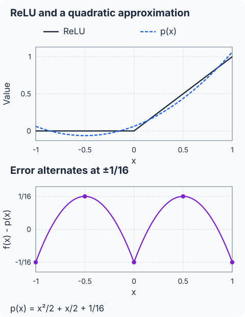
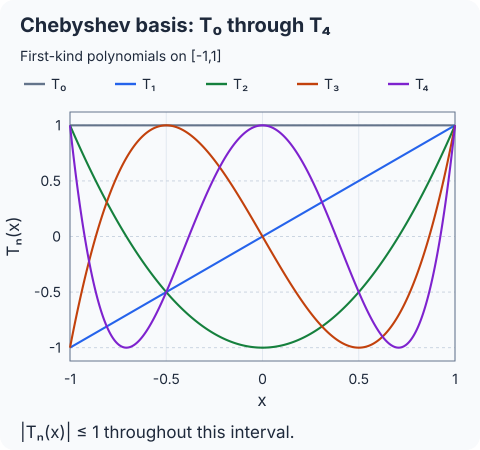
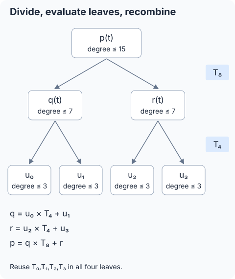

## 필기 원본

이 글에서 다룬 원본 PDF **46쪽**이다. 두 단과 여백 필기를 포함한 페이지 전체를 실었다. 이미지를 누르면 새 탭에서 원본 크기로 볼 수 있다.

[정리 글로 바로 가기](#들어가며)

<figure style="margin: 2rem 0;">
  
  <figcaption>원본 PDF 46쪽. <a href="/images/posts/cryptography-handwritten-notes/page-046.webp" target="_blank" rel="noopener">원본 크기로 보기</a></figcaption>
</figure>

## 들어가며

[앞 글](/posts/ai-security-homomorphic-matrix-multiplication-and-permutations/)에서는 암호화된 행렬곱을 계산했다. 신경망에서는 그 결과에 활성함수를 적용한다. 이번에는 **활성함수를 닮은 다항식을 구한 뒤, 그 다항식의 값을 암호문에서 계산하는 과정**을 다룬다. 근사 계수를 정하는 문제와 평가 비용을 줄이는 문제를 나눠 보자.

**정리 범위는 원본 PDF 46쪽의 슬라이드 36–45 전체다.** 활성함수, 다항식 근사와 교대 정리, Remez, Chebyshev 기저, Paterson-Stockmeyer 계열의 Baby-step/Giant-step 평가를 포함한다. 상단의 “중간범위 X”는 시험범위에 관한 필기이며, 이 글에서는 요청한 단원을 전체 정리한다.

원문에 없는 수치 예제는 보충으로 표시한다. 기저 인덱스와 준비 범위가 섞인 표기는 정리하고, 마지막 슬라이드의 곱셈 횟수·깊이가 어떤 계산 일정에서 나오는지도 확인한다.

## 1. 활성함수를 다항식으로 바꾸는 이유

### 1.1 가중합 다음에 비선형 함수를 적용한다

원문 36번 슬라이드의 뉴런 그림은 입력의 가중합에 활성함수를 적용하는 구조다. 세 입력을 예로 쓰면

$$
z=w_1x_1+w_2x_2+w_3x_3+b,\qquad y=f(z).
$$

이 비선형성이 신경망의 비선형 결정 경계를 학습하게 한다. 원문이 든 대표 함수의 정의를 보충하면 다음과 같다.

| 함수 | 정의 |
| --- | --- |
| ReLU | $\max(0,x)$ |
| GELU | $x\Phi(x)$, $\Phi$는 표준정규 누적분포함수 |
| Sigmoid | $1/(1+e^{-x})$ |

원문의 비교 그림에는 ReLU·GELU와 함께 ERF, LReLU, ELU 곡선도 있다. 서로 다른 비선형 함수를 택할 수 있다는 예시다.

### 1.2 덧셈과 곱셈으로 평가할 수 있는 형태를 만든다

비선형이라는 이유만으로 동형암호에서 계산할 수 없는 것은 아니다. 예를 들어 제곱은 암호문 곱으로 계산할 수 있다. 여기서는 비교·분기나 지수·나눗셈을 포함하는 함수를, 정해진 입력 범위에서 다항식으로 근사한다.

$$
f(x)\approx p(x),\qquad
p(x)=\sum_{j=0}^d a_jx^j.
$$

목표 함수와 근사 구간을 바탕으로 계수를 먼저 정하고, 평가자는 암호화된 입력에서 $p(x)$를 계산한다. 이 두 단계에서 무엇을 최적화하는지가 다르다.

## 2. 어느 구간에서 얼마나 잘 근사하는가

### 2.1 연속함수의 근사에는 구간 조건이 있다

원문의 “연속함수는 원하는 만큼 다항식으로 근사할 수 있다”는 설명은 닫히고 유계인 구간에서 읽는다. $a<b$이고 $f\in C([a,b])$이면 임의의 $\varepsilon>0$에 대해

$$
\sup_{x\in[a,b]}|f(x)-p(x)|<\varepsilon
$$

인 다항식 $p$가 존재한다. 필요한 차수는 함수와 구간, 목표 정확도에 따라 달라진다. 구간 밖까지 같은 오차가 보장된다는 뜻은 아니다.

### 2.2 minimax는 최대오차를 작게 만든다

차수를 $d$ 이하로 제한한 다항식 공간을 $\mathcal P_d$라 하자. 최소최대 근사는

$$
p_d^*\in\operatorname*{arg\,min}_{p\in\mathcal P_d}
\|f-p\|_{\infty,D},\qquad
\|f-p\|_{\infty,D}=\sup_{x\in D}|f(x)-p(x)|
$$

를 구하는 문제다. 원문 정리는 닫힌 집합 $D\subseteq[a,b]$로 적혀 있다. 우선 $D=[a,b]$인 경우로 설명하고, 여러 구간의 합집합은 4.3절에서 다룬다.

평균오차가 작아도 특정 위치의 오차는 클 수 있다. 여기서는 구간 전체에서 가장 큰 절대오차를 기준으로 한다.

### 2.3 Chebyshev 교대 정리의 점 개수

원문 37번 슬라이드의 기저 함수는 $g_1,\ldots,g_n$이다. Haar 조건은 이들의 영이 아닌 선형결합이 구간에서 서로 다른 영점을 최대 $n-1$개 갖는 조건이다. 이 조건 아래 최소최대 근사는 오차의 교대로 특성화된다.

오차를 $r=f-p$, 최대 절대오차를 $E=\|r\|_\infty$라 하면, 순서대로 놓인 $n+1$개 점에서 최대 크기의 오차가 번갈아 부호를 바꾼다.

$$
r(x_i)=\sigma(-1)^iE,\qquad \sigma\in\{-1,1\}.
$$

일반적인 $d$차 이하 다항식은 기저가 $d+1$개다. 따라서 이 경우는

$$
n=d+1,\qquad
a\le x_0<x_1<\cdots<x_{d+1}\le b
$$

인 **$d+2$개 교대점**으로 읽는다. 원문의 “기저 $n$개에 점 $n+1$개”와 “차수 $d$에 점 $d+2$개”를 구별한다. 오차가 $0$이면 이미 정확한 표현이다.

다항식 공간은 Haar 조건을 만족한다. 영이 아닌 $d$차 이하 다항식의 서로 다른 영점은 최대 $d$개이기 때문이다. Chebyshev 기저도 같은 다항식 공간을 표현한다.

## 3. 보충 예제: ReLU를 2차식으로 근사한다

### 3.1 예제의 구간과 다항식

원문에 제공된 계수는 아니며, 교대 조건을 확인하기 위한 **추가 예제**다. $[-1,1]$의 ReLU에 대해

$$
f(x)=\max(0,x),\qquad
p(x)=\frac{x^2}{2}+\frac{x}{2}+\frac1{16}
$$

로 정하자.

| 입력 $x$ | $f(x)$ | $p(x)$ | 오차 $r(x)$ |
| --- | --- | --- | --- |
| $-1$ | $0$ | $1/16$ | $-1/16$ |
| $-1/2$ | $0$ | $-1/16$ | $1/16$ |
| $0$ | $0$ | $1/16$ | $-1/16$ |
| $1/2$ | $1/2$ | $7/16$ | $1/16$ |
| $1$ | $1$ | $17/16$ | $-1/16$ |

### 3.2 표에 없는 위치의 오차도 확인한다

오차 함수는

$$
r(x)=\begin{cases}
-\frac{x^2}{2}-\frac{x}{2}-\frac1{16},&-1\le x\le0,\\
-\frac{x^2}{2}+\frac{x}{2}-\frac1{16},&0\le x\le1.
\end{cases}
$$

각 열린 구간에서 도함수가 $0$이 되는 점은 각각 $-1/2$, $1/2$다. 구간의 끝점과 두 식이 만나는 $0$까지 포함하면 표의 다섯 점이 전체 극값 후보다. 따라서 표본 몇 개만 비교한 것이 아니라

$$
\boxed{\sup_{x\in[-1,1]}|f(x)-p(x)|=\frac1{16}}
$$

임을 확인할 수 있다.

### 3.3 교대 정리와 연결한다

차수 $2$에서는 교대점이 적어도 $4$개면 된다. 위 예제는 최대 크기의 오차가 다섯 점에서 교대하므로, 이 다항식은 해당 구간의 2차 이하 최소최대 근사다.

근삿값이 실제 ReLU와 완전히 같은 것은 아니다. 예를 들어 $x=-1/2$에서는 $-1/16$을 낸다. 여기서 확인한 보장은 최대 절대오차이며, 모든 입력에서 정확한 비음수 출력을 낸다는 보장은 아니다.

## 4. Remez는 근사 계수를 찾는다

### 4.1 교대점 후보와 계수를 번갈아 갱신한다

원문 38번 슬라이드의 Remez 입력은 구간, 연속함수, 허용 오차 매개변수 $\delta$, 기저다. 차수 $d$의 경우 기저를 $g_0,\ldots,g_d$로 통일하면 다음과 같다.

1. 구간에서 증가하는 교대점 후보 $x_0,\ldots,x_{d+1}$를 고른다.
2. 계수 $c_0,\ldots,c_d$와 부호를 가진 오차 변수 $\eta$에 대한 선형계

   $$
   \sum_{j=0}^d c_jg_j(x_i)+(-1)^i\eta=f(x_i),
   \qquad i=0,\ldots,d+1
   $$

   를 푼다. 미지수와 식은 모두 $d+2$개다.
3. 오차 $r=f-p$의 영점들로 구간을 나눈다. 영이 아닌 교대 오차가 생겼다면 인접 후보점 사이마다 영점을 하나씩 골라 $d+1$개를 찾고, 양 끝점도 넣어 $d+2$개 부분 구간을 만든다.
4. 각 부분 구간에서 양의 오차이면 최댓값을, 음의 오차이면 최솟값을 찾아 새 후보 $y_i$를 얻는다. 미분이 되지 않는 점이 있다면 그 점도 확인한다.
5. 극값의 절대 크기에서

   $$
   \varepsilon_{\max}=\max_i|r(y_i)|,\qquad
   \varepsilon_{\min}=\min_i|r(y_i)|
   $$

   를 구한다.
6. 원문처럼

   $$
   \frac{\varepsilon_{\max}-\varepsilon_{\min}}
   {\varepsilon_{\min}}<\delta
   $$

   이면 종료하고, 아니면 $x_i$를 $y_i$로 바꾸어 선형계부터 다시 푼다.

원문의 부호 $p-f$ 대신 여기서는 일관되게 $f-p$를 사용했다. $\eta$의 부호가 이를 흡수한다. $\varepsilon_{\min}=0$인 경우에는 위 비율을 그대로 계산하지 않고, 정확한 근사인지 또는 점을 다시 골라야 하는지 확인해야 한다.

### 4.2 후보점에서 오차가 같다는 것만으로 끝내지 않는다

선형계는 **현재 후보점에서** 크기가 같은 오차를 만든다. 구간의 다른 위치에 더 큰 오차가 있을 수 있으므로 극값을 다시 찾는 단계가 필요하다. 공식 Remez 설명도 선형계와 극값 탐색을 반복하는 구조를 제시한다. [Boost Math, The Remez Method](https://www.boost.org/latest/libs/math/doc/html/math_toolkit/remez.html)

3절의 다항식은 계수와 전체 극값을 직접 검산한 예제다. Remez 반복을 실행해 그 계수를 얻었다고 제시하는 것은 아니다.

### 4.3 여러 구간에도 확장한다

원문은 multi-interval Remez도 언급한다. 예를 들어

$$
D=[a_1,b_1]\cup[a_2,b_2]\cup\cdots\cup[a_s,b_s]
$$

에서 최대오차를 줄이도록 설계할 수 있다. 이때 극값 탐색과 오차 평가는 지정한 구간들의 합집합에서 한다. 제외한 틈의 구간까지 같은 보장이 생기지는 않는다.

이 계수 탐색은 공개된 목표 함수와 구간으로 미리 수행한다. 암호화된 비밀 입력을 복호화해 교대점을 찾는 과정으로 설명하지 않는다.

## 5. Chebyshev 기저로 표현한다

### 5.1 power basis의 값 크기가 벌어질 수 있다

원문 40번 슬라이드의 가장 단순한 기저는

$$
1,x,x^2,x^3,\ldots,\qquad p(x)=\sum_j a_jx^j
$$

다. 예를 들어 $x=0.1$이면 거듭제곱은 $10^{-j}$로 작아지고, $|x|>1$에서는 높은 거듭제곱이 커진다. 항과 계수 사이의 규모 차이, 상쇄가 수치 계산을 어렵게 할 수 있다.

원문은 $[-1,1]$에서 Chebyshev 기저를 사용한다. 기저를 바꾸어 표현하는 것은 같은 다항식을 다른 좌표로 쓰는 일이다. 근사 계수를 최소최대로 정하는 문제와는 구별한다.

### 5.2 정의와 크기 조건

제1종 Chebyshev 다항식은

$$
\boxed{T_n(\cos\theta)=\cos(n\theta)}
$$

로 정의된다. 따라서

$$
|T_n(x)|\le1\qquad(-1\le x\le1).
$$

코사인의 배각 관계에서 자연스럽게 나오는 기저다. 이 정의는 NIST의 공식 수식과도 같다. [DLMF 18.5.1](https://dlmf.nist.gov/18.5.E1)

다만 이 조건은 값이 항상 $0$에서 떨어져 있다는 뜻은 아니다. 예를 들어 $T_1(0)=0$이다. 기저의 크기 제한만으로 큰 계수나 상쇄, CKKS의 근사 오차까지 모두 해결되는 것은 아니다.

### 5.3 곱과 점화식

원문 41번 슬라이드의 핵심 관계는

$$
\boxed{2T_n(x)T_m(x)=T_{n+m}(x)+T_{|n-m|}(x)}.
$$

이는 $2\cos(n\theta)\cos(m\theta)$의 합 공식으로 확인할 수 있다. 특히

$$
T_0(x)=1,\qquad T_1(x)=x,
$$

$$
T_{n+1}(x)=2xT_n(x)-T_{n-1}(x),
$$

$$
T_{2n}(x)=2T_n(x)^2-1
$$

을 얻는다. 균형 있게 차수를 나눌 때는

$$
T_{2n+1}(x)=2T_n(x)T_{n+1}(x)-x
$$

도 쓸 수 있다.

### 5.4 원문의 T0부터 T10까지

원문에 적힌 전개식을 빠짐없이 옮기면 다음과 같다. 높은 차수의 계수도 점화식으로 다시 계산해 확인했다.

$$
\begin{aligned}
T_0(x)&=1,\\
T_1(x)&=x,\\
T_2(x)&=2x^2-1,\\
T_3(x)&=4x^3-3x,\\
T_4(x)&=8x^4-8x^2+1.
\end{aligned}
$$

$$
\begin{aligned}
T_5(x)&=16x^5-20x^3+5x,\\
T_6(x)&=32x^6-48x^4+18x^2-1,\\
T_7(x)&=64x^7-112x^5+56x^3-7x.
\end{aligned}
$$

$$
\begin{aligned}
T_8(x)&=128x^8-256x^6+160x^4-32x^2+1,\\
T_9(x)&=256x^9-576x^7+432x^5-120x^3+9x,\\
T_{10}(x)&=512x^{10}-1280x^8+1120x^6\\
&\quad-400x^4+50x^2-1.
\end{aligned}
$$

### 5.5 일반 구간을 옮기고 계수를 정한다

원문의 표현은

$$
p(t)=\sum_{j=0}^d c_jT_j(t)
$$

이다. 일반 구간 $x\in[a,b]$에서는

$$
t=\frac{2x-(a+b)}{b-a},\qquad
x=\frac{a+b}{2}+\frac{b-a}{2}t
$$

로 $[-1,1]$에 옮겨 근사할 수 있다. 계수는 바뀐 함수

$$
g(t)=f\!\left(\frac{a+b}{2}+\frac{b-a}{2}t\right)
$$

를 대상으로 정한다. 입력만 정규화하고 원래 함수의 계수를 그대로 쓰지 않는다.

3절의 ReLU 예제는 같은 구간에서

$$
p(x)=\frac5{16}T_0(x)+\frac12T_1(x)+\frac14T_2(x)
$$

로 표현된다. 여기서는 상수항도 원문의 합처럼 $c_0T_0$로 쓴다.

## 6. 평가에서는 곱셈 횟수와 깊이를 함께 본다

### 6.1 원문이 던지는 세 질문

39번 슬라이드는 세 가지를 묻는다.

1. 수치 안정성에 유리한 다항식 기저는 무엇인가?
2. 암호문·암호문 곱의 횟수를 어떻게 줄이는가?
3. 곱셈 깊이를 어떻게 줄이는가?

낮은 차수부터 전부 계산해 선형결합하면 다항식은 평가할 수 있다. PS 계열의 방법은 낮은 차수 기저를 재사용하고 큰 차수 기저로 묶어, 암호문 곱의 수를 줄인다.

[09번 글의 BSGS](/posts/ai-security-ckks-matrix-vector-multiplication-and-bsgs/)는 슬롯 회전을 재사용했다. 이번 단원에서 묶고 재사용하는 것은 다항식 기저와 그 평가 결과다.

### 6.2 평문 계수 곱과 암호문 곱을 구별한다

공개 계수 $c_j$와 $T_j(x)$의 곱은 평문·암호문 곱이다. 반면 비밀 입력에 의존하는 두 값 $q(x)$와 $T_k(x)$를 곱하면 암호문·암호문 곱이다.

아래의 주된 곱셈 횟수는 후자를 센다. 평문 계수 곱·덧셈이 실제로 비용이나 스케일·레벨 소비가 없다는 뜻은 아니다. 상수 $2$를 곱하는 단계는 값을 두 번 더하는 방식으로도 처리할 수 있다.

### 6.3 균형 점화식을 사용해야 깊이도 작아진다

한 단계 전 값에 계속 $x$를 곱하는 식을 순차 실행하면 긴 의존 경로가 생긴다. 반면

$$
T_{a+b}=2T_aT_b-T_{|a-b|}
$$

에서 $a,b$를 비슷하게 잡으면 필요한 차수를 나눠 계산할 수 있다. 이미 구한 값을 저장해 재사용하면 각 새 기저에 암호문 곱 한 번을 쓰며, 차수 $j$의 기저는 암호문 곱 깊이 $\lceil\log_2j\rceil$ 이내로 만들 수 있다.

이후의 깊이 설명은 이런 균형 구성과 기저 재사용을 전제로 한다.

## 7. PS 계열의 재귀 Baby-step/Giant-step 평가

### 7.1 차수와 블록 크기를 정한다

원문 42번 알고리즘의 다항식 차수 $n$을 여기서는 $d$로 통일한다. $d\ge2$일 때

$$
m=\min\{r\in\mathbb N:2^r>d\}
=\lceil\log_2(d+1)\rceil
$$

이고, $1\le\ell<m$을 골라

$$
B=2^\ell,\qquad \ell\approx m/2
$$

로 둔다. 상수·일차식은 별도로 직접 평가하면 된다.

이 글은 강의에서 PS 알고리즘으로 설명하는 재귀 분할 구성을 따른다. Chebyshev 기저에서 직접 평가하도록 수정한 PS 방법에는 다른 변형도 있다. [Chen–Chillotti–Song, §4.3](https://yongsoosong.github.io/files/papers/improved_boot.pdf)

### 7.2 낮은 차수 기저와 큰 차수 기저를 준비한다

잎 다항식의 차수를 $B$ 미만으로 만들 것이므로

$$
T_0(x),T_1(x),\ldots,T_{B-1}(x)
$$

를 공통으로 준비한다. 이것이 baby step의 재사용 자료다. 큰 차수 쪽은

$$
T_B(x),T_{2B}(x),T_{4B}(x),\ldots,T_{2^{m-1}}(x)
$$

이며, 배각식으로 제곱을 반복해 만든다.

원문 42번은 baby 준비에 $T_B$까지 포함하고 이후 항을 따로 계산한다. 여기서는 횟수를 중복해서 세지 않도록 $T_B$를 giant 쪽에 넣었다. 44–45번처럼 $T_{2^m}$까지 추가 준비하는 일정과의 차이는 9절에서 비교한다.

### 7.3 계수의 다항식 나눗셈으로 분할한다

차수 $d<2^m$인 다항식을

$$
\boxed{p(t)=q(t)T_{2^{m-1}}(t)+r(t)}
$$

로 나눈다. 이때

$$
\deg q<2^{m-1},\qquad\deg r<2^{m-1}.
$$

이 나눗셈은 **공개된 다항식 계수 사이의 계산**이다. 암호화된 입력값으로 나누는 연산이 아니다. 몫과 나머지도 Chebyshev 계수로 표현한다.

그다음 $q,r$을 각각 $T_{2^{m-2}}$로 나누고, 같은 과정을 $T_B$까지 반복한다. 원문 43번의 이진 트리다. 완전한 트리로 보면 잎 다항식은 최대 $2^{m-\ell}$개이며 각각의 차수는 $B$ 미만이다. 실제 차수에 따라 영인 가지나 상수 가지를 간단히 처리할 수 있다.

### 7.4 잎을 평가하고 큰 기저로 결합한다

각 잎은

$$
u_i(t)=\sum_{j=0}^{B-1}u_{i,j}T_j(t)
$$

이다. 모든 잎은 준비한 baby 기저를 공유하며, 공개 계수의 평문 곱과 덧셈으로 평가한다.

아래에서 위로는

$$
\widetilde p(x)=\widetilde q(x)T_{2^s}(x)+\widetilde r(x)
$$

를 수행한다. 가장 아래 분할에서는 $s=\ell$, 위로 올라가며 $s=\ell+1,\ldots,m-1$이다. 트리의 모든 층에서 같은 $T_B$만 곱하는 것은 아니다.

몫이 입력에 의존하면 이 결합에는 암호문 곱이 필요하다. 몫이 공개 상수이면 평문 곱으로 처리한다. 마지막에 원래 $p(x)$를 얻는다.

## 8. 보충 예제: 7차식을 분할해 평가한다

### 8.1 예제 다항식

원문 알고리즘을 확인하기 위한 **추가 예제**다.

$$
p(t)=\sum_{j=0}^{7}(j+1)T_j(t).
$$

$d=7$, $m=3$, $\ell=2$, $B=4$로 두면 $T_4$로 한 번 분할한다.

### 8.2 몫과 나머지를 실제로 구한다

Chebyshev 기저에서의 정확한 나눗셈은

$$
q(t)=5T_0(t)+12T_1(t)+14T_2(t)+16T_3(t),
$$

$$
r(t)=T_0(t)-6T_1(t)-4T_2(t)-2T_3(t)
$$

를 준다. 따라서

$$
\boxed{p(t)=q(t)T_4(t)+r(t)}.
$$

예를 들어 $16T_3T_4=8T_7+8T_1$이다. 높은 차수 항을 만드는 과정에서 낮은 차수 항도 생기므로, 나머지에서 이를 조정한다.

계수 목록을 네 개씩 잘라 낮은 묶음과 높은 묶음으로 넣는 것만으로는 이 분해가 되지 않는다. 원문 알고리즘의 다항식 나눗셈이 필요한 이유다.

### 8.3 x=1/2에서 검산한다

이 입력에서

$$
\begin{aligned}
T_0&=1,&T_1&=\tfrac12,&T_2&=-\tfrac12,&T_3&=-1,\\
T_4&=-\tfrac12,&T_5&=\tfrac12,&T_6&=1,&T_7&=\tfrac12.
\end{aligned}
$$

직접 합하면

$$
p(1/2)=1+1-\frac32-4-\frac52+3+7+4=8.
$$

분할한 식도

$$
q(1/2)=-12,\qquad r(1/2)=2,
$$

$$
q(1/2)T_4(1/2)+r(1/2)=(-12)(-1/2)+2=8
$$

로 같다.

### 8.4 필요한 암호문 곱을 센다

공개 계수 곱을 별도로 두면 다음 네 번이다.

1. $T_2=2x^2-1$ 계산.
2. $T_3=2T_1T_2-T_1$ 계산.
3. $T_4=2T_2^2-1$ 계산.
4. 평가한 $q(x)$와 $T_4(x)$의 곱.

$T_2$는 $T_3,T_4$에서 재사용한다. 두 기저를 준비하는 의존 경로가 병렬로 갈라져, 마지막 출력의 암호문 곱 깊이는 $3$이다.

## 9. 원문의 곱셈 횟수와 깊이를 점검한다

### 9.1 45번 슬라이드의 세 항

원문은 다음 횟수를 적는다.

| 부분 | 원문의 암호문 곱 횟수 |
| --- | --- |
| Baby 기저 | $2^\ell-2$ |
| Giant 기저 | $m-\ell+1$ |
| 잎 다항식의 결합 | $\lceil d/2^\ell\rceil-1$ |

첫 행은 $T_0,T_1$이 준비돼 있고, $T_2$부터 $T_{B-1}$까지 새로 계산하는 횟수다. 두 번째 행은 $T_B$부터 **$T_{2^m}$까지** 준비하는 44번 슬라이드의 범위에 대응한다.

### 9.2 잎의 개수와 암호문 곱의 개수는 같지 않다

계수는 상수항까지 $d+1$개다. 차수에 따른 최대 잎 수와 그에 대응하는 최대 구조적 결합 노드 수는 각각

$$
L=\left\lceil\frac{d+1}{B}\right\rceil,\qquad L-1
$$

로 센다. 그러나 공개 상수 몫을 큰 기저에 곱하는 결합은 암호문·암호문 곱이 아니다.

일반적인 차수 $d$의 구성을 이 조건으로 세면, 비스칼라 결합 곱의 상한은 원문처럼

$$
N_{\mathrm{join}}=\left\lceil\frac dB\right\rceil-1
$$

이다. $d$가 $B$의 배수일 때 상수 몫 가지를 어떻게 세는지가 두 식의 차이를 만든다. 특수한 계수나 영인 부분이 있으면 실제 곱은 더 줄 수 있다.

이를 확인하려면 $d\ge B$에서 $K=2^{\lfloor\log_2d\rfloor}$로 나누는 재귀를 보자. 차수 $B$ 미만의 결합 곱 상한을 $J(d)=0$으로 두면

$$
J(d)\le J(d-K)+J(K-1)+\boldsymbol1_{d>K}.
$$

마지막 항은 몫이 상수가 아닐 때만 암호문 곱을 센 것이다. 이 재귀에서 위의 천장 함수 상한을 얻는다.

따라서 원문의 결합 항에 무조건 $d+1$을 넣어 고치는 것도 정확하지 않다. 무엇을 암호문 곱으로 세는지 먼저 정해야 한다.

### 9.3 마지막 giant 항의 준비 범위를 맞춘다

42번 알고리즘의 최고 분할 다항식은 $T_{2^{m-1}}$다. $d<2^m$이므로 $T_{2^m}$는 해당 출력의 재귀 결합에 사용하지 않는다.

7절처럼 필요한 giant 기저까지만 준비하면 횟수는

$$
N_{\mathrm{giant}}=m-\ell
$$

이다. 따라서 두 준비 범위의 상한을 나란히 쓰면

$$
\begin{aligned}
N_{\mathrm{source}}
&=(2^\ell-2)+(m-\ell+1)
+\left(\left\lceil\frac d{2^\ell}\right\rceil-1\right),\\
N_{\mathrm{needed}}
&=(2^\ell-2)+(m-\ell)
+\left(\left\lceil\frac d{2^\ell}\right\rceil-1\right).
\end{aligned}
$$

원문의 두 범위를 같은 일정으로 간주하지 않는다. 아래는 계수가 $c_j=j+1$인 예제들을 실제 재귀로 검산한 횟수다. 평문 계수 곱은 별도다.

| 차수 $d$ | $\ell$ | 원문 범위 | 필요 범위 | 출력 깊이 |
| --- | --- | --- | --- | --- |
| $7$ | $2$ | $5$ | $4$ | $3$ |
| $8$ | $2$ | $6$ | $5$ | $3$ |
| $15$ | $2$ | $8$ | $7$ | $4$ |
| $63$ | $3$ | $17$ | $16$ | $6$ |

### 9.4 약 2√d의 의미

주요 항은

$$
B+\frac dB
$$

이므로 $B\approx\sqrt d$에서 균형을 이룬다. 실제로는 $B=2^\ell$이라는 제한, 정수 반올림, $m-\ell$ 항도 있다. 원문의

$$
\#\operatorname{Mul}\approx2\sqrt d
$$

는 이 주요 항을 설명한 근사다. 모든 차수에서 정확히 그 정수만큼 수행한다는 뜻은 아니다.

### 9.5 깊이 식을 읽는 조건

원문 깊이 식은

$$
\boxed{m=\lceil\log_2(d+1)\rceil}.
$$

균형 기저 생성과 재귀 결합의 깊이 상한으로 읽는다. 실제 출력의 경로는 더 짧을 수 있다. 위 표에서 $d=8$은 $m=4$지만 출력 깊이는 $3$이다. 사용하지 않는 $T_{16}$을 준비하면 그 준비 경로의 깊이가 $4$가 된다.

더 간단한 특수 예로 $T_8(x)$ 하나는 $T_2,T_4,T_8$의 제곱 세 번으로 계산된다. 따라서 “최소 곱셈 횟수·최소 깊이”라는 원문 표현을 모든 계수와 모든 구현에 대한 최적성으로 확대하지 않는다.

여기서 센 깊이는 암호문·암호문 곱의 의존 경로다. 실제 CKKS에서는 공개 계수 곱과 레벨 정렬까지 포함한 법 체인 계획이 필요하다.

## 10. 실제 CKKS 평가와 근사 오차를 연결한다

### 10.1 입력 슬롯마다 같은 다항식을 계산한다

암호문에 $\boldsymbol x=(x_0,\ldots,x_{n-1})$를 넣으면, 다항식 평가는 각 슬롯에 독립적으로

$$
p(\boldsymbol x)=\bigl(p(x_0),\ldots,p(x_{n-1})\bigr)
$$

를 만든다. 이 활성함수 평가 자체에 서로 다른 슬롯의 값을 더하기 위한 회전은 필요하지 않다.

공개 계수와 입력 구간으로 평가 일정을 준비하고, 같은 기저를 잎 사이에서 재사용한다. 두 암호문을 곱한 후의 재선형화와 rescaling은 [06번 글](/posts/ai-security-ciphertext-multiplication-key-switching-and-rescaling/)의 조건을 따른다.

고차 평가의 비용을 $d$ 규모에서 $\sqrt d$ 규모로 줄이는 필기의 질문도 이 구성과 연결된다. 암호문 곱을 줄이면 곱 뒤 처리의 부담도 줄일 수 있지만, 키 전환의 정확한 횟수는 재선형화 일정에 맞춰 따로 센다.

### 10.2 스케일과 레벨을 맞춰 결합한다

두 암호문의 현재 스케일이 $\Delta_q,\Delta_T$이면 raw 곱의 스케일은

$$
\Delta_q\Delta_T
$$

이다. $q_\ell=Q_\ell/Q_{\ell-1}$로 rescale한 뒤에는

$$
\Delta_{\mathrm{out}}=\frac{\Delta_q\Delta_T}{q_\ell}
$$

가 된다. 여기에 더할 나머지 $r(x)$도 유효한 법·레벨·스케일로 맞춘다. 서로 다른 깊이의 가지를 더할 때 이를 확인해야 한다.

평문 계수의 인코딩에도 반올림과 스케일이 들어간다. 암호문 곱의 횟수만으로 실제 남는 레벨이나 최종 오차를 모두 정할 수는 없다.

### 10.3 함수 근사 오차와 암호 계산 오차

근사 구간 안에서

$$
|p(x)-f(x)|\le\varepsilon_{\mathrm{approx}},\qquad
|\widehat y-p(x)|\le\varepsilon_{\mathrm{CKKS}}
$$

를 확보했다면

$$
\boxed{|\widehat y-f(x)|
\le\varepsilon_{\mathrm{approx}}+\varepsilon_{\mathrm{CKKS}}}.
$$

두 번째 항에는 입력·계수 인코딩과 암호 계산에 따른 평가 오차를 포함해 잡아야 한다. 첫 번째 항만 작게 만들었다고 전체 오차가 그 값이 되는 것은 아니다. 모든 슬롯에 같은 구간 조건과 평가 오차 한계가 있으면 최대 슬롯 오차에도 같은 삼각부등식을 적용한다.

3절의 $1/16$과 8절의 정확한 값 $8$은 정수·유리수 다항식 검산이다. 실제 CKKS 라이브러리에서 이 오차 한계를 달성했다는 실험 결과로 제시하지 않는다.

## 11. 원문을 옮기며 정리한 표기와 조건

1. **37–38번의 점 개수.** 기저 함수 수 $n$과 다항식 차수 $d$를 구별해 $n=d+1$로 연결했다. 보통의 $d$차 이하 근사에서는 교대점 후보가 $d+2$개다.

2. **41번의 크기 제한.** $[-1,1]$에서 $|T_n|\le1$이라는 성질을 사용했다. 값이 항상 $0$보다 충분히 크다는 뜻으로 읽지 않았다.

3. **44번의 잎 선형결합.** 합의 인덱스에 맞춰 $u_i(t)=\sum_j u_{i,j}T_j(t)$로 통일했다. 잎 번호 $i$에 고정된 기저를 모든 항에 넣지 않는다.

4. **42번과 44–45번의 giant 범위.** $T_{2^{m-1}}$까지 필요한 일정과 $T_{2^m}$까지 준비한 일정을 분리했다. 그에 따른 곱셈 한 번의 차이를 표에 남겼다.

5. **45번의 결합 횟수.** 구조적 결합 노드와 암호문·암호문 곱을 구별했다. 상수 몫의 평문 곱을 별도로 세어 원문의 천장 함수가 나오는 조건을 설명했다.

6. **최소 횟수·깊이의 범위.** 기저 생성의 순서와 계수의 형태에 따른 차이를 확인했다. 원문의 근사 비용과 깊이 상한을 모든 다항식의 정확한 최적값으로 바꾸어 쓰지 않았다.

원문의 활성함수 근사부터 재귀 평가와 비용 계산까지를 여기서 마친다. 다음은 **47쪽 Week 6 Zero Knowledge Proof의 고전적 증명·검증자·NP 증명**부터다.
