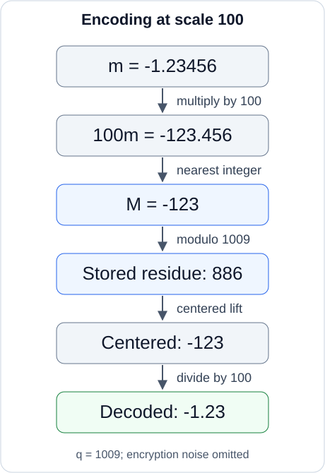

## 필기 원본

이 글에서 다룬 원본 PDF **24–27쪽**이다. 두 단과 여백 필기를 포함한 페이지 전체를 실었다. 이미지를 누르면 확대해서 볼 수 있다.

<figure style="margin: 2rem 0;">
  
  <figcaption>원본 PDF 24쪽.</figcaption>
</figure>

<figure style="margin: 2rem 0;">
  
  <figcaption>원본 PDF 25쪽.</figcaption>
</figure>

<figure style="margin: 2rem 0;">
  
  <figcaption>원본 PDF 26쪽.</figcaption>
</figure>

<figure style="margin: 2rem 0;">
  
  <figcaption>원본 PDF 27쪽.</figcaption>
</figure>

## 들어가며

[앞 글](/posts/ai-security-homomorphic-encryption-definitions-and-security/)에서는 동형암호의 정의와 IND-CPA 안전성을 정리했다. 이번에는 실수 값을 정수 계수 다항식으로 표현하고, 암호화한 상태의 연산에서 스케일과 오차가 어떻게 변하는지 살펴본다.

**정리 범위는 원본 PDF의 24–27쪽이다.** 실수 연산의 필요성, 스케일링·반올림·법 연산, 실수 계수 다항식의 Ring-LWE 암호화와 근사 복호화, 동형 덧셈과 공개 평문 곱셈을 다룬다.

원문의 수치 예제와 알고리즘을 옮기고, 생략된 반올림 항과 복호화 범위 조건을 보충한다. 추가 검산 예제는 별도로 표시한다. 여기서 다루는 것은 **실수 계수 다항식을 정수화하는 과정**이며, CKKS의 슬롯 인코딩 전체는 이후 범위다.

## 1. 실수의 산술적 의미를 유지해야 한다

### 1.1 비트 암호화에서 실수 연산으로

앞에서 본 Ring-LWE 공개키 암호는

$$
R_q=\mathbb Z_q[X]/(X^N+1)
$$

에서 계산했고, 메시지의 각 계수는 $0$ 또는 $1$이었다.

$$
\mathbf m\in\{0,1\}^N.
$$

원문은 예를 들어

$$
m(X)=1+0X+1X^2+\cdots
$$

같은 다항식의 각 비트에 $\lfloor q/2\rfloor$를 곱하는 방식을 떠올린다. 작은 잡음이 있어도 두 중심을 구별해 각 계수를 $0$ 또는 $1$로 복원하는 구조다.

하지만 신경망의 가중치에는 $0.213$, $-1.32$, $2.84$ 같은 소수가 등장한다. 활성화 함수의 출력과 중간 계산도 실수 값을 다룬다.

실수의 표현을 비트열로 만들어 암호화하는 것에 더해, **원하는 실수 덧셈·곱셈에 대응하는 계산**이 필요하다. 원문의 예제는

$$
m_1=2.34,\qquad m_2=3.12
$$

에 대해

$$
m_1+m_2=5.46,
$$

$$
m_1m_2=2.34\cdot3.12=7.3008
$$

을 계산하는 것이다. 이런 근사 실수 산술로 이어지는 대표적인 구성이 CKKS다.

### 1.2 Floating-point 표현에서 fixed-point 스케일링으로

원문은

$$
2.34=234\cdot10^{-2}
$$

를 예로 든다. 유효 숫자와 지수를 나누어 표현할 수 있지만, $R_q$의 계수 자리에 실수 $2.34$를 직접 넣을 수는 없다.

여기서는 fixed-point 방식처럼 공개된 스케일을 사용한다. 이 글에서는 양의 정수 $\Delta\in\mathbb Z_{>0}$로 설명한다. 값을 $\Delta$배 하고 정수로 반올림한 뒤 암호화한다. 계산 결과를 해석할 때는 그 결과의 스케일로 나눈다.

$$
m
\xrightarrow{\times\Delta}
\Delta m
\xrightarrow{\text{round}}
\lfloor\Delta m\rceil
\xrightarrow{\text{integer arithmetic}}
\text{scaled result}.
$$

이 글의 $\Delta$는 실수 표현을 위해 선택하는 스케일이다. 세 번째 글에서 비트 $0,1$ 사이의 간격으로 사용한 $\lfloor q/2\rfloor$와 용도를 구별한다.

### 1.3 추적해야 할 세 종류의 오차

원문은 다음 세 가지를 함께 고려하라고 강조한다.

1. 실수를 정수화할 때 생기는 **인코딩 반올림 오차**.
2. Ring-LWE 암호화·복호화 과정에서 남는 **암호화 잡음**.
3. 동형 연산이 기존 오차를 더하거나 증폭하면서 생기는 **결과 오차**.

아래에서는 이 항들을 기호로 분리한다. 계산 후의 총오차를 처음의 작은 잡음 분포와 동일하게 취급하지 않는다.

## 2. 실수 계수 다항식을 정수 계수로 옮기기

### 2.1 계산할 공간

앞 글처럼 $N$은 $2$의 거듭제곱으로 두자. 정수 계수 다항식의 환과 그 법 $q$ 버전을

$$
R=\mathbb Z[X]/(X^N+1),\qquad
R_q=R/qR
$$

로 쓰자. 실수 값의 유한 정밀도 표현은 유리수로 나타낼 수 있으므로, 원문처럼

$$
R_{\mathbb Q}=\mathbb Q[X]/(X^N+1)
$$

의 메시지 $m$을 생각한다. 각 다항식은 차수가 $N$보다 작은 대표 다항식으로 쓴다.

모든 실수를 유한한 비트 수로 정확히 저장한다는 뜻은 아니다. 주어진 수치 근삿값을 다항식 계수에 넣고, 그다음 정수화 오차를 분석하는 단계다.

### 2.2 원문 예제: 스케일링

$N\ge4$라 하고 원문의 다항식을 보자.

$$
m(X)=23.4+34.2X-9.34X^2
+\cdots+10.34X^{N-1}.
$$

$\Delta=100$을 곱하면

$$
\Delta m(X)=2340+3420X-934X^2
+\cdots+1034X^{N-1}.
$$

표시한 계수들은 이 스케일에서 정수가 된다. 일반적인 메시지에서는 $\Delta$를 곱해도 정수가 되지 않을 수 있으므로 반올림 단계가 필요하다.

### 2.3 계수별 반올림과 오차

$\lfloor x\rceil$는 가장 가까운 정수로의 반올림을 뜻한다. $\lfloor x\rfloor$처럼 항상 아래로 내리는 연산과 구별한다. 수치 예제에서 정확히 중간이면 $0$에서 먼 정수를 선택한다.

$$
M=\lfloor\Delta m\rceil\in R.
$$

다항식에는 계수별로 적용한다. 반올림 오차를

$$
\rho_m=M-\Delta m
$$

로 정의하면

$$
M=\Delta m+\rho_m.
$$

각 계수의 오차는 절댓값 $1/2$ 이하다. 이후 사용할 노름도 **계수의 최대 절댓값**으로 고정한다.

$$
\|f\|_{\mathrm{coeff},\infty}
=\max_{0\le j<N}|f_j|,
\qquad f=\sum_{j=0}^{N-1}f_jX^j.
$$

따라서

$$
\|\rho_m\|_{\mathrm{coeff},\infty}\le\frac12.
$$

이는 이 글의 계수 표현에 대한 상한이다. 이후 CKKS 슬롯 값의 오차로 바꾸려면 슬롯 변환이 오차에 미치는 영향도 반영해야 한다.

### 2.4 법 $q$로 보내기

마지막으로 각 정수 계수를 법 $q$로 줄인다.

$$
\operatorname{Encode}_{\Delta,q}(m)
=[\lfloor\Delta m\rceil]_q\in R_q.
$$

전체 과정은 다음과 같다.

$$
\begin{aligned}
m\in R_{\mathbb Q}
&\xrightarrow{\times\Delta}\Delta m\in R_{\mathbb Q}\\
&\xrightarrow{\text{round}}M\in R\\
&\xrightarrow{\bmod q}[M]_q\in R_q.
\end{aligned}
$$

이제 정수 계수 환에서 계산할 수 있다. 다만 법 연산으로 합쳐진 여러 정수 중 어떤 값을 의도했는지 복원하려면 표현 범위에 관한 조건이 필요하다.

## 3. 스케일은 정밀도와 표현 범위를 함께 바꾼다

### 3.1 원문 예제: 작은 스케일과 큰 스케일

원문은 $m=2.34567$을 $\Delta=10$, $\Delta=10000$으로 비교한다. 암호화 잡음을 제외하고 인코딩만 계산하면 다음과 같다.

| 스케일 $\Delta$ | $\Delta m$ | $M=\lfloor\Delta m\rceil$ | $M/\Delta$ | 절대오차 |
| --- | --- | --- | --- | --- |
| $10$ | $23.4567$ | $23$ | $2.3$ | $0.04567$ |
| $10000$ | $23456.7$ | $23457$ | $2.3457$ | $0.00003$ |

반올림만 있을 때 계수별 오차 상한은

$$
\left\|\frac{M}{\Delta}-m\right\|_{\mathrm{coeff},\infty}
\le\frac{1}{2\Delta}.
$$

큰 스케일은 이 상한을 줄인다. 정밀도를 위해 원문에서 $1\ll\Delta$라고 쓰는 이유다.

### 3.2 중심 대표값과 wrap-around

법 $q$의 값에는 부호 있는 정수 표현이 여러 개 대응한다. 음수 계수를 복원하려면 각 계수의 **중심 대표값**을 선택해야 한다.

$z\in\{0,\ldots,q-1\}$에 대해

$$
\operatorname{ctr}_q(z)=
\begin{cases}
z,&0\le z<q/2,\\
z-q,&q/2\le z<q.
\end{cases}
$$

다항식에는 계수별로 적용한다. 선택한 정수 계수는 $[-q/2,q/2)$에 놓인다.

원문은 다음 wrap-around 예제를 든다.

$$
120\bmod100=20.
$$

법 $100$의 값 $20$만으로 원래 정수가 $120$이었다고 복원할 수는 없다. 추가로 $m=12$, $\Delta=10$을 대입하면

$$
M=120,\qquad
\frac{\operatorname{ctr}_{100}(20)}{10}=2
$$

가 되어 의도한 값 $12$를 잃는다. $\Delta<q$라는 비교만으로 충분하지 않으며, **스케일을 곱한 메시지 자체의 크기**를 봐야 한다.

*원문 25쪽의 인코딩 흐름에 추가 수치 예제를 넣었다. $m=-1.23456$, $\Delta=100$, $q=1009$이며 암호화 잡음은 생략했다. 법 연산으로 $-123$을 $886$으로 저장해도, 중심 대표값이 $-123$임을 복원하면 $-1.23$으로 해석할 수 있다.*

### 3.3 메시지와 잡음에 필요한 공간

복호화 후 남는 암호화 잡음을 $\eta_{\mathrm{dec}}$라 하자. 중심 대표값으로 의도한 정수 다항식을 복원하는 충분조건은

$$
\|M+\eta_{\mathrm{dec}}\|_{\mathrm{coeff},\infty}
<\frac q2.
$$

$\|\eta_{\mathrm{dec}}\|_{\mathrm{coeff},\infty}\le B_{\mathrm{dec}}$인 경우, 다음 조건으로도 충분하다.

$$
\Delta\|m\|_{\mathrm{coeff},\infty}
+\frac12+B_{\mathrm{dec}}
<\frac q2.
$$

이 조건 아래에서 계수의 크기가 $T$ 이하인 메시지들을 표현하려면

$$
\Delta T+\frac12+B_{\mathrm{dec}}<\frac q2
$$

처럼 메시지·반올림·잡음의 여유를 함께 확보한다.

원문의 $1\ll\Delta\ll q$는 이 관계를 직관적으로 요약한다. 정확한 조건은 메시지 크기와 계산 중 증가하는 오차까지 포함한다. 같은 $q$에서 $\Delta$를 키우면 정밀도에 유리하지만 사용할 수 있는 메시지 범위가 줄어든다.

## 4. 실수 다항식용 Ring-LWE 키 생성

### 4.1 앞 글과 달라진 부호·성분 순서

원문은 여기서 공개키와 복호화의 표기를 바꾼다.

| 구분 | 공개키의 관계와 순서 | 암호문 $(u,v)$의 복호화 조합 |
| --- | --- | --- |
| 세 번째 글 | $b=as+e$, $pk=(a,b)$ | $v-us$ |
| 이번 글 | $b=-as+e$, $pk=(b,a)$ | $u+vs$ |

각 표기에서 큰 항이 소거되도록 암호문 성분을 맞추는 구조다. 아래에서는 원문 25–27쪽의 **부호 규약**에 맞춰 $b=-as+e$, $u+vs$를 일관되게 사용한다.

### 4.2 KeyGen

입력은 보안 매개변수의 단항 표현 $1^\lambda$이고, 출력은 $(pk,sk)$다.

보안 매개변수에 따라

$$
N=N(\lambda),\qquad
q=q(\lambda),\qquad
\chi=\chi(\lambda)
$$

를 정한다. $\chi$는 작은 정수 계수를 위한 분포이며, $\chi^N$에서 뽑은 계수들을 차수 $N$ 미만의 작은 다항식으로 본다.

비밀키와 공개키를 다음처럼 만든다.

$$
s\leftarrow\chi^N,\qquad sk=s,
$$

$$
a\xleftarrow{\mathrm U}R_q,\qquad
e\leftarrow\chi^N,
$$

$$
b=-as+e\pmod q,
\qquad pk=(b,a).
$$

작은 다항식은 $R$의 값으로 생각하고, 암호문의 계산에서는 법 $q$로 보낸다. 인코딩 스케일 $\Delta$는 메시지의 수치 표현에 사용하는 공개정보로 별도 추적한다.

## 5. 암호화와 근사 복호화

### 5.1 암호화

메시지 $m\in R_{\mathbb Q}$를 인코딩해 $M=\lfloor\Delta m\rceil$를 만든다. 암호화할 때마다 작은 다항식을 서로 독립적으로 새로 뽑는다.

$$
r,e_0,e_1\leftarrow\chi^N.
$$

암호문은

$$
c=(u,v)
=r(b,a)+(e_0,e_1)+(M,0)
\in R_q^2.
$$

성분별로 쓰면

$$
u=rb+e_0+M\pmod q,
$$

$$
v=ra+e_1\pmod q.
$$

스케일 $\Delta$로 정수화한 메시지는 첫 성분에 더해진다.

### 5.2 비밀키와 결합하면 큰 항이 소거된다

먼저 $R_q$ 안의 선형 결합을

$$
D_s(c)=u+vs\in R_q
$$

로 정의하자. 원문의 내적 표기는

$$
D_s(c)=(u,v)\cdot(1,s)
$$

와 같다.

암호문 성분을 대입하면 $R_q$에서

$$
\begin{aligned}
D_s(c)
&=rb+e_0+M+(ra+e_1)s\\
&=r(b+as)+e_0+e_1s+M\\
&=re+e_0+e_1s+M.
\end{aligned}
$$

마지막 줄은 $b=-as+e$, 즉 $b+as=e$를 사용했다. 균등한 큰 다항식 $a$가 들어간 두 항은

$$
r(-as)+(ra)s=0
$$

으로 소거된다.

복호화에 남는 잡음을

$$
\eta_{\mathrm{dec}}=re+e_0+e_1s\in R
$$

로 두면

$$
D_s(c)=[M+\eta_{\mathrm{dec}}]_q.
$$

각 작은 다항식이 곱해지고 더해진 결과이므로, $\eta_{\mathrm{dec}}$의 분포를 원래의 $\chi$와 같다고 둘 수는 없다.

### 5.3 반올림 오차까지 포함한 근사 복호화

3.3절의 범위 조건이 성립하면

$$
\operatorname{ctr}_q(D_s(c))
=M+\eta_{\mathrm{dec}}.
$$

이를 실제 수치로 해석하는 결과를 $\widehat m$이라 하자.

$$
\widehat m
=\frac{\operatorname{ctr}_q(D_s(c))}{\Delta}.
$$

이제 $M=\Delta m+\rho_m$을 대입하면

$$
\begin{aligned}
\widehat m
&=\frac{M+\eta_{\mathrm{dec}}}{\Delta}\\
&=\frac{\Delta m+\rho_m+\eta_{\mathrm{dec}}}{\Delta}\\
&=m+\frac{\rho_m+\eta_{\mathrm{dec}}}{\Delta}.
\end{aligned}
$$

원문의 $e_{\mathrm{round}}$와 $e_{\mathrm{decrypt}}$가 각각 여기의 $\rho_m$, $\eta_{\mathrm{dec}}$에 해당한다. 따라서

$$
\operatorname{Decode}_{\Delta}
\bigl(D_s(\operatorname{Enc}(m))\bigr)
\approx m
$$

으로 이해한다. 여기서 $\operatorname{Decode}_{\Delta}(z)=\operatorname{ctr}_q(z)/\Delta$다. 이 글에서는 환 안의 결합 $D_s$와, 중심 대표값을 선택해 스케일로 나누는 수치 디코딩을 구분했다.

잡음 상한이 $B_{\mathrm{dec}}$이면

$$
\|\widehat m-m\|_{\mathrm{coeff},\infty}
\le\frac{1/2+B_{\mathrm{dec}}}{\Delta}.
$$

같은 잡음 상한을 유지할 수 있고 wrap-around가 없다는 조건에서, 스케일을 키우면 이 오차 상한이 줄어든다. 실제 잡음 분포에 대한 분석에서는 이 상한을 넘는 꼬리 확률도 별도로 고려해야 한다.

### 5.4 보충: 스케일로 나누기는 모듈러 역원 곱셈이 아니다

위 복원 순서는 다음과 같다.

1. $u+vs$를 $R_q$에서 계산한다.
2. 각 계수를 중심 대표 정수로 옮긴다.
3. 그 정수 계수를 유리수·실수의 의미로 $\Delta$로 나눈다.

원문의 scale down에서 등장하는 $\Delta^{-1}$는 마지막 수치 나눗셈을 뜻한다. $R_q$에서 모듈러 역원을 곱하는 것과 구별해야 한다.

**추가 예제:** $q=101$, $\Delta=10$, 복원된 정수 계수가 $11$이면

$$
11/10=1.1.
$$

한편 $10^{-1}\equiv91\pmod{101}$이므로 모듈러 역원을 곱하면

$$
11\cdot91\equiv92\pmod{101}.
$$

이는 실수 $1.1$을 복원하는 나눗셈과 다른 연산이다.

## 6. 추가 검산: 작은 다항식으로 암호화부터 확인하기

이 절은 원문에 없는 계산 예제다. 작은 차수와 고정한 표본을 사용해 식의 부호·반올림·오차를 검산하며, 실제 보안 수준을 정하는 예제는 아니다.

### 6.1 매개변수와 메시지

$$
N=4,\qquad q=65537,\qquad\Delta=100.
$$

$X^4=-1$인 환에서 다음 작은 다항식을 선택하자.

$$
s=1+X,\qquad e=1-X,\qquad r=1-X,
$$

$$
e_0=1,\qquad e_1=X.
$$

계수 벡터를 $\operatorname{coeff}(f)=(f_0,f_1,f_2,f_3)$로 쓰고

$$
\operatorname{coeff}(a)=(1000,2000,3000,4000)
$$

으로 정한다. 메시지는

$$
m=2.34567-1.23456X+0.125X^2+3X^3.
$$

계수별 반올림 결과는

$$
\operatorname{coeff}(M)=(235,-123,13,300).
$$

세 번째 계수는 $100\cdot0.125=12.5$를 이 글의 중간값 규칙에 따라 $13$으로 반올림했다.

### 6.2 공개키와 암호문

다항식 곱셈을 $X^4=-1$로 정리하고 중심 대표 계수로 표시하면

$$
\operatorname{coeff}(b)=(3001,-3001,-5000,-7000),
$$

$$
\operatorname{coeff}(u)=(-3763,-6125,-1986,-1700),
$$

$$
\operatorname{coeff}(v)=(5000,1001,1000,1000).
$$

각각 $b=-as+e$, $u=rb+e_0+M$, $v=ra+e_1$을 계산한 값이다.

### 6.3 잔여 잡음과 수치 오차

잡음은 직접 전개할 수 있다.

$$
\begin{aligned}
\eta_{\mathrm{dec}}
&=re+e_0+e_1s\\
&=(1-X)^2+1+X(1+X)\\
&=2-X+2X^2.
\end{aligned}
$$

실제로 암호문을 복호화 조합에 넣으면

$$
\operatorname{ctr}_q(u+vs)
=237-124X+15X^2+300X^3
=M+\eta_{\mathrm{dec}}.
$$

계수 크기가 모두 $q/2$보다 작으므로 범위를 벗어나지 않는다. $100$으로 나누면

$$
\widehat m=2.37-1.24X+0.15X^2+3X^3.
$$

원래 메시지와의 차이는

$$
\widehat m-m
=0.02433-0.00544X+0.025X^2.
$$

이 예제에서 $\|\eta_{\mathrm{dec}}\|_{\mathrm{coeff},\infty}=2$이므로

$$
\|\widehat m-m\|_{\mathrm{coeff},\infty}
=0.025
=\frac{1/2+2}{100}.
$$

반올림 오차와 암호화 잡음을 합친 상한과 실제 계산이 맞는다.

## 7. 동형 덧셈: 스케일은 유지되고 오차는 더해진다

### 7.1 연산을 위한 총오차 표기

같은 비밀키·환·법 $q$와 같은 스케일 $\Delta$를 사용하는 두 암호문을 보자.

$$
c_i=(u_i,v_i),\qquad i\in\{1,2\}.
$$

원문 27쪽의 암호문 성분 $(b_i,a_i)$를 여기서는 $(u_i,v_i)$로 적는다. 공개키 성분과 구별하기 위한 표기 변경이다.

인코딩 오차와 암호화 잡음을 합친 총오차를

$$
\eta_i=\rho_{m_i}+\eta_{\mathrm{dec},i}
$$

로 두면

$$
D_s(c_i)=[\Delta m_i+\eta_i]_q.
$$

여기서 $\Delta m_i+\eta_i=M_i+\eta_{\mathrm{dec},i}$는 정수 계수 다항식이다. $\eta_i$는 원래의 잡음 분포 $\chi$에서 새로 뽑은 값이 아니라 이미 인코딩·암호화 과정을 거친 총오차다.

### 7.2 암호문 성분을 더한다

동형 덧셈을

$$
c_{\mathrm{add}}=c_1\oplus c_2
=(u_1+u_2,v_1+v_2)
$$

로 정의한다. $R_q$에서

$$
\begin{aligned}
D_s(c_{\mathrm{add}})
&=(u_1+u_2)+(v_1+v_2)s\\
&=(u_1+v_1s)+(u_2+v_2s)\\
&=D_s(c_1)+D_s(c_2)\\
&=[\Delta(m_1+m_2)+\eta_1+\eta_2]_q.
\end{aligned}
$$

원문의 핵심은 $D_s(u,v)=u+vs$의 **암호문 성분에 대한 선형성**이다. 이는 $R_q$에서 성립하는 관계다. 중심 대표값을 고르는 연산이 모든 경우에 선형인 것은 아니다.

결과가 중심 대표 범위 안에 있으면

$$
\widehat{m_1+m_2}
=m_1+m_2+\frac{\eta_1+\eta_2}{\Delta}.
$$

따라서 결과 스케일은 $\Delta$, 총오차는

$$
\eta_{\mathrm{add}}=\eta_1+\eta_2
$$

다. 계수별 오차 상한도 삼각부등식에 따라 합할 수 있다. 입력 각각이 복호화 범위 안에 있어도 합이 범위를 넘을 수 있으므로

$$
\|\Delta(m_1+m_2)+\eta_1+\eta_2\|_{\mathrm{coeff},\infty}
<q/2
$$

같은 출력 조건을 다시 확인한다.

### 7.3 추가 예제: 원문의 두 실수에 오차를 넣으면

이 절과 8.4절의 스칼라 검산에서는 별도로 $q=1000003$, $\Delta=100$을 사용한다. 상수 다항식으로 생각하면 된다.

$$
m_1=2.34,\qquad m_2=3.12.
$$

두 값은 이 스케일에서 반올림 오차가 없다. 복호화 조합의 중심 대표값에 각각 $1$, $-2$의 잡음이 남았다고 하자.

$$
\operatorname{ctr}_q(D_s(c_1))=234+1=235,
$$

$$
\operatorname{ctr}_q(D_s(c_2))=312-2=310.
$$

합의 복호화·디코딩 결과는

$$
\frac{235+310}{100}=5.45
=5.46+\frac{1-2}{100}.
$$

평문 합 $5.46$에 합산된 오차 $-0.01$이 남는다.

### 7.4 보충: 서로 다른 스케일은 먼저 맞춘다

오차가 없는 경우에도, 같은 값 $1.2$가 스케일 $100$에서는 $120$, 스케일 $1000$에서는 $1200$으로 표현된다. 이 정수들을 그대로 더한 $1320$을 어느 한 스케일로 나눠도 원하는 합 $2.4$가 되지 않는다.

첫 암호문의 각 성분을 $10$배 하여 스케일 $1000$에 맞추면

$$
\frac{10\cdot120+1200}{1000}=2.4.
$$

실제 오차가 있다면 첫 암호문의 오차도 $10$배 된다. 스케일 정렬은 암호문의 값과 오차에 영향을 주므로, 스케일을 적어 둔 숫자만 임의로 바꾸는 것과 구별한다.

## 8. 동형 평문 곱셈: 두 입력의 스케일을 곱한다

### 8.1 한쪽 입력은 공개 평문이다

이번에는 암호화된 $m$에 공개된 평문 다항식 $p$를 곱한다. $p$는 암호문으로 주어지는 비밀 입력이 아니다.

같은 스케일 $\Delta$로 평문을 인코딩하자.

$$
P=\lfloor\Delta p\rceil\in R,\qquad
\rho_p=P-\Delta p.
$$

$R_q$에서 $P$를 암호문의 두 성분에 각각 곱한다.

$$
c_{\mathrm{pm}}=P\odot c=(Pu,Pv)\in R_q^2.
$$

암호문 성분은 여전히 두 개다. 비밀키도 $s$를 유지한다.

### 8.2 원문의 근사식과 반올림을 포함한 정확한 전개

곱셈 전 암호문이

$$
D_s(c)=[\Delta m+\eta_m]_q
$$

를 만족한다고 하자. $R_q$에서

$$
\begin{aligned}
D_s(c_{\mathrm{pm}})
&=Pu+Pvs\\
&=P(u+vs)\\
&=[P(\Delta m+\eta_m)]_q.
\end{aligned}
$$

원문은 $P\approx\Delta p$를 사용해

$$
P(\Delta m+\eta_m)
\approx\Delta^2pm+\Delta p\eta_m
$$

로 설명한다. 여기서 결과의 스케일이 $\Delta^2$가 되는 것을 볼 수 있다.

평문의 반올림 항도 남겨 두면 $P=\Delta p+\rho_p$이므로, 법으로 줄이기 전의 정확한 다항식 전개는

$$
\begin{aligned}
P(\Delta m+\eta_m)
&=(\Delta p+\rho_p)(\Delta m+\eta_m)\\
&=\Delta^2pm
+\Delta p\eta_m
+\Delta m\rho_p
+\rho_p\eta_m.
\end{aligned}
$$

원문 마지막 줄의 $\delta_p$가 여기의 $\rho_p$다. 메시지 쪽의 반올림 오차도 $\eta_m=\rho_m+\eta_{\mathrm{dec}}$ 안에 포함했다.

따라서 스케일을 적용한 메시지 외의 총오차를

$$
\eta_{\mathrm{pm}}
=\Delta p\eta_m+\Delta m\rho_p+\rho_p\eta_m
$$

로 추적할 수 있다. 기존 잡음에 $\Delta p$가 곱해지고, 공개 평문의 반올림 오차에서 두 항이 더 생긴다.

### 8.3 결과는 바뀐 스케일로 디코딩한다

새 복호화 결과도 범위 안에 있어야 한다.

$$
\|\Delta^2pm+\eta_{\mathrm{pm}}\|_{\mathrm{coeff},\infty}
<q/2.
$$

이 조건 아래 결과를 $\Delta^2$로 나누면

$$
\begin{aligned}
\widehat{pm}
&=pm+\frac{\eta_{\mathrm{pm}}}{\Delta^2}\\
&=pm
+\frac{p\eta_m+m\rho_p}{\Delta}
+\frac{\rho_p\eta_m}{\Delta^2}.
\end{aligned}
$$

곱셈에서는 암호화 잡음뿐 아니라 메시지·평문 반올림 항의 교차 곱도 나타난다. 결과 오차를 처음의 $\chi$에서 뽑은 새 오차 하나로 대체하지 않는다.

### 8.4 추가 예제: 스케일을 그대로 두면 값이 달라진다

7.3절과 같은 $q=1000003$, $\Delta=100$을 사용하고

$$
m=2.34,\qquad p=3.12,\qquad P=312
$$

로 두자. 잡음이 없으면 스케일을 적용한 곱은

$$
234\cdot312=73008,
$$

$$
73008/10000=7.3008.
$$

이번에는 암호문 쪽에 $\eta_m=1$이 남아 정수 복호화 값이 $235$라고 하자. 공개 평문은 정확히 인코딩되므로 $\rho_p=0$이다.

$$
P(\Delta m+\eta_m)=312\cdot235=73320.
$$

새 스케일 $10000$으로 해석하면

$$
\widehat{pm}=7.332
=7.3008+0.0312.
$$

이 오차는 정확히

$$
\frac{p\eta_m}{\Delta}
=\frac{3.12\cdot1}{100}=0.0312
$$

다. $73320<q/2$이므로 이 예제에는 wrap-around가 없다.

원래 스케일 $100$으로 나누면 $733.2$가 된다. 새 스케일이 $10000$이라는 정보를 유지해야 올바른 수치 근삿값을 얻는다.

### 8.5 보충: 모든 평문 곱셈이 스케일을 제곱하지는 않는다

위의 $\Delta^2$는 **두 입력을 모두 스케일 $\Delta$로 표현했기 때문**이다. 일반적으로 암호문 메시지의 스케일이 $\Delta_m$, 인코딩한 평문의 스케일이 $\Delta_p$라면

$$
\Delta_{\mathrm{out}}=\Delta_m\Delta_p.
$$

이미 정수인 공개 상수 $k$를 스케일링 없이 그대로 곱하면

$$
D_s(kc)=[\Delta(km)+k\eta_m]_q.
$$

이때 메시지 $km$에 대한 스케일은 $\Delta$다. $k$ 자체에 스케일 $\Delta$를 붙여 $k\Delta$를 곱하는 경우와 구별한다.

스케일의 곱을 추적하고 덧셈 전에 스케일·계산 매개변수를 맞추는 관계는 Microsoft SEAL의 [CKKS 공식 예제](https://github.com/microsoft/SEAL/blob/main/native/examples/5_ckks_basics.cpp)에서도 확인할 수 있다.

## 9. 연산 뒤에 남는 정보를 추적하기

### 9.1 같은 스케일에서의 연산 비교

아래 표의 복호화 조합은 법 $q$ 안의 식이다. 실제 수치 결과는 범위 조건을 확인한 뒤 중심 대표값을 선택하고 출력 스케일로 나눠 해석한다.

| 연산 | 암호문 성분 | 복호화 조합의 내용 | 출력 스케일 |
| --- | --- | --- | --- |
| 덧셈 | $(u_1+u_2,v_1+v_2)$ | $\Delta(m_1+m_2)+\eta_1+\eta_2$ | $\Delta$ |
| 스케일링하지 않은 정수 $k$ 곱셈 | $(ku,kv)$ | $\Delta(km)+k\eta_m$ | $\Delta$ |
| 스케일 $\Delta$의 공개 평문 $P$ 곱셈 | $(Pu,Pv)$ | $\Delta^2pm+\eta_{\mathrm{pm}}$ | $\Delta^2$ |

세 경우 모두 암호문은 다항식 두 개로 남는다. 스케일은 연산에 따라 달라지며, 표현 범위와 총오차도 결과마다 다시 추적해야 한다.

### 9.2 보충: 계수 인코딩과 CKKS 슬롯 인코딩

지금까지는 실수 계수 다항식 $m(X)$가 이미 주어졌다고 생각했다. 그 계수를 정수화하는 과정과, 데이터 벡터를 **성분별 연산이 가능한 슬롯**으로 배치하는 과정은 구별해야 한다.

계수에 데이터를 그대로 나열하면 다항식 덧셈은 계수별 덧셈이지만, 곱셈은 계수들의 합성곱이다. 예를 들어 $N=4$일 때

$$
(1+2X)(3+4X)=3+10X+8X^2.
$$

계수 벡터 $(1,2)$와 $(3,4)$의 성분별 곱 $(3,8)$을 뜻하지 않는다. 높은 차수 항은 추가로 $X^N=-1$에 따라 정리한다.

CKKS의 슬롯 표현에서는 cyclotomic 다항식의 복소수 근에서 평가하는 구조를 이용한다. 이때의 인코딩과 디코딩은 저자들의 [ASIACRYPT 2017 발표 자료, Packing Method](https://yongsoosong.github.io/files/slides/AC17.pdf)에 설명되어 있다. 이 글의 계수 반올림 오차 상한을 슬롯 오차 상한으로 그대로 옮겨 쓰지는 않는다.

원문 28쪽부터는 암호문 두 개를 곱할 때의 $s^2$ 항, relinearization과 key switching, 증가한 스케일을 조정하는 rescaling으로 이어진다. 이 과정은 결과를 읽을 때 스케일로 나누는 디코딩과도 구별해서 다음 글에서 다룬다.

## 참고 자료

- 원본 필기 PDF 24–27쪽: 실수 연산 예제, 스케일링·반올림·법 연산, Ring-LWE 알고리즘, 근사 복호화, 덧셈과 공개 평문 곱셈 전개의 기준 자료.
- Jung Hee Cheon, Andrey Kim, Miran Kim, Yongsoo Song, [Homomorphic Encryption for Arithmetic of Approximate Numbers, ASIACRYPT 2017 발표 자료](https://yongsoosong.github.io/files/slides/AC17.pdf): 암호화 잡음을 수치 오차로 다루는 복호화 구조와 슬롯 packing의 구별.
- Microsoft SEAL, [CKKS Basics](https://github.com/microsoft/SEAL/blob/main/native/examples/5_ckks_basics.cpp): 곱셈의 스케일 변화, 덧셈의 스케일·매개변수 정렬.
