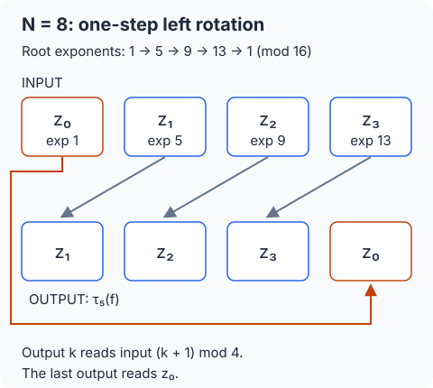
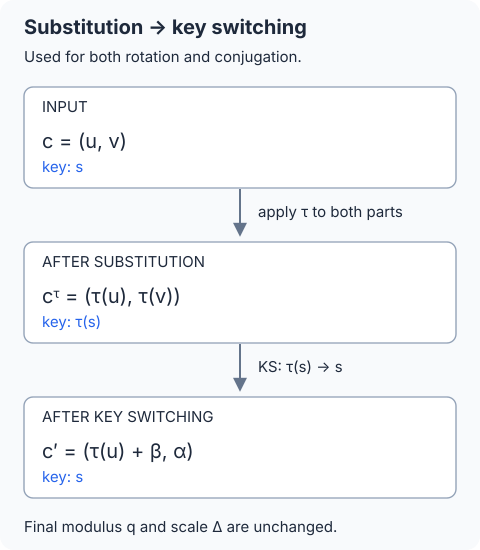

## 필기 원본

이 글에서 다룬 원본 PDF **37–39쪽**이다. 두 단과 여백 필기를 포함한 페이지 전체를 실었다. 이미지를 누르면 확대해서 볼 수 있다.

<figure style="margin: 2rem 0;">
  
  <figcaption>원본 PDF 37쪽.</figcaption>
</figure>

<figure style="margin: 2rem 0;">
  
  <figcaption>원본 PDF 38쪽.</figcaption>
</figure>

<figure style="margin: 2rem 0;">
  
  <figcaption>원본 PDF 39쪽. 이 글은 왼쪽 단을 다룬다. 오른쪽 단은 다음 글과 함께 보존했다.</figcaption>
</figure>

## 들어가며

[앞 글](/posts/ai-security-lagrange-interpolation-and-canonical-embedding/)에서는 다항식을 근에서 평가하여 여러 복소 데이터를 읽고, 홀수 지수 치환이 몫환에서 잘 정의된다는 것을 확인했다. 이제 **근의 순서를 적절히 정하면 다항식 치환이 슬롯의 순환이동이 된다**는 것을 보인다.

**정리 범위는 원본 PDF의 37–38쪽과 39쪽 왼쪽이다.** Week 4의 마지막 부분인 근의 재배열, $5$의 위수, 순환이동, 켤레 치환, 동형 회전·켤레 연산을 다룬다. 39쪽 오른쪽의 Week 5 요약부터는 다음 글의 범위다.

먼저 인코딩과 다항식 수준의 성질을 증명한다. 그다음 암호문 성분을 치환했을 때 비밀키도 달라진다는 점을 확인하고, 키 전환으로 원래 키 아래의 암호문을 얻는다. 원문의 기호는 앞 글과 맞추고, 생략된 증명과 수치 검산은 보충으로 구별한다.

## 1. 지수는 왜 N이 아니라 2N으로 줄이는가

### 1.1 환과 독립 슬롯 수

이하

$$
N=2^d\quad(d\ge1),\qquad L=N/2
$$

로 둔다. 정수 계수 환과 암호문용 환은

$$
R=\mathbb Z[X]/(X^N+1),\qquad R_q=R/qR
$$

이고, 정확한 슬롯 대응을 설명하는 실수 계수 공간은

$$
A_{\mathbb R}=\mathbb R[X]/(X^N+1)
$$

이다. 독립 복소 슬롯은 $L$개다. 임의의 복소 입력을 보간하는 이상적인 다항식은 실수 계수일 수 있고, 실제 정수 인코딩에는 앞 글의 스케일·반올림을 적용한다.

원문의 자연스러운 각도 순서에 따른 근은

$$
\zeta_j=\omega^{2j+1},\qquad
\omega=e^{\pi i/N},\qquad 0\le j<N.
$$

이번에는 이 전체 근 집합에서 새로운 순서로 켤레 쌍의 대표들을 고른다.

### 1.2 원래 위치로 돌아오는 주기는 2N이다

$$
\omega^N=e^{\pi i}=-1,\qquad
\omega^{2N}=e^{2\pi i}=1.
$$

따라서 정수 지수 $a$에 대해

$$
\omega^{a+N}=-\omega^a,\qquad
\omega^{a+2N}=\omega^a.
$$

$N$만큼 지수를 옮기면 반대편 점으로 가고, $2N$만큼 옮겨야 같은 점으로 돌아온다. 정확히

$$
\omega^a=\omega^b
\quad\Longleftrightarrow\quad
a\equiv b\pmod{2N}.
$$

이 때문에 근을 나타내는 지수는 법 $2N$으로 비교한다.

### 1.3 N=8에서 mod N을 쓰면 생기는 문제

$N=8$이면 $2N=16$이고

$$
5^2=25\equiv9\pmod{16}.
$$

따라서

$$
\omega^{25}=\omega^9=-\omega.
$$

법 $8$로만 보면 $25\equiv1$이지만 $\omega^{25}$는 아직 $\omega$로 돌아오지 않았다. 법 $16$을 사용해야 이 두 근을 구별할 수 있다.

## 2. 5의 거듭제곱은 정확히 N/2개의 근을 순환한다

### 2.1 필요한 것은 최소 주기다

원문 37쪽의 첫 번째 사실은 다음 두 주장이다.

$$
5^0,5^1,\ldots,5^{L-1}\pmod{2N}
$$

은 서로 다르고

$$
5^L\equiv1\pmod{2N}.
$$

이를 한꺼번에 표현하면

$$
\operatorname{ord}_{2N}(5)
=\min\{k>0:5^k\equiv1\pmod{2N}\}
=L.
$$

단순히 어느 시점에 $1$이 된다는 것뿐 아니라, 그보다 먼저 반복되지 않는다는 것까지 필요하다. 그래야 독립 슬롯 $L$개를 중복 없이 고를 수 있다.

### 2.2 원문의 필기를 전개한 위수 증명

원문의 필기에 적힌 처음 세 값은 다음과 같다.

$$
\begin{aligned}
5-1&=4=2^2,\\
5^2-1&=24=2^3\cdot3,\\
5^4-1&=624=2^4\cdot39.
\end{aligned}
$$

**보충 전개:** 먼저 모든 정수 $t\ge0$에 대해

$$
5^{2^t}-1=2^{t+2}u_t,\qquad u_t\text{는 홀수}
$$

임을 보이자. $t=0$이면 $5-1=4$이므로 성립한다.

이제 제곱의 차를 이용한다.

$$
5^{2^{t+1}}-1
=(5^{2^t}-1)(5^{2^t}+1).
$$

$5\equiv1\pmod4$이므로 두 번째 인수는

$$
5^{2^t}+1\equiv2\pmod4.
$$

따라서 두 번째 인수에는 $2$의 인수가 정확히 하나 들어 있다. 첫 번째 인수에 정확히 $t+2$개 들어 있었다면 곱에는 정확히 $t+3$개 들어 있다. 이것으로 귀납이 끝난다.

일반적인 양의 정수 $k$를

$$
k=2^t v,\qquad v\text{는 홀수}
$$

로 쓰면

$$
5^k-1
=(5^{2^t}-1)
\underbrace{\sum_{j=0}^{v-1}5^{2^t j}}_{\text{홀수 항을 홀수 개 더한 홀수}}
$$

이다. 따라서 $5^k-1$에 들어 있는 $2$의 인수 개수는 여전히 정확히 $t+2$다.

원하는 합동의 법은

$$
2N=2^{d+1}.
$$

그러므로

$$
\begin{aligned}
5^k\equiv1\pmod{2N}
&\quad\Longleftrightarrow\quad t+2\ge d+1\\
&\quad\Longleftrightarrow\quad 2^{d-1}\mid k.
\end{aligned}
$$

가능한 최소 양의 $k$는

$$
\boxed{k=2^{d-1}=N/2=L}.
$$

이 증명은 원문의 $5^k-1=(5^{k/2}-1)(5^{k/2}+1)$ 메모를 반복해서 사용한 것이다. $N=2$인 경계 경우에도 법 $4$에서 $5\equiv1$이므로 위수는 $1=L$이다.

### 2.3 나머지가 1 mod 4인 지수들을 모두 얻는다

모든 $k$에 대해

$$
5^k\equiv1\pmod4.
$$

법 $2N$의 나머지 중 $1\pmod4$인 것은

$$
1,5,9,\ldots,2N-3
$$

으로 정확히 $L$개다. 앞 절에서 $5^0,\ldots,5^{L-1}$이 서로 다름을 보였으므로

$$
\{5^k\bmod2N:0\le k<L\}
=\{4t+1:0\le t<L\}.
$$

이것이 원문 Fact 1과 Fact 2의 연결이다.

### 2.4 나머지 근들은 이들의 켤레다

위 지수들에 마이너스를 붙이면

$$
-5^k\equiv3\pmod4
$$

인 모든 홀수 나머지를 얻는다. 두 집합은 겹치지 않고 합치면 법 $2N$의 모든 홀수 나머지다.

$$
\{\pm5^k\bmod2N:0\le k<L\}
=\{1,3,5,\ldots,2N-1\}.
$$

복소수 근에서는

$$
\overline{\omega^{5^k}}=\omega^{-5^k}.
$$

따라서 $5$의 거듭제곱으로 고른 $L$개의 근은 각 켤레 쌍에서 하나씩 고른 대표이며, 그 켤레들이 나머지 $L$개의 근을 이룬다. 원문의 Fact 3은 이 음의 지수·켤레 관계다.

## 3. 근을 이 순서로 읽으면 왼쪽 순환이동이 된다

### 3.1 새 슬롯 순서를 먼저 고정한다

이제 독립 슬롯의 평가점을

$$
\xi_k=\omega^{5^k},\qquad 0\le k<L
$$

로 정한다. 원문의 $\zeta'_k$에 해당하며, 앞 글의 각도 순서 $\zeta_j$와 구별하기 위해 다른 문자를 사용한다.

$$
\operatorname{Slot}_5(f)
=\bigl(f(\xi_0),\ldots,f(\xi_{L-1})\bigr)
=\boldsymbol z.
$$

원문에서 입력 벡터의 성분으로 쓴 $m_k$는 이 글의 $z_k$에 대응한다.

앞 글은 자연스러운 각도 순서에서 앞 절반의 근을 골랐다. 이번에는 $5$의 거듭제곱으로 켤레 쌍의 대표를 고른다. 전체 근 집합은 같지만 **선택하는 켤레 쌍의 대표까지 달라질 수 있으므로**, 기존 독립 슬롯 값들을 단순히 위치만 바꾼 것으로 가정하지 않는다. 이하 데이터는 새 슬롯 순서를 기준으로 인코딩한다.

### 3.2 N=8의 네 슬롯을 실제로 나열한다

원문 예제에서

$$
5^0,5^1,5^2,5^3=1,5,25,125
$$

이고, 법 $16$의 나머지는 $1,5,9,13$이다.

| 슬롯 $k$ | $5^k$ | 지수의 나머지 mod $16$ | 선택한 근 |
| --- | --- | --- | --- |
| $0$ | $1$ | $1$ | $\xi_0=\omega$ |
| $1$ | $5$ | $5$ | $\xi_1=\omega^5$ |
| $2$ | $25$ | $9$ | $\xi_2=\omega^9$ |
| $3$ | $125$ | $13$ | $\xi_3=\omega^{13}$ |

다음 거듭제곱은

$$
5^4=625=16\cdot39+1\equiv1\pmod{16}.
$$

즉 지수 순서는

$$
1\longrightarrow5\longrightarrow9\longrightarrow13\longrightarrow1
$$

의 주기를 갖는다.

켤레 쪽의 지수는 원문의 필기처럼

$$
-1\equiv15,\quad -5\equiv11,\quad
-9\equiv7,\quad -13\equiv3\pmod{16}.
$$

선택한 지수 $1,5,9,13$과 합치면 홀수 지수 여덟 개가 모두 나온다.

### 3.3 출력 위치 k는 입력 위치 k+1을 읽는다

$$
g(X)=\tau_5(f)(X)=f(X^5)
$$

라 하자. 각 슬롯에서

$$
\begin{aligned}
g(\xi_k)
&=f(\xi_k^5)\\
&=f(\omega^{5^{k+1}}).
\end{aligned}
$$

$0\le k<L-1$에서는 이것이 $f(\xi_{k+1})=z_{k+1}$다. 마지막 슬롯에서는

$$
\xi_{L-1}^5
=\omega^{5^L}
=\omega
=\xi_0
$$

이다. 두 번째 등식에 $5^L\equiv1\pmod{2N}$을 사용했다. 따라서

$$
\boxed{\operatorname{Slot}_5(\tau_5 f)
=(z_1,z_2,\ldots,z_{L-1},z_0)}.
$$

이 글에서 **왼쪽 한 칸 순환이동**은 출력 위치가 다음 입력 위치를 읽는다는 뜻이다. 마지막 출력은 입력의 $0$번을 읽는다.

### 3.4 r칸 이동과 오른쪽 이동

치환을 $r$번 반복하면

$$
(\tau_5)^r=\tau_{5^r}.
$$

지수는 법 $2N$, 슬롯 번호는 법 $L$로 줄인다. $0\le r<L$에 대해

$$
\operatorname{Slot}_5(\tau_{5^r}f)_k
=z_{(k+r)\bmod L}.
$$

예를 들어 $N=8$일 때

$$
\begin{aligned}
\tau_5 &: (z_0,z_1,z_2,z_3)\longmapsto(z_1,z_2,z_3,z_0),\\
\tau_9 &: (z_0,z_1,z_2,z_3)\longmapsto(z_2,z_3,z_0,z_1),\\
\tau_{13} &: (z_0,z_1,z_2,z_3)\longmapsto(z_3,z_0,z_1,z_2).
\end{aligned}
$$

마지막 줄은 오른쪽 한 칸 이동이기도 하다. 실제로

$$
5^{-1}\equiv13\pmod{16},\qquad
(\tau_5)^{-1}=\tau_{13}
$$

이다. 여기서 $5^{-1}$은 모듈러 역원이며, $X$에 분수 지수의 다항식을 넣는다는 뜻이 아니다.

## 4. X의 역원을 넣으면 슬롯별 켤레가 된다

### 4.1 몫환에서 X의 역원은 다항식이다

원문 38쪽 왼쪽은 또 다른 치환을 도입한다.

$$
\tau_{-1}:f(X)\longmapsto f(-X^{N-1}).
$$

몫환에서 $X^N=-1$이므로

$$
X(-X^{N-1})=-X^N=1.
$$

따라서

$$
X^{-1}=-X^{N-1}
$$

이며 $f(X^{-1})$라고 쓸 수 있다. 음의 지수 표기는 이 환 안에 존재하는 역원에 대한 약속이다.

### 4.2 대표 다항식을 바꿔도 같은 결과다

원문의 동치류 증명도 확인하자. $p=f+(X^N+1)a$이면

$$
p(-X^{N-1})
=f(-X^{N-1})+
\bigl((-X^{N-1})^N+1\bigr)a(-X^{N-1}).
$$

$N$이 짝수이므로

$$
(-X^{N-1})^N+1=X^{N(N-1)}+1.
$$

또한 $N-1$이 홀수이므로

$$
\begin{aligned}
X^{N(N-1)}+1
&=(X^N+1)b(X),\\
b(X)
&=\sum_{j=0}^{N-2}(-1)^jX^{N(N-2-j)}.
\end{aligned}
$$

따라서 치환 후 두 다항식의 차이도 $X^N+1$의 배수다.

$$
[p(-X^{N-1})]=[f(-X^{N-1})].
$$

즉 이 치환 역시 몫환에서 잘 정의된다. 지수를 양의 대표로만 쓰고 싶으면

$$
X^{2N-1}=X^NX^{N-1}=-X^{N-1}
$$

이므로 $\tau_{-1}=\tau_{2N-1}$로 쓸 수 있다.

### 4.3 단위원 위에서는 역원과 켤레가 같다

각 근은 $|\xi_k|=1$이므로

$$
\xi_k\overline{\xi_k}=1,\qquad
\xi_k^{-1}=\overline{\xi_k}.
$$

원문처럼 $\xi_k^N=-1$에서 직접 구해도

$$
\xi_k^{-1}=-\xi_k^{N-1}
$$

이다. 따라서 **실수 계수** 다항식 $f$에 대해

$$
\begin{aligned}
(\tau_{-1}f)(\xi_k)
&=f(\xi_k^{-1})\\
&=f(\overline{\xi_k})\\
&=\overline{f(\xi_k)}\\
&=\overline{z_k}.
\end{aligned}
$$

즉

$$
\boxed{\operatorname{Slot}_5(\tau_{-1}f)
=(\overline{z_0},\ldots,\overline{z_{L-1}})}.
$$

여기서 모든 계수가 실수라는 조건을 사용했다. 복소수 계수 다항식 일반에 대해 마지막 켤레 등식을 적용하지 않는다.

### 4.4 회전의 역함수와 켤레 치환을 구별한다

$N=8$에서 세 연산의 차이는 다음과 같다.

| 연산 | 지수 치환 | 독립 슬롯에 미치는 영향 |
| --- | --- | --- |
| 왼쪽 한 칸 | $\tau_5$ | $(z_1,z_2,z_3,z_0)$ |
| 오른쪽 한 칸 | $(\tau_5)^{-1}=\tau_{13}$ | $(z_3,z_0,z_1,z_2)$ |
| 슬롯별 켤레 | $\tau_{-1}=\tau_{15}$ | $(\overline{z_0},\overline{z_1},\overline{z_2},\overline{z_3})$ |

아래 첨자의 $-1$과 사상 전체에 붙인 역함수 기호는 의미가 다르다.

**보충:** 계수로 계산하는 켤레 치환은

$$
f(X)=a_0+a_1X+\cdots+a_{N-1}X^{N-1}
$$

에 대해

$$
f(X^{-1})
=a_0-\sum_{j=1}^{N-1}a_jX^{N-j}.
$$

따라서 계수 배열은

$$
(a_0,a_1,\ldots,a_{N-1})
\longmapsto(a_0,-a_{N-1},\ldots,-a_1)
$$

이 된다. 실수 계수 각각에 켤레를 붙이는 것과는 다른 계산이며, 이 치환의 **평가값**이 슬롯별 켤레가 된다.

## 5. 암호문 회전에는 바뀐 비밀키를 되돌리는 과정이 필요하다

### 5.1 목표 복호화식을 먼저 쓴다

이제 암호문 수준으로 옮기자. 앞 글과 같이

$$
c=(u,v)\in R_q^2,\qquad D_s(c)=u+vs
$$

로 쓴다. 원문의 $(b,a)$가 이 글의 $(u,v)$다. 입력은

$$
D_s(c)=[\Delta m+\eta]_q
$$

를 만족한다고 하자. $m\in A_{\mathbb R}$는 이상적인 메시지 다항식이며, $\eta$는 인코딩 반올림을 포함한 총오차다. 합 $\Delta m+\eta$는 정수 계수 다항식이다.

$r$칸 왼쪽 회전에서

$$
h_r=5^r\bmod2N,\qquad \tau=\tau_{h_r}
$$

로 두면 목표는 같은 비밀키 $s$ 아래에서

$$
D_s(\operatorname{Rot}(c,r))
=[\Delta\tau(m)+\widetilde\eta]_q
$$

를 만족하는 두 성분 암호문을 만드는 것이다. 근의 순서를 이미 고정했으므로 $\tau(m)$의 독립 슬롯은 왼쪽으로 $r$칸 이동한다.

### 5.2 두 성분을 치환하면 비밀키도 치환된다

암호문 성분에 같은 치환을 적용하자.

$$
c^\tau=(\tau(u),\tau(v)).
$$

자기동형은 덧셈·곱셈을 보존하므로

$$
\begin{aligned}
\tau(u)+\tau(v)\tau(s)
&=\tau(u+vs)\\
&=[\Delta\tau(m)+\tau(\eta)]_q.
\end{aligned}
$$

즉 $c^\tau$를 읽는 키는 $\tau(s)=s(X^{h_r})$다. 원래 키 $s$로 조합하면

$$
D_s(c^\tau)=\tau(u)+\tau(v)s
$$

이고, 위의 원하는 조합과의 차이는

$$
\tau(v)\bigl(s-\tau(s)\bigr)
$$

이다. 일반적으로 이 항이 $0$이거나 작은 오차라고 볼 수 없다.

이것이 원문에서 치환한 암호문을 **원래 키로 복호화 가능한 암호문으로 변환해야 한다**고 강조한 이유다. CKKS 저자 발표 자료도 회전 치환 후의 키를 $(1,s(X^5))$로 구별한다. [Cheon–Kim–Kim–Song, Rotation, PDF 14쪽](https://yongsoosong.github.io/files/slides/AC17.pdf)

### 5.3 r칸 회전키를 생성한다

[06번 글](/posts/ai-security-ciphertext-multiplication-key-switching-and-rescaling/)의 보조 법 키 전환을 사용한다. $P>1$을 정하고 회전키를

$$
\operatorname{rk}_r=(b_r,a_r)\in R_{Pq}^2
$$

로 생성한다.

$$
a_r\xleftarrow{\mathrm U}R_{Pq},\qquad e_r\leftarrow\chi^N,
$$

$$
b_r=[-a_rs+P\tau(s)+e_r]_{Pq}.
$$

따라서 키 관계식은

$$
\boxed{b_r+a_rs=[P\tau(s)+e_r]_{Pq}}.
$$

이 키는 비밀키 $\tau(s)$에서 비밀키 $s$로 전환하는 데 사용한다. 키를 만드는 쪽은 비밀키를 이용하고, 평가하는 쪽은 공개된 회전키로 연산한다.

원문 38쪽의 키 소개 부분에는 법 $q$ 표기와 보조 법을 쓰는 관계가 섞여 있다. 이 글에서는 같은 쪽 하단 알고리즘과 앞 글에 맞춰 평가키는 $R_{Pq}$, 입출력 암호문은 $R_q$로 통일한다.

### 5.4 치환한 두 번째 성분에 키 전환을 적용한다

키 전환의 입력 계수는

$$
w=\tau(v)\in R_q
$$

다. 앞 글의 중심 대표 올림과 divide-and-round를 수행하여

$$
(\beta_r,\alpha_r)
=\operatorname{KS}_{\tau(s)\to s}(w;\operatorname{rk}_r)
$$

를 얻는다. 출력은 어떤 추가 오차 다항식 $\kappa_r$에 대해

$$
\beta_r+\alpha_rs=[w\tau(s)+\kappa_r]_q
$$

를 만족한다.

구체적으로 $\widetilde w=\operatorname{ctr}_q(w)$를 큰 법에 올리면

$$
(\beta_r,\alpha_r)
=\operatorname{DR}_{Pq\to q}
\bigl(\widetilde w(b_r,a_r)\bigr).
$$

두 성분에 DR을 각각 적용한다. 이는 $P$의 모듈러 역원을 곱하는 연산이 아니라, 정수 대표값을 $P$로 나누어 반올림하고 법 $q$로 줄이는 연산이다.

### 5.5 첫 번째 성분을 더하면 원래 키 아래의 회전이 완성된다

출력 암호문을

$$
\boxed{\operatorname{Rot}(c,r)
=(\tau(u)+\beta_r,\alpha_r)\in R_q^2}
$$

로 정의한다. 원문의 세 단계는 다음과 같다.

1. 두 성분을 치환하여 $(\tau(u),\tau(v))$를 만든다.
2. 두 번째 성분 $\tau(v)$를 $\tau(s)\to s$ 방향으로 키 전환한다.
3. 키 전환 결과의 첫 성분에 $\tau(u)$를 더한다.

원래 비밀키로 복호화 조합을 계산하면

$$
\begin{aligned}
D_s(\operatorname{Rot}(c,r))
&=\tau(u)+\beta_r+\alpha_rs\\
&=[\tau(u)+\tau(v)\tau(s)+\kappa_r]_q\\
&=[\Delta\tau(m)+\tau(\eta)+\kappa_r]_q.
\end{aligned}
$$

따라서 새로운 총오차는

$$
\widetilde\eta=\tau(\eta)+\kappa_r.
$$

이 계산으로 원문 38쪽 하단의 모든 단계와 최종 복호화식이 연결된다.

## 6. 동형 켤레 연산도 같은 구조로 만든다

### 6.1 목표와 치환 후의 키

원문 39쪽 왼쪽은

$$
D_s(\operatorname{Conj}(c))
=[\Delta m(X^{-1})+\widetilde\eta]_q
$$

를 목표로 한다. 여기서는

$$
\gamma=\tau_{-1}
$$

로 쓰자. 두 성분을 치환하면

$$
c^\gamma=(\gamma(u),\gamma(v))
=(u(X^{-1}),v(X^{-1})).
$$

이 쌍에 대해

$$
\gamma(u)+\gamma(v)\gamma(s)
=[\Delta\gamma(m)+\gamma(\eta)]_q.
$$

즉 이번의 중간 키는 $\gamma(s)=s(X^{-1})$다. 최종적으로는 다시 $s$ 아래의 암호문이 필요하다.

### 6.2 켤레 연산키와 알고리즘

켤레 연산키를

$$
\operatorname{ck}=(b_{\mathrm c},a_{\mathrm c})\in R_{Pq}^2
$$

로 생성한다. 이 키는

$$
b_{\mathrm c}+a_{\mathrm c}s
=[P\gamma(s)+e_{\mathrm c}]_{Pq}
$$

를 만족한다. 원문의 conjugation key이며, 전환 방향은 $\gamma(s)\to s$다.

회전과 같은 세 단계를 수행한다.

1. $(\gamma(u),\gamma(v))$를 계산한다.
2. $(\beta_{\mathrm c},\alpha_{\mathrm c})=\operatorname{KS}_{\gamma(s)\to s}(\gamma(v);\operatorname{ck})$를 계산한다.
3. $(\gamma(u)+\beta_{\mathrm c},\alpha_{\mathrm c})$를 출력한다.

즉

$$
\boxed{\operatorname{Conj}(c)
=(\gamma(u)+\beta_{\mathrm c},\alpha_{\mathrm c})}.
$$

### 6.3 켤레 연산의 복호화식을 끝까지 전개한다

키 전환 관계를

$$
\beta_{\mathrm c}+\alpha_{\mathrm c}s
=[\gamma(v)\gamma(s)+\kappa_{\mathrm c}]_q
$$

로 쓰면

$$
\begin{aligned}
D_s(\operatorname{Conj}(c))
&=\gamma(u)+\beta_{\mathrm c}+\alpha_{\mathrm c}s\\
&=[\gamma(u)+\gamma(v)\gamma(s)+\kappa_{\mathrm c}]_q\\
&=[\Delta\gamma(m)+\gamma(\eta)+\kappa_{\mathrm c}]_q.
\end{aligned}
$$

실수 계수 메시지의 슬롯은

$$
\operatorname{Slot}_5(\gamma(m))
=(\overline{z_0},\ldots,\overline{z_{L-1}})
$$

이므로 모든 독립 슬롯에서 켤레 연산을 수행한 암호문을 얻는다. 이때 추가되는 총오차는

$$
\widetilde\eta=\gamma(\eta)+\kappa_{\mathrm c}.
$$

## 7. 스케일과 오차를 함께 추적한다

### 7.1 두 연산 모두 메시지 스케일은 유지된다

회전·켤레 치환은 덧셈·곱셈을 보존하고 실수 상수를 고정한다.

$$
\tau(\Delta m)=\Delta\tau(m),\qquad
\gamma(\Delta m)=\Delta\gamma(m).
$$

두 메시지를 곱하는 연산이 아니므로 출력 스케일은 입력과 같은 $\Delta$다. 보조 법 $Pq$를 쓰는 키 전환도 그 출력을 다시 법 $q$로 돌려놓는다.

| 항목 | 회전 | 켤레 |
| --- | --- | --- |
| 메시지 | $\tau_{5^r}(m)$ | $\tau_{-1}(m)$ |
| 중간 비밀키 | $\tau_{5^r}(s)$ | $\tau_{-1}(s)$ |
| 최종 비밀키 | $s$ | $s$ |
| 최종 법 | $q$ | $q$ |
| 최종 스케일 | $\Delta$ | $\Delta$ |
| 추가 오차 | $\kappa_r$ | $\kappa_{\mathrm c}$ |

이 구성에서 회전이나 켤레 연산을 했다는 이유로 rescaling을 수행하지는 않는다. 입력이 이미 가진 스케일을 그대로 유지한다. 최종 값을 읽을 때에는 메시지와 총오차가 중심 대표 범위 안에 있어야 한다는 조건도 계속 필요하다.

### 7.2 치환 자체의 오차와 키 전환의 추가 오차

**보충 오차 분석:** 홀수 지수 치환은 계수들을 부호가 붙은 순열로 바꾼다. 원래 계수의 위치가 중복 없이 바뀌므로

$$
\|\tau(\eta)\|_{\mathrm{coeff},\infty}
=\|\eta\|_{\mathrm{coeff},\infty}.
$$

켤레 치환 $\gamma$도 같은 성질을 갖는다. 따라서

$$
\|\widetilde\eta\|_{\mathrm{coeff},\infty}
\le\|\eta\|_{\mathrm{coeff},\infty}
+\|\kappa\|_{\mathrm{coeff},\infty}.
$$

키 전환 오차는 앞 글과 같이 쓸 수 있다.

$$
\kappa
=\frac{\widetilde w e_{\mathrm{key}}}{P}
+\rho_\beta+\rho_\alpha s.
$$

$\widetilde w$는 치환한 공개 성분의 중심 대표값, $\rho_\beta,\rho_\alpha$는 두 성분의 반올림 오차다. 합 전체는 정수 계수 다항식이며, 각 반올림 계수의 절댓값은 $1/2$ 이하다.

따라서 앞 글의 상한을 그대로 적용하면

$$
\|\kappa\|_{\mathrm{coeff},\infty}
\le\frac{\|\widetilde w e_{\mathrm{key}}\|_{\mathrm{coeff},\infty}}P
+\frac{1+\|s\|_{\mathrm{coeff},1}}2.
$$

치환은 기존 오차의 계수 크기를 보존하지만, 최종 총오차에는 키 전환 오차가 추가된다. 이를 처음 분포 $\chi$에서 새로 뽑은 오차 하나로 취급하지 않는다.

평가키를 포함한 공개정보의 보안 가정은 06번 글의 설명을 따른다. 여기서 전개한 식들은 해당 구성의 복호화 관계를 확인하는 식이다.

### 7.3 슬롯 오차와 반복 회전

중심 대표 범위 조건을 만족한다고 하자. 입력 슬롯 오차를

$$
\epsilon_k=\frac{\eta(\xi_k)}\Delta
$$

로 쓰면 회전 후의 오차는

$$
\epsilon'_k
=\epsilon_{(k+r)\bmod L}+\frac{\kappa_r(\xi_k)}\Delta.
$$

켤레 연산에서는

$$
\epsilon'_k
=\overline{\epsilon_k}+\frac{\kappa_{\mathrm c}(\xi_k)}\Delta.
$$

모든 $\xi_k$가 단위원 위에 있으므로, $\|\kappa\|_{\mathrm{coeff},\infty}\le B_{\mathrm{KS}}$라면

$$
\boxed{\max_k|\epsilon'_k|
\le\max_k|\epsilon_k|+\frac{NB_{\mathrm{KS}}}\Delta}.
$$

다항식 수준에서는 $(\tau_5)^L=\operatorname{id}$이고 $\gamma^2=\operatorname{id}$다. 암호문에서 반복 실행할 때에는 각 키 전환의 오차가 누적될 수 있다. 슬롯 순열이 원래 순서로 돌아오는 것과 암호문 성분이 원본과 같아지는 것은 구별한다.

또한 $r$칸 회전키가 있으면 위 알고리즘에서 한 번 키 전환하여 그 회전을 수행한다. 한 칸 회전키만 반복해서 사용하는 구성은 키 전환 횟수와 오차 누적이 달라진다.

## 8. 추가 검산: 네 복소 슬롯을 회전하고 켤레로 바꾼다

### 8.1 입력과 정수 인코딩

다음은 복호화 관계를 맞춰 만든 작은 차수의 **대수 검산 예제**다. 실제 CKKS 라이브러리의 암호화 실행이나 보안 매개변수 시험으로 제시하지 않는다.

$$
N=8,\quad L=4,\quad\Delta=1024,
$$

$$
q=1000003,\qquad P=1000033.
$$

새 슬롯 순서에서 입력을

$$
\boldsymbol z=(1+2i,\;3-i,\;-2+0.5i,\;4+3i)
$$

로 정했다. 켤레 근의 값까지 완성하고 역변환한 실수 계수 다항식을 $m$이라 하자. 계수별 최근접 정수 반올림으로

$$
M=\lfloor1024m\rceil
$$

을 구하면, 상수항부터 차례로 계수 배열은

$$
\operatorname{coeff}(M)
=(1536,8,-1358,804,1152,689,1539,-1607).
$$

여기에 정수 오차

$$
\operatorname{coeff}(e)=(0,1,-1,0,1,0,-1,0)
$$

를 더하고, 복호화 조합이 $F=M+e$가 되도록 두 성분을 구성했다.

$$
\operatorname{coeff}(F)
=(1536,9,-1359,804,1153,689,1538,-1607).
$$

인코딩 반올림은 계수마다 $1/2$ 이하, 추가한 $e$는 계수마다 $1$ 이하이므로 입력 총오차는

$$
\|\eta\|_{\mathrm{coeff},\infty}\le1.5
$$

를 만족한다.

### 8.2 왼쪽 회전의 복호화 조합

왼쪽 한 칸 회전에서는 $h_1=5$를 사용했다. 키 전환의 추가 오차 계수는

$$
\operatorname{coeff}(\kappa_1)=(0,1,0,-1,0,1,2,-1)
$$

이었고, 결과의 중심 복호화 조합은 정확히

$$
F_{\mathrm{rot}}=\tau_5(F)+\kappa_1
$$

을 만족했다.

$$
\operatorname{coeff}(F_{\mathrm{rot}})
=(1536,-688,1359,-1608,1153,10,-1536,-805).
$$

이를 선택한 네 근에서 평가하고 $1024$로 나누면 다음과 같다. 표의 결과는 소수점 아래 네 자리로 표시했다.

| 출력 슬롯 | 목표 값 | 실제 디코딩 값 |
| --- | --- | --- |
| $0$ | $3-i$ | $3.0000-0.9960i$ |
| $1$ | $-2+0.5i$ | $-2.0026+0.4984i$ |
| $2$ | $4+3i$ | $3.9982+3.0035i$ |
| $3$ | $1+2i$ | $1.0044+1.9980i$ |

출력의 마지막이 입력의 첫 값으로 돌아왔으며, 반올림·기존 오차·키 전환 오차를 포함하므로 목표 값에 근접한 값을 읽는다.

### 8.3 켤레와 다른 회전도 같은 식으로 검산한다

켤레 치환에서는 $h=15\equiv-1\pmod{16}$을 사용했다. 추가 오차는

$$
\operatorname{coeff}(\kappa_{\mathrm c})=(-2,0,1,0,0,-1,1,1)
$$

이고, 출력 중심 복호화 조합은

$$
F_{\mathrm{conj}}=\tau_{15}(F)+\kappa_{\mathrm c}
$$

를 정확히 만족했다.

$$
\operatorname{coeff}(F_{\mathrm{conj}})
=(1534,1607,-1537,-689,-1153,-805,1360,-8).
$$

목표 슬롯은

$$
(1-2i,\;3+i,\;-2-0.5i,\;4-3i)
$$

다. 같은 입력으로 수행한 네 연산의 검산 결과를 모으면 다음과 같다.

| 연산 | 치환 지수 mod $16$ | 측정한 최대 슬롯 오차 |
| --- | --- | --- |
| 왼쪽 한 칸 | $5$ | 약 $0.00484913$ |
| 왼쪽 두 칸 | $9$ | 약 $0.00571697$ |
| 오른쪽 한 칸 | $13$ | 약 $0.00233325$ |
| 슬롯별 켤레 | $15$ | 약 $0.00540013$ |

이 네 사례에서는 키 전환 추가 오차의 계수 절댓값이 모두 $2$ 이하였다. 따라서 입력 총오차의 상한과 함께

$$
\max_k|\widehat z_k-z_k^{\mathrm{target}}|
\le\frac{8(1.5+2)}{1024}
=0.02734375
$$

라는 충분 상한을 얻는다. 표의 실제 오차는 모두 이보다 작다. 이 수치는 위에 구성한 사례의 결과이며, 모든 키·매개변수에 동일한 오차가 나온다는 뜻은 아니다.

모든 출력 복호화 조합의 계수도 $q/2$보다 충분히 작아 중심 대표 범위 조건을 만족했다. 정수 다항식의 키 전환 관계는 정확한 정수·유리수 연산으로, 복소 슬롯 평가는 수치 허용 오차를 두어 각각 확인했다.

여기까지가 원문 Week 4의 끝이다. 다음 글은 **39쪽 오른쪽의 Week 5, CKKS 연산 요약**에서 시작해, 회전과 평문 곱을 조합하는 행렬 연산으로 이어간다.
