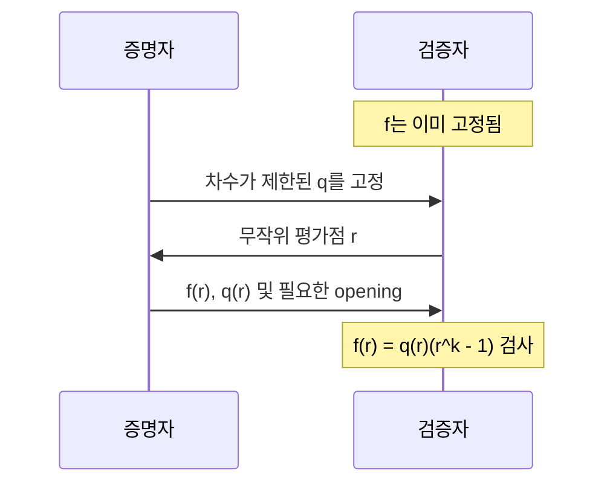

큰 회로의 모든 게이트가 올바른지 하나씩 다시 계산하면 검증도 커진다. [Week 9](/posts/ai-security-week9-kzg-and-polynomial-iop/)에서는 계산의 올바름을 다항식 관계로 옮긴 뒤, 무작위 지점 몇 개에서 검사하는 구조를 봤다. 이번에는 **많은 위치의 0 검사와 곱 검사를 작은 수의 다항식 관계로 바꾸는 도구**를 만든다.

이 글의 범위는 `Week 11 Plonk SNARK.pdf` **2–17쪽**이다. 자료는 ZeroTest와 ProdCheck를 설명하고, 순열 검사에서 값들을 근으로 바꾼 뒤 비율의 곱 검사로 연결한다. SumCheck는 목표만 소개되고, 전체 Plonk 프로토콜과 지정 순열·배선 제약의 완성 과정은 이 파일에 들어 있지 않다.

## 1. Oracle 표기와 실제 증명을 구별하기

*강의 2–4쪽*

다항식 oracle $\langle f\rangle$이 있다는 말은 검증자가 원하는 점 $u$에서 $f(u)$를 질의할 수 있다는 뜻이다. 함수 전체를 읽지는 않지만 모든 응답이 같은 다항식과 일치한다는 추상화를 사용한다.

실제로 구현할 때는 그 oracle을 PCS commitment $c_f$로 바꾸고, 질의 응답마다 평가값과 평가 증명을 제공한다. 이후 Fiat-Shamir를 적용하는 구성에서는 검증자의 무작위 질문을 이전 transcript의 해시로 만든다.

| 작업 | IOP 설명 | PCS를 사용하는 설명 |
| --- | --- | --- |
| 다항식 고정 | $\langle f\rangle$ 전달 | Commitment $c_f$ 전달 |
| 값 읽기 | Oracle에 $r$ 질의 | $f(r)$와 opening 증명 전달 및 검증 |
| 관계 검사 | 평가값들의 식 검사 | 유효한 opening을 확인한 뒤 같은 식 검사 |

아래에서는 대수적 구조를 보기 위해 IOP 표기를 쓴다. 실제 증명에서 증명자가 보낸 숫자만 믿고 계산한다는 뜻은 아니다.

### 곱으로 만든 다항식은 평가값으로 검사한다

각 차수가 $d$ 이하인 $f,g_1,g_2,g_3$에 대해

$$
f=g_1g_2g_3
$$

를 확인한다고 하자. 모든 다항식을 먼저 고정하고 무작위 $r\in\mathbb F_p$에서

$$
f(r)=g_1(r)g_2(r)g_3(r)
$$

인지 확인한다. 거짓이면 차이 다항식 $f-g_1g_2g_3$의 차수는 최대 $3d$이므로, 균등한 $r$에 대한 우연한 통과 확률은 최대 $\min(1,3d/p)$다.

기본 KZG의 선형성으로 합의 commitment는 계산할 수 있지만, 같은 군에서 곱의 commitment를 일반적으로 만들 수는 없다. Pairing으로 숨겨진 값의 곱셈 관계를 검증하는 기능과는 구별한다.

## 2. 검사할 위치들을 집합 Ω로 정한다

*강의 5쪽*

$\Omega\subseteq\mathbb F_p$를 크기 $k$인 집합이라 하자. 회로를 다항식으로 표현할 때 $\Omega$의 각 원소가 게이트 위치 등에 대응할 수 있다.

검사 도구의 목표는 다음과 같다.

| 이름 | 목표 |
| --- | --- |
| ZeroTest | 모든 $a\in\Omega$에 대해 $f(a)=0$ |
| SumCheck | $\sum_{a\in\Omega}f(a)=0$ |
| ProdCheck | $\prod_{a\in\Omega}f(a)=1$ |

여기서 **$\Omega$에서 0이라는 것과 영다항식이라는 것은 다르다.** $X^k-1$은 적절한 $k$개 단위근에서 모두 0이지만 계수 전체가 0인 다항식은 아니다. 이번 파일에서 실제 프로토콜을 전개하는 것은 ZeroTest와 ProdCheck다.

## 3. 단위근: 다음 위치로 이동하는 연산을 곱셈으로 만들기

*강의 6쪽*

$\omega\in\mathbb F_p$가 primitive $k$-th root of unity, 즉 원시 $k$차 단위근이라는 것은

$$
\omega^k=1,\qquad
\omega^j\ne1\quad(0<j<k)
$$

이라는 뜻이다. 이를 이용해

$$
\Omega=\{1,\omega,\omega^2,\ldots,\omega^{k-1}\}
$$

를 잡으면 정확히 $k$개의 원소를 갖는 곱셈 부분군이 된다. $\mathbb F_p^*$는 크기 $p-1$인 순환군이므로 이런 $\omega$가 존재하는 조건은 $k\mid(p-1)$이다.

이 표현이 편리한 이유는 **$\omega$를 곱하면 다음 위치로 이동한다**는 점이다.

$$
1\xrightarrow{\times\omega}\omega
\xrightarrow{\times\omega}\omega^2
\longrightarrow\cdots\longrightarrow\omega^{k-1}
\xrightarrow{\times\omega}1.
$$

### 강의의 예: p=17, ω=4

$$
4^1=4,\quad4^2=16,\quad4^3\equiv13,\quad4^4\equiv1\pmod{17}.
$$

따라서 $k=4$이고

$$
\Omega=\{1,4,16,13\}.
$$

단순히 $\omega^k=1$만 확인하면 부족하다. 예를 들어 $\omega=1$도 $1^4=1$을 만족하지만 네 개의 서로 다른 위치를 만들지 못한다. 더 작은 양의 지수에서는 1이 나오지 않아야 한다.

## 4. 소멸다항식: Ω 전체에서 0인 조건을 묶기

*강의 7–8쪽*

$\Omega$의 소멸다항식, vanishing polynomial은

$$
Z_\Omega(X)=\prod_{a\in\Omega}(X-a)
$$

다. 차수는 $k$이고 근은 정확히 $\Omega$의 원소들이다.

특히 $\Omega$가 위의 단위근 부분군이면

$$
\boxed{Z_\Omega(X)=X^k-1.}
$$

서로 다른 $k$개의 $\omega^i$가 모두 $X^k-1$의 근이며, 두 다항식이 같은 차수의 monic 다항식이기 때문이다. 강의 예에서는

$$
(X-1)(X-4)(X-16)(X-13)=X^4-1
\quad\text{in }\mathbb F_{17}[X].
$$

검증자는 $k$개의 인수를 전부 곱하지 않고 $r^k-1$만 계산하면 된다. 거듭제곱을 반복 제곱으로 계산하면 $O(\log k)$번의 체 연산이면 충분하다.

### 모든 위치에서 0이라는 조건은 나누어떨어진다는 조건이다

$\Omega$의 원소들이 서로 다르므로

$$
\bigl(\forall a\in\Omega,\ f(a)=0\bigr)
\iff Z_\Omega(X)\mid f(X).
$$

따라서 어떤 다항식 $q$에 대해

$$
f(X)=q(X)Z_\Omega(X)
$$

인지 검사하면 된다. KZG에서 $f(u)-v$를 $X-u$로 나눈 것과 같은 원리지만, 이번에는 여러 위치의 인수를 한꺼번에 사용한다.

## 5. ZeroTest의 순서와 건전성

*강의 9–10쪽*

강의의 차수 규칙을 그대로 사용해 $\deg f\le d$, $d\ge k$라 하자. 검증자는 $\langle f\rangle$를 이미 갖고 있다.

1. 증명자가 $q=f/Z_\Omega$를 계산하고 **차수 $d$ 이하인 $q$ oracle을 먼저 보낸다.**
2. 검증자가 균등한 $r\in\mathbb F_p$를 고른다.
3. $f(r),q(r)$를 질의하고 $Z_\Omega(r)=r^k-1$을 직접 계산한다.
4. $f(r)=q(r)(r^k-1)$이면 수락한다.

*이 그림은 강의의 순서를 본문 표기에 맞춰 새로 작성한 것이다.*

참인 경우에는 정확한 몫이 존재하므로 모든 $r$에서 식이 성립한다. 거짓인 경우에는 어떤 $q$를 고정하더라도

$$
h(X)=f(X)-q(X)Z_\Omega(X)
$$

가 영다항식일 수 없다. 강의는 증명자가 보낼 $q$의 허용 차수를 $d$로 두므로

$$
\deg h\le d+k,
$$

$$
\Pr_r[h(r)=0]\le\min\left(1,\frac{d+k}{p}\right)
\le\min\left(1,\frac{2d}{p}\right).
$$

**정직한 몫은 차수가 $d-k$ 이하라는 사실과, 악의적인 증명자에게 실제로 강제한 차수 한계를 구별해야 한다.** 더 엄격하게 $\deg q\le d-k$를 강제한다면 차이의 차수는 $d$ 이하가 되어 $d/p$ 상한을 얻는다. 두 분석을 섞지 않는다.

이것은 IOP의 대수적 오류다. PCS로 바꾼 프로토콜에는 opening 검증을 속이는 계산적 실패 항도 더해진다. 비대화형 변환까지 포함한 전체 보안은 PCS와 Fiat-Shamir의 조건 아래에서 따로 다룬다.

### 보충 예제: 몫이 숫자 하나인 경우

$\mathbb F_{17}$, $k=4$에서

$$
f(X)=3(X^4-1),\qquad q(X)=3
$$

로 두면 $f$는 $\Omega$의 모든 점에서 0이다. $r=2$에서는

$$
Z_\Omega(2)=16-1=15,\qquad
f(2)=45\equiv11=3\cdot15\pmod{17}.
$$

네 점에서 0인지 직접 검사하는 조건이 하나의 몫과 항등식으로 바뀐 것이다. 이 수치 예제는 이해를 위해 추가한 것이며 실제 보안 크기를 사용하지 않는다.

## 6. ProdCheck: 곱 전체를 누적곱으로 저장한다

*강의 11쪽*

목표는

$$
\prod_{a\in\Omega}f(a)=1
$$

이다. 검증자가 $k$개 값을 모두 읽고 곱하지 않도록, 증명자가 누적곱을 담은 다항식 $t$를 만든다.

$$
t(1)=f(1),
$$

$$
t(\omega^s)=\prod_{i=0}^{s}f(\omega^i)
\quad(1\le s\le k-1).
$$

$k$개 위치의 값이 주어졌으므로 보간하면 차수 $k$ 미만인 다항식 하나를 얻을 수 있다. 강의 프로토콜은 더 느슨한 허용 한계 $\deg t\le k$를 사용하며, 아래의 오류 분석도 그 한계에 맞춘다.

### 강의의 누적곱 표

$\mathbb F_{17}$, $\omega=4$에서 다음 값들을 사용한다.

| 위치 $x$ | $1$ | $\omega=4$ | $\omega^2=16$ | $\omega^3=13$ |
| --- | --- | --- | --- | --- |
| $f(x)$ | 2 | 3 | 5 | 4 |
| $t(x)$ | 2 | 6 | $30\equiv13$ | $52\equiv1$ |

전체 곱은 $2\cdot3\cdot5\cdot4=120\equiv1\pmod{17}$이다. 마지막 누적곱 $t(\omega^{k-1})$에 전체 곱이 들어 있다.

중간 위치에서는 자연스럽게

$$
t(\omega x)=t(x)f(\omega x)
$$

가 된다. 다음 위치의 누적곱은 현재 누적곱에 다음 값을 곱한 것이다.

## 7. 순환 관계만으로는 부족하다: 경계값 1

*강의 12쪽*

ProdCheck가 사용하는 두 조건은 다음과 같다.

$$
\boxed{t(\omega^{k-1})=1,}
$$

$$
\boxed{t(\omega x)-t(x)f(\omega x)=0
\quad\text{for all }x\in\Omega.}
$$

특히 $x=\omega^{k-1}$이면 $\omega x=1$이므로 두 번째 식은

$$
t(1)=t(\omega^{k-1})f(1)=f(1)
$$

이 된다. 나머지 위치를 따라가면

$$
t(\omega)=f(1)f(\omega),\quad\ldots,\quad
t(\omega^{k-1})=\prod_{a\in\Omega}f(a).
$$

첫 조건에 의해 이 곱이 1이다.

### 경계 조건이 없으면 생기는 반례

$t=0$이면 어떤 $f$에 대해서도 $t(\omega x)=t(x)f(\omega x)$를 만족한다. 즉 순환 관계만 검사하면 전체 곱이 1인지 알 수 없다. $t(\omega^{k-1})=1$이 이 무의미한 해를 제외한다.

또 다른 문헌에서는 누적곱을 곱하기 전 위치에 저장하고 $t(1)=1$로 시작하기도 한다. **이 강의는 첫 값을 이미 곱한 누적곱을 사용하므로 경계값은 마지막 위치에 놓인다.** 관례를 바꾸려면 recurrence와 경계 조건을 함께 바꿔야 한다.

## 8. ProdCheck를 ZeroTest로 바꾸기

*강의 13–14쪽*

새 다항식을

$$
t_1(X)=t(\omega X)-t(X)f(\omega X)
$$

로 정의한다. 앞의 순환 관계는 $t_1$이 $\Omega$에서 0이라는 조건이므로 ZeroTest로 검사할 수 있다.

증명자는

$$
q(X)=\frac{t_1(X)}{X^k-1}
$$

를 계산하고, **$t$와 $q$를 평가점이 정해지기 전에 고정한다.** $\deg f\le d$, $\deg t\le k$이면 $\deg t_1\le d+k$이고 정직한 몫의 차수는 최대 $d$다. 강의의 허용 한계는 각각 $k,d$다.

검증자는 무작위 $r\in\mathbb F_p$를 뽑은 뒤 다음 다섯 값을 질의한다.

$$
t(\omega^{k-1}),\quad t(r),\quad t(\omega r),\quad q(r),\quad f(\omega r).
$$

확인할 것은 두 식이다.

$$
t(\omega^{k-1})\stackrel?=1,
$$

$$
\boxed{t(\omega r)-t(r)f(\omega r)
\stackrel?=q(r)(r^k-1).}
$$

여기서 $t_1$ 자체를 따로 commitment할 필요는 없다. 이미 고정된 $t,f$의 평가값으로 필요한 식을 계산한다.

### 오류 확률과 비용

경계 검사가 통과했는데 실제 전체 곱이 1이 아니라면, 위 두 조건을 다항식 항등식으로 모두 만족할 수 없다. 따라서

$$
E(X)=t(\omega X)-t(X)f(\omega X)-q(X)(X^k-1)
$$

는 0이 아닌 차수 $d+k$ 이하의 다항식이다. IOP에서 무작위 검사를 우연히 통과할 확률은 최대 $(d+k)/p$다. 물론 확률 상한은 1을 넘으면 1로 잘라 읽는다.

강의가 세는 추가 데이터는 $t,q$에 대한 **두 commitment와 다섯 평가값**이다. 실제 PCS 구성에서는 이 평가값들을 인증하는 opening 증명도 필요하며, batching 방법에 따라 그 개수가 달라진다.

검증자의 체 연산은 $r^k$ 계산을 포함해 $O(\log k)$다. 강의의 증명자 $O(k\log k)$ 설명은 차수가 $k$에 비례하는 설정에서 누적곱·보간·다항식 나눗셈을 NTT로 처리하는 비용이다. $d$가 $k$보다 훨씬 크거나 입력이 계수 형식인지 평가 형식인지에 따라 비용 분석도 달라진다.

## 9. 분수의 곱도 분모를 곱해 다항식으로 검사한다

*강의 15쪽*

이번 목표가

$$
\prod_{a\in\Omega}\frac{f(a)}{g(a)}=1
$$

이라고 하자. 먼저 **모든 $a\in\Omega$에서 $g(a)\ne0$**이어야 한다. 이 조건 아래 각 비율의 누적곱을 $t$에 저장하면

$$
t(\omega x)=t(x)\frac{f(\omega x)}{g(\omega x)}.
$$

분모를 곱해서

$$
t(\omega x)g(\omega x)-t(x)f(\omega x)=0
$$

으로 바꾼다. 이 식을 $\Omega$에서 ZeroTest하고, 같은 경계값 $t(\omega^{k-1})=1$을 검사하면 된다.

**분모를 식에서 없앴다고 원래 비율의 정의 조건도 없어지는 것은 아니다.** $f=g=0$, $t=1$이면 곱해 놓은 등식과 경계 검사는 통과하지만 원래 $f/g$는 정의되지 않는다. 분모가 0이 되지 않는 조건 또는 그런 경우를 처리하는 프로토콜 규칙을 별도로 유지해야 한다.

## 10. 순열 검사: 순서 대신 중복 횟수까지 같은지 확인한다

*강의 16–17쪽*

다음 두 평가 벡터가 서로 순열인지 확인하고 싶다.

$$
\bigl(f(1),f(\omega),\ldots,f(\omega^{k-1})\bigr),
$$

$$
\bigl(g(1),g(\omega),\ldots,g(\omega^{k-1})\bigr).
$$

중요한 것은 집합이 아니라 **multiset, 다중집합**이다. $(2,2,3)$과 $(2,3,3)$은 원소의 종류만 보면 같지만 서로 순열이 아니다. 각 값의 등장 횟수까지 같아야 한다.

강의의 아이디어는 평가값을 새로운 다항식의 근으로 삼는 것이다.

$$
\widehat f(Y)=\prod_{a\in\Omega}(Y-f(a)),
\qquad
\widehat g(Y)=\prod_{a\in\Omega}(Y-g(a)).
$$

원래 다항식의 입력 변수 $X$와 구별하기 위해 여기서는 새 변수를 $Y$로 썼다. 두 다항식은 모두 차수 $k$의 monic 다항식이다. 인수분해의 유일성에 따라

$$
\widehat f=\widehat g
\iff
\text{두 평가 벡터가 같은 다중집합을 가진다.}
$$

강의 예인 $(3,5,7)$과 $(7,3,5)$는 모두

$$
(Y-3)(Y-5)(Y-7)
$$

을 만든다. 곱셈 순서를 바꿔도 다항식은 같기 때문이다. 값이 반복되면 해당 근의 인수도 그 횟수만큼 나타나므로 중복도 보존된다.

### 앞의 곱 검사와 어떻게 이어지는가

17쪽 하단 도식은 이 인코딩을 앞의 ProdCheck로 연결한다. 두 다항식이 미리 고정되어 있을 때 무작위 $\beta$에서

$$
\widehat f(\beta)=\widehat g(\beta)
$$

를 검사한다. 원문의 질문 기호는 $r$이지만, 뒤의 ProdCheck 평가점과 구별하기 위해 여기서는 $\beta$로 썼다. 보충해서 오류를 계산하면, 서로 다른 monic 차수 $k$ 다항식은 최고차항이 상쇄되어 차이가 최대 $k-1$차다. 따라서 우연히 같은 평가값을 낼 확률은 최대 $(k-1)/p$다.

또한 $\beta-g(a)\ne0$인 경우에는 위 등식을

$$
\prod_{a\in\Omega}
\frac{\beta-f(a)}{\beta-g(a)}=1
$$

로 바꿀 수 있다. 앞의 유리함수 ProdCheck를 $F_\beta(X)=\beta-f(X)$, $G_\beta(X)=\beta-g(X)$에 적용하는 것이다. 순서는 다음과 같다.

1. 원래 다항식 $f,g$를 먼저 고정한다.
2. 검증자가 무작위 $\beta$를 보낸다.
3. 증명자가 이 $\beta$로 만든 비율의 누적곱 $t$와 몫 $q$를 고정한다.
4. 검증자가 ProdCheck용 무작위 평가점 $r$를 고르고 경계값과 몫 항등식을 검사한다.

이때 recurrence의 검사식은

$$
t(\omega r)(\beta-g(\omega r))
-t(r)(\beta-f(\omega r))
\stackrel?=q(r)(r^k-1)
$$

이다. 원문 도식의 두 commitment는 $t,q$이며, 여섯 평가값은 $t(\omega^{k-1}),t(r),t(\omega r),q(r),f(\omega r),g(\omega r)$로 풀어 읽을 수 있다. 실제 PCS에서는 이 평가값의 인증도 필요하다.

다만 $\beta$가 어떤 $g(a)$와 같으면 분모가 0이다. 원문은 별도의 예외 처리 알고리즘을 제시하지 않으므로, 비율 식의 사용 조건을 명시한다. 정해진 값 $g(a)$들이 만드는 예외 집합의 크기는 최대 $k$다. 위의 $(k-1)/p$는 다중집합 비교 단계의 대수적 오류이며, ProdCheck의 오류나 이 예외까지 모두 합친 최종 보안 상한은 아니다.

여기까지가 이번 자료의 순열 검사다. **어떤 순열이든 같다는 조건과 회로가 지정한 배선을 정확히 따르는 조건은 다르다.** 지정 순열과 wire 위치의 연결은 추가 구성이 필요하다. 원 강의의 뒤를 더 보려면 [ZKP MOOC Lecture 5](https://rdi.berkeley.edu/zkp-course/assets/lecture5-2023.pdf)의 permutation 및 prescribed permutation 구분을 이어 읽을 수 있다.

## 11. 세 가지 조건을 끝까지 유지하기

많은 위치의 검사를 몇 개의 값으로 줄이는 과정에서 다음 조건이 함께 움직인다.

1. **차수 제한**: 무작위 검사가 얼마나 자주 속을 수 있는지 결정한다. 정직한 증명자가 사용하는 차수와 검증자가 강제하는 한계를 구별한다.
2. **먼저 고정하는 순서**: $f,t,q$를 질문 $r$를 본 뒤 바꾸지 못해야 한다. Oracle 모형에서는 정의로, 실제 PCS에서는 보안 성질로 다룬다.
3. **경계·정의 조건**: 누적곱의 마지막 값은 1이어야 하고, 분수의 분모는 정의역에서 0이 아니어야 한다.

ZeroTest는 여러 0 조건을 하나의 나눗셈 관계로, ProdCheck는 전체 곱을 인접한 누적곱의 관계와 경계값으로 바꾼다. 계산 결과 몇 개만 확인할 수 있는 이유는 나머지 조건을 버렸기 때문이 아니라, 그 조건을 다항식 구조 안에 넣었기 때문이다.

## 12. 복습문제

아래는 본문 이해를 확인하기 위해 만든 문제이며 수업의 기출문제가 아니다.

1. ω⁴=1이면 항상 원시 4차 단위근인가?

아니다. 더 작은 양의 지수에서는 1이 되지 않아야 한다. ω=1은 ω⁴=1을 만족하지만 위수가 1이다.

2. Ω={1,4,16,13}⊂F₁₇의 소멸다항식은?

이 집합은 원시 4차 단위근 4가 생성하는 부분군이므로 ZΩ(X)=X⁴−1이다.

3. f가 Ω에서 모두 0이면 영다항식인가?

반드시 그렇지는 않다. f=X^k−1이 반례다. Ω에서 0이라는 것은 ZΩ가 f를 나눈다는 조건이다. 추가로 deg f&lt;k라면 k개의 서로 다른 근을 가지므로 영다항식이어야 한다.

4. ZeroTest에서 q의 허용 차수가 d이면 왜 오류를 바로 d/p라고 쓰지 않는가?

f−qZΩ의 차수가 최대 d+k이기 때문이다. q의 차수를 d−k 이하로 실제 강제한 경우에만 이 계산의 차수 상한을 d로 줄일 수 있다.

5. 강의의 누적곱은 t(1)=1에서 시작하는가?

아니다. t(1)=f(1)이며 마지막 값 t(ω^(k−1))=1을 검사한다. 첫 값을 곱하기 전 누적곱을 쓰는 다른 관례와 혼동하지 않는다.

6. ProdCheck에서 경계 조건을 생략하면 어떤 거짓 해가 생기는가?

t=0은 모든 f에 대해 recurrence를 만족한다. 마지막 누적곱을 1로 고정해야 이런 해를 제외하고 전체 곱이 1임을 얻는다.

7. f 값이 (2,3,5,4)일 때 F₁₇에서 누적곱은?

(2,6,13,1)이다. 마지막 값은 2×3×5×4=120≡1 mod 17이며, 마지막 위치에서 처음으로 돌아가는 식도 2=1×2로 성립한다.

8. 분모를 곱해서 없앴다면 g(a)≠0 조건도 없어지는가?

아니다. 원래 f(a)/g(a)가 정의되어야 한다. 예를 들어 f=g=0, t=1은 분모를 곱한 식과 경계값을 만족하지만 원래 비율은 정의되지 않는다.

9. (2,2,3)과 (2,3,3)은 왜 순열 검사를 통과하면 안 되는가?

원소의 종류는 같지만 중복 횟수가 다르다. 인코딩 다항식도 각각 (Y−2)²(Y−3), (Y−2)(Y−3)²로 다르다.

10. 같은 다중집합이면 회로의 배선까지 맞는가?

그것만으로는 부족하다. 어떤 순서 변경이든 허용하는 순열 검사와, 정해진 wire 연결을 요구하는 지정 순열 검사는 다른 조건이다.

## 참고 자료

- 중앙대학교 인공지능보안, 이준우 교수, `Week 11 Plonk SNARK.pdf`, 2–17쪽. 특히 9쪽 ZeroTest와 13쪽 ProdCheck 도식의 메시지 순서·질의점·경계 조건을 기준으로 정리했다.
- Dan Boneh 외, [ZKP MOOC Lecture 5: The Plonk SNARK](https://rdi.berkeley.edu/zkp-course/assets/lecture5-2023.pdf). ZeroTest·ProdCheck의 구조와 순열 검사에서 지정 순열 검사로 이어지는 차이를 대조했다.
- 앞 내용: [Week 9: KZG와 Poly-IOP](/posts/ai-security-week9-kzg-and-polynomial-iop/).
