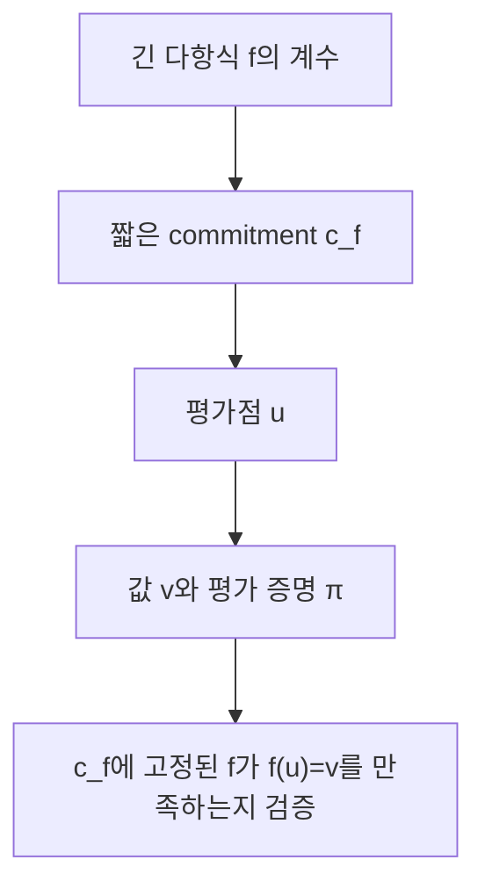

[SNARK 도입](/posts/ai-security-introduction-to-snark/)에서는 큰 계산을 짧은 증명으로 검증한다는 목표를 봤다. 이번에는 **긴 다항식을 전부 읽지 않고도, 그 다항식에 관한 계산이 맞는지 확인하는 방법**으로 내려간다.

흐름은 세 단계다. 계산을 다항식 관계로 표현하고, 다항식을 commitment로 먼저 고정한 다음, 무작위 지점의 값 몇 개로 관계를 검사한다. KZG는 그 값이 실제로 고정한 다항식에서 나온 값인지 확인하고, Poly-IOP는 어떤 관계를 검사해야 원래 계산의 올바름을 얻는지 정한다.

이 글은 `Week 9 Introduction to SNARK(2).pdf` **2–58쪽**을 따른다. 앞부분의 도입은 짧게 복습하고, 산술회로 이후의 새 내용을 중심으로 정리했다. 일부 슬라이드 바닥글에는 이전 주차 이름이 남아 있으므로 주차는 표지의 Week 9를 기준으로 한다. 아래 쪽수는 PDF 페이지다.

## 1. 산술회로: 검증할 계산을 체 위에 놓기

*강의 2–11쪽*

SNARK가 처리할 주장을 통일하려면, “어떤 witness가 올바른가”를 검사하는 계산부터 공통 형식으로 표현해야 한다. 여기서는 유한체 $\mathbb F_p$ 위의 **산술회로(arithmetic circuit)** 를 사용한다.

회로는 방향이 있고 순환이 없는 그래프다. 입력과 상수에서 시작해 덧셈·뺄셈·곱셈 게이트를 따라 값을 계산한다. $|C|$는 회로의 게이트 수이며, 계산량을 나타내는 기준이 된다.

강의의 예는 다음 다항식을 계산한다.

$$
C(x_1,x_2)=x_1(x_1+x_2+1)(x_2-1).
$$

$\mathbb F_7$에서 $x_1=2$, $x_2=3$을 넣으면

$$
x_1+x_2+1=6,\qquad x_2-1=2,
$$

$$
C(2,3)=2\cdot6\cdot2=24\equiv3\pmod7.
$$

이 슬라이드는 여러 입력을 받는 연산 노드 하나를 한 게이트로 세어 $|C|=3$으로 표시한다. 입력 두 개씩만 받는 게이트로 바꾸면 게이트 수는 달라진다. 회로 크기를 비교할 때는 게이트 모델도 같아야 한다.

### 공개 입력과 witness

입력을 공개 statement $x$와 비밀 witness $w$로 나눈다. 검증할 관계를

$$
C(x,w)=0
$$

으로 표현한다. 예를 들어 $C(x,w)=w^2-x$라면, 증명하려는 것은 $x$의 제곱근 $w$를 알고 있다는 주장이다.

이때 등식은 **선택한 체에서의 등식**이다. $N-w_1w_2=0$이라는 체의 식 하나만으로 정수 $N$의 비자명한 인수분해를 표현했다고 할 수는 없다. 정수 범위, 비자명성, 모듈러 wrap-around를 막는 조건 등을 함께 인코딩해야 한다.

### 비트도 제약식으로 표현한다

체의 원소 $b$를 비트로 제한하려면

$$
b(b-1)=0
$$

을 요구한다. 체에는 영인자가 없으므로 $b=0$ 또는 $b=1$이다. 비트 제약을 만족하는 $a,b$에 대해서는 다음이 성립한다.

| 논리 연산 | 체 위의 식 |
| --- | --- |
| NOT $a$ | $1-a$ |
| $a$ AND $b$ | $ab$ |
| $a$ OR $b$ | $a+b-ab$ |
| $a$ XOR $b$ | $a+b-2ab$ |

이 식만 적고 입력을 비트로 제한하지 않으면, 원래 Boolean 연산과 다른 관계가 된다. 일반 프로그램을 산술회로로 옮길 수 있다는 말에도 실행 시간과 메모리 사용량 등에 대한 유한한 한계가 필요하다. 특히 비트 중심 연산을 체 연산으로 옮기는 비용은 작지 않을 수 있다.

## 2. NARK에 간결성을 더하면 SNARK

*강의 12–21쪽*

전처리형 NARK의 기본 알고리즘은 다음과 같다.

$$
S(C)\longrightarrow(pp,pv),
$$

$$
P(pp,x,w)\longrightarrow\pi,
\qquad
V(pv,x,\pi)\longrightarrow\{\mathrm{accept},\mathrm{reject}\}.
$$

$pp$는 증명자용 공개 매개변수이고 $pv$는 검증자용 공개 매개변수다. 둘 중 하나를 비밀키라고 해석하지 않는다. 이 전처리 모형에서는 회로에 관한 준비 작업을 먼저 하고, 같은 회로의 여러 증명에서 그 결과를 재사용한다. 이것이 모든 SNARK가 회로마다 새 trusted setup을 요구한다는 뜻은 아니다.

NARK가 요구하는 성질을 나누면 다음과 같다.

| 성질 | 무엇을 요구하는가 |
| --- | --- |
| 완전성 | 유효한 witness를 가진 정직한 증명자가 만든 증명은 통과한다. |
| 지식 건전성 | 효율적인 증명자가 충분한 확률로 검증을 통과한다면, 보안 정의에 따른 추출기가 유효한 witness를 추출할 수 있어야 한다. |
| 비대화성 | 온라인 검증자와 질문을 주고받는 대신 증명 메시지 하나를 보낸다. |
| 영지식, 선택적 | 공개 statement를 넘어서는 witness 정보가 증명에서 새로 드러나지 않아야 한다. |

**Argument**는 효율적인 부정행위 증명자를 상대로 한 계산적 보장이다. 계산 능력이 무제한인 증명자까지 건전성을 요구하는 proof와 양화 범위가 다르다. 또한 검증자가 증명을 한 번 수락했다는 사실만으로 실제 검증자에게 witness가 추출되는 것은 아니다.

Witness를 그대로 보내고 $C(x,w)=0$인지 확인하는 방법도 NARK의 출발점이 될 수 있다. 다만 witness가 길면 증명도 길고, 검증자가 원래 계산을 수행해야 하며, 비밀도 공개된다. 이 중 **짧은 증명과 빠른 검증**을 요구하는 것이 succinctness다.

강의는 강한 간결성의 예로, 보안 매개변수 의존성을 생략한

$$
|\pi|=O(\log|C|),\qquad
\operatorname{time}(V)=O(|x|+\log|C|)
$$

형태를 제시한다. 모든 SNARK의 정확한 복잡도가 이 식 하나라는 뜻은 아니다. 공개 입력을 읽는 비용 $|x|$는 남고, setup과 증명자 비용이 사라지는 것도 아니다.

## 3. Commitment: 먼저 고정하고 나중에 확인한다

*강의 22–25쪽*

Commitment는 봉인한 봉투에 비유할 수 있다. 먼저 값 $m$을 고정해 전달하고, 나중에 필요할 때 열어 확인한다.

$$
\operatorname{Commit}(m,r)\longrightarrow c,
\qquad
\operatorname{Verify}(m,r,c)\longrightarrow\{0,1\}.
$$

두 성질은 다르다.

- **Binding**: 같은 commitment를 서로 다른 메시지로 열 수 없어야 한다.
- **Hiding**: 열기 전에는 commitment로 메시지를 알아내지 못해야 한다.

강의의 가위바위보 예에서는 Alice가 먼저 자신의 수를 고정하고 Bob이 수를 정한 뒤 Alice가 연다. Binding은 Alice가 뒤늦게 수를 바꾸는 것을 막고, hiding은 Bob이 Alice의 수를 미리 읽는 것을 막는다.

단순히 $c=H(m)$이라고 하면 메시지 후보가 세 개뿐이므로 Bob이 모두 해시해 볼 수 있다. 충분히 긴 독립 난수 $r$를 넣은 $H(m,r)$가 이 문제를 피하는 출발점이다. 단, **충돌 저항성만으로 hiding까지 증명되는 것은 아니다.** 강의는 hiding 설명에서 적절한 해시와 난수 길이, random oracle 같은 모델을 함께 전제한다.

## 4. 다항식을 공개하지 않고 값 하나를 증명하기

*강의 26–29쪽*

함수 commitment에서는 함수 전체를 열지 않고 특정 입력의 출력만 확인한다. 다항식 commitment scheme, PCS에서는

$$
f(X)\in\mathbb F_p^{(\le d)}[X]
$$

를 먼저 고정한다. 검증자는 $f$의 계수 전체 대신 $c_f$를 갖고 있고, 증명자는 특정 $u,v$에 대해

$$
f(u)=v
$$

임을 짧게 증명한다. 허용 차수 $d$ 역시 프로토콜의 조건이다.

계수 전체를 해시한 commitment는 만들기 쉽다. 하지만 평가를 검증할 때 모든 계수와 난수를 보내게 하면 증명 크기와 검증 비용이 $d$에 비례한다. **Commitment가 짧은 것과 평가 증명이 짧은 것은 다른 요구**다.



*위 그림은 설명을 위해 새로 그린 흐름도다.*

## 5. 무작위 지점 하나로 항등식을 검사하는 이유

*강의 30–31쪽*

체 위에서 0이 아닌 차수 $d$ 이하의 다항식은 근이 최대 $d$개다. 따라서 **다항식을 먼저 고정한 뒤** $r$를 $\mathbb F_p$에서 균등하게 뽑으면

$$
f\ne0
\quad\Longrightarrow\quad
\Pr_r[f(r)=0]\le\min(1,d/p).
$$

두 다항식의 동일성은 $f-g$에 이 사실을 적용하면 된다.

$$
f\ne g
\quad\Longrightarrow\quad
\Pr_r[f(r)=g(r)]\le d/p
$$

여기서는 $\deg f,\deg g\le d<p$로 두었다. $p\approx2^{256}$, $d\le2^{40}$이라면 이 비율은 대략 $2^{-216}$ 이하가 된다.

30쪽 마지막의 **SZDL(Schwartz–Zippel–DeMillo–Lipton) lemma**는 이 검사를 다변수로 확장한다. 0이 아닌 다항식 $F(X_1,\ldots,X_m)$의 **총차수**가 $d$ 이하이고, $F$를 고정한 뒤 각 $r_i$를 $\mathbb F_p$에서 독립적으로 균등하게 고르면 $\Pr[F(r_1,\ldots,r_m)=0]\le\min(1,d/p)$다. 총차수는 한 항에 나타나는 지수의 합을 모든 항에서 비교한 최댓값이다. 예를 들어 $X_1^2X_2^3$의 총차수는 5이지 3이 아니다. 원문에서 간략히 쓴 다변수 확장에 샘플링 조건을 풀어 적은 것이며, 위의 일변수 검사는 $m=1$인 경우다.

이 정리는 “한 점에서 같으면 반드시 같은 다항식”이라는 말이 아니다. **서로 다른 고정 다항식을 같다고 잘못 받아들일 확률이 작다**는 말이다. 검사를 통과한 뒤 두 다항식이 같을 사후확률을 별도의 분포 가정 없이 계산한 것도 아니다.

또한 $r$를 먼저 공개한 뒤 다항식을 고르게 하면 $h(X)=X-r$ 같은 0이 아닌 다항식이 항상 $h(r)=0$을 만족한다. Commitment를 먼저 보내는 순서가 필요한 이유다.

## 6. 군 원소로 다항식을 표현하기

*강의 32–36쪽*

KZG를 설명하기 위해 소수 위수 $p$인 군 $\mathbb G$와 생성원 $G$를 사용한다. 표기는 덧셈식이며

$$
aG+bG=(a+b)G
$$

가 성립한다. 스칼라 $a$로 $aG$를 계산하는 일은 효율적이지만, 적절히 선택한 큰 군에서 $aG$만 보고 $a$를 찾는 이산로그 문제는 어렵다고 가정한다.

강의의 작은 예는 $\mathbb F_{17}$ 위의 곡선

$$
y^2=x^3+2x+2
$$

와 $G=(5,1)$이다. 이 곡선의 점은 무한원점을 포함해 19개이며 $7G=(0,6)$이다. **곡선 좌표를 계산하는 체의 크기 17과, 군의 위수 및 스칼라 체의 크기 19는 다르다.** 이 작은 군은 손계산 예시이며 보안에 사용할 크기가 아니다.

### Setup: 비밀 $\tau$는 버리고 그 거듭제곱의 군 표현을 남긴다

차수 한계 $d$에 대해 무작위 $\tau\in\mathbb F_p$를 고르고

$$
H_i=\tau^iG\quad(0\le i\le d)
$$

를 공개한다. 즉

$$
gp=(G,\tau G,\tau^2G,\ldots,\tau^dG).
$$

Setup에 사용한 $\tau$ 자체는 비밀로 남지 않도록 제거해야 한다. 슬라이드 35쪽 필기가 강조하는 trusted setup의 핵심도 **공개 매개변수와 setup 비밀을 구별하는 것**이다.

증명자가 $f(X)=\sum_{i=0}^d f_iX^i$에 대해 계산할 commitment는

$$
c_f=\sum_{i=0}^d f_iH_i
=\left(\sum_{i=0}^d f_i\tau^i\right)G
=f(\tau)G.
$$

$\tau$를 몰라도 공개된 $H_i$를 계수로 곱하고 더하면 된다. **$f(\tau)$를 스칼라로 계산한 것이 아니라 $f(\tau)G$라는 군 원소를 계산한 것**이다.

### 짧지만 기본형은 hiding이 아니다

Commitment는 군 원소 하나라서 $d$와 무관한 크기다. 그러나 이 기본형은 결정적이므로 후보 $f$가 몇 개뿐이라면 각 후보의 commitment를 계산해 비교할 수 있다. 영지식을 얻으려면 적절한 blinding과 전체 프로토콜 설계가 필요하다.

Binding도 이산로그라는 직관과 루트 개수 계산만으로 끝나지 않는다. 공개 매개변수를 보고 다항식을 고르는 공격자까지 다루려면 KZG의 계산적 가정과 보안 정의가 필요하다. 강의는 SDH 계열 가정을 언급한다. $f\mapsto f(\tau)G$는 모든 다항식에 대한 수학적 일대일 함수가 아니며, 보안은 공격자가 유효한 충돌이나 잘못된 opening을 효율적으로 만들기 어렵다는 보장이다.

## 7. KZG 평가 증명: 나눗셈의 나머지가 0인가

*강의 37–38쪽*

$f(u)=v$라는 주장은

$$
f(X)-v=q(X)(X-u)
$$

를 만족하는 다항식 $q$가 존재한다는 말과 같다. 나머지 정리에 따라 $X-u$로 나눴을 때 나머지가 $f(u)-v$이기 때문이다.

증명자는

$$
q(X)=\frac{f(X)-v}{X-u},\qquad
\pi=c_q=q(\tau)G
$$

를 계산해 보낸다. 올바른 주장이면 $\deg q\le d-1$이다.

강의의 예를 그대로 계산하면

$$
f(X)=X^2+1,\quad u=2,\quad v=5,
$$

$$
f(X)-5=X^2-4=(X-2)(X+2),
\qquad q(X)=X+2.
$$

반대로 $v=6$이라고 주장하면 나머지가 $-1$이므로 정확히 나누어떨어지는 $q$는 없다. 여기서 필요한 것은 유리함수 $\frac{X^2-5}{X-2}$가 아니라 **허용 차수의 다항식**이다.

항등식을 $X=\tau$에 대입하면 검증하고 싶은 관계는

$$
(\tau-u)c_q=c_f-vG
$$

가 된다. 하지만 검증자도 $\tau$를 모른다. 이 식을 그대로 스칼라 곱으로 실행할 수 없다는 문제를 다음 단계가 해결한다.

## 8. Pairing: 숨겨진 스칼라 사이의 곱셈 관계 검사

*강의 39–40쪽*

강의는 설명을 단순화한 대칭 pairing

$$
e:\mathbb G\times\mathbb G\longrightarrow\mathbb G_T
$$

을 사용한다. 비퇴화성과 쌍선형성에 의해

$$
e(aG,bG)=e(G,G)^{ab}
$$

이다. 검증자는 다음 식을 확인한다.

$$
\boxed{e(c_q,H_1-uG)=e(c_f-vG,G).}
$$

왼쪽은 $e(G,G)^{q(\tau)(\tau-u)}$, 오른쪽은 $e(G,G)^{f(\tau)-v}$다. 검증자가 $q(\tau)$나 $\tau$를 읽지 않아도 두 값의 곱셈 관계를 확인할 수 있다.

37쪽 여백 필기는 $f(\tau)-v=q(\tau)(\tau-u)$에서 출발해 이 pairing 검사식으로 연결한다. $c_f-vG$와 $H_1-uG$는 공개 정보로 계산되지만, 두 군 원소에 들어 있는 스칼라를 직접 꺼내 곱할 수는 없다는 점을 구별해야 한다.

실제 비대칭 pairing 표기에서는 $e:\mathbb G_1\times\mathbb G_2\to\mathbb G_T$로 두고

$$
e(c_f-vG_1,G_2)=e(\pi,\tau G_2-uG_2)
$$

처럼 군과 매개변수를 맞춘다. 이는 강의의 단일 군 표기를 구현과 혼동하지 않기 위한 보충이다.

| 항목 | 기본 KZG의 비용, 보안 매개변수 고정 |
| --- | --- |
| Commitment | 군 원소 1개 |
| 한 점의 평가 증명 | 군 원소 1개 |
| 평가 검증 | 상수 개의 pairing과 군 연산 |
| 증명자 계산 | 계수 형식에서 몫 계산과 commitment 생성에 대략 $O(d)$ 작업 |
| 공개 매개변수 | 차수 한계에 비례하는 크기 |

"상수 시간"은 차수 $d$에 대한 표현이다. 암호학적 군 연산의 비트 복잡도가 0이라는 뜻도, 증명자가 다항식을 읽지 않는다는 뜻도 아니다. KZG의 기본 구조와 평가 증명은 [ZKP MOOC Lecture 5](https://rdi.berkeley.edu/zkp-course/assets/lecture5-2023.pdf)와도 대조했다.

## 9. PCS와 무작위 평가를 합치기

*강의 41–44쪽*

검증자가 $c_f,c_g$를 가지고 있고 $\deg f,\deg g\le d$라고 하자. 다항식 동일성 검사는 다음 순서다.

1. 증명자가 $f,g$를 고정한 commitment를 보낸다.
2. 검증자가 무작위 $r\in\mathbb F_p$를 보낸다.
3. 증명자가 $y=f(r)$, $y'=g(r)$와 각각의 평가 증명을 보낸다.
4. 검증자는 평가 증명들이 유효하고 $y=y'$인지 확인한다.

거짓 주장이 통과하려면, 고정된 서로 다른 다항식이 우연히 같은 값을 내거나 PCS 검증을 속여야 한다. 적절한 PCS 보안 아래 오류를

$$
\frac d p+\operatorname{negl}(\lambda)
$$

형태로 나누어 이해할 수 있다. 앞 항은 대수적 검사의 오류이고 뒤 항은 암호학적 실패 확률이다.

### KZG commitment끼리 비교하면 되지 않는가

기본형 KZG는 결정적이므로 직접 commitment한 $f,g$라면 $c_f=c_g$를 비교하는 것이 유용하다. 그러나 그 등식을 아무 가정 없는 $f=g$의 논리적 동치로 읽지는 않는다.

더 중요한 경우는 **곱으로 계산한 다항식**이다. KZG에는

$$
c_f+c_g=c_{f+g},\qquad a c_f=c_{af}
$$

라는 선형성이 있다. 하지만 $c_f,c_g$만으로 같은 commitment 군의 $c_{fg}$를 일반적으로 계산할 수는 없다. Pairing 결과는 다른 목표 군에 있으므로 이 문제를 단순히 없애 주지 않는다.

그래서 $f=qh$를 검사할 때는 각각을 먼저 고정하고, 같은 무작위 $r$에서

$$
f(r)=q(r)h(r)
$$

를 검사한다. 세 다항식의 차수가 각각 $d$ 이하라면 차이 다항식의 차수는 최대 $2d$이므로 오류 상한도 $2d/p$로 계산한다. **입력 다항식의 차수와 검사하는 식 전체의 차수는 다르다.**

## 10. Fiat-Shamir: 검증자의 질문을 transcript에서 만든다

*강의 45–47쪽*

앞 프로토콜에서 검증자는 무작위 질문 $r$만 보낸다. 이런 public-coin 프로토콜에서는 적절한 조건 아래 질문을 transcript의 해시로 대체한다.

$$
r=H(\text{프로토콜 문맥},x,c_f,c_g,\text{이전 메시지들}).
$$

여기서 $H$는 필요한 challenge 공간으로 보내는 함수로 모델링한다. 증명자와 검증자가 같은 공개 정보로 같은 $r$를 재계산할 수 있으므로 온라인 질문이 필요 없어지고, 증명자는 평가값과 opening 증명을 한 번에 보낼 수 있다.

이전 47쪽 판 `Week 8 Introduction to SNARK_2.pdf`의 **13쪽 여백 필기**는 실제 해시의 결정성과 random oracle 모델을 구별한다. SHA-256 같은 구체적인 해시는 같은 입력에 항상 같은 출력을 낸다. Random oracle도 질의할 때마다 답을 바꾸는 장치가 아니다. **처음 보는 입력에는 출력공간에서 독립적인 균등 값을 정하고, 같은 입력을 다시 받으면 이전 값을 그대로 돌려주는 이상적인 함수**로 모델링한다. 따라서 증명자와 검증자가 같은 transcript를 질의하면 같은 질문을 얻는다는 점과, 처음 보는 입력의 응답을 미리 예측하기 어렵다는 점이 함께 성립한다. 구체적인 해시 함수가 이런 이상적 모델과 완전히 같다는 정리를 얻은 것은 아니다.

46쪽의 $H(x)$는 statement $x$가 commitment 등을 포함하는 간략 표기다. 실제 transcript에서는 공개 statement, 매개변수 문맥, 이전 commitment와 메시지 순서가 빠지지 않아야 한다. **난수를 증명자 마음대로 고르는 것과는 다르다.**

### Grinding 때문에 원래 오류가 작아야 한다

증명자가 여러 commitment 후보를 만들고 해시해 보며 유리한 질문을 찾는 시도를 grinding이라고 한다. 단순한 무작위 다항식 검사 직관에서는 $Q$번의 시도에 대해 오류가 대략

$$
Q\cdot\frac d p
$$

만큼 커질 수 있다. $d/p\approx2^{-216}$이면 $Q=2^{80}$을 대입한 값은 $2^{-136}$이다. 이 식은 해당 검사와 random oracle 모델의 직관이며, 모든 다중 라운드 변환의 일반 보안 정리로 사용하지 않는다.

반대로 한 번의 QR 질문처럼 오류가 $1/2$이면, 자기에게 유리한 질문이 나올 때까지 몇 번 시도하는 것으로 충분할 수 있다. 작은 오류를 갖도록 구성하는 작업 없이 “일단 해시로 바꾸고 나중에 반복하면 된다”고 할 수 없다.

Fiat-Shamir가 모든 public-coin 프로토콜을 자동으로 영지식·지식 건전한 SNARK로 만들어 주는 것도 아니다. 이 강의에서는 random oracle 모델, PCS의 보안, 충분히 작은 검사 오류와 적합한 IOP를 함께 사용한다.

## 11. IOP: 긴 함수는 고정하되 검증자는 일부만 읽는다

*강의 48–52쪽*

Oracle은 입력 $u$를 주면 고정된 함수 $f$의 값 $f(u)$를 돌려주는 추상적인 장치다. 검증자는 함수 전체를 읽지 않아도 여러 점을 질의할 수 있고, 응답은 항상 같은 함수와 일치해야 한다.

IOP, interactive oracle proof에서는 증명자가 이런 함수 oracle들을 보내고 검증자가 일부 지점만 질의한다. 일반적인 대화형 증명에서 긴 메시지 전체를 읽는 방식과 차이가 있다.

| IOP의 추상적 동작 | PCS를 사용하는 실제 동작 |
| --- | --- |
| 증명자가 oracle $f_i$를 보냄 | $c_{f_i}$를 보냄 |
| 검증자가 $u$에서 oracle을 질의 | 증명자가 $f_i(u)$와 평가 증명을 보냄 |
| 응답이 같은 함수와 일치 | PCS의 보안으로 보장 |
| 검증자가 무작위 질문을 보냄 | 비대화형 변환에서는 이전 transcript의 해시로 계산 |
| 회로를 표현한 공개 oracle들 | 전처리한 회로 다항식의 commitment들 |

50쪽에서 setup이 만드는 oracle은 게이트와 배선 등 **회로 자체의 구조**를 표현한다. 증명 중 새로 보내는 다항식은 witness와 실행에 관한 정보를 담는다. 검증자는 회로 전체를 매번 읽는 대신 전처리 결과와 필요한 평가값을 이용한다.

IOP의 대수적 검사가 참인지 확인하는 역할과, 실제 네트워크의 메시지들이 그 oracle을 충실히 구현하는지 보장하는 역할을 분리한 것이다. [ZKP MOOC Lecture 2](https://rdi.berkeley.edu/zkp-course/assets/Lecture2-2023.pdf)도 이 두 구성요소를 나누어 설명한다.

## 12. 강의 예제: 집합 포함 관계를 나눗셈으로 바꾸기

*강의 53–56쪽*

공개 집합 $X$가 비밀 집합 $W$에 포함된다는 관계를 생각하자.

$$
X\subseteq W\subseteq\mathbb F_p.
$$

각 집합 원소를 근으로 하는 다항식을 만든다.

$$
f(Z)=\prod_{w\in W}(Z-w),\qquad
g(Z)=\prod_{x\in X}(Z-x).
$$

집합은 중복 원소가 없으므로 각 인수는 한 번씩 나타난다. **이 형태로 인코딩되었다는 전제에서**

$$
X\subseteq W\iff g\mid f
\iff\exists q:\ f=gq.
$$

증명자는 $f,q$ oracle을 먼저 고정하고, 검증자는 무작위 $r$에서 $f(r)=g(r)q(r)$인지 확인한다. 공개 집합으로 만든 $g(r)$는 검증자가 직접 계산할 수 있다.

### 강의의 $\mathbb F_{11}$ 예제

$$
X=\{2,5\},\qquad W=\{2,3,5\},
$$

$$
f(Z)=(Z-2)(Z-3)(Z-5),\quad
g(Z)=(Z-2)(Z-5),\quad q(Z)=Z-3.
$$

$r=7$이면

$$
f(7)=5\cdot4\cdot2=40\equiv7\pmod{11},
$$

$$
g(7)=5\cdot2=10,\qquad q(7)=4,
$$

이므로 $g(7)q(7)=40\equiv7=f(7)$이다.

$W=\{2,3\}$으로 바꾸면 5가 빠져 $g$가 $f$를 나누지 못한다. 그래도 특정 한 점에서는 잘못된 몫과 우연히 값이 맞을 수 있으므로 실제 보안 분석에는 차수와 체의 크기가 필요하다.

### 이 예제가 보여 주는 것과 생략하는 것

강의도 이 예를 인위적인 예제로 표시한다. “포함하는 어떤 집합을 안다”는 관계만이라면 누구나 $W=X$를 택할 수 있어, 실제 응용에서 비밀 지식을 입증하는 강한 주장은 아니다.

또한 $f=gq$ 검사만으로 임의의 $f$가 지정한 크기의 집합을 올바르게 인코딩했다고 보장하지 않는다. 예를 들어 $f=q=0$이면 항등식은 통과하지만 집합 원소의 곱으로 만든 monic 다항식은 아니다. Monic 여부, 허용 차수·집합 크기, 서로 다른 근, 지정된 집합 commitment와의 연결 등 응용에 필요한 조건은 따로 정해야 한다.

여기서 가져갈 패턴은 **관계 → 다항식 나눗셈 → 몫 oracle → 무작위 평가 검사**다. 이 예제를 그 조건들까지 갖춘 완성된 집합 증명 시스템으로 해석하지 않는다.

## 13. IOP를 SNARK로 옮길 때 추출기는 무엇을 보는가

*강의 57–58쪽*

위 예제의 비대화형 증명은 개략적으로

$$
\pi=(c_f,c_q,f(r),q(r),\pi_f,\pi_q)
$$

로 표현할 수 있다. $r$는 공개 입력과 먼저 보낸 commitment들을 포함한 transcript에서 계산한다.

IOP 모델의 추출기는 검증자와 달리 전체 함수 $f,q$에 접근하는 것으로 정의된다. 그러나 실제 증명에 들어 있는 것은 짧은 commitment다. 따라서 IOP의 추출 논리를 그대로 가져오려면 **PCS 쪽에서도 필요한 다항식을 추출할 수 있는 보안 성질**이 있어야 한다. Binding과 extractability는 같은 말이 아니다.

강의 58쪽은 이 차이를 설명하기 위해 **Algebraic Group Model, AGM**을 소개한다. 이 모델에서는 공격자가 군 원소를 출력할 때, 자신이 받은 군 원소들의 어떤 선형 결합으로 만들었는지도 추출기가 사용할 수 있도록 한다. 단순한 KZG 설정에서

$$
c_f=f_0H_0+f_1H_1+\cdots+f_dH_d
$$

라는 표현 계수가 주어지면 추출기는 이를 다항식으로 읽을 수 있다. 여기에 관련 계산적 가정과 PCS의 평가 보안이 결합된다.

이는 **일반 검증자가 commitment 하나를 보고 계수를 복원할 수 있다는 뜻이 아니다.** 공격자의 범위와 추출기가 받는 정보를 제한·정의한 보안 모델이다. 더 일반적인 프로토콜에서는 이전에 받은 다른 군 원소까지 포함한 표현을 분석해야 하므로, “KZG이면 아무 조건 없이 계수가 추출된다”고 줄이지 않는다.

이렇게 역할을 나누어야 논리가 이어진다.

```text
IOP의 지식 건전성
  + 적합한 PCS의 binding·추출 성질
  + Fiat-Shamir를 정당화하는 모델과 조건
  → 해당 가정 아래의 지식 건전한 SNARK

여기에 별도의 영지식 설계와 증명이 있어야 zk-SNARK가 된다.
```

## 14. 헷갈리기 쉬운 연결

| 혼동하기 쉬운 표현 | 구별할 내용 |
| --- | --- |
| $f(\tau)G$를 계산했다 | $f(\tau)$나 $\tau$를 스칼라로 알아냈다는 뜻이 아니다. |
| KZG commitment가 하나의 군 원소다 | 평가 증명, 공개 매개변수, 증명자 비용을 모두 한 원소로 센 것이 아니다. |
| 한 점에서 항등식을 검사했다 | 차수 제한과 사전 고정 아래의 확률적 검사다. |
| Pairing으로 곱을 검사한다 | 같은 군의 곱 다항식 commitment를 자유롭게 만드는 연산은 아니다. |
| Binding이 있다 | Hiding이나 지식 추출을 자동으로 얻는 것은 아니다. |
| Fiat-Shamir를 적용했다 | 오류 확률·random oracle·프로토콜별 보안 조건을 함께 확인해야 한다. |
| IOP 추출기가 다항식을 본다 | 실제 검증자에게 전체 다항식이 공개된다는 뜻이 아니다. |

## 15. 복습문제

아래는 정리 내용을 확인하기 위해 만든 문제이며 수업의 기출문제가 아니다.

<details><summary>1. b(b−1)=0 제약을 빼고 AND를 ab로 쓰면 왜 부족한가?</summary>

a와 b가 임의의 체 원소일 수 있기 때문이다. Boolean 연산과 연결하려면 입력이 0 또는 1이라는 제약부터 필요하다.

</details>

<details><summary>2. NARK에 witness 자체를 보내는 방식은 왜 SNARK의 목표를 충족하지 못할 수 있는가?</summary>

Witness의 길이가 크고, 검증자가 전체 관계를 다시 계산해야 할 수 있다. 영지식도 보장하지 않는다. 짧은 증명·빠른 검증·정보 비공개는 각각 따로 요구한다.

</details>

<details><summary>3. 다항식을 고정하기 전에 r를 알려 주면 무엇이 달라지는가?</summary>

증명자가 h(X)=X−r처럼 r에서만 0인 다항식을 고를 수 있다. 고정한 0이 아닌 다항식에 대해 무작위 근을 맞힐 확률을 계산한 정리를 적용할 수 없어진다.

</details>

<details><summary>4. f(X)=X²+1, u=2, v=5의 KZG 몫 다항식은?</summary>

q(X)=(X²+1−5)/(X−2)=X+2다. 증명은 q(τ)G이며, f 전체나 q 전체를 보내지 않는다.

</details>

<details><summary>5. τ가 공개되면 평가 증명에서 어떤 문제가 생기는가?</summary>

u≠τ에 대해 공격자가 임의의 v를 정하고 π=(τ−u)⁻¹(c_f−vG)를 계산할 수 있다. 그러면 검증식은 성립하므로 commitment에 맞는 평가값이라는 보장이 깨진다. 이는 setup 비밀을 제거해야 하는 이유를 보여 주는 보충 계산이다.

</details>

<details><summary>6. 기본 KZG가 hiding이 아닌 이유는?</summary>

결정적 commitment이므로 후보 다항식을 알고 있으면 각 후보의 commitment를 계산해 비교할 수 있다. 이산로그를 풀어야만 모든 정보가 드러나는 것은 아니다.

</details>

<details><summary>7. 차수 d 이하의 f, q, h에 대해 f=qh를 검사할 때 오류 상한은 왜 d/p가 아닐 수 있는가?</summary>

검사하는 차이 f−qh의 차수가 최대 2d이기 때문이다. 0이 아닌 차이 다항식이 무작위 r에서 0일 확률은 최대 2d/p다.

</details>

<details><summary>8. IOP oracle과 PCS commitment의 연결을 한 문장으로 설명하면?</summary>

고정된 함수 oracle을 짧은 commitment로 표현하고, oracle 질의 응답을 값과 평가 증명으로 구현한다.

</details>

<details><summary>9. AGM 추출을 일반 사용자의 복호화 기능으로 이해하면 안 되는 이유는?</summary>

추출기는 보안 모델에서 공격자의 군 원소 구성 계수 등 추가 정보를 받는다. 일반 검증자가 공개 commitment만으로 다항식 계수를 알아내는 절차가 아니다.

</details>

## 참고 자료와 다음 글

- 중앙대학교 인공지능보안, 이준우 교수, `Week 9 Introduction to SNARK(2).pdf`, 2–58쪽. 35–58쪽 필기와 프로토콜 도식을 함께 확인했다.
- `Week 8 Introduction to SNARK_2.pdf`는 표지가 Week 9인 47쪽 판이다. 최신 `(2)` 58쪽 판은 이 47쪽의 인쇄 내용을 유지하며 제목·수식 서식을 다듬고, 48–58쪽에 IOP·집합 포함·추출·AGM을 추가했다. 손글씨는 판마다 달라 이전 판의 초기 수업 필기도 별도로 대조했다. §10의 해시와 random oracle 구별에는 이전 판 13쪽 필기를 반영했다. 초기 8쪽 입문판의 응용 사례는 [앞선 Introduction to SNARK 글](/posts/ai-security-introduction-to-snark/)에 정리되어 있다.
- Dan Boneh 외, [ZKP MOOC Lecture 2: Introduction to Modern SNARKs](https://rdi.berkeley.edu/zkp-course/assets/Lecture2-2023.pdf), [Lecture 5: The Plonk SNARK](https://rdi.berkeley.edu/zkp-course/assets/lecture5-2023.pdf). PCS·IOP·무작위 평가 검사의 보충 대조 자료다.

다음 [Week 11: Plonk의 다항식 검사 도구](/posts/ai-security-week11-plonk-proof-gadgets/)에서는 이 구조를 ZeroTest, 누적곱, 순열 검사로 구체화한다.
