비밀을 직접 보내지 않았다는 사실만으로 영지식이 보장되지는 않는다. 주고받은 메시지에 비밀의 일부가 남을 수 있기 때문이다. **비밀을 모르는 알고리즘도 검증자가 본 것과 같은 분포의 기록을 만들 수 있는가**가 영지식을 판단하는 기준이다.

한편 증명자가 비밀을 안다는 것은 어떻게 확인할까? 이번에는 그 증명자를 이용해 실제 witness를 계산하는 **추출기(extractor)** 를 생각한다. 시뮬레이터는 검증자가 새 정보를 얻지 못함을 보이고, 추출기는 증명자가 지식을 가지고 있음을 보인다.

여기서 witness는 공개 주장을 참으로 만드는 구체적인 데이터다. “$y$의 제곱근을 안다”는 주장에서는 그 제곱근이 witness다.

## 1. 대화형 증명: 완전성(completeness)과 건전성(soundness)

*ZKP (2) 강의 2~3쪽*

증명자 $P$와 검증자 $V$는 공개 입력 $u$를 공유하고 메시지를 주고받는다. 마지막에 $V$가 accept 또는 reject를 출력한다. 참인 입력들의 집합을 언어 $L$이라 한다.

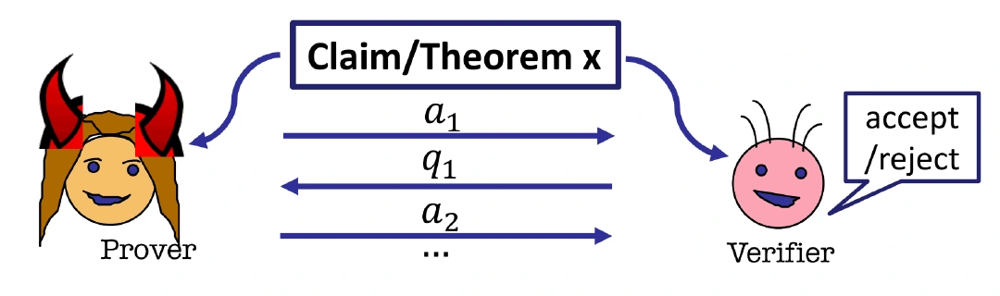

일반적인 언어의 입력에는 $u$, 뒤의 제곱잉여 예제에서 비밀 제곱근에는 $x$를 사용한다. 둘은 역할이 다르다.

### 완전성(completeness): 참인 주장은 통과한다

강의는 정직한 증명자가 유효한 witness를 가지고 프로토콜을 따르면 항상 통과하는 perfect completeness를 사용한다.

$$
u\in L
\quad\Longrightarrow\quad
\Pr[\langle P,V\rangle(u)=\mathrm{accept}]=1.
$$

완전성(completeness)은 정직한 실행에 대한 조건이다. 참인 입력이라도 증명자가 일부러 잘못된 답을 보내면 거절될 수 있다.

식의 $\langle P,V\rangle(u)$는 공개 입력 $u$를 두고 두 알고리즘이 대화한 결과를 뜻한다. 위 식은 “$u$가 참인 입력이면, 정직한 두 참여자가 어떤 난수를 골라도 accept한다”라고 읽으면 된다. 이것만으로 거짓 주장을 막는다는 결론은 나오지 않으므로 다음 조건이 따로 필요하다.

### 건전성(soundness): 거짓인 주장을 받아들일 확률이 작다

$$
u\notin L
\quad\Longrightarrow\quad
\forall P^*,\quad
\Pr[\langle P^*,V\rangle(u)=\mathrm{accept}]
\leq \operatorname{negl}(\lambda).
$$

$P^*$는 규칙을 어기는 증명자다. 대화형 **proof**의 건전성(soundness)은 계산 능력이 무제한인 $P^*$까지 상대한다. 검증자는 확률적 다항시간 알고리즘(PPT)이고, 위 확률은 참여자들의 난수 선택에 대해 계산한다.

$\lambda$는 보안 매개변수다. 강의의 $\operatorname{negl}(|u|)$ 표기는 입력 길이를 기준으로 쓴 표현이며, 여기서는 보안 매개변수를 따로 표시한다.

여기서 $\forall P^*$는 특정한 속임수 하나만 막으면 된다는 뜻이 아니다. 증명자가 어떤 전략을 쓰더라도 거짓 입력을 통과시킬 확률이 상한 이하여야 한다. 뒤의 QR 한 라운드는 이 상한이 $1/2$인 기본 단계이고, 반복을 통해 오류를 negligible하게 줄인다.

### Negligible은 단순히 작은 상수가 아니다

함수 $\mu(\lambda)$가 negligible이라는 것은 모든 양의 다항식 $p$에 대해, 충분히 큰 $\lambda$에서

$$
\mu(\lambda)<\frac{1}{p(\lambda)}
$$

가 성립한다는 뜻이다.

| 함수 | Negligible 여부 | 이유 |
| --- | --- | --- |
| $2^{-\lambda}$ | 해당 | 모든 역다항식보다 결국 작아진다 |
| $\lambda^{-10}$ | 해당하지 않음 | 예를 들어 $\lambda^{-11}$보다 작아지지 않는다 |
| $2^{-100}$이라는 고정 상수 | 점근적 의미에서는 해당하지 않음 | $\lambda$가 증가해도 줄어들지 않는다 |

QR 프로토콜을 $k$번 반복하면 건전성(soundness) 오류는 $2^{-k}$다. $k=\lambda$로 잡으면 negligible하다. 실제 매개변수에서 충분히 작은 확률을 고르는 일과 점근적 정의를 구별해야 한다.

## 2. 검증자가 보는 모든 것: view

*강의 4~5쪽*

“검증자가 무엇을 배웠는가”를 직접 수학적 대상으로 삼기는 어렵다. 대신 검증자가 계산에 사용할 수 있는 입력 전체를 모은다. 이것이 **view**다.

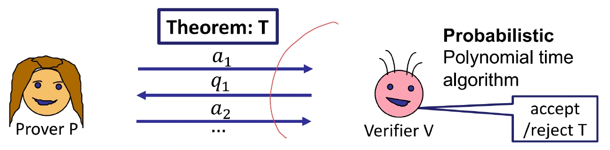

공개 입력 $u$를 고정하면, view는 대화 메시지와 검증자의 random tape $\rho_V$로 표현할 수 있다.

$$
\operatorname{View}_{V}^{P}(u)
=(\rho_V,a_1,q_1,a_2,q_2,\ldots).
$$

정확한 인코딩에 따라 공개 입력이나 검증자의 출력도 함께 적는다. 검증자가 보낸 메시지와 최종 출력은 자신의 입력·난수·수신 메시지로 다시 계산할 수 있다.

여기서 한 번 실행해 얻은 **기록 하나**와, 실행마다 달라지는 기록의 **확률분포**를 구별해야 한다. 필기의 “확률분포” 표시는 이 차이를 강조한다. $P$와 $V$가 난수를 쓰므로 같은 공개 입력에도 여러 view가 나올 수 있다.

검증자가 계산하는 비밀에 관한 추측, 통계, 다음 행동은 모두 자신의 view에서 나온다. 따라서 영지식의 질문은 다음처럼 바뀐다.

> 실제 view가 공개 입력과 주장이 참이라는 사실을 넘어서는 정보를 담고 있는가?

예를 들어 메시지만 보면 무작위 비트처럼 보여도, 검증자가 자신의 난수와 결합하면 비밀을 계산할 수 있을지 모른다. 그래서 메시지 각각이 그럴듯하게 무작위라는 설명만으로는 부족하다. 검증자가 함께 가지고 있는 정보 사이의 상관관계까지 view에 담아 비교해야 한다.

## 3. 시뮬레이션으로 영지식성(zero-knowledge)을 정의한다

*강의 6~8쪽*

시뮬레이터 $S$는 witness 없이 공개 입력만 받아 검증자의 view처럼 보이는 출력을 만드는 효율적인 알고리즘이다.

$$
S(u,1^\lambda).
$$

$1^\lambda$는 보안 매개변수를 단항으로 표시한 입력이다. 시뮬레이터에게 witness $w$를 주는 것은 허용하지 않는다. 비밀을 주고 비슷한 기록을 만들게 하면 “비밀 없이도 가능한 계산”이라는 비교가 사라진다.

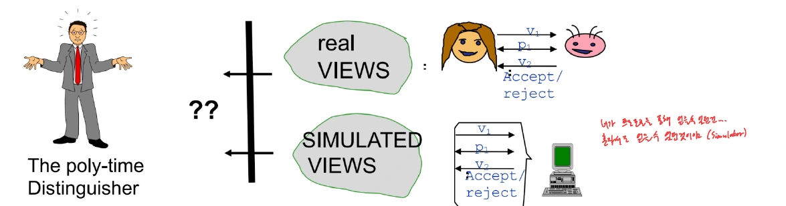

필기에 적힌 “혼자 view 생성”이 핵심이다. 실제 대화가 끝난 뒤 검증자가 계산할 수 있는 것을, 공개 입력만으로 만든 view에서도 계산할 수 있다면 대화로 추가적인 계산 능력을 얻었다고 보기 어렵다.

### 계산적 구별 불가능성(computational indistinguishability)

분포들의 모음 $D_{0,\lambda}$와 $D_{1,\lambda}$를 생각하자. PPT 구별자 $D$가 어느 쪽의 표본을 받았는지 구분하는 이득이 negligible하면

$$
D_{0,\lambda}\approx_c D_{1,\lambda}
$$

라고 쓴다. 구체적으로 모든 PPT $D$에 대해

$$
\left|
\Pr_{X\leftarrow D_{0,\lambda}}[D(X)=1]
-
\Pr_{X\leftarrow D_{1,\lambda}}[D(X)=1]
\right|
\leq \operatorname{negl}(\lambda)
$$

여야 한다.

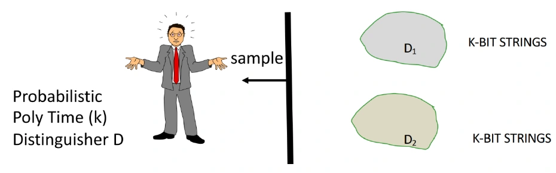

출처를 균등하게 고르는 게임으로 표현하면, 정답 확률은 $1/2$에 negligible한 이득을 더한 정도다. “어떤 구별자도 구별하지 못한다”에서 **PPT라는 계산 제한**을 빼면 더 강한 조건이 된다.

| 영지식의 종류 | 실제 view와 시뮬레이션 view의 관계 |
| --- | --- |
| Perfect ZK | 두 분포가 정확히 같다 |
| Statistical ZK | 두 분포의 통계적 거리가 negligible하다 |
| Computational ZK | 모든 효율적인 구별자의 이득이 negligible하다 |

계산적 ZK는 분포가 문자 그대로 같다고 주장하지 않는다. 반면 뒤에서 보일 QR 시뮬레이션은 분포가 정확히 일치한다.

시뮬레이션의 논리는 계산을 이어 붙여 보면 분명해진다. 검증자가 실제 view에서 비밀에 관한 어떤 값을 효율적으로 계산한다면, 먼저 $S$로 view를 만든 다음 같은 계산을 할 수도 있다. 시뮬레이터가 witness를 받지 않았으므로 그 계산 능력을 증명자가 새로 알려 준 비밀 덕분이라고 할 수 없다는 것이다. 따라서 비교 대상은 특정 기록 하나의 모양이 아니라, 그 뒤에 수행할 계산까지 구별하지 못하게 하는 전체 분포다.

## 4. HVZK와 full ZK

*강의 8~9쪽*

### 정직한 검증자만 상대하는 경우

Honest-Verifier Zero Knowledge(HVZK)는 정해진 절차를 따르는 $V$의 view를 시뮬레이션한다.

$$
\exists S\quad\forall u\in L,\qquad
\operatorname{View}_{V}^{P}(u)
\approx_c S(u,1^\lambda).
$$

검증자가 공정한 동전을 던지기로 했다면 실제로 그 규칙을 지킨다고 가정한다.

### 임의의 효율적인 검증자를 상대하는 경우

악의적인 $V^*$는 첫 메시지에 따라 질문을 고르거나 편향된 난수를 사용할 수 있다. Full ZK에서는 이런 검증자마다 대응하는 시뮬레이터가 있어야 한다.

$$
\forall\text{ PPT }V^*\quad\exists S_{V^*}
\quad\forall u\in L,\qquad
\operatorname{View}_{V^*}^{P}(u)
\approx_c S_{V^*}(u,1^\lambda).
$$

**모든 검증자에 대해 하나의 똑같은 시뮬레이터를 강요하는 식이 아니다.** 시뮬레이터는 상대할 $V^*$에 의존할 수 있다. 필기의 computationally bounded 표시는 검증자의 범위를 설명한다.

양화사의 순서를 말로 풀면 “효율적인 검증 전략을 하나 정하자. 그러면 그 전략이 보게 될 기록을 흉내 내는 시뮬레이터가 있어야 하고, 그 시뮬레이터는 모든 참인 공개 입력에서 작동해야 한다”가 된다. 검증 전략을 보고 시뮬레이터를 정할 수는 있지만, 매 입력마다 비밀 답을 미리 넣은 별도 프로그램을 골라서는 안 된다. 또한 여기서 악의적이라는 말은 공격 의도를 추측한다는 뜻이 아니라, 정해진 질문 선택 규칙을 따르지 않는 알고리즘까지 허용한다는 뜻이다.

영지식성(zero-knowledge) 조건은 유효한 witness로 실행하는 참인 입력에 요구한다. 거짓 입력을 받아들이지 않는 문제는 건전성(soundness)이 담당한다. 완전성(completeness)·건전성(soundness)·영지식성(zero-knowledge)을 함께 만족해야 zero-knowledge interactive proof다.

보충으로, 일반적인 정의에서는 검증자가 이미 가진 보조 입력도 함께 고려한다. 시뮬레이터에도 같은 공개 입력과 보조 입력을 주고 view를 비교한다. 또한 아래 rewinding 시뮬레이터는 **기대 다항시간**을 사용한다.

보조 입력(auxiliary input)은 검증자가 대화 전에 이미 가진 관련 정보다. 그것까지 같은 조건으로 주어야 대화에서 새로 얻은 정보를 비교할 수 있다. 기대 다항시간(expected polynomial time)은 실행 시간이 매번 일정한 한도 안에 든다는 뜻이 아니라, 난수 선택에 따른 평균 실행 시간이 다항식으로 제한된다는 뜻이다. 되감기에서 드물게 여러 번 실패할 수 있어도 평균 비용이 작으면 이 조건을 만족할 수 있다.

## 5. QR 프로토콜을 다시 쓰기

*강의 10~11쪽*

공개 입력은 $(N,y)$, 비밀 witness는

$$
x\in\mathbb Z_N^*,\qquad x^2\equiv y\pmod N
$$

인 제곱근이다. $\mathbb Z_N^*$는 $N$과 서로소인 나머지들의 곱셈군이다. 역원이 필요한 계산이므로 $0$을 포함한 모든 나머지에서 무작정 원소를 고르면 안 된다.

한 라운드는 다음과 같다.

1. $P$가 $r\leftarrow\mathbb Z_N^*$를 균등하게 뽑고 $s=r^2\bmod N$을 보낸다.
2. $V$가 $b\leftarrow\{0,1\}$을 균등하게 골라 보낸다.
3. $P$가 다음 응답을 보낸다.

$$
z=
\begin{cases}
r,&b=1,\\
rx\bmod N,&b=0.
\end{cases}
$$

검증자는 원소들이 요구된 군에 속하는지 확인하고

$$
\boxed{z^2\equiv s\,y^{1-b}\pmod N}
$$

이면 받아들인다.

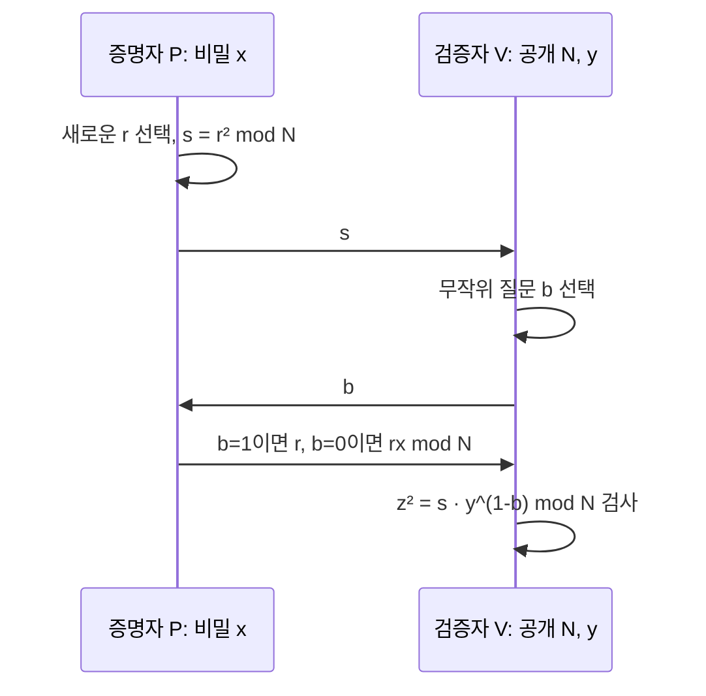

강의 본문은 $b=1$일 때 $r$을 보내지만 일부 삽입 그림은 비트의 역할을 반대로 표시한다. 두 표기 모두 일관되게 쓰면 같은 구조다. 여기서는 **본문과 앞 글의 규칙**에 맞춰 $z^2=s y^{1-b}$로 통일한다.

정직한 검증자의 난수는 질문 비트 $b$이고, 한 라운드의 기록은 $(s,b,z)$다. 이제 이 세 값을 비밀 $x$ 없이 생성해 보자.

먼저 검증식에 두 응답을 직접 대입해 두면 이후 계산이 덜 낯설다. $b=1$이면 $z^2=r^2=s$이고, $b=0$이면 $z^2=(rx)^2=r^2x^2=sy$다. 정직한 증명자는 $x$를 알아 두 경우 모두 답할 수 있지만, 검증자에게 보내는 것은 매번 새로운 $r$과 섞인 응답 하나다.

## 6. 실제 기록의 분포를 분석한다

*강의 12쪽*

$b$는 균등한 비트다. 중요한 것은 각 $b$를 고정했을 때 $z$도 $\mathbb Z_N^*$에서 균등하다는 사실이다.

- $b=1$이면 $z=r$이므로 바로 균등하다.
- $b=0$이면 $z=rx$다. 고정된 $x\in\mathbb Z_N^*$를 곱하는 함수는 전단사이므로 균등성이 유지된다.

$$
r\longmapsto rx,\qquad
z\longmapsto zx^{-1}.
$$

필기의 “fix × uniform = uniform”은 **군 원소에 의한 전단사**라는 조건 아래에서 성립한다. 아무 공간에서 아무 값을 곱해도 균등해진다는 뜻은 아니다. $0$을 곱하면 모든 값이 $0$이 되는 것과 비교하면 차이가 분명하다.

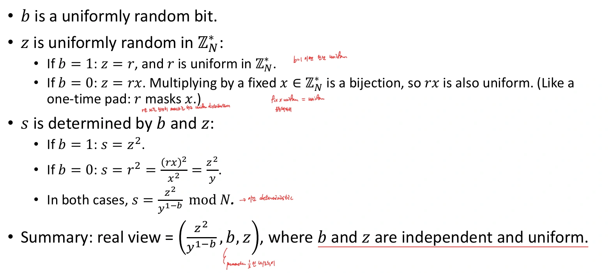

한편 $s$는 $b,z$로 결정된다.

$$
s=
\begin{cases}
z^2\bmod N,&b=1,\\
z^2y^{-1}\bmod N,&b=0.
\end{cases}
$$

두 경우를 합치면

$$
\boxed{s=z^2y^{b-1}\bmod N}
$$

이다. 따라서 실제 기록의 분포는 **독립이고 균등한 $b,z$를 고른 뒤 이 식으로 $s$를 정하는 분포**와 같다. 실제 프로토콜의 시간 순서를 바꾼다는 뜻이 아니라, 결과 분포를 다른 방식으로 표현한 것이다.

## 7. 정직한 검증자를 위한 시뮬레이터

*강의 13~14쪽*

$S(N,y)$는 다음처럼 동작한다.

1. $b\leftarrow\{0,1\}$을 균등하게 고른다.
2. $z\leftarrow\mathbb Z_N^*$를 균등하게 고른다.
3. $s=z^2y^{b-1}\bmod N$을 계산한다.
4. $(s,b,z)$를 출력한다.

$S$는 $x$를 사용하지 않는다. 공개된 $y$의 역원만 계산하면 된다. 출력은 항상

$$
s y^{1-b}\equiv z^2\pmod N
$$

을 만족한다.

다만 **검증식을 만족한다는 사실만으로 영지식 증명이 끝나지는 않는다.** 실제 실행과 같은 확률로 기록을 만들어야 한다. 앞 절에서 실제와 시뮬레이션 모두 $(b,z)$가 독립·균등하고, $s$가 같은 결정 함수임을 확인했으므로 분포가 정확히 일치한다. 따라서 perfect HVZK다.

### 보충 예제: 비밀 없이 통과하는 기록 만들기

$N=15,y=4$라 하자. $4^{-1}\equiv4\pmod{15}$다. 시뮬레이터가 $b=0,z=7$을 뽑으면

$$
s=7^2\cdot4^{-1}\bmod15
=49\cdot4\bmod15=1.
$$

기록 $(1,0,7)$은

$$
7^2\equiv4\equiv1\cdot4\pmod{15}
$$

이므로 통과한다. 실제 증명자가 $x=2,r=11$을 썼을 때에도 $s=1,z=7$이라는 같은 기록이 나온다. 시뮬레이터는 이 $x,r$을 알 필요가 없다.

여기서 $y^{-1}$을 계산하는 일과 $y$의 제곱근을 찾는 일을 구별해야 한다. $y$와 $N$이 서로소이면 역원은 확장 유클리드 알고리즘으로 계산할 수 있다. 시뮬레이터는 이 공개적인 연산만으로 기록을 만들며, 비밀 제곱근 문제를 풀고 있는 것이 아니다.

## 8. 시뮬레이터가 건전성(soundness)을 깨뜨리지 않는 이유

*강의 15쪽*

실제 증명자는 **$s$를 보낸 다음에야** 검증자가 고른 $b$를 받는다. 시뮬레이터는 완성된 기록을 오프라인으로 쓰므로 $b,z$부터 고르고 $s$를 역산할 수 있다.

| 실제 대화 | 시뮬레이션 |
| --- | --- |
| $s\rightarrow b\rightarrow z$ 순서 | $b,z$를 먼저 정하고 $s$ 계산 |
| 검증자의 미래 질문을 통제하지 못함 | 출력할 기록의 질문을 직접 선택 |
| 질문이 온 뒤 첫 메시지를 바꿀 수 없음 | 아직 전송한 메시지가 없음 |

거짓 입력에서는 같은 $s$로 두 질문을 모두 통과할 수 없어 한 라운드 성공 확률이 최대 $1/2$다. 참인 입력에서 witness를 모른다는 상황과 입력 자체가 거짓인 상황은 별도로 구별해야 한다.

이 구조에는 **non-transferability**도 있다. 제삼자에게 $(s,b,z)$만 보여 줘서는 “실제로 비밀을 아는 사람과 대화했다”는 것을 입증하지 못한다. 제삼자 자신도 같은 종류의 기록을 만들 수 있기 때문이다. 실제로 적절한 시점에 질문을 선택한 검증자가 얻는 확신과, 나중에 기록만 보는 사람이 얻는 확신은 다르다.

## 9. 악의적인 검증자와 rewinding

*강의 16~18쪽*

악의적인 검증자는 공정한 동전 대신

$$
b'=V^*(N,y,s;\rho)
$$

처럼 $s$와 자신의 random tape $\rho$에 따라 질문을 고를 수 있다. 기존 HVZK 시뮬레이터가 마음대로 만든 $b$가 이 $b'$와 맞지 않으면 그 검증자의 실제 view가 아니다.

### 질문을 추측하고 틀리면 되감는다

$V^*$의 random tape와 시작 상태를 고정한 뒤 다음을 반복한다.

1. 질문의 추측값 $\widehat b\leftarrow\{0,1\}$을 균등하게 고른다.
2. $z\leftarrow\mathbb Z_N^*$를 고른다.
3. $s=z^2y^{\widehat b-1}\bmod N$을 계산한다.
4. $V^*$에게 $s$를 주고 질문 $b'$를 받는다.
5. $b'=\widehat b$이면 $(s,b',z,\rho)$를 출력한다.
6. 다르면 **같은 검증자의 시작 상태로 돌아가** 새로운 $\widehat b,z$로 다시 시도한다.

실제 상대에게 시간을 되돌리라고 요청하는 프로토콜이 아니다. 보안 증명 속 시뮬레이터가 검증자 프로그램을 실행하고 저장된 상태로 복원하는 것이다. 난수 테이프를 고정해야 같은 검증자 실행을 되감는 의미가 유지된다.

### 성공 확률이 정확히 1/2인 이유

참인 입력에서 $y$는 제곱잉여다.

- $\widehat b=1$이면 $s=z^2$는 제곱잉여 집합 $QR_N$에서 균등하다.
- $\widehat b=0$이면 $s=z^2y^{-1}$이다. 제곱잉여 $y$의 역원을 곱하는 것은 $QR_N$ 위의 전단사이므로 역시 균등하다.

두 추측에서 **$s$의 분포가 같다.** 따라서 $s$를 본 $V^*$도 추측값 $\widehat b$를 알아낼 수 없다. 고정된 $\rho$에 대해 $b'$는 $s$의 함수이고, 추측은 그 $s$와 독립인 균등 비트다.

$$
\Pr[b'=\widehat b]=\frac12,
\qquad
\mathbb E[\text{시도 횟수}]=2.
$$

극단적으로 $V^*$가 항상 $0$만 질문해도 마찬가지다. 시뮬레이터의 추측은 공정한 비트이므로 절반의 시도에서 $0$을 골라 성공한다. 질문이 $s$에 따라 바뀌는 경우에도 $s$가 추측 비트를 드러내지 않는다는 성질 덕분에 같은 계산이 성립한다. 성공률 $1/2$은 검증자의 질문이 공정하다는 가정에서 나오는 값이 아니다.

### 성공한 기록의 분포도 맞는가

성공 확률이 $1/2$인 것만으로 충분하지는 않다. 성공 조건을 걸어도 실제 view의 분포가 나와야 한다.

각 $s,\rho$에서 성공 확률이 동일한 $1/2$이므로 성공 조건이 이들의 분포를 편향시키지 않는다. 성공한 질문 $b'$는 실제 $V^*$가 선택한 질문이다. 그때 $z$는 검증식을 만족하는 근들 사이에서 균등하며 실제 응답의 조건부 분포와 일치한다. 따라서 기대 다항시간의 **perfect ZK** 시뮬레이션을 얻는다.

여기서는 검증자가 한 비트 질문을 보내는 모형을 사용했다. 잘못된 형식의 질문이나 중단도 허용하는 구현에서는 실제 실행의 중단 규칙과 그 view까지 맞춰 시뮬레이션해야 한다.

## 10. 여러 라운드: 순차 반복과 병렬 반복

*강의 19쪽*

### 순차 반복

$k$개 라운드를 차례대로 수행하면 현재 라운드의 시작 상태만 저장하고 되감으면 된다. 검증자의 과거 기록과 내부 상태를 유지한 채 현재 질문을 시뮬레이션한다.

$$
\mathbb E[\text{전체 시도 횟수}]=2k.
$$

이는 시도 횟수다. 실제 실행 시간에는 각 시도에서 $V^*$를 실행하는 다항시간 비용도 포함된다.

예를 들어 10라운드에서는 한 번에 10개의 질문을 모두 맞힐 필요가 없다. 첫 라운드를 성공한 상태로 저장하고 두 번째 라운드만 다시 시도하는 식이므로 평균 시도 횟수가 $2+\cdots+2=20$이 된다. 이처럼 이미 성공한 앞부분을 보존할 수 있다는 점이 뒤의 병렬 반복과 다르다.

### 엄격한 시간 제한을 두는 경우

라운드마다 최대 $\lambda$번만 시도하고 실패하면 $\bot$을 출력하게 하자. 한 라운드에서 모두 틀릴 확률은 $2^{-\lambda}$이고, 합집합 상계로

$$
\Pr[\text{어느 라운드에서든 실패}]
\leq k\,2^{-\lambda}.
$$

$k$가 $\lambda$의 다항식이면 이 값은 negligible하다. 제한 없는 시뮬레이터와 출력이 달라지는 경우를 이 실패 사건으로 묶을 수 있으므로, strict polynomial time을 얻는 대신 perfect ZK에서 **statistical ZK**로 바뀐다.

### 병렬 반복에서는 같은 계산을 적용할 수 없다

모든 첫 메시지 $s_1,\ldots,s_k$를 한꺼번에 보내면 $V^*$는 전체 벡터를 보고 질문 벡터를 고를 수 있다. 질문을 통째로 추측하는 단순한 방법의 성공 확률은

$$
2^{-k}
$$

이고 기대 시도 횟수는 $2^k$다. $k=\lambda$이면 효율적인 시뮬레이터가 아니다. 이것은 **이 시뮬레이션 방법의 한계**이지, 병렬 반복의 모든 보안 성질이 자동으로 사라진다는 뜻은 아니다.

## 11. 참이라는 증명과 안다는 증명

*강의 20~21쪽*

QR에서 다음 두 주장은 구별된다.

- Membership: $x^2\equiv y\pmod N$인 $x$가 존재한다.
- Knowledge: 증명자가 그런 $x$를 알고 있다.

기계가 무언가를 “안다”는 말을 메모리 속 특정 위치에 값이 저장되어 있다는 뜻으로 한정하기는 어렵다. 값이 프로그램에 다른 형태로 들어 있을 수도 있다. 그래서 **그 증명자를 이용해 witness를 효율적으로 계산할 수 있는가**로 정의한다.

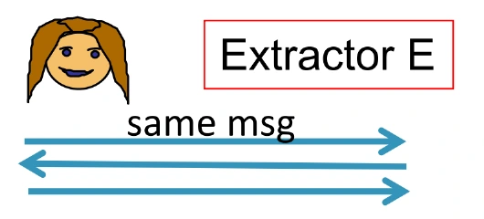

공개 입력 $u$와 witness $w$의 관계를 $R(u,w)=1$로 쓰자. Knowledge extractor $E$는 공개 입력과 증명자 $P^*$에 대한 접근을 받아 유효한 $w$를 출력한다.

필기는 “검증자를 속일 만큼 잘 답하는 $P^*$에서 witness를 추출한다”는 점과, **SNARK에서 ZK는 선택적이지만 knowledge는 이름에 포함된 조건**이라는 점을 강조한다.

### 추출 시간은 지식 오류(knowledge error)와의 차이에 달린다

한 라운드는 질문을 미리 찍는 전략으로도 확률 $1/2$로 통과할 수 있다. 따라서 성공률이 단지 양수라는 이유만으로 효율적인 추출을 요구하지는 않는다.

성공률을 $p$, knowledge error를 $\kappa$라 하면 $p>\kappa$일 때 추출을 요구하며, 실행 시간에는 일반적으로 $1/(p-\kappa)$가 들어간다. 효율적인 증명자와 역다항식 이상의 간격을 가정하면 효율적인 추출이 가능해진다.

Knowledge error는 witness 없이도 우연히 통과할 수 있는 기준선으로 이해하면 된다. QR의 한 비트 질문에서는 답할 수 있는 질문 하나를 미리 찍는 것으로 $1/2$를 달성할 수 있으므로, 그 정도의 성공만으로 지식을 결론 내릴 수 없다. 추출은 이 기준선을 의미 있게 넘는 능력을 이용한다.

강의 21쪽은 실행 시간을 $\operatorname{poly}(|u|,1/\epsilon)$으로 요약한다. 이를 읽을 때는 성공 확률 자체뿐 아니라 **오류 상한을 얼마나 넘었는지**를 함께 보아야 한다. 이 차이를 명시하는 표준 정의는 [Damgård의 Σ-protocol 강의노트, 지식증명 정의](https://www.cs.au.dk/~ivan/Sigma.pdf)에서 확인할 수 있다.

## 12. QR에서 witness를 추출한다

*강의 22~24쪽*

시뮬레이터가 $V^*$를 되감았다면, 추출기는 $P^*$를 되감는다.

1. $P^*$의 random tape를 고정하고 첫 메시지 $s$를 받는다.
2. $b=1$을 보내 응답 $z_1$을 받는다.
3. $s$를 보낸 직후의 상태로 $P^*$를 되감는다.
4. $b=0$을 보내 응답 $z_0$을 받는다.
5. 두 응답이 모두 유효하면 $x'=z_0z_1^{-1}\bmod N$을 출력한다.

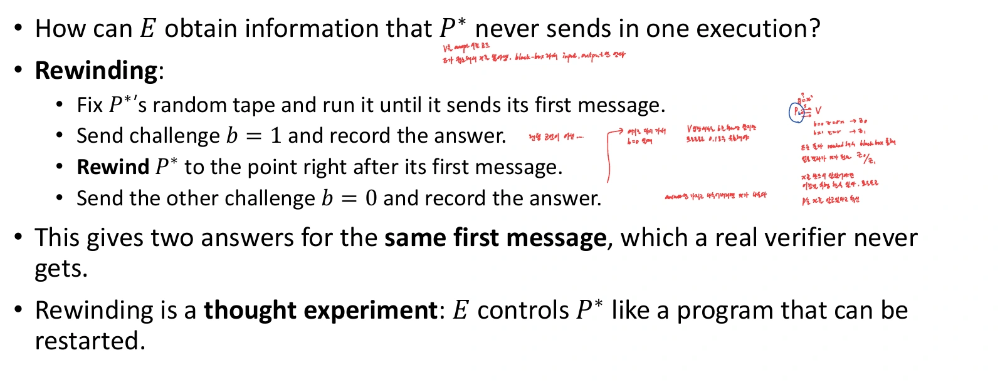

두 수락식은

$$
z_1^2\equiv s,\qquad z_0^2\equiv sy\pmod N
$$

이므로

$$
(x')^2
\equiv (z_0z_1^{-1})^2
\equiv (sy)s^{-1}
\equiv y\pmod N.
$$

같은 첫 메시지에 대한 서로 다른 질문의 수락 기록 두 개로 witness를 계산하는 성질이 **special soundness**다. 질문만 다르고 첫 메시지는 같아야 한다.

식을 나누는 이유는 두 응답에 공통으로 들어간 가림값을 없애기 위해서다. 정직한 응답에서는 $z_0=rx$, $z_1=r$이므로 비율을 취하면 $x$가 남는다. 임의의 증명자가 보낸 값이라도 두 검증식을 만족하면 위 제곱식으로 유효한 근임을 보일 수 있다. 반면 첫 메시지가 서로 다르면 $s$가 소거되지 않아 같은 추출 결론을 얻지 못한다.

$N=pq$가 서로 다른 홀수 소수의 곱이고 $y\in QR_N$이면 $y$에는 네 개의 제곱근이 있다. 추출 결과는 원래 증명자가 사용한 근과 다를 수 있지만, $R((N,y),x')=1$이면 유효한 witness다.

### 1/2보다 더 잘 성공하면 왜 추출 가능한가

한 라운드의 성공 확률이

$$
p=\frac12+\epsilon
$$

이라고 하자. Random tape를 고정하면 증명자가 두 질문 중 맞힐 수 있는 개수는 $0,1,2$개다. 각각의 tape 비율을 $q_0,q_1,q_2$라 두면

$$
p=\frac{q_1+2q_2}{2},\qquad
q_0+q_1+q_2=1.
$$

따라서

$$
2\epsilon=q_2-q_0
\quad\Longrightarrow\quad
q_2\geq2\epsilon.
$$

최소 $2\epsilon$ 비율의 tape에서는 두 질문을 모두 통과한다. 새 tape로 시작해 두 응답을 검사하는 시도를 반복하면 기대 시도 횟수는 최대

$$
\frac{1}{2\epsilon}
$$

이다. 예를 들어 성공률이 $0.6$이면 $\epsilon=0.1$이므로 두 질문에 답하는 tape의 비율은 최소 $0.2$, 기대 시도는 최대 $5$회다.

$k$라운드 전체에 대한 강의의 기준은 성공률이 $2^{-k}$를 눈에 띄게 넘는가이다. 여러 라운드의 추출은 대화의 분기 구조를 다뤄야 하므로, 위 한 라운드 식에 숫자만 치환한 증명과 구별한다.

## 13. Simulator와 extractor는 모순되지 않는다

*강의 25쪽*

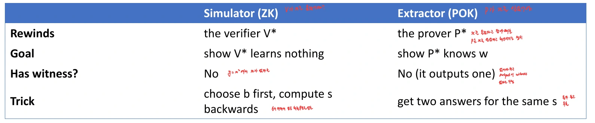

| 구분 | Simulator | Extractor |
| --- | --- | --- |
| 보이려는 성질 | 검증자가 추가 정보를 얻지 못함 | 증명자의 동작에서 witness를 계산할 수 있음 |
| 되감는 상대 | 악의적인 검증자 $V^*$ | 증명자 $P^*$ |
| 처음 witness를 받는가 | 받지 않음 | 받지 않음 |
| 최종 출력 | 실제와 같은 분포의 view | 유효한 witness |
| QR에서의 방법 | 질문을 먼저 고르고 $s$를 역산 | 같은 $s$에 대한 두 응답 확보 |

시뮬레이터는 스스로 정한 **한 질문**에 맞는 기록을 만든다. 추출기는 **같은 첫 메시지의 두 질문**에 답하는 증명자의 능력을 이용한다. 서로 다른 능력을 사용하므로 “witness 없이 기록을 만든다”와 “잘 답하는 증명자에서 witness를 얻는다”는 모순되지 않는다.

일반 검증자가 실제 실행에서 두 응답을 받을 수 있다는 뜻도 아니다. 되감기는 보안 증명의 접근 권한이다. 실제 구현에서 같은 난수와 첫 메시지를 재사용해 두 응답을 내놓으면 witness가 유출될 수 있다.

정상적인 두 번의 인증에서는 서로 다른 난수로 첫 메시지도 새로 만든다. 따라서 첫 번째 인증에서 받은 $z_1$과 두 번째 인증에서 받은 $z_0$를 단순히 나눈다고 위 추출식이 성립하지 않는다. “한 실행의 같은 상태에서 두 갈래의 응답을 얻는 능력”과 “서로 독립적인 실행을 여러 번 관찰하는 능력”을 구별해야 한다.

## 14. 두 번째 예제: Graph Isomorphism

*강의 26~27쪽*

두 그래프 $G_0=(V,E_0)$, $G_1=(V,E_1)$ 사이에 정점 순열 $\sigma$가 존재하여

$$
(i,j)\in E_0
\quad\Longleftrightarrow\quad
(\sigma(i),\sigma(j))\in E_1
$$

이면 동형이라고 한다. $\sigma(G_0)=G_1$ 또는 $G_0\cong G_1$로 쓴다. 그림의 배치가 달라도 정점 이름을 바꿔 인접 관계를 보존하면 같은 구조다.

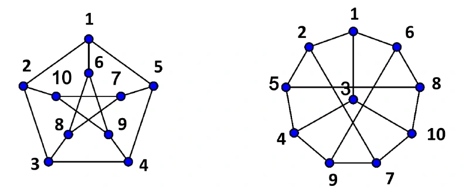

공개 입력은 $(G_0,G_1)$이고 witness는 동형사상 $\sigma$다. 증명자는 $\sigma$를 공개하지 않고, 두 그래프가 동형이며 자신이 그 대응을 안다는 것을 보이려 한다.

무작위로 다시 이름 붙인 그래프 $H$를 만들고, 검증자가 고른 쪽에서 $H$로 가는 대응 하나만 보여 주는 것이 기본 생각이다.

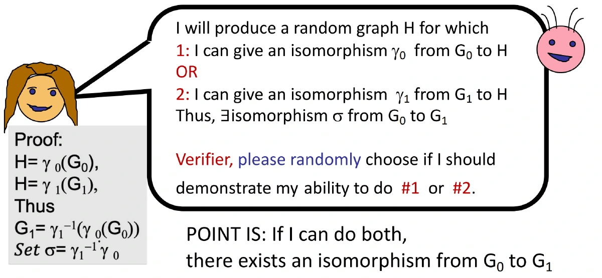

$G_0\rightarrow H$와 $G_1\rightarrow H$의 대응을 둘 다 알면 두 대응을 합성해 $G_0\rightarrow G_1$을 얻는다. 실제 실행에서는 하나만 공개한다.

## 15. 그래프 동형 프로토콜

*강의 28쪽*

$\sigma(G_0)=G_1$을 아는 증명자는 다음을 수행한다.

1. 정점들의 균등한 무작위 순열 $\gamma$를 고른다.
2. $H=\gamma(G_0)$를 만들어 보낸다.
3. 검증자가 균등한 비트 $b$를 보낸다.
4. 증명자는 다음 순열 $\tau$를 응답한다.

$$
\tau=
\begin{cases}
\gamma,&b=0,\\
\gamma\circ\sigma^{-1},&b=1.
\end{cases}
$$

검증자는 $\tau$가 유효한 정점 순열인지 확인하고

$$
\boxed{\tau(G_b)=H}
$$

를 검사한다.

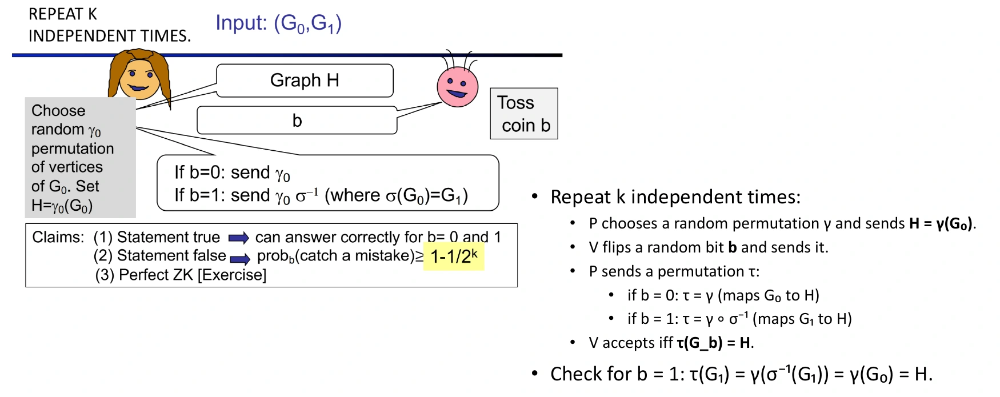

$\gamma\circ\sigma^{-1}$은 **오른쪽의 $\sigma^{-1}$을 먼저 적용**한다. $G_1$을 $G_0$로 되돌린 다음 $\gamma$로 $H$에 보내는 것이다.

$$
G_1\xrightarrow{\sigma^{-1}}G_0
\xrightarrow{\gamma}H.
$$

QR의 곱셈에서는 순서를 크게 의식하지 않았지만, 순열의 합성은 일반적으로 교환법칙이 성립하지 않는다.

검증자는 비밀 대응 $\sigma$를 복원할 필요가 없다. 자신이 고른 $G_b$의 정점 이름을 응답 $\tau$대로 바꿨을 때, 간선 집합까지 정확히 $H$와 같아지는지만 확인하면 된다. 동형사상을 처음부터 찾는 문제와, 주어진 후보 동형사상이 맞는지 검사하는 문제의 차이가 드러나는 예다.

## 16. 그래프 동형의 보안 성질과 지식 추출

*강의 29~30쪽*

### 완전성(completeness)

$b=0$이면 $\tau(G_0)=\gamma(G_0)=H$다. $b=1$이면

$$
\tau(G_1)
=\gamma(\sigma^{-1}(G_1))
=\gamma(G_0)=H.
$$

정직한 증명자는 두 질문 모두에 답할 수 있다.

### 건전성(soundness)

$G_0\not\cong G_1$이면 하나의 $H$가 두 그래프 모두와 동형일 수 없다. 만약 둘 모두와 동형이면 그 대응들을 합성해 $G_0\cong G_1$을 얻어 모순이다.

따라서 $H$를 먼저 고른 거짓 증명자는 두 질문 중 최대 하나에 답한다. 한 라운드 수락 확률은 최대 $1/2$, 독립된 새 질문으로 $k$회 반복하여 모두 통과하게 하면 최대 $2^{-k}$다. 거짓 주장을 잡아낼 확률은 최소 $1-2^{-k}$다.

### 영지식성(zero-knowledge): perfect HVZK와 악의적 검증자 시뮬레이션

정직한 검증자를 위한 시뮬레이터는 $b$와 순열 $\tau$를 균등하게 고르고

$$
H=\tau(G_b)
$$

로 정해 $(H,b,\tau)$를 출력한다. $\sigma$를 사용하지 않는다.

실제 실행에서도 $b=0$이면 $\tau=\gamma$, $b=1$이면 $\tau=\gamma\circ\sigma^{-1}$이다. 고정 순열을 합성하는 연산은 순열 집합의 전단사이므로 두 경우 모두 $\tau$가 균등하다. $H$도 같은 식으로 결정되어 기록 분포가 정확히 일치한다.

악의적인 검증자에게는 $b$를 추측하고 $H$를 보낸 뒤 질문이 다르면 되감는다. 참인 입력에서 $G_0$와 $G_1$의 무작위 재명명 결과는 같은 분포이므로 $H$는 추측 비트를 드러내지 않는다. 기대 시도 횟수는 라운드당 $2$회다.

보충으로, 그래프에 자기동형이 있어 여러 순열이 같은 $H$를 만들더라도 각 재명명 결과의 원상 개수가 같으므로 위 분포 비교는 유지된다.

### 지식 추출(knowledge extraction)

같은 $H$에 대해

$$
\tau_0(G_0)=H,\qquad \tau_1(G_1)=H
$$

인 두 유효 응답을 얻으면

$$
\boxed{\sigma'=\tau_1^{-1}\circ\tau_0}
$$

를 출력한다.

$$
\sigma'(G_0)
=\tau_1^{-1}(\tau_0(G_0))
=\tau_1^{-1}(H)
=G_1.
$$

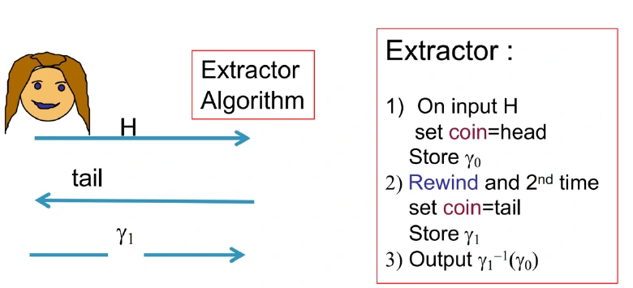

QR에서 두 응답의 비율로 제곱근을 얻었다면, 여기서는 역순열과 합성으로 동형사상을 얻는다. 따라서 이 프로토콜은 ZK proof of knowledge, 즉 ZKPOK다.

## 17. Proof, argument, Σ-protocol

*강의 31~32쪽*

계산 능력이 무제한인 증명자는 다항식 길이의 witness 후보를 전부 탐색할 수 있다. 현실의 효율적인 증명자가 어떻게 witness를 알고 있는지를 다룰 때에는 계산 제한과 추출 효율을 함께 보는 것이 중요하다.

| 구분 | 거짓 증명을 막아야 하는 상대 |
| --- | --- |
| Proof | 계산 능력이 무제한인 증명자까지 |
| Argument | 효율적인 PPT 증명자 |

이 구별은 **건전성(soundness)의 상대 범위**다. Proof/argument와 ZK 여부, knowledge 여부는 각각 따로 확인하는 성질이다. 무제한 증명자를 논의할 수 없다는 뜻도 아니다. 추출기의 효율을 오라클 호출 수와 증명자 실행 비용 중 어떤 기준으로 재는지 분명히 해야 한다.

QR와 GI에는 공통으로 다음 구조가 있다.

$$
\text{첫 메시지(commit)}
\longrightarrow\text{무작위 challenge}
\longrightarrow\text{response}.
$$

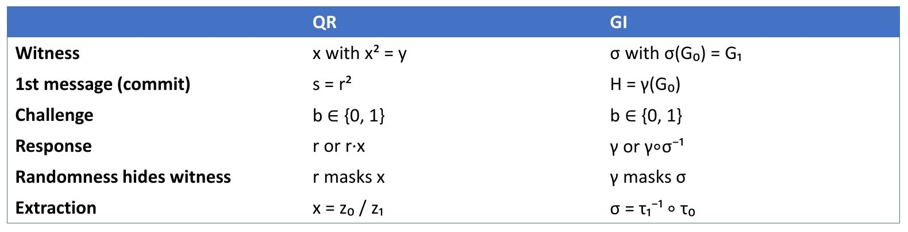

이러한 public-coin 3단계 구조에 완전성(completeness), special soundness, special HVZK를 갖춘 것이 **Σ-protocol**이다. 메시지가 세 번 오간다는 사실만으로 모두 Σ-protocol은 아니다. 첫 메시지를 commit이라고 부르지만, 별도의 commitment scheme의 모든 성질이 자동으로 붙는 것도 아니다. [Σ-protocol 정의](https://www.cs.au.dk/~ivan/Sigma.pdf)

Public-coin은 검증자의 challenge가 정해진 공간에서 뽑은 공개 무작위 값이라는 뜻이다. Special HVZK는 challenge를 지정해 주어도 그 challenge에 조건을 건 실제 기록의 분포를 시뮬레이션할 수 있다는 성질이다. QR에서는 주어진 $b$에 대해 $z$를 균등하게 뽑고 $s=z^2y^{b-1}$로 정했던 계산이 바로 그 예다. Special soundness는 두 challenge의 답에서 witness를 얻는 조건이고, special HVZK는 한 challenge의 기록을 witness 없이 만드는 조건이다.

강의는 Schnorr identification과 서명도 이 구조와 연결된 예로 든다. 다음 글의 SNARK에서도 proof/argument의 차이와 knowledge extractor가 다시 등장한다.

## 18. 응용: 비밀번호를 보내지 않는 신원 인증

*강의 33~34쪽*

Alice가 Bob에게 자신임을 증명하려고 비밀번호 자체를 보내면, 이를 얻은 공격자가 나중에 Alice를 사칭할 수 있다. 강의는 네트워크 도청, 서버 침해, 악의적인 서버를 예로 들고 스마트카드·ATM·인터넷 로그인을 응용 상황으로 제시한다.

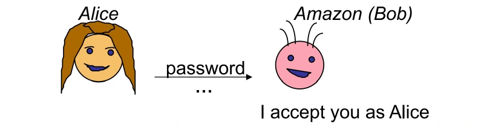

ZK identification에서는 비밀을 보내는 대신 **등록한 공개키에 대응하는 비밀을 안다**는 것을 증명한다.

1. 적절한 $N=pq$에 대해 Alice가 비밀 $x\in\mathbb Z_N^*$를 고른다.
2. $y=x^2\bmod N$을 공개키로 등록한다.
3. 로그인할 때 QR ZKPOK로 $y$의 제곱근을 안다는 것을 증명한다.
4. Bob은 공개 정보 $(N,y)$로 검증한다.

| 관점 | 비밀번호를 직접 전달하는 단순 모형 | ZK identification |
| --- | --- | --- |
| 서버의 검증 정보 | 비밀번호 또는 비밀번호 검증값 | 공개키 |
| 대화에서 보호할 값 | 전송한 비밀번호 | 공개하지 않는 비밀 제곱근 |
| 공개키 DB가 노출되면 | 비밀번호 검증값에 대한 공격을 고려해야 함 | 공개키만으로 witness를 바로 얻지는 못함 |

강의의 비밀번호 비교는 단순화된 모형이다. TLS로 보호되는 로그인에서 도청자가 평문 비밀번호를 바로 읽는다고 일반화하거나, 해시 유출이 항상 즉시 비밀번호 유출과 같다고 해석하면 안 된다.

### 두 보안 성질이 함께 필요하다

**영지식성(zero-knowledge)** 은 정당한 인증 과정의 view에서 비밀에 관한 추가 정보를 얻지 못하게 한다. **지식 건전성(knowledge soundness)** 은 사칭자가 오류 상한보다 눈에 띄게 높은 확률로 성공하면 그 사칭자에게서 제곱근을 추출할 수 있음을 뜻한다.

여기에 적절히 생성한 합성수에 대한 제곱근 계산의 어려움이 결합된다. 강의의 “제곱근 계산과 인수분해가 동등하게 어렵다”는 말은 표준적인 임의 제곱잉여의 근 찾기 문제에 관한 환원이다. $y=1$처럼 근이 바로 보이는 개별 입력까지 모두 어렵다는 뜻은 아니다.

보충으로, 임의의 $a\in\mathbb Z_N^*$에 대해 $y=a^2$를 만들고 다른 근 $x\not\equiv\pm a\pmod N$을 얻으면 $\gcd(a-x,N)$으로 비자명한 인수를 찾을 수 있다. 반대로 $p,q$를 알면 각 소수 법에서 근을 구해 CRT로 결합할 수 있다.

그러므로 검증자가 $N$의 소인수를 알고 있는 설정에서는 제곱근을 구해 사칭할 수 있다. 안전한 매개변수 생성, 공개키와 계정의 결합, 매 실행의 새 난수도 필요하다. ZK만으로 실시간 인증 중계나 서버 전체 장악까지 해결되는 것은 아니다.

## 19. 복습문제

1. 1/λ¹⁰이 작은 값인데도 negligible이 아닌 이유는?

Negligible은 모든 역다항식보다 결국 작아야 한다. $1/\lambda^{10}$은 $1/\lambda^{11}$보다 작아지지 않으므로 정의를 만족하지 않는다.

2. View에 메시지뿐 아니라 검증자의 난수도 넣는 이유는?

검증자는 자신의 난수를 알고 있고 이를 메시지와 결합해 계산할 수 있다. 메시지 분포만 맞추고 난수와의 상관관계를 무시하면 검증자의 실제 정보를 시뮬레이션했다고 할 수 없다.

3. 유효한 transcript 하나를 만들면 영지식 증명이 끝나는가?

아니다. 실제 실행의 view와 같은 분포이거나 요구된 의미에서 구별 불가능해야 한다. 항상 특정한 유효 기록 하나만 출력하는 시뮬레이터는 일반적으로 실제 분포와 구별된다.

4. QR에서 b=0일 때 z=rx가 균등한 이유는?

$x$가 단위군 원소라 역원 $x^{-1}$이 존재한다. $r\mapsto rx$가 단위군 위의 전단사이므로 균등한 $r$의 분포를 순서만 바꾼다.

5. N=15, y=4에서 시뮬레이터가 b=0, z=7을 골랐다. s는?

$4^{-1}\equiv4\pmod{15}$이므로 $s=7^2\cdot4\bmod15=1$이다. 검증식은 $7^2\equiv1\cdot4\pmod{15}$로 성립한다.

6. 악의적인 검증자가 s를 보고 질문을 골라도 추측 성공률이 1/2인 이유는?

참인 입력에서 추측값이 $0$이든 $1$이든 $s$는 같은 균등 제곱잉여 분포다. $s$와 검증자의 고정 난수로 질문을 계산해도, 그와 독립인 균등 추측값을 맞히는 확률은 $1/2$이다.

7. 순차 k회 시뮬레이션을 라운드마다 λ번으로 제한하면 무엇이 바뀌는가?

실행 시간을 엄격한 다항시간으로 제한할 수 있다. 대신 최대 $k2^{-\lambda}$ 확률로 실패 표식이 출력되어, 정확히 같은 분포가 아니라 negligible한 통계적 차이를 허용한다.

8. N=15, y=4, s=4에서 z₁=7, z₀=14를 얻었다. 추출되는 근은?

$7^{-1}\equiv13\pmod{15}$이므로 $x'=14\cdot13\bmod15=2$다. $2^2\equiv4\pmod{15}$이므로 유효하다. 두 응답은 같은 $s$에 대한 것이어야 한다.

9. 한 라운드 성공률이 0.6이면 두 질문에 모두 답하는 random tape의 비율은 최소 얼마인가?

$0.6=1/2+0.1$이므로 최소 $2\epsilon=0.2$다. 두 응답을 얻는 새 tape 시도의 기대 횟수는 최대 $1/0.2=5$회다.

10. GI 프로토콜에서 b=1의 응답이 γ∘σ⁻¹인 이유는?

검증자는 $G_1$에서 $H$로 가는 순열을 요구한다. 먼저 $\sigma^{-1}$로 $G_1$을 $G_0$로 돌리고, $\gamma$로 $H$에 보낸다. 그래서 오른쪽부터 적용하는 합성 $\gamma\circ\sigma^{-1}$이다.

11. GI에서 두 응답 τ₀, τ₁으로 얻는 witness와 그 방향은?

$\sigma'=\tau_1^{-1}\circ\tau_0$이다. $G_0\xrightarrow{\tau_0}H\xrightarrow{\tau_1^{-1}}G_1$이므로 $G_0$에서 $G_1$로 가는 동형사상이다.

12. 시뮬레이터와 추출기가 둘 다 되감기를 쓰는데, 왜 역할이 반대인가?

시뮬레이터는 검증자를 되감아 witness 없이 view를 만든다. 추출기는 증명자를 되감아 같은 첫 메시지에 대한 두 응답에서 witness를 계산한다. 전자는 검증자가 배우지 못함, 후자는 증명자가 알고 있음을 보인다.

13. 세 번 메시지를 주고받는 프로토콜이면 모두 Σ-protocol인가?

아니다. Public-coin challenge를 사용하는 3단계 형식과 함께 완전성(completeness), special soundness, special HVZK가 필요하다.

14. ZK identification 서버가 공개키만 보관하면 모든 침해에 안전한가?

아니다. 공개키 DB의 노출이 비밀키 노출과 같지 않다는 의미다. 매개변수의 비밀 인수 보유, 키 등록 변조, 실시간 중계, 난수 재사용, 서버 전체 장악은 각각 별도로 다뤄야 한다.

