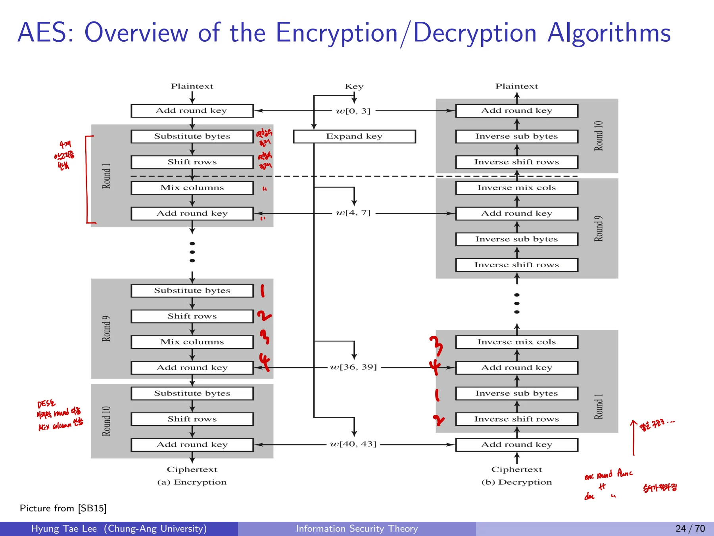
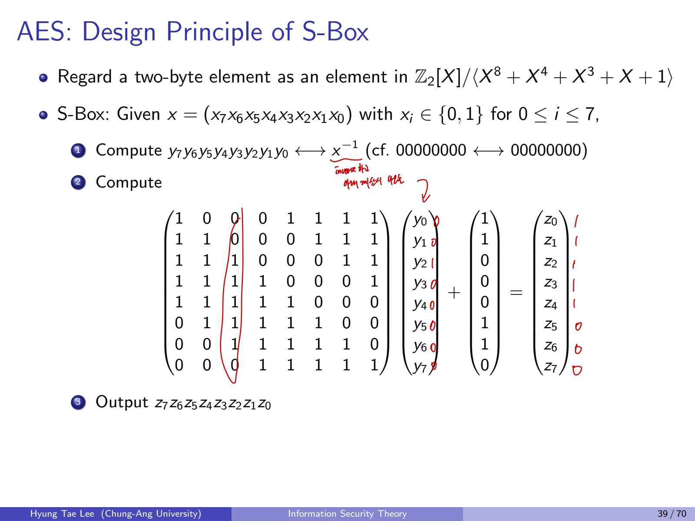
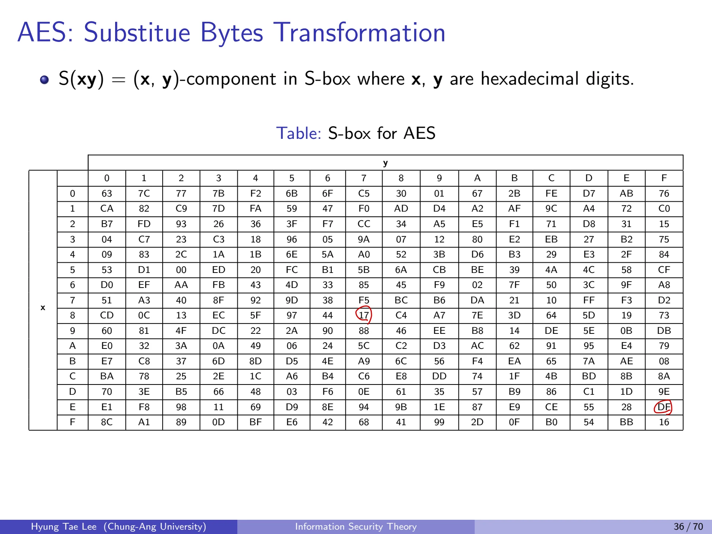
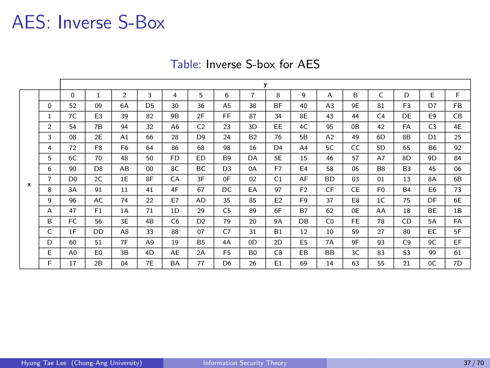
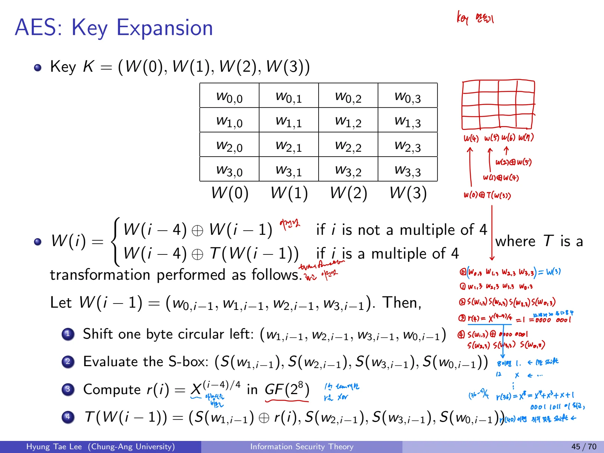

## 1. AES 개요

### 1.1 AES와 Rijndael
AES는 Vincent Rijmen과 Joan Daemen이 개발한 Rijndael 알고리즘을 바탕으로 NIST가 2001년 선정한 블록암호 표준이다.

| 항목 | AES-128 | AES-192 | AES-256 |
| --- | --- | --- | --- |
| 평문 및 암호문 블록 | 128비트 | 128비트 | 128비트 |
| 비밀키 길이 | 128비트 | 192비트 | 256비트 |
| 라운드 수 | 10 | 12 | 14 |
| 내부 구조 | SPN | SPN | SPN |

DES의 Feistel 구조와 달리 AES의 기본 구조는 **Substitution-Permutation Network(SPN)**다. 블록 크기와 키 크기는 별개다. AES에서 블록은 항상 128비트이며, 키에 따라 라운드 수가 달라진다.

### 1.2 16진수 표현과 State
한 바이트는 8비트이고, 4비트 값 하나를 16진수 한 자릿수(0\~9,A\~F)로 표기한다. AES에서는 128비트 입력을 16바이트, 곧 **4행 4열 State** 행렬로 구성한다.
State 예시:

$$
S=
\begin{pmatrix}
\mathrm{EA}&04&65&85\\
83&45&5D&96\\
5C&33&98&B0\\
F0&2D&AD&C5
\end{pmatrix}_{16}.
$$

일반적인 AES 상태 배열은 열 단위로 채워지는 4x4 바이트 행렬이다. 다음 행렬 연산은 평문과 키의 바이트 순서를 명확히 지정해야 정확히 계산된다.

### 1.3 암복호화 순서와 마지막 라운드
암호화 전 단계에서 **AddRoundKey**가 먼저 적용된다. AES-128의 일반 라운드 1\~9는

$$
\text{SubBytes}\to\text{ShiftRows}\to\text{MixColumns}\to\text{AddRoundKey}
$$

순서로 수행한다. **마지막 라운드에는 MixColumns가 없다.** 복호화는 각 변환의 역을 사용하며 라운드키도 역순이다.

## 2. AES의 유한체 $GF(2^8)$

### 2.1 Field와 $GF(p^n)$
체(Field)는 덧셈, 뺄셈, 곱셈, **0이 아닌 원소에 대한 나눗셈**이 가능하고 결합법칙, 교환법칙, 분배법칙을 만족하는 집합이다. 실수와 복소수는 체이나 정수 $\mathbb Z$는 $1/3$이 정수가 아니므로 체가 아니다.
$\mathbb Z_p$는 **p가 소수**인 경우 체가 된다. $GF(p^n)$은 원소가 $p^n$개인 유한체다. 일반적으로 $\mathbb F_p[X]$를 차수 n의 기약다항식으로 나눈 나머지 동치류를 이용해 구성한다.
합동산술에서 나눗셈은 역원 곱셈이다. 합성수를 법으로 삼으면 0이 아닌 어떤 원소에는 역원이 존재하지 않으므로 체가 되지 않는다.

### 2.2 AES의 기약다항식
AES 바이트 연산은 $\mathbb F_2$ 계수 다항식의 몫체를 이용한다.

$$
GF(2^8)\cong \mathbb F_2[X]/(P(X)),
\qquad P(X)=X^8+X^4+X^3+X+1.
$$

바이트 비트열 $b_7b_6\cdots b_0$는 다음 다항식과 대응한다.

$$
b_7X^7+b_6X^6+\cdots+b_1X+b_0,\quad b_i\in\{0,1\}.
$$

예를 들어 $\mathrm{CB}_{16}=11001011_2$는 $X^7+X^6+X^3+X+1$이다.

### 2.3 덧셈은 XOR
계산 예시는

$$
A(X)=X^7+X^6+X^3+X+1,\qquad
B(X)=X^4+X^3+1.
$$

그러면 같은 항끼리 덧셈하면 계수가 0이 되어

$$
A+B=X^7+X^6+X^4+X.
$$

바이트로 표현하면

$$
11001011_2\oplus00011001_2=11010010_2,
\qquad\mathrm{CB}\oplus\mathrm{19}=\mathrm{D2}.
$$

### 2.4 곱셈과 reduction
곱셈은 다항식 곱셈 결과를 구한 후 차수 8 이상의 항을 $P(X)$로 나눈 나머지로 환원한다.

$$
A\otimes B=(A(X)B(X))\bmod P(X).
$$

예를 들어 $X^8\equiv X^4+X^3+X+1\pmod{P(X)}$이므로 가장 높은 차수항을 이 관계로 줄일 수 있다. 모든 덧셈은 $\mathbb F_2$에서 XOR다.
**핵심:** AES에서 곱하기 02는 1비트 왼쪽 이동을 기초로 구현하고, 최고 비트가 1이면 환원 다항식에 따른 XOR을 추가한다. 이 설명은 이후 MixColumns의 02, 03 계수와 연결된다.

## 3. 다항식 Euclidean Algorithm과 역원

### 3.1 Bézout 항등식
체 $\mathbb F$의 다항식 $P(X),A(X)$에 대해 유클리드 알고리즘과 확장 유클리드 알고리즘은

$$
P(X)S(X)+A(X)T(X)=\gcd(P(X),A(X))
$$

를 만족하는 $S,T$를 구한다. $P$가 기약이고 $A\not\equiv0\bmod P$이면 gcd가 1이므로

$$
A(X)T(X)\equiv1\pmod{P(X)},\qquad T(X)=A(X)^{-1}.
$$

### 3.2 일반 나눗셈 절차

$$
R_0=P,\quad R_1=A,\quad R_{i-1}=Q_iR_i+R_{i+1}.
$$

나머지가 0이 될 때까지 반복한다. 마지막 0이 아닌 나머지가 gcd다. 연산은 $\mathbb F_2[X]$에서 수행되므로 빼기 역시 덧셈과 같다.

### 3.3 역원 계산

$$
P=X^8+X^4+X^3+X+1,\qquad A=X^7+X^6+X^3+X+1.
$$

첫 두 나눗셈은 다음과 같다.

$$
P=(X+1)A+(X^6+X^2+X)
$$

$$
A=(X+1)(X^6+X^2+X)+1.
$$

두 번째 식에서

$$
1=A+(X+1)(X^6+X^2+X)
$$

이고 첫 번째 식의 나머지를 대입하면

$$
1=A+(X+1)\bigl(P+(X+1)A\bigr).
$$

$\mathbb F_2$에서 $(X+1)^2=X^2+1$이므로

$$
1=(1+(X+1)^2)A+(X+1)P=X^2A+(X+1)P.
$$

따라서

$$
\boxed{A^{-1}\equiv X^2\pmod{P}}.
$$

**검산:** $A(X)X^2+P(X)(X+1)=1$이라는 Bézout 식을 직접 펼쳐 확인한다.

### 3.4 Extended Euclidean Algorithm의 상태 갱신
초기 계수는

$$
(S_0,T_0)=(1,0),\qquad(S_1,T_1)=(0,1)
$$

이다. 몫 $Q$를 사용하여

$$
S_{i+1}=S_{i-1}-Q_iS_i,\qquad
T_{i+1}=T_{i-1}-Q_iT_i
$$

로 갱신한다. $\mathbb F_2$에서는 빼기가 XOR와 동일하다. 각 단계마다 $R_i=P S_i+A T_i$ 불변식을 유지한다. 이 불변식은 수학적 귀납법으로 증명할 수 있다.

## 4. SubBytes 및 AES S-box

### 4.1 SubBytes
State의 각 바이트를 독립적으로 8비트 S-box에 넣는다. 위치를 바꾸는 ShiftRows와 달리 **바이트 값 자체를 비선형으로 변환**한다.
예시는:

$$
\begin{pmatrix}
EA&04&65&85\\
83&45&5D&96\\
5C&33&98&B0\\
F0&2D&AD&C5
\end{pmatrix}
\mapsto
\begin{pmatrix}
87&F2&4D&97\\
EC&6E&4C&90\\
4A&C3&46&E7\\
8C&D8&95&A6
\end{pmatrix}_{16}.
$$

### 4.2 S-box의 수학적 구성
입력 $x\in GF(2^8)$에 대하여 먼저 곱셈 역원 $x^{-1}$을 구한다. 단 $x=0$은 별도로 0에 대응한다. 그다음 비트벡터에 **고정된 affine transformation**을 적용한다.

$$
\mathbf z=A\mathbf y\oplus\mathbf c,\qquad
\mathbf y=\operatorname{bits}(x^{-1}),\quad \mathbf c=(01100011)_2.
$$

이 변환에서 $A$는 아래의 8×8 이진 행렬이다.

예시:

- $S(00)=63$

- $S(01)=7C$

- $S(CB)=1F$ (역원이 04이고 affine transformation을 적용)

단순히 256개 값을 암기하는 대신 **유한체 역원 계산과 affine map**의 두 단계가 핵심이다.

### 4.3 S-box와 Inverse S-box

S-box는 바이트의 상위 16진수 한 자리를 행, 하위 한 자리를 열로 읽는다. 예를 들어 입력 `EA`는 E행 A열의 `87`로 치환된다. 역 S-box는 이 대응을 반대로 되돌린다.

## 5. ShiftRows
State의 네 행을 각각 **왼쪽으로 0, 1, 2, 3바이트씩 순환 이동**한다. 역변환은 오른쪽 순환 이동이다.
예시:

$$
\begin{pmatrix}
87&F2&4D&97\\
EC&6E&4C&90\\
4A&C3&46&E7\\
8C&D8&95&A6
\end{pmatrix}
\mapsto
\begin{pmatrix}
87&F2&4D&97\\
6E&4C&90&EC\\
46&E7&4A&C3\\
A6&8C&D8&95
\end{pmatrix}.
$$

첫 행은 바뀌지 않는다는 점과, 같은 바이트라도 행에 따라 이동량이 다르다는 점을 확인한다.

## 6. MixColumns

### 6.1 행렬 연산
한 열의 네 바이트를 $GF(2^8)$의 원소로 보고 고정된 4x4 행렬을 곱한다. 네 출력 바이트가 각 열의 모든 입력 바이트에 의존하도록 **확산(diffusion)**한다.

$$
\begin{pmatrix}d_0\\d_1\\d_2\\d_3\end{pmatrix}
=
\begin{pmatrix}
02&03&01&01\\
01&02&03&01\\
01&01&02&03\\
03&01&01&02
\end{pmatrix}
\begin{pmatrix}c_0\\c_1\\c_2\\c_3\end{pmatrix}.
$$

행렬 곱셈은 보통 정수 연산이 아니라 $GF(2^8)$에서 수행한다. 역 MixColumns는 위 행렬의 **역행렬**을 이용한다.

### 6.2 예제의 첫 번째 열
입력의 첫 열은 $(87,6E,46,A6)^T$이고, 출력은 $(47,37,94,ED)^T$이다.

$$
d_0=(02\otimes87)\oplus(03\otimes6E)\oplus46\oplus A6=47.
$$

다항식으로 같은 계산을 전개하면,

$$
X(X^7+X^2+X+1)+(X+1)(X^6+X^5+X^3+X^2+X)
+(X^6+X^2+X)+(X^7+X^5+X^2+X)
$$

$$
=X^8+X^6+X^4+X^3+X^2
\equiv X^6+X^2+X+1
\equiv01000111_2=\mathrm{47}.
$$

같은 방식으로 다른 열도 계산한다. 전체 예시 출력:

$$
\begin{pmatrix}
47&40&A3&4C\\
37&D4&70&9F\\
94&E4&3A&42\\
ED&A5&A6&BC
\end{pmatrix}.
$$

## 7. AddRoundKey
현재 State의 128비트와 같은 크기의 round key를 **비트별 XOR**한다.

$$
S_{\mathrm{next}}=S\oplus K_{\mathrm{round}}.
$$

XOR을 두 번 하면 제자리로 돌아오므로 역연산 또한 같은 키로 XOR하는 것이다.
첫 바이트 예시:

$$
\mathrm{47}\oplus\mathrm{AC}=\mathrm{EB}
$$

전체 연산:

$$
\begin{pmatrix}
47&40&A3&4C\\37&D4&70&9F\\94&E4&3A&42\\ED&A5&A6&BC
\end{pmatrix}
\oplus
\begin{pmatrix}
AC&19&28&57\\77&FA&D1&5C\\66&DC&29&00\\F3&21&41&6E
\end{pmatrix}
=
\begin{pmatrix}
EB&59&8B&1B\\40&2E&A1&C3\\F2&38&13&42\\1E&84&E7&D2
\end{pmatrix}.
$$

AES 라운드 변환 중 비밀키 값을 직접 쓰는 부분이 AddRoundKey라는 점.

## 8. AES-128 Key Expansion

### 8.1 4바이트 Word
AES-128 비밀키 128비트는 네 개의 4바이트 word로 시작한다.

$$
K=(W^{(0)},W^{(1)},W^{(2)},W^{(3)}).
$$

다음 word는 앞선 4칸의 word와 바로 직전 word를 조합한다.

$$
W^{(i)}=
\begin{cases}
W^{(i-4)}\oplus W^{(i-1)},&i\not\equiv0\pmod4,\\
W^{(i-4)}\oplus T(W^{(i-1)}),&i\equiv0\pmod4.
\end{cases}
$$

### 8.2 $T$ 변환의 단계

1. **RotWord:** word를 왼쪽으로 한 바이트 회전

2. **SubWord:** 회전 결과의 네 바이트에 AES S-box 적용

3. **Rcon:** 맨 앞 바이트에 라운드 상수 $r(i)$를 XOR

$$
T(w_0,w_1,w_2,w_3)
=
(S(w_1)\oplus r_i,\ S(w_2),\ S(w_3),\ S(w_0)).
$$

라운드 상수는 2원체에서 지수 연산한 값으로 구한다. $W^{(4)}$부터 $W^{(43)}$까지 만들어 최초 키 포함 총 11개 라운드 키를 사용한다.
네 word마다 특수한 $T$가 개입한다는 점, Shift/Rotate와 S-box, Rcon이 서로 다른 단계임을 구별해야 한다.

## 9. AES 안전성과 블록 암호 비교
AES-128의 전수 탐색 공간은 $2^{128}$. 2011년에는 Bogdanov, Khovratovich, Rechberger가 Biclique 공격을 제시했다.

| AES 버전 | Biclique 공격의 계산복잡도 |
| --- | --- |
| AES-128 | 약 $2^{126.1}$ |
| AES-192 | 약 $2^{189.7}$ |
| AES-256 | 약 $2^{254.4}$ |

이는 이론적인 공격 복잡도로, 곧바로 실용적인 암호 해독 가능성을 뜻하지 않는다.

| 항목 | DES | Triple DES | AES |
| --- | --- | --- | --- |
| 블록 크기 | 64비트 | 64비트 | 128비트 |
| 키 크기 | 56비트 | 112 또는 168비트 | 128/192/256비트 |
| 라운드 | 16 | DES 연산 3회 | 10/12/14 |
| 구조 | Feistel | Feistel 기반 EDE | SPN |

## 이어서 읽기

- 이전 글: [03. 블록 암호, Feistel, DES와 Triple DES](/posts/basic-cryptography-block-ciphers-feistel-des/)
- 다음 글: [05. 스트림 암호, 난수 생성과 RC4](/posts/basic-cryptography-stream-ciphers-rc4/)
