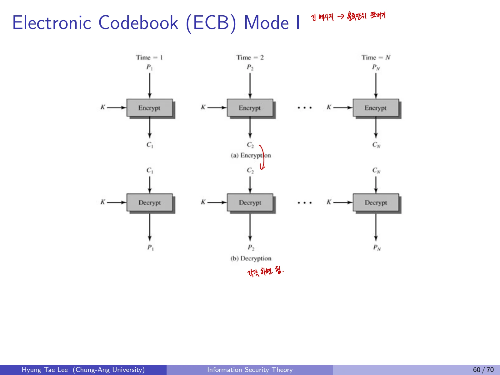
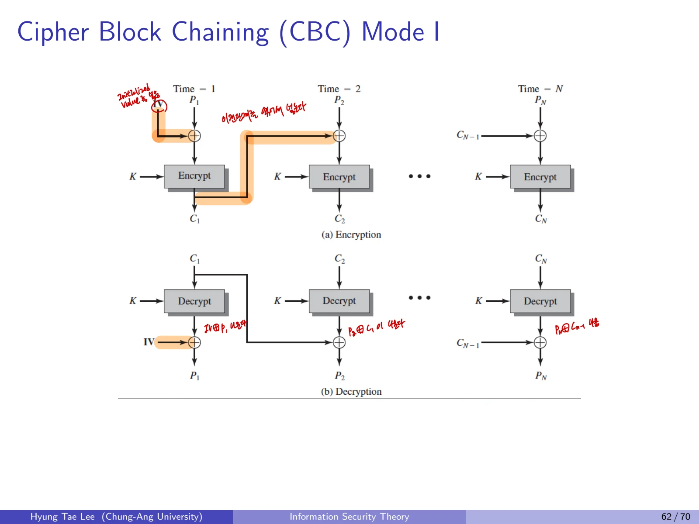
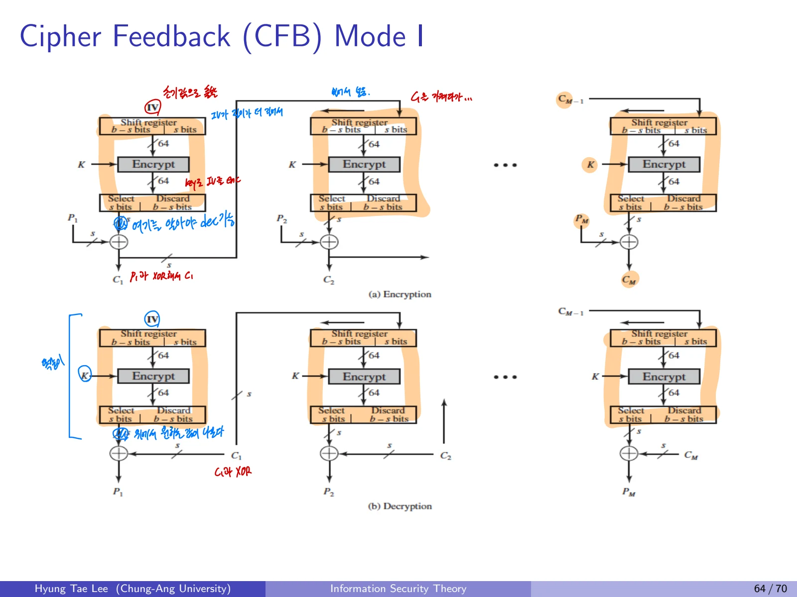
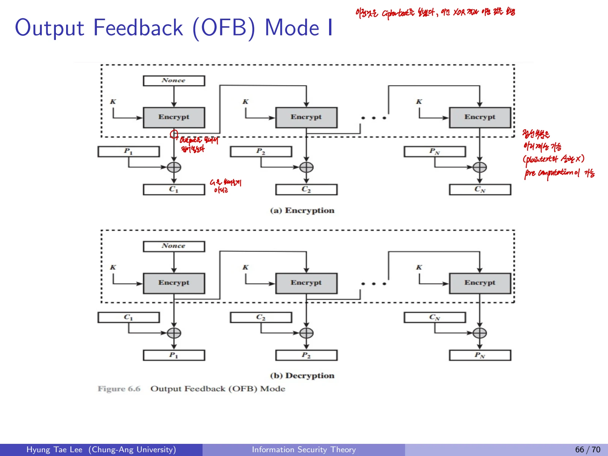
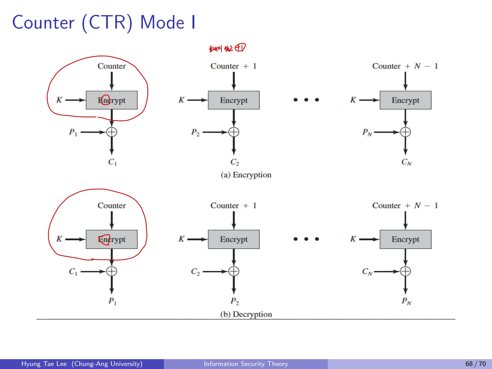

## 1. 운용 모드가 필요한 이유
DES, AES 같은 블록암호는 고정 길이의 블록만 처리한다. 길이가 다양한 실제 메시지를 여러 블록으로 나누어 암복호화하는 절차가 **Mode of Operation**이다.

- ECB(Electronic Codebook)

- CBC(Cipher Block Chaining)

- CFB(Cipher Feedback)

- OFB(Output Feedback)

- CTR(Counter)

기호는 평문 $P_i$, 암호문 $C_i$, 블록암호의 암호화 $E_K$, 복호화 $D_K$, 초기화 벡터 $IV$로 통일한다.

## 2. ECB Mode

$$
C_i=E_K(P_i),\qquad P_i=D_K(C_i).
$$

암호화할 때 다른 블록을 참고하지 않으므로 가장 단순한 방식이다.
**장점**

1. 각 블록이 독립적이며 블록 간 동기화가 필요하지 않다.

2. 전송 오류는 해당 암호문 블록의 복호화 결과에만 영향을 준다.

3. 여러 블록을 병렬로 암호화하고 복호화할 수 있다.
**단점**

1. 같은 키로 같은 평문 블록을 암호화하면 같은 암호문 블록이 나온다. **Deterministic Encryption**이라는 약점이 있다.

2. 반복 패턴이 그대로 나타난다.

3. 은행 계좌 예처럼 특정 암호문 블록을 다른 블록으로 교체하는 **Substitution Attack**이 가능하다.

각 블록이 독립이므로 중간 블록을 바꿔도 다른 블록의 복호화에는 영향을 주지 않는다.

## 3. CBC Mode

### 3.1 암호화
평문 블록을 직전 암호문 블록과 XOR한 뒤 블록암호에 넣는다. 첫 블록에서는 직전 암호문 대신 IV를 사용한다.

$$
C_0=IV,\qquad C_i=E_K(P_i\oplus C_{i-1}).
$$

첫 블록만 별도로 쓰면

$$
C_1=E_K(P_1\oplus IV).
$$

### 3.2 복호화
현재 암호문을 먼저 블록 복호화한 다음 직전 암호문을 XOR한다.

$$
P_i=D_K(C_i)\oplus C_{i-1}.
$$

첫 블록은

$$
P_1=D_K(C_1)\oplus IV.
$$

**핵심 구별:** CBC의 연결은 **이전 평문이나 키스트림이 아니라 이전 암호문**을 입력에 사용한다는 뜻이다.

### 3.3 성질과 공격

- IV가 바뀌면 같은 평문에서도 다른 암호문이 나올 수 있다.

- **예측 불가능한 IV**가 필요하다.

- 암호화는 이전 블록을 기다려야 하므로 순차적이다.

- 복호화 단계의 $D_K(C_i)$는 블록별 병렬화할 수 있다.

- $C_i$의 비트 오류가 있으면 $P_i$는 넓게 훼손되고, 다음 $P_{i+1}$의 해당 비트 위치가 바뀐다.

- CBC가 **메시지 인증을 제공하는 것은 아니며**, 예측 가능한 IV, 인증 없는 메시지, 잘못된 패딩 오류 처리 등은 공격면이 될 수 있다.

첫 블록은 IV와, 이후 블록은 직전 암호문과 XOR한다.

## 4. CFB Mode

### 4.1 블록암호를 스트림암호처럼 사용
이전 암호문을 블록암호의 암호화 함수에 입력하고, 출력에서 s비트를 취해 평문 s비트와 XOR한다.

$$
C_1=P_1\oplus F_s(E_K(IV)).
$$

전체 블록을 한 세그먼트로 사용하는 경우에는

$$
C_i=P_i\oplus F_s(E_K(C_{i-1})),\quad i>1,
$$

$$
P_i=C_i\oplus F_s(E_K(C_{i-1})).
$$

$F_s$는 결과의 **처음 s비트만 취하는 함수**이다.
s가 블록 크기보다 작은 일반 CFB에서는 직전 암호문 블록 전체가 아닌 **시프트 레지스터**를 사용한다. 레지스터의 앞 s비트를 제거하고 새 암호문 s비트를 뒤에 넣는다. 따라서 $C_{i-1}$ 표현을 모든 s비트 CFB에 그대로 확장하면 안 된다.

### 4.2 성질

- 암호화와 복호화 양쪽에서 **블록암호의 Encryption 함수 **$E_K$를 사용

- 피드백 대상은 **이전 Ciphertext**

- IV를 초기 입력으로 사용

- 스트림암호처럼 XOR로 암복호화

- 전송 오류는 해당 세그먼트와 뒤이어 들어오는 제한된 범위의 세그먼트에 영향을 줌

- 암호화는 피드백 때문에 기본적으로 순차 처리

CFB와 OFB는 그림이 비슷하지만 **이전에 생성한 암호문을 다시 넣는지, 암호화 함수의 출력을 넣는지**를 구별한다.

## 5. OFB Mode

### 5.1 키스트림 생성
OFB는 암호문이 아니라 **이전 블록암호 출력**을 다음 라운드의 입력으로 사용한다.

$$
X_0=IV,\qquad X_i=E_K(X_{i-1}).
$$

$$
C_i=P_i\oplus X_i,\qquad P_i=C_i\oplus X_i.
$$

### 5.2 성질

- CFB와 같이 블록암호를 이용해 스트림암호처럼 동작

- 피드백 대상은 **암호문이 아니라 키스트림 **$X_i$

- 평문과 무관하게 $X_i$를 미리 계산 가능

- 다만 $X_i$는 $X_{i-1}$에 의존하기 때문에 연속 키스트림 생성은 순차적

- 암호문 한 비트 전송 오류는 해당 평문 비트에만 영향

- **같은 키와 IV로 두 메시지를 암호화하면 동일 키스트림이 생기므로 위험**

CFB는 암호문을, OFB는 암호화 함수의 출력을 다음 단계로 되돌려 보낸다.

## 6. CTR Mode

### 6.1 카운터 블록 암호화
이전 암호문이나 키스트림을 사용할 필요가 없다. 블록 인덱스가 추가된 카운터 블록을 암호화해 키스트림을 만든다.

$$
X_i=E_K(CTR+i-1).
$$

$$
C_i=P_i\oplus X_i,\qquad P_i=C_i\oplus X_i.
$$

여기서 $CTR+i-1$은 실제 구현에서 **고정 크기 블록의 증가 규칙**으로 정의한다.

### 6.2 특징

- 이전 암호문에 의존하지 않으므로 **암호화/복호화 모두 병렬화 가능**

- 평문이 없어도 키스트림을 **사전 계산 가능**

- 같은 키로 **카운터 블록을 재사용**하면 같은 키스트림 반복

- 암호문 비트 오류는 복호화된 평문의 같은 비트 위치만 바꾼다.

- 카운터 오버플로, 키/nonce/카운터 쌍의 유일성이 중요하다.

CTR은 이전 블록의 결과를 기다리지 않아도 된다는 점을 강조한다.

## 7. 운용 모드 비교표

| 모드 | 입력에 재사용하는 값 | 초기값 | 암호화 병렬화 | 사전 키스트림 계산 | 주요 위험 |
| --- | --- | --- | --- | --- | --- |
| ECB | 아무것도 없음 | 불필요 | 가능 | 해당 없음 | 동일 블록 패턴 및 블록 교체 |
| CBC | 이전 암호문 | IV | 불가 | 불가 | IV 예측과 무결성 미보장 |
| CFB | 이전 암호문/피드백 레지스터 | IV | 기본적으로 순차 | 불가 | 오류 전파, 재사용 |
| OFB | 이전 암호화 함수 출력 | IV | 키스트림 순차 | 가능 | 동일 키스트림 재사용 |
| CTR | Counter block | nonce/초기값 | 가능 | 가능 | Counter 중복 |

### 오류 전파를 함께 비교

- ECB: 오류가 포함된 암호문 블록 하나의 복호화에 영향

- CBC: 해당 평문 블록을 크게 훼손하며 다음 블록의 같은 위치 비트도 바뀜

- CFB: 오류가 들어간 세그먼트와 피드백 창에 걸친 뒤따르는 세그먼트에 영향

- OFB: 오류가 발생한 평문 비트에만 영향

- CTR: 오류가 발생한 평문 비트에만 영향

## 8. 현대적인 보충: 기밀성과 인증
다섯 가지 모드는 기본적으로 **기밀성**을 제공하는 구성이다. 공격자가 암호문을 변경했는지 확인하는 **무결성/인증**은 별개이다. 현대 신규 시스템에서는 AEAD인 AES-GCM 등 인증된 암호화를 고려한다.

## 이어서 읽기

- 이전 글: [05. 스트림 암호, 난수 생성과 RC4](/posts/basic-cryptography-stream-ciphers-rc4/)
- 다음 글: [07. 공개키 암호와 안전성 모델](/posts/basic-cryptography-public-key-security-models/)
