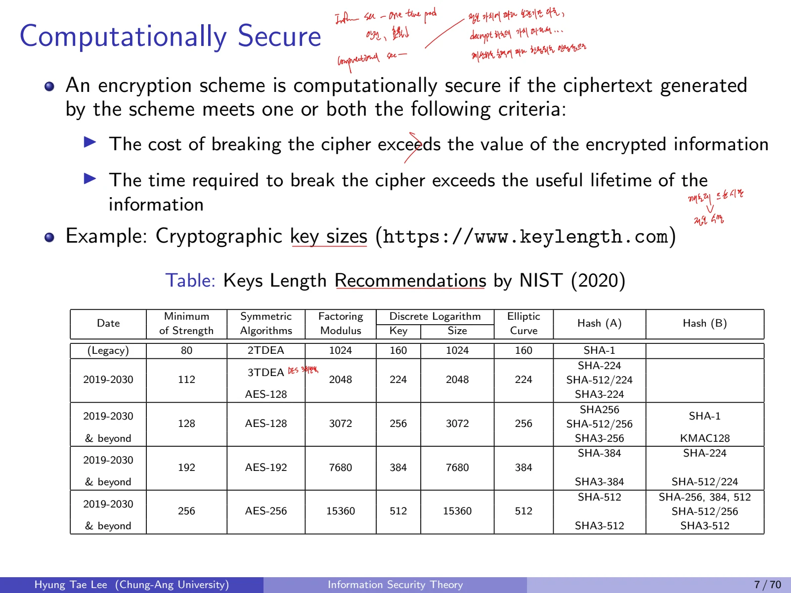
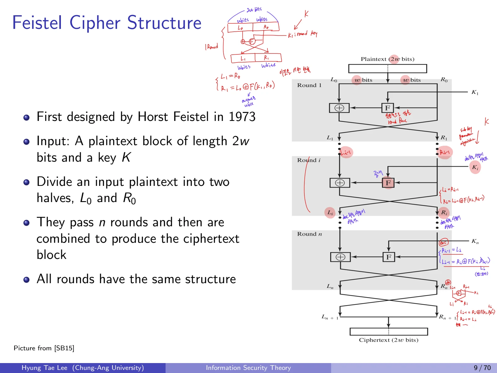
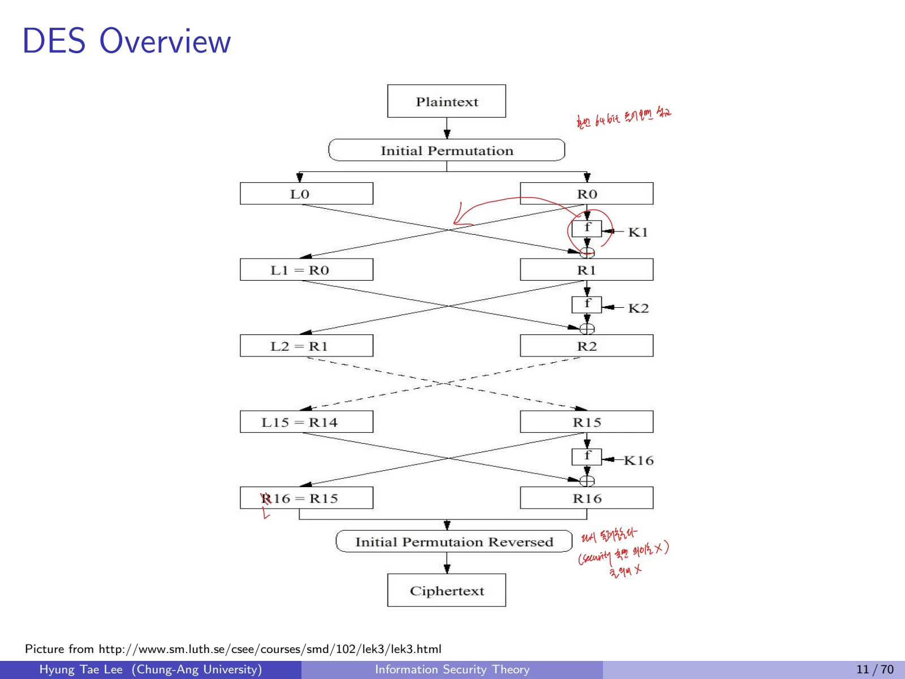
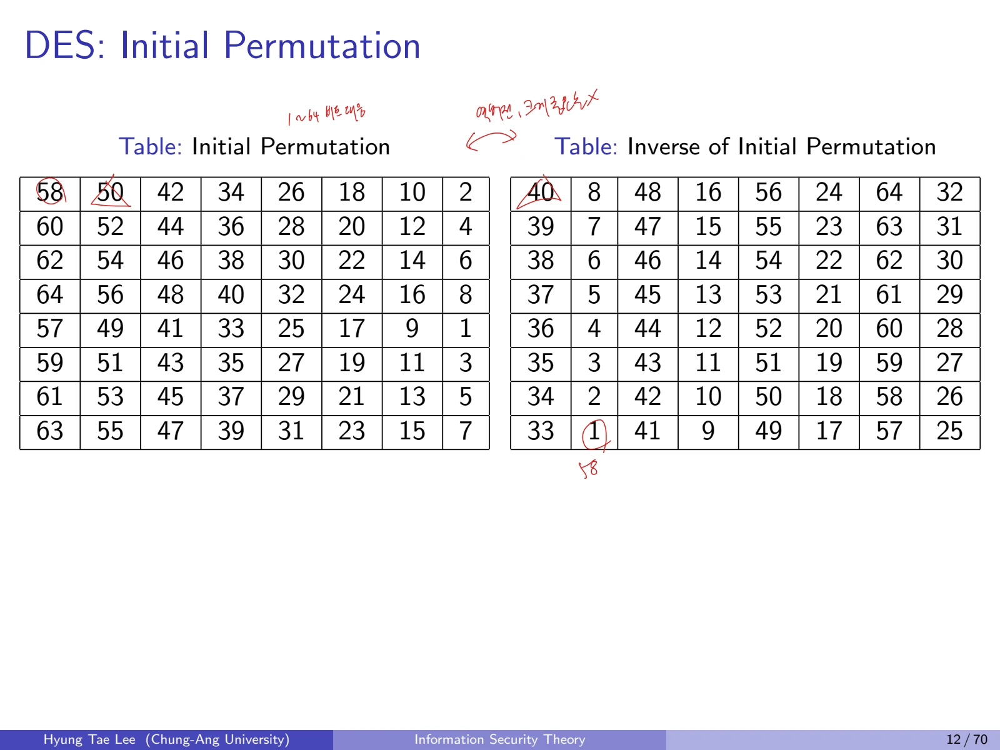
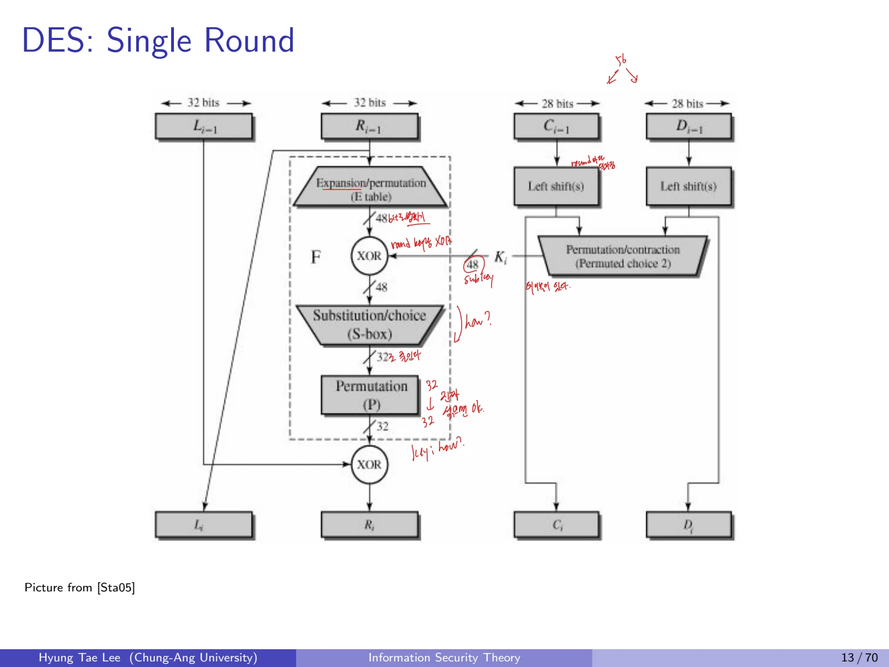
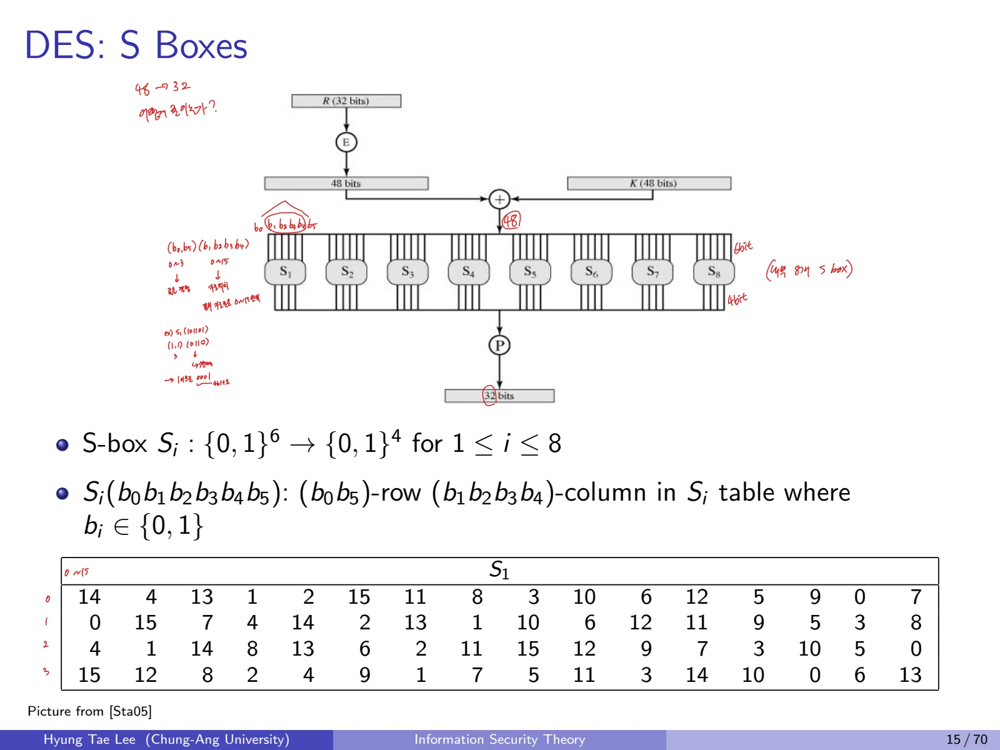
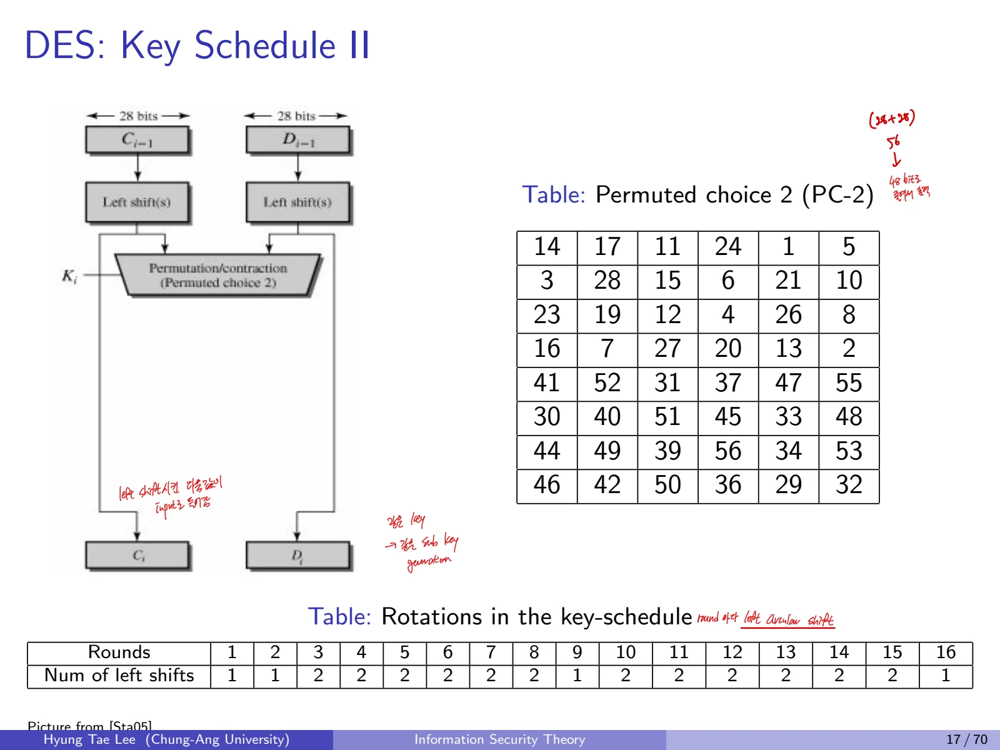
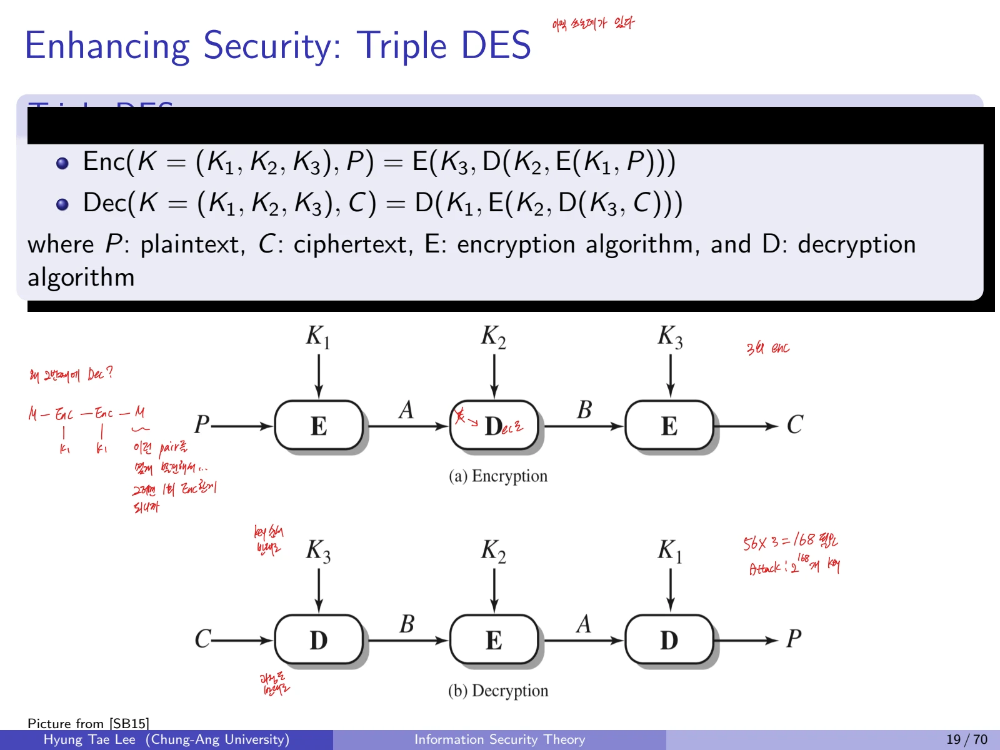

## 1. 대칭키 암호와 블록 암호

### 1.1 대칭키 암호의 정의
대칭키 암호에서는 송신자와 수신자가 같은 비밀키를 공유한다. 현대 대칭키 암호는 데이터를 일정한 길이로 묶어 처리하는 블록암호와 키스트림을 이용하는 스트림암호로 구분할 수 있다. 공개키 암호보다 일반적으로 빠르지만, 키를 안전하게 공유하고 관리해야 한다.

고전적인 치환·순열 암호도 공유된 비밀키를 사용한다. 블록암호의 예로 DES, AES, ARIA, SEED가 있고 스트림암호의 예로 RC4와 ChaCha가 있다.

| 비교 | 블록암호(Block Cipher) | 스트림암호(Stream Cipher) |
| --- | --- | --- |
| 입력 | 일정한 길이의 블록 | 연속적인 입력 요소 |
| 출력 | 블록 단위의 결과 | 요소 단위의 결과 |
| 키 사용 | 안전한 운용 모드 아래 키 재사용 가능 | 같은 키스트림 재사용 금지 |
| 대표 사례 | DES, AES, ARIA, SEED | LFSR cipher, RC4, ChaCha |
| 특징 | 더 일반적으로 사용 | 대체로 빠르며 연속적 처리 |

블록 단위 처리와 키 재사용 가능성을 구분한다. 스트림암호에서는 **같은 키스트림을 두 메시지에 재사용하면 안 된다**. 현대 암호의 nonce 기반 스트림암호는 장기 키 자체를 재사용할 수 있어 표현을 구별해야 한다.

### 1.2 블록암호의 설계 기준
대칭 블록암호는 **Substitution과 Permutation**이 키에 의해 제어되는 라운드들을 반복한다. 설계 매개변수는 다음 일곱 가지다.

1. Block size: 처리하는 블록의 크기

2. Key size: 전수 탐색 공간 등 안전성을 좌우하는 키 길이

3. Number of rounds: 치환, 확산이 반복되는 횟수

4. Subkey generation algorithm: 라운드 키 도출 방법

5. Round function: 한 라운드가 입력에 적용하는 연산

6. Fast software/hardware encryption/decryption: 구현 성능

7. Ease of security analysis: 수학적으로 공격을 분석하기 쉬운지 여부

### 1.3 Computational Security
계산적으로 안전하다는 것은 해독 자체가 불가능하다는 뜻은 아니다. 공격에 필요한 비용이나 시간이 다음 조건 중 하나 이상을 만족한다는 뜻이다.

- 암호 해독 비용이 암호화한 정보의 가치보다 큼

- 암호 해독 시간이 정보의 유효 수명보다 김



표의 대표 항목:

| 강도 | 대칭키 예 | RSA 모듈러스 | ECC 군 크기 |
| --- | --- | --- | --- |
| 80비트, 레거시 | 2TDEA | 1024 | 160 |
| 112비트 | 3TDEA, AES-128 | 2048 | 224 |
| 128비트 | AES-128 | 3072 | 256 |
| 192비트 | AES-192 | 7680 | 384 |
| 256비트 | AES-256 | 15360 | 512 |

위 표는 **2020년 시점의 보안강도 비교**다. TDEA는 현재 신규 시스템에 권장되는 방식이 아니다.

## 2. Feistel Cipher Structure
1973년 Horst Feistel이 제안한 구조로, 길이가 $2w$비트인 입력을 $w$비트씩 왼쪽과 오른쪽 절반으로 나누어 여러 라운드를 처리한다.

$$
P=L_0\parallel R_0
$$

$$
L_i=R_{i-1},\qquad R_i=L_{i-1}\oplus F(R_{i-1},K_i)
$$

- $K_i$는 $i$번째 라운드 키

- $F$는 임의의 라운드 함수로, 반드시 가역일 필요가 없음

- 같은 구조를 n번 반복하여 결과를 결합

이전 상태는 다음 식으로 복원한다.

$$
R_{i-1}=L_i,\qquad L_{i-1}=R_i\oplus F(L_i,K_i)
$$

암호화와 복호화는 좌우 $L,R$을 교환하는 구조를 공유한다. 라운드 키를 역순으로 적용하면 같은 구조로 복호화할 수 있다.



## 3. Data Encryption Standard (DES)

### 3.1 개요
DES는 1977년 NBS(현 NIST)가 FIPS PUB 46으로 채택했다.

- 평문 및 암호문 블록: **64비트**

- 유효 키: **56비트**(64비트 키 형식에서 8비트는 패리티)

- **16라운드 Feistel 구조**

- 매 라운드에 48비트 subkey 하나, 전체 16개 subkey

- 암호화: $K_1,K_2,\ldots,K_{16}$

- 복호화: $K_{16},K_{15},\ldots,K_1$



### 3.2 DES 전체 처리

$$
P_{64}\xrightarrow{IP}(L_0,R_0)\xrightarrow{16\ \mathrm{rounds}}(R_{16},L_{16})\xrightarrow{IP^{-1}}C_{64}
$$

첫 Initial Permutation(IP)은 비트의 순서를 바꾸는 공개된 고정표이다. 첫 출력 비트는 입력의 58번째 비트가 된다. 마지막에는 역순열 $IP^{-1}$을 적용한다.

**Initial Permutation (IP)**
```text
58 50 42 34 26 18 10  2
60 52 44 36 28 20 12  4
62 54 46 38 30 22 14  6
64 56 48 40 32 24 16  8
57 49 41 33 25 17  9  1
59 51 43 35 27 19 11  3
61 53 45 37 29 21 13  5
63 55 47 39 31 23 15  7
```

**Inverse Initial Permutation**
```text
40  8 48 16 56 24 64 32
39  7 47 15 55 23 63 31
38  6 46 14 54 22 62 30
37  5 45 13 53 21 61 29
36  4 44 12 52 20 60 28
35  3 43 11 51 19 59 27
34  2 42 10 50 18 58 26
33  1 41  9 49 17 57 25
```



### 3.3 DES 한 라운드

$$
F(R,K)=P(S(E(R)\oplus K)).
$$

1. Expansion Permutation $E$: 32비트를 48비트로 확장한다.

2. 48비트 subkey $K_i$와 XOR 한다.

3. 48비트를 6비트씩 8개로 나눠 S-box 8개를 각각 통과한다.

4. 각 S-box의 4비트 출력 8개를 합쳐 32비트를 얻는다.

5. Permutation $P$로 32비트의 위치를 섞는다.

6. 왼쪽 32비트와 XOR하여 라운드 출력을 구성한다.

**Expansion Permutation $E$, 32 → 48비트**
```text
32  1  2  3  4  5
 4  5  6  7  8  9
 8  9 10 11 12 13
12 13 14 15 16 17
16 17 18 19 20 21
20 21 22 23 24 25
24 25 26 27 28 29
28 29 30 31 32  1
```

**Permutation $P$, 32 → 32비트**
```text
16  7 20 21 29 12 28 17
 1 15 23 26  5 18 31 10
 2  8 24 14 32 27  3  9
19 13 30  6 22 11  4 25
```



### 3.4 DES S-Boxes
각 S-box는 6비트 입력을 4비트 출력으로 변환한다.

$$
S_i:\{0,1\}^{6}\rightarrow\{0,1\}^{4},\quad 1\le i\le8.
$$

입력 $b_0b_1b_2b_3b_4b_5$에 대해 **행은 바깥 두 비트** $b_0b_5$, **열은 가운데 네 비트** $b_1b_2b_3b_4$를 이진수로 읽어 구한다.
$S_1$ 전체 표:
```text
row/col  0  1  2  3  4  5  6  7  8  9 10 11 12 13 14 15
0       14  4 13  1  2 15 11  8  3 10  6 12  5  9  0  7
1        0 15  7  4 14  2 13  1 10  6 12 11  9  5  3  8
2        4  1 14  8 13  6  2 11 15 12  9  7  3 10  5  0
3       15 12  8  2  4  9  1  7  5 11  3 14 10  0  6 13
```
입력 101101은 row=11₂=3, column=0110₂=6이므로 $S_1[3,6]=1$, 출력 비트는 0001. 나머지 $S_2$부터 $S_8$까지는 각각 다른 테이블을 쓴다.



### 3.5 DES Key Schedule
먼저 64비트 키 형식에 **PC-1**을 적용해 56비트의 $(C_0,D_0)$, 즉 28비트 반쪽 두 개를 만든다.

**PC-1, 64 -\> 56비트**
```text
LEFT HALF            RIGHT HALF
57 49 41 33 25 17  9 | 63 55 47 39 31 23 15
 1 58 50 42 34 26 18 |  7 62 54 46 38 30 22
10  2 59 51 43 35 27 | 14  6 61 53 45 37 29
19 11  3 60 52 44 36 | 21 13  5 28 20 12  4
```
각 라운드에서 $C,D$를 지정 횟수만큼 왼쪽으로 순환 이동하고, **PC-2**로 48비트를 선택한다.

$$
C_i=\operatorname{RotL}_{s_i}(C_{i-1}),\quad D_i=\operatorname{RotL}_{s_i}(D_{i-1}),\quad K_i=PC2(C_i\parallel D_i).
$$

**PC-2, 56 -\> 48비트**
```text
14 17 11 24  1  5
 3 28 15  6 21 10
23 19 12  4 26  8
16  7 27 20 13  2
41 52 31 37 47 55
30 40 51 45 33 48
44 49 39 56 34 53
46 42 50 36 29 32
```

**각 라운드의 왼쪽 순환 이동 수**
```text
ROUND: 1 2 3 4 5 6 7 8 9 10 11 12 13 14 15 16
SHIFT: 1 1 2 2 2 2 2 2 1  2  2  2  2  2  2  1
```
PC-1에서 56비트가 되고, PC-2에서 48비트를 추출한다. 키 스케줄의 회전 횟수는 항상 2가 아니라, 1/2/9/16라운드에서는 1회다.


### 3.6 DES Security Analysis
S-box가 비선형 연산을 제공하고, 나머지의 상당 부분은 선형적인 재배열, XOR로 구성된다.

- Brute-force 탐색 공간: $2^{56}$개 유효 키

- 1993년 CRYPTO에서 Michael Wiener의 10만 달러 설계안(예상 1.5일)

- 1998년 EFF의 25만 달러 탐색 기계(약 56시간)

- 1999년 RSA Laboratories가 약 22시간 15분 만에 키 발견

- Mitsuru Matsui의 Linear Cryptanalysis: 평문/암호문 약 $2^{43}$쌍 수집에 40일, 키 탐색에 10일이 걸렸다는 사례가 있다.

위 수치는 당시 장비를 기준으로 한 **역사적 사례**다.

## 4. Triple DES (TDEA)

### 4.1 EDE: Encrypt-Decrypt-Encrypt
키 $(K_1,K_2,K_3)$를 순서대로 사용하는 세 번의 DES 연산이다.

$$
C=E_{K_3}(D_{K_2}(E_{K_1}(P)))
$$

$$
P=D_{K_1}(E_{K_2}(D_{K_3}(C))).
$$

두 키만 사용하는 옵션은 $K_1=K_3$이며, 모든 키가 같으면 한 번의 DES와 같아지는 호환성을 갖는다.

### 4.2 역사, 장점과 약점

- 1985년 ANSI X9.17 금융 응용에 표준화

- 1999년 FIPS PUB 46-3에 포함

- 64비트 블록 길이 유지

- 3개 DES 키를 사용할 때 단순 키 길이 합계 168비트, 2-key 옵션에서는 112비트

- DES를 기반으로 하여 기존 구현 재활용 가능

- DES보다 훨씬 높은 전수 탐색 비용을 제공하지만 **168비트와 동일한 보안강도를 뜻하지는 않음**

- 64비트 블록의 한계, 느린 소프트웨어 속도, meet-in-the-middle 공격 고려 필요

세 번 사용해도 **블록 크기는 64비트 그대로**이고 키 크기만 증가한다. EDE의 가운데는 *decryption*임을 구분한다.



## 5. 단원 정리

| 구분 | Feistel 구조 | DES | Triple DES |
| --- | --- | --- | --- |
| 성격 | 설계 구조 | 표준화된 블록암호 | DES의 EDE 반복 |
| 블록 | 일반적으로 $2w$비트 | 64비트 | 64비트 |
| 라운드 | 구조에 따라 설정 | 16라운드 | DES 3회 |
| 키 | 설계에 따라 설정 | 유효 56비트 | 형식상 112/168비트 |
| 암복호화 차이 | 라운드 역순으로 처리 | 라운드 키 역순 | 세 연산을 역순으로 복원 |
