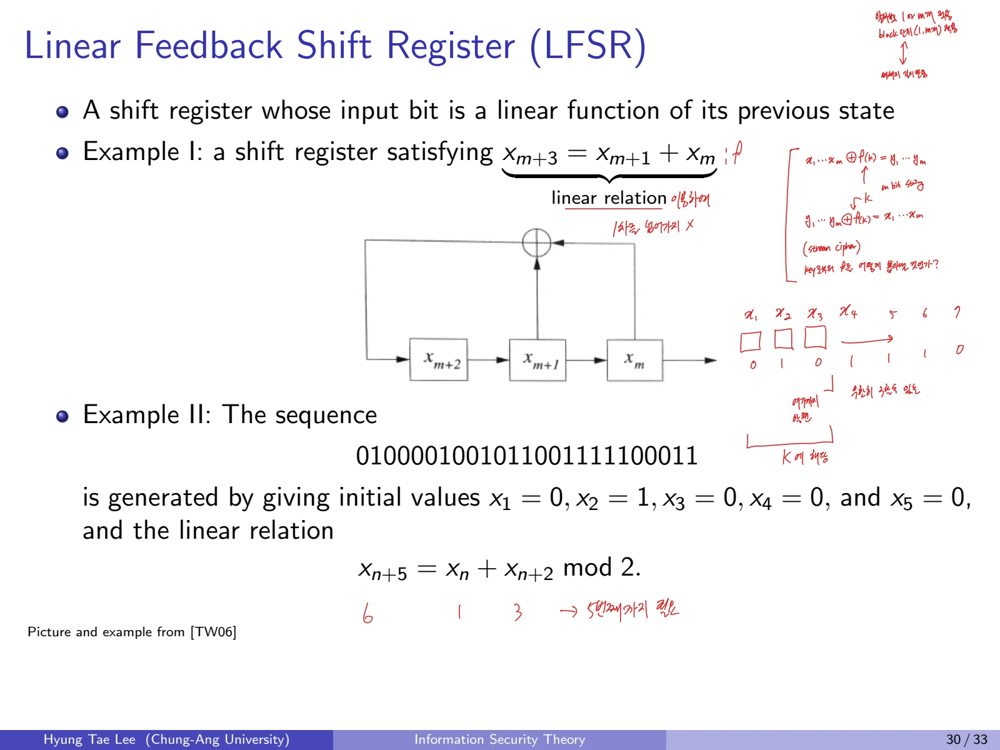

암호의 키 공간이 크다고 해서 반드시 안전한 것은 아니다. 문자 빈도나 선형 관계가 남아 있으면 키를 전부 시도하지 않고도 평문을 알아낼 수 있다. 고전암호와 LFSR을 살펴보고, OTP가 완전비밀성을 갖는 조건까지 비교해 보자.

## 1. 수학적 표기와 알파벳 표현

### 1.1 모듈러 연산
정수 m에 대해 나머지 집합을 다음처럼 정의한다.

$$
\mathbb{Z}_m=\{0,1,\ldots,m-1\}.
$$

암호화된 글자는 영어 알파벳을 정수로 치환하여 다룬다.

$$
a\mapsto0,\quad b\mapsto1,\quad \ldots,\quad z\mapsto25,
\qquad P=C=\mathbb{Z}_{26}.
$$

$$
10\bmod3=1,\qquad729\bmod31=16,\qquad(-7)\bmod26=19.
$$

마지막 결과에서 음수의 나머지를 음수로 남겨 두지 않는다. 0에서 25 사이의 대표값으로 취해 -7과 19가 모듈러 26에서 동치임을 이용한다.
a\~z를 0\~25로 대응시키고, plaintext space와 ciphertext space를 모두 26개 문자로 둔다. 평문 공간, 암호문 공간, 키 공간은 서로 다른 개념이다.

## 2. Shift Cipher

### 2.1 암호화와 복호화
키가 0\~25 중 하나인 전형적인 단일 문자 치환 암호다. K=3이면 Caesar Cipher에 해당한다.

$$
\operatorname{Enc}(K,x)=(x+K)\bmod26,
\qquad 0\le K\le25.
$$

$$
\operatorname{Dec}(K,y)=(y-K)\bmod26.
$$

### 2.2 계산 예제: SHIFT를 BQROC으로
평문 SHIFT의 숫자 표현은 (18,7,8,5,19)이다. 키 K=9를 더하면 다음과 같다.

$$
(18,7,8,5,19)+(9,9,9,9,9)
\equiv (1,16,17,14,2)\pmod{26}.
$$

따라서 암호문은 **BQROC**이다. 복호화할 때 각 원소에서 9를 빼고 26으로 나눈 나머지를 취하면 다시 SHIFT를 얻는다.

### 2.3 공격 가능성

- Brute force: 후보 키가 26개뿐이어서 전수 탐색이 쉽다.

- Known plaintext attack: 평문 s=18이 암호문 B=1에 대응함을 안다면,

$$
K=(1-18)\bmod26=9.
$$

한 쌍의 평문과 암호문만으로도 키를 구할 수 있다.

## 3. Affine Cipher

### 3.1 키 조건
키를 (a,b)로 두되 a는 26과 서로소여야 한다. 그렇지 않으면 곱셈 역원이 존재하지 않아 복호화할 수 없다.

$$
K=(a,b)\in\mathbb{Z}_{26}^{2},
\qquad\gcd(a,26)=1.
$$

$$
\operatorname{Enc}_{a,b}(x)=(ax+b)\bmod26.
$$

$$
\operatorname{Dec}_{a,b}(y)=a^{-1}(y-b)\bmod26.
$$

가능한 a는 1,3,5,7,9,11,15,17,19,21,23,25로 12개이다. b는 26개를 선택할 수 있으므로 키 전체 개수는

$$
12\times26=312.
$$

### 3.2 계산 예제: HOT를 AXG로
키 (a,b)=(7,3)과 HOT=(7,14,19)를 사용하면,

$$
(7\cdot7+3,\;7\cdot14+3,\;7\cdot19+3)
=(52,101,136)
\equiv(0,23,6)\pmod{26}.
$$

숫자 (0,23,6)은 **AXG**이다.

$$
7^{-1}\equiv15\pmod{26}
\quad\text{because}\quad
7\cdot15=105\equiv1\pmod{26}.
$$

따라서 복호화에서 15를 곱해 평문을 복원한다.

### 3.3 Known-Plaintext Attack
HOT와 AXG의 처음 두 대응 문자로 식을 세우면,

$$
\begin{cases}
7a+b\equiv0\pmod{26},\\
14a+b\equiv23\pmod{26}.
\end{cases}
$$

두 식을 빼면

$$
7a\equiv23\pmod{26}
\quad\Longrightarrow\quad
a\equiv15\cdot23\equiv7\pmod{26}.
$$

첫 식에 대입하여

$$
b\equiv -49\equiv3\pmod{26}.
$$

따라서 키는 (7,3)이다.

## 4. Substitution Cipher

### 4.1 단일치환
키가 26개 글자 전체의 순열 π라는 점에서 Shift와 Affine보다 키 공간은 매우 크다.

$$
\operatorname{Enc}_{\pi}(x)=\pi(x),
\qquad
\operatorname{Dec}_{\pi}(y)=\pi^{-1}(y).
$$

$$
|\mathcal{K}|=26!\approx 4.03\times10^{26}\approx2^{88.3}.
$$

A→S, B→C, C→F처럼 각 평문 글자의 암호문 대응표 전체가 키이며, 알고리즘 자체는 같은 치환 방식이다.

### 4.2 공격 분석

- Brute force는 26!개 키를 확인해야 하므로 Shift나 Affine보다 비싸다.

- 그러나 통계적 특징은 보존된다. 같은 평문 글자는 언제나 같은 암호문 글자로 변환된다.

- Chosen plaintext로 n개의 서로 다른 알파벳 매핑을 확인하면 남은 후보의 개수는 대략 (26-n)!로 감소한다.

$$
\text{Remaining mappings}=(26-n)!.
$$

## 5. Statistical Test와 빈도 분석
단일치환에서 자연어의 각 문자 빈도는 사라지지 않고 **문자 이름만 바뀐다.** 영어에서 자주 등장하는 e, t, a 등의 빈도를 활용할 수 있다.

### 5.1 빈도 분석할 암호문
```text
YIFQFMZRWQFYVECFMDZPCVMRZWNMDZVEJBTXCDDUMJ
NDIFEFMDZCDMQZKCEYFCJMYRNCWJCSZREXCHZUNMXZ
NZUCDRJXYYSMRTMEYIFZWDYVZVYFZUMRZCRWNZDZJJ
XZWGCHSMRNMDHNCMFQCHZJMXJZWIEJYUCFWDJNZDIR
```
글자별 빈도를 세면 다음과 같다.

| 문자 | 횟수 | 문자 | 횟수 | 문자 | 횟수 | 문자 | 횟수 |
| --- | --- | --- | --- | --- | --- | --- | --- |
| A | 0 | H | 4 | O | 0 | V | 5 |
| B | 1 | I | 5 | P | 1 | W | 8 |
| C | 15 | J | 11 | Q | 4 | X | 6 |
| D | 13 | K | 1 | R | 10 | Y | 10 |
| E | 7 | L | 0 | S | 3 | Z | 20 |
| F | 11 | M | 16 | T | 2 |  |  |
| G | 1 | N | 9 | U | 5 |  |  |

- 가장 빈번한 글자는 Z로 20회, 그다음 M으로 16회, C로 15회 등장한다.

- 따라서 흔한 영어 글자를 대응 후보로 선정해 치환표를 점차 복원할 수 있다.

- 첫 추정만으로 평문 전체가 정해지는 것은 아니며 실제 문장 패턴을 함께 검토해야 한다.

### 5.2 복호화 결과
> Our friend from Paris examined his empty glass with surprise, as if evaporation had taken place while he wasn’t looking. I poured some more wine and he settled back in his chair, face tilted up towards the sun.
빈도 분석은 글자 빈도뿐 아니라 단어의 문맥도 함께 이용한다. 자주 나오는 글자부터 후보를 세우고, 문장으로 읽히는지 확인하며 치환표를 좁힌다.

## 6. Vigenère Cipher

### 6.1 다중 알파벳 치환
앞선 Shift, Affine, 단일 Substitution은 Monoalphabetic이다. Vigenère는 여러 개의 Shift 키를 순환하는 **Polyalphabetic cipher**다.
키는 m개의 성분을 갖는 벡터다.

$$
K=(k_1,\ldots,k_m)\in(\mathbb{Z}_{26})^{m}.
$$

$$
\operatorname{Enc}_K(x_1,\ldots,x_m)
=(x_1+k_1,\ldots,x_m+k_m)\pmod{26}.
$$

$$
\operatorname{Dec}_K(y_1,\ldots,y_m)
=(y_1-k_1,\ldots,y_m-k_m)\pmod{26}.
$$

긴 문장에서는 키 벡터를 주기적으로 반복한다.

### 6.2 공격 유형

- Brute force: 키 길이가 m일 때 후보는 26의 m제곱 개이다.

$$
|\mathcal K|=26^m,\qquad
26^{18}\approx2^{84.6}.
$$

- Ciphertext-only attack: Kasiski test 같은 통계적 방법으로 키 길이와 주기성을 추정한다.

- Known-plaintext attack: 키 길이가 알려졌을 때 대응하는 평문과 암호문의 차이로 키 성분을 구하기 쉽다.

단일치환에서 다중치환으로 바뀌었더라도 키를 반복하면 주기적 특성이 남고, 공격자는 그 주기를 분석할 수 있다.

## 7. Permutation Cipher

### 7.1 문자 값이 아닌 순서를 바꿈
키 π는 \{1,...,m\}의 순열이다. 치환표가 글자 자체를 바꾸는 Substitution Cipher와 달리, Permutation Cipher는 **글자의 위치**를 재배열한다.

$$
\operatorname{Enc}_{\pi}(x_1,\ldots,x_m)
=(x_{\pi(1)},\ldots,x_{\pi(m)}).
$$

$$
\operatorname{Dec}_{\pi}(y_1,\ldots,y_m)
=(y_{\pi^{-1}(1)},\ldots,y_{\pi^{-1}(m)}).
$$

### 7.2 Permutation Matrix와 Hill Cipher
위치 재배열은 순열 행렬 P를 이용한 선형 연산으로 표현할 수 있다.

$$
(x_1,\ldots,x_m)P=(y_1,\ldots,y_m).
$$

순열행렬 P가 아닌 일반 가역 행렬까지 허용하여 연산을 확장하면 Hill Cipher와 연결된다.
Substitution은 알파벳을 치환하고, Permutation은 문자의 자리를 재배열한다.

### 7.3 공격

- Brute-force: m!개 키 후보

- 예시: 25!은 대략 2의 83.68제곱개

- Known/Chosen plaintext: 선형 관계를 이용해 독립적인 입력 블록들을 확보하고, 행렬 P를 복원할 수 있다. m개의 선형독립인 블록을 확보하면 행렬을 복원할 수 있다.

## 8. Linear Feedback Shift Register (LFSR)

### 8.1 구조
LFSR은 이전 상태의 비트들에 대한 **선형 함수**로 다음 입력 비트를 계산하는 시프트 레지스터다. 계산은 2원체에서 수행하므로 덧셈은 XOR로 해석한다.
첫 번째 재귀식:

$$
x_{n+3}=x_{n+1}+x_n\pmod2.
$$

두 번째 예시는 초기 상태

$$
(x_1,x_2,x_3,x_4,x_5)=(0,1,0,0,0)
$$

와 점화식

$$
x_{n+5}=x_n+x_{n+2}\pmod2
$$

를 사용한다. 생성되는 비트열은
```text
0100001001011001111100011
```
이다. 이는 무작위 비트열처럼 보이더라도 알고 있는 선형 규칙으로 생성할 수 있음을 보여준다.



### 8.2 LFSR Cipher와 Known-Plaintext Attack
LFSR 암호는 생성된 키스트림을 평문 비트열과 XOR한다.

$$
y_i=x_i\oplus k_i,\qquad
x_i=y_i\oplus k_i.
$$

길이 ℓ인 피드백 상태에 대해,

$$
k_j=\sum_{i=1}^{\ell}c_i\,k_{j-\ell+i-1}\pmod2,
\qquad j>\ell.
$$

인덱스 식은 일반적인 한 표기이고, 실제 구현 시에는 탭 순서의 정의에 맞춰야 한다. 핵심은 이전 ℓ비트의 선형 결합으로 다음 비트를 결정한다는 점이다.
알려진 평문과 암호문의 쌍이 있으면

$$
k_i=x_i\oplus y_i
$$

를 통해 키스트림 일부를 즉시 복원한다. 이 값으로 다음과 같은 선형시스템을 만든다.

$$
\begin{pmatrix}
k_1 & k_2 & \cdots & k_\ell\\
k_2 & k_3 & \cdots & k_{\ell+1}\\
\vdots & \vdots & & \vdots\\
k_\ell & k_{\ell+1} & \cdots & k_{2\ell-1}
\end{pmatrix}
\begin{pmatrix}c_1\\c_2\\\vdots\\c_\ell\end{pmatrix}
=
\begin{pmatrix}k_{\ell+1}\\k_{\ell+2}\\\vdots\\k_{2\ell}\end{pmatrix}
\pmod2.
$$

행렬이 가역이라면 피드백 계수를 복원하고 나머지 키스트림을 계산할 수 있다.
키스트림의 일부가 노출되면 이 선형관계를 풀어 피드백 계수를 추정할 수 있다.

## 9. One-Time Pad (OTP)

### 9.1 완전비밀성의 조건
OTP는 키와 메시지가 같은 길이인 비트열이며, **키가 진정한 균일 무작위이고 각 메시지에 딱 한 번만 사용된다**는 조건에서 perfect secrecy를 갖는다.

$$
\mathcal P=\mathcal C=\mathcal K=(\mathbb Z_2)^m.
$$

$$
\operatorname{Enc}_K(M)=M\oplus K,
\qquad
\operatorname{Dec}_K(C)=C\oplus K.
$$

$$
(M\oplus K)\oplus K=M.
$$

완전비밀성은 관찰한 암호문이 평문에 대한 추가 정보를 주지 않는 성질로 설명할 수 있다.

$$
\Pr[M=m\mid C=c]=\Pr[M=m].
$$

### 9.2 장점과 현실적 한계

- 장점: 위의 조건을 충족하면 **perfect secrecy**를 보장한다.

- 단점: 메시지마다 메시지와 같은 길이의 새 비밀키를 안전하게 공유해야 하며, 한 번 사용한 키는 버려야 한다.

- 절대로 같은 OTP 키를 두 번 사용하지 않아야 한다.

재사용한 두 메시지의 암호문을 XOR하면 키가 소거된다.

$$
C_1\oplus C_2
=(M_1\oplus K)\oplus(M_2\oplus K)
=M_1\oplus M_2.
$$

이 식에서 **OTP 키를 재사용하면 안 되는 이유**가 드러난다.
완전비밀성을 얻는 대신 긴 키의 분배와 일회성 사용이라는 비용을 치른다.

## 10. 핵심 개념 정리

1. Shift와 Affine Cipher는 키 공간을 세고, 알려진 평문과 암호문으로 키를 직접 복원할 수 있어야 한다.

2. Substitution과 Vigenère에서는 키 공간이 크다는 사실이 통계 분석 공격을 막아주는지는 별개 문제다.

3. Permutation Cipher의 순열행렬 표현과 Hill Cipher의 일반 행렬 표현을 구별한다.

4. LFSR은 선형성이 공격에 어떻게 쓰이는지 행렬 방정식으로 연결한다.

5. OTP는 perfect secrecy를 만족하는 **조건**을 함께 설명해야 한다.
