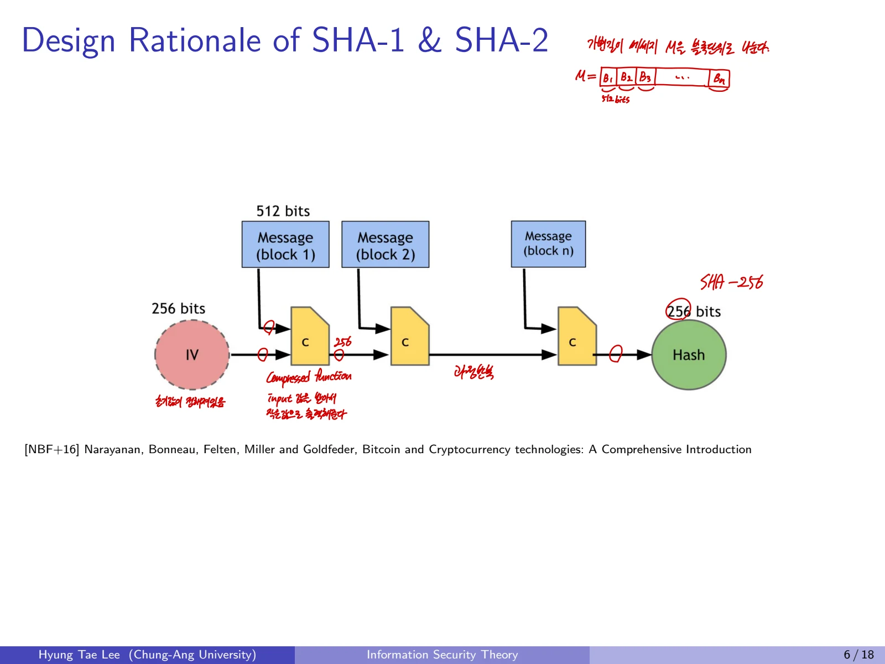
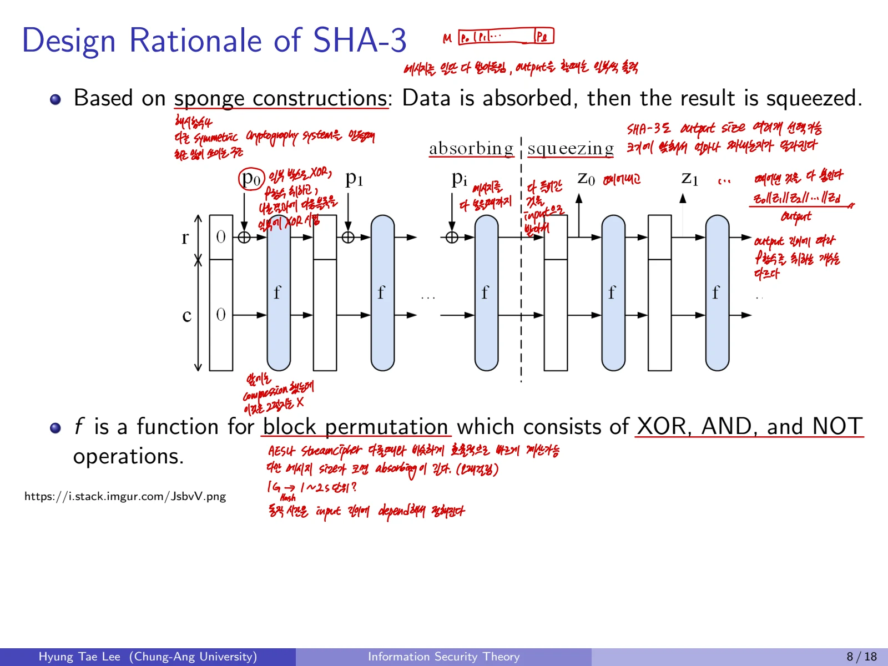

## 1. 일반 Hash Function과 Cryptographic Hash Function

### 1.1 일반적인 해시 함수
해시 함수는 **길이가 임의인 데이터**를 받아 **고정 길이 출력값**을 생성한다.

$$
h:\{0,1\}^{*}\rightarrow\{0,1\}^{n}.
$$

예를 들어 메시지를 n비트 블록으로 나누고 각 블록을 XOR하여 n비트 출력을 만드는 함수도 일반적인 의미의 해시 함수다.

$$
h(M_1\parallel\cdots\parallel M_t)=M_1\oplus\cdots\oplus M_t.
$$

그러나 이런 단순 XOR 함수는 출력이 같도록 입력을 바꾸기 쉬워 암호학적으로 안전하지 않다.

### 1.2 왜 충돌이 존재하는가
입력은 임의 길이이므로 가능한 메시지가 출력의 $2^n$개 값보다 훨씬 많다. **비둘기집 원리**에 따라 서로 다른 입력에서 같은 출력이 생기는 충돌(collision)은 반드시 존재한다. 암호학에서의 요구는 "충돌이 절대 없다"가 아니라 **계산적으로 찾기 어려워야 한다**는 것이다.

## 2. Cryptographic Hash Function의 네 가지 요구사항

### 2.1 Efficiently Computable
어떤 입력 메시지 M이 주어져도 $h(M)$을 효율적으로 계산할 수 있어야 한다.

### 2.2 Preimage Resistance(역상 저항성)
해시값 y가 주어졌을 때

$$
\text{Find }M\text{ such that }h(M)=y
$$

를 해결하기 어려워야 한다. **입력 원문이 주어지지 않은 상태**에서 해시 출력값만 보고 원문을 찾으려는 공격이다.

### 2.3 Second-Preimage Resistance(제2역상 저항성)
특정 메시지 M이 주어졌을 때 **M과 다른 메시지** $M'$로

$$
M'\ne M,\qquad h(M')=h(M)
$$

을 만족시키는 것을 찾기 어려워야 한다. 일반 충돌 탐색과 달리 **기존 메시지 하나가 고정되어 있다.**

### 2.4 Collision Resistance(충돌 저항성)
공격자가 두 메시지 모두 자유롭게 선택할 수 있지만, 서로 다른 두 메시지로 해시값이 같아지는 쌍을 찾기 어려워야 한다.

$$
M\ne M',\qquad h(M)=h(M').
$$

역상은 y만 제시, 제2역상은 M이 먼저 제시, 충돌은 M과 $M'$ 둘 다 자유롭게 찾는 상황으로 구분한다.

## 3. 보안강도와 Birthday Bound
임의의 n비트 해시 출력이 균일하고 독립적이라고 가정하면,

- **Preimage 공격:** 일반적으로 약 $2^n$회 시도

- **Second-preimage 공격:** 일반적으로 약 $2^n$회 시도(추가 조건 및 구조에 따라 차이 가능)

- **Collision 공격:** 생일 역설 때문에 약 $2^{n/2}$회 시도

따라서 충돌 저항성의 보안강도는 일반적으로 출력 길이의 절반 정도다.

$$
n=256\quad\Longrightarrow\quad
\text{collision security}\approx128\text{ bits}.
$$

**주의:** 정확한 SHA 계열의 second-preimage 보안강도에는 메시지 최대길이 등 세부 조건이 있다. 위 수치는 이상적인 무작위 함수와 단순 공격을 기준으로 한 직관이다.

## 4. SHA(Secure Hash Algorithm)의 역사

### 4.1 SHA 계열의 발전

- **1993년:** NIST의 최초 SHA 발표

- **1995년:** SHA-1 개정, 160비트 출력

- **2002년:** SHA-2의 SHA-256, SHA-384, SHA-512 등이 표준 범위로 도입

- **2005년:** Wang 연구진이 SHA-1 충돌 공격의 복잡도를 약 $2^{69}$로 줄이는 결과 발표

- **2007년:** NIST SHA-3 경쟁 시작

- **2012년:** Keccak 설계(Bertoni, Daemen, Peeters, Van Assche)가 SHA-3로 선정

2005년에 SHA-1에 대한 이론적인 충돌 공격이 발표되었다. SHA-1은 충돌 저항성이 필요한 신규 설계에 사용하지 않는다.

### 4.2 SHA-1과 SHA-2
두 계열은 **반복적인 압축 함수**를 사용해 입력 블록을 처리한다.

- 메시지의 길이에 맞춰 padding과 길이 정보를 붙임

- 고정 크기 블록으로 분할

- Initial Value(IV, 초기 내부 상태)에서 시작

- 각 블록과 이전 chaining state를 compression function에 입력

- 마지막 chaining state를 출력 해시로 사용

SHA-256과 SHA-512는 출력 크기가 다른 해시 함수다. SHA-256은 비트코인을 비롯한 블록체인에서도 사용된다. SHA의 해시값 계산 자체가 비트코인 채굴만을 뜻하는 것은 아니다.

## 5. SHA-3와 Sponge Construction

### 5.1 구조
SHA-3는 Keccak의 **Sponge 구조**를 사용하며 SHA-1/2의 Merkle-Damgård 계열과 다르게 동작한다.

1. 입력 데이터를 일정 길이 r비트의 블록으로 padding 및 분할

2. **Absorb 단계:** 입력 블록을 내부 상태의 rate 영역에 XOR한 뒤 변환 함수 $f$ 적용

3. **Squeeze 단계:** 내부 상태에서 r비트씩 출력하고 더 많은 출력이 필요하면 $f$를 다시 적용

내부 상태의 전체 너비는

$$
b=r+c
$$

이며 r은 **rate**, c는 **capacity**다. 같은 내부 너비에서 c가 커지면 보안 목표를 높일 여지가 있는 반면, 한 번에 처리하는 입력량 r은 줄어든다.

### 5.2 SHA-3 표준 인스턴스
파라미터를 비교하면 다음과 같다. 단위는 모두 비트다.

| Instance | Output size | Block size(rate r) | Capacity c | Collision | Preimage | Second preimage |
| --- | --- | --- | --- | --- | --- | --- |
| SHA3-224 | 224 | 1152 | 448 | 112 | 224 | 224 |
| SHA3-256 | 256 | 1088 | 512 | 128 | 256 | 256 |
| SHA3-384 | 384 | 832 | 768 | 192 | 384 | 384 |
| SHA3-512 | 512 | 576 | 1024 | 256 | 512 | 512 |

모든 인스턴스에서 $r+c=1600$이다. **Security 열은 공격 작업량의 로그 비트 수준**이라는 의미다.

### 5.3 SHA-2와 SHA-3의 관계
SHA-3는 SHA-2가 당연히 깨졌기 때문에 생긴 대체물이 아니라, **독립된 설계 원리와 안전성 다양성을 확보**하는 목적도 있다. SHA-2와 SHA-3는 모두 현대적인 암호학적 해시 후보지만 사용 환경에 맞는 표준 선택이 필요하다.

## 6. 해시 함수와 인증의 차이
해시 함수가 충돌 저항성을 제공하더라도 **해시값을 누가 만들었는지 증명하지는 못한다.** 공개된 해시 알고리즘은 누구나 실행할 수 있기 때문이다. 통신 당사자 사이에서 무결성과 발신자 인증을 확인하려면 **MAC 또는 전자서명**을 함께 사용한다.
