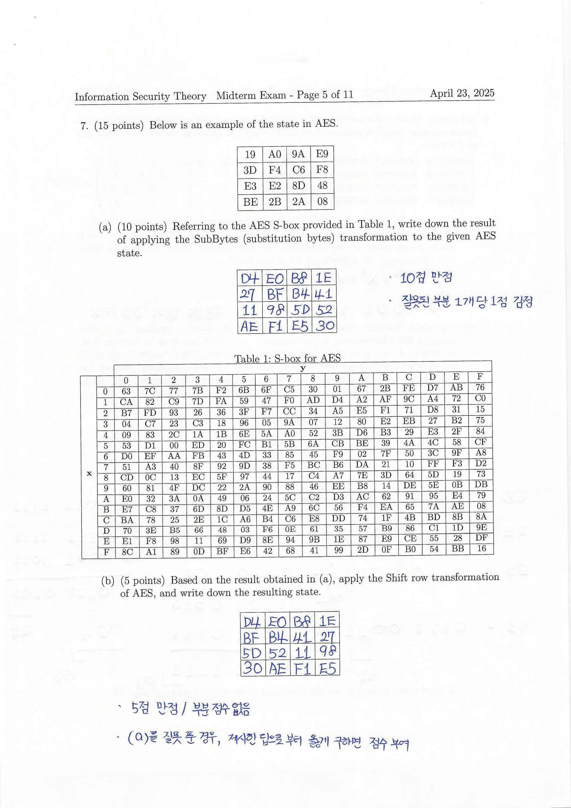
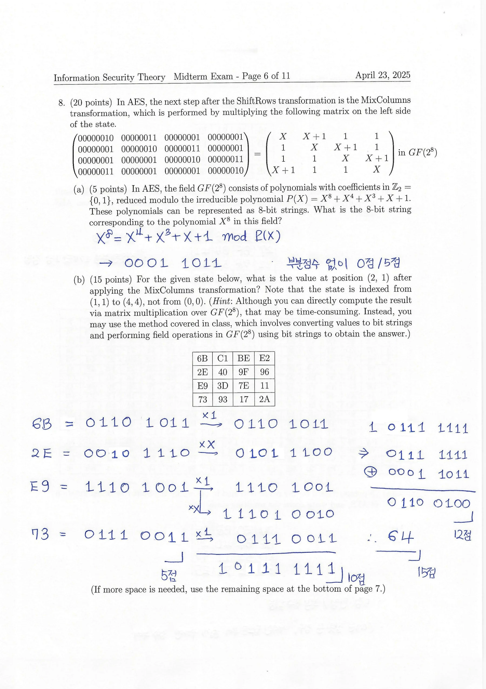

## 1. 대칭키 암호와 RSA 연습

### 문제 1: CIA Triad
정답은 Confidentiality, Integrity, Availability. 무엇을 보호하는지와 각 속성의 차이를 설명할 수 있어야 한다.

### 문제 2: One-Time Pad(OTP)
비밀키 $K_i$와 평문 $M$을 XOR하여 암호문 $C_i$를 만드는 OTP에서 키스트림 재사용 시 메시지 관계가 드러나는지 분석한다.

$$
C_1=M_1\oplus K_1,\qquad C_2=M_2\oplus K_2
$$

독립적인 한 번짜리 키라면 각각 완전비밀성 조건을 만족한다. 그러나 동일한 키를 공유하여 재사용했다면 $C_1\oplus C_2=M_1\oplus M_2$이고, 알려진 한 평문에서 다른 평문을 복원할 수 있다. 세 메시지에 각각 $K_2$, $K_3$, $K_2\oplus K_3$를 사용하면 다음과 같다.

$$
C_1=M_1\oplus K_2,\quad C_2=M_2\oplus K_3,\quad C_3=M_3\oplus K_2\oplus K_3.
$$

세 암호문을 XOR하면 키 항이 모두 소거된다.

$$
C_1\oplus C_2\oplus C_3=M_1\oplus M_2\oplus M_3.
$$

공격자는 암호문만으로 세 평문의 관계를 알 수 있으므로, 세 메시지를 함께 보았을 때 완전비밀성이 성립하지 않는다.

### 문제 3: Feistel Round
도식을 채우고 식으로 표현한다.

$$
L_i=R_{i-1},\qquad R_i=L_{i-1}\oplus F(R_{i-1},K_i).
$$

Feistel 구조에서 F는 역함수가 없어도 복호화할 수 있으며, 복호화는 역순 키를 적용한다.

### 문제 4: PRNG 기반 XOR 암복호화
$PRNG(K)$로 생성한 난수열 R을 이용할 때

$$
C=M\oplus R,\qquad M=C\oplus R
$$

을 도식화한다. 송수신자가 동일한 키스트림을 생성할 수 있어야 한다.

### 문제 5: Triple DES
DES의 암호화 $E$와 복호화 $D$로 EDE 암호화/복호화를 나타내고, 세 키가 같은 경우 DES와 같아지는지 확인한다.

$$
C=E_{K_3}(D_{K_2}(E_{K_1}(M)))
$$

$$
M=D_{K_1}(E_{K_2}(D_{K_3}(C))).
$$

### 문제 6: DES와 AES 비교

| 요구 사항 | DES | AES |
| --- | --- | --- |
| Block size | 64비트 | 128비트 |
| Key size | 유효 56비트 | 128/192/256비트 |
| Rounds | 16 | 10/12/14 |
| Round structure | Feistel | SPN |
| Round key size | 48비트 | 128비트 |

AES의 SubBytes, ShiftRows, MixColumns, AddRoundKey와 DES의 Expansion, XOR, Substitution, Permutation 절차도 설명할 수 있어야 한다.

### 문제 7: AES SubBytes와 ShiftRows

주어진 4x4 바이트 State에 S-box를 적용하고 ShiftRows를 적용하는 문제다.
**풀이 원칙**

1. 각 바이트의 상위 16진수 한 자리는 S-box의 행, 하위 한 자리는 열

2. 네 행을 각각 왼쪽으로 0, 1, 2, 3바이트 회전

3. 계산을 소수 자리 숫자로 수행하지 않고 **16진수 바이트 표기를 유지**

### 문제 8: AES 유한체와 MixColumns

먼저 $GF(2^8)$의 법 다항식에 대응하는 비트열을 쓰고, 그 체 위에서 MixColumns 행렬 곱셈 일부를 계산한다.

$$
P(X)=X^8+X^4+X^3+X+1,\quad
02\otimes x=\operatorname{xtime}(x).
$$

$$
\begin{pmatrix}
02&03&01&01\\
01&02&03&01\\
01&01&02&03\\
03&01&01&02
\end{pmatrix}
$$

계산은 다항식 곱셈 후 $P(X)$에 대한 나머지를 취한다. **중간 과정에서 XOR와 carry 처리, 환원항을 전부 적는 방식**으로 풀이한다.

### 문제 9: Left-to-Right Modular Exponentiation
$g^{117}\bmod p$를 Left-to-Right 방법으로 계산하기 위한 경로를 쓰고 모듈러 곱셈 횟수를 구하는 문제.

$$
117=(1110101)_2=64+32+16+4+1.
$$

첫 1비트에서 초기화하는 left-to-right 방식에서는 **제곱 6회와 일반 곱셈 4회, 총 10회**가 필요하다. '전체 7비트의 각 반복에서 1번씩 곱한다'는 구현과는 연산 횟수 계산 관례가 다를 수 있으니 초기화 방식과 연산 횟수의 기준을 명시해야 한다.

### 문제 10: OFB Mode
OFB의 암호화/복호화 그림과 수식을 직접 그리는 문제.

$$
Z_0=IV,\quad Z_i=E_K(Z_{i-1}),\quad C_i=P_i\oplus Z_i,\quad P_i=C_i\oplus Z_i.
$$

OFB의 피드백은 CFB와 달리 **암호문이 아니라 이전 암호화 함수 출력**이다.

### 문제 11: Public Key Encryption과 IND-CPA
PKE의 세 알고리즘 정의 및 결정적 PKE가 IND-CPA 안전하지 않은 이유를 제시한다.

$$
(pk,sk)=KeyGen(\lambda),\quad C=Enc(pk,M),\quad M=Dec(sk,C).
$$

공격자가 공개키로 후보 $M_0,M_1$을 직접 암호화할 수 있으므로 결정적 암호화에서는 challenge ciphertext와 비교해서 어느 메시지인지 맞힐 수 있다.

### 문제 12: RSA 계산 전체
$p=11,q=13,N=143,e=37,C=2$에 대해 $\varphi(N)$, d, 평문 M을 계산한다.

$$
\varphi(143)=(11-1)(13-1)=120.
$$

확장 유클리드:

$$
120=3\cdot37+9,\quad37=4\cdot9+1.
$$

$$
1=37-4(120-3\cdot37)=13\cdot37-4\cdot120.
$$

$$
d=13,\qquad M=2^{13}\bmod143=41.
$$

**검산:** $37\cdot13=481\equiv1\pmod{120}$, $2^{13}=8192\equiv41\pmod{143}$.

## 2. 공개키 암호, 서명과 인증 연습

### 문제 1: RSA-OAEP Decoding
RSA 개인키 d로 암호문 $CT$에서 인코딩된 메시지 $EM$을 얻은 후, 두 단계 mask 제거를 통해 원래 Message를 복원해야 한다.

1. $EM=CT^d\bmod N$ 계산

2. $EM$에서 maskedSeed, maskedDB를 위치에 따라 분리

3. $seedMask=MGF(maskedDB)$

4. $Seed=maskedSeed\oplus seedMask$

5. $dbMask=MGF(Seed)$

6. $DB=maskedDB\oplus dbMask$

7. Label 해시, padding, 0x01 구분자를 검증해 메시지 M 추출
**주의:** MGF의 입력과 출력 길이를 구분하고, 디코딩 후 패딩 구조와 해시를 모두 검증해야 한다.

### 문제 2: Diffie-Hellman, MITM, Authentication
DH 공개값과 공유 비밀, 중간자 공격, 방어 방법까지 단계별로 묻는다.

$$
A=g^a\bmod p,\qquad B=g^b\bmod p
$$

$$
K=B^a=A^b=g^{ab}\bmod p.
$$

MITM 공격에서는 Eve가 Alice와 Bob에게 자신의 공개값을 대신 전달하므로 Alice, Bob은 서로가 아닌 Eve와 각각 다른 키를 공유한다. 방어 예시는 **서명과 공개키 검증을 이용한 당사자 인증**이다.

### 문제 3: ElGamal 암호와 Additive Notation

**(a) 암호문 복호화의 실제 계산:** $p=23,g=5,h=17,x=7,C=(2,7)$라고 주어진다.

$$
M=C_2/(C_1^x)\bmod p
=7/(2^7)\bmod23.
$$

$$
2^7=128\equiv13\pmod{23},\quad13^{-1}\equiv16\pmod{23}.
$$

$$
M=7\cdot16=112\equiv20\pmod{23}.
$$

**(b) 임의 길이 비트 메시지로 확장:** $M\in\{0,1\}^*$일 때 해시 함수 $H:G\to\{0,1\}^{|M|}$를 쓰는 구성은

$$
C_1=g^r,\quad C_2=M\oplus H(h^r)
$$

$$
M=C_2\oplus H(C_1^x).
$$

**(c) ECC 등 Additive Group에서도 구성 가능:** 표현을 곱셈에서 덧셈으로 바꾸면 표기 $g^r$ 대신 $rG$, $h^r$ 대신 $rH$를 이용한다. 유한체 크기 대비 키와 암호문 길이가 작아질 수 있다는 장점이 있다.

### 문제 4: RSA Signature, Forgery, PSS
RSA Sign 및 Verify, textbook RSA Signature existential forgery, EMSA-PSS의 인코딩 및 서명 검증 절차까지 묻는다.

$$
\sigma=M^d\bmod N,\quad Verify(pk,M,\sigma)=[\sigma^e\equiv M\pmod N].
$$

**Existential forgery:** 임의 $\sigma$를 고르고 $M=\sigma^e\bmod N$이라 하면 검증에 성공한다. 즉 raw RSA 서명은 안전하지 않다.
PSS에서는 Salt, Hash, MGF, DB, maskedDB, trailer를 구분해야 한다. 서명 생성 결과로부터 $EM$을 추출하고 인코딩 구조 및 해시 일치성을 검증한다.

### 문제 5: Elliptic Curve에서 실제 점 계산
유한체 $\mathbb F_7$ 위 곡선 $E:y^2=x^3+2$에 대해 점들을 나열하고 $P+Q$, $2P$를 구한다.
곡선 점:

$$
E(\mathbb F_7)=\{\mathcal O,(0,3),(0,4),(3,1),(3,6),(5,1),(5,6),(6,1),(6,6)\}.
$$

**(b)** $P=(3,1),Q=(5,6)$

$$
s=(6-1)/(5-3)=5\cdot2^{-1}\equiv5\cdot4\equiv6\pmod7
$$

$$
x_3=s^2-3-5=28\equiv0,\quad
y_3=s(3-0)-1=17\equiv3\pmod7.
$$

따라서 $P+Q=(0,3)$.
**(c)** $2P$

$$
s=(3x_P^2)/(2y_P)=27/2\equiv6\cdot4=3\pmod7
$$

$$
x_3=3^2-2\cdot3=3,\quad y_3=3(3-3)-1\equiv6\pmod7.
$$

따라서 $2P=(3,6)$이다.

### 문제 6: Cryptographic Hash Properties

**(a) Collision Resistance:** 서로 다른 두 메시지로

$$
x\ne x',\quad h(x)=h(x')
$$

를 찾기 어려워야 한다.
**(b) 반례:** $h:\{0,1\}^*\to\{0,1\}^8$가 **입력의 마지막 비트만 출력하고 나머지는 0으로 패딩**한다고 하자. 이 함수가 충돌 저항성을 갖지 않는 이유는 입력이 달라도 마지막 비트가 같으면 결과가 동일하기 때문이다. 예를 들어 마지막 비트가 모두 0인 두 입력을 쉽게 찾을 수 있다.

### 문제 7: CBC-MAC
CBC Mode를 이용하여 마지막 암호문 블록을 태그로 만드는 CBC-MAC 생성 알고리즘과 검증 과정을 묻는다.

$$
Y_0=IV,\qquad Y_i=E_K(M_i\oplus Y_{i-1}),\qquad tag=Y_n.
$$

검증자는 공유키로 같은 연산을 다시 수행하고 전달받은 태그와 비교한다. 일반 IV 표기를 사용하지만, **안전한 기본 CBC-MAC에서는 고정 IV(보통 0), 고정 길이 메시지 가정** 등이 중요하다.

## 3. 추가 복습

| 문제 | 출제 주제 | 핵심 풀이 또는 확인사항 |
| --- | --- | --- |
| 1 | 컴퓨터 보안 및 DES/AES/RC4의 T/F | 기밀성 vs 무결성, DES와 AES 구조, ECB/CBC/CFB/OFB |
| 2 | Permutation 및 Substitution Cipher | 문자 값 치환과 위치 순열을 구별 |
| 3 | Affine Cipher의 키 a,b 복원 | 두 평문/암호문 쌍의 연립합동식 |
| 4 | OTP의 Perfect Secrecy | 균등 무작위, 키 1회 사용, 메시지 길이의 키 |
| 5 | Symmetric vs Public-Key | 키 종류, 키 공유, 속도, 키 개수 |
| 6 | Block Cipher vs Stream Cipher | 블록 단위와 요소 단위 처리 |
| 7 | Feistel Round의 도식과 복호화 | 좌우 교환, XOR, 라운드 키 역순 |
| 8 | DES S-box 입력에서 4비트 출력 | 바깥 2비트 = row, 가운데 4비트 = col |
| 9 | Right-to-Left Modular Exponentiation | 지수의 이진 비트, 제곱 및 곱셈 횟수 |
| 10 | AES SubBytes 및 ShiftRows | 4x4 State 처리, S-box lookup |
| 11 | AES $GF(2^8)$와 MixColumns | 모듈러 다항식, Shift/XOR와 reduction |
| 12 | LFSR 키스트림과 XOR 복호화 | 점화식으로 12비트 생성, 암호문 XOR |
| 13 | CTR Mode 암복호화 및 장점 | Counter 블록 암호화, 병렬/사전 계산 |
| 14 | RSA $\varphi(N)$과 인수분해 | $N=pq$, Euler 함수 및 소인수분해 |

### 문제 3: Affine Cipher 복습 예시
선택 평문 N과 O가 각각 T와 Y에 대응한다면

$$
13a+b\equiv19\pmod{26},\qquad14a+b\equiv24\pmod{26}.
$$

빼면 $a\equiv5\pmod{26}$, 따라서 $b\equiv19-13\cdot5\equiv6\pmod{26}$. **키는 (5,6)**이다. 정합성: $\gcd(5,26)=1$.

### 문제 14: RSA에서 $\varphi(N)$과 소인수분해
서로 다른 두 소수의 곱인 RSA 모듈러스 N과 $\varphi(N)$이 함께 주어졌다고 하자. 이 두 값으로 p와 q를 구할 수 있다.

$$
p+q=N-\varphi(N)+1
$$

왜냐하면 $\varphi(N)=(p-1)(q-1)=pq-p-q+1$이기 때문이다. 따라서 p,q는 다음 이차방정식의 근이다.

$$
t^2-(N-\varphi(N)+1)t+N=0.
$$

판별식이 제곱수가 되어야 하며, 두 근이 소수인지 검산한다.

## 4. 연습할 계산 유형

1. **Affine/Shift/Permutation:** 숫자와 문자의 치환 및 알려진 평문 공격.

2. **DES/Feistel:** 라운드 식과 S-box row/column 선택.

3. **AES:** SubBytes, ShiftRows, MixColumns의 중간 행렬과 비트 계산.

4. **$GF(2^8)$:** 기약다항식 환원 및 역원.

5. **Modular Exponentiation:** Left-to-Right/Right-to-Left 알고리즘의 곱셈 횟수.

6. **RSA:** Euler, Euclidean, modular inverse, KeyGen, Enc/Dec, OAEP.

7. **DH/ElGamal:** 공유 비밀, MITM, 인증, 모듈러 역원 복호화.

8. **ECDSA/ECC:** Point Addition, Doubling, x좌표와 mod.

9. **Hash/MAC:** collision resistance와 MAC 검증 알고리즘.

## 이어서 읽기

- 이전 글: [13. 메시지 인증 코드, HMAC와 CBC-MAC](/posts/basic-cryptography-message-authentication-codes/)
