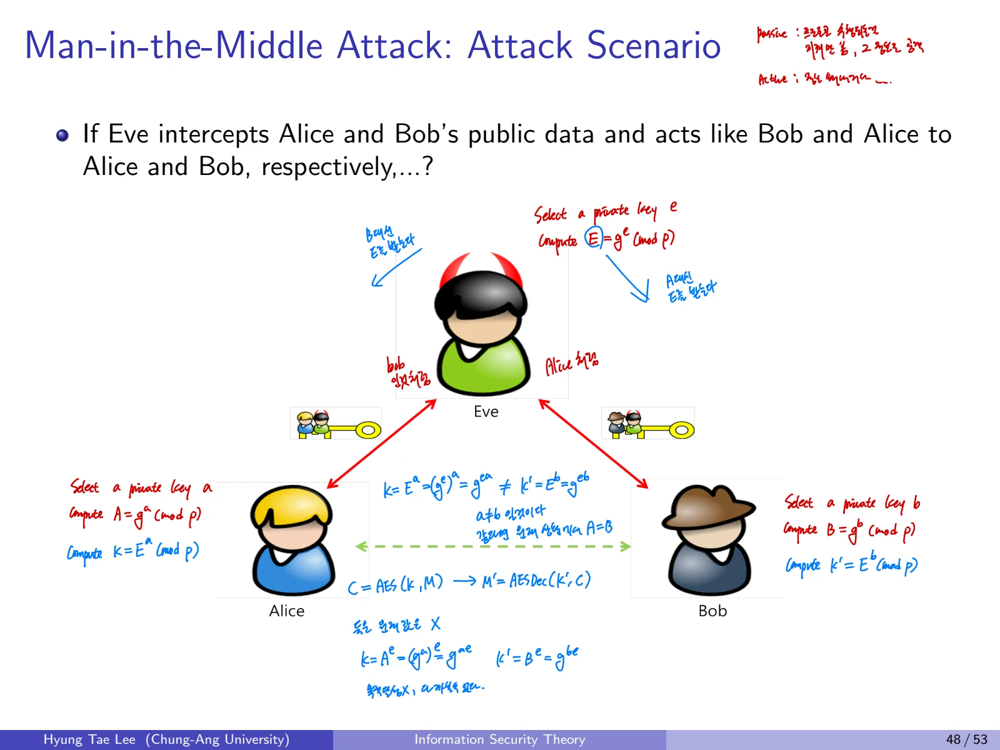

## 1. 군(Group)의 정의
집합 G와 이항연산 $\circ$에 대해 다음 네 가지 조건을 만족하면 $(G,\circ)$를 군이라고 한다.

1. **Closure:** 모든 $a,b\in G$에 대해 $a\circ b\in G$

2. **Associativity:** $(a\circ b)\circ c=a\circ(b\circ c)$

3. **Identity:** $e\in G$가 존재하여 $a\circ e=e\circ a=a$

4. **Inverse:** 모든 $a\in G$에 대해 $a\circ a^{-1}=a^{-1}\circ a=e$인 역원이 존재

추가로 $a\circ b=b\circ a$이면 **Abelian Group(가환군)**이다. 부분집합 $H\subseteq G$가 같은 연산으로 군이면 **Subgroup(부분군)**이다.

### 군의 예제

- $(\mathbb Z,+)$, $(\mathbb Q,+)$, $(\mathbb R,+)$, $(\mathbb C,+)$는 가환군

- $(\mathbb Z,+)$는 $(\mathbb Q,+)$의 부분군

- $(\mathbb Q\setminus\{0\},\cdot)$, $(\mathbb R\setminus\{0\},\cdot)$, $(\mathbb C\setminus\{0\},\cdot)$는 곱셈에 대한 가환군

- $(\mathbb Z\setminus\{0\},\cdot)$는 3의 곱셈 역원이 이 집합 안에 없으므로 군이 아님

- 가역 $2\times2$ 행렬의 곱셈군은 일반적으로 **비가환군**(AB가 BA와 다름)

- $(\mathbb Z_n,+)$는 n원소의 가환군

- $(\mathbb Z_n^*,\cdot)$는 n과 서로소인 원소만 포함하는 곱셈 가환군이며 $|\mathbb Z_n^*|=\varphi(n)$

## 2. 원소의 위수와 순환군

### 2.1 Order of an Element
$a\in G$의 위수는 반복 연산으로 단위원이 처음 나오는 최소 양의 정수다.

$$
\operatorname{ord}(a)=\min\{k\ge1:a^k=e\}.
$$

예시에서 $\mathbb Z_{11}^*$ 안의 3은

$$
3^1=3,\ 3^2=9,\ 3^3\equiv5,\ 3^4\equiv4,\ 3^5\equiv1\pmod{11}.
$$

따라서 $\operatorname{ord}(3)=5$다.

### 2.2 Cyclic Group과 Generator
어떤 $g\in G$의 위수가 $|G|$이면 G는 순환군이고 g를 생성원(generator, primitive element)이라 한다.

$$
G=\langle g\rangle=\{e,g,g^2,\ldots,g^{|G|-1}\}.
$$

$\mathbb Z_{11}^*$ 예시:

$$
2^1\equiv2,\ 2^2\equiv4,\ 2^3\equiv8,\ 2^4\equiv5,\ 2^5\equiv10,
$$

$$
2^6\equiv9,\ 2^7\equiv7,\ 2^8\equiv3,\ 2^9\equiv6,\ 2^{10}\equiv1\pmod{11}.
$$

따라서 $\operatorname{ord}(2)=10=|\mathbb Z_{11}^*|$이고, 2는 생성원이다. 반면 3은 전체군의 생성원은 아니지만 부분군

$$
\langle3\rangle=\{1,3,9,5,4\}
$$

의 생성원이다.

## 3. Discrete Logarithm Problem(DLP)

### 3.1 정의
군 G의 생성원 g와 $A=g^a$가 주어졌을 때 미지의 지수 a를 찾는 문제다.

$$
\text{Given }(G,g,A=g^a),\qquad\text{find }a.
$$

실수에서의 로그 계산과 달리 충분히 큰 유한군에서의 **이산로그** 계산은 어려울 수 있다. 단, 작은 군에서는 손으로 거듭제곱을 반복하여 쉽게 구할 수 있다.
예를 들어 $\mathbb Z_{31}^*$에서 $g=3,A=20$일 때, $3^a\equiv20\pmod{31}$을 만족하는 a를 찾는 문제다.

### 3.2 알려진 공격 알고리즘
군의 크기와 구조에 따라 다음 알고리즘을 고려한다.

- 충분히 작지 않은 법 p가 요구된다. 유한체 곱셈군 전체에 대한 **General/Special Number Field Sieve** 공격을 고려해야 한다.

- 부분군의 위수 q도 충분히 커야 한다. **Pollard rho** 같은 generic DLP 공격의 복잡도는 대략 $\sqrt q$에 비례한다.

NIST(2020)의 보안강도별 크기 비교:

| 목표 강도 | q의 비트 수 | p의 비트 수 |
| --- | --- | --- |
| 80 | 160 | 1024 |
| 112 | 224 | 2048 |
| 128 | 256 | 3072 |
| 192 | 384 | 7680 |
| 256 | 512 | 15360 |

이는 2020년 시점의 보안강도 비교로, 최신 표준 선택을 대체하는 것은 아니다.

## 4. Diffie-Hellman Key Exchange

### 4.1 목적과 역사
Alice와 Bob이 **공개 채널만 이용해 같은 공유 비밀값을 생성**하는 절차다. Whitfield Diffie와 Martin Hellman이 1976년에 발표했다.

### 4.2 사전 공유 매개변수

- 소수 p

- $\mathbb Z_p^*$ 또는 선택된 순환 부분군의 생성원 g

- 각 참여자는 별도의 개인 지수 a,b를 선택

### 4.3 키 교환 절차
**Alice**

1. 비밀 지수 a 선택

2. $A=g^a\bmod p$ 계산

3. A를 Bob에게 전송

4. Bob의 B를 받아 $K_{AB}=B^a\bmod p$ 계산
**Bob**

1. 비밀 지수 b 선택

2. $B=g^b\bmod p$ 계산

3. B를 Alice에게 전송

4. Alice의 A를 받아 $K_{BA}=A^b\bmod p$ 계산

양쪽 결과의 동일성:

$$
K_{AB}=B^a=(g^b)^a=g^{ab}=(g^a)^b=A^b=K_{BA}\pmod p.
$$

### 4.4 계산 예제
매개변수 $p=31,g=3$, Alice의 $a=6$, Bob의 $b=8$일 때

$$
A=3^6\bmod31=729\bmod31=16.
$$

$$
B=3^8\bmod31=6561\bmod31=20.
$$

공개값을 교환한 뒤

$$
K_{AB}=20^6\bmod31=4,\qquad K_{BA}=16^8\bmod31=4.
$$

두 참여자 모두 공유값 **4**를 얻는다.

## 5. DH의 안전성과 CDH
공격자 Eve는 $g,p,g^a,g^b$를 볼 수 있다. 개인 지수 a 또는 b를 획득하면 공유값을 바로 계산할 수 있다. 개인 지수 복원이 **DLP**와 연결된다.

### CDH(Computational Diffie-Hellman) Problem

$$
\text{Given }g,g^a,g^b,\quad\text{compute }g^{ab}.
$$

CDH는 지수 a 또는 b를 반드시 직접 구하지 않더라도 공유 비밀을 계산할 수 있는지를 묻는다. DLP를 풀 수 있으면 CDH도 풀 수 있지만, **일반적으로 두 문제가 다항시간 동치라고 증명된 것은 아니다.**

## 6. Man-in-the-Middle(MITM) Attack

### 6.1 문제 상황
인증되지 않은 DH는 중간자 Eve가 **Alice에게는 Bob인 척**, **Bob에게는 Alice인 척**할 수 있다.

1. Eve가 비밀 지수 e를 선택하고 $E=g^e\bmod p$ 계산

2. Alice가 보낸 A와 Bob이 보낸 B를 가로채 양쪽 모두에게 E 전달

3. Alice는 $K_{AE}=E^a=g^{ea}$ 생성

4. Bob은 $K_{BE}=E^b=g^{eb}$ 생성

5. Eve는 A와 B를 알므로 $K_{EA}=A^e$, $K_{EB}=B^e$를 각각 계산 가능

따라서 Alice와 Bob이 같은 비밀키를 공유하지 못하고 **각각 Eve와 다른 비밀키**를 공유하게 된다. Eve는 Alice의 메시지를 복호화하고 재암호화하여 Bob에게 전달할 수 있다.

### 6.2 방어
**참가자 인증(Authentication)**이 필요하다. 공개값을 보낼 때 **전자서명**을 덧붙여 인증할 수 있다. 단, 서명만 붙이는 것으로 끝나지 않고 검증키가 실제 해당 주체의 것이라는 신뢰 관계도 필요하다.

## 7. ElGamal Encryption

### 7.1 역사와 성질
Taher El Gamal이 1985년 제안한 공개키 암호다. **Probabilistic Encryption**이며 각 암호화에 랜덤 지수 r이 필요하다.

### 7.2 DDH(Decisional Diffie-Hellman) Problem
$g,g^a,g^b,X$가 주어졌을 때

$$
X=g^{ab}\quad\text{인지}\quad X=g^c
$$

인지를 구분하는 문제다. 후자는 독립적으로 무작위 선택한 c의 거듭제곱이다. 적절한 그룹과 DDH 가정 아래 **원래의 ElGamal은 IND-CPA 안전성**을 얻는다.

### 7.3 Key Generation

1. 큰 소수 p, 그리고 관련 부분군 위수 q를 선택

2. $\mathbb Z_p^*$의 위수 q인 순환 부분군 G의 생성원 g 선택

3. 비밀 지수 $x\leftarrow\mathbb Z_q$ 선택

4. 공개 원소 $X=g^x\bmod p$ 계산

$$
pk=(p,q,g,X),\quad sk=x.
$$

### 7.4 Encryption
평문 M을 부분군의 원소로 표현해야 한다. 일회용 무작위값 $r\leftarrow\mathbb Z_q$를 선택하여

$$
C_1=g^r\bmod p,\qquad C_2=M X^r\bmod p
$$

를 계산하고 암호문은

$$
CT=(C_1,C_2).
$$

이다.

### 7.5 Decryption

$$
M=C_2(C_1^x)^{-1}\bmod p.
$$

정합성 증명:

$$
C_1^x=(g^r)^x=g^{rx}=(g^x)^r=X^r
$$

$$
\frac{C_2}{C_1^x}=\frac{MX^r}{X^r}=M.
$$

$C_1$만으로 메시지를 알아낼 수 없으며, 무작위 r 때문에 같은 메시지라도 암호문은 매번 바뀐다.

## 8. ElGamal의 곱셈 준동형성과 보안 모델
ElGamal은 원래 구조에서

$$
\operatorname{Enc}(M)\cdot\operatorname{Enc}(M')
\sim\operatorname{Enc}(MM')
$$

라는 **곱셈 준동형성**을 갖는다. 암호문 두 쌍의 각 성분을 곱하면 그 결과는 평문의 곱에 대한 적절한 무작위화된 암호문이 된다. 이 성질은 응용에서 유용하지만, **원래 ElGamal 자체가 IND-CCA2를 제공하지 않음**도 뜻한다. 더 강한 보안성을 얻으려면 별도의 안전한 변환이 필요하다.

## 9. 중요 비교

| 개념 | 질문 | 결과 |
| --- | --- | --- |
| DLP | $g,g^a$에서 a를 계산할 수 있는가? | 개인 지수 복원 문제 |
| CDH | $g,g^a,g^b$에서 $g^{ab}$을 계산할 수 있는가? | 공유 비밀 계산 문제 |
| DDH | 주어진 X가 $g^{ab}$인지 구별하는가? | 공유 비밀의 무작위성 구별 |
| DH | 공개 채널로 같은 비밀을 공유할 수 있는가? | 가능하지만 인증 없는 MITM에 취약 |
| ElGamal | 공개키로 확률적 메시지 암호화를 할 수 있는가? | DDH 가정 하 IND-CPA |

## 이어서 읽기

- 이전 글: [08. RSA, 정수론, 소수 판정과 OAEP](/posts/basic-cryptography-rsa-number-theory-oaep/)
- 다음 글: [10. 전자서명, RSA, ElGamal과 PSS](/posts/basic-cryptography-digital-signatures-rsa-pss/)
