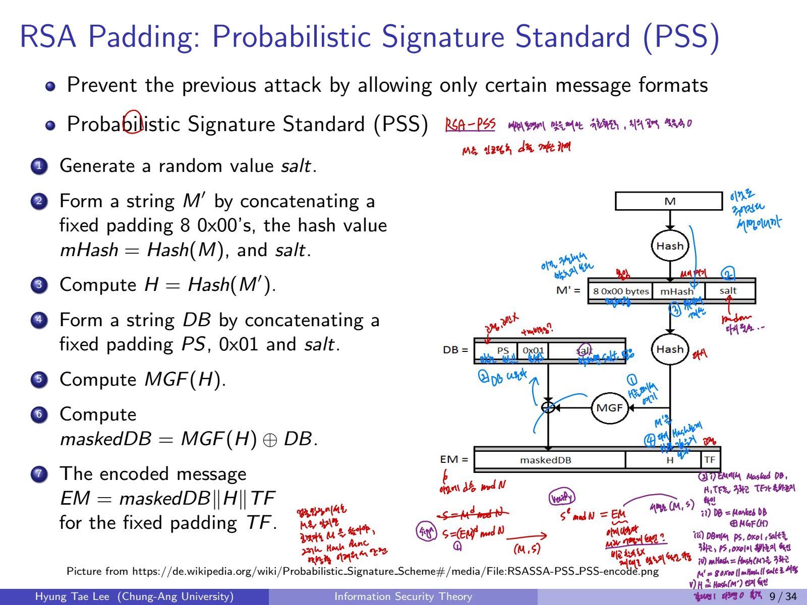

## 1. Digital Signature의 목적
Bob이 Alice에게 메시지를 보낼 때 **메시지의 기밀성보다 발신자가 Bob인지, 메시지가 바뀌지 않았는지**를 보장하려는 상황에서 전자서명을 사용한다.

1. Bob이 자신의 **비밀키**로 메시지에 서명한다.

2. 서명과 메시지를 Alice에게 전달한다.

3. Alice는 Bob의 **공개키**로 서명을 검증한다.

서명은 일반적으로 메시지를 숨기지 않는다. **메시지 인증(출처 확인)과 무결성**을 제공하도록 설계한다. 제삼자가 Bob의 비밀키 없이 새로운 유효 서명을 생성하기 어려워야 한다.

## 2. 전자서명의 형식적 정의

### 2.1 Algorithms

$$
(pk,sk)\leftarrow\operatorname{KeyGen}(1^\lambda)
$$

$$
\sigma\leftarrow\operatorname{Sign}(sk,M)
$$

$$
b\leftarrow\operatorname{Verify}(pk,M,\sigma),\qquad b\in\{0,1\}.
$$

- **KeyGen:** 보안 매개변수를 받아 공개키와 비밀키 생성

- **Sign:** 비밀키와 메시지로 서명 $\sigma$ 생성

- **Verify:** 공개키와 메시지 및 서명을 입력받아 참(1)/거짓(0) 검증

메시지와 서명을 묶어서 $(M,\sigma)$라고 두고 Verify(pk,$(M,\sigma)$)처럼 표기하기도 한다.

### 2.2 Correctness

$$
\operatorname{Verify}\bigl(pk,M,\operatorname{Sign}(sk,M)\bigr)=1.
$$

올바른 키쌍과 서명 알고리즘으로 생성한 서명은 반드시 검증을 통과해야 한다.

## 3. Digital Signature Security Game

### 3.1 Challenger/Adversary

1. Challenger C가 KeyGen으로 $(pk,sk)$를 생성하고 공격자 A에게 $pk$를 준다.

2. 공격자 A가 여러 메시지 $M_i$에 대해 **Signing Oracle**에 서명을 요청한다.

3. 도전자는 각각 $\sigma_i=\operatorname{Sign}(sk,M_i)$를 반환한다.

4. 공격자가 $(M^*,\sigma^*)$를 출력한다.

5. 공개키로 검증에 성공하고, 출력한 결과가 기존 Signing Oracle 응답으로 단순히 받은 값이 아니면 위조 성공을 판정한다.

이를 **Strongly Unforgeable under Adaptive Chosen Message Attack**이라고 한다. **EUF-CMA**에서는 이전에 서명받지 않은 새 메시지에 대한 위조를 요구하고, **SUF-CMA**에서는 이전에 서명받았던 메시지라도 *새로운 유효 서명 쌍*을 만들어내는 것을 금지한다. 즉 둘을 구별한다.

### 3.2 보안 조건
모든 다항시간 공격자에 대해 성공 확률이 $\lambda$에 대해 negligible해야 한다.

$$
\Pr[\operatorname{Verify}(pk,M^*,\sigma^*)=1\land\operatorname{Fresh}(M^*,\sigma^*)]\le\operatorname{negl}(\lambda).
$$

공격자는 비밀키를 몰라도 공개키와 서명 오라클을 활용할 수 있다. 목표는 기존 응답을 단순 재전송하는 것이 아니라 **새로운 유효한 서명**을 만드는 것이다.

## 4. RSA Signatures

### 4.1 KeyGen
RSA 암호화의 키 생성과 마찬가지다.

1. 서로 다른 큰 소수 p,q를 선택하고 $N=pq$

2. $\gcd(e,\varphi(N))=1$인 공개 지수 e 선택

3. $ed\equiv1\pmod{\varphi(N)}$인 d 계산

4. $pk=(N,e)$, $sk=d$

### 4.2 Sign과 Verify

**Raw/Textbook RSA Signature**

$$
s=M^d\bmod N,\qquad\sigma=(M,s).
$$

검증:

$$
s^e\overset{?}=M\pmod N.
$$

정합성:

$$
s^e=(M^d)^e=M^{de}\equiv M\pmod N.
$$

### 4.3 Raw RSA Signature에 대한 Existential Forgery
서명할 메시지를 먼저 고를 필요조차 없다.

1. 공격자가 임의의 값 $s\in\mathbb Z_N$을 선택

2. $M=s^e\bmod N$을 계산

3. $(M,s)$를 유효한 서명으로 출력

공개 정보만으로 검증을 통과하는 메시지·서명 쌍을 만든 것이다. **중요:** 비밀키 d를 계산하지 않았어도 위조가 성공한 것이다. 안전한 서명은 **메시지 인코딩 및 서명용 패딩**이 필요하다.

## 5. RSA-PSS

### 5.1 PSS를 사용하는 이유
Raw RSA의 검증 관계는 너무 단순하므로 공격자가 임의로 고른 s에 따라 유효한 M을 만들 수 있다. **Probabilistic Signature Scheme(PSS)**은 해시, 임의의 salt, 마스크 생성 함수를 사용해 허용되는 메시지 인코딩 형식을 제한한다.

### 5.2 PSS 인코딩의 기본 흐름

1. 무작위 salt 생성

2. $mHash=Hash(M)$

3. $M'=0x00^{8}\parallel mHash\parallel salt$

4. $H=Hash(M')$

5. 패딩 PS, $0x01$, salt를 연결해 $DB=PS\parallel0x01\parallel salt$

6. $dbMask=MGF(H,\mathrm{len}(DB))$

7. $maskedDB=DB\oplus dbMask$

8. $EM=maskedDB\parallel H\parallel TF$로 인코딩, TF는 고정 trailer 필드

실제 표준 RSA-PSS 인코딩에는 길이 제한, 첫 비트 처리, trailer byte 0xbc 등 추가 규칙이 있으므로 구현에서는 **RFC 8017 등 표준**을 따라야 한다. 위 과정은 인코딩의 핵심 원리를 나타낸다.

## 6. ElGamal Signatures

### 6.1 Key Generation

1. 큰 소수 p와 $\mathbb Z_p^*$의 큰 부분군 생성원 g 선택

2. 비밀키 $x$ 선택

3. $X=g^x\bmod p$ 계산

4. 공개키 $pk=(p,g,X)$, 비밀키 $sk=x$

### 6.2 Sign
메시지 M을 정수 표현으로 해석한다. $\gcd(k,p-1)=1$인 임시 비밀값 k를 선택한다.

$$
r=g^k\bmod p.
$$

$$
s=(M-xr)k^{-1}\bmod(p-1).
$$

서명은 $\sigma=(M,(r,s))$이다. k에 역원이 존재해야 하므로 **k와 p-1은 서로소**여야 한다.

### 6.3 Verify

$$
t=X^r r^s\bmod p
$$

를 계산하여

$$
t\overset{?}=g^M\bmod p
$$

인지 검사한다. 정합성:

$$
X^rr^s=g^{xr}g^{ks}=g^{xr+ks}
$$

이고 $ks\equiv M-xr\pmod{p-1}$이므로

$$
g^{xr+ks}\equiv g^M\pmod p.
$$

### 6.4 ElGamal Signature의 위조 예시
비밀키 x를 몰라도 새로운 메시지와 유효한 서명 쌍을 만들 수 있다.

1. $\gcd(j,p-1)=1$인 정수 i,j 선택

2. $r=g^i X^j\bmod p$ 계산

3. $s=-r j^{-1}\bmod(p-1)$ 계산

4. $M=i s\bmod(p-1)$ 선택

5. $(M,(r,s))$를 출력

검증:

$$
X^rr^s=g^{xr}(g^iX^j)^s
=g^{is+x(r+js)}
=g^{is}=g^M\pmod p.
$$

이 공격은 Raw ElGamal Signature 구조와 메시지 인코딩 문제를 설명한다. 실무용 전자서명과 동일하게 다뤄서는 안 된다.

## 7. DSA(Digital Signature Algorithm)

### 7.1 KeyGen

- $\mathbb Z_p^*$의 위수 q인 순환 부분군 G를 설정

- 생성원 $g\in G$ 선택

- 개인키 $x\in\mathbb Z_q^*$ 선택

- 공개 요소 $X=g^x\bmod p$ 계산

- 공개키 $pk=(p,q,g,X)$, 비밀키 $sk=x$

### 7.2 Sign
암호학적 해시 $H(M)$을 사용한다. 매 서명에 새 임시 비밀값 $k\in\mathbb Z_q^*$를 사용한다.

$$
r=(g^k\bmod p)\bmod q
$$

$$
s=k^{-1}(H(M)+xr)\bmod q.
$$

서명은 $(M,(r,s))$이다. 표준 DSA에서는 r 또는 s가 0이면 k를 다시 선택한다.

### 7.3 Verify

$$
w=s^{-1}\bmod q
$$

$$
u_1=wH(M)\bmod q,\qquad u_2=wr\bmod q
$$

$$
v=(g^{u_1}X^{u_2}\bmod p)\bmod q.
$$

$v\overset{?}=r$이면 유효한 서명이다.

### 7.4 Correctness

$$
g^{u_1}X^{u_2}=g^{u_1+xu_2}
=g^{w(H(M)+xr)}
=g^k,
$$

왜냐하면 $s=k^{-1}(H(M)+xr)$이고 따라서 $w(H(M)+xr)\equiv k\pmod q$이기 때문이다. 최종적으로 $v=r$이다.

### 7.5 ElGamal vs. DSA

| 항목 | ElGamal Signature | DSA |
| --- | --- | --- |
| 연산 기반 | 유한체 곱셈군 | 소수 위수 부분군 |
| 메시지 처리 | raw 예시에서 M을 직접 지수로 사용 | $H(M)$ 사용 |
| 서명 r | $g^k\bmod p$ | $(g^k\bmod p)\bmod q$ |
| 서명 s | $(M-xr)k^{-1}\bmod(p-1)$ | $(H(M)+xr)k^{-1}\bmod q$ |
| 검증 | $X^rr^s\overset{?}=g^M$ | $(g^{u_1}X^{u_2}\bmod p)\bmod q\overset{?}=r$ |

DSA에서는 법 p와 법 q를 구분해야 한다. 서명에는 무작위 k와 그 역원이 필요하다.

## 8. 보안상 꼭 주의할 점

- DSA와 ElGamal의 **서명용 k는 외부에 노출되거나 재사용되면 안 된다.**

- 전자서명은 공개키의 소유자 확인까지 스스로 해결하지 않는다.

- 단순 RSA 거듭제곱을 **그대로 서명 알고리즘으로 사용하면 위조**된다.

- PSS/DSA 같은 이름을 아는 것만으로 안전한 구현이 되지 않는다. 해시, 입력 검증, 표준 매개변수 등을 적용해야 한다.
