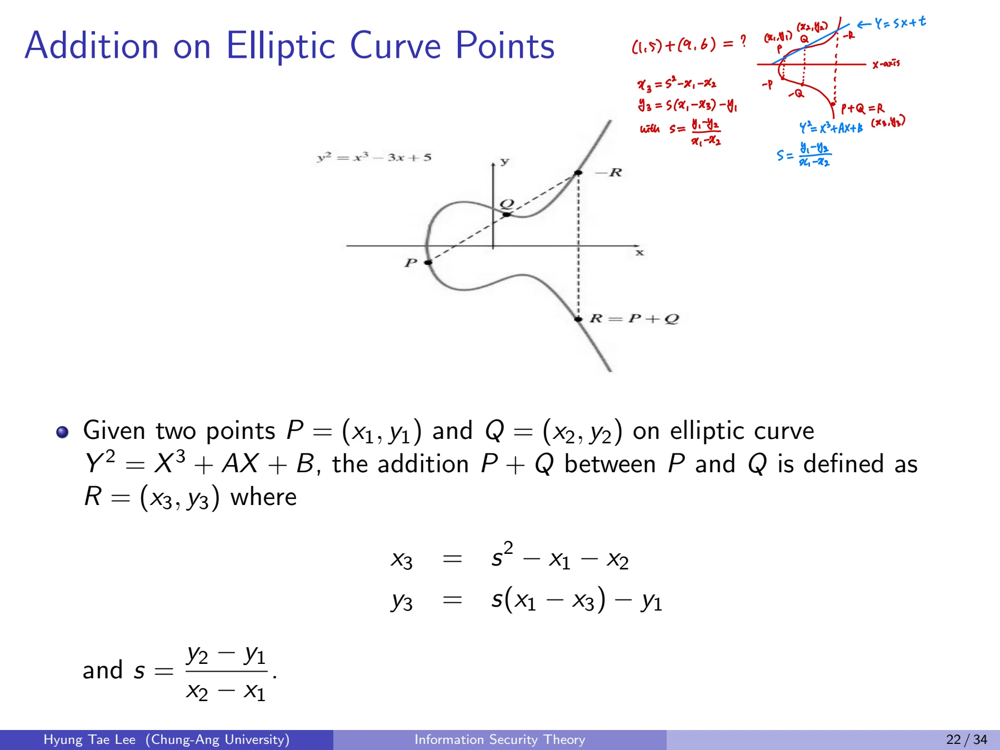
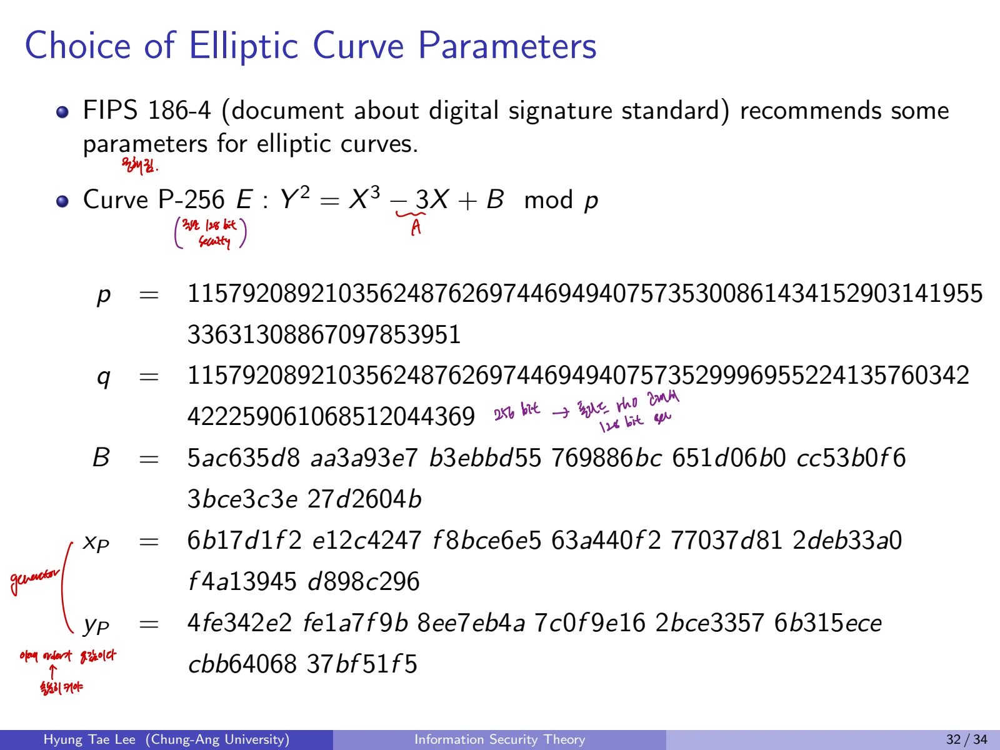

## 1. ECC로 넘어가는 이유
앞서 소개한 DSA와 Diffie-Hellman은 일반적인 유한체 곱셈군에서의 DLP 어려움에 기초한다. ECC는 **타원곡선 위 점들로 이루어진 유한군**을 사용하며, 같은 목표 보안강도에서 유한체 DLP보다 짧은 키/매개변수를 사용할 수 있다.

## 2. Multiplicative vs. Additive Notation

| 개념 | 곱셈 표기 | 덧셈 표기 |
| --- | --- | --- |
| 생성원 | $g$ | $P$ |
| 연산 | $gh$ | $P+Q$ |
| 반복 연산 | $g^x$ | $xP$ |
| 단위원 | 1 | 무한원점 $\mathcal O$ |
| 역원 | $g^{-1}$ | $-P$ |

타원곡선에서는 $g^x$에 해당하는 것이 $xP$, 즉 점 P를 x번 더한 스칼라 곱셈이다.

### DSA를 덧셈 표기로 다시 표현
공개 원소를 $Q=xP$, 임시값 $R=kP$라고 놓고,

$$
s=k^{-1}(H(M)+xr)\bmod q.
$$

검증에서

$$
w=s^{-1},\quad u_1=wH(M),\quad u_2=wr
$$

로 둔다면

$$
u_1P+u_2Q=(u_1+xu_2)P
=w(H(M)+xr)P=kP.
$$

**덧셈군에서 서명값 표현하기:** 일반적인 덧셈군에는 정수 좌표 r을 고르는 방법이나 결과 점을 r과 비교하는 방법이 아직 정의되지 않았다. 이것을 해결하기 위해 **타원곡선의 x좌표**를 사용한다.

## 3. Elliptic Curve의 수학적 정의

### 3.1 Weierstrass Equation
특성 2,3이 아닌 체에서는 곡선을 보통 다음 형태로 쓴다.

$$
E:\quad Y^2=X^3+AX+B.
$$

비특이 조건:

$$
4A^3+27B^2\ne0.
$$

점 집합에는 평면의 유한한 점 외에 **무한원점 **$\mathcal O$를 포함한다. 이 점은 타원곡선 덧셈의 항등원이다.

### 3.2 Finite Field 위 곡선
p가 소수인 경우,

$$
E(\mathbb F_p)=\{(x,y)\in\mathbb F_p^2:y^2\equiv x^3+Ax+B\pmod p\}\cup\{\mathcal O\}.
$$

실수 평면에서 곡선 그림을 이용해 덧셈을 이해하되 실제 암호계산은 유한체 내 좌표만을 대상으로 한다. 유한체 연산에서 분수는 정수 나눗셈이 아니라 **모듈러 역원**을 뜻한다.

### 3.3 유한체 예제

$$
E:y^2=x^3+3x+8\pmod{13}.
$$

$$
E(\mathbb F_{13})=
\{\mathcal O,(1,5),(1,8),(2,3),(2,10),(9,6),(9,7),(12,2),(12,11)\}.
$$

$x=0$이면 $y^2=8$을 만족하는 y가 없고, $x=1$이면 $y^2=12$, 따라서 $y=5$ 또는 $8$이다. 점들의 y좌표는 $\pm y$가 쌍으로 나타나며, 무한원점까지 총 **9개**의 점이 있다.

## 4. 점의 덧셈(Point Addition)

### 4.1 서로 다른 두 점의 덧셈
$P=(x_1,y_1)$, $Q=(x_2,y_2)$이고 $x_1\ne x_2$일 때,

$$
s=\frac{y_2-y_1}{x_2-x_1}\pmod p
$$

$$
x_3=s^2-x_1-x_2\pmod p
$$

$$
y_3=s(x_1-x_3)-y_1\pmod p.
$$

그 결과 $P+Q=(x_3,y_3)$다. 수학적으로는 두 점을 잇는 직선이 곡선과 만나는 세 번째 교점에 대해 x축 대칭을 취한 점을 덧셈 결과로 정한다.
**예외**

- $\mathcal O+P=P$.

- 같은 x좌표에 y가 서로 음수인 점들은 서로 역원이라 $P+(-P)=\mathcal O$.

- $P=Q$이면 접선 기울기를 사용하는 **점의 배점** 공식 적용.

### 4.2 덧셈 공식의 기하학적 유도
두 점을 지나는 직선을 $y=sx+t$라고 두고 곡선 식에 대입하면,

$$
x^3-s^2x^2+(A-2st)x+(B-t^2)=0.
$$

세 근의 합으로

$$
x_1+x_2+x_3=s^2
$$

이므로 $x_3=s^2-x_1-x_2$. 직선 위의 세 번째 교점의 y좌표를 음수로 바꾸면 $y_3=s(x_1-x_3)-y_1$이 된다.

### 4.3 점 덧셈 예제
곡선 $E:y^2=x^3+3x+8$ over $\mathbb F_{13}$에서

$$
P=(9,7),\qquad Q=(1,8).
$$

$$
s=\frac{8-7}{1-9}=\frac1{-8}\equiv\frac15\equiv8\pmod{13}
$$

$$
x_3=8^2-9-1=54\equiv2\pmod{13}
$$

$$
y_3=8(9-2)-7=49\equiv10\pmod{13}
$$

따라서

$$
\boxed{P+Q=(2,10)}.
$$



## 5. Point Doubling

### 5.1 접선의 기울기
$P=(x_1,y_1)$일 때

$$
s=\frac{3x_1^2+A}{2y_1}\pmod p
$$

로 정의하고,

$$
x_3=s^2-2x_1,\qquad y_3=s(x_1-x_3)-y_1\pmod p.
$$

위 기울기는 곡선 방정식 $2y\,dy/dx=3x^2+A$의 음함수 미분에서 유도한다.

### 5.2 Point Doubling 예제
같은 곡선에서 $P=(9,7)$일 때,

$$
s=\frac{3\cdot9^2+3}{2\cdot7}=\frac{246}{14}\pmod{13}.
$$

$246\equiv12$, $14\equiv1$이므로 $s\equiv12\equiv-1\pmod{13}$.

$$
x_3=(-1)^2-18=-17\equiv9\pmod{13}
$$

$$
y_3=(-1)(9-9)-7=-7\equiv6\pmod{13}.
$$

따라서

$$
\boxed{2P=(9,6)=-P}.
$$

즉 $P+2P=\mathcal O$이고 이 점은 이 곡선에서 위수가 3인 원소다.

## 6. Scalar Multiplication
정수 x에 대해 $xP=P+\cdots+P$를 효율적으로 계산한다. 모듈러 거듭제곱의 repeated squaring과 같은 생각을 사용한다.

| 모듈러 거듭제곱 | 타원곡선 |
| --- | --- |
| Multiplication | Point Addition |
| Squaring | Point Doubling |
| $g^x$ | $xP$ |

### Right-to-Left Double-and-Add
```text
R = O       # 무한원점
T = P
for bit in binary(x), from LSB to MSB:
    if bit == 1:
        R = R + T
    T = T + T
return R
```
연산량은 x의 이진 길이에 비례한다. $x=13=1101_2$이면 $13P=P+4P+8P$로 계산한다.

## 7. ECC의 키 길이 이점
유한체 곱셈군의 DLP에는 Number Field Sieve 계열 공격이 가능한 반면, 일반적으로 선택하는 표준 타원곡선의 DLP에 대해 **Pollard rho**가 대표적인 일반 공격이다. 같은 목표 보안강도에서 타원곡선의 군 크기 및 키가 짧다.

| 보안강도 | ECC 군 위수 비트 수 | 유한체 DLP의 p 비트 수 |
| --- | --- | --- |
| 80 | 160 | 1024 |
| 112 | 224 | 2048 |
| 128 | 256 | 3072 |
| 192 | 384 | 7680 |
| 256 | 512 | 15360 |

이 표는 **2016년 당시의 NIST 기준 비교**다.

## 8. ECDSA(Elliptic Curve Digital Signature Algorithm)

### 8.1 Key Generation

1. 유한체 $\mathbb F_p$에서 곡선 E와 계수 A,B 결정

2. 위수 q인 순환 부분군을 생성하는 점 P 선택

3. 비밀키 $x\in\{1,\ldots,q-1\}$ 선택

4. 공개 점 $Q=xP$ 계산

$$
pk=(p,A,B,q,P,Q),\qquad sk=x.
$$

### 8.2 Sign
새로운 서명마다 난수 $k\in\{1,\ldots,q-1\}$를 선택한다.

$$
R=kP,\qquad r=x_R\bmod q
$$

$$
s=k^{-1}(H(M)+xr)\bmod q.
$$

서명은 $(r,s)$다. **r 또는 s가 0이면 k를 다시 선택**해야 한다.

### 8.3 Verify

$$
w=s^{-1}\bmod q
$$

$$
u_1=wH(M)\bmod q,\qquad u_2=wr\bmod q
$$

$$
R'=u_1P+u_2Q.
$$

$r\overset{?}=x_{R'}\bmod q$인지를 확인한다. 검증에서는 값 범위, 곡선 위 여부, 무한원점 여부 등의 조건도 확인해야 한다.

### 8.4 Correctness
$Q=xP$이므로

$$
R'=u_1P+u_2Q
=w(H(M)+xr)P.
$$

서명식으로부터 $w(H(M)+xr)\equiv k\pmod q$이므로

$$
R'=kP=R.
$$

따라서 x좌표가 같아 검증에 성공한다.
**주의:** ECDSA의 r은 점의 x좌표 자체가 아니라 $x_R\bmod q$다. 같은 k를 두 서명에 재사용하면 개인키를 복구할 수 있어 nonce 생성은 중요하다.

## 9. 표준 곡선 파라미터의 예
P-256은 다음과 같은 곡선이다.

$$
E:y^2=x^3-3x+B\pmod p.
$$

관련 매개변수에는 체의 법 p, 기약 부분군의 위수 q, 계수 B, 생성점 좌표 $(x_P,y_P)$가 있다. 구체적인 매개변수 값은 다음과 같다.



## 10. Elliptic Curve ElGamal

### 10.1 KeyGen
선택한 곡선, 위수 q인 생성점 G와 비밀 정수 x를 이용한다.

$$
X=xG,\qquad pk=(p,A,B,q,G,X),\quad sk=x.
$$

### 10.2 Enc
곡선 위 점으로 인코딩한 메시지 M과 랜덤 정수 r에 대해

$$
C_1=rG,\qquad C_2=M+rX.
$$

### 10.3 Dec

$$
M=C_2-xC_1.
$$

정합성:

$$
C_2-xC_1=M+rX-x(rG)=M+rxG-rxG=M.
$$

일반 ElGamal에서는 곱셈과 나눗셈을 썼지만 ECC로 옮긴 버전에서는 **덧셈과 뺄셈**을 쓴다는 점이 핵심이다.

## 이어서 읽기

- 이전 글: [10. 전자서명, RSA, ElGamal과 PSS](/posts/basic-cryptography-digital-signatures-rsa-pss/)
- 다음 글: [12. 암호학적 해시 함수와 SHA 계열](/posts/basic-cryptography-cryptographic-hash-functions/)
