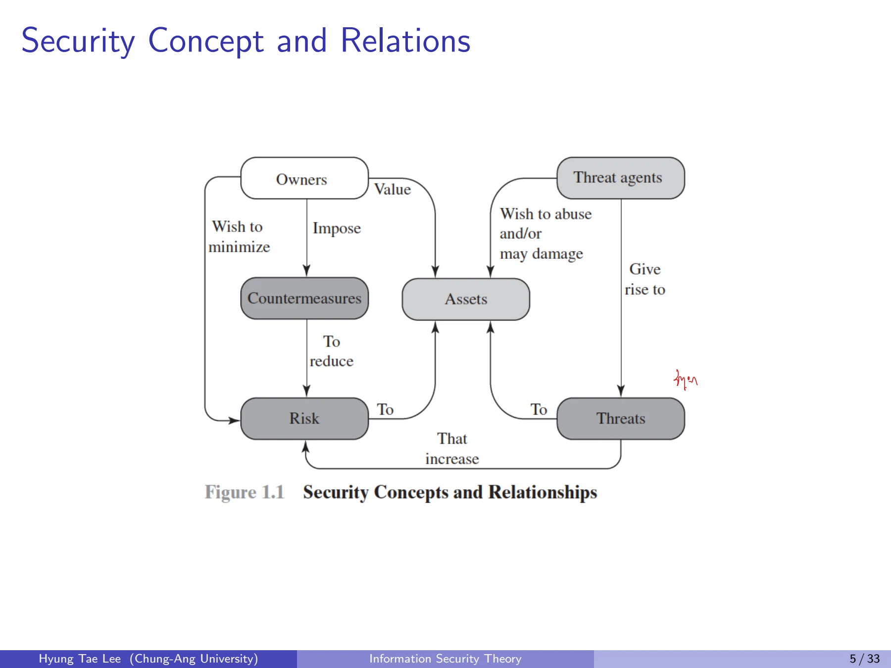
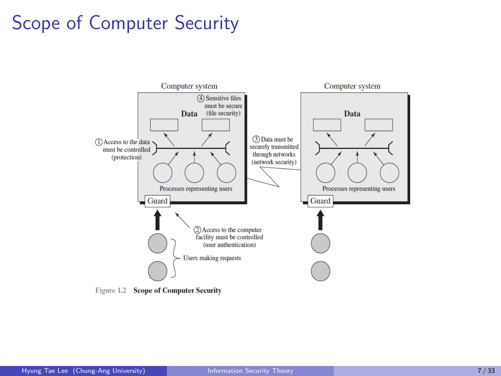
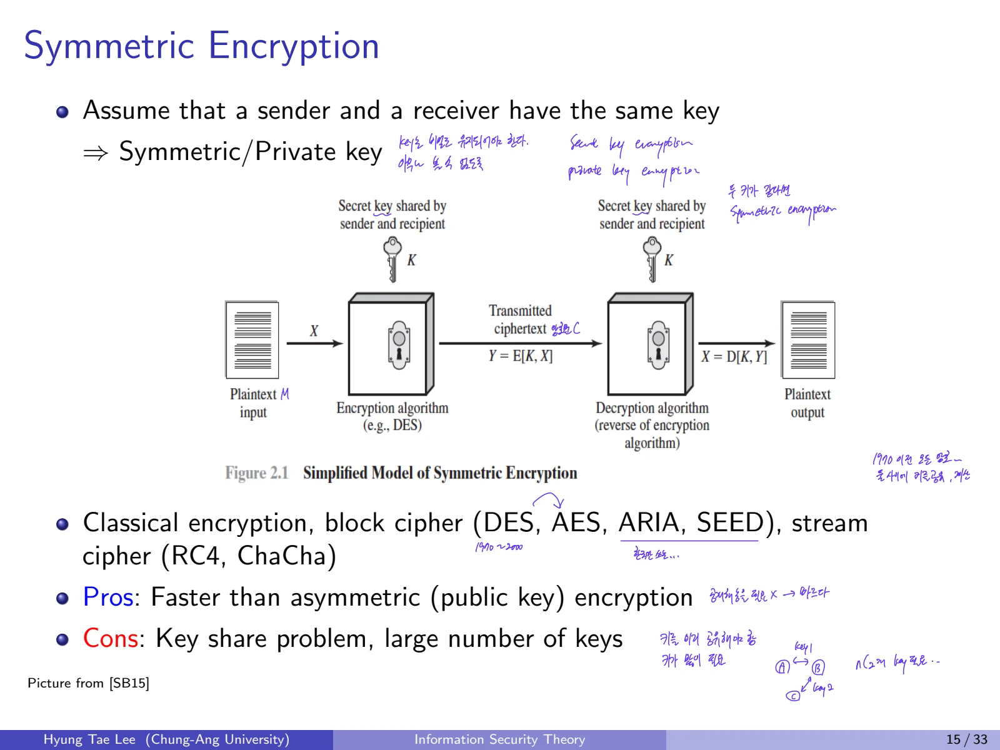
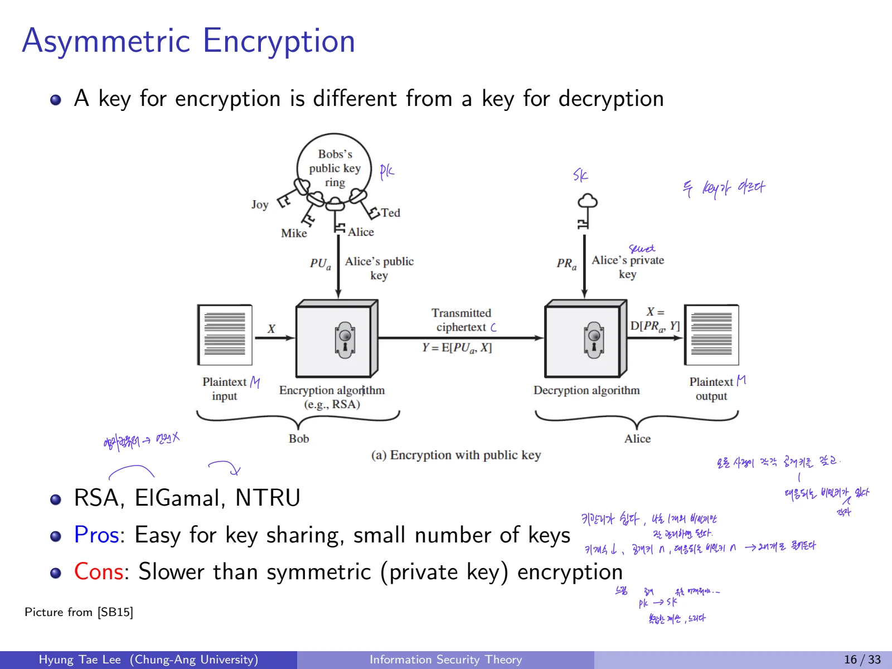

정보보호는 정보를 숨기는 것만으로 완성되지 않는다. 허가 없이 내용이 바뀌지 않아야 하고, 필요한 사람이 제때 이용할 수도 있어야 한다. 이 세 가지 목표가 기밀성, 무결성, 가용성이다.

## 1. 정보보호와 Computer Security

### 1.1 Computer Security의 정의
컴퓨터 보안이란 **자동화된 정보시스템의 자원에 대해 기밀성, 무결성, 가용성을 보존하도록 제공하는 보호**를 뜻한다. 보호 대상은 정보 자체뿐 아니라 하드웨어, 소프트웨어, 펌웨어, 통신과 서비스까지 포함된다.

### 1.2 CIA Triad

| 보안 목표 | 개념 | 세부 항목과 예 |
| --- | --- | --- |
| Confidentiality, 기밀성 | 허가되지 않은 주체가 정보를 읽지 못하게 함 | Data confidentiality, Privacy, 암호화 |
| Integrity, 무결성 | 데이터나 시스템이 허가 없이 바뀌지 않도록 보존함 | Data integrity, System integrity |
| Availability, 가용성 | 정당한 사용자가 필요한 자원을 제때 이용할 수 있게 함 | 서비스 접근성, 장애 및 DoS에 대한 대응 |

정보보호에서는 CIA 세 가지를 함께 고려한다. 기밀성은 정보를 숨기는 관점, 무결성은 저장 및 처리된 내용이 올바르게 유지되는 관점, 가용성은 서비스가 이용 가능한 관점으로 이해한다.

### 1.3 추가 요구사항

- **Authenticity, 진정성:** 통신 상대, 데이터 또는 주체가 주장하는 출처와 정체가 실제로 맞는가.

- **Accountability, 책임추적성:** 수행된 작업을 책임 주체에 연결하고 추적할 수 있는가.

암호화만으로는 모든 보안 목표가 충족되지 않는다. 해시, MAC, 전자서명, 인증 프로토콜이 각기 다른 목적을 갖는 이유다.

## 2. 보안 용어와 관계

| 용어 | 정의와 핵심 포인트 |
| --- | --- |
| Adversary (threat agent) | 시스템을 공격하는 개체, 공격자 |
| Attack | 지능적 위협에서 비롯된 실제 보안 침해 시도 |
| Countermeasure | 위협, 취약점, 공격을 줄이는 조치, 장치, 절차 또는 기술 |
| Risk | 특정 위협이 취약점을 이용해 특정 손해를 일으킬 것으로 기대되는 손실 |
| Security policy | 중요 자산을 보호하기 위해 보안 서비스를 제공하고 통제하는 규칙과 관행 |
| System resource (Asset) | 시스템 데이터, 서비스, 기능, 운영 시설 등 보호할 자산 |
| Threat | 보안 위반을 일으킬 수 있는 잠재적 상황, 능력, 행동 또는 사건 |
| Vulnerability | 설계, 구현, 운영, 관리에서 발생한 악용 가능한 약점 |

### 2.1 Security Concepts and Relationships
보안 개념의 관계를 살펴보면 자산을 소유한 **Owner**, 공격 주체인 **Threat Agent**, 공격받는 **Asset**, 발생 가능한 **Threat**, 이를 줄이려는 **Countermeasure**와 **Risk**가 상호 연결되어 있다.

- 소유자는 자산에 가치를 부여하고 위험을 줄이기 위한 대응책을 적용한다.

- 위협 주체는 자산에 대한 위협을 발생시키며, 위험을 증가시킬 수 있다.

- 대응책은 위험을 줄이지만 완전한 제거를 보장하지는 않는다.

### 2.2 취약점, 공격, 대응책의 분류

**취약점이 일으키는 손실**

- Corrupted: 무결성 손실

- Leaky: 기밀성 손실

- Unavailable or very slow: 가용성 손실

**공격의 구분**

- Passive attack: 내용을 관찰하거나 정보를 수집하는 수동적 공격

- Active attack: 메시지나 시스템 동작에 개입하는 능동적 공격

- Insider attack: 내부자가 수행하는 공격

- Outsider attack: 외부 주체의 공격

**대응의 구분**

1. Prevent: 공격을 미리 방지

2. Detect: 공격이나 비정상 상태 탐지

3. Recover: 피해 복구

보안 전략을 논할 때는 여기에 **Response, 대응**을 별도의 단계로 넣어 Prevention, Detection, Response, Recovery를 설명한다.

## 3. Fundamental Security Design Principles
보안 기능을 설계할 때 고려할 원칙은 다음과 같다.

| 원칙 | 핵심 의미 |
| --- | --- |
| Economy of mechanism | 보안 기능을 가능한 한 작고 단순하게 설계하여 검증 가능성을 높인다. |
| Fail-safe defaults | 허용을 기본값으로 하지 않고, 명시적으로 허가된 요청만 허용한다. |
| Complete mediation | 보호된 객체에 대한 접근은 매번 권한 검사를 거친다. |
| Open design | 설계의 비밀 자체에 안전성을 의존하지 않는다. 암호학에서는 Kerckhoffs 원칙과 연결된다. |
| Separation of privilege | 하나의 권한이나 조건만으로 중요한 동작이 성립하지 않게 권한을 나눈다. |
| Least privilege | 주체에 작업에 필요한 최소 권한만 부여한다. |
| Least common mechanism | 여러 사용자나 구성요소가 공유하는 보안상 민감한 공통 메커니즘을 최소화한다. |
| Psychological acceptability | 사용자가 보안 기능을 이해하고 올바르게 사용할 수 있도록 설계한다. |
| Isolation | 보호해야 하는 구성요소 및 자원을 격리한다. |
| Encapsulation | 내부 구현을 감추고 통제된 인터페이스를 통해 접근하게 한다. |
| Modularity | 시스템을 분리 가능한 모듈로 구성하여 관리와 검증을 쉽게 한다. |
| Layering | 하나의 방어층에만 의존하지 않고 여러 층을 사용한다. |
| Least astonishment | 시스템과 보안 기능이 사용자에게 예상 가능한 방식으로 동작하도록 한다. |

Open design은 알고리즘의 설계 자체를 숨겨 안전을 확보하려 하지 않는다는 원칙이며, Least privilege는 권한을 최소화한다는 원칙이다.

## 4. 공격 표면과 컴퓨터 보안의 범위

### 4.1 Attack Surface
Attack surface는 공격자가 도달하고 악용할 수 있는 시스템 취약점의 집합이다.

- **Network:** 네트워크 프로토콜, 인터넷 연결, 통신 링크, 서비스 거부 공격

- **Software:** 애플리케이션, 유틸리티, 운영체제 코드의 취약점

- **Human:** 사회공학, 사람의 실수, 신뢰된 내부자의 행위

### 4.2 Scope of Computer Security
보안은 데이터만을 보호하는 문제가 아니라 **시스템의 구성요소, 접근 제어, 물리적 및 논리적 방어**를 함께 고려해야 하는 영역이다.

보안 분야는 다음과 같이 나눌 수 있다: System Security, Network Security, Web Security, Code Security, Malware, Mobile/IoT Security, Cryptography, Security Systems(인증, 방화벽, 침입방지), Electronic Commerce Security(PKI, 암호화폐, 블록체인), Digital Forensics.

### 4.3 Computer Security Strategy

| 요소 | 설명 |
| --- | --- |
| Security policy | 조직과 시스템에서 보호할 것, 적용할 규칙을 정한다. |
| Security implementation | 예방, 탐지, 대응, 복구 기능을 실제로 구현한다. |
| Security assurance | 구현한 보안 수단이 의도대로 동작한다는 확신의 정도다. |
| Security evaluation | 일정 기준에 따라 제품이나 시스템의 보안성을 평가한다. |

## 5. Classical Cryptography에서 Modern Cryptography로

### 5.1 고전암호
전통적으로 cryptography는 암호문을 쓰거나 해독하는 기술을 뜻했다. 현대 암호학은 단순한 code, encode, decode, encipher, decipher의 구분을 넘어서 정형화된 보안 목표와 공격자 모델을 다룬다.

### 5.2 현대암호학
현대암호학은 디지털 정보, 거래, 분산 계산을 안전하게 하는 기법을 **과학적으로 연구하는 분야**다.

| 계층 | 예시 | 대표 목적 |
| --- | --- | --- |
| Primitives | Hash functions, Random number generators | 안전한 구성 요소 |
| Schemes | Encryption, Digital Signature | 기밀성, 무결성 및 출처 검증 |
| Protocols | Identification, Key establishment, Secret sharing | 인증, 키 합의 및 분산 협력 |
| Applications | Secure Internet protocols, Electronic cash | 완성된 응용 서비스 |

Primitives는 암호학에서 쓰이는 기본 재료, Schemes는 암호화를 비롯한 구체적 방식, Protocols는 실제 주체들 간에 수행되는 절차다. 용어가 비슷해도 계층별 역할을 구분한다.

## 6. 암호화의 기본 구조

### 6.1 Encryption Scheme
암호화는 **기밀성(confidentiality)**을 제공하는 기술이다. 공통 인터페이스는 다음 세 알고리즘이다.

$$
\operatorname{Setup}(\lambda)\longrightarrow(K_{\mathrm{Enc}},K_{\mathrm{Dec}})
$$

$$
\operatorname{Enc}(K_{\mathrm{Enc}},M)\longrightarrow CT
$$

$$
\operatorname{Dec}(K_{\mathrm{Dec}},CT)\longrightarrow M
$$

여기서 λ는 보안 매개변수, M은 평문, CT는 암호문이다. 올바른 키와 정상적인 암호문에 대해서는 복호화를 거치면 원래 평문을 얻어야 한다.

$$
\operatorname{Dec}\bigl(K_{\mathrm{Dec}},\operatorname{Enc}(K_{\mathrm{Enc}},M)\bigr)=M
$$

마지막 식은 정상 동작을 나타내는 **Correctness 조건**이다.

### 6.2 Symmetric Encryption
송신자와 수신자가 동일한 비밀키를 공유한다. Block Cipher와 Stream Cipher를 포함하며 대표적인 예는 DES, AES, ARIA, SEED, RC4, ChaCha다.

- 장점: 공개키 암호에 비해 상대적으로 빠른 계산

- 단점: 사전 키 공유의 어려움, 여러 사용자 간 키 관리 문제

### 6.3 Asymmetric Encryption
암호화키와 복호화키가 다른 암호 방식이다. 암호화에 공개키를, 복호화에 개인키를 사용하는 형태가 대표적이다. 대표적인 예는 RSA, ElGamal, NTRU다.

- 장점: 공개키 공개가 가능하여 키 공유가 상대적으로 수월함

- 단점: 대칭키 암호보다 상대적으로 느린 계산

기반 문제에 따라 소인수분해, 이산로그, 격자, 오류정정부호 기반 등으로 나눌 수 있다. 격자와 오류정정부호 기반 암호는 양자내성암호의 주요 접근법이다.

### 6.4 Encryption Terminology

- **Plaintext:** 암호화에 입력되는 원래 메시지

- **Ciphertext:** 암호화 알고리즘에서 생성된 출력

- **Encryption algorithm:** 평문과 키에서 암호문을 생성하는 알고리즘

- **Decryption algorithm:** 암호문과 키에서 평문을 복원하는 알고리즘

- **Private/secret key:** 대칭키 암호의 암복호화에 사용하는 비밀키

- **Public key / private key pair:** 공개키 암호에서 각각 암호화와 복호화에 사용하는 키 쌍

## 7. Kerckhoffs's Principle과 공격 모델

### 7.1 Kerckhoffs's Principle
암호 알고리즘은 적에게 공개되어도 안전해야 하고, **암호 기법 자체의 비밀을 안전성의 전제로 삼아서는 안 된다.**

1. 전체 알고리즘보다 짧은 키의 비밀을 유지하는 편이 쉽다.

2. 키가 유출될 때 알고리즘을 통째로 교체할 필요 없이 키를 변경할 수 있다.

3. 같은 알고리즘을 쓰더라도 상대방마다 서로 다른 키를 사용해 통신할 수 있다.

이 원칙은 앞의 **Open Design**과 일관된다.

### 7.2 기본 공격 유형

**Brute-force attack:** 가능한 키를 모두 시도하는 공격.
**Cryptanalysis:** 암호의 성질이나 공격자가 가진 정보를 이용해 암호를 분석하는 공격. 공격자가 얻을 수 있는 정보에 따라 네 가지로 구분한다.

| 공격 모델 | 공격자가 가진 정보 |
| --- | --- |
| Ciphertext-only attack, COA | 암호문 |
| Known-plaintext attack, KPA | 알려진 평문과 그에 대응하는 암호문 |
| Chosen-plaintext attack, CPA | 공격자가 선택한 평문의 암호화 결과 |
| Chosen-ciphertext attack, CCA | 공격자가 선택한 암호문의 복호화 결과 |

공격자가 얻을 수 있는 정보와 사용할 수 있는 기능을 구분하면 고전암호의 공격 방법을 비교할 수 있다. 공개키 암호의 IND-CPA와 IND-CCA 안전성 정의도 이러한 공격자 모델을 바탕으로 한다.
