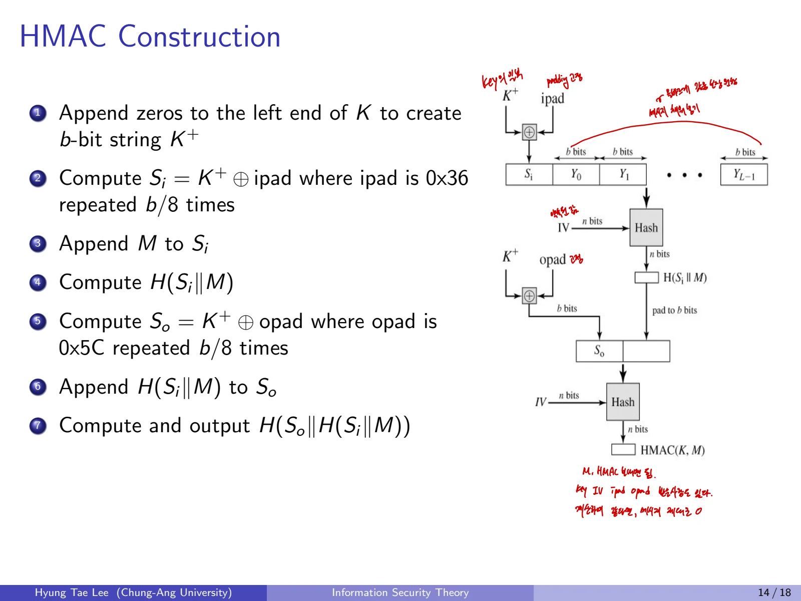
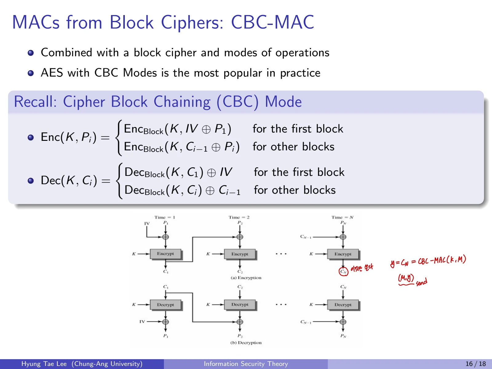

## 1. Message Authentication Code(MAC)

### 1.1 왜 MAC이 필요한가
Alice와 Bob은 안전한 비밀키 k를 공유하고 있다고 가정한다. Bob이 메시지 x를 보낼 때 **전송 중 변경되었는지** 확인하고, 메시지가 같은 비밀키를 가진 당사자로부터 왔다는 것을 인증하려고 한다.
Bob은

$$
y=MAC_k(x)
$$

를 계산하여 메시지와 함께 $(x,y)$를 Alice에게 전송한다. Alice는 자신이 공유한 k로 받은 메시지 x에 대한 MAC를 다시 계산해 전달받은 y와 비교한다.

### 1.2 MAC의 특성

- **Cryptographic checksum:** 메시지와 비밀키에 의존하는 검증 태그

- **Symmetric technique:** 송신자와 수신자가 같은 비밀키를 공유

- **Variable-length input, fixed-length output**

- **Message integrity:** 메시지의 변경 감지

- **Message authentication:** 공유 키를 모르는 외부자의 유효 태그 위조 방지

- **No nonrepudiation:** 공유키 양쪽 당사자가 모두 MAC을 만들 수 있어 제삼자에게 특정 한 사람만 생성했다고 증명하기 어려움

## 2. MAC vs. Digital Signature

| 항목 | MAC | 전자서명 |
| --- | --- | --- |
| 키 | 대칭 공유 비밀키 | 개인키로 서명, 공개키로 검증 |
| 검증자 | 비밀키 소유자 | 공개키를 가진 누구나 |
| 효율 | 일반적으로 빠름 | 공개키 연산으로 상대적으로 비쌈 |
| 무결성/인증 | 제공 | 제공 |
| 부인방지(Nonrepudiation) | 제공하지 않음 | 키 소유권 및 법적/운영적 조건에 따라 증거로 사용 가능 |
| 구성 | HMAC, CBC-MAC | RSA-PSS, DSA, ECDSA |

MAC에는 비밀키를 공유한다는 조건이 있고, 바로 그 때문에 제삼자 앞에서 한 사용자가 MAC 생성을 부인하지 못하게 만드는 성질(**nonrepudiation**)은 확보할 수 없다.

## 3. MAC의 안전성 정의
KeyGen, MAC generation, verification을 다음처럼 쓸 수 있다.

$$
k\leftarrow\operatorname{KeyGen}(1^\lambda),\quad
t\leftarrow\operatorname{Mac}(k,M),\quad
b\leftarrow\operatorname{Vrfy}(k,M,t).
$$

정합성:

$$
\operatorname{Vrfy}(k,M,\operatorname{Mac}(k,M))=1.
$$

공격자가 메시지에 대한 MAC 태그를 요청할 수 있더라도, 아직 인증받지 않은 **새 메시지에 대한 유효한 MAC**를 생성하기 어려워야 한다. 이 조건을 선택 메시지 공격 상황의 unforgeability로 표현한다.

## 4. HMAC(Hash-based MAC)

### 4.1 설계와 사용 배경
HMAC은 Bellare, Canetti, Krawczyk가 1996년에 발표한 해시 함수 기반 MAC이다. IPsec, TLS 등에 사용된다. 특정 해시 함수의 특성과 적절한 가정 아래 **보안성을 증명할 수 있는 구성**이라는 점을 강조한다.

### 4.2 HMAC의 핵심 식
해시 함수 H의 압축함수 블록 길이를 b비트라 하고, K를 블록 길이에 맞춰 정규화한 키 $K'$라고 하자.

$$
HMAC(K,M)=H((K'\oplus opad)\parallel H((K'\oplus ipad)\parallel M)).
$$

- **ipad:** 바이트 값 0x36을 블록 전체에 반복

- **opad:** 바이트 값 0x5C를 블록 전체에 반복

- $\parallel$: 문자열 이어붙이기

- Inner hash: 키와 ipad를 XOR한 뒤 메시지 M을 연결해 해싱

- Outer hash: 키와 opad를 XOR한 뒤 inner hash를 연결해 다시 해싱

### 4.3 단계별 알고리즘

1. 원래 키 K를 해시 함수의 블록 길이에 맞게 K'로 조정한다.

2. $S_i=K'\oplus ipad$ 계산

3. $S_i\parallel M$을 구성

4. $H(S_i\parallel M)$ 계산

5. $S_o=K'\oplus opad$ 계산

6. $S_o\parallel H(S_i\parallel M)$ 연결

7. $H(S_o\parallel H(S_i\parallel M))$ 출력

키가 해시 함수의 블록 길이보다 짧으면 **오른쪽에 0을 붙인다**. 블록 길이보다 길면 먼저 해싱한 다음 필요한 만큼 0을 붙인다.

### 4.4 HMAC이 단순 Hash(K\|\|M)보다 안전한 이유
HMAC은 내부 패딩과 외부 패딩을 달리하여 단순 연결 해시의 구조적 위험(일부 해시 구조의 length extension 등)을 피하도록 설계되었다. 키가 해시의 내부와 외부 두 단계에서 다르게 사용된다.

### 4.5 HMAC의 안전성
HMAC의 안전성은 사용하는 해시 함수와 압축함수의 성질에 의존한다.

- 비밀 IV를 쓰는 압축함수의 출력을 공격자가 예측하는 문제

- 비밀 상태에서 해시 충돌을 만들 수 있는지의 문제

- 해시를 이용하는 구성의 **증명 가능한 안전성**이라는 관점

해시 함수의 공개 충돌 하나가 곧 HMAC 전체의 위조 성공을 뜻하지는 않는다. 정확한 가정과 보안 모델을 구별해야 한다.

## 5. CBC-MAC(Block Cipher 기반 MAC)

### 5.1 구성 원리
CBC-MAC은 블록암호의 CBC chaining을 이용하지만 **암호문 전체를 전송하는 것이 아니라 마지막 블록의 상태값을 인증 태그로 사용**한다.
메시지 $M=M_1\parallel\cdots\parallel M_n$을 블록으로 분할하고, 초기 chaining 값 $Y_0$를 정한다. 안전한 기본 고정 길이 CBC-MAC에서는 보통

$$
Y_0=0^b.
$$

그다음

$$
Y_i=E_K(M_i\oplus Y_{i-1}),\quad i=1,\ldots,n
$$

으로 계산하고 마지막 값을 태그로 사용한다.

$$
MAC_K(M)=Y_n.
$$

### 5.2 Generation/Verification
**Generation**

1. 비밀키 K 준비

2. 메시지를 n개 블록으로 분할

3. 고정 IV에서 시작하여 CBC chaining 수행

4. 마지막 암호화 결과 $Y_n$을 태그로 출력
**Verification**

1. 받은 메시지 M에 대해 같은 키와 초기 상태로 CBC-MAC 다시 계산

2. 수신한 태그와 일정 시간 비교를 수행

3. 같으면 수락, 다르면 거부

### 5.3 CBC-MAC의 안전한 사용조건
반복식을 IV로 표현하면 다음과 같다. 기본 CBC-MAC에서는 IV를 0으로 고정한다.

$$
Y_1=E_K(IV\oplus M_1)
$$

$$
Y_i=E_K(M_i\oplus Y_{i-1})\quad (2\le i\le n).
$$

그러나 **표준적으로 안전한 고정 길이 CBC-MAC은 IV를 공격자가 자유롭게 정하지 않도록 고정한다.** 일반 CBC 암호화처럼 임의 IV를 자유롭게 선택하도록 허용하면 태그 위조 문제가 생길 수 있다.

### 5.4 가변 길이 메시지에 대한 주의
기본 CBC-MAC은 **길이가 고정된 메시지 집합**에서의 안전성을 전제로 한다. 임의 길이 메시지에 같은 규칙을 그대로 적용하면 연장 공격이 가능하다.
예를 들어 $MAC(M)=t$, $MAC(N)=u$이고 같은 키, 고정 IV=0을 쓰는 경우 $N=N_1\parallel\cdots\parallel N_k$에 대해,

$$
M\parallel(N_1\oplus t)\parallel N_2\parallel\cdots\parallel N_k
$$

의 CBC-MAC가 u가 될 수 있다. M 처리 후 chaining 값이 t이므로 다음 블록의 XOR가 $t\oplus(N_1\oplus t)=N_1$로 상쇄되기 때문이다.
따라서 **가변 길이 메시지에는 길이 인코딩을 포함한 적절한 설계나 CMAC 등의 표준화된 변형**을 사용해야 한다.

## 6. HMAC와 CBC-MAC 비교

| 구분 | HMAC | CBC-MAC |
| --- | --- | --- |
| 구성 요소 | 해시 함수 | 블록암호 |
| 처리 | 내부/외부의 두 단계 해싱 | CBC chaining의 마지막 블록 |
| 키 처리 | ipad, opad와 키 XOR | 블록암호의 비밀키 |
| 메시지 길이 | 일반적으로 가변 길이 가능 | 기본형은 고정 길이 제약 |
| 주의 | 키 정규화와 해시함수의 가정 | 고정 IV, 메시지 길이, 위조 방어 |
| 검증 | 동일한 HMAC 재계산 | 동일한 CBC-MAC 재계산 |

## 7. 암호화, 해시, MAC, 전자서명 구분

- **Encryption:** 기밀성 확보가 목적

- **Hash:** 비밀키 없이 입력에서 고정 길이 다이제스트 생성

- **MAC:** 공유 비밀키로 무결성 및 메시지 인증

- **Digital Signature:** 개인키 서명과 공개키 검증, 출처 인증 및 제삼자 검증

## 이어서 읽기

- 이전 글: [12. 암호학적 해시 함수와 SHA 계열](/posts/basic-cryptography-cryptographic-hash-functions/)
- 다음 글: [14. 암호학 계산 문제와 복습](/posts/basic-cryptography-cryptography-review/)
