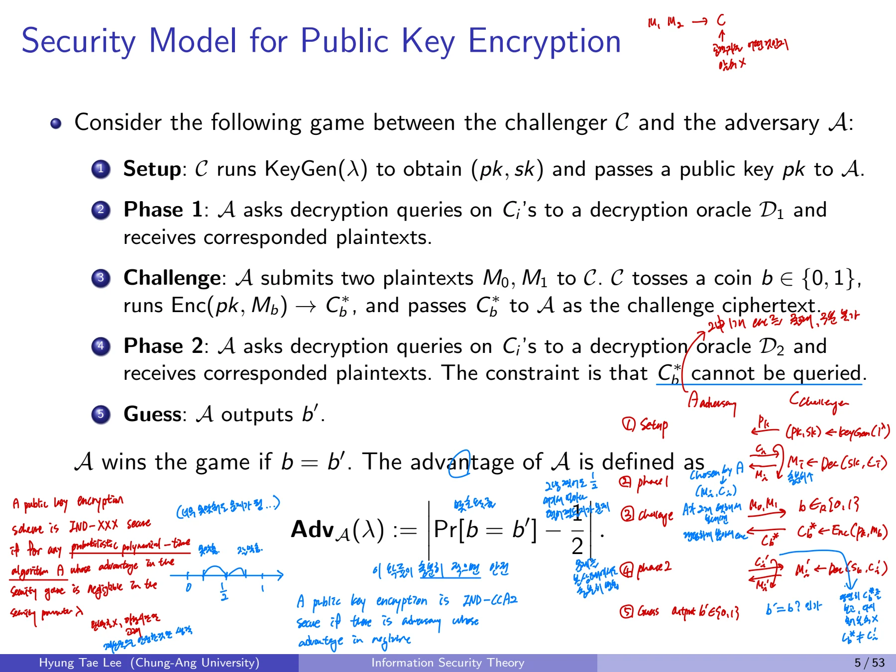

## 1. Public Key Encryption

### 1.1 대칭키 암호와의 차이
공개키 암호는 암호화 키와 복호화 키가 다르다. 암호화에 쓰는 공개키는 공개해도 되고, 복호화에 쓰는 비밀키는 소유자만 보유한다. RSA, ElGamal, NTRU가 대표적인 예다.

| 비교 | 대칭키 암호 | 공개키 암호 |
| --- | --- | --- |
| 키 | 공유된 비밀키 | 공개키, 개인키 |
| 속도 | 일반적으로 빠름 | 일반적으로 느림 |
| 키 배포 | 공유 과정의 보안이 중요 | 공개키 자체를 공개 가능 |
| 키의 안전성 | 비밀키 보호 | 비밀키 보호 및 공개키의 진위 확인 |

공개키 암호는 공개키를 알아도 평문을 복원하기 어렵도록 설계한다. 다만 **그 공개키가 누구의 것인지 인증하는 문제는 별도로 해결해야 한다.**

## 2. PKE의 세 알고리즘
PKE는 다항시간에 수행되는 세 알고리즘으로 정의한다.

$$
(pk,sk)\leftarrow \operatorname{KeyGen}(1^\lambda)
$$

$$
C\leftarrow\operatorname{Enc}(pk,M)
$$

$$
M\leftarrow\operatorname{Dec}(sk,C)
$$

- **KeyGen**: 보안 매개변수 $\lambda$를 입력받아 공개키/비밀키 쌍 생성

- **Enc**: 공개키와 평문으로 암호문 생성

- **Dec**: 비밀키와 암호문으로 평문 복원

$1^\lambda$는 보안 매개변수를 단항 문자열로 표현한 것으로, 실행시간을 $\lambda$에 대한 다항식으로 다루기 위한 표기다.

### Correctness(정합성)
정상적인 키쌍과 평문에 대해 복호화는 암호화한 원문을 돌려주어야 한다.

$$
\operatorname{Dec}(sk,\operatorname{Enc}(pk,M))=M.
$$

이는 안전성(security)과 다르다. 암호화와 복호화가 정상 동작하더라도 공격자에게 정보를 노출한다면 안전한 암호가 아니다.

## 3. PKE의 Security Game

### 3.1 Challenger와 Adversary
공격자 $A$가 암호문이 두 메시지 중 **어느 메시지를 암호화한 것인지 구별할 수 있는가**를 시험한다. 도전자는 $C$라고 표기한다.

**Setup**

1. Challenger가 $KeyGen(\lambda)$을 수행하여 $(pk,sk)$를 생성한다.

2. 공격자에게 공개키 $pk$를 준다.

**Phase 1**

1. 공격 모델에 따라 공격자는 복호화 오라클 $D_1$에 암호문을 제출하고 평문을 받는다.

**Challenge**

1. 공격자가 같은 길이의 후보 메시지 $M_0,M_1$을 도전자에게 제출한다.

2. 도전자가 무작위 비트 $b\in\{0,1\}$를 고른다.

3. 도전자는 $C^*=\operatorname{Enc}(pk,M_b)$를 계산하여 공격자에게 보낸다.

**Phase 2**

1. 공격 모델에 따라 공격자가 복호화 오라클 $D_2$에 암호문을 제출한다.

2. **도전 암호문 $C^*$ 자체는 이 오라클에 물어볼 수 없다.**

**Guess**

1. 공격자가 $b'$을 출력한다. $b'=b$이면 공격자가 성공한다.

### 3.2 Advantage
공격자가 임의의 추측보다 얼마나 더 잘 맞히는지가 중요하다. 이를 advantage로 나타내면

$$
\operatorname{Adv}_{A}(\lambda)=\left|\Pr[b'=b]-\frac12\right|.
$$

문헌에 따라 위 값에 2를 곱해 Advantage를 정의하기도 한다. **정의의 정규화 배율보다 보안 매개변수에 대한 negligible(무시할 수 있는) 성질이 핵심**이다.

## 4. CPA, CCA, CCA2 구분
허용되는 복호화 질의 오라클이 다르다.

| 안전성 모델 | 도전 전 $D_1$ | 도전 후 $D_2$ | 직관 |
| --- | --- | --- | --- |
| IND-CPA | 불허 | 불허 | 공격자는 공개키를 사용해 스스로 암호화 가능 |
| IND-CCA (non-adaptive) | 허용 | 불허 | 도전 전에만 복호화 질의 |
| IND-CCA2 (adaptive) | 허용 | 허용, 단 $C^*$ 제외 | 도전 후에도 적응적으로 질의 |

**CCA1**은 non-adaptive CCA, **CCA2**는 adaptive CCA다. 일부 현대 문헌에서는 그냥 IND-CCA를 IND-CCA2의 의미로 쓰기도 하므로 논문마다 용어를 확인해야 한다.

### 4.1 왜 $C^*$ 복호화를 금지하는가
도전 암호문 자체를 복호화 오라클에 물어볼 수 있다면 공격자는 바로 $M_b$를 얻고 $b$를 알아낸다. 이것은 의미 있는 보안 게임이 아니다.

### 4.2 CPA와 공개키 암호의 특징
공개키가 알려져 있으므로 공격자는 임의 평문을 원하는 만큼 직접 암호화해 볼 수 있다. 따라서 **공개키 암호의 안전성 정의에서는 CPA 수준의 공격능력을 기본으로 고려**한다. 결정적인 textbook RSA가 IND-CPA 안전하지 않은 이유와 연결된다.

### 4.3 IND-XXX Security
효율적인 모든 공격자 $A$에 대해 성공 이점이 negligible하면 해당 IND-XXX 보안을 만족한다고 말한다.

$$
\forall\ \text{PPT } A,\quad \operatorname{Adv}_A(\lambda)\le \operatorname{negl}(\lambda).
$$

PPT는 probabilistic polynomial time의 약자다. 공개키 암호의 computational security를 수론의 어려운 문제(factoring, discrete logarithm 등)에 대한 **환원(reduction)**과 연결한다.

## 5. 핵심 정리

- KeyGen의 비밀키는 공개되지 않고, 암호화에 필요한 pk는 공개된다.

- 공격자가 제출하는 $M_0,M_1$의 암호문 중 하나를 도전자가 보내고, 공격자는 어떤 메시지였는지를 맞힌다.

- $D_1,D_2$는 복호화 질의가 언제 허용되는지를 나타낸다.

- CCA2에서는 challenge 이후에도 공격할 수 있지만 **challenge ciphertext 직접 복호화 금지**다.

- negligible하지 않은 advantage를 얻는 다항시간 공격자가 존재한다면 해당 게임 안전성이 깨진 것이다.
