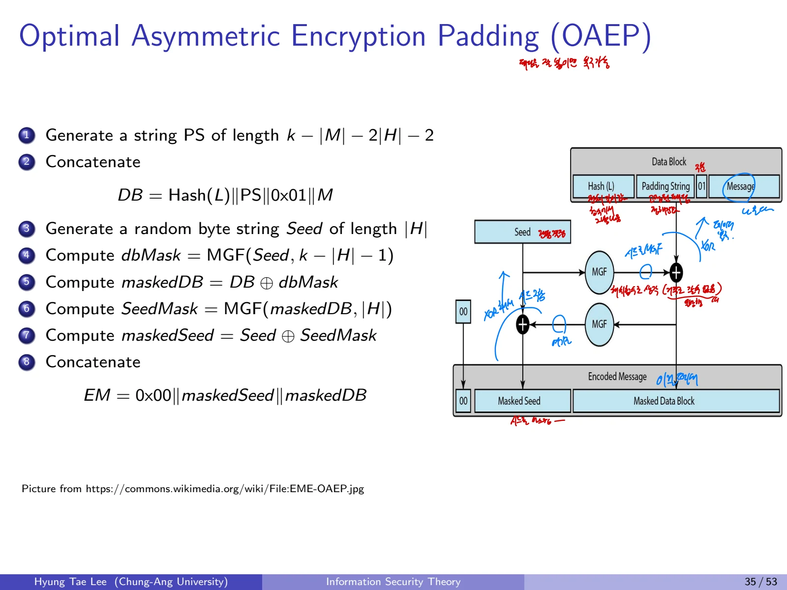

RSA는 큰 정수의 거듭제곱과 모듈러 연산을 바탕으로 평문을 암호화한다. 키를 만드는 데는 소수 판정과 확장 유클리드 알고리즘이 필요하고, 안전하게 사용하려면 OAEP 같은 인코딩도 필요하다.


## 1. 정수론의 기본 연산

### 1.1 Modular Exponentiation
RSA 암복호화에는 $g^a\bmod p$를 효율적으로 계산해야 한다. $a-1$번의 순차 곱셈은 비효율적이며, **지수의 이진 전개**를 이용하면 $O(\log a)$개의 제곱과 곱셈으로 계산할 수 있다.
기본 예시:

$$
5^4\bmod31=625\bmod31=5
$$

$$
3^9\bmod31=19683\bmod31=29.
$$

### 1.2 Left-to-Right 방식
지수 $a$의 최상위 비트에서 최하위 비트로 이동한다.
```text
R = 1
for bit in binary(a), from MSB to LSB:
    R = (R * R) mod p
    if bit == 1:
        R = (R * g) mod p
return R
```
현재 누적한 부분 지수를 두 배로 만들기 위해 제곱하고, 다음 비트가 1이면 밑 g를 곱한다.

### 1.3 Right-to-Left 방식
최하위 비트에서 최상위 비트로 이동한다.
```text
R = 1
T = g mod p
while a > 0:
    if a mod 2 == 1:
        R = (R * T) mod p
    T = (T * T) mod p
    a = floor(a / 2)
return R
```
현재 밑의 $2^i$제곱이 T에 저장된다. 두 알고리즘 모두 지수의 비트 수에 비례하는 곱셈을 수행한다. 두 방식은 **MSB부터 누적 제곱**하는 방식과 **LSB부터 밑을 제곱**하는 방식으로 나뉜다.

## 2. Euclidean과 Extended Euclidean Algorithm

### 2.1 최대공약수

$$
\gcd(a,b)=\gcd(b,a\bmod b).
$$

나머지가 0이 될 때까지 반복한다.
```text
r0 = a
r1 = b
while r1 != 0:
    r0, r1 = r1, r0 mod r1
return r0
```

### 2.2 Bézout Identity
정수 a,b와 $d=\gcd(a,b)$에 대해

$$
as+bt=d
$$

가 되는 정수 s,t가 존재한다. 정수 r에 대해 $as+bt=r$의 해가 존재할 필요충분조건은 $d\mid r$이다.
확장 유클리드 알고리즘은 나머지와 함께 이 계수들을 갱신한다.
```text
(old_r,r) = (a,b)
(old_s,s) = (1,0)
(old_t,t) = (0,1)
while r != 0:
    q = old_r // r
    (old_r,r) = (r,old_r-q*r)
    (old_s,s) = (s,old_s-q*s)
    (old_t,t) = (t,old_t-q*t)
return old_r,old_s,old_t
```
$ax+my=1$을 얻었다면

$$
x\equiv a^{-1}\pmod m.
$$

RSA는 공개 지수 e의 $\varphi(N)$**에 대한 역원 d**를 계산해야 하므로 확장 유클리드 알고리즘이 핵심이다.

## 3. Euler Phi Function

$$
\varphi(m)=\#\{a\in\mathbb Z_m:\gcd(a,m)=1\}.
$$

$$
m=\prod_{i=1}^n p_i^{e_i}
\ \Longrightarrow\
\varphi(m)=\prod_{i=1}^n(p_i^{e_i}-p_i^{e_i-1})
=m\prod_{p\mid m}\left(1-\frac1p\right).
$$

$p$가 소수라면 $\varphi(p)=p-1$이고, 서로 다른 소수 p,q에 대해

$$
\varphi(pq)=(p-1)(q-1).
$$

예시:

$$
\varphi(6)=2,\quad\varphi(5)=4,\quad
240=2^4\cdot3\cdot5,
$$

$$
\varphi(240)=(16-8)(3-1)(5-1)=64.
$$

## 4. Fermat's Little Theorem과 Euler's Theorem

### 4.1 Fermat
p가 소수일 때 모든 정수 a에 대해

$$
a^p\equiv a\pmod p.
$$

$\gcd(a,p)=1$이면

$$
a^{p-1}\equiv1\pmod p,
\quad a^{-1}\equiv a^{p-2}\pmod p.
$$

예시: $2^7=128\equiv2\pmod7$, $2^5=32\equiv4\pmod7$.

### 4.2 Euler
$\gcd(a,m)=1$이면

$$
a^{\varphi(m)}\equiv1\pmod m.
$$

예시: $a=5$, $m=12$, $\varphi(12)=4$이므로

$$
5^4=625\equiv1\pmod{12}.
$$

## 5. Chinese Remainder Theorem(CRT)

### 5.1 정리
서로소인 p,q에 대해

$$
x\equiv a\pmod p,\qquad x\equiv b\pmod q
$$

는 $\mathbb Z_{pq}$에서 정확히 하나의 해를 가진다.

$$
x=a\,q(q^{-1}\bmod p)+b\,p(p^{-1}\bmod q)\pmod{pq}.
$$

**유일성 증명:** 두 해 x,y가 두 법에 대해 일치하면 $p\mid(x-y)$와 $q\mid(x-y)$. p,q가 서로소이므로 $pq\mid(x-y)$다.

### 5.2 계산 예제

$$
x\equiv3\pmod7,\qquad x\equiv5\pmod{15}.
$$

$p=7,q=15$, $15^{-1}\equiv1\pmod7$, $7^{-1}\equiv13\pmod{15}$이므로

$$
x=3\cdot15\cdot1+5\cdot7\cdot13
=500\equiv80\pmod{105}.
$$

검산: $80\bmod7=3$, $80\bmod15=5$.

## 6. 소수 판정

### 6.1 Fermat Primality Test
$p$가 소수라면 임의의 $1\le a<p$에 대해 $a^p\equiv a\pmod p$이므로, 랜덤으로 선택한 여러 $a$에서

$$
a^{p-1}\not\equiv1\pmod p
$$

가 한 번이라도 나오면 후보 p는 합성수다.
```text
repeat lambda times:
    choose random a in {2,...,p-2}
    if pow(a,p-1,p) != 1:
        return composite
return probably_prime
```

**확률적 소수 판정을 통과했다고 해서 소수임이 확정되는 것은 아니다.** 통과한 수는 probable prime으로 해석한다.

### 6.2 Carmichael Number 반례
합성수 $C$인데도 모든 $\gcd(a,C)=1$인 a에 대해

$$
a^{C-1}\equiv1\pmod C
$$

를 만족하면 Carmichael Number라고 한다. 사례:

$$
561=3\cdot11\cdot17
$$

은 합성수지만 Fermat 판정의 여러 밑에서 소수로 오판될 수 있다.

### 6.3 Miller-Rabin의 아이디어
홀수 후보 n에 대해

$$
n-1=2^r s,\qquad s\ \text{odd}
$$

로 분해한다. 무작위 밑 $a\in[2,n-2]$를 고르고

$$
x=a^s\bmod n
$$

을 계산한다. $x=1$ 또는 $x=n-1$이면 이번 라운드를 통과한다. 그렇지 않으면 $r-1$회까지 제곱하면서 $n-1$이 등장하는지 확인한다.
```text
for iteration in 1..lambda:
    choose random a in [2,n-2]
    x = pow(a,s,n)
    if x == 1 or x == n-1:
        continue
    passed = false
    for j in 1..r-1:
        x = x*x mod n
        if x == n-1:
            passed = true
            break
        if x == 1:
            return composite
    if not passed:
        return composite
return probably_prime
```
합성수를 소수로 판단할 확률은 반복 횟수와 랜덤 밑의 선택으로 줄일 수 있다.

**561 예시:** $560=2^4\cdot35$이고, 밑 a=5일 때

$$
5^{35}\equiv23,\quad
5^{70}\equiv529,\quad
5^{140}\equiv463,\quad
5^{280}\equiv67\pmod{561}.
$$

처음에 1도 아니고, 이후 제곱에서도 -1(=560)이 등장하지 않아 합성수로 판정된다.

## 7. RSA 암호

### 7.1 역사와 기반 문제
Rivest, Shamir, Adleman이 1978년 발표한 공개키 암호. 소인수분해의 어려움과 관련된 구조로 설계된다. 단, **RSA의 모든 안전성 정의가 단순히 소인수분해의 어려움과 동치로 증명되는 것은 아니다.**

### 7.2 Key Generation

1. 큰 서로 다른 소수 p,q 선택

2. $N=pq$ 계산

3. $\varphi(N)=(p-1)(q-1)$ 계산

4. $\gcd(e,\varphi(N))=1$인 공개 지수 e 선택

5. $ed\equiv1\pmod{\varphi(N)}$인 d 계산

6. 공개키 $pk=(N,e)$와 비밀키 $sk=d$ 생성

실제 구현에는 CRT를 위한 p,q 등을 비밀키 자료에 함께 보관하기도 한다.

### 7.3 Enc, Dec

$$
C=M^e\bmod N,\qquad
M'=C^d\bmod N.
$$

### 7.4 Correctness
$ed\equiv1\pmod{\varphi(N)}$이므로, 페르마의 소정리를 p와 q에 각각 적용한 뒤 CRT로 결합하면 다음 합동식이 성립한다.

$$
M^{ed}\equiv M\pmod N.
$$

따라서 올바른 RSA 키쌍으로 복호화하면 원문 M을 얻는다. 여기에는 메시지가 반드시 $\mathbb Z_N^*$에 있어야 한다는 제약을 일반적으로 요구하지 않는다. p,q 각각에 대한 Fermat 정리와 CRT로 전체 $\mathbb Z_N$에 대해 정합성을 보여줄 수 있다.

### 7.5 Toy RSA 전체 계산

$$
p=13,\quad q=17,\quad N=221.
$$

$$
\varphi(N)=12\cdot16=192,\quad e=5,\quad d=77.
$$

$$
5\cdot77=385\equiv1\pmod{192}.
$$

평문 $M=3$일 때

$$
C=3^5\bmod221=243\bmod221=22.
$$

복호화:

$$
M'=22^{77}\bmod221=3.
$$

$22^7\equiv61\pmod{221}$을 이용해 $(22^7)^{11}$을 계산할 수도 있다.

## 8. RSA의 속도 향상

### 8.1 빠른 공개 지수 e
이진수에서 1의 개수가 적은 작은 e를 쓰면 modular exponentiation의 곱셈 수가 감소한다. 예를 들어

$$
e\in\{3,\ 17,\ 2^{16}+1=65537\}
$$

인 경우 덧셈사슬로 거듭제곱을 계산하면 제곱을 포함해 각각 2, 5, 17회의 모듈러 곱셈이 필요하다. 낮은 공개 지수 자체만으로 안전성을 판단할 수는 없지만, 잘못된 패딩과 결합하면 공격에 취약해질 수 있다.

### 8.2 비밀 지수 d를 너무 작게 두지 않기
작은 비밀 지수 d는 공격의 대상이 될 수 있다. Boneh–Durfee 공격의 대표적인 경계는 $d<N^{0.292}$다. 따라서 e의 계산 편의성을 d를 임의로 짧게 만드는 식으로 얻으면 안 된다.

### 8.3 CRT 기반 복호화

$$
d_p=d\bmod(p-1),\qquad d_q=d\bmod(q-1)
$$

$$
m_p=C^{d_p}\bmod p,\qquad m_q=C^{d_q}\bmod q.
$$

이후 CRT로 $m_p,m_q$를 결합한다.

**같은 예제:** $N=221,p=13,q=17,d=77,C=22$.

$$
d_p=77\bmod12=5,\quad d_q=77\bmod16=13.
$$

$$
m_p=22^5\bmod13=3,\qquad m_q=22^{13}\bmod17=3.
$$

$17^{-1}\equiv10\pmod{13}$, $13^{-1}\equiv4\pmod{17}$이므로

$$
M=3\cdot17\cdot10+3\cdot13\cdot4
=666\equiv3\pmod{221}.
$$

이 계산에서 inverse의 법을 바꾸어 쓰지 않도록 유의한다.

## 9. RSA의 안전성과 textbook RSA의 문제점

### 9.1 소인수분해
공개키의 모듈러스 $N=pq$에서 p,q를 구하기 어렵다는 점이 비밀키 d 복원 난이도와 연결된다. 역사적 factoring challenge 결과에는 RSA-100(1991), RSA-576(2003), RSA-640(2005), RSA-768(2009), RSA-704(2012)가 포함된다. 이는 **역사적 기록**이고 최신 최대 기록은 아니다.
고전적 공격에 대한 보안강도와 모듈러스 길이 비교: 80비트 강도에 1024, 112비트에 2048, 128비트에 3072, 192비트에 7680, 256비트에 15360비트.

### 9.2 결정성
textbook RSA는 동일 평문과 공개키에서 동일 암호문이 나온다. 공격자가 pk를 알고 직접 암호화를 할 수 있으므로 **IND-CPA에 안전하지 않다.**

### 9.3 곱셈 준동형성

$$
E(M_1)E(M_2)\equiv
M_1^e M_2^e\equiv(M_1M_2)^e=E(M_1M_2)\pmod N.
$$

이는 암호문을 곱해 평문 곱의 암호문을 구성할 수 있다는 뜻이므로, 변형 불가능성 및 선택 암호문 공격에 대한 안전성에도 문제가 생긴다. **무패딩 textbook RSA는 사용하지 않는다.**

## 10. OAEP(Optimal Asymmetric Encryption Padding)
OAEP는 RSA의 메시지 인코딩에 **난수 Seed와 Mask Generation Function(MGF)**를 이용하여 단순 결정성 및 구조적 약점을 완화한다. 표준화된 RSA-OAEP의 정확한 보안성은 사용하는 해시, MGF, 구현 조건에 의존한다.

### 10.1 인코딩 단계
$k$를 모듈러스 길이(바이트), $hLen$을 해시 출력 길이라 두고,

1. 메시지 길이에 맞는 0 바이트 패딩 PS 생성. 길이는 $k-|M|-2hLen-2$

2. $DB=Hash(L)\parallel PS\parallel0x01\parallel M$ 연결. L은 선택적 Label

3. $hLen$바이트 무작위 Seed 생성

4. $dbMask=MGF(Seed,k-hLen-1)$

5. $maskedDB=DB\oplus dbMask$

6. $seedMask=MGF(maskedDB,hLen)$

7. $maskedSeed=Seed\oplus seedMask$

8. $EM=0x00\parallel maskedSeed\parallel maskedDB$ 출력

### 10.2 구조와 목적
Masking을 Seed와 DB 양쪽에 적용해 입력 메시지와 인코딩 결과 간에 복잡한 관계를 만든다. **기존 RSA의 결정성과 단순 곱셈 준동형성을 그대로 노출하지 않도록 하는 패딩**이라는 점이 핵심이다.


