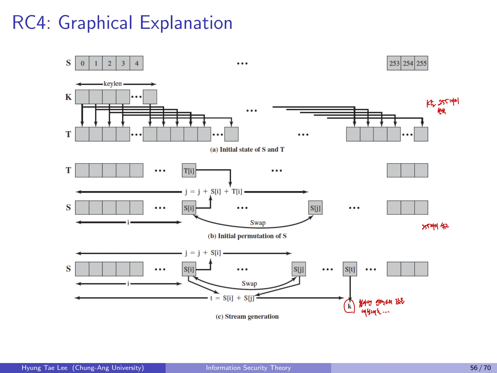

## 1. Stream Cipher
스트림암호는 비밀키에서 생성한 키스트림을 평문과 결합해 암호문을 만든다. 비트 또는 바이트 단위로 처리하며, LFSR 기반 암호와 RC4, ChaCha가 예에 해당한다.

키스트림 $Z_i$를 이용한 동기식 스트림암호는 다음과 같다.

$$
C_i=P_i\oplus Z_i,\qquad P_i=C_i\oplus Z_i.
$$

### Known-Plaintext Attack과 키스트림 재사용
공격자가 어떤 평문과 대응 암호문을 알면 해당 위치의 키스트림을 바로 복원한다.

$$
Z_i=P_i\oplus C_i.
$$

같은 키스트림을 두 메시지에 재사용했다면,

$$
C_1\oplus C_2=P_1\oplus P_2.
$$

이는 두 평문의 관계를 노출한다. 따라서 **같은 키스트림을 재사용해서는 안 된다**. 키와 nonce로 키스트림을 생성하는 방식이라면 같은 키에서 nonce를 중복 사용하지 않아야 한다.

## 2. 난수의 암호학적 요구사항

### 2.1 난수가 사용되는 위치

- 공개키 암호의 개인키 생성

- 스트림암호의 키, 시드

- 대칭키 통신에서 임시 세션키 생성

### 2.2 Randomness와 Unpredictability

- **Uniform distribution:** 각 출력값의 발생 빈도가 균일해야 한다.

- **Independence:** 한 출력이 다른 출력에 대한 통계적 정보를 주지 않아야 한다.

- **Unpredictability:** 이미 관찰한 출력만으로 미래 출력값을 계산하기 어려워야 한다.

통계적 랜덤성 검정을 통과했다는 사실만으로 암호학적 예측 불가능성을 보장하지는 않는다.

### 2.3 TRNG와 PRNG

| 항목 | TRNG | PRNG |
| --- | --- | --- |
| 원천 | 비결정적인 물리 현상 | 결정적인 알고리즘과 시드 |
| 예시 | 방사선, 기체 방전, 누설 커패시터 | 의사난수 수열 |
| 특징 | 구현이 비싸거나 물리 엔트로피 검증 필요 | 같은 시드에서 같은 수열 재생성 |
| 안전성 | 엔트로피 측정 필요 | 단순 통계적 성질 외에 예측 불가능성 확보 필요 |

프로세서의 하드웨어 난수 발생기도 난수원으로 쓰인다. 암호학적 PRNG(CSPRNG)는 안전하게 생성된 시드에서 의사난수를 생성한다.

## 3. LFSR Cipher 복습
선형 피드백 시프트 레지스터는 이전 상태 비트들의 선형 결합으로 다음 비트를 생성한다.

$$
k_j=\sum_{i=1}^{\ell}c_i k_{j-\ell+i-1}\pmod2.
$$

예시:

$$
x_{m+3}=x_{m+1}+x_m\pmod2.
$$

평문과 암호문의 쌍에서 키스트림을 구하고, 연속된 키스트림 비트로 계수 $c_i$에 대한 연립방정식을 만들 수 있다. 따라서 **LFSR을 그대로 사용한 스트림암호는 알려진 평문 공격에 취약**하다.

## 4. RC4 Overview

- Ron Rivest가 1987년 설계, 1994년 공개

- RC는 Rivest Cipher. RC2, RC5, RC6는 스트림암호가 아니라 블록암호

- 가변 길이 키 및 바이트 단위 연산

- 0부터 255까지의 값으로 이루어진 **순열 S**를 내부 상태로 이용

- 역사적 속도 비교: DES 21Mbps, 3DES 10Mbps, AES 61Mbps, RC4 113Mbps. 비교 당시 환경에서의 수치이므로 현대 장비의 성능 비교에 사용할 수 없음

## 5. RC4 KSA(Key Scheduling Algorithm)
상태배열 $S$와 키를 반복한 임시배열 $T$의 초기화는 다음과 같다.

$$
S[i]=i,\qquad T[i]=K[i\bmod \operatorname{keylen}],\qquad 0\le i<256.
$$

```text
for i = 0 to 255:
    S[i] = i
    T[i] = K[i mod keylen]

j = 0
for i = 0 to 255:
    j = (j + S[i] + T[i]) mod 256
    swap(S[i], S[j])
```
여기서 keylen은 키의 바이트 길이이다. T를 키스트림처럼 사용하지 않는다. T는 **S를 섞는 데 쓰이는 임시 배열**이며, KSA 종료 시 S는 256개 바이트의 순열로 남는다.

## 6. RC4 PRGA(Pseudo-Random Generation Algorithm)
순열 S에서 각 출력 바이트를 생성하는 과정이다.
```text
i = 0
j = 0
while true:
    i = (i + 1) mod 256
    j = (j + S[i]) mod 256
    swap(S[i], S[j])
    t = (S[i] + S[j]) mod 256
    z = S[t]
    output z
```
평문의 다음 바이트와 $z$를 XOR하여 암호화하고, 복호화도 같은 $z$를 XOR한다. S\[255\]에 도달한 뒤에도 인덱스를 순환하며 계속 진행된다. 한 바이트를 출력할 때마다 S의 순열 상태는 바뀐다.



## 7. RC4 보안 문제

- **2001년 WEP:** RC4를 사용하는 무선 암호 프로토콜에 대한 공격 보고

- **2015년 무렵 TLS:** RC4의 취약점에 대한 우려와 IETF, Mozilla, Microsoft 등의 사용 금지 권고

- RC4의 초기 키스트림 등 통계적 편향과 WEP/TLS 운용상 문제가 복합적으로 작용

RC4는 신규 서비스에서 사용하지 않는다.

## 8. 난수와 키스트림 비교

| 개념 | 입력/상태 | 특징 | 대표 위험 |
| --- | --- | --- | --- |
| LFSR | 연속된 상태 비트 | 선형 피드백으로 생성이 빠름 | 선형 관계 추론 가능 |
| RC4 KSA | 비밀키, S/T 배열 | 키에 맞춰 순열 S 준비 | 키 설정/초기 바이트 편향 |
| RC4 PRGA | 변하는 S, i, j | 바이트 키스트림 출력 | 키스트림 통계적 편향 |
| TRNG | 물리적 엔트로피 | 비결정적 | 엔트로피 품질 |
| PRNG | 시드와 내부 상태 | 결정적 | 상태 노출, 예측 가능성 |
